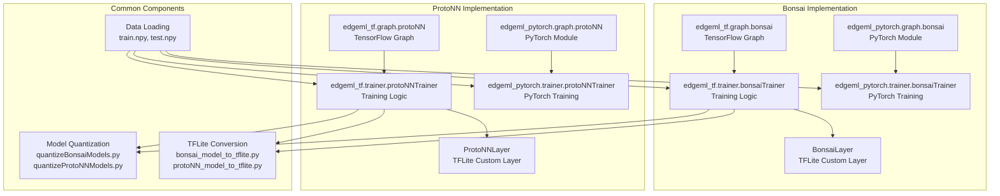
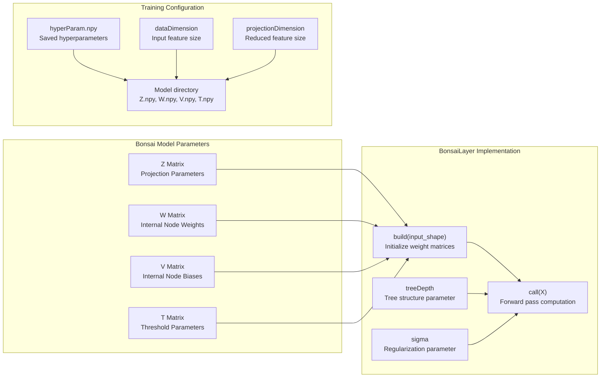
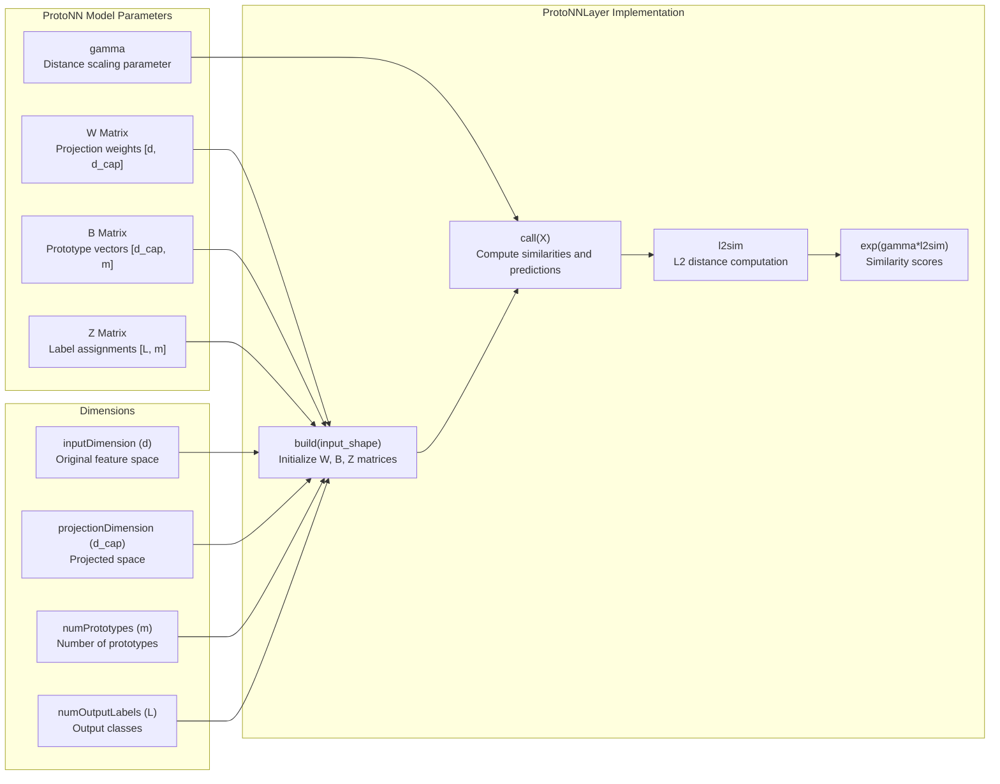
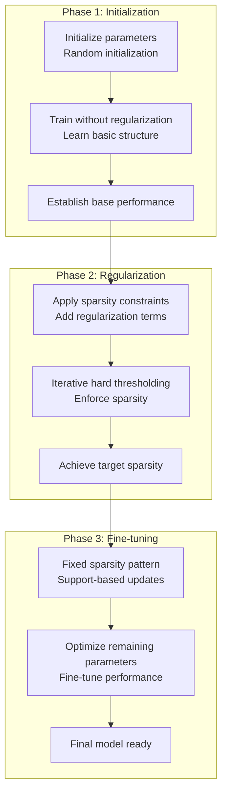
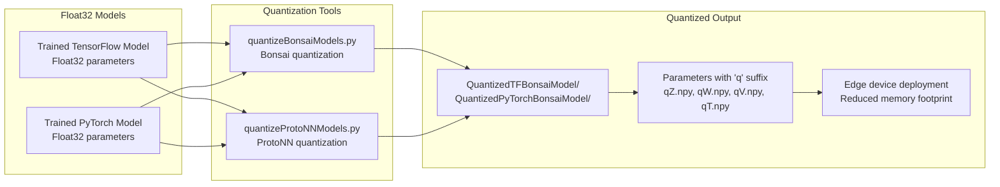

<!-- source: DeepWiki mcp.deepwiki.com · repo microsoft/EdgeML · page 2.3 Bonsai and ProtoNN · fetched 2026-10-26 -->

# Bonsai and ProtoNN

<details>
<summary>Relevant source files</summary>

The following files were used as context for generating this wiki page:

- [examples/pytorch/Bonsai/README.md](examples/pytorch/Bonsai/README.md)
- [examples/pytorch/FastCells/KWS-training/train_classifier.py](examples/pytorch/FastCells/KWS-training/train_classifier.py)
- [examples/pytorch/FastCells/KWS-training/training_config.py](examples/pytorch/FastCells/KWS-training/training_config.py)
- [examples/pytorch/FastCells/README.md](examples/pytorch/FastCells/README.md)
- [examples/pytorch/ProtoNN/README.md](examples/pytorch/ProtoNN/README.md)
- [examples/pytorch/SRNN/README.md](examples/pytorch/SRNN/README.md)
- [examples/tf/Bonsai/README.md](examples/tf/Bonsai/README.md)
- [examples/tf/Bonsai/bonsai_model_to_tflite.py](examples/tf/Bonsai/bonsai_model_to_tflite.py)
- [examples/tf/FastCells/README.md](examples/tf/FastCells/README.md)
- [examples/tf/ProtoNN/README.md](examples/tf/ProtoNN/README.md)
- [examples/tf/ProtoNN/protoNN_model_to_tflite.py](examples/tf/ProtoNN/protoNN_model_to_tflite.py)
- [tf/edgeml_tf/tflite/README.md](tf/edgeml_tf/tflite/README.md)
- [tf/edgeml_tf/tflite/__init__.py](tf/edgeml_tf/tflite/__init__.py)
- [tf/edgeml_tf/tflite/bonsaiLayer.py](tf/edgeml_tf/tflite/bonsaiLayer.py)
- [tf/edgeml_tf/tflite/protoNNLayer.py](tf/edgeml_tf/tflite/protoNNLayer.py)
- [tf/requirements-gpu.txt](tf/requirements-gpu.txt)

</details>


## Purpose and Scope

This document covers the Bonsai tree-based classifier and ProtoNN prototype-based k-NN algorithms implemented in EdgeML. Both algorithms are designed for resource-efficient machine learning on edge devices, providing compact models with competitive accuracy. 

For information about RNN-based algorithms like FastGRNN and FastRNN, see [FastCells - FastRNN and FastGRNN](#2.2). For anomaly detection algorithms, see [DROCC - Deep Robust One-Class Classification](#2.1).

## Algorithm Overview

### Bonsai Tree-Based Classifier

Bonsai is a novel tree-based algorithm that learns both the tree structure and prediction functions jointly. Unlike traditional decision trees, Bonsai uses:
- **Sparse oblique splits**: Each internal node performs linear combinations of features
- **Regularized training**: Three-phase training with sparsity constraints
- **Compact representation**: Significantly smaller than traditional ensemble methods

### ProtoNN Prototype-Based Learning

ProtoNN generalizes k-nearest neighbors by learning:
- **Prototype selection**: Automatically selects representative data points
- **Distance metric learning**: Learns optimal distance functions in projected space
- **Non-linear projections**: Projects data to lower-dimensional spaces for efficiency

Sources: [examples/tf/Bonsai/README.md:9-12](), [examples/tf/ProtoNN/README.md:9-13](), [examples/pytorch/Bonsai/README.md:9-13]()

## Implementation Architecture

### Framework Support Matrix

| Algorithm | TensorFlow | PyTorch | C++ | TFLite | Quantization |
|-----------|------------|---------|-----|--------|--------------|
| Bonsai   | ✓         | ✓       | ✓   | ✓      | ✓            |
| ProtoNN  | ✓         | ✓       | ✓   | ✓      | ✓            |

### Core Implementation Structure



Sources: [examples/tf/Bonsai/README.md:9-13](), [examples/tf/ProtoNN/README.md:9-14](), [examples/pytorch/Bonsai/README.md:9-14](), [examples/pytorch/ProtoNN/README.md:9-16]()

### Bonsai Core Components



Sources: [tf/edgeml_tf/tflite/bonsaiLayer.py:27-31](), [tf/edgeml_tf/tflite/bonsaiLayer.py:33-58](), [examples/tf/Bonsai/bonsai_model_to_tflite.py:49-59]()

### ProtoNN Core Components



Sources: [tf/edgeml_tf/tflite/protoNNLayer.py:17-25](), [tf/edgeml_tf/tflite/protoNNLayer.py:27-45](), [examples/tf/ProtoNN/protoNN_model_to_tflite.py:36-44]()

## Training Process

### Data Format Requirements

Both algorithms expect data in a standardized format:
- **Training data**: `train.npy` with shape `[numberOfExamples, numberOfFeatures + 1]`
- **Test data**: `test.npy` with same format
- **Label encoding**: First column contains integer labels (0 through N-1 for N classes)
- **Data preprocessing**: Data should be pre-shuffled as training doesn't shuffle internally

### Three-Phase Training Strategy



Sources: [examples/tf/Bonsai/README.md:10-12](), [examples/pytorch/Bonsai/README.md:10-13](), [examples/tf/ProtoNN/README.md:10-14]()

### Training Command Examples

**Bonsai Training (TensorFlow)**:
```bash
python bonsai_example.py -dir usps10/ -d 3 -p 28 -rW 0.001 -rZ 0.0001 -rV 0.001 -rT 0.001 -sZ 0.2 -sW 0.3 -sV 0.3 -sT 0.62 -e 100 -s 1
```

**ProtoNN Training (TensorFlow)**:
```bash
python protoNN_example.py --data-dir ./usps10 --projection-dim 60 --num-prototypes 80 --gamma 0.0015 --learning-rate 0.1 --epochs 200
```

Sources: [examples/tf/Bonsai/README.md:44](), [examples/tf/ProtoNN/README.md:49-57]()

## Deployment and Inference

### TensorFlow Lite Integration

Both algorithms support deployment via TensorFlow Lite for mobile and edge devices:

**Bonsai TFLite Conversion**:
```bash
python bonsai_model_to_tflite.py --data-dir ./usps10/ --model-dir ./usps10/TFBonsaiResults/model-dir-path/
```

**ProtoNN TFLite Conversion**:
```bash
python protoNN_model_to_tflite.py --data-dir ./usps10/ --output-dir ./model/
```

### Model Quantization Pipeline



Sources: [examples/tf/Bonsai/README.md:71-78](), [examples/pytorch/Bonsai/README.md:56-63](), [examples/tf/ProtoNN/README.md:63-71]()

### TFLite Layer Implementation Details

**BonsaiLayer Forward Pass**:
- Projects input through `Z` matrix: `X_ = ZX / projectionDimension`
- Computes node probabilities using tree structure
- Applies sigmoid and tanh activations with `sigma` parameter
- Aggregates predictions across all tree nodes

**ProtoNNLayer Forward Pass**:
- Projects input: `WX = matmul(X, W)`
- Computes L2 distances to prototypes: `||WX - B||²`
- Applies RBF kernel: `exp(-gamma² * distances)`
- Weighted prediction: `Z × similarities`

Sources: [tf/edgeml_tf/tflite/bonsaiLayer.py:33-74](), [tf/edgeml_tf/tflite/protoNNLayer.py:27-45]()

## Performance and Model Characteristics

### Expected Results

**Bonsai on USPS10**:
- Test Accuracy: ~94%
- Model Size: ~31.7 KB
- Non-zeros: ~4,156 parameters
- Training Epochs: ~66 (with early stopping)

**ProtoNN on USPS10**:
- Test Accuracy: ~92.5%
- Compact prototype representation
- Efficient distance computations

### Key Hyperparameters

**Bonsai Parameters**:
- `depth (-d)`: Tree depth (affects model capacity)
- `projectionDimension (-p)`: Dimensionality reduction
- Regularization: `-rW`, `-rZ`, `-rV`, `-rT` for different parameter groups
- Sparsity: `-sW`, `-sZ`, `-sV`, `-sT` target sparsity levels

**ProtoNN Parameters**:
- `projection-dim`: Reduced feature dimensionality
- `num-prototypes`: Number of representative points
- `gamma`: Distance scaling (affects similarity sharpness)
- `learning-rate`: Optimization step size

Sources: [examples/tf/Bonsai/README.md:46-51](), [examples/tf/ProtoNN/README.md:60](), [examples/pytorch/Bonsai/README.md:46-51]()

---

