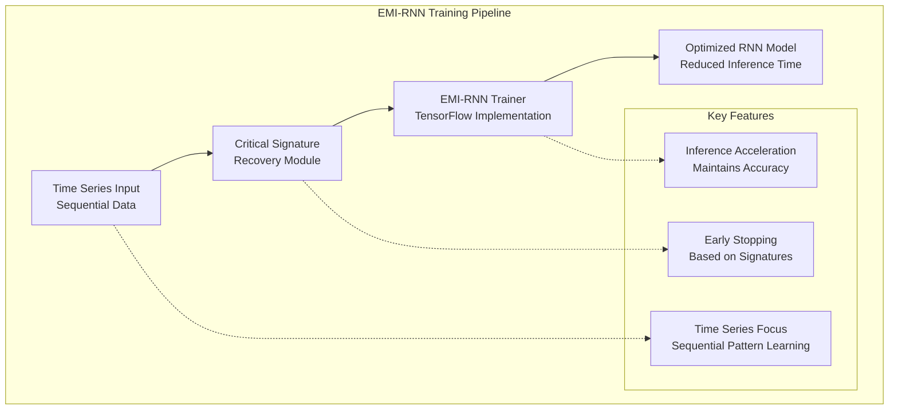
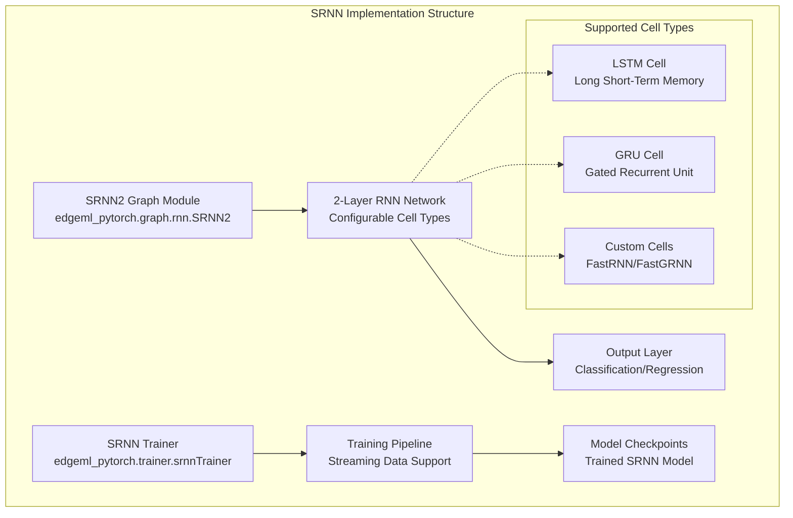
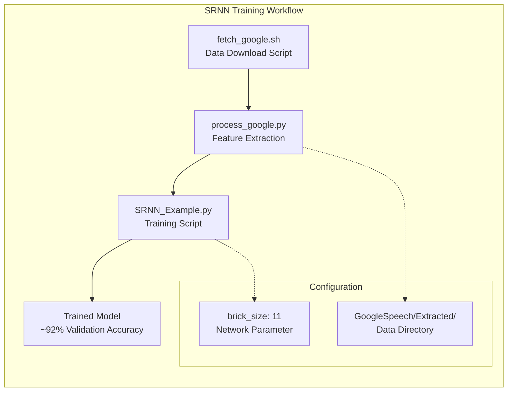
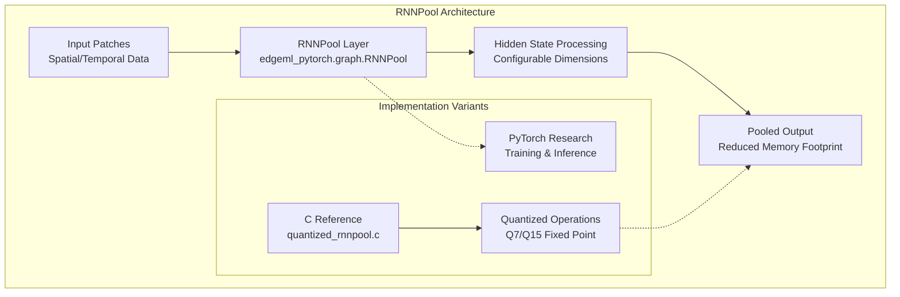
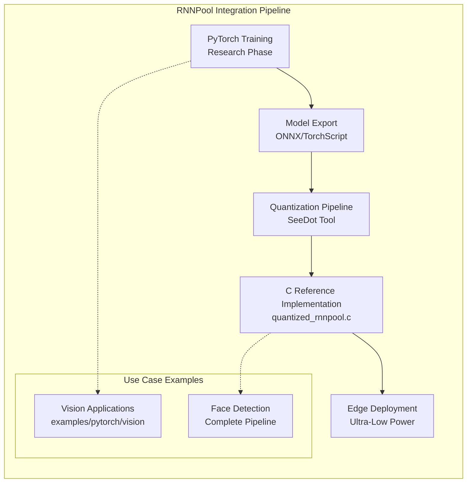

<!-- source: DeepWiki mcp.deepwiki.com · repo microsoft/EdgeML · page 2.4 Other Algorithms · fetched 2026-10-26 -->

# Other Algorithms

Relevant source files

The following files were used as context for generating this wiki page:

- [README.md](README.md)
- [examples/pytorch/Bonsai/README.md](examples/pytorch/Bonsai/README.md)
- [examples/pytorch/DROCC/README.md](examples/pytorch/DROCC/README.md)
- [examples/pytorch/DROCC/data_process_scripts/process_cifar.py](examples/pytorch/DROCC/data_process_scripts/process_cifar.py)
- [examples/pytorch/DROCC/data_process_scripts/process_mnist.py](examples/pytorch/DROCC/data_process_scripts/process_mnist.py)
- [examples/pytorch/DROCC/main_cifar.py](examples/pytorch/DROCC/main_cifar.py)
- [examples/pytorch/DROCC/main_drocclf_mnist.py](examples/pytorch/DROCC/main_drocclf_mnist.py)
- [examples/pytorch/DROCC/main_tabular.py](examples/pytorch/DROCC/main_tabular.py)
- [examples/pytorch/DROCC/main_timeseries.py](examples/pytorch/DROCC/main_timeseries.py)
- [examples/pytorch/FastCells/KWS-training/train_classifier.py](examples/pytorch/FastCells/KWS-training/train_classifier.py)
- [examples/pytorch/FastCells/KWS-training/training_config.py](examples/pytorch/FastCells/KWS-training/training_config.py)
- [examples/pytorch/FastCells/README.md](examples/pytorch/FastCells/README.md)
- [examples/pytorch/ProtoNN/README.md](examples/pytorch/ProtoNN/README.md)
- [examples/pytorch/SRNN/README.md](examples/pytorch/SRNN/README.md)
- [pytorch/README.md](pytorch/README.md)
- [pytorch/edgeml_pytorch/trainer/drocc_trainer.py](pytorch/edgeml_pytorch/trainer/drocc_trainer.py)
- [pytorch/edgeml_pytorch/trainer/drocclf_trainer.py](pytorch/edgeml_pytorch/trainer/drocclf_trainer.py)
- [tf/README.md](tf/README.md)

This document covers three additional EdgeML algorithms that complement the core offerings: EMI-RNN for time series signature recovery, Shallow RNN (SRNN) for streaming data processing, and RNNPool for efficient non-linear pooling. For information about the primary EdgeML algorithms, see [DROCC](#2.1), [FastCells](#2.2), and [Bonsai and ProtoNN](#2.3).

## Overview

The "Other Algorithms" category encompasses specialized techniques that address specific machine learning challenges in resource-constrained environments:

- **EMI-RNN**: Enables faster and more accurate RNN predictions by recovering critical signatures from time series data
- **Shallow RNN (SRNN)**: Provides a meta-architecture for training RNNs on streaming data with rolling window approaches
- **RNNPool**: Offers efficient non-linear pooling operations designed for RAM-constrained inference scenarios

**Implementation Framework Coverage**

| Algorithm | TensorFlow | PyTorch | C++ | C Reference |
|-----------|------------|---------|-----|-------------|
| EMI-RNN   | ✓          | ✗       | ✗   | ✗           |
| SRNN      | ✗          | ✓       | ✗   | ✗           |
| RNNPool   | ✗          | ✓       | ✗   | ✓           |

Sources: [README.md:14-21](), [tf/README.md:8](), [pytorch/README.md:28-38]()

## EMI-RNN Architecture

EMI-RNN (Early Mitigated Insufficient RNN) focuses on recovering critical signatures from time series data to enable faster and more accurate predictions. The algorithm addresses the challenge of maintaining prediction quality while reducing computational requirements.

**EMI-RNN Framework Integration**

The EMI-RNN algorithm is exclusively implemented in the TensorFlow framework as part of the `edgeml_tf` package. The implementation provides training routines specifically designed for time series data processing.

Sources: [README.md:17](), [tf/README.md:8]()

## Shallow RNN (SRNN) Architecture

SRNN implements a meta-architecture for training RNNs that can be applied to streaming data scenarios. The implementation provides a 2-layer network structure with configurable RNN cell types.

**SRNN Training Example**

The Google Speech Commands Dataset example demonstrates SRNN usage for keyword spotting applications:

Sources: [examples/pytorch/SRNN/README.md:10-13](), [pytorch/README.md:28-30](), [examples/pytorch/SRNN/README.md:35-39]()

## RNNPool Implementation

RNNPool provides an efficient non-linear pooling operator specifically designed for RAM-constrained inference scenarios. The implementation spans both PyTorch research code and quantized C reference implementations.

**RNNPool Integration Points**

**Key RNNPool Features**

- **Memory Efficiency**: Designed specifically for RAM-constrained environments
- **Non-linear Pooling**: Provides more sophisticated pooling than traditional max/average operations  
- **Quantization Support**: Full pipeline from floating-point training to fixed-point inference
- **Application Flexibility**: Used in vision tasks and other spatial data processing scenarios

Sources: [README.md:21](), [pytorch/README.md:35-39](), [c_reference implementation files]()

## Training and Deployment Considerations

### Framework-Specific Implementation Strategies

Each algorithm targets specific deployment scenarios through its framework implementation:

**EMI-RNN (TensorFlow)**
- Optimized for time series analysis workflows
- Integrates with TensorFlow Lite export pipeline
- Suitable for mobile and embedded time series applications

**SRNN (PyTorch)**  
- Research-oriented implementation with flexible configuration
- Supports various RNN cell types including FastCells
- Enables experimentation with streaming data architectures

**RNNPool (PyTorch + C Reference)**
- Complete training-to-deployment pipeline
- Quantization support for ultra-low power inference
- Demonstrated in computer vision applications

### Performance Characteristics

| Algorithm | Primary Use Case | Memory Impact | Training Complexity | Inference Speed |
|-----------|------------------|---------------|-------------------|-----------------|
| EMI-RNN | Time Series | Moderate | Medium | Fast |
| SRNN | Streaming Data | Low | Low | Fast |
| RNNPool | Spatial Pooling | Very Low | Low | Very Fast |

Sources: [README.md:14-28](), [examples/pytorch/SRNN/README.md:38](), [pytorch/README.md:35-38]()

---

