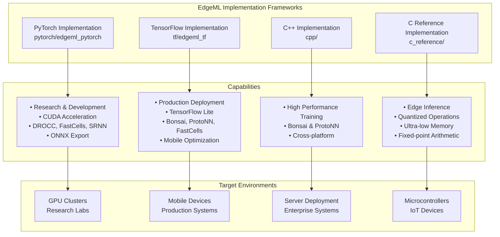
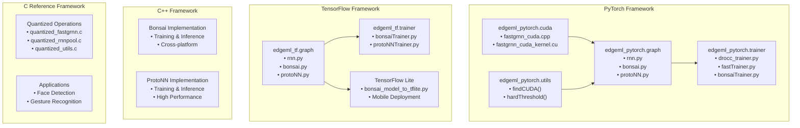
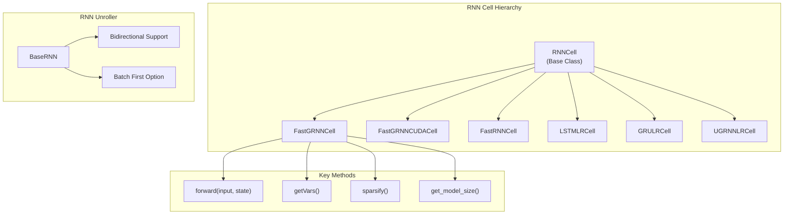
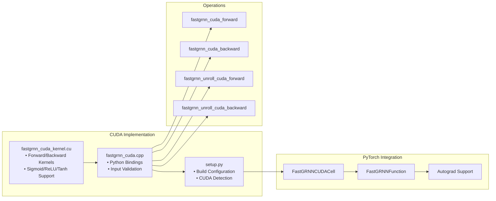
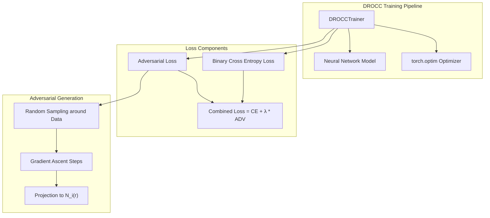
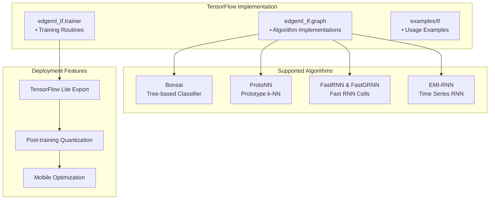
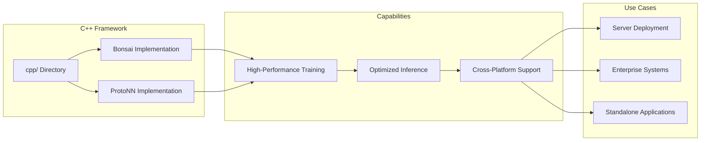
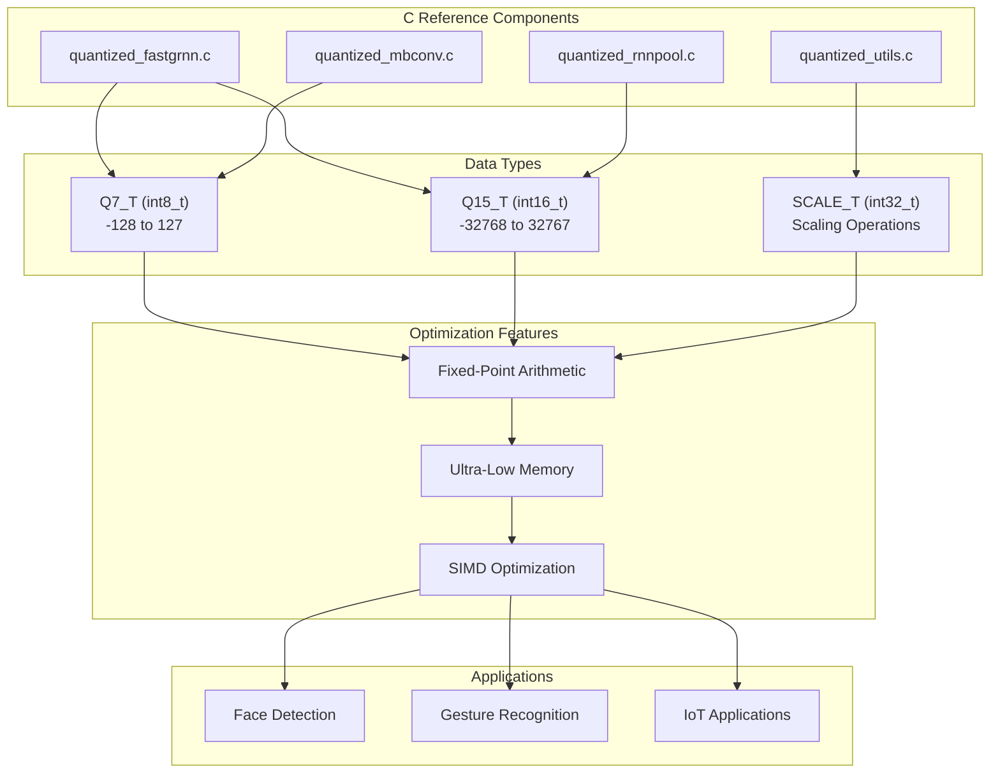
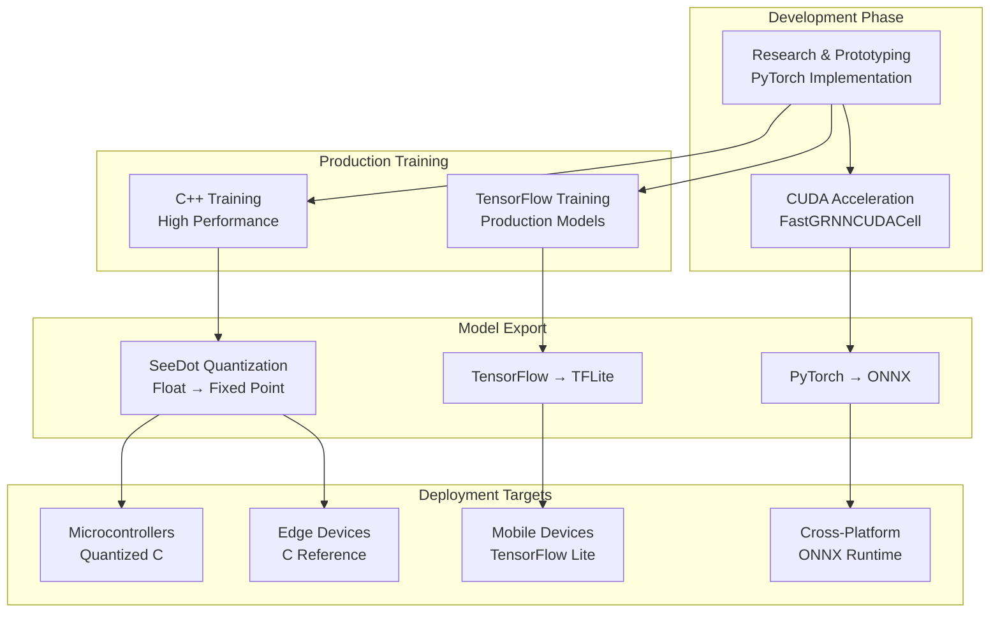

<!-- source: DeepWiki mcp.deepwiki.com · repo microsoft/EdgeML · page 3 Implementation Frameworks · fetched 2026-10-26 -->

# Implementation Frameworks

Relevant source files

The following files were used as context for generating this wiki page:

- [README.md](README.md)
- [examples/pytorch/DROCC/README.md](examples/pytorch/DROCC/README.md)
- [examples/pytorch/DROCC/data_process_scripts/process_cifar.py](examples/pytorch/DROCC/data_process_scripts/process_cifar.py)
- [examples/pytorch/DROCC/data_process_scripts/process_mnist.py](examples/pytorch/DROCC/data_process_scripts/process_mnist.py)
- [examples/pytorch/DROCC/main_cifar.py](examples/pytorch/DROCC/main_cifar.py)
- [examples/pytorch/DROCC/main_drocclf_mnist.py](examples/pytorch/DROCC/main_drocclf_mnist.py)
- [examples/pytorch/DROCC/main_tabular.py](examples/pytorch/DROCC/main_tabular.py)
- [examples/pytorch/DROCC/main_timeseries.py](examples/pytorch/DROCC/main_timeseries.py)
- [examples/pytorch/FastCells/fastcell_example.py](examples/pytorch/FastCells/fastcell_example.py)
- [examples/pytorch/FastCells/helpermethods.py](examples/pytorch/FastCells/helpermethods.py)
- [pytorch/README.md](pytorch/README.md)
- [pytorch/edgeml_pytorch/cuda/fastgrnn_cuda.cpp](pytorch/edgeml_pytorch/cuda/fastgrnn_cuda.cpp)
- [pytorch/edgeml_pytorch/cuda/fastgrnn_cuda_kernel.cu](pytorch/edgeml_pytorch/cuda/fastgrnn_cuda_kernel.cu)
- [pytorch/edgeml_pytorch/cuda/setup.py](pytorch/edgeml_pytorch/cuda/setup.py)
- [pytorch/edgeml_pytorch/graph/rnn.py](pytorch/edgeml_pytorch/graph/rnn.py)
- [pytorch/edgeml_pytorch/trainer/drocc_trainer.py](pytorch/edgeml_pytorch/trainer/drocc_trainer.py)
- [pytorch/edgeml_pytorch/trainer/drocclf_trainer.py](pytorch/edgeml_pytorch/trainer/drocclf_trainer.py)
- [pytorch/edgeml_pytorch/utils.py](pytorch/edgeml_pytorch/utils.py)
- [pytorch/setup.py](pytorch/setup.py)
- [tf/README.md](tf/README.md)

This document provides an overview of the different implementation frameworks available in EdgeML and their capabilities. EdgeML offers multiple implementation options to support different development environments, deployment targets, and performance requirements.

For detailed information about specific algorithms, see [Core Algorithms](#2). For deployment and optimization techniques, see [Deployment and Optimization](#5).

## Framework Overview

EdgeML provides four distinct implementation frameworks, each optimized for different use cases:

**Sources:** [README.md:36-45](), [pytorch/README.md:1-42](), [tf/README.md:1-17]()

## Algorithm Support Matrix

The following table shows which algorithms are supported by each framework:

| Algorithm | PyTorch | TensorFlow | C++ | C Reference |
|-----------|---------|------------|-----|-------------|
| **DROCC** | ✓ | ✗ | ✗ | ✗ |
| **FastRNN/FastGRNN** | ✓ | ✓ | ✗ | ✓ |
| **Bonsai** | ✓ | ✓ | ✓ | ✗ |
| **ProtoNN** | ✓ | ✓ | ✓ | ✗ |
| **EMI-RNN** | ✗ | ✓ | ✗ | ✗ |
| **SRNN** | ✓ | ✗ | ✗ | ✗ |
| **RNNPool** | ✓ | ✗ | ✗ | ✓ |
| **CUDA Acceleration** | ✓ | ✗ | ✗ | ✗ |
| **Quantization** | ✗ | ✓ | ✗ | ✓ |
| **Mobile Export** | ONNX | TFLite | ✗ | ✓ |

**Sources:** [pytorch/README.md:8-39](), [tf/README.md:5-11]()

## Core Components Architecture

**Sources:** [pytorch/edgeml_pytorch/graph/rnn.py:1-50](), [pytorch/edgeml_pytorch/trainer/drocc_trainer.py:1-30](), [pytorch/edgeml_pytorch/cuda/fastgrnn_cuda.cpp:1-20]()

## PyTorch Implementation Details

The PyTorch implementation serves as the primary research and development framework, offering the most comprehensive algorithm support and advanced features.

### Core RNN Architecture

**Sources:** [pytorch/edgeml_pytorch/graph/rnn.py:76-198](), [pytorch/edgeml_pytorch/graph/rnn.py:199-318](), [pytorch/edgeml_pytorch/graph/rnn.py:966-1020]()

### CUDA Acceleration Components

The PyTorch implementation includes optimized CUDA kernels for FastGRNN operations:

**Sources:** [pytorch/edgeml_pytorch/cuda/fastgrnn_cuda_kernel.cu:1-50](), [pytorch/edgeml_pytorch/cuda/fastgrnn_cuda.cpp:1-50](), [pytorch/edgeml_pytorch/cuda/setup.py:1-19]()

### DROCC Training Framework

The PyTorch implementation provides the only available implementation of the DROCC algorithm:

**Sources:** [pytorch/edgeml_pytorch/trainer/drocc_trainer.py:10-35](), [pytorch/edgeml_pytorch/trainer/drocc_trainer.py:158-214]()

## TensorFlow Implementation Details

The TensorFlow implementation focuses on production deployment and mobile optimization, with built-in support for TensorFlow Lite conversion.

### Framework Structure

**Sources:** [tf/README.md:5-14](), [tf/README.md:17-48]()

## C++ Implementation Details

The C++ implementation provides high-performance training and inference for Bonsai and ProtoNN algorithms, designed for server deployment and enterprise systems.

**Sources:** [README.md:41]()

## C Reference Implementation Details

The C reference implementation provides quantized inference optimized for edge devices and microcontrollers with severe memory constraints.

### Quantization Architecture

**Sources:** [README.md:44]()

## Training to Deployment Pipeline

**Sources:** [README.md:29-44](), [pytorch/README.md:41-78](), [tf/README.md:17-48]()

## Framework Selection Guidelines

| Use Case | Recommended Framework | Key Benefits |
|----------|----------------------|--------------|
| **Research & Development** | PyTorch | Complete algorithm support, CUDA acceleration, flexible experimentation |
| **Mobile Applications** | TensorFlow | TensorFlow Lite integration, mobile optimization |
| **High-Performance Training** | C++ | Optimized performance, enterprise deployment |
| **Edge/IoT Deployment** | C Reference | Quantized operations, minimal memory footprint |
| **Cross-Platform Inference** | PyTorch → ONNX | Wide runtime support, standardized format |
| **Microcontroller Deployment** | C Reference | Fixed-point arithmetic, ultra-low power |

**Sources:** [README.md:36-45](), [pytorch/README.md:44-78](), [tf/README.md:17-33]()

---

