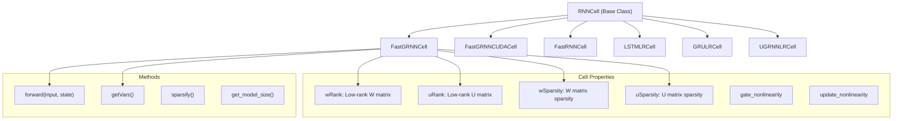
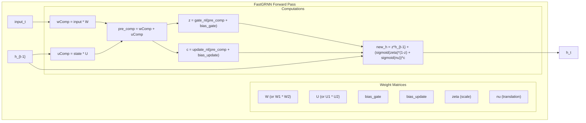
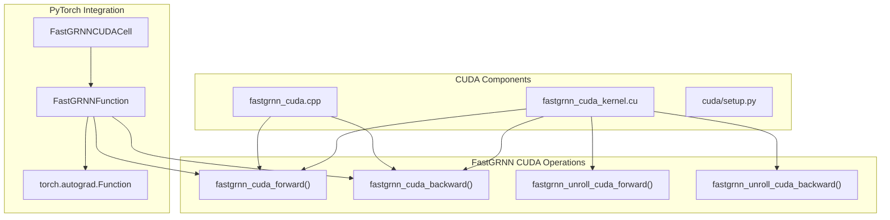
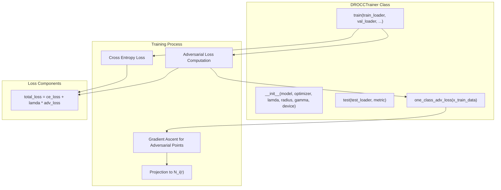
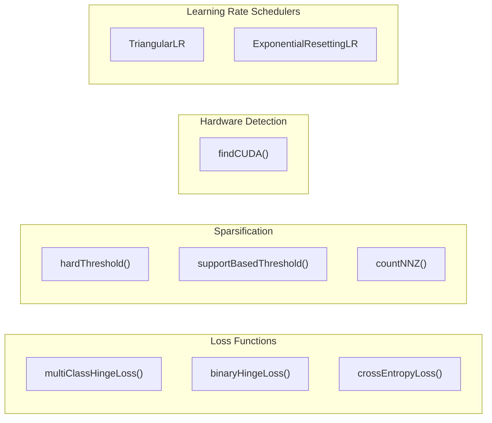
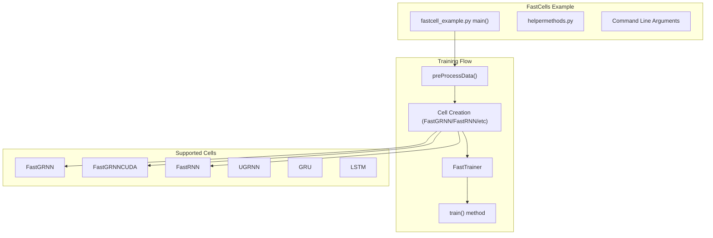
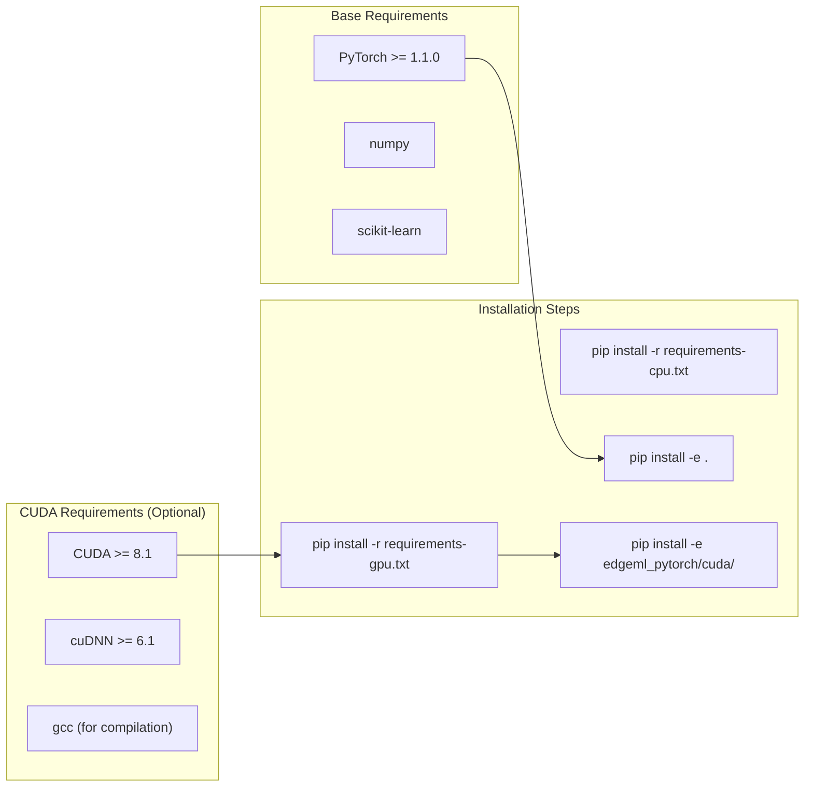

<!-- source: DeepWiki mcp.deepwiki.com · repo microsoft/EdgeML · page 3.1 PyTorch Implementation · fetched 2026-10-26 -->

# PyTorch Implementation

Relevant source files

The following files were used as context for generating this wiki page:

- [README.md](README.md)
- [examples/pytorch/DROCC/README.md](examples/pytorch/DROCC/README.md)
- [examples/pytorch/DROCC/data_process_scripts/process_cifar.py](examples/pytorch/DROCC/data_process_scripts/process_cifar.py)
- [examples/pytorch/DROCC/data_process_scripts/process_mnist.py](examples/pytorch/DROCC/data_process_scripts/process_mnist.py)
- [examples/pytorch/DROCC/main_cifar.py](examples/pytorch/DROCC/main_cifar.py)
- [examples/pytorch/DROCC/main_drocclf_mnist.py](examples/pytorch/DROCC/main_drocclf_mnist.py)
- [examples/pytorch/DROCC/main_tabular.py](examples/pytorch/DROCC/main_tabular.py)
- [examples/pytorch/DROCC/main_timeseries.py](examples/pytorch/DROCC/main_timeseries.py)
- [examples/pytorch/FastCells/fastcell_example.py](examples/pytorch/FastCells/fastcell_example.py)
- [examples/pytorch/FastCells/helpermethods.py](examples/pytorch/FastCells/helpermethods.py)
- [pytorch/README.md](pytorch/README.md)
- [pytorch/edgeml_pytorch/cuda/fastgrnn_cuda.cpp](pytorch/edgeml_pytorch/cuda/fastgrnn_cuda.cpp)
- [pytorch/edgeml_pytorch/cuda/fastgrnn_cuda_kernel.cu](pytorch/edgeml_pytorch/cuda/fastgrnn_cuda_kernel.cu)
- [pytorch/edgeml_pytorch/cuda/setup.py](pytorch/edgeml_pytorch/cuda/setup.py)
- [pytorch/edgeml_pytorch/graph/rnn.py](pytorch/edgeml_pytorch/graph/rnn.py)
- [pytorch/edgeml_pytorch/trainer/drocc_trainer.py](pytorch/edgeml_pytorch/trainer/drocc_trainer.py)
- [pytorch/edgeml_pytorch/trainer/drocclf_trainer.py](pytorch/edgeml_pytorch/trainer/drocclf_trainer.py)
- [pytorch/edgeml_pytorch/utils.py](pytorch/edgeml_pytorch/utils.py)
- [pytorch/setup.py](pytorch/setup.py)
- [tf/README.md](tf/README.md)

This document covers the PyTorch implementation of EdgeML algorithms, including graph modules, trainers, CUDA acceleration, and utility functions. The PyTorch implementation provides the most comprehensive algorithm coverage in EdgeML, supporting FastCells, DROCC, Bonsai, ProtoNN, and other algorithms with both CPU and GPU acceleration capabilities.

For TensorFlow implementations, see [TensorFlow Implementation](#3.2). For deployment and quantization, see [C Reference Implementation](#3.4).

## Architecture Overview

The PyTorch implementation follows a modular design separating algorithm definitions from training logic:

### System Architecture

```mermaid
graph TB
    subgraph "edgeml_pytorch Package"
        direction TB
        
        subgraph "Graph Modules"
            RNN["edgeml_pytorch.graph.rnn"]
            BONSAI["edgeml_pytorch.graph.bonsai"]
            PROTONN["edgeml_pytorch.graph.protoNN"]
            RNNPOOL["edgeml_pytorch.graph.RNNPool"]
        end
        
        subgraph "Trainers"
            FASTTRAINER["edgeml_pytorch.trainer.fastTrainer"]
            DROCCTRAINER["edgeml_pytorch.trainer.drocc_trainer"]
            BONSAITRAINER["edgeml_pytorch.trainer.bonsaiTrainer"]
            PROTOTRAINER["edgeml_pytorch.trainer.protoNNTrainer"]
        end
        
        subgraph "CUDA Acceleration"
            CUDAKERNEL["fastgrnn_cuda_kernel.cu"]
            CUDACPP["fastgrnn_cuda.cpp"]
            CUDAMOD["fastgrnn_cuda module"]
        end
        
        subgraph "Utilities"
            UTILS["edgeml_pytorch.utils"]
        end
    end
    
    subgraph "Examples"
        FASTEXAMPLE["examples/pytorch/FastCells/"]
        DROCCEXAMPLE["examples/pytorch/DROCC/"]
    end
    
    RNN --> FASTTRAINER
    RNN --> CUDAMOD
    BONSAI --> BONSAITRAINER
    PROTONN --> PROTOTRAINER
    
    CUDAKERNEL --> CUDAMOD
    CUDACPP --> CUDAMOD
    
    FASTEXAMPLE --> FASTTRAINER
    DROCCEXAMPLE --> DROCCTRAINER
    
    UTILS --> FASTTRAINER
    UTILS --> DROCCTRAINER
```

**Sources:** [pytorch/README.md:1-78](), [pytorch/setup.py:1-14](), [pytorch/edgeml_pytorch/utils.py:1-179]()

## Core RNN Cell Implementations

The `edgeml_pytorch.graph.rnn` module provides the foundation for fast RNN implementations:

### RNN Cell Hierarchy

**Sources:** [pytorch/edgeml_pytorch/graph/rnn.py:76-198](), [pytorch/edgeml_pytorch/graph/rnn.py:199-318]()

### FastGRNN Cell Architecture

The `FastGRNNCell` implements the core FastGRNN algorithm with low-rank parameterization:

**Sources:** [pytorch/edgeml_pytorch/graph/rnn.py:280-301](), [pytorch/edgeml_pytorch/graph/rnn.py:253-269]()

## CUDA Acceleration

The PyTorch implementation provides CUDA acceleration for FastGRNN through custom kernels:

### CUDA Implementation Structure

**Sources:** [pytorch/edgeml_pytorch/cuda/fastgrnn_cuda_kernel.cu:1-557](), [pytorch/edgeml_pytorch/cuda/fastgrnn_cuda.cpp:1-240](), [pytorch/edgeml_pytorch/cuda/setup.py:1-19]()

### CUDA Kernel Implementation

The CUDA kernels provide optimized forward and backward passes:

| Operation | Kernel Function | Purpose |
|-----------|----------------|---------|
| Forward Pass | `fastgrnn_cuda_forward_kernel` | Compute FastGRNN cell output |
| Backward Pass | `fastgrnn_cuda_backward_kernel` | Compute gradients for single timestep |
| Unroll Forward | `fastgrnn_unroll_cuda_forward` | Process entire sequences |
| Unroll Backward | `fastgrnn_unroll_cuda_backward` | Backprop through sequences |

**Sources:** [pytorch/edgeml_pytorch/cuda/fastgrnn_cuda_kernel.cu:42-60](), [pytorch/edgeml_pytorch/cuda/fastgrnn_cuda_kernel.cu:63-89]()

## DROCC Training Framework

The DROCC (Deep Robust One-Class Classification) implementation provides advanced anomaly detection capabilities:

### DROCC Trainer Architecture

**Sources:** [pytorch/edgeml_pytorch/trainer/drocc_trainer.py:11-221](), [pytorch/edgeml_pytorch/trainer/drocc_trainer.py:158-214]()

### DROCC Algorithm Flow

The DROCC training process implements the algorithm from the paper:

1. **Standard Training Phase**: Train with cross-entropy loss only
2. **Adversarial Training Phase**: Add adversarial loss for positive samples
3. **Adversarial Point Generation**: Use gradient ascent to find optimal adversarial points
4. **Projection**: Project points to the set N_i(r) between radius R and γR

**Sources:** [pytorch/edgeml_pytorch/trainer/drocc_trainer.py:36-118](), [pytorch/edgeml_pytorch/trainer/drocc_trainer.py:158-214]()

## Utility Functions and Tools

The `edgeml_pytorch.utils` module provides essential utilities:

### Key Utilities

**Sources:** [pytorch/edgeml_pytorch/utils.py:39-71](), [pytorch/edgeml_pytorch/utils.py:73-135](), [pytorch/edgeml_pytorch/utils.py:12-37]()

## Training Examples and Usage Patterns

The implementation includes comprehensive examples demonstrating usage patterns:

### FastCells Example Structure

**Sources:** [examples/pytorch/FastCells/fastcell_example.py:12-99](), [examples/pytorch/FastCells/helpermethods.py:80-153]()

### DROCC Usage Examples

The DROCC implementation supports multiple data types and scenarios:

| Example | File | Purpose |
|---------|------|---------|
| Tabular Data | `main_tabular.py` | Anomaly detection on structured data |
| Time Series | `main_timeseries.py` | Sequential anomaly detection |
| CIFAR-10 | `main_cifar.py` | Image-based one-class classification |
| MNIST DROCC-LF | `main_drocclf_mnist.py` | Limited negative data scenario |

**Sources:** [examples/pytorch/DROCC/main_tabular.py:1-185](), [examples/pytorch/DROCC/main_timeseries.py:1-186](), [examples/pytorch/DROCC/main_cifar.py:1-158]()

## Installation and Dependencies

The PyTorch implementation requires specific setup for full functionality:

### Installation Requirements

**Sources:** [pytorch/README.md:44-77](), [pytorch/edgeml_pytorch/cuda/setup.py:6-18]()

The PyTorch implementation provides the most comprehensive and actively developed EdgeML algorithms, with strong support for both research and production use cases through its modular architecture and CUDA acceleration capabilities.

---

