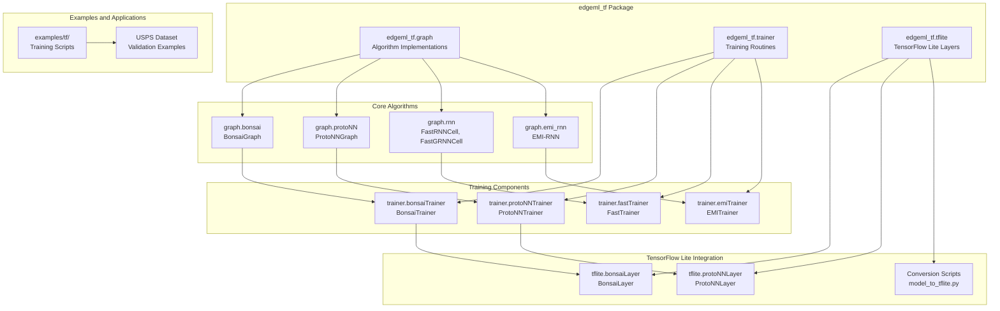
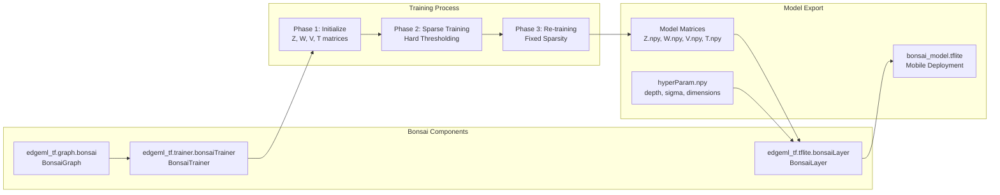
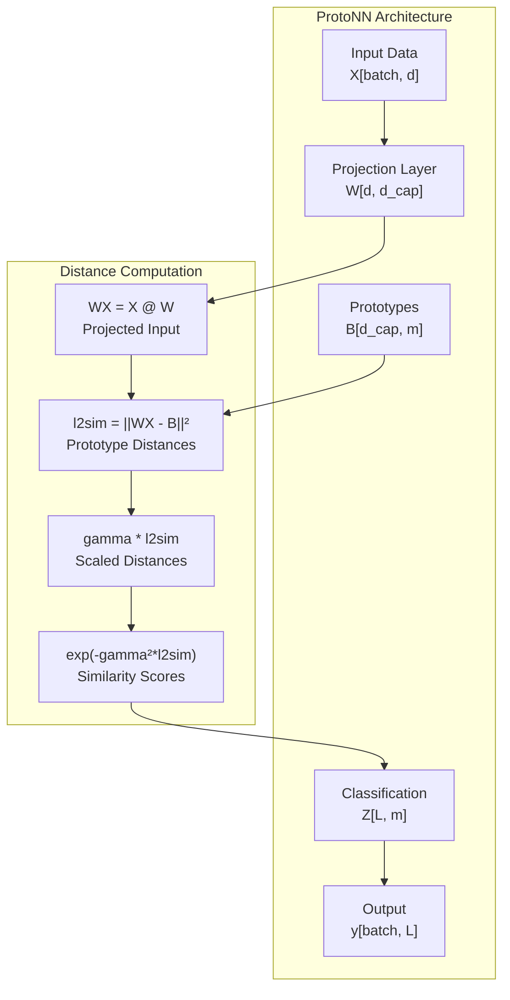
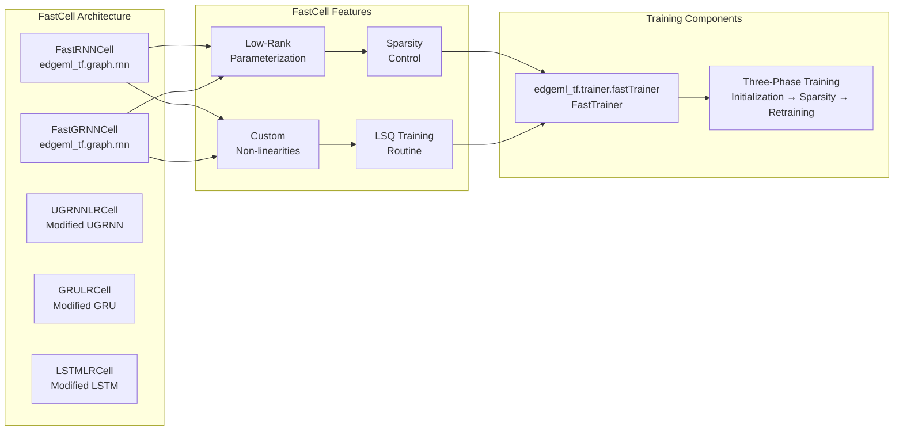
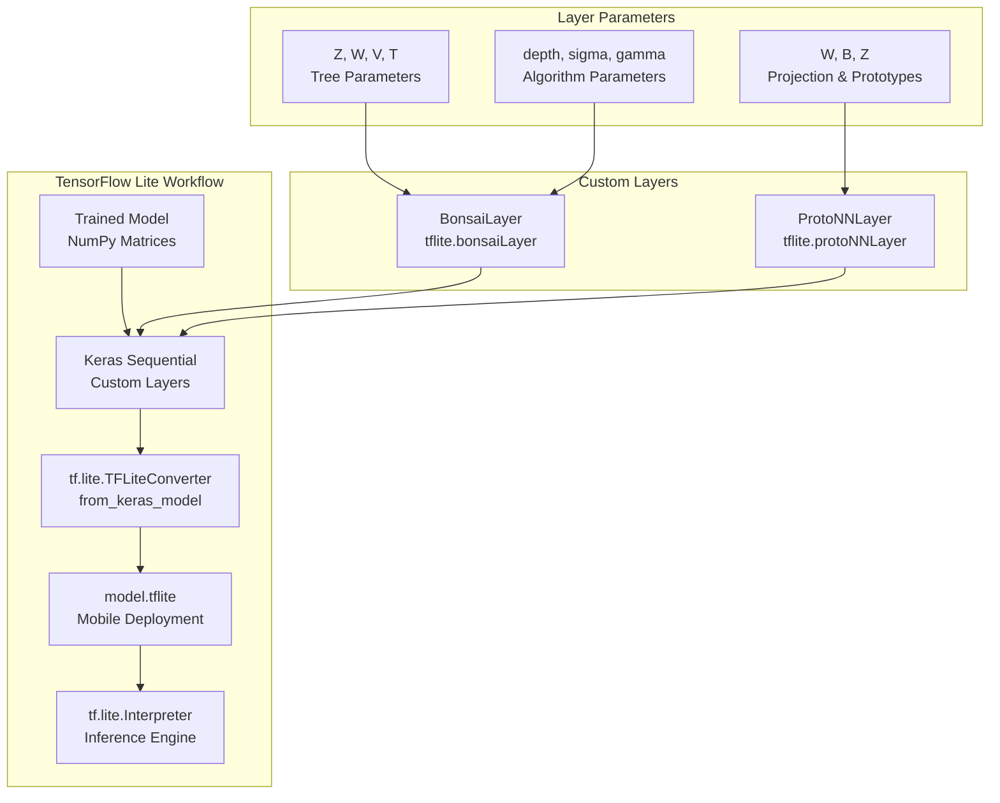
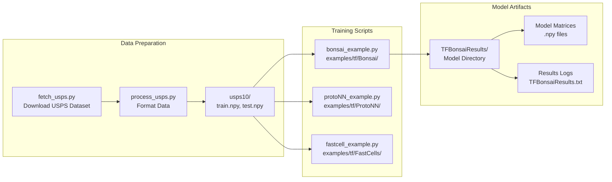
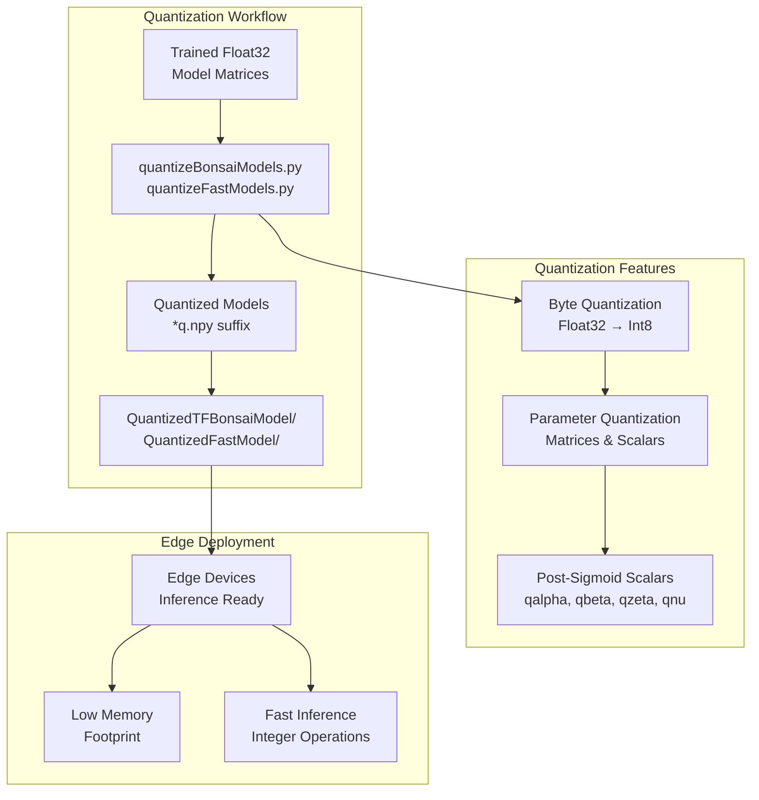

<!-- source: DeepWiki mcp.deepwiki.com · repo microsoft/EdgeML · page 3.2 TensorFlow Implementation · fetched 2026-10-26 -->

# TensorFlow Implementation

Relevant source files

The following files were used as context for generating this wiki page:

- [README.md](README.md)
- [examples/pytorch/DROCC/README.md](examples/pytorch/DROCC/README.md)
- [examples/pytorch/DROCC/data_process_scripts/process_cifar.py](examples/pytorch/DROCC/data_process_scripts/process_cifar.py)
- [examples/pytorch/DROCC/data_process_scripts/process_mnist.py](examples/pytorch/DROCC/data_process_scripts/process_mnist.py)
- [examples/pytorch/DROCC/main_cifar.py](examples/pytorch/DROCC/main_cifar.py)
- [examples/pytorch/DROCC/main_drocclf_mnist.py](examples/pytorch/DROCC/main_drocclf_mnist.py)
- [examples/pytorch/DROCC/main_tabular.py](examples/pytorch/DROCC/main_tabular.py)
- [examples/pytorch/DROCC/main_timeseries.py](examples/pytorch/DROCC/main_timeseries.py)
- [examples/tf/Bonsai/README.md](examples/tf/Bonsai/README.md)
- [examples/tf/Bonsai/bonsai_model_to_tflite.py](examples/tf/Bonsai/bonsai_model_to_tflite.py)
- [examples/tf/FastCells/README.md](examples/tf/FastCells/README.md)
- [examples/tf/ProtoNN/README.md](examples/tf/ProtoNN/README.md)
- [examples/tf/ProtoNN/protoNN_model_to_tflite.py](examples/tf/ProtoNN/protoNN_model_to_tflite.py)
- [pytorch/README.md](pytorch/README.md)
- [pytorch/edgeml_pytorch/trainer/drocc_trainer.py](pytorch/edgeml_pytorch/trainer/drocc_trainer.py)
- [pytorch/edgeml_pytorch/trainer/drocclf_trainer.py](pytorch/edgeml_pytorch/trainer/drocclf_trainer.py)
- [tf/README.md](tf/README.md)
- [tf/edgeml_tf/tflite/README.md](tf/edgeml_tf/tflite/README.md)
- [tf/edgeml_tf/tflite/__init__.py](tf/edgeml_tf/tflite/__init__.py)
- [tf/edgeml_tf/tflite/bonsaiLayer.py](tf/edgeml_tf/tflite/bonsaiLayer.py)
- [tf/edgeml_tf/tflite/protoNNLayer.py](tf/edgeml_tf/tflite/protoNNLayer.py)
- [tf/requirements-gpu.txt](tf/requirements-gpu.txt)

This document covers the TensorFlow implementation of EdgeML algorithms, including core algorithm implementations, training procedures, TensorFlow Lite integration, and model export capabilities. The TensorFlow implementation provides production-ready training and inference for resource-efficient machine learning models suitable for edge devices.

For PyTorch implementations of these algorithms, see [PyTorch Implementation](#3.1). For deployment and quantization details, see [Deployment and Optimization](#5).

## Architecture Overview

The TensorFlow implementation is organized around the `edgeml_tf` package, which provides graph definitions, trainers, and deployment utilities.

### TensorFlow Package Structure

**Sources:** [tf/README.md:12-14](), [tf/edgeml_tf/tflite/README.md:1-12]()

### Algorithm Implementation Matrix

The TensorFlow implementation supports a specific subset of EdgeML algorithms with full training and deployment capabilities.

| Algorithm | Graph Module | Trainer Module | TFLite Support | Quantization |
|-----------|-------------|----------------|----------------|--------------|
| Bonsai | `edgeml_tf.graph.bonsai` | `edgeml_tf.trainer.bonsaiTrainer` | ✓ `BonsaiLayer` | ✓ |
| ProtoNN | `edgeml_tf.graph.protoNN` | `edgeml_tf.trainer.protoNNTrainer` | ✓ `ProtoNNLayer` | ✓ |
| FastRNN | `edgeml_tf.graph.rnn.FastRNNCell` | `edgeml_tf.trainer.fastTrainer` | ✗ | ✓ |
| FastGRNN | `edgeml_tf.graph.rnn.FastGRNNCell` | `edgeml_tf.trainer.fastTrainer` | ✗ | ✓ |
| EMI-RNN | `edgeml_tf.graph.emi_rnn` | `edgeml_tf.trainer.emiTrainer` | ✗ | ✗ |

**Sources:** [tf/README.md:4-10](), [tf/edgeml_tf/tflite/README.md:3-5]()

## Core Algorithm Implementations

### Bonsai Implementation

The Bonsai implementation provides a tree-based non-linear classifier optimized for edge devices. The implementation follows a modular design separating graph construction from training.

The Bonsai graph maintains four key parameter matrices: `Z` (projection), `W` (classifier weights), `V` (classifier weights), and `T` (tree structure). The training follows a three-phase approach with sparsity regularization.

**Sources:** [examples/tf/Bonsai/README.md:9-12](), [examples/tf/Bonsai/bonsai_model_to_tflite.py:49-65]()

### ProtoNN Implementation

ProtoNN implements a prototype-based k-nearest neighbors classifier with learned projections and prototypes.

The ProtoNN algorithm computes similarities between projected inputs and learned prototypes using RBF kernels with learnable gamma parameter.

**Sources:** [tf/edgeml_tf/tflite/protoNNLayer.py:28-45](), [examples/tf/ProtoNN/README.md:9-13]()

### FastCells Implementation

The FastCells implementation provides FastRNN and FastGRNN cells with low-rank parameterization and custom non-linearities.

FastCells support plug-and-play usage in place of standard RNN cells like `RNNCell`, `GRUCell`, and `BasicLSTMCell`.

**Sources:** [examples/tf/FastCells/README.md:10-17](), [examples/tf/FastCells/README.md:19-21]()

## TensorFlow Lite Integration

The TensorFlow Lite integration enables deployment of trained EdgeML models on mobile and embedded devices through custom Keras layers.

### TFLite Layer Implementation

The conversion process loads trained model parameters and creates Keras models with custom layers that implement the EdgeML algorithms natively in TensorFlow Lite.

**Sources:** [tf/edgeml_tf/tflite/README.md:7-9](), [examples/tf/Bonsai/bonsai_model_to_tflite.py:67-89]()

### Model Conversion Process

The model conversion scripts demonstrate the complete pipeline from trained models to TensorFlow Lite format:

1. **Load Model Parameters**: Read trained matrices from `.npy` files
2. **Create Keras Model**: Build sequential model with custom layers
3. **Set Weights**: Load trained parameters into layer weights
4. **Convert to TFLite**: Use `TFLiteConverter.from_keras_model()`
5. **Inference Testing**: Validate converted model with sample predictions

**Sources:** [examples/tf/Bonsai/bonsai_model_to_tflite.py:82-110](), [examples/tf/ProtoNN/protoNN_model_to_tflite.py:70-98]()

## Training Infrastructure

### Data Format Requirements

The TensorFlow implementation expects data in a standardized NumPy format:

- **Training Data**: `train.npy` - 2D array `[numberOfExamples, numberOfFeatures + 1]`
- **Test Data**: `test.npy` - 2D array `[numberOfExamples, numberOfFeatures + 1]`
- **Label Format**: First column contains integer labels (0 through N-1 for N-class problems)
- **Data Shuffling**: Training data must be pre-shuffled

For time-series data (FastCells), features are flattened across timesteps: `timesteps × inputDims`.

**Sources:** [examples/tf/Bonsai/README.md:14-24](), [examples/tf/FastCells/README.md:23-30]()

### Training Examples

Each training script provides command-line interfaces with hyperparameter configuration and automatic model saving.

**Sources:** [examples/tf/Bonsai/README.md:40-54](), [examples/tf/ProtoNN/README.md:47-60](), [examples/tf/FastCells/README.md:47-66]()

## Quantization and Optimization

### Quantization Pipeline

The TensorFlow implementation supports byte quantization for model compression:

The quantization process converts floating-point parameters to byte-quantized integers suitable for edge device deployment with minimal accuracy loss.

**Sources:** [examples/tf/Bonsai/README.md:70-78](), [examples/tf/FastCells/README.md:69-80]()

### Performance Characteristics

The TensorFlow implementation achieves significant model compression:

- **Bonsai USPS10**: ~4156 non-zeros, 31.7 KB model size
- **FastCells USPS10**: ~1932 non-zeros, 7.5 KB model size
- **Quantization**: Further compression through integer arithmetic

These characteristics make the models suitable for deployment on resource-constrained edge devices while maintaining high accuracy.

**Sources:** [examples/tf/Bonsai/README.md:48-52](), [examples/tf/FastCells/README.md:59-63]()

---

