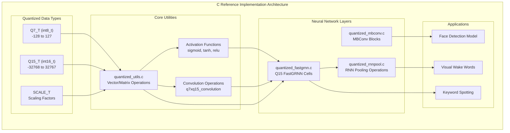
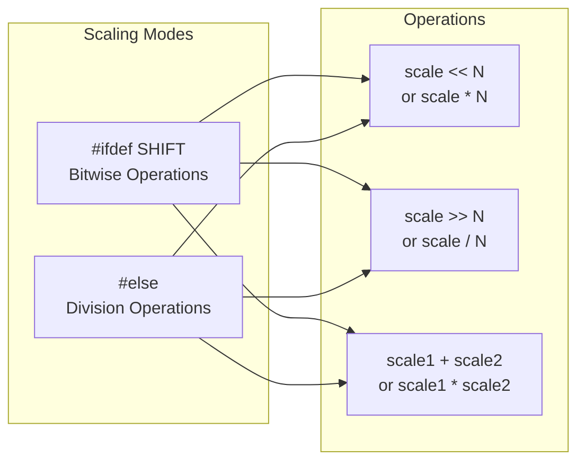
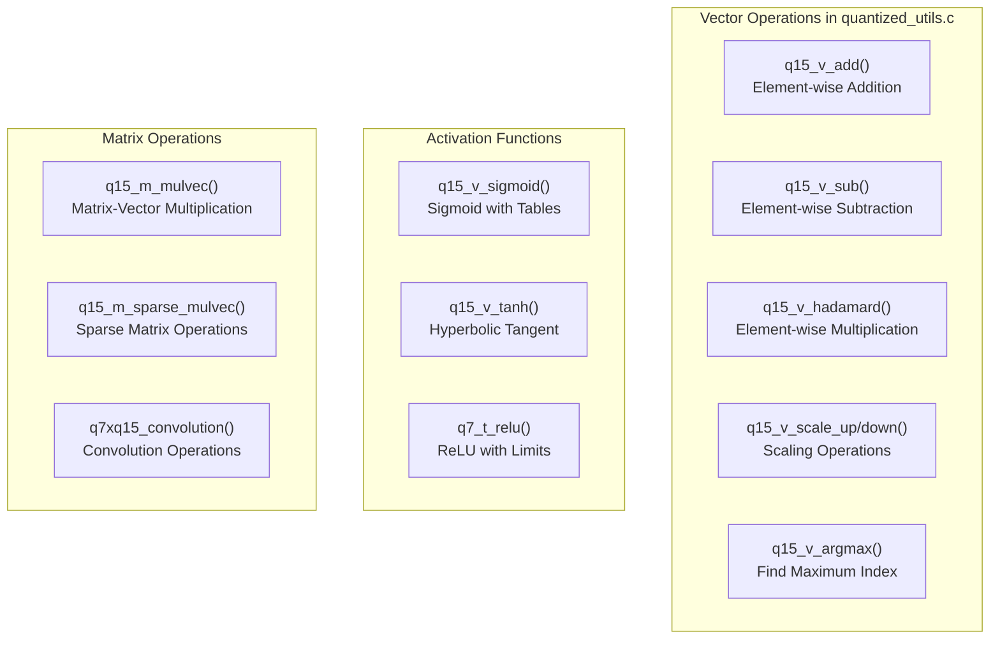
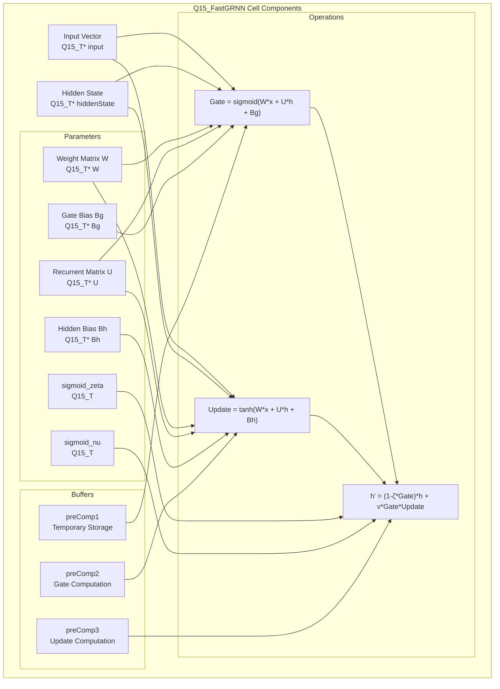
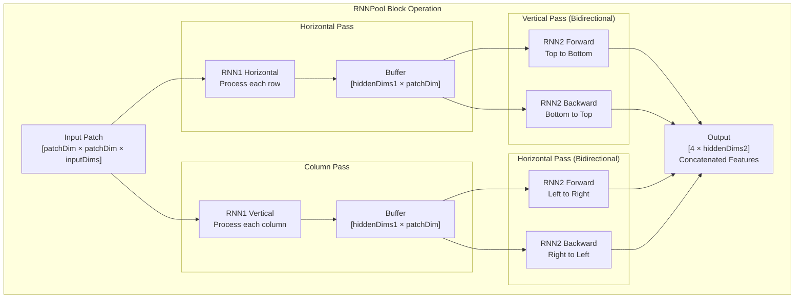
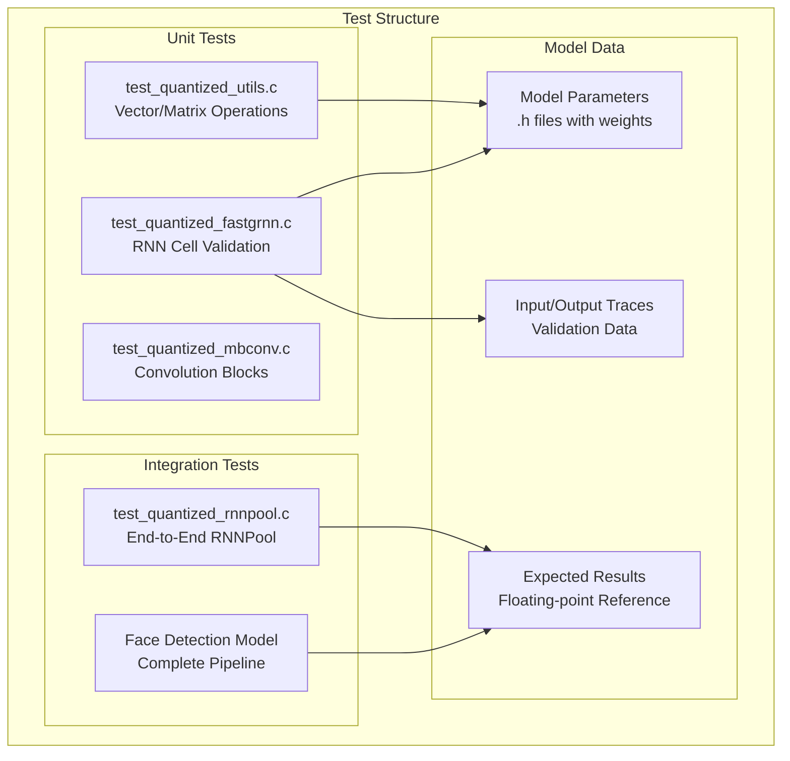
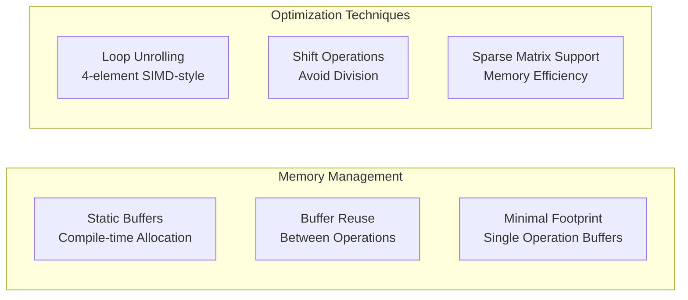

<!-- source: DeepWiki mcp.deepwiki.com · repo microsoft/EdgeML · page 3.4 C Reference Implementation · fetched 2026-10-26 -->

# C Reference Implementation

<details>
<summary>Relevant source files</summary>

The following files were used as context for generating this wiki page:

- [c_reference/Makefile](c_reference/Makefile)
- [c_reference/README.md](c_reference/README.md)
- [c_reference/config.mk](c_reference/config.mk)
- [c_reference/include/classifier.h](c_reference/include/classifier.h)
- [c_reference/include/fastgrnn.h](c_reference/include/fastgrnn.h)
- [c_reference/include/quantized_fastgrnn.h](c_reference/include/quantized_fastgrnn.h)
- [c_reference/include/quantized_mbconv.h](c_reference/include/quantized_mbconv.h)
- [c_reference/include/quantized_rnnpool.h](c_reference/include/quantized_rnnpool.h)
- [c_reference/include/quantized_utils.h](c_reference/include/quantized_utils.h)
- [c_reference/include/utils.h](c_reference/include/utils.h)
- [c_reference/src/classifier.c](c_reference/src/classifier.c)
- [c_reference/src/quantized_fastgrnn.c](c_reference/src/quantized_fastgrnn.c)
- [c_reference/src/quantized_mbconv.c](c_reference/src/quantized_mbconv.c)
- [c_reference/src/quantized_rnnpool.c](c_reference/src/quantized_rnnpool.c)
- [c_reference/src/quantized_utils.c](c_reference/src/quantized_utils.c)
- [c_reference/src/utils.c](c_reference/src/utils.c)
- [c_reference/tests/fastgrnn/test_fastgrnn_lr.c](c_reference/tests/fastgrnn/test_fastgrnn_lr.c)
- [c_reference/tests/rnnpool/q_wider_regression_model/rnn1.h](c_reference/tests/rnnpool/q_wider_regression_model/rnn1.h)
- [c_reference/tests/rnnpool/q_wider_regression_model/rnn2.h](c_reference/tests/rnnpool/q_wider_regression_model/rnn2.h)
- [c_reference/tests/rnnpool/test_quantized_rnnpool.c](c_reference/tests/rnnpool/test_quantized_rnnpool.c)
- [c_reference/tests/rnnpool/test_rnnpool.c](c_reference/tests/rnnpool/test_rnnpool.c)
- [c_reference/tests/utils/test_quantized_utils.c](c_reference/tests/utils/test_quantized_utils.c)

</details>


## Purpose and Scope

The C Reference Implementation provides highly optimized, production-ready C code for quantized inference of EdgeML algorithms on resource-constrained devices. This implementation focuses on fixed-point arithmetic using Q7 (8-bit) and Q15 (16-bit) quantized data types to enable efficient deployment on microcontrollers and edge devices without floating-point units.

The implementation covers quantized versions of FastGRNN cells, RNNPool operations, and MBConv blocks, along with comprehensive utility functions for quantized arithmetic. For information about the floating-point training implementations, see [PyTorch Implementation](#3.1) and [TensorFlow Implementation](#3.2). For the quantization pipeline that converts floating-point models to this format, see [Quantization Pipeline](#5.1).

## Architecture Overview

The C reference implementation is structured as a modular system of quantized operations that can be composed to build complete neural network models for edge deployment.



Sources: [c_reference/include/quantized_datatypes.h:1-50](), [c_reference/include/quantized_utils.h:1-550](), [c_reference/src/quantized_utils.c:1-50](), [c_reference/include/quantized_fastgrnn.h:1-50]()

## Quantized Data Types and Scaling

The implementation uses fixed-point arithmetic with carefully designed data types and scaling mechanisms to maintain numerical precision while operating entirely in integer arithmetic.

### Data Type System

| Type | Range | Usage |
|------|-------|-------|
| `Q7_T` | -128 to 127 | Weights, activations in memory-constrained scenarios |
| `Q15_T` | -32768 to 32767 | Intermediate computations, higher precision requirements |
| `Q31_T` | -2³¹ to 2³¹-1 | Accumulation of products to prevent overflow |
| `SCALE_T` | int32_t | Scaling factors for fixed-point arithmetic |

### Scaling Operations

The implementation supports both shift-based and division-based scaling, controlled by the `SHIFT` preprocessor macro:



Sources: [c_reference/include/quantized_datatypes.h:20-50](), [c_reference/src/quantized_utils.c:8-45]()

## Core Utility Functions

The `quantized_utils` module provides the fundamental building blocks for all quantized operations, including vectorized arithmetic, matrix operations, and activation functions.

### Vector Operations



### Loop Unrolling and Optimization

The implementation includes aggressive optimizations controlled by the `LOOP_UNROLL` macro:

```c
#ifdef LOOP_UNROLL
  ITER_T len_unroll = len >> 2;
  len = len % 4;
  while (len_unroll--) {
    // Process 4 elements at once
  }
#endif
```

Sources: [c_reference/src/quantized_utils.c:17-33](), [c_reference/include/quantized_utils.h:66-242]()

## FastGRNN Implementation

The quantized FastGRNN implementation supports both full-rank and low-rank variants, with comprehensive parameter and buffer management for efficient memory usage.

### FastGRNN Cell Structure



### Low-Rank FastGRNN

For memory-constrained scenarios, the low-rank variant decomposes weight matrices:

- **W = W1 × W2** where W1 is `inputDims × wRank` and W2 is `wRank × hiddenDims`
- **U = U1 × U2** where U1 is `hiddenDims × uRank` and U2 is `uRank × hiddenDims`

Sources: [c_reference/include/quantized_fastgrnn.h:29-154](), [c_reference/src/quantized_fastgrnn.c:7-150]()

## RNNPool Operations

RNNPool implements bidirectional RNN-based pooling over 2D patches, using two cascaded RNN layers to capture spatial dependencies.

### RNNPool Architecture



### Function Signature

The RNNPool implementation uses function pointers to allow different RNN cell types:

```c
int q15_rnnpool_block(const Q15_T* const patch, ITER_T inputDims,
  ITER_T patchDim, ITER_T stride, q15_rnn_t rnn1, ITER_T hiddenDims1,
  const void* rnn1_params, void* rnn1_buffers, const void* rnn1_scales,
  q15_rnn_t rnn2, ITER_T hiddenDims2, const void* rnn2_params,
  void* rnn2_buffers, const void* rnn2_scales, Q15_T* const output,
  Q15_T* const buffer, SCALE_T ShR1, SCALE_T ShL1, SCALE_T ShR2, SCALE_T ShL2);
```

Sources: [c_reference/include/quantized_rnnpool.h:13-44](), [c_reference/src/quantized_rnnpool.c:7-80]()

## MBConv Implementation

The MBConv (Mobile Inverted Bottleneck Convolution) implementation provides efficient convolution blocks optimized for mobile deployment, featuring depthwise separable convolutions with batch normalization and ReLU activations.

### MBConv Block Structure

```mermaid
graph TB
    subgraph "MBConv Block Pipeline"
        INPUT["Input Tensor<br/>[N×H×W×CIn]"]
        
        subgraph "Stage 1: Expansion"
            CONV1["1×1 Convolution<br/>filter1: [CIn→CTemp]"]
            BN1["Batch Norm 1<br/>BN1W, BN1B"]
            RELU1["ReLU6<br/>limit1"]
            BUFFER1["convBuffer1<br/>[H×W×CTemp]"]
        end
        
        subgraph "Stage 2: Depthwise"
            CONV2["Depthwise Conv<br/>filter2: [HF×WF×CTemp]"]
            BN2["Batch Norm 2<br/>BN2W, BN2B"]
            RELU2["ReLU6<br/>limit2"]
            BUFFER2["convBuffer2<br/>[HOut×WOut×CTemp]"]
        end
        
        subgraph "Stage 3: Projection"
            CONV3["1×1 Convolution<br/>filter3: [CTemp→COut]"]
            BN3["Batch Norm 3<br/>BN3W, BN3B"]
            OUTPUT["Output Tensor<br/>[N×HOut×WOut×COut]"]
        end
    end
    
    INPUT --> CONV1
    CONV1 --> BN1
    BN1 --> RELU1
    RELU1 --> BUFFER1
    
    BUFFER1 --> CONV2
    CONV2 --> BN2
    BN2 --> RELU2
    RELU2 --> BUFFER2
    
    BUFFER2 --> CONV3
    CONV3 --> BN3
    BN3 --> OUTPUT
```



### Quantization Scaling

Each stage uses separate scaling factors for precise numerical control:

| Parameter | Purpose |
|-----------|---------|
| `shrU1`, `shlU1` | Stage 1 convolution scaling |
| `shrX1`, `shlX1` | Stage 1 output scaling |
| `shrU2`, `shlU2` | Stage 2 convolution scaling |
| `shrX2`, `shlX2` | Stage 2 output scaling |
| `shrU3`, `shlU3` | Stage 3 convolution scaling |
| `shrW3`, `shlW3` | Final output scaling |

Sources: [c_reference/include/quantized_mbconv.h:9-87](), [c_reference/src/quantized_mbconv.c:6-262]()

## Test Infrastructure and Validation

The C reference implementation includes comprehensive test suites that validate both individual operations and complete model pipelines against floating-point reference implementations.

### Test Organization



### Error Metrics

Tests compute detailed error analysis between quantized and floating-point results:

```c
float compute_error(Q15_T pred[], float label[], float* const errors, SCALE_T scl) {
  for (unsigned i = 0; i < len; i++) {
    float f_pred = ((float)pred[i]) / pow(2, scl);
    float single_diff = 100.0 * fabs(f_pred - label[i]) / (fabs(label[i]) + epsilon);
    // Track maximum and aggregate errors
  }
}
```

Sources: [c_reference/tests/utils/test_quantized_utils.c:9-32](), [c_reference/tests/rnnpool/test_quantized_rnnpool.c:25-45](), [c_reference/tests/fastgrnn/test_quantized_fastgrnn.c:1-50]()

## Memory Management and Performance Optimization

The implementation is designed for memory-constrained environments with careful buffer management and optional optimizations.

### Compilation Flags

| Flag | Effect |
|------|--------|
| `SHIFT` | Use bitwise operations instead of division |
| `LOOP_UNROLL` | Unroll loops for 4x parallelization |
| `O3` | Enable compiler optimizations |

### Buffer Reuse Strategy



Sources: [c_reference/README.md:18-25](), [c_reference/config.mk:1-7](), [c_reference/Makefile:1-28]()

---

