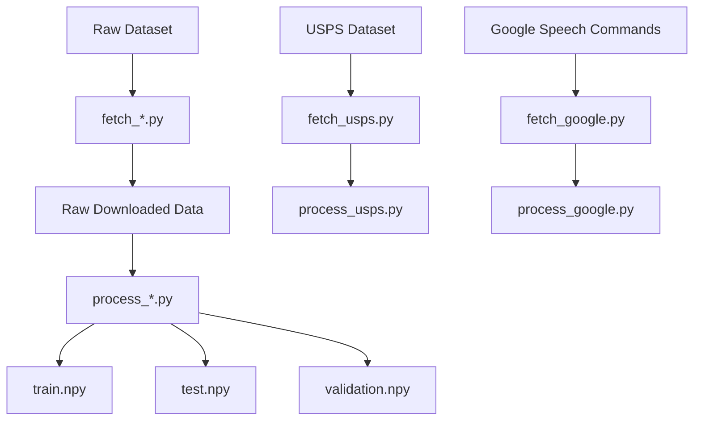
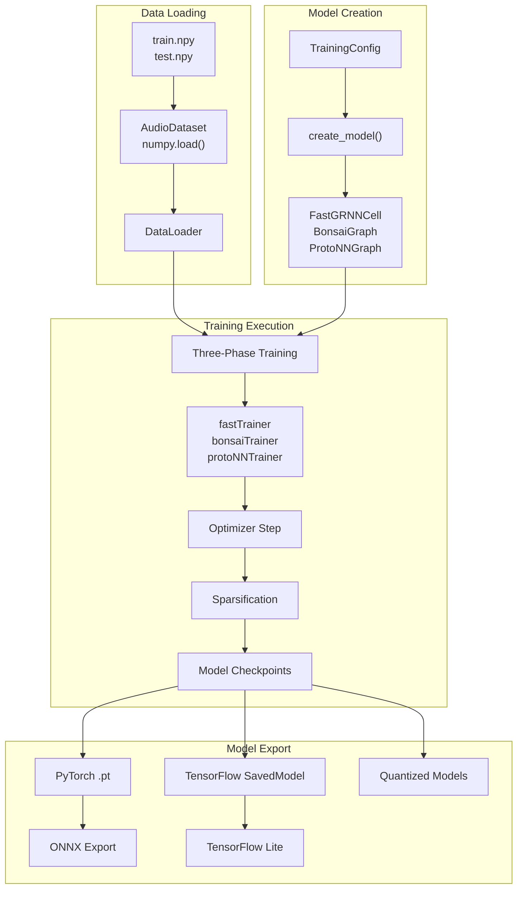
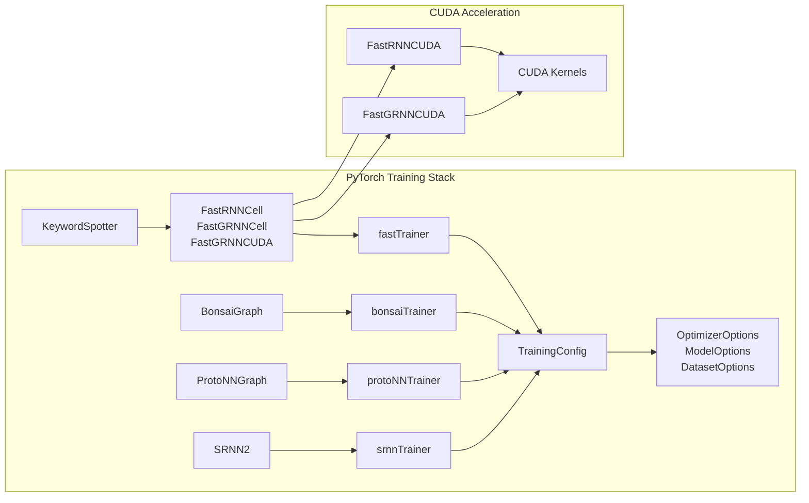
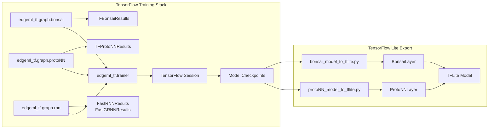
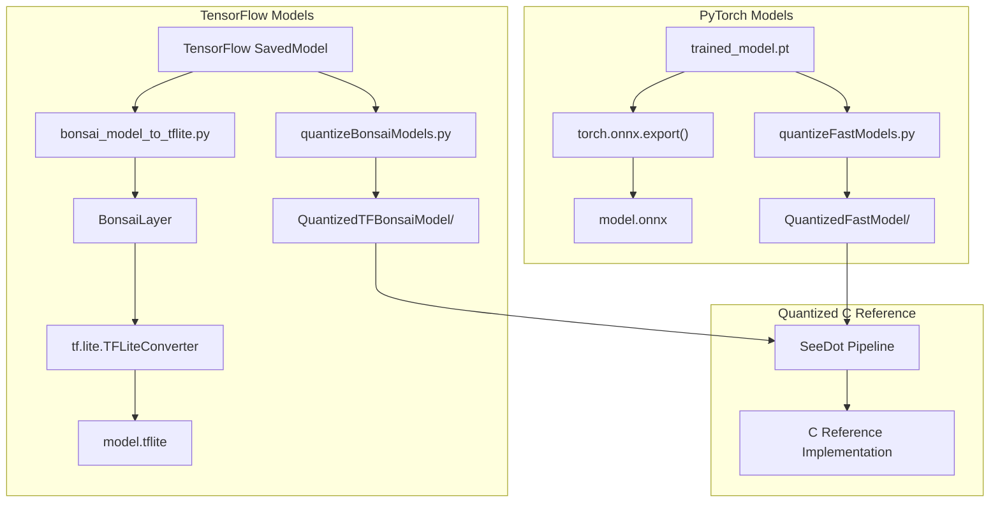
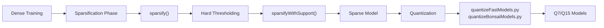

<!-- source: DeepWiki mcp.deepwiki.com · repo microsoft/EdgeML · page 4 Training and Examples · fetched 2026-10-26 -->

# Training and Examples

<details>
<summary>Relevant source files</summary>

The following files were used as context for generating this wiki page:

- [examples/pytorch/Bonsai/README.md](examples/pytorch/Bonsai/README.md)
- [examples/pytorch/FastCells/KWS-training/train_classifier.py](examples/pytorch/FastCells/KWS-training/train_classifier.py)
- [examples/pytorch/FastCells/KWS-training/training_config.py](examples/pytorch/FastCells/KWS-training/training_config.py)
- [examples/pytorch/FastCells/README.md](examples/pytorch/FastCells/README.md)
- [examples/pytorch/ProtoNN/README.md](examples/pytorch/ProtoNN/README.md)
- [examples/pytorch/SRNN/README.md](examples/pytorch/SRNN/README.md)
- [examples/tf/Bonsai/README.md](examples/tf/Bonsai/README.md)
- [examples/tf/Bonsai/bonsai_model_to_tflite.py](examples/tf/Bonsai/bonsai_model_to_tflite.py)
- [examples/tf/FastCells/README.md](examples/tf/FastCells/README.md)
- [examples/tf/ProtoNN/README.md](examples/tf/ProtoNN/README.md)
- [examples/tf/ProtoNN/protoNN_model_to_tflite.py](examples/tf/ProtoNN/protoNN_model_to_tflite.py)
- [tf/edgeml_tf/tflite/README.md](tf/edgeml_tf/tflite/README.md)
- [tf/edgeml_tf/tflite/__init__.py](tf/edgeml_tf/tflite/__init__.py)
- [tf/edgeml_tf/tflite/bonsaiLayer.py](tf/edgeml_tf/tflite/bonsaiLayer.py)
- [tf/edgeml_tf/tflite/protoNNLayer.py](tf/edgeml_tf/tflite/protoNNLayer.py)
- [tf/requirements-gpu.txt](tf/requirements-gpu.txt)

</details>


This page provides comprehensive guidance for training EdgeML models using the available algorithms and frameworks. It covers data preparation, training workflows, configuration options, and model export capabilities across both PyTorch and TensorFlow implementations.

For information about the specific algorithms and their mathematical foundations, see [Core Algorithms](#2). For details about deployment and optimization after training, see [Deployment and Optimization](#5).

## Data Preparation Requirements

EdgeML training examples expect data in a standardized NumPy format:

| File | Format | Description |
|------|---------|-------------|
| `train.npy` | `[numberOfExamples, numberOfFeatures + 1]` | Training data with labels in first column |
| `test.npy` | `[numberOfExamples, numberOfFeatures + 1]` | Test data with labels in first column |
| `validation.npy` | `[numberOfExamples, numberOfFeatures + 1]` | Validation data (when available) |

**Label Encoding:**
- Classification: Integer labels from 0 to N-1 for N-class problems
- Binary classification: Labels 0 and 1
- Time series: Flattened format `timesteps × inputDims` across feature dimension

**Data Processing Scripts:**


Sources: [examples/pytorch/FastCells/README.md:41-50](), [examples/tf/Bonsai/README.md:28-38](), [examples/pytorch/SRNN/README.md:17-28]()

## Training Pipeline Overview

The EdgeML training pipeline consists of data loading, model initialization, training execution, and model export phases:



Sources: [examples/pytorch/FastCells/KWS-training/train_classifier.py:141-290](), [examples/pytorch/FastCells/README.md:28-37](), [tf/requirements-gpu.txt:1-12]()

## Framework-Specific Training Components

### PyTorch Training Architecture



Sources: [examples/pytorch/FastCells/KWS-training/train_classifier.py:33-147](), [examples/pytorch/FastCells/KWS-training/training_config.py:9-147]()

### TensorFlow Training Architecture



Sources: [examples/tf/Bonsai/README.md:9-24](), [examples/tf/ProtoNN/README.md:9-22](), [tf/edgeml_tf/tflite/bonsaiLayer.py:8-78]()

## Training Configuration System

The training system uses hierarchical configuration objects to manage hyperparameters:

### Configuration Classes

| Class | Purpose | Key Parameters |
|-------|---------|----------------|
| `TrainingConfig` | Root configuration | `model`, `dataset`, `training` |
| `ModelOptions` | Model architecture | `architecture`, `hidden_units`, `wRank`, `uRank` |
| `DatasetOptions` | Data settings | `path`, `categories`, `normalize` |
| `TrainingOptions` | Training parameters | `max_epochs`, `learning_rate`, `batch_size` |
| `OptimizerOptions` | Optimizer settings | `weight_decay`, `momentum`, `betas` |

### Example Training Commands

**FastCells (PyTorch):**
```bash
python fastcell_example.py -dir usps10/ -id 16 -hd 32
```

**Bonsai (TensorFlow):**
```bash
python bonsai_example.py -dir usps10/ -d 3 -p 28 -rW 0.001 -rZ 0.0001 -e 100
```

**Keyword Spotting (PyTorch):**
```bash
python train_classifier.py --epochs 30 --batch_size 128 --architecture FastGRNN --hidden_units 64
```

Sources: [examples/pytorch/FastCells/README.md:55-69](), [examples/tf/Bonsai/README.md:40-52](), [examples/pytorch/FastCells/KWS-training/train_classifier.py:582-747]()

## Model Export and Conversion

EdgeML supports multiple export formats for deployment:

### Export Pipeline



### TensorFlow Lite Conversion Process

The TFLite conversion creates Keras layer implementations for inference:

1. **Model Loading:** Load trained parameters from NumPy files
2. **Layer Creation:** Instantiate `BonsaiLayer` or `ProtoNNLayer`
3. **Model Building:** Create `keras.Sequential` model
4. **Conversion:** Use `tf.lite.TFLiteConverter.from_keras_model()`
5. **Inference:** Use `tf.lite.Interpreter` for prediction

Sources: [examples/tf/Bonsai/bonsai_model_to_tflite.py:13-115](), [examples/tf/ProtoNN/protoNN_model_to_tflite.py:13-103](), [tf/edgeml_tf/tflite/README.md:1-13]()

## Advanced Training Features

### Sparsification and Quantization

EdgeML implements iterative hard thresholding (IHT) for model sparsification:



### CUDA Acceleration

PyTorch FastCells provide CUDA implementations for faster training:

- `FastRNNCUDA`: CUDA-accelerated FastRNN
- `FastGRNNCUDA`: CUDA-accelerated FastGRNN
- Numerically equivalent to CPU versions
- Automatic GPU detection and usage

Sources: [examples/pytorch/FastCells/README.md:18-22](), [examples/pytorch/FastCells/KWS-training/train_classifier.py:257-267](), [examples/pytorch/FastCells/README.md:77-90]()

---

