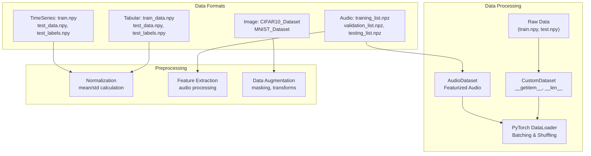
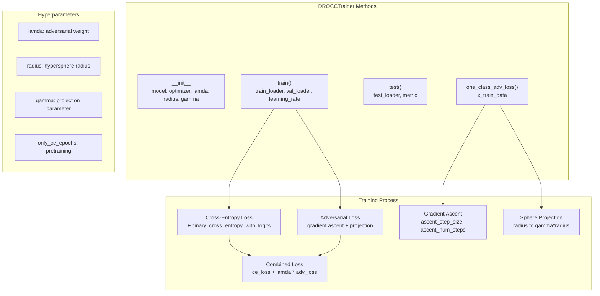
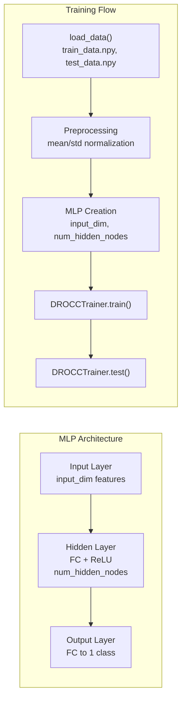
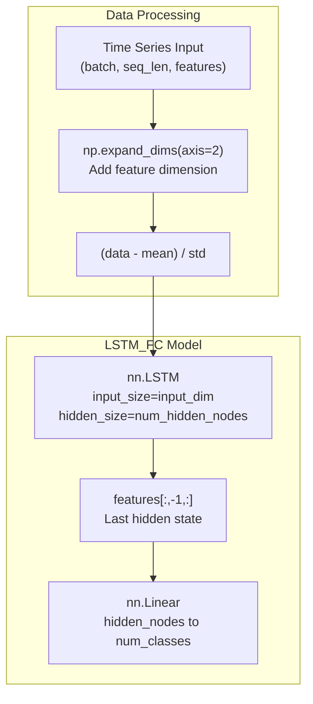
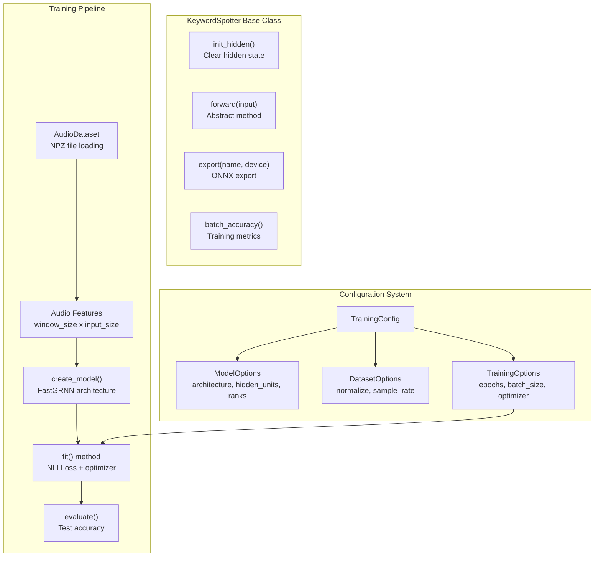
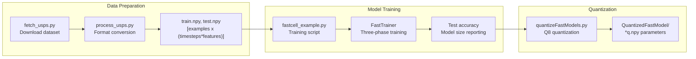
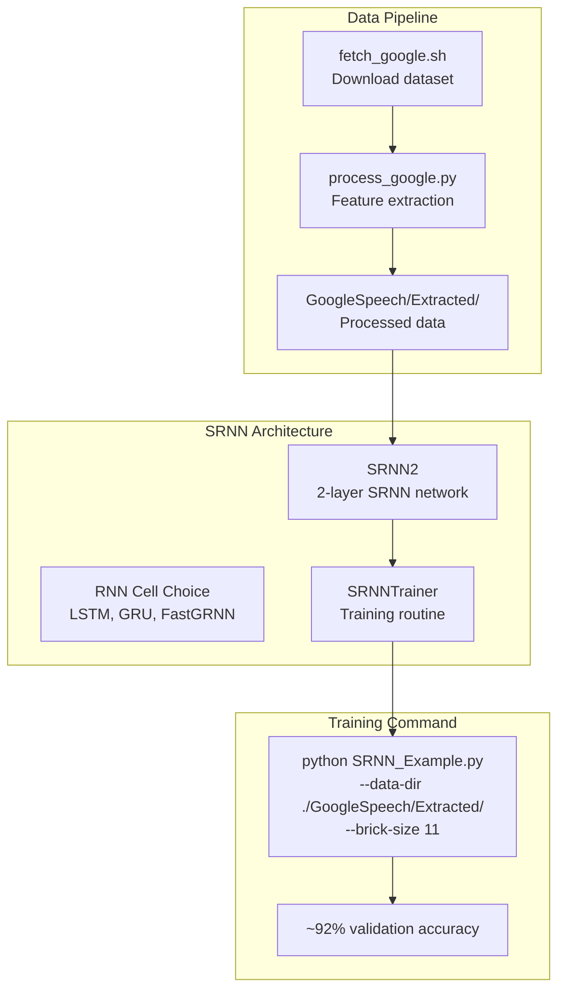
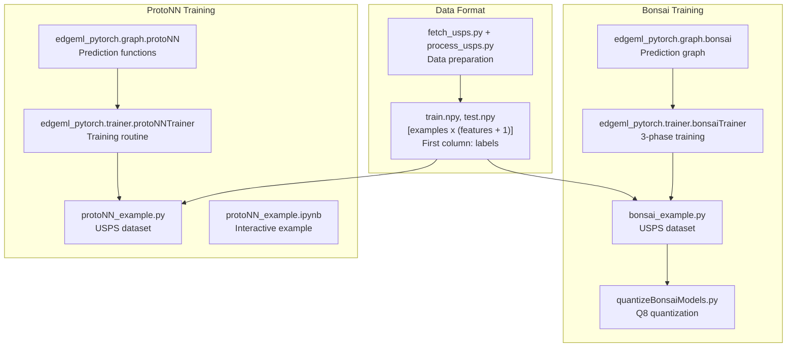
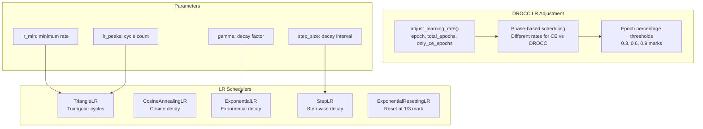

<!-- source: DeepWiki mcp.deepwiki.com · repo microsoft/EdgeML · page 4.1 PyTorch Training Examples · fetched 2026-10-26 -->

# PyTorch Training Examples

<details>
<summary>Relevant source files</summary>

The following files were used as context for generating this wiki page:

- [README.md](README.md)
- [examples/pytorch/Bonsai/README.md](examples/pytorch/Bonsai/README.md)
- [examples/pytorch/DROCC/README.md](examples/pytorch/DROCC/README.md)
- [examples/pytorch/DROCC/data_process_scripts/process_cifar.py](examples/pytorch/DROCC/data_process_scripts/process_cifar.py)
- [examples/pytorch/DROCC/data_process_scripts/process_mnist.py](examples/pytorch/DROCC/data_process_scripts/process_mnist.py)
- [examples/pytorch/DROCC/main_cifar.py](examples/pytorch/DROCC/main_cifar.py)
- [examples/pytorch/DROCC/main_drocclf_mnist.py](examples/pytorch/DROCC/main_drocclf_mnist.py)
- [examples/pytorch/DROCC/main_tabular.py](examples/pytorch/DROCC/main_tabular.py)
- [examples/pytorch/DROCC/main_timeseries.py](examples/pytorch/DROCC/main_timeseries.py)
- [examples/pytorch/FastCells/KWS-training/train_classifier.py](examples/pytorch/FastCells/KWS-training/train_classifier.py)
- [examples/pytorch/FastCells/KWS-training/training_config.py](examples/pytorch/FastCells/KWS-training/training_config.py)
- [examples/pytorch/FastCells/README.md](examples/pytorch/FastCells/README.md)
- [examples/pytorch/ProtoNN/README.md](examples/pytorch/ProtoNN/README.md)
- [examples/pytorch/SRNN/README.md](examples/pytorch/SRNN/README.md)
- [pytorch/README.md](pytorch/README.md)
- [pytorch/edgeml_pytorch/trainer/drocc_trainer.py](pytorch/edgeml_pytorch/trainer/drocc_trainer.py)
- [pytorch/edgeml_pytorch/trainer/drocclf_trainer.py](pytorch/edgeml_pytorch/trainer/drocclf_trainer.py)
- [tf/README.md](tf/README.md)

</details>


This page provides a comprehensive guide to training EdgeML algorithms using the PyTorch implementation. It covers practical examples for DROCC, FastCells, SRNN, Bonsai, and ProtoNN algorithms, including data preparation, training configurations, and evaluation procedures.

For information about the PyTorch implementation architecture and graph modules, see [PyTorch Implementation](#3.1). For details about deployment and model conversion, see [Model Export and Conversion](#5.2).

## Training Infrastructure Overview

The PyTorch implementation provides a structured training framework centered around specialized trainer classes and configurable training pipelines.

### Core Trainer Architecture

```mermaid
graph TD
    subgraph "Trainer Classes"
        DROCCTrainer["DROCCTrainer<br/>drocc_trainer.py"]
        DROCCLFTrainer["DROCCLFTrainer<br/>drocclf_trainer.py"]
        FastModelTrainer["FastModelTrainer<br/>fastmodel.py"]
        BonsaiTrainer["BonsaiTrainer<br/>bonsaiTrainer.py"]
        ProtoNNTrainer["ProtoNNTrainer<br/>protoNNTrainer.py"]
        SRNNTrainer["SRNNTrainer<br/>srnnTrainer.py"]
    end

    subgraph "Training Examples"
        TabularExample["main_tabular.py<br/>MLP + DROCCTrainer"]
        TimeSeriesExample["main_timeseries.py<br/>LSTM_FC + DROCCTrainer"]
        CIFARExample["main_cifar.py<br/>CIFAR10_LeNet + DROCCTrainer"]
        KWSExample["train_classifier.py<br/>KeywordSpotter + FastModel"]
        SRNNExample["SRNN_Example.py<br/>SRNN2 + SRNNTrainer"]
    end

    subgraph "Configuration"
        TrainingConfig["TrainingConfig<br/>training_config.py"]
        ModelOptions["ModelOptions"]
        DatasetOptions["DatasetOptions"]
        OptimizerOptions["OptimizerOptions"]
    end

    DROCCTrainer --> TabularExample
    DROCCTrainer --> TimeSeriesExample
    DROCCTrainer --> CIFARExample
    DROCCLFTrainer --> "main_drocclf_mnist.py"
    FastModelTrainer --> KWSExample
    SRNNTrainer --> SRNNExample

    TrainingConfig --> ModelOptions
    TrainingConfig --> DatasetOptions
    TrainingConfig --> OptimizerOptions
    TrainingConfig --> KWSExample
```

**Sources:** [pytorch/edgeml_pytorch/trainer/drocc_trainer.py:1-221](), [examples/pytorch/FastCells/KWS-training/training_config.py:1-147](), [examples/pytorch/DROCC/main_tabular.py:1-185]()

### Data Pipeline Architecture



**Sources:** [examples/pytorch/DROCC/main_tabular.py:68-80](), [examples/pytorch/FastCells/KWS-training/train_classifier.py:324-406](), [examples/pytorch/DROCC/data_process_scripts/process_cifar.py:51-82]()

## DROCC Training Examples

DROCC (Deep Robust One-Class Classification) provides comprehensive training examples for anomaly detection across different data types.

### DROCC Trainer Implementation

The `DROCCTrainer` class implements the core DROCC algorithm with adversarial loss computation:



**Sources:** [pytorch/edgeml_pytorch/trainer/drocc_trainer.py:11-221](), [pytorch/edgeml_pytorch/trainer/drocc_trainer.py:158-214]()

### Tabular Data Training

Training DROCC on tabular datasets like Arrhythmia, Thyroid, and Abalone:

| Parameter | Arrhythmia | Thyroid | Abalone |
|-----------|------------|---------|---------|
| `--hd` (hidden dim) | 128 | 128 | 128 |
| `--lr` (learning rate) | 0.0001 | 0.001 | 0.001 |
| `--lamda` | 1 | 1 | 1 |
| `--gamma` | 2 | 2 | 2 |
| `--radius` | 16 | 2.5 | 3 |
| `--epochs` | 200 | 100 | 200 |

The tabular training pipeline uses a simple MLP architecture defined in [examples/pytorch/DROCC/main_tabular.py:14-38]():



**Sources:** [examples/pytorch/DROCC/main_tabular.py:81-99](), [examples/pytorch/DROCC/main_tabular.py:101-135]()

### Time Series Training

Time series DROCC training uses LSTM-based feature extraction:

The `LSTM_FC` model architecture combines LSTM encoding with fully connected classification:



**Sources:** [examples/pytorch/DROCC/main_timeseries.py:13-39](), [examples/pytorch/DROCC/main_timeseries.py:78-98]()

### Image Data Training

CIFAR-10 and MNIST training examples demonstrate DROCC on image data:

```mermaid
graph TD
    subgraph "CIFAR10_LeNet Architecture"
        Conv1["Conv2d(3,32,5) + BN + Pool"]
        Conv2["Conv2d(32,64,5) + BN + Pool"]
        Conv3["Conv2d(64,128,5) + BN + Pool"]
        FC1["Linear(128*4*4, 128)"]
        FC2["Linear(128, 64)"]
        FC3["Linear(64, 1)"]
    end

    subgraph "MNIST_LeNet Architecture"
        MConv1["Conv2d(1,8,5) + BN + Pool"]
        MConv2["Conv2d(8,4,5) + BN + Pool"]
        MFC1["Linear(4*7*7, 64)"]
        MFC2["Linear(64, 1)"]
    end

    Conv1 --> Conv2 --> Conv3 --> FC1 --> FC2 --> FC3
    MConv1 --> MConv2 --> MFC1 --> MFC2
```



**Sources:** [examples/pytorch/DROCC/main_cifar.py:14-43](), [examples/pytorch/DROCC/main_drocclf_mnist.py:14-37]()

## FastCells Training Examples

FastCells training focuses on efficient RNN implementations for resource-constrained applications.

### Keyword Spotting Training

The keyword spotting example demonstrates FastGRNN usage for audio classification:



**Sources:** [examples/pytorch/FastCells/KWS-training/train_classifier.py:33-82](), [examples/pytorch/FastCells/KWS-training/train_classifier.py:324-406](), [examples/pytorch/FastCells/KWS-training/training_config.py:77-147]()

### FastModel Integration

The training system integrates with the FastModel trainer for efficient RNN training:

| Configuration Parameter | Purpose | Example Values |
|------------------------|---------|----------------|
| `architecture` | RNN cell type | "FastGRNN", "FastRNN" |
| `hidden_units` | Hidden layer size | 32, 64, 128 |
| `wRank` | Weight matrix rank | None, 8, 16 |
| `uRank` | Update matrix rank | None, 8, 16 |
| `wSparsity` | Weight sparsity | 1.0, 0.8, 0.5 |
| `gate_nonlinearity` | Gate activation | "sigmoid", "tanh" |
| `update_nonlinearity` | Update activation | "tanh", "sigmoid" |

**Sources:** [examples/pytorch/FastCells/KWS-training/train_classifier.py:409-421](), [examples/pytorch/FastCells/KWS-training/training_config.py:9-28]()

### USPS Dataset Training

FastCells training on the USPS digit recognition dataset:



**Sources:** [examples/pytorch/FastCells/README.md:41-89](), [examples/pytorch/FastCells/README.md:55-76]()

## Other Algorithm Training Examples

### SRNN Training

Shallow RNN training for Google Speech Commands dataset:



**Sources:** [examples/pytorch/SRNN/README.md:1-42](), [examples/pytorch/SRNN/README.md:17-36]()

### Bonsai and ProtoNN Training

Tree-based and prototype-based classifier training:



**Sources:** [examples/pytorch/Bonsai/README.md:1-68](), [examples/pytorch/ProtoNN/README.md:1-58]()

## Common Training Patterns

### Learning Rate Scheduling

The training infrastructure supports multiple learning rate schedulers:



**Sources:** [examples/pytorch/FastCells/KWS-training/train_classifier.py:113-139](), [examples/pytorch/DROCC/main_tabular.py:40-66]()

### Model Evaluation and Metrics

Training examples implement comprehensive evaluation metrics:

| Algorithm | Primary Metric | Secondary Metrics | Evaluation Method |
|-----------|---------------|-------------------|-------------------|
| DROCC | F1 Score / AUC | Precision, Recall | `DROCCTrainer.test()` |
| DROCC-LF | Precision@FPR | Recall@FPR | `cal_precision_recall()` |
| FastCells | Accuracy | Model Size | `KeywordSpotter.batch_accuracy()` |
| Bonsai/ProtoNN | Accuracy | Model Size, Sparsity | Standard classification |

**Sources:** [pytorch/edgeml_pytorch/trainer/drocc_trainer.py:119-155](), [pytorch/edgeml_pytorch/trainer/drocclf_trainer.py:10-25](), [examples/pytorch/FastCells/KWS-training/train_classifier.py:70-81]()

---

