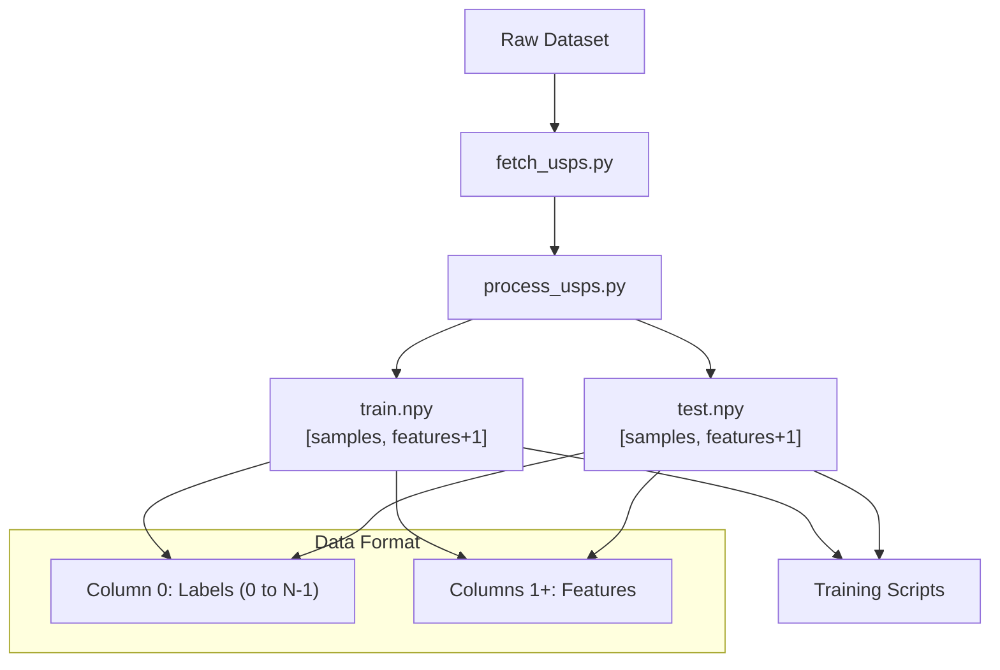
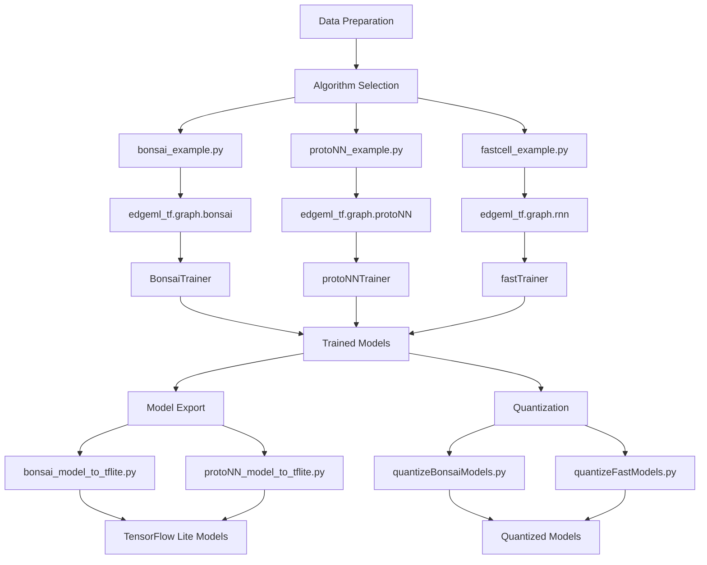
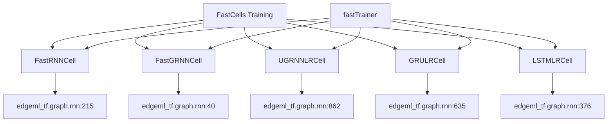
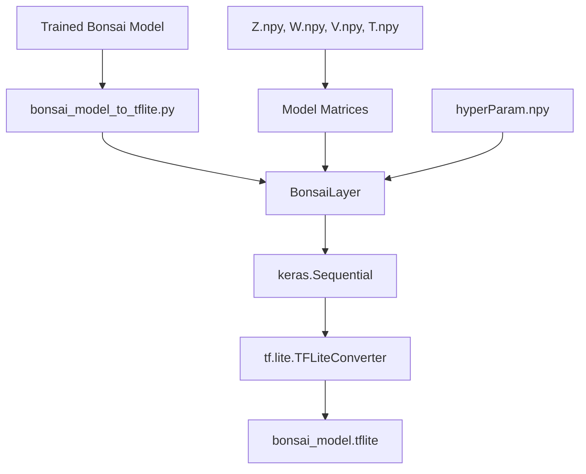
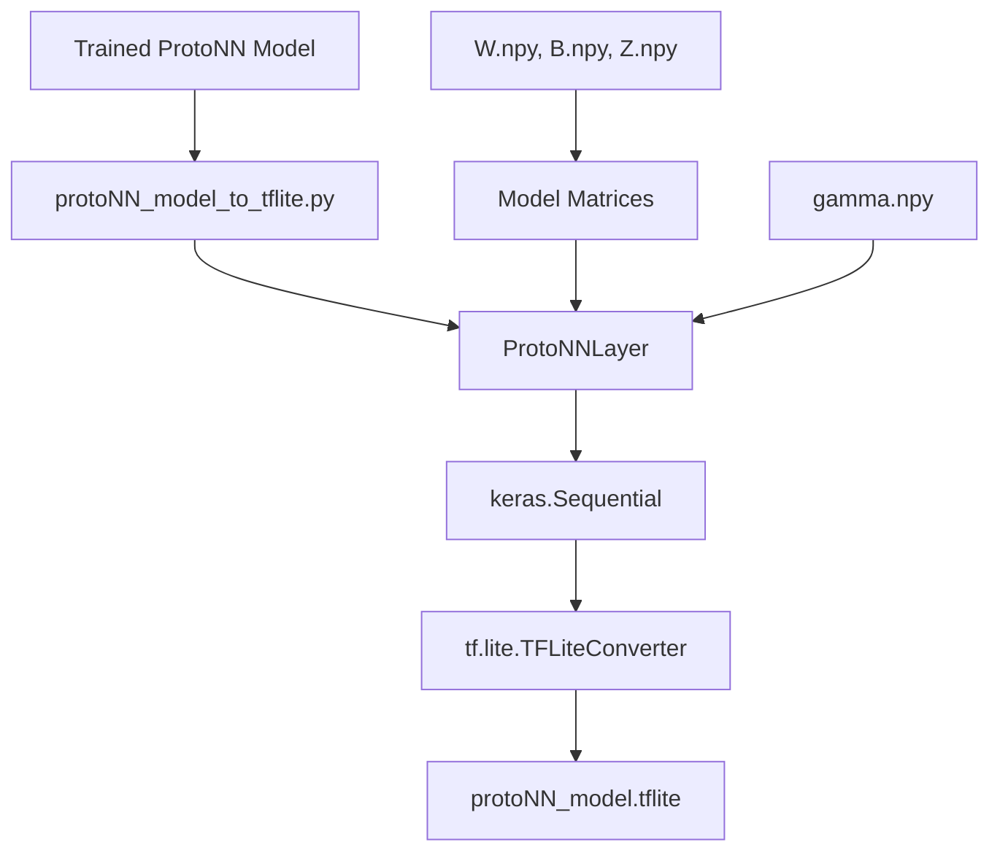

<!-- source: DeepWiki mcp.deepwiki.com · repo microsoft/EdgeML · page 4.2 TensorFlow Training Examples · fetched 2026-10-26 -->

# TensorFlow Training Examples

<details>
<summary>Relevant source files</summary>

The following files were used as context for generating this wiki page:

- [examples/tf/Bonsai/README.md](examples/tf/Bonsai/README.md)
- [examples/tf/Bonsai/bonsai_model_to_tflite.py](examples/tf/Bonsai/bonsai_model_to_tflite.py)
- [examples/tf/FastCells/README.md](examples/tf/FastCells/README.md)
- [examples/tf/ProtoNN/README.md](examples/tf/ProtoNN/README.md)
- [examples/tf/ProtoNN/protoNN_model_to_tflite.py](examples/tf/ProtoNN/protoNN_model_to_tflite.py)
- [tf/edgeml_tf/tflite/README.md](tf/edgeml_tf/tflite/README.md)
- [tf/edgeml_tf/tflite/__init__.py](tf/edgeml_tf/tflite/__init__.py)
- [tf/edgeml_tf/tflite/bonsaiLayer.py](tf/edgeml_tf/tflite/bonsaiLayer.py)
- [tf/edgeml_tf/tflite/protoNNLayer.py](tf/edgeml_tf/tflite/protoNNLayer.py)
- [tf/requirements-gpu.txt](tf/requirements-gpu.txt)

</details>


This page documents the TensorFlow training examples provided in EdgeML, covering training scripts, data preparation, and model export for Bonsai, ProtoNN, and FastCells algorithms. These examples demonstrate how to train models using the TensorFlow implementation and export them for deployment.

For information about the underlying TensorFlow implementation details, see [TensorFlow Implementation](#3.2). For deployment and optimization techniques, see [Model Export and Conversion](#5.2).

## Purpose and Scope

The TensorFlow training examples provide complete workflows for:
- Training Bonsai, ProtoNN, and FastCells models using TensorFlow
- Data preprocessing and format standardization
- Hyperparameter configuration and optimization
- Model export to TensorFlow Lite format
- Quantization for model compression

## Data Format Requirements

All TensorFlow training examples use a standardized data format. Training and test data must be contained in `train.npy` and `test.npy` files, each containing 2D numpy arrays of dimension `[numberOfExamples, numberOfFeatures + 1]`. The first column contains label information, with labels as integers from 0 to N-1 for N-class problems.



**Data Format Specifications**
- First column: Integer labels (0 through N-1)
- Remaining columns: Feature values
- Training data must be pre-shuffled
- For time-series data (FastCells): features are flattened as `timesteps x inputDims`

Sources: [examples/tf/Bonsai/README.md:14-24](), [examples/tf/ProtoNN/README.md:15-20](), [examples/tf/FastCells/README.md:23-30]()

## Training Workflow Architecture



**Training Pipeline Components**

| Component | Purpose | Key Files |
|-----------|---------|-----------|
| Data Scripts | Dataset download and preprocessing | `fetch_usps.py`, `process_usps.py` |
| Training Scripts | Algorithm-specific training | `bonsai_example.py`, `protoNN_example.py`, `fastcell_example.py` |
| Graph Modules | Model definitions | `edgeml_tf.graph.bonsai`, `edgeml_tf.graph.protoNN`, `edgeml_tf.graph.rnn` |
| Trainers | Training logic | `edgeml_tf.trainer` modules |
| Export Scripts | TFLite conversion | `*_model_to_tflite.py` |
| Quantization | Model compression | `quantize*Models.py` |

Sources: [examples/tf/Bonsai/README.md:9-12](), [examples/tf/ProtoNN/README.md:9-13](), [examples/tf/FastCells/README.md:10-21]()

## Bonsai Training

The Bonsai training example demonstrates tree-based classification using the `edgeml_tf.graph.bonsai` module. The training script `bonsai_example.py` implements the three-phase training routine decoupled from the forward graph.

### Basic Usage

```bash
python bonsai_example.py -dir usps10/ -d 3 -p 28 -rW 0.001 -rZ 0.0001 -rV 0.001 -rT 0.001 -sZ 0.2 -sW 0.3 -sV 0.3 -sT 0.62 -e 100 -s 1
```

### Key Parameters

| Parameter | Description | Example Value |
|-----------|-------------|---------------|
| `-d` | Tree depth | 3 |
| `-p` | Projection dimension | 28 |
| `-rW`, `-rZ`, `-rV`, `-rT` | Regularization parameters | 0.001, 0.0001, 0.001, 0.001 |
| `-sW`, `-sZ`, `-sV`, `-sT` | Sparsity parameters | 0.3, 0.2, 0.3, 0.62 |
| `-e` | Number of epochs | 100 |

### Expected Output

```
Maximum Test accuracy at compressed model size(including early stopping): 0.94369704 at Epoch: 66
Final Test Accuracy: 0.93024415
Non-Zeros: 4156.0 Model Size: 31.703125 KB hasSparse: True
```

The training produces model matrices `Z.npy`, `W.npy`, `V.npy`, `T.npy` and hyperparameters stored in `TFBonsaiResults` directory.

Sources: [examples/tf/Bonsai/README.md:40-54]()

## ProtoNN Training

ProtoNN training uses prototype-based k-nearest neighbor classification through the `edgeml_tf.trainer.protoNNTrainer` module.

### Basic Usage

```bash
python protoNN_example.py \
      --data-dir ./usps10 \
      --projection-dim 60 \
      --num-prototypes 80 \
      --gamma 0.0015 \
      --learning-rate 0.1 \
      --epochs 200 \
      --val-step 10 \
      --output-dir ./model
```

### Key Parameters

| Parameter | Description | Expected Value |
|-----------|-------------|----------------|
| `--projection-dim` | Projection dimension | 60 |
| `--num-prototypes` | Number of prototypes | 80 |
| `--gamma` | RBF kernel parameter | 0.0015 |
| `--learning-rate` | Learning rate | 0.1 |
| `--epochs` | Training epochs | 200 |

Expected test accuracy: approximately 92.5%

The training produces model matrices `W.npy`, `B.npy`, `Z.npy`, and `gamma.npy` in the output directory.

Sources: [examples/tf/ProtoNN/README.md:46-61]()

## FastCells Training

FastCells training supports FastRNN and FastGRNN cells with low-rank parameterization and custom non-linearities. The implementation includes modified UGRNN, GRU, and LSTM cells supporting LSQ training.

### Basic Usage

```bash
python fastcell_example.py -dir usps10/ -id 16 -hd 32
```

### Key Parameters

| Parameter | Description | USPS10 Example |
|-----------|-------------|----------------|
| `-id` | Input dimensions | 16 |
| `-hd` | Hidden dimensions | 32 |
| Number of timesteps | Derived from data | 16 |

### Available Cell Types



### Expected Output

```
Maximum Test accuracy at compressed model size(including early stopping): 0.9407075 at Epoch: 262
Final Test Accuracy: 0.93721974
Non-Zeros: 1932 Model Size: 7.546875 KB hasSparse: False
```

The scalars `alpha`, `beta`, `zeta`, and `nu` are stored before sigmoid application during training.

Sources: [examples/tf/FastCells/README.md:47-67]()

## TensorFlow Lite Export

The TensorFlow examples include utilities to convert trained models to TensorFlow Lite format using Keras layer implementations.

### Bonsai TFLite Export

```bash
python bonsai_model_to_tflite.py --data-dir ./usps10/ --model-dir ./usps10/TFBonsaiResults/model-dir-path/
```

The script uses `BonsaiLayer` from `edgeml_tf.tflite.bonsaiLayer` to create a Keras sequential model:



The `BonsaiLayer` implements the forward pass with matrices Z (projection), W and V (node weights), and T (tree parameters).

Sources: [examples/tf/Bonsai/bonsai_model_to_tflite.py:67-79](), [tf/edgeml_tf/tflite/bonsaiLayer.py:8-74]()

### ProtoNN TFLite Export

```bash
python protoNN_model_to_tflite.py --data-dir ./usps10/ --output-dir ./model/
```

The script uses `ProtoNNLayer` implementing the ProtoNN forward pass:



The `ProtoNNLayer` computes RBF similarities and prototype-based classification using matrices W (projection), B (prototypes), and Z (classification).

Sources: [examples/tf/ProtoNN/protoNN_model_to_tflite.py:50-62](), [tf/edgeml_tf/tflite/protoNNLayer.py:7-45]()

## Model Quantization

The TensorFlow examples provide quantization scripts for model compression using byte quantization.

### Bonsai Quantization

```bash
python quantizeBonsaiModels.py -h
```

Generates quantized models with suffix `q` in directory `QuantizedTFBonsaiModel`.

### FastCells Quantization

```bash
python quantizeFastModels.py -h
```

Generates quantized models in directory `QuantizedFastModel`. The quantized scalars `qalpha`, `qbeta`, `qzeta`, and `qnu` are post-sigmoid and ready for inference pipelines.

### Quantization Output

| Original Parameter | Quantized Parameter | Storage Location |
|-------------------|-------------------|------------------|
| Model matrices | `*q.npy` files | `Quantized*Model/` |
| FastCell scalars | `qalpha`, `qbeta`, `qzeta`, `qnu` | Post-sigmoid values |
| Bonsai parameters | `Zq`, `Wq`, `Vq`, `Tq` | Quantized matrices |

Sources: [examples/tf/Bonsai/README.md:70-78](), [examples/tf/FastCells/README.md:69-79]()

## Requirements and Dependencies

The TensorFlow examples require specific versions for compatibility:

| Dependency | Version | Purpose |
|------------|---------|---------|
| `tensorflow-gpu` | 1.15.4 | Core framework |
| `numpy` | 1.16.4 | Numerical operations |
| `scipy` | 1.1.0 | Scientific computing |
| `scikit-learn` | 0.19.2 | Data preprocessing |
| `onnx` | 1.8.0 | Model export |
| `tqdm` | 4.56.0 | Progress tracking |

**Compatibility Notes:**
- TensorFlow >1.6 supported for training examples
- TensorFlow 2.X required for TFLite conversion scripts
- Python 2 and Python 3 compatibility for training scripts

Sources: [tf/requirements-gpu.txt:1-11](), [examples/tf/Bonsai/README.md:26](), [examples/tf/ProtoNN/README.md:22]()

---

