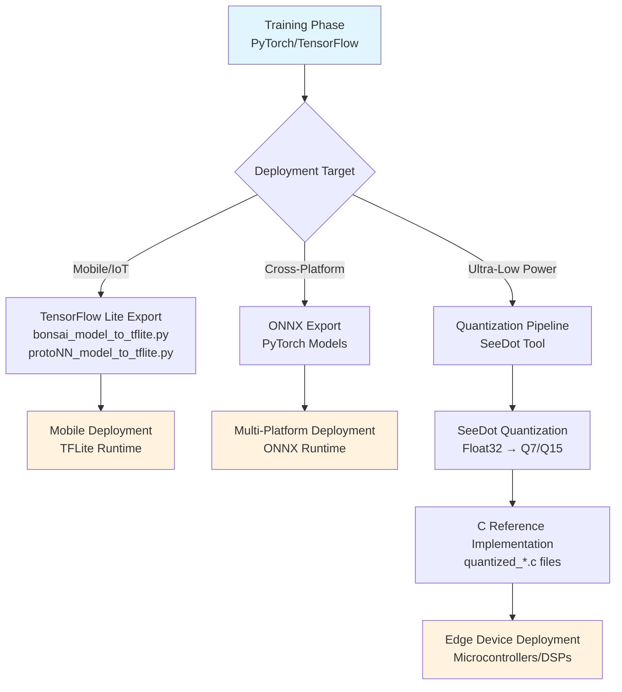
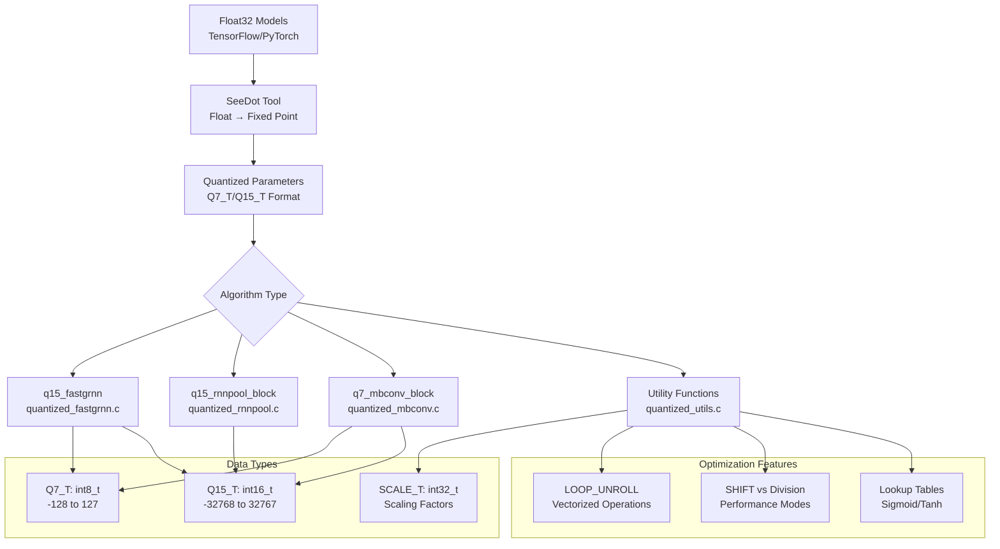
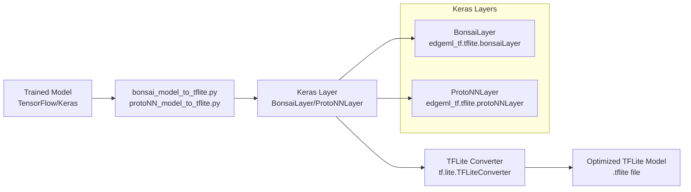
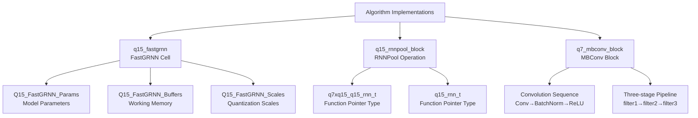
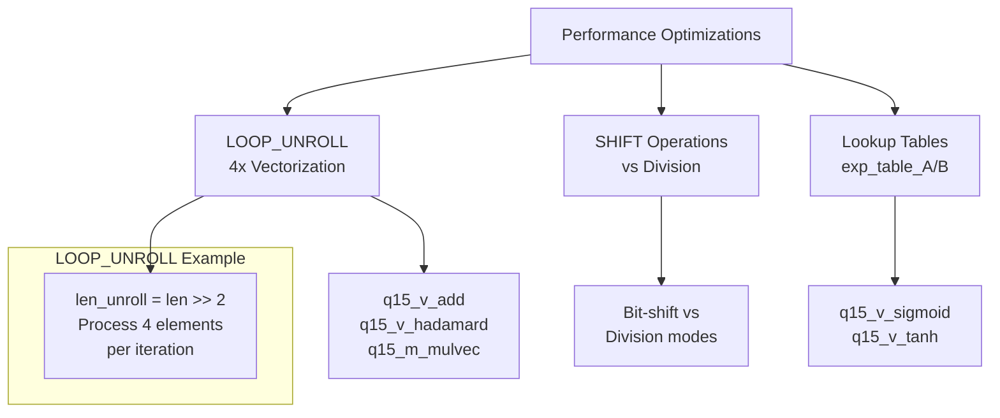
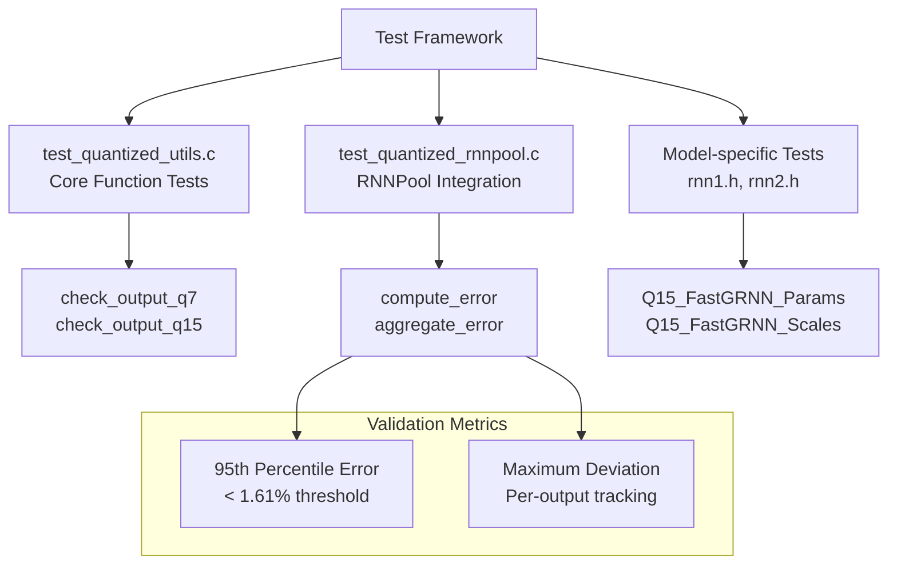

<!-- source: DeepWiki mcp.deepwiki.com · repo microsoft/EdgeML · page 5 Deployment and Optimization · fetched 2026-10-26 -->

# Deployment and Optimization

Relevant source files

The following files were used as context for generating this wiki page:

- [c_reference/include/quantized_fastgrnn.h](c_reference/include/quantized_fastgrnn.h)
- [c_reference/include/quantized_mbconv.h](c_reference/include/quantized_mbconv.h)
- [c_reference/include/quantized_rnnpool.h](c_reference/include/quantized_rnnpool.h)
- [c_reference/include/quantized_utils.h](c_reference/include/quantized_utils.h)
- [c_reference/src/quantized_fastgrnn.c](c_reference/src/quantized_fastgrnn.c)
- [c_reference/src/quantized_mbconv.c](c_reference/src/quantized_mbconv.c)
- [c_reference/src/quantized_rnnpool.c](c_reference/src/quantized_rnnpool.c)
- [c_reference/src/quantized_utils.c](c_reference/src/quantized_utils.c)
- [c_reference/tests/rnnpool/q_wider_regression_model/rnn1.h](c_reference/tests/rnnpool/q_wider_regression_model/rnn1.h)
- [c_reference/tests/rnnpool/q_wider_regression_model/rnn2.h](c_reference/tests/rnnpool/q_wider_regression_model/rnn2.h)
- [c_reference/tests/rnnpool/test_quantized_rnnpool.c](c_reference/tests/rnnpool/test_quantized_rnnpool.c)
- [c_reference/tests/utils/test_quantized_utils.c](c_reference/tests/utils/test_quantized_utils.c)
- [examples/tf/Bonsai/README.md](examples/tf/Bonsai/README.md)
- [examples/tf/Bonsai/bonsai_model_to_tflite.py](examples/tf/Bonsai/bonsai_model_to_tflite.py)
- [examples/tf/FastCells/README.md](examples/tf/FastCells/README.md)
- [examples/tf/ProtoNN/README.md](examples/tf/ProtoNN/README.md)
- [examples/tf/ProtoNN/protoNN_model_to_tflite.py](examples/tf/ProtoNN/protoNN_model_to_tflite.py)
- [tf/edgeml_tf/tflite/README.md](tf/edgeml_tf/tflite/README.md)
- [tf/edgeml_tf/tflite/__init__.py](tf/edgeml_tf/tflite/__init__.py)
- [tf/edgeml_tf/tflite/bonsaiLayer.py](tf/edgeml_tf/tflite/bonsaiLayer.py)
- [tf/edgeml_tf/tflite/protoNNLayer.py](tf/edgeml_tf/tflite/protoNNLayer.py)
- [tf/requirements-gpu.txt](tf/requirements-gpu.txt)

This document covers the deployment and optimization pipeline for EdgeML models on resource-constrained edge devices. It explains the quantization process from floating-point training models to fixed-point inference implementations, model export to various deployment formats, and the highly optimized C reference implementation for ultra-low power edge deployment.

For information about training EdgeML algorithms, see [Training and Examples](#4). For details about the core algorithms themselves, see [Core Algorithms](#2).

## Deployment Pipeline Overview

EdgeML provides a comprehensive pipeline for deploying trained models to edge devices, supporting multiple deployment targets and optimization levels depending on the target platform's constraints.

### Training to Deployment Flow

**Sources:** [examples/tf/Bonsai/bonsai_model_to_tflite.py](), [examples/tf/ProtoNN/protoNN_model_to_tflite.py](), [tf/requirements-gpu.txt:10]()

## Quantization Pipeline

The quantization pipeline converts floating-point models to fixed-point representations suitable for resource-constrained devices. EdgeML uses the SeeDot quantization tool to perform this conversion while maintaining numerical accuracy.

### Quantization Architecture

**Sources:** [c_reference/include/quantized_utils.h:13-21](), [c_reference/src/quantized_utils.c:7-42](), [c_reference/include/quantized_fastgrnn.h:29-42]()

### Data Types and Scaling

The quantization system uses fixed-point arithmetic with specific data type definitions:

| Type | Range | Usage |
|------|-------|-------|
| `Q7_T` | -128 to 127 | 8-bit quantized values |
| `Q15_T` | -32768 to 32767 | 16-bit quantized values |
| `SCALE_T` | 32-bit integer | Scaling factors |
| `ITER_T` | Unsigned integer | Loop iteration counters |

The scaling system supports both bit-shifting (`SHIFT` mode) and division operations, with bit-shifting providing better performance on resource-constrained devices.

**Sources:** [c_reference/include/quantized_utils.h:1-8](), [c_reference/src/quantized_utils.c:9-16]()

## Model Export and Conversion

EdgeML supports multiple export formats to accommodate different deployment scenarios and runtime requirements.

### TensorFlow Lite Conversion

The TensorFlow Lite export path is designed for mobile and embedded devices with TensorFlow Lite runtime support:

**Sources:** [examples/tf/Bonsai/bonsai_model_to_tflite.py:71-73](), [examples/tf/ProtoNN/protoNN_model_to_tflite.py:71-73](), [tf/edgeml_tf/tflite/bonsaiLayer.py:8-31]()

### ONNX Export

ONNX export provides cross-platform compatibility, particularly useful for PyTorch-trained models:

**Sources:** [tf/requirements-gpu.txt:10]()

## C Reference Implementation

The C reference implementation provides the most optimized deployment path for ultra-low power edge devices, featuring hand-optimized quantized operations.

### Core Algorithms Implementation

**Sources:** [c_reference/include/quantized_fastgrnn.h:29-42](), [c_reference/include/quantized_rnnpool.h:9-10](), [c_reference/include/quantized_mbconv.h:65-75]()

### Memory Layout and Buffer Management

The C implementation uses structured buffer management for efficient memory usage:

| Structure | Purpose | Size Requirements |
|-----------|---------|------------------|
| `Q15_FastGRNN_Buffers` | Working memory for FastGRNN | `hiddenDims * 3 + inputDims` |
| `Q15_FastGRNN_Params` | Model parameters | Weights, biases, hyperparameters |
| `Q15_FastGRNN_Scales` | Quantization scales | Scale factors for all operations |

**Sources:** [c_reference/include/quantized_fastgrnn.h:122-129](), [c_reference/include/quantized_fastgrnn.h:172-185]()

## Performance Optimization

The C reference implementation includes multiple optimization techniques for maximum performance on edge devices.

### Vectorization and Loop Unrolling

**Sources:** [c_reference/src/quantized_utils.c:17-33](), [c_reference/include/quantized_utils.h:55-56]()

### Conditional Compilation Options

The implementation supports multiple compilation modes:

- **`LOOP_UNROLL`**: Enables 4x vectorized operations for better throughput
- **`SHIFT`**: Uses bit-shifting instead of division for faster arithmetic  
- **Table lookups**: Pre-computed exponential tables for sigmoid/tanh functions

**Sources:** [c_reference/src/quantized_utils.c:9-16](), [c_reference/src/quantized_utils.c:192-227]()

## Testing and Validation

The C reference implementation includes comprehensive test suites to validate numerical accuracy and performance.

### Test Framework Structure

**Sources:** [c_reference/tests/utils/test_quantized_utils.c:9-32](), [c_reference/tests/rnnpool/test_quantized_rnnpool.c:40-45](), [c_reference/tests/rnnpool/q_wider_regression_model/rnn1.h:13-26]()

### Accuracy Validation Process

The test framework validates quantized models against floating-point references:

1. **Error Computation**: Compares quantized outputs to floating-point labels
2. **Aggregation**: Computes 95th percentile error across all outputs  
3. **Validation**: Ensures error remains below 1.61% threshold
4. **Performance**: Measures inference time per patch/sample

**Sources:** [c_reference/tests/rnnpool/test_quantized_rnnpool.c:189-196](), [c_reference/tests/rnnpool/test_quantized_rnnpool.c:25-38]()

---

