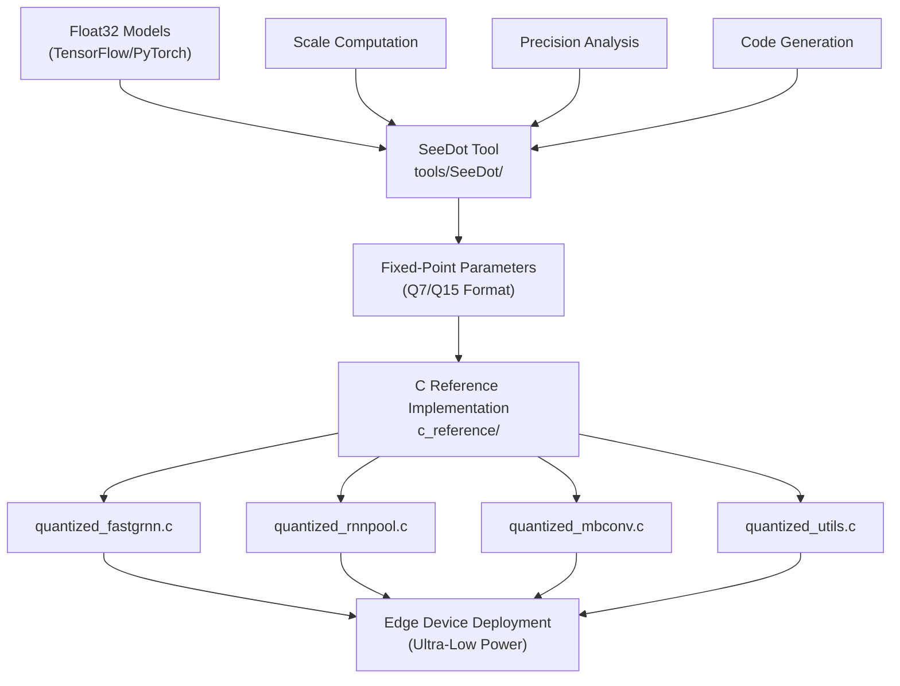
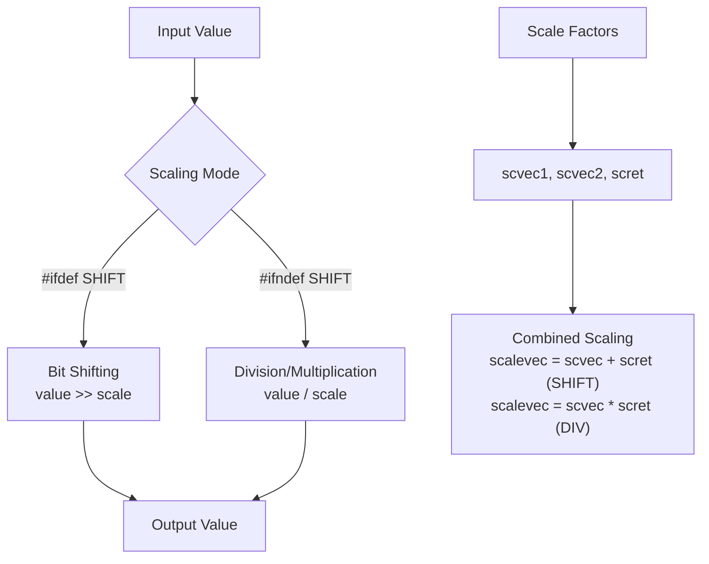
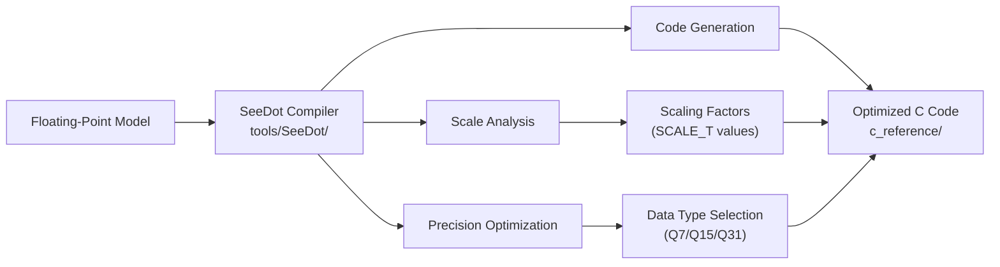
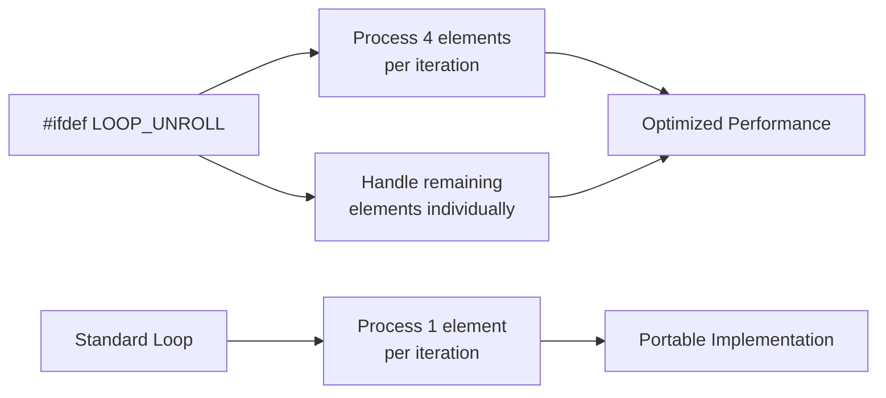
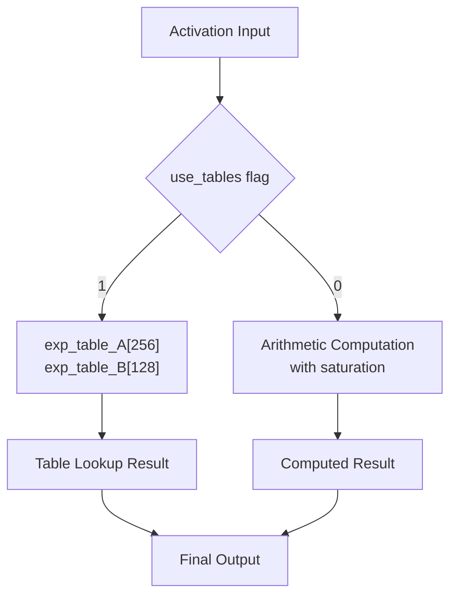
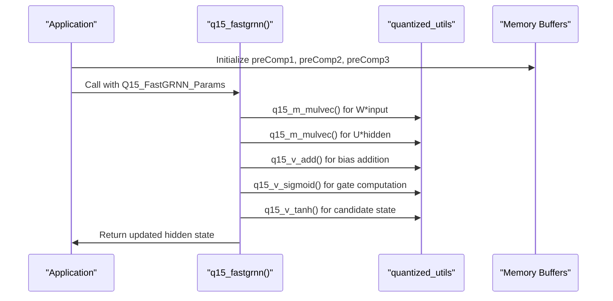
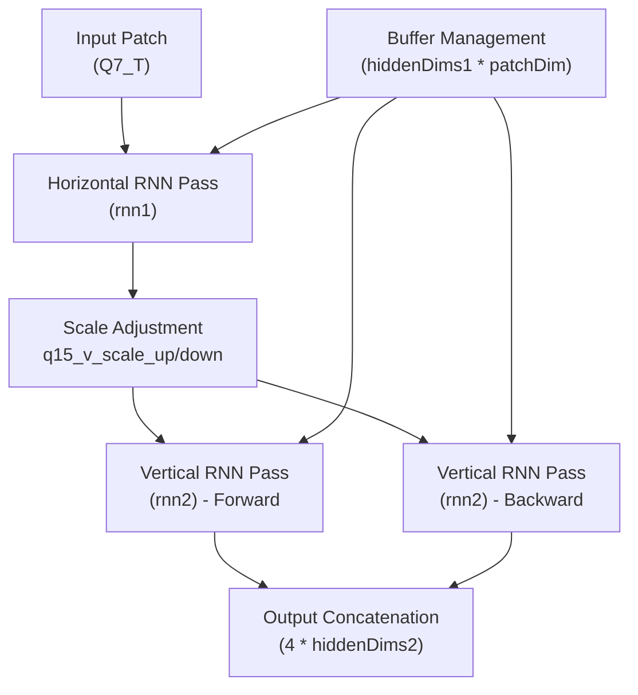
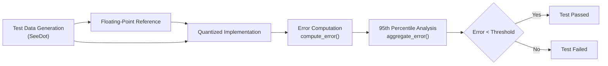

<!-- source: DeepWiki mcp.deepwiki.com · repo microsoft/EdgeML · page 5.1 Quantization Pipeline · fetched 2026-10-26 -->

# Quantization Pipeline

Relevant source files

The following files were used as context for generating this wiki page:

- [README.md](README.md)
- [c_reference/include/quantized_fastgrnn.h](c_reference/include/quantized_fastgrnn.h)
- [c_reference/include/quantized_mbconv.h](c_reference/include/quantized_mbconv.h)
- [c_reference/include/quantized_rnnpool.h](c_reference/include/quantized_rnnpool.h)
- [c_reference/include/quantized_utils.h](c_reference/include/quantized_utils.h)
- [c_reference/src/quantized_fastgrnn.c](c_reference/src/quantized_fastgrnn.c)
- [c_reference/src/quantized_mbconv.c](c_reference/src/quantized_mbconv.c)
- [c_reference/src/quantized_rnnpool.c](c_reference/src/quantized_rnnpool.c)
- [c_reference/src/quantized_utils.c](c_reference/src/quantized_utils.c)
- [c_reference/tests/rnnpool/q_wider_regression_model/rnn1.h](c_reference/tests/rnnpool/q_wider_regression_model/rnn1.h)
- [c_reference/tests/rnnpool/q_wider_regression_model/rnn2.h](c_reference/tests/rnnpool/q_wider_regression_model/rnn2.h)
- [c_reference/tests/rnnpool/test_quantized_rnnpool.c](c_reference/tests/rnnpool/test_quantized_rnnpool.c)
- [c_reference/tests/utils/test_quantized_utils.c](c_reference/tests/utils/test_quantized_utils.c)
- [examples/pytorch/DROCC/README.md](examples/pytorch/DROCC/README.md)
- [examples/pytorch/DROCC/data_process_scripts/process_cifar.py](examples/pytorch/DROCC/data_process_scripts/process_cifar.py)
- [examples/pytorch/DROCC/data_process_scripts/process_mnist.py](examples/pytorch/DROCC/data_process_scripts/process_mnist.py)
- [examples/pytorch/DROCC/main_cifar.py](examples/pytorch/DROCC/main_cifar.py)
- [examples/pytorch/DROCC/main_drocclf_mnist.py](examples/pytorch/DROCC/main_drocclf_mnist.py)
- [examples/pytorch/DROCC/main_tabular.py](examples/pytorch/DROCC/main_tabular.py)
- [examples/pytorch/DROCC/main_timeseries.py](examples/pytorch/DROCC/main_timeseries.py)
- [pytorch/README.md](pytorch/README.md)
- [pytorch/edgeml_pytorch/trainer/drocc_trainer.py](pytorch/edgeml_pytorch/trainer/drocc_trainer.py)
- [pytorch/edgeml_pytorch/trainer/drocclf_trainer.py](pytorch/edgeml_pytorch/trainer/drocclf_trainer.py)
- [tf/README.md](tf/README.md)

The quantization pipeline in EdgeML converts floating-point machine learning models to fixed-point representations optimized for edge device deployment. This system enables ultra-low power inference on resource-constrained devices by using integer arithmetic instead of floating-point operations.

For information about model export formats before quantization, see [Model Export and Conversion](#5.2). For details about training the models that feed into this pipeline, see [Training and Examples](#4).

## Overview

The EdgeML quantization pipeline transforms trained floating-point models into highly optimized fixed-point implementations suitable for microcontrollers and embedded systems. The pipeline consists of two main components: the SeeDot quantization tool and the C reference implementation library.

### Quantization Pipeline Architecture

**Quantization Pipeline Flow Diagram**

Sources: [README.md:29-30](), [README.md:44](), [c_reference/include/quantized_utils.h:1-500]()

## Data Types and Scaling

The quantization system uses two primary fixed-point data types with sophisticated scaling mechanisms to maintain numerical precision.

### Fixed-Point Data Types

| Type | Definition | Range | Usage |
|------|------------|-------|-------|
| `Q7_T` | `int8_t` | -128 to 127 | Weights, activations |
| `Q15_T` | `int16_t` | -32768 to 32767 | Intermediate computations |
| `Q31_T` | `int32_t` | -2^31 to 2^31-1 | Accumulations |
| `SCALE_T` | `int32_t` | Scale factors | Scaling operations |

### Scaling Operations

The system supports two scaling modes controlled by the `SHIFT` preprocessor directive:

**Scaling Mechanism Diagram**

Sources: [c_reference/src/quantized_utils.c:9-16](), [c_reference/include/quantized_datatypes.h]()

## SeeDot Quantization Tool

SeeDot is the core quantization compiler that analyzes floating-point models and generates optimized fixed-point C code. The tool performs static analysis to determine optimal scaling factors and bit-widths for each operation.

### SeeDot Workflow

**SeeDot Compilation Process**

Sources: [README.md:29-30](), [README.md:56]()

## C Reference Implementation

The C reference implementation provides a complete library of quantized operations for deploying EdgeML algorithms on edge devices. All operations are implemented with both bit-shifting and division-based scaling for maximum portability.

### Core Quantized Operations

```mermaid
graph TB
    subgraph "Vector Operations"
        A["q15_v_add()"]
        B["q15_v_sub()"]
        C["q15_v_hadamard()"]
        D["q15_v_scalar_mul()"]
    end
    
    subgraph "Matrix Operations"
        E["q15_m_mulvec()"]
        F["q15_m_sparse_mulvec()"]
        G["q15xq7_q15_m_mulvec()"]
    end
    
    subgraph "Activation Functions"
        H["q15_v_sigmoid()"]
        I["q15_v_tanh()"]
        J["q7_relu()"]
    end
    
    subgraph "Tensor Operations"
        K["q7_t_add()"]
        L["q15_t_l2_norm()"]
        M["q7xq15_q7_convolution()"]
    end
    
    N["quantized_utils.h"] --> A
    N --> B
    N --> C
    N --> D
    N --> E
    N --> F
    N --> G
    N --> H
    N --> I
    N --> J
    N --> K
    N --> L
    N --> M
```

**Quantized Operations Library Structure**

Sources: [c_reference/include/quantized_utils.h:66-492](), [c_reference/src/quantized_utils.c:1-2000]()

### Algorithm-Specific Implementations

The pipeline provides optimized quantized implementations for specific EdgeML algorithms:

| Algorithm | Header File | Implementation | Key Features |
|-----------|-------------|----------------|---------------|
| FastGRNN | `quantized_fastgrnn.h` | `quantized_fastgrnn.c` | Low-rank decomposition, sparse operations |
| RNNPool | `quantized_rnnpool.h` | `quantized_rnnpool.c` | Pooling with RNN cells |
| MBConv | `quantized_mbconv.h` | `quantized_mbconv.c` | Mobile convolution blocks |

Sources: [c_reference/include/quantized_fastgrnn.h:1-312](), [c_reference/include/quantized_rnnpool.h:1-46](), [c_reference/include/quantized_mbconv.h:1-121]()

## Optimization Features

### Loop Unrolling

The implementation includes optional loop unrolling for performance optimization:

**Loop Unrolling Strategy**

Sources: [c_reference/src/quantized_utils.c:17-33](), [c_reference/src/quantized_utils.c:54-70]()

### Table-Based Activation Functions

For activation functions like sigmoid and tanh, the system supports both table-based and arithmetic implementations:

**Activation Function Implementation Options**

Sources: [c_reference/include/quantized_utils.h:55-64](), [c_reference/src/quantized_utils.c:192-227]()

## Example Usage

### FastGRNN Quantized Inference

**FastGRNN Quantized Execution Flow**

Sources: [c_reference/include/quantized_fastgrnn.h:287-311](), [c_reference/src/quantized_fastgrnn.c:7-400]()

### RNNPool Block Processing

The RNNPool implementation demonstrates the integration of multiple quantized RNN operations:

**RNNPool Quantized Processing Pipeline**

Sources: [c_reference/include/quantized_rnnpool.h:12-44](), [c_reference/src/quantized_rnnpool.c:7-100]()

## Testing and Validation

The quantization pipeline includes comprehensive testing infrastructure to ensure numerical accuracy:

**Validation Pipeline for Quantized Operations**

Sources: [c_reference/tests/utils/test_quantized_utils.c:9-32](), [c_reference/tests/rnnpool/test_quantized_rnnpool.c:25-45]()

The quantization pipeline enables EdgeML algorithms to run efficiently on resource-constrained edge devices while maintaining numerical accuracy through careful scaling and optimization strategies.

---

