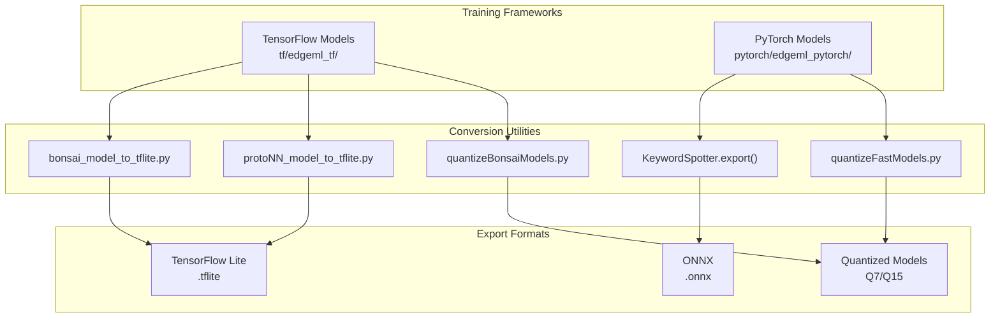
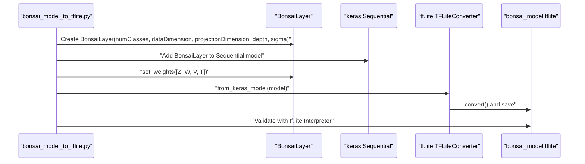
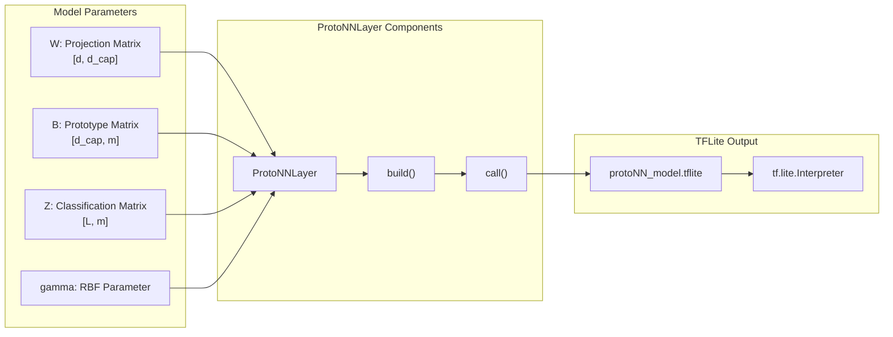
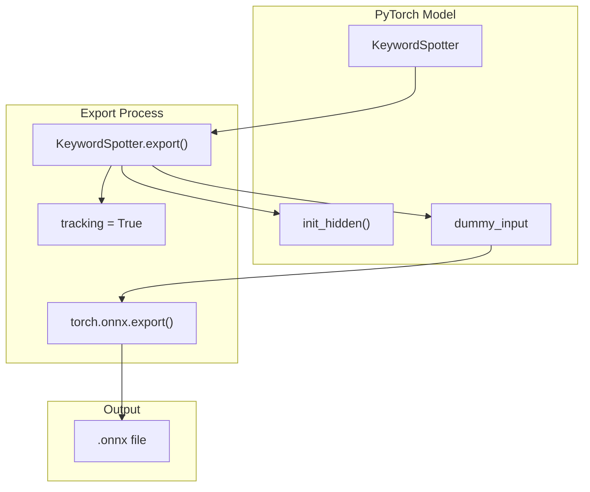
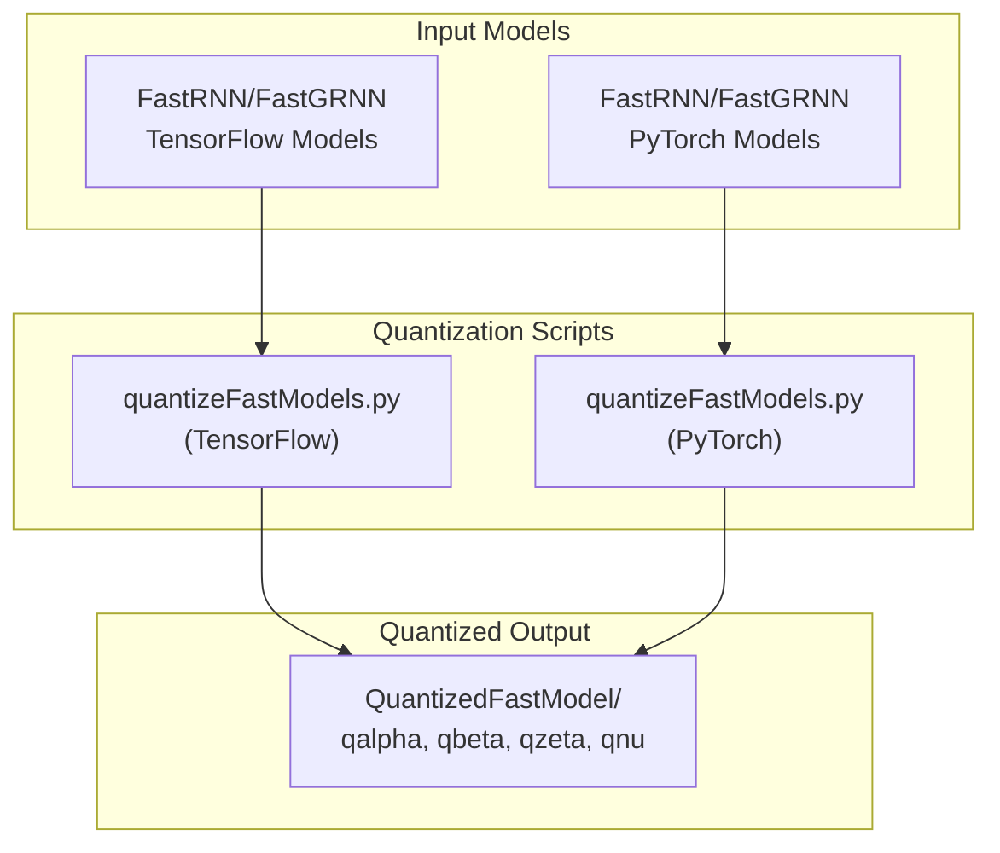
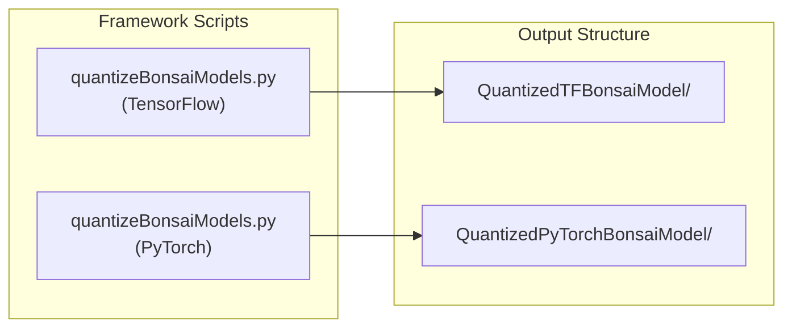

<!-- source: DeepWiki mcp.deepwiki.com · repo microsoft/EdgeML · page 5.2 Model Export and Conversion · fetched 2026-10-26 -->

# Model Export and Conversion

Relevant source files

The following files were used as context for generating this wiki page:

- [examples/pytorch/Bonsai/README.md](examples/pytorch/Bonsai/README.md)
- [examples/pytorch/FastCells/KWS-training/train_classifier.py](examples/pytorch/FastCells/KWS-training/train_classifier.py)
- [examples/pytorch/FastCells/KWS-training/training_config.py](examples/pytorch/FastCells/KWS-training/training_config.py)
- [examples/pytorch/FastCells/README.md](examples/pytorch/FastCells/README.md)
- [examples/pytorch/ProtoNN/README.md](examples/pytorch/ProtoNN/README.md)
- [examples/pytorch/SRNN/README.md](examples/pytorch/SRNN/README.md)
- [examples/tf/Bonsai/README.md](examples/tf/Bonsai/README.md)
- [examples/tf/Bonsai/bonsai_model_to_tflite.py](examples/tf/Bonsai/bonsai_model_to_tflite.py)
- [examples/tf/FastCells/README.md](examples/tf/FastCells/README.md)
- [examples/tf/ProtoNN/README.md](examples/tf/ProtoNN/README.md)
- [examples/tf/ProtoNN/protoNN_model_to_tflite.py](examples/tf/ProtoNN/protoNN_model_to_tflite.py)
- [tf/edgeml_tf/tflite/README.md](tf/edgeml_tf/tflite/README.md)
- [tf/edgeml_tf/tflite/__init__.py](tf/edgeml_tf/tflite/__init__.py)
- [tf/edgeml_tf/tflite/bonsaiLayer.py](tf/edgeml_tf/tflite/bonsaiLayer.py)
- [tf/edgeml_tf/tflite/protoNNLayer.py](tf/edgeml_tf/tflite/protoNNLayer.py)
- [tf/requirements-gpu.txt](tf/requirements-gpu.txt)

This page documents the model export and conversion capabilities in EdgeML, covering the transformation of trained models into deployment-ready formats. The system supports exporting models from both TensorFlow and PyTorch implementations to various target formats including TensorFlow Lite, ONNX, and quantized representations for edge deployment.

For information about the quantization pipeline from floating-point to fixed-point models, see [Quantization Pipeline](#5.1). For details about training models that will be exported, see [Training and Examples](#4).

## Export Pipeline Overview

EdgeML provides multiple pathways for converting trained models into deployment formats, with different frameworks supporting different export targets.

**Sources:** [examples/tf/Bonsai/bonsai_model_to_tflite.py:1-115](), [examples/tf/ProtoNN/protoNN_model_to_tflite.py:1-103](), [examples/pytorch/FastCells/KWS-training/train_classifier.py:60-68]()

## TensorFlow Lite Conversion

### Bonsai Model Conversion

The TensorFlow implementation provides dedicated conversion utilities for Bonsai models through custom Keras layers. The conversion process involves creating a `BonsaiLayer` and converting it to TensorFlow Lite format.

| Component | Purpose | Key Parameters |
|-----------|---------|----------------|
| `BonsaiLayer` | Custom Keras layer implementation | `numClasses`, `dataDimension`, `projectionDimension`, `treeDepth`, `sigma` |
| `bonsai_model_to_tflite.py` | Conversion script | `--data-dir`, `--model-dir`, `--regression` |
| TFLite Converter | Framework conversion utility | Optimization settings |

The conversion workflow:

**Sources:** [tf/edgeml_tf/tflite/bonsaiLayer.py:8-78](), [examples/tf/Bonsai/bonsai_model_to_tflite.py:67-90]()

### ProtoNN Model Conversion

ProtoNN models follow a similar conversion pattern using the `ProtoNNLayer` custom layer:

**Sources:** [tf/edgeml_tf/tflite/protoNNLayer.py:7-48](), [examples/tf/ProtoNN/protoNN_model_to_tflite.py:50-83]()

## ONNX Export

### PyTorch FastCells Export

PyTorch models, particularly FastCells used in keyword spotting applications, support ONNX export through the `torch.onnx.export` function. The `KeywordSpotter` class provides an `export` method that handles this conversion.

The export method signature and implementation:

| Parameter | Type | Purpose |
|-----------|------|---------|
| `name` | str | Output filename for ONNX model |
| `device` | torch.device | Target device (CPU/CUDA) |
| `dummy_input` | torch.Tensor | Example input for tracing |

**Sources:** [examples/pytorch/FastCells/KWS-training/train_classifier.py:60-68](), [examples/pytorch/FastCells/KWS-training/train_classifier.py:551-553]()

## Model Quantization for Export

### FastCells Quantization

Both TensorFlow and PyTorch implementations support quantization of FastCells models through dedicated scripts:

The quantization process converts floating-point parameters to fixed-point representations with specific naming conventions:

| Original Parameter | Quantized Parameter | Post-Processing |
|-------------------|-------------------|-----------------|
| `alpha` | `qalpha` | After sigmoid application |
| `beta` | `qbeta` | After sigmoid application |
| `zeta` | `qzeta` | After sigmoid application |
| `nu` | `qnu` | After sigmoid application |

**Sources:** [examples/pytorch/FastCells/README.md:77-89](), [examples/tf/FastCells/README.md:69-79]()

### Bonsai Model Quantization

Bonsai models support byte quantization through framework-specific scripts that generate quantized parameter matrices:

**Sources:** [examples/tf/Bonsai/README.md:70-78](), [examples/pytorch/Bonsai/README.md:55-63]()

## Export Format Compatibility Matrix

The following table summarizes the export capabilities across EdgeML implementations:

| Algorithm | TensorFlow | PyTorch | TFLite | ONNX | Quantization |
|-----------|------------|---------|--------|------|--------------|
| Bonsai | ✓ | ✓ | ✓ | ✗ | ✓ |
| ProtoNN | ✓ | ✓ | ✓ | ✗ | ✗ |
| FastRNN/FastGRNN | ✓ | ✓ | ✗ | ✓ | ✓ |
| DROCC | ✗ | ✓ | ✗ | ✓ | ✗ |

### Dependencies and Requirements

Export functionality requires specific package versions:

| Format | Required Package | Version Constraint |
|--------|------------------|-------------------|
| TFLite | `tensorflow` | 2.x for TFLite conversion |
| ONNX | `onnx` | 1.8.0+ (PyTorch) |
| Quantization | Framework-specific | Native support |

**Sources:** [tf/requirements-gpu.txt:10](), [examples/tf/Bonsai/bonsai_model_to_tflite.py:14]()

---

