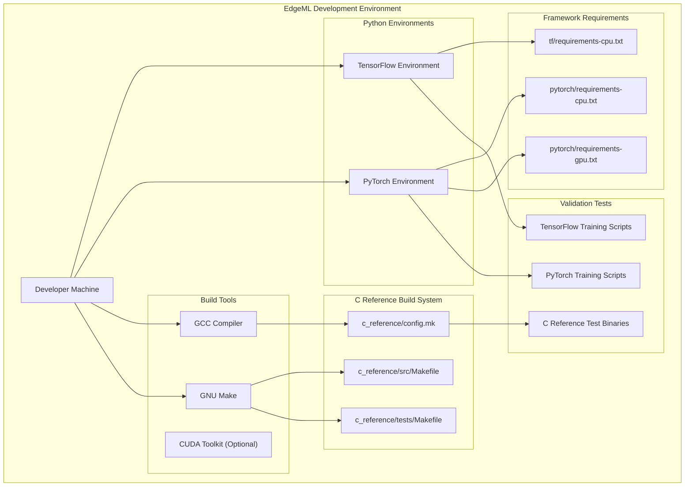
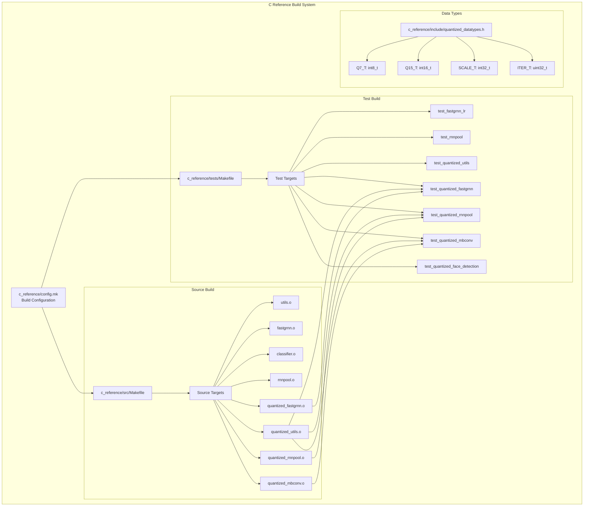
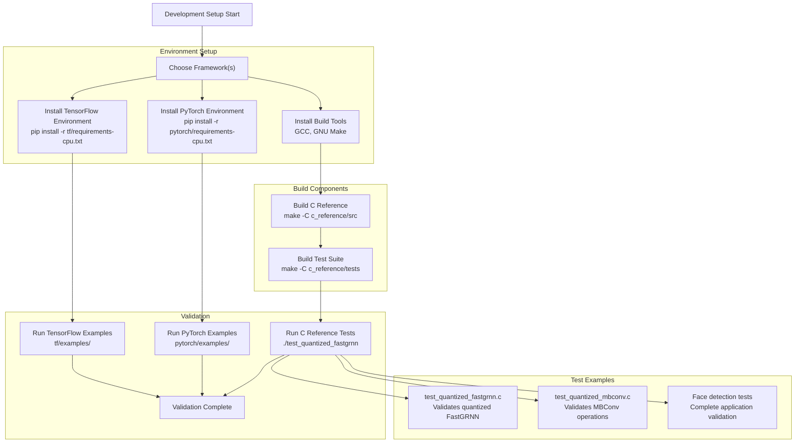

<!-- source: DeepWiki mcp.deepwiki.com · repo microsoft/EdgeML · page 6 Development Setup · fetched 2026-10-26 -->

# Development Setup

<details>
<summary>Relevant source files</summary>

The following files were used as context for generating this wiki page:

- [c_reference/include/quantized_datatypes.h](c_reference/include/quantized_datatypes.h)
- [c_reference/src/Makefile](c_reference/src/Makefile)
- [c_reference/tests/Makefile](c_reference/tests/Makefile)
- [c_reference/tests/fastgrnn/test_quantized_fastgrnn.c](c_reference/tests/fastgrnn/test_quantized_fastgrnn.c)
- [c_reference/tests/mbconv/q_wider_regression_model/mbconv.h](c_reference/tests/mbconv/q_wider_regression_model/mbconv.h)
- [c_reference/tests/mbconv/test_quantized_mbconv.c](c_reference/tests/mbconv/test_quantized_mbconv.c)
- [pytorch/requirements-cpu.txt](pytorch/requirements-cpu.txt)
- [pytorch/requirements-gpu.txt](pytorch/requirements-gpu.txt)
- [tf/requirements-cpu.txt](tf/requirements-cpu.txt)

</details>


This document provides instructions for setting up a development environment for EdgeML, including installing dependencies, building components, and validating installations across all supported frameworks (TensorFlow, PyTorch, and C/C++).

For detailed requirements and installation procedures, see [Requirements and Installation](#6.1). For comprehensive building and testing instructions, see [Building and Testing](#6.2).

## Development Environment Overview

EdgeML supports multiple implementation frameworks, each with specific requirements and build processes. The development setup varies depending on which components you plan to use.



**Sources:** [tf/requirements-cpu.txt:1-12](), [pytorch/requirements-cpu.txt:1-10](), [pytorch/requirements-gpu.txt:1-10](), [c_reference/tests/Makefile:1-48](), [c_reference/src/Makefile:1-42]()

## Framework Requirements Summary

EdgeML supports development across three main frameworks, each with distinct dependency requirements:

| Framework | Python Version | Key Dependencies | GPU Support |
|-----------|----------------|------------------|-------------|
| TensorFlow | Python 3.6+ | `tensorflow==1.15.4`, `numpy==1.16.4` | CPU/GPU |
| PyTorch | Python 3.6+ | `torch==1.4.0`, `torchvision==0.5.0` | CPU/GPU |
| C Reference | N/A | GCC, GNU Make | N/A |

**Common Dependencies:**
- `numpy==1.16.4`
- `scipy==1.3.0`
- `scikit-learn==0.21.2`
- `pandas==0.23.4`
- `jupyter==1.0.0`

**Additional Tools:**
- `antlr4-python3-runtime==4.7` (for SeeDot quantization)
- `onnx==1.8.0` (for model export)
- `bokeh==2.1.1` (for visualization)
- `tqdm==4.56.0` (for progress bars)

**Sources:** [tf/requirements-cpu.txt:1-12](), [pytorch/requirements-cpu.txt:1-10](), [pytorch/requirements-gpu.txt:1-10]()

## C Reference Build System Architecture

The C reference implementation uses a hierarchical Makefile-based build system for compiling quantized inference code and validation tests.



**Sources:** [c_reference/tests/Makefile:1-48](), [c_reference/src/Makefile:1-42](), [c_reference/include/quantized_datatypes.h:1-26]()

## Installation and Validation Workflow

The development setup follows a structured workflow from environment preparation through validation testing.



**Sources:** [c_reference/tests/fastgrnn/test_quantized_fastgrnn.c:1-39](), [c_reference/tests/mbconv/test_quantized_mbconv.c:1-202]()

## Key Build Targets and Commands

The C reference implementation provides several important build targets for development and testing:

### Source Compilation Targets

```bash
# Build all source objects
make -C c_reference/src all

# Individual targets
make -C c_reference/src utils.o fastgrnn.o classifier.o rnnpool.o
make -C c_reference/src quantized_utils.o quantized_fastgrnn.o quantized_rnnpool.o quantized_mbconv.o
```

### Test Compilation Targets

```bash
# Build all tests
make -C c_reference/tests all

# Specific algorithm tests
make -C c_reference/tests test_fastgrnn_lr test_rnnpool
make -C c_reference/tests test_quantized_fastgrnn test_quantized_rnnpool test_quantized_mbconv

# Application tests
make -C c_reference/tests test_quantized_face_detection
```

### Quantized Data Types

The C reference implementation defines specific data types for quantized operations in [c_reference/include/quantized_datatypes.h:10-24]():

- `Q7_T`: `int8_t` for 8-bit quantized values
- `Q15_T`: `int16_t` for 16-bit quantized values  
- `SCALE_T`: `int32_t` for scaling operations
- `ITER_T`: `uint32_t` for iteration counters

**Sources:** [c_reference/tests/Makefile:11-39](), [c_reference/src/Makefile:9-33](), [c_reference/include/quantized_datatypes.h:10-24]()

## Next Steps

For detailed installation procedures and dependency management, see [Requirements and Installation](#6.1).

For comprehensive build instructions, testing procedures, and troubleshooting, see [Building and Testing](#6.2).

---

