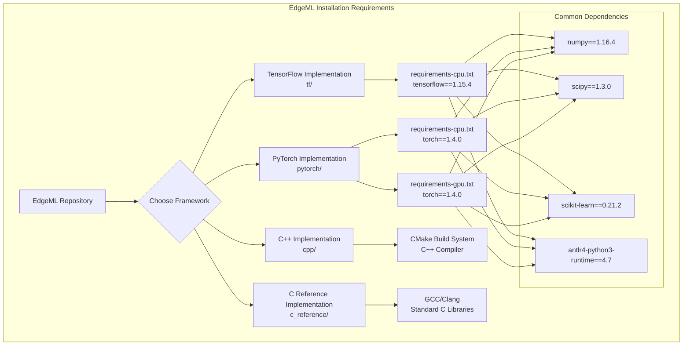
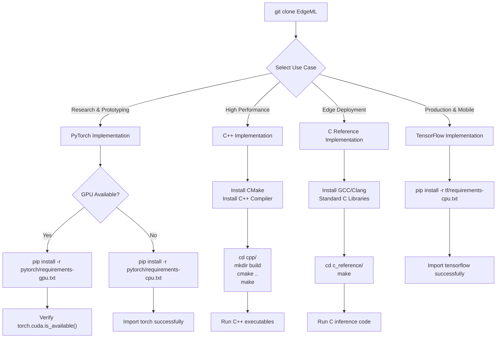
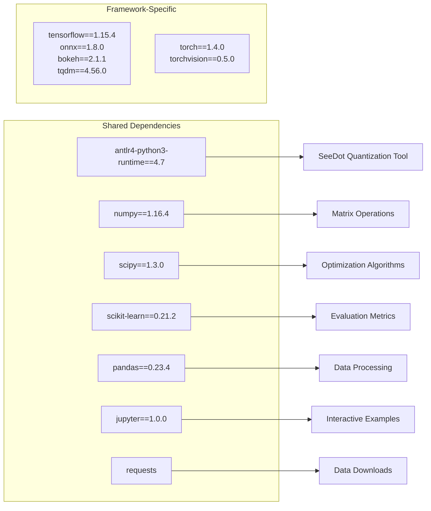

<!-- source: DeepWiki mcp.deepwiki.com · repo microsoft/EdgeML · page 6.1 Requirements and Installation · fetched 2026-10-26 -->

# Requirements and Installation

<details>
<summary>Relevant source files</summary>

The following files were used as context for generating this wiki page:

- [pytorch/requirements-cpu.txt](pytorch/requirements-cpu.txt)
- [pytorch/requirements-gpu.txt](pytorch/requirements-gpu.txt)
- [tf/requirements-cpu.txt](tf/requirements-cpu.txt)

</details>


This page provides detailed installation requirements and setup instructions for the EdgeML repository. EdgeML supports multiple implementation frameworks (TensorFlow, PyTorch, C++, and C reference implementations), each with specific dependencies and installation procedures. This page covers Python environment setup, framework-specific requirements, and basic installation procedures. For detailed framework usage and capabilities, see [Implementation Frameworks](#3). For build instructions and testing procedures, see [Building and Testing](#6.2).

## Framework Requirements Overview

EdgeML supports multiple implementation frameworks, each optimized for different use cases and deployment scenarios. The installation requirements vary significantly between frameworks.



Sources: [tf/requirements-cpu.txt:1-12](), [pytorch/requirements-cpu.txt:1-10](), [pytorch/requirements-gpu.txt:1-10]()

## Python Framework Requirements

### TensorFlow Implementation

The TensorFlow implementation requires Python 3.6+ with specific package versions for compatibility with TensorFlow 1.15.4.

| Package | Version | Purpose |
|---------|---------|---------|
| `tensorflow` | 1.15.4 | Core ML framework |
| `numpy` | 1.16.4 | Numerical computations |
| `scipy` | 1.3.0 | Scientific computing |
| `scikit-learn` | 0.21.2 | ML utilities and metrics |
| `pandas` | 0.23.4 | Data manipulation |
| `onnx` | 1.8.0 | Model export format |
| `bokeh` | 2.1.1 | Visualization |
| `tqdm` | 4.56.0 | Progress bars |
| `antlr4-python3-runtime` | 4.7 | SeeDot quantization tool |
| `jupyter` | 1.0.0 | Interactive notebooks |
| `requests` | latest | HTTP utilities |

**Installation:**
```bash
cd tf/
pip install -r requirements-cpu.txt
```

Sources: [tf/requirements-cpu.txt:1-12]()

### PyTorch Implementation

The PyTorch implementation supports both CPU and GPU configurations. The GPU configuration uses the same dependencies as CPU but requires CUDA-compatible PyTorch installation.

| Package | Version | Purpose |
|---------|---------|---------|
| `torch` | 1.4.0 | Core ML framework |
| `torchvision` | 0.5.0 | Computer vision utilities |
| `numpy` | 1.16.4 | Numerical computations |
| `scipy` | 1.3.0 | Scientific computing |
| `scikit-learn` | 0.21.2 | ML utilities and metrics |
| `pandas` | 0.23.4 | Data manipulation |
| `antlr4-python3-runtime` | 4.7 | SeeDot quantization tool |
| `jupyter` | 1.0.0 | Interactive notebooks |
| `requests` | latest | HTTP utilities |

**CPU Installation:**
```bash
cd pytorch/
pip install -r requirements-cpu.txt
```

**GPU Installation:**
```bash
cd pytorch/
pip install -r requirements-gpu.txt
```

Note: For GPU support, ensure CUDA 10.1 or compatible version is installed on your system.

Sources: [pytorch/requirements-cpu.txt:1-10](), [pytorch/requirements-gpu.txt:1-10]()

## Installation Flow and Framework Selection



Sources: [tf/requirements-cpu.txt:1-12](), [pytorch/requirements-cpu.txt:1-10](), [pytorch/requirements-gpu.txt:1-10]()

## System Prerequisites

### Python Environment

- **Python Version**: 3.6 or higher
- **Package Manager**: pip (version 19.0+) or conda
- **Virtual Environment**: Recommended to avoid dependency conflicts

### Hardware Requirements

| Implementation | Minimum RAM | Recommended RAM | GPU Support |
|---------------|-------------|-----------------|-------------|
| TensorFlow | 4GB | 8GB | CPU only |
| PyTorch | 4GB | 8GB | CUDA 10.1+ |
| C++ | 2GB | 4GB | No |
| C Reference | 1GB | 2GB | No |

### Operating System Support

- **Linux**: Ubuntu 16.04+, CentOS 7+
- **macOS**: 10.12+
- **Windows**: 10 (with WSL recommended for C implementations)

## Common Dependencies Analysis

The following packages are shared across TensorFlow and PyTorch implementations:



Sources: [tf/requirements-cpu.txt:1-12](), [pytorch/requirements-cpu.txt:1-10]()

## Verification Steps

After installation, verify your setup using the following commands:

### TensorFlow Verification
```bash
python -c "import tensorflow as tf; print(tf.__version__)"
python -c "import numpy, scipy, sklearn, pandas; print('All packages imported successfully')"
```

### PyTorch Verification
```bash
python -c "import torch; print(torch.__version__)"
python -c "import torch; print('CUDA available:', torch.cuda.is_available())"
python -c "import numpy, scipy, sklearn, pandas; print('All packages imported successfully')"
```

## Troubleshooting Common Issues

### Version Compatibility
- **TensorFlow 1.15.4** is specifically required for compatibility with EdgeML algorithms
- **PyTorch 1.4.0** provides the necessary features for custom CUDA kernels
- **NumPy 1.16.4** prevents compatibility issues with older TensorFlow versions

### GPU Setup
For PyTorch GPU support:
1. Verify CUDA installation: `nvcc --version`
2. Check GPU compatibility: `nvidia-smi`
3. Install PyTorch with CUDA support from official PyTorch website if automatic detection fails

### Dependency Conflicts
Use virtual environments to isolate EdgeML dependencies:
```bash
python -m venv edgeml_env
source edgeml_env/bin/activate  # Linux/macOS
# or
edgeml_env\Scripts\activate     # Windows
```

Sources: [tf/requirements-cpu.txt:1-12](), [pytorch/requirements-cpu.txt:1-10](), [pytorch/requirements-gpu.txt:1-10]()

---

