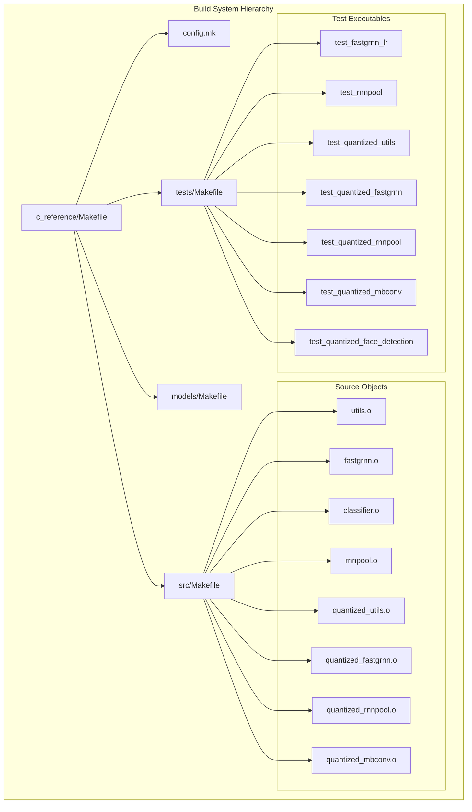
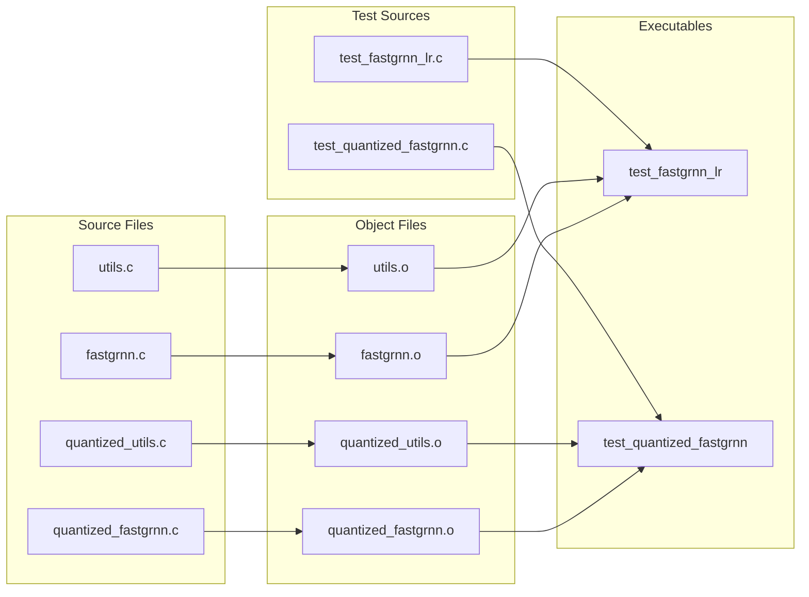
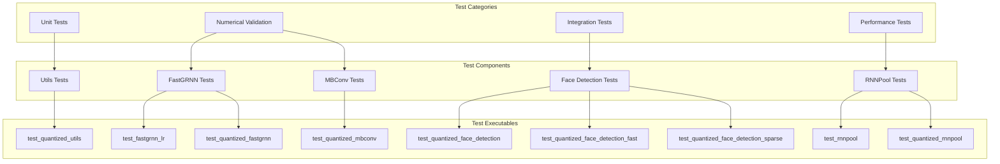
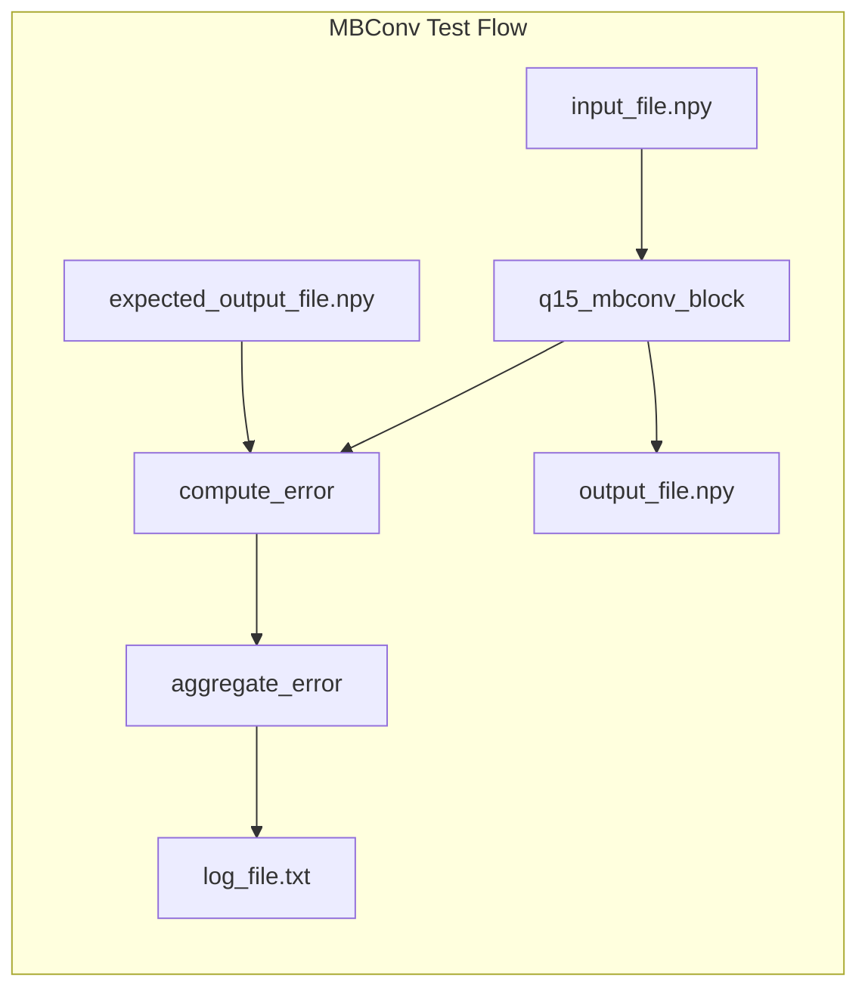

<!-- source: DeepWiki mcp.deepwiki.com · repo microsoft/EdgeML · page 6.2 Building and Testing · fetched 2026-10-26 -->

# Building and Testing

<details>
<summary>Relevant source files</summary>

The following files were used as context for generating this wiki page:

- [c_reference/Makefile](c_reference/Makefile)
- [c_reference/README.md](c_reference/README.md)
- [c_reference/config.mk](c_reference/config.mk)
- [c_reference/include/classifier.h](c_reference/include/classifier.h)
- [c_reference/include/fastgrnn.h](c_reference/include/fastgrnn.h)
- [c_reference/include/quantized_datatypes.h](c_reference/include/quantized_datatypes.h)
- [c_reference/include/utils.h](c_reference/include/utils.h)
- [c_reference/src/Makefile](c_reference/src/Makefile)
- [c_reference/src/classifier.c](c_reference/src/classifier.c)
- [c_reference/src/utils.c](c_reference/src/utils.c)
- [c_reference/tests/Makefile](c_reference/tests/Makefile)
- [c_reference/tests/fastgrnn/test_fastgrnn_lr.c](c_reference/tests/fastgrnn/test_fastgrnn_lr.c)
- [c_reference/tests/fastgrnn/test_quantized_fastgrnn.c](c_reference/tests/fastgrnn/test_quantized_fastgrnn.c)
- [c_reference/tests/mbconv/q_wider_regression_model/mbconv.h](c_reference/tests/mbconv/q_wider_regression_model/mbconv.h)
- [c_reference/tests/mbconv/test_quantized_mbconv.c](c_reference/tests/mbconv/test_quantized_mbconv.c)
- [c_reference/tests/rnnpool/test_rnnpool.c](c_reference/tests/rnnpool/test_rnnpool.c)

</details>


This document covers the build system and testing framework for the C reference implementation in EdgeML. The C reference implementation provides quantized inference capabilities for edge deployment, including FastGRNN, RNNPool, MBConv operations, and complete applications like face detection.

For information about the C reference algorithms and data types, see [C Reference Implementation](#3.4). For deployment and quantization pipeline details, see [Quantization Pipeline](#5.1).

## Build System Overview

The EdgeML C reference implementation uses a hierarchical Makefile system with GNU Make and GCC. The build system is organized into three main components: source compilation, model compilation, and test compilation.

### Build System Architecture



Sources: [c_reference/Makefile:10-13](), [c_reference/src/Makefile:9](), [c_reference/tests/Makefile:11]()

## Build Configuration

The build system uses a centralized configuration in `config.mk` that defines compiler settings and flags for all components.

| Configuration | Value | Purpose |
|---------------|-------|---------|
| `CC` | `gcc` | C compiler |
| `CFLAGS` | `-g -fPIC -O3 -Wall` | Debug info, position independent code, optimization, warnings |
| `LDFLAGS` | `-lm -ldl` | Math library and dynamic loading |

Sources: [c_reference/config.mk:4-6]()

## Building the C Reference Implementation

### Prerequisites

- GCC compiler toolchain
- GNU Make
- Math library (libm)
- Git LFS for model weights (if building complete models)

### Build Commands

To build the entire C reference implementation:

```bash
cd c_reference
make
```

This executes the hierarchical build process:

1. **Source Compilation**: Builds all core library objects
2. **Model Compilation**: Builds model-specific objects and headers
3. **Test Compilation**: Builds all test executables

To build individual components:

```bash
# Build only source objects
make -C src

# Build only tests  
make -C tests

# Clean build artifacts
make clean

# Deep clean including temporary files
make cleanest
```

Sources: [c_reference/Makefile:10-14](), [c_reference/Makefile:17-27]()

### Compilation Flow



Sources: [c_reference/src/Makefile:11-33](), [c_reference/tests/Makefile:14-17]()

## Testing Framework

The EdgeML C reference implementation includes comprehensive test suites that validate both floating-point and quantized operations. Tests are organized by component and include both unit tests and integration tests.

### Test Organization



Sources: [c_reference/tests/Makefile:11](), [c_reference/tests/fastgrnn/test_fastgrnn_lr.c:1-20](), [c_reference/tests/mbconv/test_quantized_mbconv.c:1-50]()

## Running Tests

### Individual Test Execution

Each test executable can be run independently after building:

```bash
# Run FastGRNN low-rank test
./test_fastgrnn_lr

# Run quantized FastGRNN test  
./test_quantized_fastgrnn

# Run RNNPool test
./test_rnnpool

# Run quantized utilities test
./test_quantized_utils
```

### Test Dependencies

Tests have specific dependencies on compiled objects and model files:

| Test | Dependencies | Purpose |
|------|-------------|---------|
| `test_fastgrnn_lr` | `utils.o`, `fastgrnn.o`, `classifier.o` | Validates low-rank FastGRNN with USPS dataset |
| `test_quantized_fastgrnn` | `quantized_utils.o`, `quantized_fastgrnn.o` | Validates quantized FastGRNN operations |
| `test_rnnpool` | `utils.o`, `fastgrnn.o`, `rnnpool.o` | Validates RNNPool block operations |
| `test_quantized_mbconv` | `quantized_utils.o`, `quantized_mbconv.o` | Validates quantized MBConv with file I/O |

Sources: [c_reference/tests/Makefile:14-39]()

## Test Types and Validation

### Numerical Validation Tests

The quantized tests perform numerical validation by comparing fixed-point results against expected floating-point outputs. 

#### FastGRNN Quantized Test

The `test_quantized_fastgrnn` validates the `q15_fastgrnn` function using predetermined test vectors:

- **Input**: 4-element `Q15_T` patch: `{1040, 1919, 4254, 4024}`
- **Expected Output**: 8-element `Q15_T` array for `HIDDEN_DIM1`
- **Validation**: Exact fixed-point comparison

Sources: [c_reference/tests/fastgrnn/test_quantized_fastgrnn.c:10-15](), [c_reference/tests/fastgrnn/test_quantized_fastgrnn.c:24-35]()

#### MBConv Numerical Test

The `test_quantized_mbconv` performs comprehensive numerical validation with file-based I/O:



The test validates:
- **Maximum Deviation**: Per-element percentage error
- **95th Percentile Error**: Statistical error aggregation  
- **Fixed-Point Accuracy**: Exact integer comparison
- **Performance Timing**: Execution time measurement

Sources: [c_reference/tests/mbconv/test_quantized_mbconv.c:22-42](), [c_reference/tests/mbconv/test_quantized_mbconv.c:154-180]()

### Integration Tests  

#### Face Detection Tests

Three face detection test variants validate complete application pipelines:

- `test_quantized_face_detection`: Standard face detection model
- `test_quantized_face_detection_fast`: Optimized fast variant
- `test_quantized_face_detection_sparse`: Sparse model variant

Each integrates multiple quantized components: `quantized_fastgrnn.o`, `quantized_rnnpool.o`, `quantized_mbconv.o`, and model-specific objects.

Sources: [c_reference/tests/Makefile:34-39]()

### Data Types and Precision

The testing framework validates multiple quantized data types defined in the system:

| Type | Definition | Range | Usage |
|------|------------|-------|-------|
| `Q7_T` | `int8_t` | -128 to 127 | 8-bit quantized values |
| `Q15_T` | `int16_t` | -32768 to 32767 | 16-bit quantized values |  
| `SCALE_T` | `int32_t` | 32-bit signed | Scaling factors |
| `ITER_T` | `uint32_t` | 32-bit unsigned | Loop iterators |

Sources: [c_reference/include/quantized_datatypes.h:10-19]()