# Page: Overview

# Overview

<details>
<summary>Relevant source files</summary>

The following files were used as context for generating this wiki page:

- [README.md](README.md)
- [examples/pytorch/DROCC/README.md](examples/pytorch/DROCC/README.md)
- [examples/pytorch/DROCC/data_process_scripts/process_cifar.py](examples/pytorch/DROCC/data_process_scripts/process_cifar.py)
- [examples/pytorch/DROCC/data_process_scripts/process_mnist.py](examples/pytorch/DROCC/data_process_scripts/process_mnist.py)
- [examples/pytorch/DROCC/main_cifar.py](examples/pytorch/DROCC/main_cifar.py)
- [examples/pytorch/DROCC/main_drocclf_mnist.py](examples/pytorch/DROCC/main_drocclf_mnist.py)
- [examples/pytorch/DROCC/main_tabular.py](examples/pytorch/DROCC/main_tabular.py)
- [examples/pytorch/DROCC/main_timeseries.py](examples/pytorch/DROCC/main_timeseries.py)
- [pytorch/README.md](pytorch/README.md)
- [pytorch/edgeml_pytorch/trainer/drocc_trainer.py](pytorch/edgeml_pytorch/trainer/drocc_trainer.py)
- [pytorch/edgeml_pytorch/trainer/drocclf_trainer.py](pytorch/edgeml_pytorch/trainer/drocclf_trainer.py)
- [tf/README.md](tf/README.md)

</details>


This document provides a comprehensive overview of the EdgeML repository, which contains machine learning algorithms optimized for resource-constrained edge devices. EdgeML was developed at Microsoft Research India to enable real-time predictions on IoT devices and edge computing platforms with minimal storage, computation, and energy requirements.

For specific training examples and usage instructions, see [Training and Examples](#4). For detailed algorithm implementations, see [Core Algorithms](#2). For deployment and quantization processes, see [Deployment and Optimization](#5).

## Purpose and Scope

EdgeML addresses the challenge of deploying machine learning models on devices with severe resource constraints. The repository provides algorithms that can train models requiring orders of magnitude less memory than conventional ML approaches while maintaining competitive accuracy. These models are designed to fit in kilobytes and run efficiently on microcontrollers, IoT sensors, and edge devices without cloud connectivity.

Sources: [README.md:1-27]()

## System Architecture

The EdgeML ecosystem consists of multiple implementation frameworks, core algorithms, and deployment tools that work together to provide a complete pipeline from training to edge deployment.

### Overall Architecture

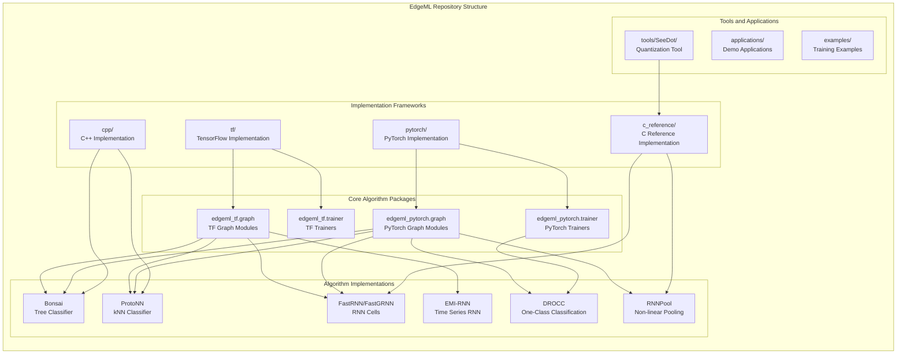

Sources: [README.md:36-45](), [tf/README.md:1-15](), [pytorch/README.md:1-40]()

## Core Algorithms

EdgeML provides several specialized algorithms designed for resource efficiency:

| Algorithm | Purpose | Key Features | Implementations |
|-----------|---------|--------------|-----------------|
| **Bonsai** | Tree-based classification | Shallow non-linear trees | `tf/`, `pytorch/`, `cpp/` |
| **ProtoNN** | Prototype-based kNN | Efficient nearest neighbor | `tf/`, `pytorch/`, `cpp/` |
| **FastRNN/FastGRNN** | Recurrent neural networks | Low-rank parameterization, CUDA acceleration | `tf/`, `pytorch/`, `c_reference/` |
| **DROCC** | One-class classification | Deep robust anomaly detection | `pytorch/` only |
| **EMI-RNN** | Time series analysis | Early prediction for RNNs | `tf/` |
| **RNNPool** | Non-linear pooling | RAM-constrained inference | `pytorch/`, `c_reference/` |

### Algorithm Availability Matrix

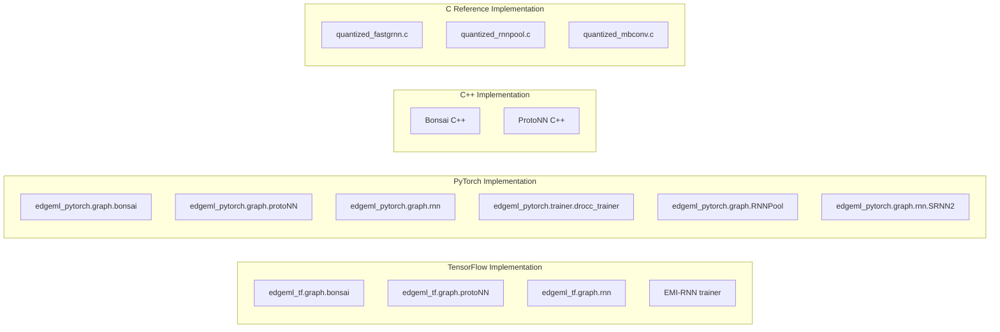

Sources: [tf/README.md:3-10](), [pytorch/README.md:8-39](), [README.md:14-21]()

## Implementation Frameworks

### Framework Capabilities

Each implementation framework serves different use cases:

- **TensorFlow** (`tf/`): Production deployment with TensorFlow Lite export support
- **PyTorch** (`pytorch/`): Research and development with the most complete algorithm coverage
- **C++** (`cpp/`): High-performance training and inference for Bonsai and ProtoNN
- **C Reference** (`c_reference/`): Quantized inference optimized for microcontrollers

### PyTorch Implementation Highlights

The PyTorch implementation provides the most comprehensive algorithm support, including:

- `FastRNNCUDACell` and `FastGRNNCUDACell` for GPU acceleration
- `DROCCTrainer` class for one-class classification training
- `SRNN2` meta-architecture for streaming data
- Full ONNX export compatibility

Sources: [pytorch/README.md:18-27](), [pytorch/edgeml_pytorch/trainer/drocc_trainer.py:10-35]()

## Training to Deployment Pipeline

The EdgeML system supports a complete pipeline from model training to edge deployment:

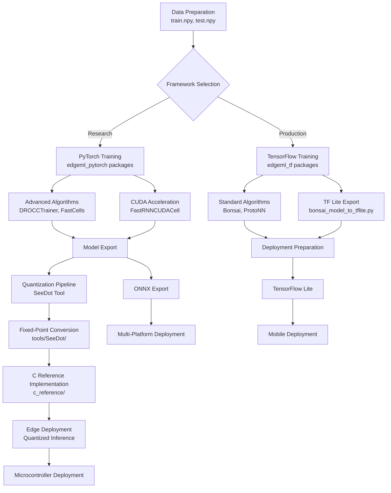

Sources: [README.md:29-30](), [README.md:36-45]()

## Quantization and Edge Optimization

EdgeML provides a sophisticated quantization pipeline through the SeeDot tool:

### Quantization Data Types

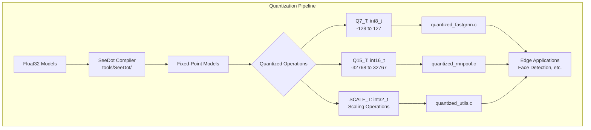

The C reference implementation provides highly optimized quantized operations for:
- `quantized_fastgrnn.c` - Quantized FastGRNN cells
- `quantized_rnnpool.c` - Quantized RNNPool operations  
- `quantized_mbconv.c` - Quantized MBConv blocks
- `quantized_utils.c` - Supporting quantized utilities

Sources: [README.md:29-30](), [README.md:44]()

## Getting Started

To begin using EdgeML:

1. **Choose Implementation Framework**: Select between TensorFlow (`tf/`) for production deployment or PyTorch (`pytorch/`) for research and development
2. **Install Dependencies**: Follow framework-specific installation instructions in respective README files
3. **Select Algorithm**: Choose from Bonsai, ProtoNN, FastCells, DROCC, or other algorithms based on your use case
4. **Train Model**: Use provided examples in `examples/tf/` or `examples/pytorch/`
5. **Deploy**: Export to TensorFlow Lite, ONNX, or use SeeDot quantization for edge deployment

For detailed installation instructions, see [Development Setup](#6). For algorithm-specific guidance, see [Core Algorithms](#2).

Sources: [tf/README.md:16-33](), [pytorch/README.md:44-74](), [README.md:46]()

---

# Page: Core Algorithms

# Core Algorithms

<details>
<summary>Relevant source files</summary>

The following files were used as context for generating this wiki page:

- [README.md](README.md)
- [examples/pytorch/DROCC/README.md](examples/pytorch/DROCC/README.md)
- [examples/pytorch/DROCC/data_process_scripts/process_cifar.py](examples/pytorch/DROCC/data_process_scripts/process_cifar.py)
- [examples/pytorch/DROCC/data_process_scripts/process_mnist.py](examples/pytorch/DROCC/data_process_scripts/process_mnist.py)
- [examples/pytorch/DROCC/main_cifar.py](examples/pytorch/DROCC/main_cifar.py)
- [examples/pytorch/DROCC/main_drocclf_mnist.py](examples/pytorch/DROCC/main_drocclf_mnist.py)
- [examples/pytorch/DROCC/main_tabular.py](examples/pytorch/DROCC/main_tabular.py)
- [examples/pytorch/DROCC/main_timeseries.py](examples/pytorch/DROCC/main_timeseries.py)
- [examples/pytorch/FastCells/fastcell_example.py](examples/pytorch/FastCells/fastcell_example.py)
- [examples/pytorch/FastCells/helpermethods.py](examples/pytorch/FastCells/helpermethods.py)
- [pytorch/README.md](pytorch/README.md)
- [pytorch/edgeml_pytorch/cuda/fastgrnn_cuda.cpp](pytorch/edgeml_pytorch/cuda/fastgrnn_cuda.cpp)
- [pytorch/edgeml_pytorch/cuda/fastgrnn_cuda_kernel.cu](pytorch/edgeml_pytorch/cuda/fastgrnn_cuda_kernel.cu)
- [pytorch/edgeml_pytorch/cuda/setup.py](pytorch/edgeml_pytorch/cuda/setup.py)
- [pytorch/edgeml_pytorch/graph/rnn.py](pytorch/edgeml_pytorch/graph/rnn.py)
- [pytorch/edgeml_pytorch/trainer/drocc_trainer.py](pytorch/edgeml_pytorch/trainer/drocc_trainer.py)
- [pytorch/edgeml_pytorch/trainer/drocclf_trainer.py](pytorch/edgeml_pytorch/trainer/drocclf_trainer.py)
- [pytorch/edgeml_pytorch/utils.py](pytorch/edgeml_pytorch/utils.py)
- [pytorch/setup.py](pytorch/setup.py)
- [tf/README.md](tf/README.md)

</details>


This document provides an overview of the machine learning algorithms implemented in EdgeML, their characteristics, and implementation architecture. These algorithms are specifically designed for resource-constrained edge devices with emphasis on model size, inference speed, and energy efficiency.

For detailed algorithm-specific documentation, see: [DROCC](#2.1), [FastCells](#2.2), [Bonsai and ProtoNN](#2.3), and [Other Algorithms](#2.4). For training examples and usage, see [Training and Examples](#4). For deployment considerations, see [Deployment and Optimization](#5).

## Algorithm Categories

EdgeML implements algorithms across three main categories, each targeting different machine learning paradigms while maintaining resource efficiency:

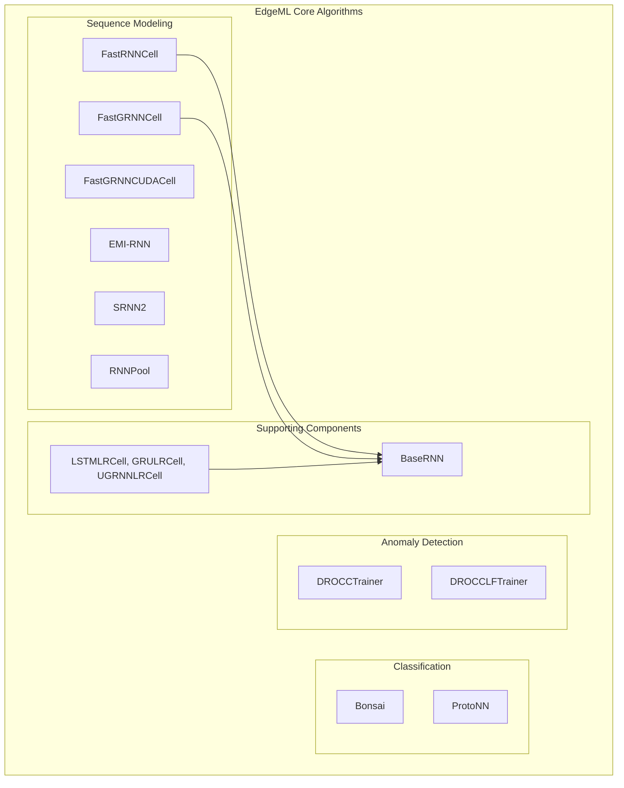

**Sources:** [README.md:14-21](), [pytorch/edgeml_pytorch/graph/rnn.py:966-1043]()

## Key Algorithm Characteristics

All EdgeML algorithms share common design principles optimized for edge deployment:

| Characteristic | Implementation | Benefit |
|---|---|---|
| **Low-Rank Parameterization** | `wRank`, `uRank` parameters in RNN cells | Reduces parameter count |
| **Sparsity Control** | `wSparsity`, `uSparsity` with `hardThreshold()` | Further compression |
| **Quantization Support** | Fixed-point arithmetic via SeeDot | Memory and compute efficiency |
| **Custom Non-linearities** | `quantTanh`, `quantSigm` in `gen_nonlinearity()` | Hardware-friendly activations |

**Sources:** [pytorch/edgeml_pytorch/graph/rnn.py:76-143](), [pytorch/edgeml_pytorch/utils.py:73-84]()

## Implementation Architecture

The EdgeML codebase implements algorithms across multiple frameworks with consistent interfaces:

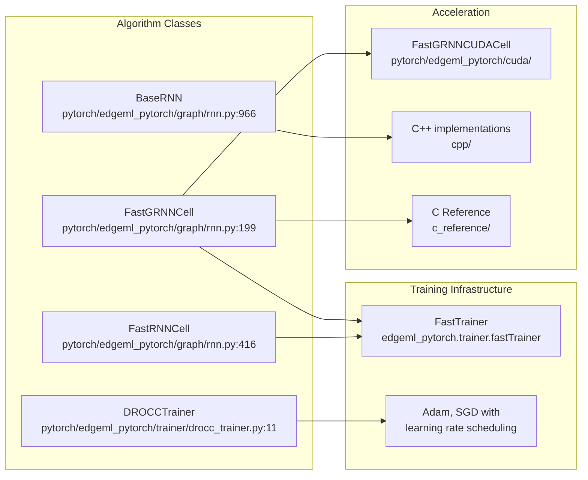

**Sources:** [pytorch/edgeml_pytorch/graph/rnn.py:199-318](), [examples/pytorch/FastCells/fastcell_example.py:84-86](), [pytorch/edgeml_pytorch/cuda/setup.py:7-18]()

## Framework Support Matrix

Different algorithms have varying levels of support across EdgeML's implementation frameworks:

| Algorithm | PyTorch | TensorFlow | C++ | C Reference | CUDA |
|---|---|---|---|---|---|
| **FastGRNN** | ✓ `FastGRNNCell` | ✓ | ✗ | ✓ `quantized_fastgrnn.c` | ✓ `FastGRNNCUDACell` |
| **FastRNN** | ✓ `FastRNNCell` | ✓ | ✗ | ✗ | ✗ |
| **DROCC** | ✓ `DROCCTrainer` | ✗ | ✗ | ✗ | ✗ |
| **Bonsai** | ✓ | ✓ | ✓ | ✗ | ✗ |
| **ProtoNN** | ✓ | ✓ | ✓ | ✗ | ✗ |
| **RNNPool** | ✓ | ✗ | ✗ | ✓ `quantized_rnnpool.c` | ✗ |

**Sources:** [README.md:36-44](), [pytorch/README.md:18-39](), [tf/README.md:5-11]()

## Algorithm Selection Guide

Choose algorithms based on your specific use case and constraints:

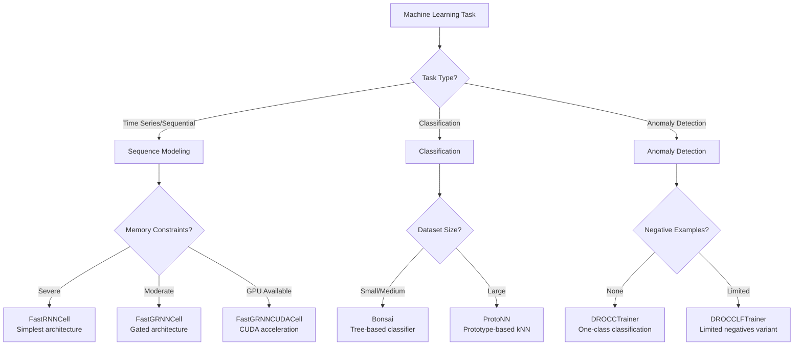

**Sources:** [README.md:14-21](), [pytorch/edgeml_pytorch/trainer/drocc_trainer.py:11-34](), [pytorch/edgeml_pytorch/trainer/drocclf_trainer.py:185-210]()

## Low-Rank Parameterization

A key innovation across EdgeML algorithms is low-rank matrix decomposition to reduce model parameters:

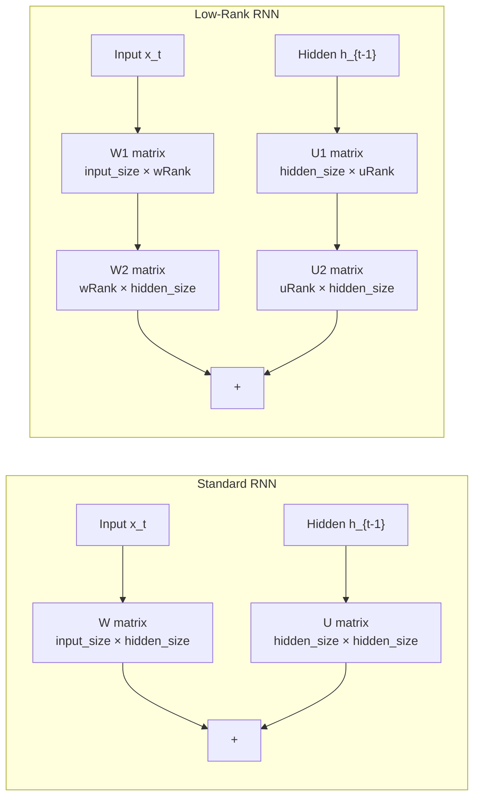

**Sources:** [pytorch/edgeml_pytorch/graph/rnn.py:253-263](), [pytorch/edgeml_pytorch/graph/rnn.py:280-291]()

---

# Page: DROCC - Deep Robust One-Class Classification

# DROCC - Deep Robust One-Class Classification

<details>
<summary>Relevant source files</summary>

The following files were used as context for generating this wiki page:

- [README.md](README.md)
- [examples/pytorch/DROCC/README.md](examples/pytorch/DROCC/README.md)
- [examples/pytorch/DROCC/data_process_scripts/process_cifar.py](examples/pytorch/DROCC/data_process_scripts/process_cifar.py)
- [examples/pytorch/DROCC/data_process_scripts/process_mnist.py](examples/pytorch/DROCC/data_process_scripts/process_mnist.py)
- [examples/pytorch/DROCC/main_cifar.py](examples/pytorch/DROCC/main_cifar.py)
- [examples/pytorch/DROCC/main_drocclf_mnist.py](examples/pytorch/DROCC/main_drocclf_mnist.py)
- [examples/pytorch/DROCC/main_tabular.py](examples/pytorch/DROCC/main_tabular.py)
- [examples/pytorch/DROCC/main_timeseries.py](examples/pytorch/DROCC/main_timeseries.py)
- [pytorch/README.md](pytorch/README.md)
- [pytorch/edgeml_pytorch/trainer/drocc_trainer.py](pytorch/edgeml_pytorch/trainer/drocc_trainer.py)
- [pytorch/edgeml_pytorch/trainer/drocclf_trainer.py](pytorch/edgeml_pytorch/trainer/drocclf_trainer.py)
- [tf/README.md](tf/README.md)

</details>


## Purpose and Scope

This document covers the DROCC (Deep Robust One-Class Classification) algorithm implementation in EdgeML. DROCC is designed for training robust anomaly detectors and one-class classifiers that can handle adversarial examples and provide better generalization. The implementation includes both the standard DROCC algorithm and the DROCC-LF (Limited Feedback) variant for scenarios with limited negative samples.

For information about other anomaly detection approaches, see other algorithms in [Core Algorithms](#2). For training examples and practical usage, see [PyTorch Training Examples](#4.1).

## Algorithm Overview

DROCC addresses the challenge of training robust one-class classifiers by incorporating adversarial training. The key innovation is generating adversarial negative samples around positive training data points and using them to improve model robustness.

### DROCC Training Pipeline

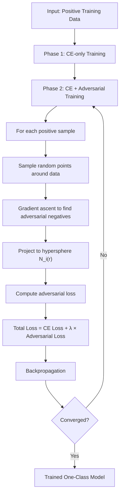

**Sources:** [pytorch/edgeml_pytorch/trainer/drocc_trainer.py:36-117](), [examples/pytorch/DROCC/README.md:1-93]()

### Core Components

The DROCC implementation consists of two main trainer classes and supporting utilities:

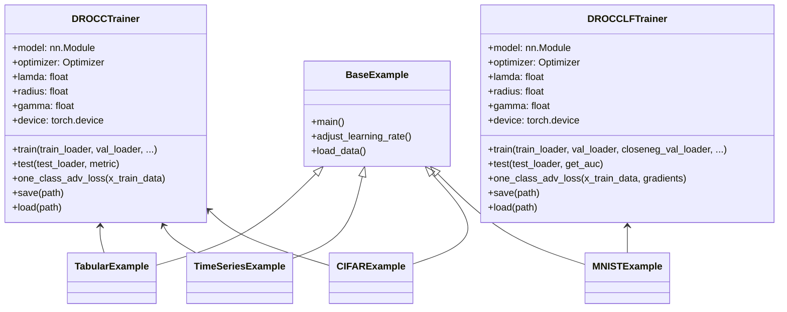

**Sources:** [pytorch/edgeml_pytorch/trainer/drocc_trainer.py:11-221](), [pytorch/edgeml_pytorch/trainer/drocclf_trainer.py:185-411]()

## DROCC Algorithm Implementation

### DROCCTrainer Class

The `DROCCTrainer` class implements the standard DROCC algorithm with the following key parameters:

| Parameter | Description | Typical Range |
|-----------|-------------|---------------|
| `lamda` | Weight for adversarial loss (μ in paper) | 0.5 - 2.0 |
| `radius` | Radius for hypersphere sampling | 2.5 - 16 |
| `gamma` | Projection parameter (radius multiplier) | 1.0 - 2.0 |
| `ascent_step_size` | Step size for gradient ascent | 0.001 - 0.1 |
| `ascent_num_steps` | Number of ascent steps | 50 - 100 |

**Sources:** [pytorch/edgeml_pytorch/trainer/drocc_trainer.py:17-34](), [examples/pytorch/DROCC/README.md:84-93]()

### Adversarial Loss Computation

The adversarial loss generation follows this process:

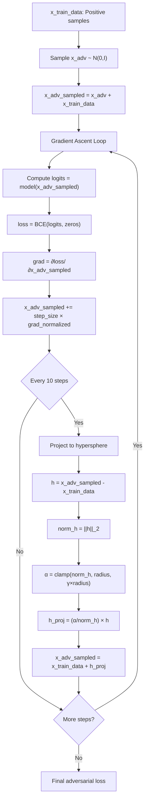

**Sources:** [pytorch/edgeml_pytorch/trainer/drocc_trainer.py:158-214]()

### Training Process

The training combines cross-entropy loss with adversarial loss:

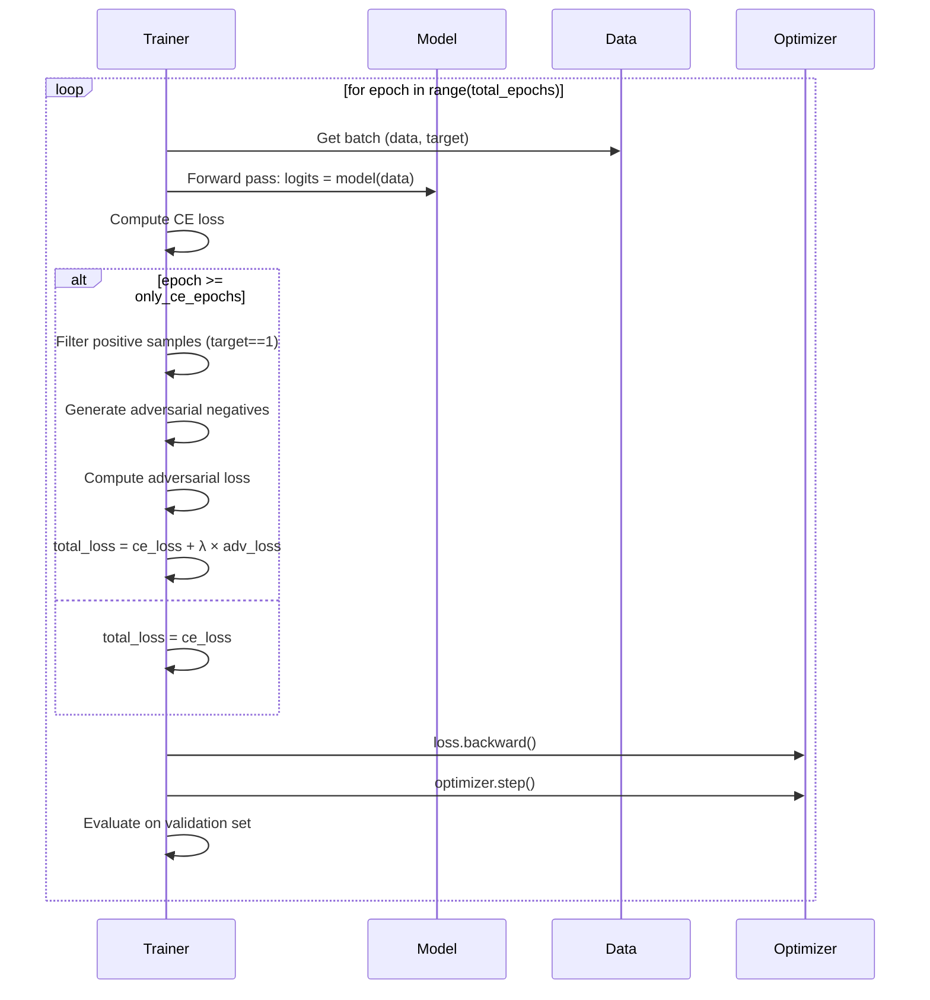

**Sources:** [pytorch/edgeml_pytorch/trainer/drocc_trainer.py:59-117]()

## DROCC-LF Algorithm Implementation

### DROCCLFTrainer Class

The `DROCCLFTrainer` extends DROCC for scenarios with limited negative feedback. Key differences include:

- Uses Mahalanobis distance for projection instead of Euclidean distance
- Solves a non-convex optimization problem for projection
- Evaluates performance using precision/recall at fixed false positive rates

**Sources:** [pytorch/edgeml_pytorch/trainer/drocclf_trainer.py:185-210]()

### Mahalanobis Distance Projection

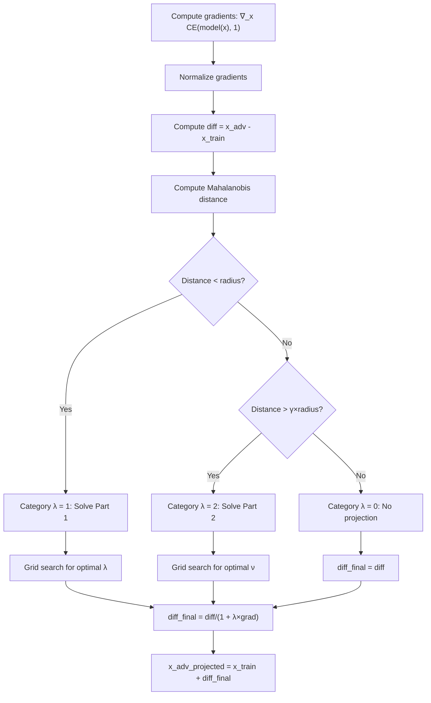

**Sources:** [pytorch/edgeml_pytorch/trainer/drocclf_trainer.py:112-161](), [pytorch/edgeml_pytorch/trainer/drocclf_trainer.py:40-97]()

## Usage Examples

### Model Architectures

Different example scripts demonstrate DROCC with various model architectures:

| Data Type | Model Class | Architecture | Example Script |
|-----------|-------------|--------------|----------------|
| Tabular | `MLP` | Single hidden layer + ReLU | `main_tabular.py` |
| Time Series | `LSTM_FC` | Single LSTM + FC layer | `main_timeseries.py` |
| Images (CIFAR) | `CIFAR10_LeNet` | 3 Conv + 3 FC layers | `main_cifar.py` |
| Images (MNIST) | `MNIST_LeNet` | 2 Conv + 2 FC layers | `main_drocclf_mnist.py` |

**Sources:** [examples/pytorch/DROCC/main_tabular.py:14-38](), [examples/pytorch/DROCC/main_timeseries.py:13-39](), [examples/pytorch/DROCC/main_cifar.py:14-43](), [examples/pytorch/DROCC/main_drocclf_mnist.py:14-37]()

### Data Processing Pipeline

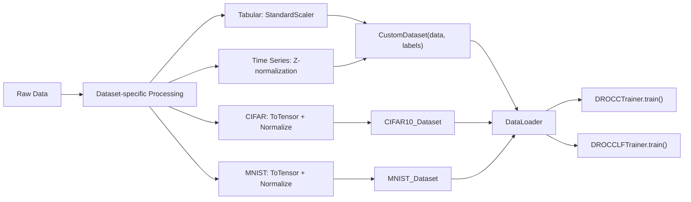

**Sources:** [examples/pytorch/DROCC/main_tabular.py:81-99](), [examples/pytorch/DROCC/main_timeseries.py:78-98](), [examples/pytorch/DROCC/data_process_scripts/process_cifar.py:51-82](), [examples/pytorch/DROCC/data_process_scripts/process_mnist.py:51-77]()

### Learning Rate Scheduling

All examples implement custom learning rate scheduling functions:

```python
def adjust_learning_rate(epoch, total_epochs, only_ce_epochs, learning_rate, optimizer):
    # Adjust learning rate based on training phase
    epoch = epoch - only_ce_epochs
    drocc_epochs = total_epochs - only_ce_epochs
    
    # Different decay schedules for different datasets
    if epoch <= drocc_epochs:
        lr = learning_rate * decay_factor
    # Additional conditions based on epoch fractions
```

**Sources:** [examples/pytorch/DROCC/main_tabular.py:40-66](), [examples/pytorch/DROCC/main_timeseries.py:54-76](), [examples/pytorch/DROCC/main_cifar.py:45-69]()

## Evaluation Metrics

### Standard DROCC

The standard `DROCCTrainer` supports two evaluation metrics:

- **AUC**: Area Under the ROC Curve
- **F1**: F1-score using 20th percentile threshold

**Sources:** [pytorch/edgeml_pytorch/trainer/drocc_trainer.py:147-155]()

### DROCC-LF

The `DROCCLFTrainer` uses precision and recall at fixed false positive rates:

- **Precision @ FPR 3%**: Precision when false positive rate is 3%
- **Recall @ FPR 3%**: Recall when false positive rate is 3%
- **Precision @ FPR 5%**: Precision when false positive rate is 5%
- **Recall @ FPR 5%**: Recall when false positive rate is 5%

The `cal_precision_recall()` function computes these metrics by combining far negative and close negative scores to determine appropriate thresholds.

**Sources:** [pytorch/edgeml_pytorch/trainer/drocclf_trainer.py:10-25](), [examples/pytorch/DROCC/main_drocclf_mnist.py:144-149]()

## Integration with EdgeML

DROCC is implemented as part of the PyTorch implementation of EdgeML and follows the same patterns as other algorithms:

- Trainer classes are in `edgeml_pytorch.trainer` module
- Examples demonstrate usage with different data types
- Models can be saved/loaded using standard PyTorch state dictionaries
- Compatible with CUDA acceleration when available

The implementation supports the EdgeML philosophy of resource-efficient machine learning by providing configurable model architectures and training procedures suitable for edge deployment scenarios.

**Sources:** [pytorch/README.md:31-34](), [pytorch/edgeml_pytorch/trainer/drocc_trainer.py:216-221](), [examples/pytorch/DROCC/README.md:4-10]()

---

# Page: FastCells - FastRNN and FastGRNN

# FastCells - FastRNN and FastGRNN

<details>
<summary>Relevant source files</summary>

The following files were used as context for generating this wiki page:

- [c_reference/Makefile](c_reference/Makefile)
- [c_reference/README.md](c_reference/README.md)
- [c_reference/config.mk](c_reference/config.mk)
- [c_reference/include/classifier.h](c_reference/include/classifier.h)
- [c_reference/include/fastgrnn.h](c_reference/include/fastgrnn.h)
- [c_reference/include/utils.h](c_reference/include/utils.h)
- [c_reference/src/classifier.c](c_reference/src/classifier.c)
- [c_reference/src/utils.c](c_reference/src/utils.c)
- [c_reference/tests/fastgrnn/test_fastgrnn_lr.c](c_reference/tests/fastgrnn/test_fastgrnn_lr.c)
- [c_reference/tests/rnnpool/test_rnnpool.c](c_reference/tests/rnnpool/test_rnnpool.c)
- [examples/pytorch/FastCells/fastcell_example.py](examples/pytorch/FastCells/fastcell_example.py)
- [examples/pytorch/FastCells/helpermethods.py](examples/pytorch/FastCells/helpermethods.py)
- [pytorch/edgeml_pytorch/cuda/fastgrnn_cuda.cpp](pytorch/edgeml_pytorch/cuda/fastgrnn_cuda.cpp)
- [pytorch/edgeml_pytorch/cuda/fastgrnn_cuda_kernel.cu](pytorch/edgeml_pytorch/cuda/fastgrnn_cuda_kernel.cu)
- [pytorch/edgeml_pytorch/cuda/setup.py](pytorch/edgeml_pytorch/cuda/setup.py)
- [pytorch/edgeml_pytorch/graph/rnn.py](pytorch/edgeml_pytorch/graph/rnn.py)
- [pytorch/edgeml_pytorch/utils.py](pytorch/edgeml_pytorch/utils.py)
- [pytorch/setup.py](pytorch/setup.py)

</details>


## Purpose and Scope

This document covers the FastCells family of algorithms in EdgeML, specifically FastRNN and FastGRNN (Fast Gated Recurrent Neural Network). These are resource-efficient RNN architectures designed for edge devices that achieve competitive accuracy while using significantly fewer parameters than standard RNNs through low-rank parameterization and sparsity techniques.

For information about other RNN architectures like EMI-RNN and SRNN, see [Other Algorithms](#2.4). For deployment and quantization of FastCells, see [Quantization Pipeline](#5.1).

## Architecture Overview

FastCells implement gated recurrent architectures with the following key innovations:

### FastGRNN Architecture

FastGRNN uses a simplified gating mechanism compared to standard GRU/LSTM:

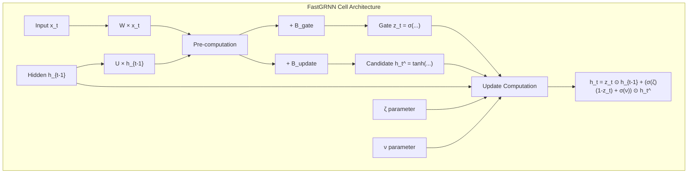

**Sources:** [pytorch/edgeml_pytorch/graph/rnn.py:199-318](), [c_reference/include/fastgrnn.h:27-40]()

### FastRNN Architecture

FastRNN uses an even simpler update mechanism without explicit gating:

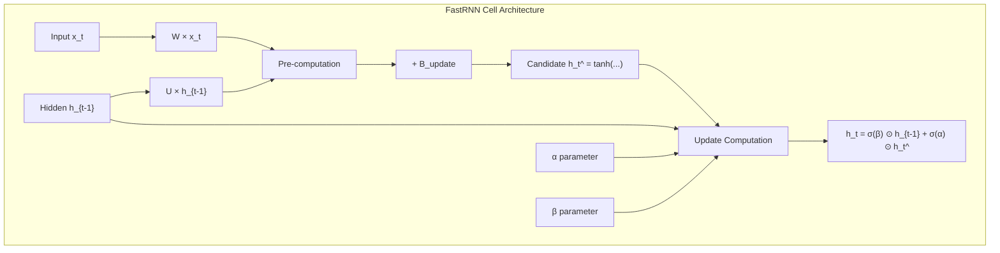

**Sources:** [pytorch/edgeml_pytorch/graph/rnn.py:416-531]()

## Low-Rank Parameterization

Both FastRNN and FastGRNN support low-rank matrix factorization to reduce parameters:

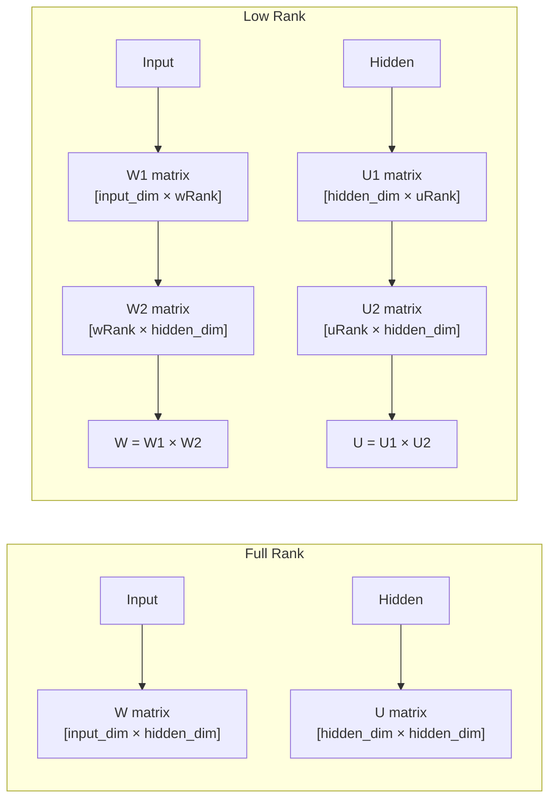

**Sources:** [pytorch/edgeml_pytorch/graph/rnn.py:245-263](), [c_reference/include/fastgrnn.h:14-26]()

## Implementation Variants

### PyTorch Implementation

| Class | Description | Key Features |
|-------|-------------|--------------|
| `FastGRNNCell` | Standard FastGRNN implementation | Full/low-rank, multiple activations, sparsity |
| `FastRNNCell` | Simplified FastRNN variant | No explicit gating, lighter computation |
| `FastGRNNCUDACell` | CUDA-accelerated FastGRNN | GPU optimization, forward/backward kernels |
| `BaseRNN` | RNN wrapper for sequence processing | Bidirectional support, batch handling |

### Parameter Configuration

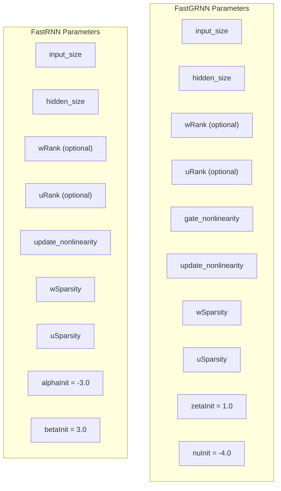

**Sources:** [pytorch/edgeml_pytorch/graph/rnn.py:235-251](), [pytorch/edgeml_pytorch/graph/rnn.py:449-466]()

### CUDA Acceleration

The CUDA implementation provides significant speedup for GPU training:

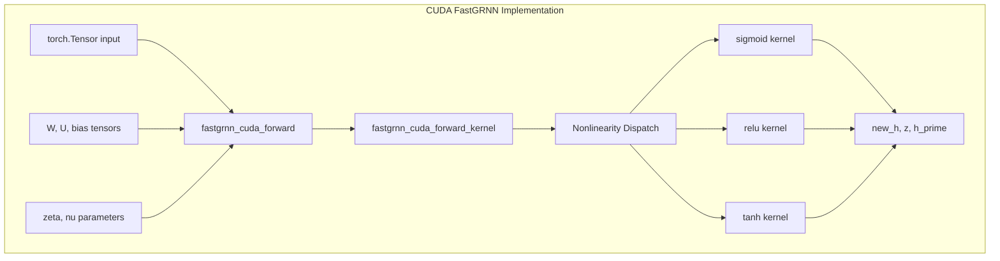

**Sources:** [pytorch/edgeml_pytorch/cuda/fastgrnn_cuda_kernel.cu:42-60](), [pytorch/edgeml_pytorch/cuda/fastgrnn_cuda.cpp:72-106]()

### C Reference Implementation

The C implementation provides quantized inference for deployment:

| Structure | Purpose | Key Fields |
|-----------|---------|------------|
| `FastGRNN_Params` | Model parameters | `W`, `U`, `Bg`, `Bh`, `sigmoid_zeta`, `sigmoid_nu` |
| `FastGRNN_LR_Params` | Low-rank parameters | `W1`, `W2`, `U1`, `U2`, `wRank`, `uRank` |
| `FastGRNN_Buffers` | Computation buffers | `preComp`, `normFeatures` |
| `FastGRNN_LR_Buffers` | Low-rank buffers | `tempLRW`, `tempLRU` |

**Sources:** [c_reference/include/fastgrnn.h:88-107](), [c_reference/include/fastgrnn.h:27-54]()

## Activation Functions

FastCells support multiple activation functions optimized for quantization:

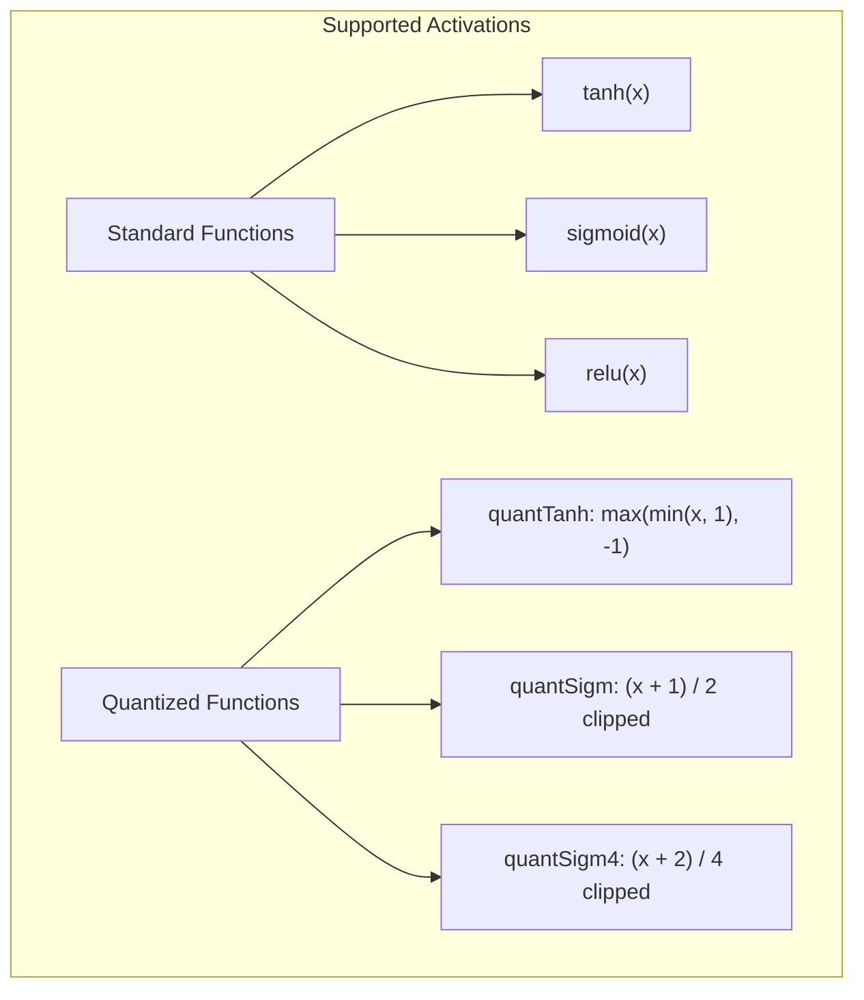

**Sources:** [pytorch/edgeml_pytorch/graph/rnn.py:46-74](), [c_reference/src/utils.c:16-37]()

## Training and Usage

### Basic Training Setup

```python
# Initialize FastGRNN cell
cell = FastGRNNCell(
    input_size=inputDims, 
    hidden_size=hiddenDims,
    gate_nonlinearity="sigmoid",
    update_nonlinearity="tanh",
    wRank=wRank,  # Optional low-rank
    uRank=uRank   # Optional low-rank
)

# Wrap in BaseRNN for sequence processing
rnn = BaseRNN(cell, batch_first=False)

# Training with FastTrainer
trainer = FastTrainer(cell, numClasses, 
                     sW=sparsity_W, sU=sparsity_U)
```

**Sources:** [examples/pytorch/FastCells/fastcell_example.py:55-86]()

### Sparsification Process

FastCells implement structured sparsification during training:

```mermaid
graph TD
    subgraph "Sparsification Pipeline"
        Training["Training Step"] --> CopyWeights["copy_previous_UW()"]
        CopyWeights --> HardThreshold["sparsify()"]
        HardThreshold --> Utils["hardThreshold(matrix, sparsity)"]
        Utils --> Support["supportBasedThreshold()"]
        Support --> NextIter["Next Training Step"]
    end
```

**Sources:** [pytorch/edgeml_pytorch/graph/rnn.py:172-198](), [pytorch/edgeml_pytorch/utils.py:73-101]()

## Model Export and Deployment

FastCells can be exported to multiple formats:

| Target | Method | Key Features |
|--------|--------|--------------|
| ONNX | `onnx_exportable_rnn()` | Cross-platform deployment |
| TensorFlow Lite | TF conversion | Mobile optimization |
| C Reference | Parameter export | Quantized inference |
| CUDA Inference | GPU deployment | Real-time processing |

**Sources:** [pytorch/edgeml_pytorch/graph/rnn.py:25-44]()

## Performance Characteristics

FastCells achieve efficiency through:

1. **Parameter Reduction**: Low-rank factorization reduces W and U matrices
2. **Sparsity**: Structured pruning removes unnecessary connections  
3. **Simplified Gates**: Fewer operations than LSTM/GRU
4. **Quantization Ready**: Support for fixed-point arithmetic
5. **Hardware Acceleration**: CUDA kernels for GPU deployment

The `get_model_size()` method estimates memory footprint based on non-zero parameters and sparsity patterns.

**Sources:** [pytorch/edgeml_pytorch/graph/rnn.py:149-170](), [pytorch/edgeml_pytorch/utils.py:104-134]()

---

# Page: Bonsai and ProtoNN

# Bonsai and ProtoNN

<details>
<summary>Relevant source files</summary>

The following files were used as context for generating this wiki page:

- [examples/pytorch/Bonsai/README.md](examples/pytorch/Bonsai/README.md)
- [examples/pytorch/FastCells/KWS-training/train_classifier.py](examples/pytorch/FastCells/KWS-training/train_classifier.py)
- [examples/pytorch/FastCells/KWS-training/training_config.py](examples/pytorch/FastCells/KWS-training/training_config.py)
- [examples/pytorch/FastCells/README.md](examples/pytorch/FastCells/README.md)
- [examples/pytorch/ProtoNN/README.md](examples/pytorch/ProtoNN/README.md)
- [examples/pytorch/SRNN/README.md](examples/pytorch/SRNN/README.md)
- [examples/tf/Bonsai/README.md](examples/tf/Bonsai/README.md)
- [examples/tf/Bonsai/bonsai_model_to_tflite.py](examples/tf/Bonsai/bonsai_model_to_tflite.py)
- [examples/tf/FastCells/README.md](examples/tf/FastCells/README.md)
- [examples/tf/ProtoNN/README.md](examples/tf/ProtoNN/README.md)
- [examples/tf/ProtoNN/protoNN_model_to_tflite.py](examples/tf/ProtoNN/protoNN_model_to_tflite.py)
- [tf/edgeml_tf/tflite/README.md](tf/edgeml_tf/tflite/README.md)
- [tf/edgeml_tf/tflite/__init__.py](tf/edgeml_tf/tflite/__init__.py)
- [tf/edgeml_tf/tflite/bonsaiLayer.py](tf/edgeml_tf/tflite/bonsaiLayer.py)
- [tf/edgeml_tf/tflite/protoNNLayer.py](tf/edgeml_tf/tflite/protoNNLayer.py)
- [tf/requirements-gpu.txt](tf/requirements-gpu.txt)

</details>


## Purpose and Scope

This document covers the Bonsai tree-based classifier and ProtoNN prototype-based k-NN algorithms implemented in EdgeML. Both algorithms are designed for resource-efficient machine learning on edge devices, providing compact models with competitive accuracy. 

For information about RNN-based algorithms like FastGRNN and FastRNN, see [FastCells - FastRNN and FastGRNN](#2.2). For anomaly detection algorithms, see [DROCC - Deep Robust One-Class Classification](#2.1).

## Algorithm Overview

### Bonsai Tree-Based Classifier

Bonsai is a novel tree-based algorithm that learns both the tree structure and prediction functions jointly. Unlike traditional decision trees, Bonsai uses:
- **Sparse oblique splits**: Each internal node performs linear combinations of features
- **Regularized training**: Three-phase training with sparsity constraints
- **Compact representation**: Significantly smaller than traditional ensemble methods

### ProtoNN Prototype-Based Learning

ProtoNN generalizes k-nearest neighbors by learning:
- **Prototype selection**: Automatically selects representative data points
- **Distance metric learning**: Learns optimal distance functions in projected space
- **Non-linear projections**: Projects data to lower-dimensional spaces for efficiency

Sources: [examples/tf/Bonsai/README.md:9-12](), [examples/tf/ProtoNN/README.md:9-13](), [examples/pytorch/Bonsai/README.md:9-13]()

## Implementation Architecture

### Framework Support Matrix

| Algorithm | TensorFlow | PyTorch | C++ | TFLite | Quantization |
|-----------|------------|---------|-----|--------|--------------|
| Bonsai   | ✓         | ✓       | ✓   | ✓      | ✓            |
| ProtoNN  | ✓         | ✓       | ✓   | ✓      | ✓            |

### Core Implementation Structure

```mermaid
graph TB
    subgraph "Bonsai Implementation"
        BGraph["edgeml_tf.graph.bonsai<br/>TensorFlow Graph"]
        BPyGraph["edgeml_pytorch.graph.bonsai<br/>PyTorch Module"]
        BTrainer["edgeml_tf.trainer.bonsaiTrainer<br/>Training Logic"]
        BPyTrainer["edgeml_pytorch.trainer.bonsaiTrainer<br/>PyTorch Training"]
        BTFLite["BonsaiLayer<br/>TFLite Custom Layer"]
    end
    
    subgraph "ProtoNN Implementation"
        PGraph["edgeml_tf.graph.protoNN<br/>TensorFlow Graph"]
        PPyGraph["edgeml_pytorch.graph.protoNN<br/>PyTorch Module"]
        PTrainer["edgeml_tf.trainer.protoNNTrainer<br/>Training Logic"]
        PPyTrainer["edgeml_pytorch.trainer.protoNNTrainer<br/>PyTorch Training"]
        PTFLite["ProtoNNLayer<br/>TFLite Custom Layer"]
    end
    
    subgraph "Common Components"
        DataLoader["Data Loading<br/>train.npy, test.npy"]
        Quantizer["Model Quantization<br/>quantizeBonsaiModels.py<br/>quantizeProtoNNModels.py"]
        TFLiteConv["TFLite Conversion<br/>bonsai_model_to_tflite.py<br/>protoNN_model_to_tflite.py"]
    end
    
    BGraph --> BTrainer
    BPyGraph --> BPyTrainer
    PGraph --> PTrainer
    PPyGraph --> PPyTrainer
    
    BTrainer --> BTFLite
    PTrainer --> PTFLite
    
    BTrainer --> Quantizer
    PTrainer --> Quantizer
    BTrainer --> TFLiteConv
    PTrainer --> TFLiteConv
    
    DataLoader --> BTrainer
    DataLoader --> PTrainer
    DataLoader --> BPyTrainer
    DataLoader --> PPyTrainer
```

Sources: [examples/tf/Bonsai/README.md:9-13](), [examples/tf/ProtoNN/README.md:9-14](), [examples/pytorch/Bonsai/README.md:9-14](), [examples/pytorch/ProtoNN/README.md:9-16]()

### Bonsai Core Components

```mermaid
graph LR
    subgraph "Bonsai Model Parameters"
        ZMatrix["Z Matrix<br/>Projection Parameters"]
        WMatrix["W Matrix<br/>Internal Node Weights"]
        VMatrix["V Matrix<br/>Internal Node Biases"]
        TMatrix["T Matrix<br/>Threshold Parameters"]
    end
    
    subgraph "BonsaiLayer Implementation"
        BuildMethod["build(input_shape)<br/>Initialize weight matrices"]
        CallMethod["call(X)<br/>Forward pass computation"]
        TreeDepth["treeDepth<br/>Tree structure parameter"]
        Sigma["sigma<br/>Regularization parameter"]
    end
    
    subgraph "Training Configuration"
        HyperParams["hyperParam.npy<br/>Saved hyperparameters"]
        ModelDir["Model directory<br/>Z.npy, W.npy, V.npy, T.npy"]
        DataDim["dataDimension<br/>Input feature size"]
        ProjDim["projectionDimension<br/>Reduced feature size"]
    end
    
    ZMatrix --> BuildMethod
    WMatrix --> BuildMethod
    VMatrix --> BuildMethod
    TMatrix --> BuildMethod
    
    BuildMethod --> CallMethod
    TreeDepth --> CallMethod
    Sigma --> CallMethod
    
    HyperParams --> ModelDir
    DataDim --> ModelDir
    ProjDim --> ModelDir
```

Sources: [tf/edgeml_tf/tflite/bonsaiLayer.py:27-31](), [tf/edgeml_tf/tflite/bonsaiLayer.py:33-58](), [examples/tf/Bonsai/bonsai_model_to_tflite.py:49-59]()

### ProtoNN Core Components

```mermaid
graph LR
    subgraph "ProtoNN Model Parameters"
        WProj["W Matrix<br/>Projection weights [d, d_cap]"]
        BProto["B Matrix<br/>Prototype vectors [d_cap, m]"]
        ZLabels["Z Matrix<br/>Label assignments [L, m]"]
        GammaParam["gamma<br/>Distance scaling parameter"]
    end
    
    subgraph "ProtoNNLayer Implementation"
        BuildProto["build(input_shape)<br/>Initialize W, B, Z matrices"]
        CallProto["call(X)<br/>Compute similarities and predictions"]
        L2Sim["l2sim<br/>L2 distance computation"]
        ExpSim["exp(gamma*l2sim)<br/>Similarity scores"]
    end
    
    subgraph "Dimensions"
        InputDim["inputDimension (d)<br/>Original feature space"]
        ProjDim2["projectionDimension (d_cap)<br/>Projected space"]
        NumProto["numPrototypes (m)<br/>Number of prototypes"]
        NumLabels["numOutputLabels (L)<br/>Output classes"]
    end
    
    WProj --> BuildProto
    BProto --> BuildProto
    ZLabels --> BuildProto
    GammaParam --> CallProto
    
    BuildProto --> CallProto
    CallProto --> L2Sim
    L2Sim --> ExpSim
    
    InputDim --> BuildProto
    ProjDim2 --> BuildProto
    NumProto --> BuildProto
    NumLabels --> BuildProto
```

Sources: [tf/edgeml_tf/tflite/protoNNLayer.py:17-25](), [tf/edgeml_tf/tflite/protoNNLayer.py:27-45](), [examples/tf/ProtoNN/protoNN_model_to_tflite.py:36-44]()

## Training Process

### Data Format Requirements

Both algorithms expect data in a standardized format:
- **Training data**: `train.npy` with shape `[numberOfExamples, numberOfFeatures + 1]`
- **Test data**: `test.npy` with same format
- **Label encoding**: First column contains integer labels (0 through N-1 for N classes)
- **Data preprocessing**: Data should be pre-shuffled as training doesn't shuffle internally

### Three-Phase Training Strategy

```mermaid
graph TD
    subgraph "Phase 1: Initialization"
        P1Start["Initialize parameters<br/>Random initialization"]
        P1Train["Train without regularization<br/>Learn basic structure"]
        P1End["Establish base performance"]
    end
    
    subgraph "Phase 2: Regularization"
        P2Start["Apply sparsity constraints<br/>Add regularization terms"]
        P2Train["Iterative hard thresholding<br/>Enforce sparsity"]
        P2End["Achieve target sparsity"]
    end
    
    subgraph "Phase 3: Fine-tuning"
        P3Start["Fixed sparsity pattern<br/>Support-based updates"]
        P3Train["Optimize remaining parameters<br/>Fine-tune performance"]
        P3End["Final model ready"]
    end
    
    P1Start --> P1Train
    P1Train --> P1End
    P1End --> P2Start
    P2Start --> P2Train
    P2Train --> P2End
    P2End --> P3Start
    P3Start --> P3Train
    P3Train --> P3End
```

Sources: [examples/tf/Bonsai/README.md:10-12](), [examples/pytorch/Bonsai/README.md:10-13](), [examples/tf/ProtoNN/README.md:10-14]()

### Training Command Examples

**Bonsai Training (TensorFlow)**:
```bash
python bonsai_example.py -dir usps10/ -d 3 -p 28 -rW 0.001 -rZ 0.0001 -rV 0.001 -rT 0.001 -sZ 0.2 -sW 0.3 -sV 0.3 -sT 0.62 -e 100 -s 1
```

**ProtoNN Training (TensorFlow)**:
```bash
python protoNN_example.py --data-dir ./usps10 --projection-dim 60 --num-prototypes 80 --gamma 0.0015 --learning-rate 0.1 --epochs 200
```

Sources: [examples/tf/Bonsai/README.md:44](), [examples/tf/ProtoNN/README.md:49-57]()

## Deployment and Inference

### TensorFlow Lite Integration

Both algorithms support deployment via TensorFlow Lite for mobile and edge devices:

**Bonsai TFLite Conversion**:
```bash
python bonsai_model_to_tflite.py --data-dir ./usps10/ --model-dir ./usps10/TFBonsaiResults/model-dir-path/
```

**ProtoNN TFLite Conversion**:
```bash
python protoNN_model_to_tflite.py --data-dir ./usps10/ --output-dir ./model/
```

### Model Quantization Pipeline

```mermaid
graph LR
    subgraph "Float32 Models"
        TFModel["Trained TensorFlow Model<br/>Float32 parameters"]
        PyModel["Trained PyTorch Model<br/>Float32 parameters"]
    end
    
    subgraph "Quantization Tools"
        BonsaiQuant["quantizeBonsaiModels.py<br/>Bonsai quantization"]
        ProtoQuant["quantizeProtoNNModels.py<br/>ProtoNN quantization"]
    end
    
    subgraph "Quantized Output"
        QModels["QuantizedTFBonsaiModel/<br/>QuantizedPyTorchBonsaiModel/"]
        QParams["Parameters with 'q' suffix<br/>qZ.npy, qW.npy, qV.npy, qT.npy"]
        EdgeDeploy["Edge device deployment<br/>Reduced memory footprint"]
    end
    
    TFModel --> BonsaiQuant
    TFModel --> ProtoQuant
    PyModel --> BonsaiQuant
    PyModel --> ProtoQuant
    
    BonsaiQuant --> QModels
    ProtoQuant --> QModels
    QModels --> QParams
    QParams --> EdgeDeploy
```

Sources: [examples/tf/Bonsai/README.md:71-78](), [examples/pytorch/Bonsai/README.md:56-63](), [examples/tf/ProtoNN/README.md:63-71]()

### TFLite Layer Implementation Details

**BonsaiLayer Forward Pass**:
- Projects input through `Z` matrix: `X_ = ZX / projectionDimension`
- Computes node probabilities using tree structure
- Applies sigmoid and tanh activations with `sigma` parameter
- Aggregates predictions across all tree nodes

**ProtoNNLayer Forward Pass**:
- Projects input: `WX = matmul(X, W)`
- Computes L2 distances to prototypes: `||WX - B||²`
- Applies RBF kernel: `exp(-gamma² * distances)`
- Weighted prediction: `Z × similarities`

Sources: [tf/edgeml_tf/tflite/bonsaiLayer.py:33-74](), [tf/edgeml_tf/tflite/protoNNLayer.py:27-45]()

## Performance and Model Characteristics

### Expected Results

**Bonsai on USPS10**:
- Test Accuracy: ~94%
- Model Size: ~31.7 KB
- Non-zeros: ~4,156 parameters
- Training Epochs: ~66 (with early stopping)

**ProtoNN on USPS10**:
- Test Accuracy: ~92.5%
- Compact prototype representation
- Efficient distance computations

### Key Hyperparameters

**Bonsai Parameters**:
- `depth (-d)`: Tree depth (affects model capacity)
- `projectionDimension (-p)`: Dimensionality reduction
- Regularization: `-rW`, `-rZ`, `-rV`, `-rT` for different parameter groups
- Sparsity: `-sW`, `-sZ`, `-sV`, `-sT` target sparsity levels

**ProtoNN Parameters**:
- `projection-dim`: Reduced feature dimensionality
- `num-prototypes`: Number of representative points
- `gamma`: Distance scaling (affects similarity sharpness)
- `learning-rate`: Optimization step size

Sources: [examples/tf/Bonsai/README.md:46-51](), [examples/tf/ProtoNN/README.md:60](), [examples/pytorch/Bonsai/README.md:46-51]()

---

# Page: Other Algorithms

# Other Algorithms

<details>
<summary>Relevant source files</summary>

The following files were used as context for generating this wiki page:

- [README.md](README.md)
- [examples/pytorch/Bonsai/README.md](examples/pytorch/Bonsai/README.md)
- [examples/pytorch/DROCC/README.md](examples/pytorch/DROCC/README.md)
- [examples/pytorch/DROCC/data_process_scripts/process_cifar.py](examples/pytorch/DROCC/data_process_scripts/process_cifar.py)
- [examples/pytorch/DROCC/data_process_scripts/process_mnist.py](examples/pytorch/DROCC/data_process_scripts/process_mnist.py)
- [examples/pytorch/DROCC/main_cifar.py](examples/pytorch/DROCC/main_cifar.py)
- [examples/pytorch/DROCC/main_drocclf_mnist.py](examples/pytorch/DROCC/main_drocclf_mnist.py)
- [examples/pytorch/DROCC/main_tabular.py](examples/pytorch/DROCC/main_tabular.py)
- [examples/pytorch/DROCC/main_timeseries.py](examples/pytorch/DROCC/main_timeseries.py)
- [examples/pytorch/FastCells/KWS-training/train_classifier.py](examples/pytorch/FastCells/KWS-training/train_classifier.py)
- [examples/pytorch/FastCells/KWS-training/training_config.py](examples/pytorch/FastCells/KWS-training/training_config.py)
- [examples/pytorch/FastCells/README.md](examples/pytorch/FastCells/README.md)
- [examples/pytorch/ProtoNN/README.md](examples/pytorch/ProtoNN/README.md)
- [examples/pytorch/SRNN/README.md](examples/pytorch/SRNN/README.md)
- [pytorch/README.md](pytorch/README.md)
- [pytorch/edgeml_pytorch/trainer/drocc_trainer.py](pytorch/edgeml_pytorch/trainer/drocc_trainer.py)
- [pytorch/edgeml_pytorch/trainer/drocclf_trainer.py](pytorch/edgeml_pytorch/trainer/drocclf_trainer.py)
- [tf/README.md](tf/README.md)

</details>


This document covers three additional EdgeML algorithms that complement the core offerings: EMI-RNN for time series signature recovery, Shallow RNN (SRNN) for streaming data processing, and RNNPool for efficient non-linear pooling. For information about the primary EdgeML algorithms, see [DROCC](#2.1), [FastCells](#2.2), and [Bonsai and ProtoNN](#2.3).

## Overview

The "Other Algorithms" category encompasses specialized techniques that address specific machine learning challenges in resource-constrained environments:

- **EMI-RNN**: Enables faster and more accurate RNN predictions by recovering critical signatures from time series data
- **Shallow RNN (SRNN)**: Provides a meta-architecture for training RNNs on streaming data with rolling window approaches
- **RNNPool**: Offers efficient non-linear pooling operations designed for RAM-constrained inference scenarios

**Implementation Framework Coverage**

| Algorithm | TensorFlow | PyTorch | C++ | C Reference |
|-----------|------------|---------|-----|-------------|
| EMI-RNN   | ✓          | ✗       | ✗   | ✗           |
| SRNN      | ✗          | ✓       | ✗   | ✗           |
| RNNPool   | ✗          | ✓       | ✗   | ✓           |

Sources: [README.md:14-21](), [tf/README.md:8](), [pytorch/README.md:28-38]()

## EMI-RNN Architecture

EMI-RNN (Early Mitigated Insufficient RNN) focuses on recovering critical signatures from time series data to enable faster and more accurate predictions. The algorithm addresses the challenge of maintaining prediction quality while reducing computational requirements.

```mermaid
graph TB
    subgraph "EMI-RNN Training Pipeline"
        A["Time Series Input<br/>Sequential Data"] --> B["Critical Signature<br/>Recovery Module"]
        B --> C["EMI-RNN Trainer<br/>TensorFlow Implementation"]
        C --> D["Optimized RNN Model<br/>Reduced Inference Time"]
        
        subgraph "Key Features"
            E["Early Stopping<br/>Based on Signatures"]
            F["Inference Acceleration<br/>Maintains Accuracy"]
            G["Time Series Focus<br/>Sequential Pattern Learning"]
        end
        
        B -.-> E
        C -.-> F
        A -.-> G
    end
```

**EMI-RNN Framework Integration**

The EMI-RNN algorithm is exclusively implemented in the TensorFlow framework as part of the `edgeml_tf` package. The implementation provides training routines specifically designed for time series data processing.

Sources: [README.md:17](), [tf/README.md:8]()

## Shallow RNN (SRNN) Architecture

SRNN implements a meta-architecture for training RNNs that can be applied to streaming data scenarios. The implementation provides a 2-layer network structure with configurable RNN cell types.

```mermaid
graph TB
    subgraph "SRNN Implementation Structure"
        A["SRNN2 Graph Module<br/>edgeml_pytorch.graph.rnn.SRNN2"] --> B["2-Layer RNN Network<br/>Configurable Cell Types"]
        C["SRNN Trainer<br/>edgeml_pytorch.trainer.srnnTrainer"] --> D["Training Pipeline<br/>Streaming Data Support"]
        
        B --> E["Output Layer<br/>Classification/Regression"]
        D --> F["Model Checkpoints<br/>Trained SRNN Model"]
        
        subgraph "Supported Cell Types"
            G["LSTM Cell<br/>Long Short-Term Memory"]
            H["GRU Cell<br/>Gated Recurrent Unit"] 
            I["Custom Cells<br/>FastRNN/FastGRNN"]
        end
        
        B -.-> G
        B -.-> H
        B -.-> I
    end
```

**SRNN Training Example**

The Google Speech Commands Dataset example demonstrates SRNN usage for keyword spotting applications:

```mermaid
graph LR
    subgraph "SRNN Training Workflow"
        A["fetch_google.sh<br/>Data Download Script"] --> B["process_google.py<br/>Feature Extraction"]
        B --> C["SRNN_Example.py<br/>Training Script"]
        C --> D["Trained Model<br/>~92% Validation Accuracy"]
        
        subgraph "Configuration"
            E["brick_size: 11<br/>Network Parameter"]
            F["GoogleSpeech/Extracted/<br/>Data Directory"]
        end
        
        C -.-> E
        B -.-> F
    end
```

Sources: [examples/pytorch/SRNN/README.md:10-13](), [pytorch/README.md:28-30](), [examples/pytorch/SRNN/README.md:35-39]()

## RNNPool Implementation

RNNPool provides an efficient non-linear pooling operator specifically designed for RAM-constrained inference scenarios. The implementation spans both PyTorch research code and quantized C reference implementations.

```mermaid
graph TB
    subgraph "RNNPool Architecture"
        A["Input Patches<br/>Spatial/Temporal Data"] --> B["RNNPool Layer<br/>edgeml_pytorch.graph.RNNPool"]
        B --> C["Hidden State Processing<br/>Configurable Dimensions"]
        C --> D["Pooled Output<br/>Reduced Memory Footprint"]
        
        subgraph "Implementation Variants"
            E["PyTorch Research<br/>Training & Inference"]
            F["C Reference<br/>quantized_rnnpool.c"]
            G["Quantized Operations<br/>Q7/Q15 Fixed Point"]
        end
        
        B -.-> E
        F --> G
        G -.-> D
    end
```

**RNNPool Integration Points**

```mermaid
graph LR
    subgraph "RNNPool Integration Pipeline"
        A["PyTorch Training<br/>Research Phase"] --> B["Model Export<br/>ONNX/TorchScript"]
        B --> C["Quantization Pipeline<br/>SeeDot Tool"]
        C --> D["C Reference Implementation<br/>quantized_rnnpool.c"]
        D --> E["Edge Deployment<br/>Ultra-Low Power"]
        
        subgraph "Use Case Examples"
            F["Vision Applications<br/>examples/pytorch/vision"]
            G["Face Detection<br/>Complete Pipeline"]
        end
        
        A -.-> F
        D -.-> G
    end
```

**Key RNNPool Features**

- **Memory Efficiency**: Designed specifically for RAM-constrained environments
- **Non-linear Pooling**: Provides more sophisticated pooling than traditional max/average operations  
- **Quantization Support**: Full pipeline from floating-point training to fixed-point inference
- **Application Flexibility**: Used in vision tasks and other spatial data processing scenarios

Sources: [README.md:21](), [pytorch/README.md:35-39](), [c_reference implementation files]()

## Training and Deployment Considerations

### Framework-Specific Implementation Strategies

Each algorithm targets specific deployment scenarios through its framework implementation:

**EMI-RNN (TensorFlow)**
- Optimized for time series analysis workflows
- Integrates with TensorFlow Lite export pipeline
- Suitable for mobile and embedded time series applications

**SRNN (PyTorch)**  
- Research-oriented implementation with flexible configuration
- Supports various RNN cell types including FastCells
- Enables experimentation with streaming data architectures

**RNNPool (PyTorch + C Reference)**
- Complete training-to-deployment pipeline
- Quantization support for ultra-low power inference
- Demonstrated in computer vision applications

### Performance Characteristics

| Algorithm | Primary Use Case | Memory Impact | Training Complexity | Inference Speed |
|-----------|------------------|---------------|-------------------|-----------------|
| EMI-RNN | Time Series | Moderate | Medium | Fast |
| SRNN | Streaming Data | Low | Low | Fast |
| RNNPool | Spatial Pooling | Very Low | Low | Very Fast |

Sources: [README.md:14-28](), [examples/pytorch/SRNN/README.md:38](), [pytorch/README.md:35-38]()

---

# Page: Implementation Frameworks

# Implementation Frameworks

<details>
<summary>Relevant source files</summary>

The following files were used as context for generating this wiki page:

- [README.md](README.md)
- [examples/pytorch/DROCC/README.md](examples/pytorch/DROCC/README.md)
- [examples/pytorch/DROCC/data_process_scripts/process_cifar.py](examples/pytorch/DROCC/data_process_scripts/process_cifar.py)
- [examples/pytorch/DROCC/data_process_scripts/process_mnist.py](examples/pytorch/DROCC/data_process_scripts/process_mnist.py)
- [examples/pytorch/DROCC/main_cifar.py](examples/pytorch/DROCC/main_cifar.py)
- [examples/pytorch/DROCC/main_drocclf_mnist.py](examples/pytorch/DROCC/main_drocclf_mnist.py)
- [examples/pytorch/DROCC/main_tabular.py](examples/pytorch/DROCC/main_tabular.py)
- [examples/pytorch/DROCC/main_timeseries.py](examples/pytorch/DROCC/main_timeseries.py)
- [examples/pytorch/FastCells/fastcell_example.py](examples/pytorch/FastCells/fastcell_example.py)
- [examples/pytorch/FastCells/helpermethods.py](examples/pytorch/FastCells/helpermethods.py)
- [pytorch/README.md](pytorch/README.md)
- [pytorch/edgeml_pytorch/cuda/fastgrnn_cuda.cpp](pytorch/edgeml_pytorch/cuda/fastgrnn_cuda.cpp)
- [pytorch/edgeml_pytorch/cuda/fastgrnn_cuda_kernel.cu](pytorch/edgeml_pytorch/cuda/fastgrnn_cuda_kernel.cu)
- [pytorch/edgeml_pytorch/cuda/setup.py](pytorch/edgeml_pytorch/cuda/setup.py)
- [pytorch/edgeml_pytorch/graph/rnn.py](pytorch/edgeml_pytorch/graph/rnn.py)
- [pytorch/edgeml_pytorch/trainer/drocc_trainer.py](pytorch/edgeml_pytorch/trainer/drocc_trainer.py)
- [pytorch/edgeml_pytorch/trainer/drocclf_trainer.py](pytorch/edgeml_pytorch/trainer/drocclf_trainer.py)
- [pytorch/edgeml_pytorch/utils.py](pytorch/edgeml_pytorch/utils.py)
- [pytorch/setup.py](pytorch/setup.py)
- [tf/README.md](tf/README.md)

</details>


This document provides an overview of the different implementation frameworks available in EdgeML and their capabilities. EdgeML offers multiple implementation options to support different development environments, deployment targets, and performance requirements.

For detailed information about specific algorithms, see [Core Algorithms](#2). For deployment and optimization techniques, see [Deployment and Optimization](#5).

## Framework Overview

EdgeML provides four distinct implementation frameworks, each optimized for different use cases:

```mermaid
graph TB
    subgraph "EdgeML Implementation Frameworks"
        PT["PyTorch Implementation<br/>pytorch/edgeml_pytorch"]
        TF["TensorFlow Implementation<br/>tf/edgeml_tf"]
        CPP["C++ Implementation<br/>cpp/"]
        CREF["C Reference Implementation<br/>c_reference/"]
    end
    
    subgraph "Capabilities"
        PT --> PT_CAP["• Research & Development<br/>• CUDA Acceleration<br/>• DROCC, FastCells, SRNN<br/>• ONNX Export"]
        TF --> TF_CAP["• Production Deployment<br/>• TensorFlow Lite<br/>• Bonsai, ProtoNN, FastCells<br/>• Mobile Optimization"]
        CPP --> CPP_CAP["• High Performance Training<br/>• Bonsai & ProtoNN<br/>• Cross-platform"]
        CREF --> CREF_CAP["• Edge Inference<br/>• Quantized Operations<br/>• Ultra-low Memory<br/>• Fixed-point Arithmetic"]
    end
    
    subgraph "Target Environments"
        PT_CAP --> ENV1["GPU Clusters<br/>Research Labs"]
        TF_CAP --> ENV2["Mobile Devices<br/>Production Systems"]
        CPP_CAP --> ENV3["Server Deployment<br/>Enterprise Systems"]
        CREF_CAP --> ENV4["Microcontrollers<br/>IoT Devices"]
    end
```

**Sources:** [README.md:36-45](), [pytorch/README.md:1-42](), [tf/README.md:1-17]()

## Algorithm Support Matrix

The following table shows which algorithms are supported by each framework:

| Algorithm | PyTorch | TensorFlow | C++ | C Reference |
|-----------|---------|------------|-----|-------------|
| **DROCC** | ✓ | ✗ | ✗ | ✗ |
| **FastRNN/FastGRNN** | ✓ | ✓ | ✗ | ✓ |
| **Bonsai** | ✓ | ✓ | ✓ | ✗ |
| **ProtoNN** | ✓ | ✓ | ✓ | ✗ |
| **EMI-RNN** | ✗ | ✓ | ✗ | ✗ |
| **SRNN** | ✓ | ✗ | ✗ | ✗ |
| **RNNPool** | ✓ | ✗ | ✗ | ✓ |
| **CUDA Acceleration** | ✓ | ✗ | ✗ | ✗ |
| **Quantization** | ✗ | ✓ | ✗ | ✓ |
| **Mobile Export** | ONNX | TFLite | ✗ | ✓ |

**Sources:** [pytorch/README.md:8-39](), [tf/README.md:5-11]()

## Core Components Architecture

```mermaid
graph TB
    subgraph "PyTorch Framework"
        PT_GRAPH["edgeml_pytorch.graph<br/>• rnn.py<br/>• bonsai.py<br/>• protoNN.py"]
        PT_TRAINER["edgeml_pytorch.trainer<br/>• drocc_trainer.py<br/>• fastTrainer.py<br/>• bonsaiTrainer.py"]
        PT_CUDA["edgeml_pytorch.cuda<br/>• fastgrnn_cuda.cpp<br/>• fastgrnn_cuda_kernel.cu"]
        PT_UTILS["edgeml_pytorch.utils<br/>• findCUDA()<br/>• hardThreshold()"]
    end
    
    subgraph "TensorFlow Framework"
        TF_GRAPH["edgeml_tf.graph<br/>• rnn.py<br/>• bonsai.py<br/>• protoNN.py"]
        TF_TRAINER["edgeml_tf.trainer<br/>• bonsaiTrainer.py<br/>• protoNNTrainer.py"]
        TF_EXPORT["TensorFlow Lite<br/>• bonsai_model_to_tflite.py<br/>• Mobile Deployment"]
    end
    
    subgraph "C++ Framework"
        CPP_BONSAI["Bonsai Implementation<br/>• Training & Inference<br/>• Cross-platform"]
        CPP_PROTONN["ProtoNN Implementation<br/>• Training & Inference<br/>• High Performance"]
    end
    
    subgraph "C Reference Framework"
        CREF_QUANT["Quantized Operations<br/>• quantized_fastgrnn.c<br/>• quantized_rnnpool.c<br/>• quantized_utils.c"]
        CREF_APP["Applications<br/>• Face Detection<br/>• Gesture Recognition"]
    end
    
    PT_GRAPH --> PT_TRAINER
    PT_CUDA --> PT_GRAPH
    PT_UTILS --> PT_GRAPH
    
    TF_GRAPH --> TF_TRAINER
    TF_GRAPH --> TF_EXPORT
```

**Sources:** [pytorch/edgeml_pytorch/graph/rnn.py:1-50](), [pytorch/edgeml_pytorch/trainer/drocc_trainer.py:1-30](), [pytorch/edgeml_pytorch/cuda/fastgrnn_cuda.cpp:1-20]()

## PyTorch Implementation Details

The PyTorch implementation serves as the primary research and development framework, offering the most comprehensive algorithm support and advanced features.

### Core RNN Architecture

```mermaid
graph TB
    subgraph "RNN Cell Hierarchy"
        RNNBASE["RNNCell<br/>(Base Class)"]
        FASTGRNN["FastGRNNCell"]
        FASTGRNN_CUDA["FastGRNNCUDACell"]
        FASTRNN["FastRNNCell"]
        LSTM_LR["LSTMLRCell"]
        GRU_LR["GRULRCell"]
        UGRNN_LR["UGRNNLRCell"]
    end
    
    subgraph "Key Methods"
        FORWARD["forward(input, state)"]
        GETVARS["getVars()"]
        SPARSIFY["sparsify()"]
        MODELSIZE["get_model_size()"]
    end
    
    subgraph "RNN Unroller"
        BASERNN["BaseRNN"]
        BIDIR["Bidirectional Support"]
        BATCH_FIRST["Batch First Option"]
    end
    
    RNNBASE --> FASTGRNN
    RNNBASE --> FASTGRNN_CUDA  
    RNNBASE --> FASTRNN
    RNNBASE --> LSTM_LR
    RNNBASE --> GRU_LR
    RNNBASE --> UGRNN_LR
    
    FASTGRNN --> FORWARD
    FASTGRNN --> GETVARS
    FASTGRNN --> SPARSIFY
    FASTGRNN --> MODELSIZE
    
    BASERNN --> BIDIR
    BASERNN --> BATCH_FIRST
```

**Sources:** [pytorch/edgeml_pytorch/graph/rnn.py:76-198](), [pytorch/edgeml_pytorch/graph/rnn.py:199-318](), [pytorch/edgeml_pytorch/graph/rnn.py:966-1020]()

### CUDA Acceleration Components

The PyTorch implementation includes optimized CUDA kernels for FastGRNN operations:

```mermaid
graph LR
    subgraph "CUDA Implementation"
        KERNEL["fastgrnn_cuda_kernel.cu<br/>• Forward/Backward Kernels<br/>• Sigmoid/ReLU/Tanh Support"]
        WRAPPER["fastgrnn_cuda.cpp<br/>• Python Bindings<br/>• Input Validation"]
        SETUP["setup.py<br/>• Build Configuration<br/>• CUDA Detection"]
    end
    
    subgraph "PyTorch Integration"
        CELL["FastGRNNCUDACell"]
        FUNCTION["FastGRNNFunction"]
        AUTOGRAD["Autograd Support"]
    end
    
    subgraph "Operations"
        FWD["fastgrnn_cuda_forward"]
        BWD["fastgrnn_cuda_backward"]
        UNROLL_FWD["fastgrnn_unroll_cuda_forward"]
        UNROLL_BWD["fastgrnn_unroll_cuda_backward"]
    end
    
    KERNEL --> WRAPPER
    WRAPPER --> SETUP
    SETUP --> CELL
    CELL --> FUNCTION
    FUNCTION --> AUTOGRAD
    
    WRAPPER --> FWD
    WRAPPER --> BWD
    WRAPPER --> UNROLL_FWD
    WRAPPER --> UNROLL_BWD
```

**Sources:** [pytorch/edgeml_pytorch/cuda/fastgrnn_cuda_kernel.cu:1-50](), [pytorch/edgeml_pytorch/cuda/fastgrnn_cuda.cpp:1-50](), [pytorch/edgeml_pytorch/cuda/setup.py:1-19]()

### DROCC Training Framework

The PyTorch implementation provides the only available implementation of the DROCC algorithm:

```mermaid
graph TB
    subgraph "DROCC Training Pipeline"
        TRAINER["DROCCTrainer"]
        MODEL["Neural Network Model"]
        OPTIMIZER["torch.optim Optimizer"]
    end
    
    subgraph "Loss Components"
        CE_LOSS["Binary Cross Entropy Loss"]
        ADV_LOSS["Adversarial Loss"]
        COMBINED["Combined Loss = CE + λ * ADV"]
    end
    
    subgraph "Adversarial Generation"
        SAMPLE["Random Sampling around Data"]
        ASCENT["Gradient Ascent Steps"]
        PROJECT["Projection to N_i(r)"]
    end
    
    TRAINER --> MODEL
    TRAINER --> OPTIMIZER
    TRAINER --> CE_LOSS
    TRAINER --> ADV_LOSS
    
    ADV_LOSS --> SAMPLE
    SAMPLE --> ASCENT
    ASCENT --> PROJECT
    
    CE_LOSS --> COMBINED
    ADV_LOSS --> COMBINED
```

**Sources:** [pytorch/edgeml_pytorch/trainer/drocc_trainer.py:10-35](), [pytorch/edgeml_pytorch/trainer/drocc_trainer.py:158-214]()

## TensorFlow Implementation Details

The TensorFlow implementation focuses on production deployment and mobile optimization, with built-in support for TensorFlow Lite conversion.

### Framework Structure

```mermaid
graph TB
    subgraph "TensorFlow Implementation"
        TF_GRAPH["edgeml_tf.graph<br/>• Algorithm Implementations"]
        TF_TRAINER["edgeml_tf.trainer<br/>• Training Routines"]
        TF_EXAMPLES["examples/tf<br/>• Usage Examples"]
    end
    
    subgraph "Supported Algorithms"
        BONSAI_TF["Bonsai<br/>Tree-based Classifier"]
        PROTONN_TF["ProtoNN<br/>Prototype k-NN"]
        FASTCELLS_TF["FastRNN & FastGRNN<br/>Fast RNN Cells"]
        EMI_RNN["EMI-RNN<br/>Time Series RNN"]
    end
    
    subgraph "Deployment Features"
        TFLITE["TensorFlow Lite Export"]
        QUANTIZATION["Post-training Quantization"]
        MOBILE["Mobile Optimization"]
    end
    
    TF_GRAPH --> BONSAI_TF
    TF_GRAPH --> PROTONN_TF
    TF_GRAPH --> FASTCELLS_TF
    TF_GRAPH --> EMI_RNN
    
    TF_TRAINER --> TFLITE
    TFLITE --> QUANTIZATION
    QUANTIZATION --> MOBILE
```

**Sources:** [tf/README.md:5-14](), [tf/README.md:17-48]()

## C++ Implementation Details

The C++ implementation provides high-performance training and inference for Bonsai and ProtoNN algorithms, designed for server deployment and enterprise systems.

```mermaid
graph LR
    subgraph "C++ Framework"
        CPP_DIR["cpp/ Directory"]
        BONSAI_CPP["Bonsai Implementation"]
        PROTONN_CPP["ProtoNN Implementation"]
    end
    
    subgraph "Capabilities"
        TRAINING["High-Performance Training"]
        INFERENCE["Optimized Inference"]
        CROSS_PLATFORM["Cross-Platform Support"]
    end
    
    subgraph "Use Cases"
        SERVER["Server Deployment"]
        ENTERPRISE["Enterprise Systems"]
        STANDALONE["Standalone Applications"]
    end
    
    CPP_DIR --> BONSAI_CPP
    CPP_DIR --> PROTONN_CPP
    
    BONSAI_CPP --> TRAINING
    PROTONN_CPP --> TRAINING
    TRAINING --> INFERENCE
    INFERENCE --> CROSS_PLATFORM
    
    CROSS_PLATFORM --> SERVER
    CROSS_PLATFORM --> ENTERPRISE
    CROSS_PLATFORM --> STANDALONE
```

**Sources:** [README.md:41]()

## C Reference Implementation Details

The C reference implementation provides quantized inference optimized for edge devices and microcontrollers with severe memory constraints.

### Quantization Architecture

```mermaid
graph TB
    subgraph "C Reference Components"
        FASTGRNN_C["quantized_fastgrnn.c"]
        RNNPOOL_C["quantized_rnnpool.c"]
        MBCONV_C["quantized_mbconv.c"]
        UTILS_C["quantized_utils.c"]
    end
    
    subgraph "Data Types"
        Q7["Q7_T (int8_t)<br/>-128 to 127"]
        Q15["Q15_T (int16_t)<br/>-32768 to 32767"]
        SCALE["SCALE_T (int32_t)<br/>Scaling Operations"]
    end
    
    subgraph "Applications"
        FACE_DETECT["Face Detection"]
        GESTURE["Gesture Recognition"]
        IOT["IoT Applications"]
    end
    
    subgraph "Optimization Features"
        FIXED_POINT["Fixed-Point Arithmetic"]
        LOW_MEMORY["Ultra-Low Memory"]
        SIMD["SIMD Optimization"]
    end
    
    FASTGRNN_C --> Q7
    FASTGRNN_C --> Q15
    RNNPOOL_C --> Q15
    MBCONV_C --> Q7
    UTILS_C --> SCALE
    
    Q7 --> FIXED_POINT
    Q15 --> FIXED_POINT
    SCALE --> FIXED_POINT
    
    FIXED_POINT --> LOW_MEMORY
    LOW_MEMORY --> SIMD
    
    SIMD --> FACE_DETECT
    SIMD --> GESTURE
    SIMD --> IOT
```

**Sources:** [README.md:44]()

## Training to Deployment Pipeline

```mermaid
flowchart TD
    subgraph "Development Phase"
        RESEARCH["Research & Prototyping<br/>PyTorch Implementation"]
        CUDA_DEV["CUDA Acceleration<br/>FastGRNNCUDACell"]
    end
    
    subgraph "Production Training"
        TF_TRAIN["TensorFlow Training<br/>Production Models"]
        CPP_TRAIN["C++ Training<br/>High Performance"]
    end
    
    subgraph "Model Export"
        PYTORCH_EXPORT["PyTorch → ONNX"]
        TF_EXPORT["TensorFlow → TFLite"]
        SEEDOT["SeeDot Quantization<br/>Float → Fixed Point"]
    end
    
    subgraph "Deployment Targets"
        MOBILE["Mobile Devices<br/>TensorFlow Lite"]
        CROSS_PLATFORM["Cross-Platform<br/>ONNX Runtime"]
        EDGE["Edge Devices<br/>C Reference"]
        MICROCONTROLLER["Microcontrollers<br/>Quantized C"]
    end
    
    RESEARCH --> CUDA_DEV
    RESEARCH --> TF_TRAIN
    RESEARCH --> CPP_TRAIN
    
    CUDA_DEV --> PYTORCH_EXPORT
    TF_TRAIN --> TF_EXPORT
    CPP_TRAIN --> SEEDOT
    
    PYTORCH_EXPORT --> CROSS_PLATFORM
    TF_EXPORT --> MOBILE
    SEEDOT --> EDGE
    SEEDOT --> MICROCONTROLLER
```

**Sources:** [README.md:29-44](), [pytorch/README.md:41-78](), [tf/README.md:17-48]()

## Framework Selection Guidelines

| Use Case | Recommended Framework | Key Benefits |
|----------|----------------------|--------------|
| **Research & Development** | PyTorch | Complete algorithm support, CUDA acceleration, flexible experimentation |
| **Mobile Applications** | TensorFlow | TensorFlow Lite integration, mobile optimization |
| **High-Performance Training** | C++ | Optimized performance, enterprise deployment |
| **Edge/IoT Deployment** | C Reference | Quantized operations, minimal memory footprint |
| **Cross-Platform Inference** | PyTorch → ONNX | Wide runtime support, standardized format |
| **Microcontroller Deployment** | C Reference | Fixed-point arithmetic, ultra-low power |

**Sources:** [README.md:36-45](), [pytorch/README.md:44-78](), [tf/README.md:17-33]()

---

# Page: PyTorch Implementation

# PyTorch Implementation

<details>
<summary>Relevant source files</summary>

The following files were used as context for generating this wiki page:

- [README.md](README.md)
- [examples/pytorch/DROCC/README.md](examples/pytorch/DROCC/README.md)
- [examples/pytorch/DROCC/data_process_scripts/process_cifar.py](examples/pytorch/DROCC/data_process_scripts/process_cifar.py)
- [examples/pytorch/DROCC/data_process_scripts/process_mnist.py](examples/pytorch/DROCC/data_process_scripts/process_mnist.py)
- [examples/pytorch/DROCC/main_cifar.py](examples/pytorch/DROCC/main_cifar.py)
- [examples/pytorch/DROCC/main_drocclf_mnist.py](examples/pytorch/DROCC/main_drocclf_mnist.py)
- [examples/pytorch/DROCC/main_tabular.py](examples/pytorch/DROCC/main_tabular.py)
- [examples/pytorch/DROCC/main_timeseries.py](examples/pytorch/DROCC/main_timeseries.py)
- [examples/pytorch/FastCells/fastcell_example.py](examples/pytorch/FastCells/fastcell_example.py)
- [examples/pytorch/FastCells/helpermethods.py](examples/pytorch/FastCells/helpermethods.py)
- [pytorch/README.md](pytorch/README.md)
- [pytorch/edgeml_pytorch/cuda/fastgrnn_cuda.cpp](pytorch/edgeml_pytorch/cuda/fastgrnn_cuda.cpp)
- [pytorch/edgeml_pytorch/cuda/fastgrnn_cuda_kernel.cu](pytorch/edgeml_pytorch/cuda/fastgrnn_cuda_kernel.cu)
- [pytorch/edgeml_pytorch/cuda/setup.py](pytorch/edgeml_pytorch/cuda/setup.py)
- [pytorch/edgeml_pytorch/graph/rnn.py](pytorch/edgeml_pytorch/graph/rnn.py)
- [pytorch/edgeml_pytorch/trainer/drocc_trainer.py](pytorch/edgeml_pytorch/trainer/drocc_trainer.py)
- [pytorch/edgeml_pytorch/trainer/drocclf_trainer.py](pytorch/edgeml_pytorch/trainer/drocclf_trainer.py)
- [pytorch/edgeml_pytorch/utils.py](pytorch/edgeml_pytorch/utils.py)
- [pytorch/setup.py](pytorch/setup.py)
- [tf/README.md](tf/README.md)

</details>


This document covers the PyTorch implementation of EdgeML algorithms, including graph modules, trainers, CUDA acceleration, and utility functions. The PyTorch implementation provides the most comprehensive algorithm coverage in EdgeML, supporting FastCells, DROCC, Bonsai, ProtoNN, and other algorithms with both CPU and GPU acceleration capabilities.

For TensorFlow implementations, see [TensorFlow Implementation](#3.2). For deployment and quantization, see [C Reference Implementation](#3.4).

## Architecture Overview

The PyTorch implementation follows a modular design separating algorithm definitions from training logic:

### System Architecture

```mermaid
graph TB
    subgraph "edgeml_pytorch Package"
        direction TB
        
        subgraph "Graph Modules"
            RNN["edgeml_pytorch.graph.rnn"]
            BONSAI["edgeml_pytorch.graph.bonsai"]
            PROTONN["edgeml_pytorch.graph.protoNN"]
            RNNPOOL["edgeml_pytorch.graph.RNNPool"]
        end
        
        subgraph "Trainers"
            FASTTRAINER["edgeml_pytorch.trainer.fastTrainer"]
            DROCCTRAINER["edgeml_pytorch.trainer.drocc_trainer"]
            BONSAITRAINER["edgeml_pytorch.trainer.bonsaiTrainer"]
            PROTOTRAINER["edgeml_pytorch.trainer.protoNNTrainer"]
        end
        
        subgraph "CUDA Acceleration"
            CUDAKERNEL["fastgrnn_cuda_kernel.cu"]
            CUDACPP["fastgrnn_cuda.cpp"]
            CUDAMOD["fastgrnn_cuda module"]
        end
        
        subgraph "Utilities"
            UTILS["edgeml_pytorch.utils"]
        end
    end
    
    subgraph "Examples"
        FASTEXAMPLE["examples/pytorch/FastCells/"]
        DROCCEXAMPLE["examples/pytorch/DROCC/"]
    end
    
    RNN --> FASTTRAINER
    RNN --> CUDAMOD
    BONSAI --> BONSAITRAINER
    PROTONN --> PROTOTRAINER
    
    CUDAKERNEL --> CUDAMOD
    CUDACPP --> CUDAMOD
    
    FASTEXAMPLE --> FASTTRAINER
    DROCCEXAMPLE --> DROCCTRAINER
    
    UTILS --> FASTTRAINER
    UTILS --> DROCCTRAINER
```

**Sources:** [pytorch/README.md:1-78](), [pytorch/setup.py:1-14](), [pytorch/edgeml_pytorch/utils.py:1-179]()

## Core RNN Cell Implementations

The `edgeml_pytorch.graph.rnn` module provides the foundation for fast RNN implementations:

### RNN Cell Hierarchy

```mermaid
graph TB
    RNNCEL["RNNCell (Base Class)"]
    
    RNNCEL --> FASTGRNN["FastGRNNCell"]
    RNNCEL --> FASTGRNNCUDA["FastGRNNCUDACell"]
    RNNCEL --> FASTRNN["FastRNNCell"]
    RNNCEL --> LSTMLR["LSTMLRCell"]
    RNNCEL --> GRULR["GRULRCell"]
    RNNCEL --> UGRNNLR["UGRNNLRCell"]
    
    subgraph "Cell Properties"
        WRANK["wRank: Low-rank W matrix"]
        URANK["uRank: Low-rank U matrix"]
        WSPARSITY["wSparsity: W matrix sparsity"]
        USPARSITY["uSparsity: U matrix sparsity"]
        GATENL["gate_nonlinearity"]
        UPDATENL["update_nonlinearity"]
    end
    
    subgraph "Methods"
        FORWARD["forward(input, state)"]
        GETVARS["getVars()"]
        SPARSIFY["sparsify()"]
        GETMODELSIZE["get_model_size()"]
    end
    
    FASTGRNN --> WRANK
    FASTGRNN --> URANK
    FASTGRNN --> WSPARSITY
    FASTGRNN --> USPARSITY
    
    FASTGRNN --> FORWARD
    FASTGRNN --> GETVARS
```

**Sources:** [pytorch/edgeml_pytorch/graph/rnn.py:76-198](), [pytorch/edgeml_pytorch/graph/rnn.py:199-318]()

### FastGRNN Cell Architecture

The `FastGRNNCell` implements the core FastGRNN algorithm with low-rank parameterization:

```mermaid
graph LR
    subgraph "FastGRNN Forward Pass"
        INPUT["input_t"]
        STATE["h_{t-1}"]
        
        subgraph "Weight Matrices"
            W["W (or W1 * W2)"]
            U["U (or U1 * U2)"]
            BIASGATE["bias_gate"]
            BIASUPDATE["bias_update"]
            ZETA["zeta (scale)"]
            NU["nu (translation)"]
        end
        
        subgraph "Computations"
            WCOMP["wComp = input * W"]
            UCOMP["uComp = state * U"]
            PRECOMP["pre_comp = wComp + uComp"]
            GATEZ["z = gate_nl(pre_comp + bias_gate)"]
            UPDATEC["c = update_nl(pre_comp + bias_update)"]
            NEWH["new_h = z*h_{t-1} + (sigmoid(zeta)*(1-z) + sigmoid(nu))*c"]
        end
        
        INPUT --> WCOMP
        STATE --> UCOMP
        WCOMP --> PRECOMP
        UCOMP --> PRECOMP
        PRECOMP --> GATEZ
        PRECOMP --> UPDATEC
        GATEZ --> NEWH
        UPDATEC --> NEWH
        STATE --> NEWH
    end
    
    NEWH --> OUTPUTSTATE["h_t"]
```

**Sources:** [pytorch/edgeml_pytorch/graph/rnn.py:280-301](), [pytorch/edgeml_pytorch/graph/rnn.py:253-269]()

## CUDA Acceleration

The PyTorch implementation provides CUDA acceleration for FastGRNN through custom kernels:

### CUDA Implementation Structure

```mermaid
graph TB
    subgraph "CUDA Components"
        KERNEL["fastgrnn_cuda_kernel.cu"]
        CPP["fastgrnn_cuda.cpp"]
        SETUP["cuda/setup.py"]
    end
    
    subgraph "FastGRNN CUDA Operations"
        FORWARD["fastgrnn_cuda_forward()"]
        BACKWARD["fastgrnn_cuda_backward()"]
        UNROLLFORWARD["fastgrnn_unroll_cuda_forward()"]
        UNROLLBACKWARD["fastgrnn_unroll_cuda_backward()"]
    end
    
    subgraph "PyTorch Integration"
        FASTGRNNCUDACELL["FastGRNNCUDACell"]
        FASTGRNNFUNCTION["FastGRNNFunction"]
        AUTOGRAD["torch.autograd.Function"]
    end
    
    KERNEL --> FORWARD
    KERNEL --> BACKWARD
    KERNEL --> UNROLLFORWARD
    KERNEL --> UNROLLBACKWARD
    
    CPP --> FORWARD
    CPP --> BACKWARD
    
    FASTGRNNCUDACELL --> FASTGRNNFUNCTION
    FASTGRNNFUNCTION --> AUTOGRAD
    FASTGRNNFUNCTION --> FORWARD
    FASTGRNNFUNCTION --> BACKWARD
```

**Sources:** [pytorch/edgeml_pytorch/cuda/fastgrnn_cuda_kernel.cu:1-557](), [pytorch/edgeml_pytorch/cuda/fastgrnn_cuda.cpp:1-240](), [pytorch/edgeml_pytorch/cuda/setup.py:1-19]()

### CUDA Kernel Implementation

The CUDA kernels provide optimized forward and backward passes:

| Operation | Kernel Function | Purpose |
|-----------|----------------|---------|
| Forward Pass | `fastgrnn_cuda_forward_kernel` | Compute FastGRNN cell output |
| Backward Pass | `fastgrnn_cuda_backward_kernel` | Compute gradients for single timestep |
| Unroll Forward | `fastgrnn_unroll_cuda_forward` | Process entire sequences |
| Unroll Backward | `fastgrnn_unroll_cuda_backward` | Backprop through sequences |

**Sources:** [pytorch/edgeml_pytorch/cuda/fastgrnn_cuda_kernel.cu:42-60](), [pytorch/edgeml_pytorch/cuda/fastgrnn_cuda_kernel.cu:63-89]()

## DROCC Training Framework

The DROCC (Deep Robust One-Class Classification) implementation provides advanced anomaly detection capabilities:

### DROCC Trainer Architecture

```mermaid
graph TB
    subgraph "DROCCTrainer Class"
        INIT["__init__(model, optimizer, lamda, radius, gamma, device)"]
        TRAIN["train(train_loader, val_loader, ...)"]
        TEST["test(test_loader, metric)"]
        ADVLOSS["one_class_adv_loss(x_train_data)"]
    end
    
    subgraph "Training Process"
        CELOSS["Cross Entropy Loss"]
        ADVLOSSCOMP["Adversarial Loss Computation"]
        GRADASCENT["Gradient Ascent for Adversarial Points"]
        PROJECTION["Projection to N_i(r)"]
    end
    
    subgraph "Loss Components"
        TOTALLOSS["total_loss = ce_loss + lamda * adv_loss"]
    end
    
    TRAIN --> CELOSS
    TRAIN --> ADVLOSSCOMP
    ADVLOSSCOMP --> ADVLOSS
    ADVLOSS --> GRADASCENT
    GRADASCENT --> PROJECTION
    
    CELOSS --> TOTALLOSS
    ADVLOSSCOMP --> TOTALLOSS
```

**Sources:** [pytorch/edgeml_pytorch/trainer/drocc_trainer.py:11-221](), [pytorch/edgeml_pytorch/trainer/drocc_trainer.py:158-214]()

### DROCC Algorithm Flow

The DROCC training process implements the algorithm from the paper:

1. **Standard Training Phase**: Train with cross-entropy loss only
2. **Adversarial Training Phase**: Add adversarial loss for positive samples
3. **Adversarial Point Generation**: Use gradient ascent to find optimal adversarial points
4. **Projection**: Project points to the set N_i(r) between radius R and γR

**Sources:** [pytorch/edgeml_pytorch/trainer/drocc_trainer.py:36-118](), [pytorch/edgeml_pytorch/trainer/drocc_trainer.py:158-214]()

## Utility Functions and Tools

The `edgeml_pytorch.utils` module provides essential utilities:

### Key Utilities

```mermaid
graph LR
    subgraph "Loss Functions"
        HINGEM["multiClassHingeLoss()"]
        HINGEB["binaryHingeLoss()"]
        CROSSENT["crossEntropyLoss()"]
    end
    
    subgraph "Sparsification"
        HARDTHRESH["hardThreshold()"]
        SUPPORTTHRESH["supportBasedThreshold()"]
        COUNTNNZ["countNNZ()"]
    end
    
    subgraph "Hardware Detection"
        FINDCUDA["findCUDA()"]
    end
    
    subgraph "Learning Rate Schedulers"
        TRIANGULAR["TriangularLR"]
        EXPONENTIAL["ExponentialResettingLR"]
    end
```

**Sources:** [pytorch/edgeml_pytorch/utils.py:39-71](), [pytorch/edgeml_pytorch/utils.py:73-135](), [pytorch/edgeml_pytorch/utils.py:12-37]()

## Training Examples and Usage Patterns

The implementation includes comprehensive examples demonstrating usage patterns:

### FastCells Example Structure

```mermaid
graph TB
    subgraph "FastCells Example"
        MAIN["fastcell_example.py main()"]
        HELPER["helpermethods.py"]
        ARGS["Command Line Arguments"]
    end
    
    subgraph "Training Flow"
        PREPROCESS["preProcessData()"]
        CELLCREATION["Cell Creation (FastGRNN/FastRNN/etc)"]
        TRAINER["FastTrainer"]
        TRAIN["train() method"]
    end
    
    subgraph "Supported Cells"
        FASTGRNN["FastGRNN"]
        FASTGRNNCUDA["FastGRNNCUDA"]
        FASTRNN["FastRNN"]
        UGRNN["UGRNN"]
        GRU["GRU"]
        LSTM["LSTM"]
    end
    
    MAIN --> PREPROCESS
    PREPROCESS --> CELLCREATION
    CELLCREATION --> TRAINER
    TRAINER --> TRAIN
    
    CELLCREATION --> FASTGRNN
    CELLCREATION --> FASTGRNNCUDA
    CELLCREATION --> FASTRNN
```

**Sources:** [examples/pytorch/FastCells/fastcell_example.py:12-99](), [examples/pytorch/FastCells/helpermethods.py:80-153]()

### DROCC Usage Examples

The DROCC implementation supports multiple data types and scenarios:

| Example | File | Purpose |
|---------|------|---------|
| Tabular Data | `main_tabular.py` | Anomaly detection on structured data |
| Time Series | `main_timeseries.py` | Sequential anomaly detection |
| CIFAR-10 | `main_cifar.py` | Image-based one-class classification |
| MNIST DROCC-LF | `main_drocclf_mnist.py` | Limited negative data scenario |

**Sources:** [examples/pytorch/DROCC/main_tabular.py:1-185](), [examples/pytorch/DROCC/main_timeseries.py:1-186](), [examples/pytorch/DROCC/main_cifar.py:1-158]()

## Installation and Dependencies

The PyTorch implementation requires specific setup for full functionality:

### Installation Requirements

```mermaid
graph LR
    subgraph "Base Requirements"
        PYTORCH["PyTorch >= 1.1.0"]
        NUMPY["numpy"]
        SKLEARN["scikit-learn"]
    end
    
    subgraph "CUDA Requirements (Optional)"
        CUDA["CUDA >= 8.1"]
        CUDNN["cuDNN >= 6.1"]
        GCC["gcc (for compilation)"]
    end
    
    subgraph "Installation Steps"
        REQCPU["pip install -r requirements-cpu.txt"]
        REQGPU["pip install -r requirements-gpu.txt"]
        INSTALL["pip install -e ."]
        CUDAINSTALL["pip install -e edgeml_pytorch/cuda/"]
    end
    
    PYTORCH --> INSTALL
    CUDA --> REQGPU
    REQGPU --> CUDAINSTALL
```

**Sources:** [pytorch/README.md:44-77](), [pytorch/edgeml_pytorch/cuda/setup.py:6-18]()

The PyTorch implementation provides the most comprehensive and actively developed EdgeML algorithms, with strong support for both research and production use cases through its modular architecture and CUDA acceleration capabilities.

---

# Page: TensorFlow Implementation

# TensorFlow Implementation

<details>
<summary>Relevant source files</summary>

The following files were used as context for generating this wiki page:

- [README.md](README.md)
- [examples/pytorch/DROCC/README.md](examples/pytorch/DROCC/README.md)
- [examples/pytorch/DROCC/data_process_scripts/process_cifar.py](examples/pytorch/DROCC/data_process_scripts/process_cifar.py)
- [examples/pytorch/DROCC/data_process_scripts/process_mnist.py](examples/pytorch/DROCC/data_process_scripts/process_mnist.py)
- [examples/pytorch/DROCC/main_cifar.py](examples/pytorch/DROCC/main_cifar.py)
- [examples/pytorch/DROCC/main_drocclf_mnist.py](examples/pytorch/DROCC/main_drocclf_mnist.py)
- [examples/pytorch/DROCC/main_tabular.py](examples/pytorch/DROCC/main_tabular.py)
- [examples/pytorch/DROCC/main_timeseries.py](examples/pytorch/DROCC/main_timeseries.py)
- [examples/tf/Bonsai/README.md](examples/tf/Bonsai/README.md)
- [examples/tf/Bonsai/bonsai_model_to_tflite.py](examples/tf/Bonsai/bonsai_model_to_tflite.py)
- [examples/tf/FastCells/README.md](examples/tf/FastCells/README.md)
- [examples/tf/ProtoNN/README.md](examples/tf/ProtoNN/README.md)
- [examples/tf/ProtoNN/protoNN_model_to_tflite.py](examples/tf/ProtoNN/protoNN_model_to_tflite.py)
- [pytorch/README.md](pytorch/README.md)
- [pytorch/edgeml_pytorch/trainer/drocc_trainer.py](pytorch/edgeml_pytorch/trainer/drocc_trainer.py)
- [pytorch/edgeml_pytorch/trainer/drocclf_trainer.py](pytorch/edgeml_pytorch/trainer/drocclf_trainer.py)
- [tf/README.md](tf/README.md)
- [tf/edgeml_tf/tflite/README.md](tf/edgeml_tf/tflite/README.md)
- [tf/edgeml_tf/tflite/__init__.py](tf/edgeml_tf/tflite/__init__.py)
- [tf/edgeml_tf/tflite/bonsaiLayer.py](tf/edgeml_tf/tflite/bonsaiLayer.py)
- [tf/edgeml_tf/tflite/protoNNLayer.py](tf/edgeml_tf/tflite/protoNNLayer.py)
- [tf/requirements-gpu.txt](tf/requirements-gpu.txt)

</details>


This document covers the TensorFlow implementation of EdgeML algorithms, including core algorithm implementations, training procedures, TensorFlow Lite integration, and model export capabilities. The TensorFlow implementation provides production-ready training and inference for resource-efficient machine learning models suitable for edge devices.

For PyTorch implementations of these algorithms, see [PyTorch Implementation](#3.1). For deployment and quantization details, see [Deployment and Optimization](#5).

## Architecture Overview

The TensorFlow implementation is organized around the `edgeml_tf` package, which provides graph definitions, trainers, and deployment utilities.

### TensorFlow Package Structure

```mermaid
graph TB
    subgraph "edgeml_tf Package"
        GRAPH["edgeml_tf.graph<br/>Algorithm Implementations"]
        TRAINER["edgeml_tf.trainer<br/>Training Routines"]
        TFLITE["edgeml_tf.tflite<br/>TensorFlow Lite Layers"]
    end
    
    subgraph "Core Algorithms"
        BONSAI_G["graph.bonsai<br/>BonsaiGraph"]
        PROTONN_G["graph.protoNN<br/>ProtoNNGraph"]
        RNN_G["graph.rnn<br/>FastRNNCell, FastGRNNCell"]
        EMI_G["graph.emi_rnn<br/>EMI-RNN"]
    end
    
    subgraph "Training Components"
        BONSAI_T["trainer.bonsaiTrainer<br/>BonsaiTrainer"]
        PROTONN_T["trainer.protoNNTrainer<br/>ProtoNNTrainer"]
        FAST_T["trainer.fastTrainer<br/>FastTrainer"]
        EMI_T["trainer.emiTrainer<br/>EMITrainer"]
    end
    
    subgraph "TensorFlow Lite Integration"
        BONSAI_L["tflite.bonsaiLayer<br/>BonsaiLayer"]
        PROTONN_L["tflite.protoNNLayer<br/>ProtoNNLayer"]
        CONVERT["Conversion Scripts<br/>model_to_tflite.py"]
    end
    
    subgraph "Examples and Applications"
        EXAMPLES["examples/tf/<br/>Training Scripts"]
        USPS["USPS Dataset<br/>Validation Examples"]
    end
    
    GRAPH --> BONSAI_G
    GRAPH --> PROTONN_G
    GRAPH --> RNN_G
    GRAPH --> EMI_G
    
    TRAINER --> BONSAI_T
    TRAINER --> PROTONN_T
    TRAINER --> FAST_T
    TRAINER --> EMI_T
    
    TFLITE --> BONSAI_L
    TFLITE --> PROTONN_L
    TFLITE --> CONVERT
    
    BONSAI_G --> BONSAI_T
    PROTONN_G --> PROTONN_T
    RNN_G --> FAST_T
    EMI_G --> EMI_T
    
    BONSAI_T --> BONSAI_L
    PROTONN_T --> PROTONN_L
    
    EXAMPLES --> USPS
```

**Sources:** [tf/README.md:12-14](), [tf/edgeml_tf/tflite/README.md:1-12]()

### Algorithm Implementation Matrix

The TensorFlow implementation supports a specific subset of EdgeML algorithms with full training and deployment capabilities.

| Algorithm | Graph Module | Trainer Module | TFLite Support | Quantization |
|-----------|-------------|----------------|----------------|--------------|
| Bonsai | `edgeml_tf.graph.bonsai` | `edgeml_tf.trainer.bonsaiTrainer` | ✓ `BonsaiLayer` | ✓ |
| ProtoNN | `edgeml_tf.graph.protoNN` | `edgeml_tf.trainer.protoNNTrainer` | ✓ `ProtoNNLayer` | ✓ |
| FastRNN | `edgeml_tf.graph.rnn.FastRNNCell` | `edgeml_tf.trainer.fastTrainer` | ✗ | ✓ |
| FastGRNN | `edgeml_tf.graph.rnn.FastGRNNCell` | `edgeml_tf.trainer.fastTrainer` | ✗ | ✓ |
| EMI-RNN | `edgeml_tf.graph.emi_rnn` | `edgeml_tf.trainer.emiTrainer` | ✗ | ✗ |

**Sources:** [tf/README.md:4-10](), [tf/edgeml_tf/tflite/README.md:3-5]()

## Core Algorithm Implementations

### Bonsai Implementation

The Bonsai implementation provides a tree-based non-linear classifier optimized for edge devices. The implementation follows a modular design separating graph construction from training.

```mermaid
graph LR
    subgraph "Bonsai Components"
        BG["edgeml_tf.graph.bonsai<br/>BonsaiGraph"]
        BT["edgeml_tf.trainer.bonsaiTrainer<br/>BonsaiTrainer"]
        BL["edgeml_tf.tflite.bonsaiLayer<br/>BonsaiLayer"]
    end
    
    subgraph "Training Process"
        PHASE1["Phase 1: Initialize<br/>Z, W, V, T matrices"]
        PHASE2["Phase 2: Sparse Training<br/>Hard Thresholding"]
        PHASE3["Phase 3: Re-training<br/>Fixed Sparsity"]
    end
    
    subgraph "Model Export"
        MATRICES["Model Matrices<br/>Z.npy, W.npy, V.npy, T.npy"]
        HYPERP["hyperParam.npy<br/>depth, sigma, dimensions"]
        TFLITE_MODEL["bonsai_model.tflite<br/>Mobile Deployment"]
    end
    
    BG --> BT
    BT --> PHASE1
    PHASE1 --> PHASE2
    PHASE2 --> PHASE3
    PHASE3 --> MATRICES
    MATRICES --> BL
    BL --> TFLITE_MODEL
    HYPERP --> BL
```

The Bonsai graph maintains four key parameter matrices: `Z` (projection), `W` (classifier weights), `V` (classifier weights), and `T` (tree structure). The training follows a three-phase approach with sparsity regularization.

**Sources:** [examples/tf/Bonsai/README.md:9-12](), [examples/tf/Bonsai/bonsai_model_to_tflite.py:49-65]()

### ProtoNN Implementation

ProtoNN implements a prototype-based k-nearest neighbors classifier with learned projections and prototypes.

```mermaid
graph TB
    subgraph "ProtoNN Architecture"
        INPUT["Input Data<br/>X[batch, d]"]
        PROJ["Projection Layer<br/>W[d, d_cap]"]
        PROTO["Prototypes<br/>B[d_cap, m]"]
        CLASSIFIER["Classification<br/>Z[L, m]"]
        OUTPUT["Output<br/>y[batch, L]"]
    end
    
    subgraph "Distance Computation"
        WX["WX = X @ W<br/>Projected Input"]
        L2SIM["l2sim = ||WX - B||²<br/>Prototype Distances"]
        GAMMA["gamma * l2sim<br/>Scaled Distances"]
        EXP["exp(-gamma²*l2sim)<br/>Similarity Scores"]
    end
    
    INPUT --> PROJ
    PROJ --> WX
    WX --> L2SIM
    PROTO --> L2SIM
    L2SIM --> GAMMA
    GAMMA --> EXP
    EXP --> CLASSIFIER
    CLASSIFIER --> OUTPUT
```

The ProtoNN algorithm computes similarities between projected inputs and learned prototypes using RBF kernels with learnable gamma parameter.

**Sources:** [tf/edgeml_tf/tflite/protoNNLayer.py:28-45](), [examples/tf/ProtoNN/README.md:9-13]()

### FastCells Implementation

The FastCells implementation provides FastRNN and FastGRNN cells with low-rank parameterization and custom non-linearities.

```mermaid
graph LR
    subgraph "FastCell Architecture"
        FASTRNN["FastRNNCell<br/>edgeml_tf.graph.rnn"]
        FASTGRNN["FastGRNNCell<br/>edgeml_tf.graph.rnn"]
        UGRNN["UGRNNLRCell<br/>Modified UGRNN"]
        GRU["GRULRCell<br/>Modified GRU"]
        LSTM["LSTMLRCell<br/>Modified LSTM"]
    end
    
    subgraph "FastCell Features"
        LOWRANK["Low-Rank<br/>Parameterization"]
        NONLIN["Custom<br/>Non-linearities"]
        SPARSE["Sparsity<br/>Control"]
        LSQ["LSQ Training<br/>Routine"]
    end
    
    subgraph "Training Components"
        TRAINER["edgeml_tf.trainer.fastTrainer<br/>FastTrainer"]
        THREEPHASE["Three-Phase Training<br/>Initialization → Sparsity → Retraining"]
    end
    
    FASTRNN --> LOWRANK
    FASTGRNN --> LOWRANK
    FASTRNN --> NONLIN
    FASTGRNN --> NONLIN
    
    LOWRANK --> SPARSE
    NONLIN --> LSQ
    SPARSE --> TRAINER
    LSQ --> TRAINER
    TRAINER --> THREEPHASE
```

FastCells support plug-and-play usage in place of standard RNN cells like `RNNCell`, `GRUCell`, and `BasicLSTMCell`.

**Sources:** [examples/tf/FastCells/README.md:10-17](), [examples/tf/FastCells/README.md:19-21]()

## TensorFlow Lite Integration

The TensorFlow Lite integration enables deployment of trained EdgeML models on mobile and embedded devices through custom Keras layers.

### TFLite Layer Implementation

```mermaid
graph TB
    subgraph "TensorFlow Lite Workflow"
        TRAINED["Trained Model<br/>NumPy Matrices"]
        KERAS["Keras Sequential<br/>Custom Layers"]
        CONVERTER["tf.lite.TFLiteConverter<br/>from_keras_model"]
        TFLITE["model.tflite<br/>Mobile Deployment"]
        INTERPRETER["tf.lite.Interpreter<br/>Inference Engine"]
    end
    
    subgraph "Custom Layers"
        BONSAI_LAYER["BonsaiLayer<br/>tflite.bonsaiLayer"]
        PROTONN_LAYER["ProtoNNLayer<br/>tflite.protoNNLayer"]
    end
    
    subgraph "Layer Parameters"
        BONSAI_PARAMS["Z, W, V, T<br/>Tree Parameters"]
        PROTONN_PARAMS["W, B, Z<br/>Projection & Prototypes"]
        HYPERPARAMS["depth, sigma, gamma<br/>Algorithm Parameters"]
    end
    
    TRAINED --> KERAS
    BONSAI_LAYER --> KERAS
    PROTONN_LAYER --> KERAS
    BONSAI_PARAMS --> BONSAI_LAYER
    PROTONN_PARAMS --> PROTONN_LAYER
    HYPERPARAMS --> BONSAI_LAYER
    
    KERAS --> CONVERTER
    CONVERTER --> TFLITE
    TFLITE --> INTERPRETER
```

The conversion process loads trained model parameters and creates Keras models with custom layers that implement the EdgeML algorithms natively in TensorFlow Lite.

**Sources:** [tf/edgeml_tf/tflite/README.md:7-9](), [examples/tf/Bonsai/bonsai_model_to_tflite.py:67-89]()

### Model Conversion Process

The model conversion scripts demonstrate the complete pipeline from trained models to TensorFlow Lite format:

1. **Load Model Parameters**: Read trained matrices from `.npy` files
2. **Create Keras Model**: Build sequential model with custom layers
3. **Set Weights**: Load trained parameters into layer weights
4. **Convert to TFLite**: Use `TFLiteConverter.from_keras_model()`
5. **Inference Testing**: Validate converted model with sample predictions

**Sources:** [examples/tf/Bonsai/bonsai_model_to_tflite.py:82-110](), [examples/tf/ProtoNN/protoNN_model_to_tflite.py:70-98]()

## Training Infrastructure

### Data Format Requirements

The TensorFlow implementation expects data in a standardized NumPy format:

- **Training Data**: `train.npy` - 2D array `[numberOfExamples, numberOfFeatures + 1]`
- **Test Data**: `test.npy` - 2D array `[numberOfExamples, numberOfFeatures + 1]`
- **Label Format**: First column contains integer labels (0 through N-1 for N-class problems)
- **Data Shuffling**: Training data must be pre-shuffled

For time-series data (FastCells), features are flattened across timesteps: `timesteps × inputDims`.

**Sources:** [examples/tf/Bonsai/README.md:14-24](), [examples/tf/FastCells/README.md:23-30]()

### Training Examples

```mermaid
graph LR
    subgraph "Training Scripts"
        BONSAI_EX["bonsai_example.py<br/>examples/tf/Bonsai/"]
        PROTONN_EX["protoNN_example.py<br/>examples/tf/ProtoNN/"]
        FASTCELL_EX["fastcell_example.py<br/>examples/tf/FastCells/"]
    end
    
    subgraph "Data Preparation"
        FETCH["fetch_usps.py<br/>Download USPS Dataset"]
        PROCESS["process_usps.py<br/>Format Data"]
        USPS_DATA["usps10/<br/>train.npy, test.npy"]
    end
    
    subgraph "Model Artifacts"
        RESULTS["TFBonsaiResults/<br/>Model Directory"]
        MATRICES["Model Matrices<br/>.npy files"]
        LOGS["Results Logs<br/>TFBonsaiResults.txt"]
    end
    
    FETCH --> PROCESS
    PROCESS --> USPS_DATA
    USPS_DATA --> BONSAI_EX
    USPS_DATA --> PROTONN_EX
    USPS_DATA --> FASTCELL_EX
    
    BONSAI_EX --> RESULTS
    RESULTS --> MATRICES
    RESULTS --> LOGS
```

Each training script provides command-line interfaces with hyperparameter configuration and automatic model saving.

**Sources:** [examples/tf/Bonsai/README.md:40-54](), [examples/tf/ProtoNN/README.md:47-60](), [examples/tf/FastCells/README.md:47-66]()

## Quantization and Optimization

### Quantization Pipeline

The TensorFlow implementation supports byte quantization for model compression:

```mermaid
graph TB
    subgraph "Quantization Workflow"
        TRAINED["Trained Float32<br/>Model Matrices"]
        QUANT_SCRIPT["quantizeBonsaiModels.py<br/>quantizeFastModels.py"]
        QUANT_MODELS["Quantized Models<br/>*q.npy suffix"]
        QUANT_DIR["QuantizedTFBonsaiModel/<br/>QuantizedFastModel/"]
    end
    
    subgraph "Quantization Features"
        BYTE_QUANT["Byte Quantization<br/>Float32 → Int8"]
        PARAM_QUANT["Parameter Quantization<br/>Matrices & Scalars"]
        SIGMOID_POST["Post-Sigmoid Scalars<br/>qalpha, qbeta, qzeta, qnu"]
    end
    
    subgraph "Edge Deployment"
        EDGE_DEVICE["Edge Devices<br/>Inference Ready"]
        LOW_MEMORY["Low Memory<br/>Footprint"]
        FAST_INFERENCE["Fast Inference<br/>Integer Operations"]
    end
    
    TRAINED --> QUANT_SCRIPT
    QUANT_SCRIPT --> BYTE_QUANT
    BYTE_QUANT --> PARAM_QUANT
    PARAM_QUANT --> SIGMOID_POST
    QUANT_SCRIPT --> QUANT_MODELS
    QUANT_MODELS --> QUANT_DIR
    QUANT_DIR --> EDGE_DEVICE
    EDGE_DEVICE --> LOW_MEMORY
    EDGE_DEVICE --> FAST_INFERENCE
```

The quantization process converts floating-point parameters to byte-quantized integers suitable for edge device deployment with minimal accuracy loss.

**Sources:** [examples/tf/Bonsai/README.md:70-78](), [examples/tf/FastCells/README.md:69-80]()

### Performance Characteristics

The TensorFlow implementation achieves significant model compression:

- **Bonsai USPS10**: ~4156 non-zeros, 31.7 KB model size
- **FastCells USPS10**: ~1932 non-zeros, 7.5 KB model size
- **Quantization**: Further compression through integer arithmetic

These characteristics make the models suitable for deployment on resource-constrained edge devices while maintaining high accuracy.

**Sources:** [examples/tf/Bonsai/README.md:48-52](), [examples/tf/FastCells/README.md:59-63]()

---

# Page: C++ Implementation

# C++ Implementation

<details>
<summary>Relevant source files</summary>

The following files were used as context for generating this wiki page:

- [README.md](README.md)
- [c_reference/Makefile](c_reference/Makefile)
- [c_reference/README.md](c_reference/README.md)
- [c_reference/config.mk](c_reference/config.mk)
- [c_reference/include/classifier.h](c_reference/include/classifier.h)
- [c_reference/include/fastgrnn.h](c_reference/include/fastgrnn.h)
- [c_reference/include/utils.h](c_reference/include/utils.h)
- [c_reference/src/classifier.c](c_reference/src/classifier.c)
- [c_reference/src/utils.c](c_reference/src/utils.c)
- [c_reference/tests/fastgrnn/test_fastgrnn_lr.c](c_reference/tests/fastgrnn/test_fastgrnn_lr.c)
- [c_reference/tests/rnnpool/test_rnnpool.c](c_reference/tests/rnnpool/test_rnnpool.c)
- [examples/pytorch/DROCC/README.md](examples/pytorch/DROCC/README.md)
- [examples/pytorch/DROCC/data_process_scripts/process_cifar.py](examples/pytorch/DROCC/data_process_scripts/process_cifar.py)
- [examples/pytorch/DROCC/data_process_scripts/process_mnist.py](examples/pytorch/DROCC/data_process_scripts/process_mnist.py)
- [examples/pytorch/DROCC/main_cifar.py](examples/pytorch/DROCC/main_cifar.py)
- [examples/pytorch/DROCC/main_drocclf_mnist.py](examples/pytorch/DROCC/main_drocclf_mnist.py)
- [examples/pytorch/DROCC/main_tabular.py](examples/pytorch/DROCC/main_tabular.py)
- [examples/pytorch/DROCC/main_timeseries.py](examples/pytorch/DROCC/main_timeseries.py)
- [pytorch/README.md](pytorch/README.md)
- [pytorch/edgeml_pytorch/trainer/drocc_trainer.py](pytorch/edgeml_pytorch/trainer/drocc_trainer.py)
- [pytorch/edgeml_pytorch/trainer/drocclf_trainer.py](pytorch/edgeml_pytorch/trainer/drocclf_trainer.py)
- [tf/README.md](tf/README.md)

</details>


## Purpose and Scope

The C++ implementation provides efficient training and inference capabilities for two core EdgeML algorithms: **Bonsai** and **ProtoNN**. This implementation focuses on high-performance computation for edge devices where C++ offers better memory management and execution speed compared to Python-based frameworks.

For information about other algorithm implementations, see [PyTorch Implementation](#3.1) and [TensorFlow Implementation](#3.2). For quantized inference optimizations, see [C Reference Implementation](#3.4).

Sources: [README.md:41]()

## Supported Algorithms

The C++ implementation specifically targets two algorithms from the EdgeML suite:

| Algorithm | Type | Description |
|-----------|------|-------------|
| **Bonsai** | Tree-based Classifier | Strong and shallow non-linear tree-based classifier optimized for edge devices |
| **ProtoNN** | Prototype-based kNN | Prototype-based k-nearest neighbors classifier with efficient memory usage |

Both algorithms are designed to produce models with extremely small memory footprints suitable for IoT devices and edge computing scenarios.

Sources: [README.md:15-16](), [README.md:41]()

## Architecture Overview

```mermaid
graph TB
    subgraph "C++ Implementation (cpp/)"
        direction TB
        
        subgraph "Algorithm Implementations"
            BONSAI_CPP["Bonsai C++<br/>Training & Inference"]
            PROTONN_CPP["ProtoNN C++<br/>Training & Inference"]
        end
        
        subgraph "Core Components"
            TRAIN_ENGINE["Training Engine"]
            INFER_ENGINE["Inference Engine"]
            OPTIM["Optimization Routines"]
            DATA_HANDLER["Data Handling"]
        end
        
        subgraph "Utilities"
            MATH_UTILS["Mathematical Utilities"]
            MEM_MGMT["Memory Management"]
            FILE_IO["File I/O Operations"]
        end
    end
    
    subgraph "Input/Output"
        TRAIN_DATA["Training Data<br/>(CSV, Binary)"]
        TEST_DATA["Test Data<br/>(CSV, Binary)"]
        MODEL_FILES["Model Files<br/>(Binary Format)"]
        PREDICTIONS["Predictions<br/>(Classifications)"]
    end
    
    TRAIN_DATA --> BONSAI_CPP
    TRAIN_DATA --> PROTONN_CPP
    TEST_DATA --> BONSAI_CPP
    TEST_DATA --> PROTONN_CPP
    
    BONSAI_CPP --> TRAIN_ENGINE
    BONSAI_CPP --> INFER_ENGINE
    PROTONN_CPP --> TRAIN_ENGINE
    PROTONN_CPP --> INFER_ENGINE
    
    TRAIN_ENGINE --> OPTIM
    TRAIN_ENGINE --> DATA_HANDLER
    INFER_ENGINE --> DATA_HANDLER
    
    OPTIM --> MATH_UTILS
    DATA_HANDLER --> MEM_MGMT
    DATA_HANDLER --> FILE_IO
    
    BONSAI_CPP --> MODEL_FILES
    PROTONN_CPP --> MODEL_FILES
    INFER_ENGINE --> PREDICTIONS
```

Sources: [README.md:41]()

## Implementation Comparison Matrix

The C++ implementation serves a specific role within the broader EdgeML ecosystem:

```mermaid
graph LR
    subgraph "Implementation Comparison"
        direction TB
        
        subgraph "C++ (cpp/)"
            CPP_BONSAI["✓ Bonsai"]
            CPP_PROTONN["✓ ProtoNN"]
            CPP_PERF["High Performance"]
            CPP_EDGE["Edge Optimized"]
        end
        
        subgraph "PyTorch (pytorch/)"
            PT_ALL["✓ All Algorithms"]
            PT_RESEARCH["Research Friendly"]
            PT_CUDA["CUDA Support"]
            PT_FLEX["High Flexibility"]
        end
        
        subgraph "TensorFlow (tf/)"
            TF_SUBSET["✓ Core Algorithms"]
            TF_DEPLOY["Production Ready"]
            TF_LITE["TensorFlow Lite"]
            TF_QUANT["Quantization"]
        end
        
        subgraph "C Reference (c_reference/)"
            C_QUANT["✓ Quantized Ops"]
            C_ULTRA["Ultra Low Power"]
            C_FIXED["Fixed Point"]
            C_EMBEDDED["Embedded Focus"]
        end
    end
    
    CPP_BONSAI -.->|"Fast Training"| PT_ALL
    CPP_PROTONN -.->|"Fast Training"| PT_ALL
    CPP_PERF -.->|"Model Export"| TF_LITE
    CPP_EDGE -.->|"Quantization"| C_QUANT
```

Sources: [README.md:37-44]()

## Core Components and Data Flow

### Training Pipeline

```mermaid
flowchart TD
    A["Raw Training Data<br/>(Features + Labels)"] --> B["Data Preprocessing<br/>Normalization & Validation"]
    
    B --> C{Algorithm Selection}
    
    C -->|Bonsai| D["Bonsai Training Engine<br/>Tree Construction"]
    C -->|ProtoNN| E["ProtoNN Training Engine<br/>Prototype Learning"]
    
    D --> F["Bonsai Model Parameters<br/>Tree Structure + Weights"]
    E --> G["ProtoNN Model Parameters<br/>Prototypes + Projection"]
    
    F --> H["Model Serialization<br/>Binary Format"]
    G --> H
    
    H --> I["Trained Model File<br/>(.model, .bin)"]
    
    subgraph "Optimization Loop"
        J["Parameter Updates"]
        K["Loss Computation"]
        L["Gradient Calculation"]
        
        K --> L
        L --> J
        J --> K
    end
    
    D --> J
    E --> J
    
    style D fill:#e1f5fe
    style E fill:#e8f5e8
    style I fill:#fff3e0
```

### Inference Pipeline

```mermaid
flowchart TD
    A["Trained Model File"] --> B["Model Loading<br/>Parameter Initialization"]
    C["Test Input<br/>(Feature Vector)"] --> D["Input Preprocessing<br/>Same as Training"]
    
    B --> E{Model Type}
    D --> E
    
    E -->|Bonsai| F["Tree Traversal<br/>Decision Path"]
    E -->|ProtoNN| G["Distance Computation<br/>Prototype Matching"]
    
    F --> H["Leaf Node Classification<br/>Class Scores"]
    G --> I["Weighted k-NN<br/>Aggregation"]
    
    H --> J["Final Prediction<br/>Class Label + Confidence"]
    I --> J
    
    J --> K["Output Results<br/>(Classification)"]
    
    style F fill:#e1f5fe
    style G fill:#e8f5e8
    style K fill:#fff3e0
```

Sources: [README.md:15-16]()

## Key Advantages of C++ Implementation

### Performance Characteristics

| Aspect | C++ Advantage | Benefit |
|--------|---------------|---------|
| **Memory Management** | Manual memory control | Minimal overhead, predictable usage |
| **Execution Speed** | Compiled native code | Faster inference for real-time applications |
| **Resource Efficiency** | No runtime dependencies | Suitable for constrained environments |
| **Deterministic Behavior** | No garbage collection | Consistent latency for edge devices |

### Use Cases

The C++ implementation is particularly suited for:

1. **Production Edge Deployment**: Where Python frameworks are too heavy
2. **Real-time Inference**: Applications requiring consistent low latency
3. **Resource-Constrained Devices**: IoT sensors with limited memory/CPU
4. **Embedded Systems**: Integration into existing C++ codebases
5. **High-Throughput Processing**: Batch inference scenarios

Sources: [README.md:8-11]()

## Integration with EdgeML Ecosystem

### Model Exchange Flow

```mermaid
graph TD
    subgraph "Development Workflow"
        A["Research Phase<br/>PyTorch Implementation"] --> B["Model Architecture<br/>Validation"]
        B --> C["Performance Testing<br/>TensorFlow Implementation"]
        C --> D["Production Training<br/>C++ Implementation"]
        D --> E["Deployment Optimization<br/>C Reference Implementation"]
    end
    
    subgraph "Model Formats"
        F["PyTorch Models<br/>(.pth, .pt)"]
        G["TensorFlow Models<br/>(.pb, .tflite)"]
        H["C++ Models<br/>(.model, .bin)"]
        I["Quantized Models<br/>(Fixed-point)"]
    end
    
    A --> F
    C --> G
    D --> H
    E --> I
    
    F -.->|"Parameter Transfer"| H
    H -.->|"Model Export"| I
    
    style D fill:#e1f5fe
    style H fill:#e1f5fe
```

### Cross-Platform Compatibility

The C++ implementation provides a bridge between research environments and production deployment:

- **Model Import**: Can load parameters trained in PyTorch/TensorFlow
- **Model Export**: Generates models compatible with C reference implementation
- **Format Standardization**: Uses consistent parameter formats across implementations
- **Validation**: Ensures numerical consistency with Python implementations

Sources: [README.md:37-44]()

## Development and Build Considerations

### Dependencies and Requirements

The C++ implementation is designed for minimal dependencies:

- **Standard C++ Libraries**: STL containers and algorithms
- **Mathematical Libraries**: BLAS/LAPACK for linear algebra operations
- **Compiler Requirements**: C++11 or later standard
- **Platform Support**: Cross-platform compatibility (Linux, Windows, macOS)

### Integration Points

```mermaid
graph LR
    subgraph "External Interfaces"
        API["C++ API<br/>Public Headers"]
        CLI["Command Line<br/>Interface"]
        LIB["Static/Shared<br/>Libraries"]
    end
    
    subgraph "Data Interfaces"
        CSV["CSV Files<br/>Text Format"]
        BIN["Binary Files<br/>Optimized Format"]
        MEM["Memory Buffers<br/>In-process Data"]
    end
    
    subgraph "Model Interfaces"
        EXPORT["Model Export<br/>Serialization"]
        IMPORT["Model Import<br/>Parameter Loading"]
        VALIDATE["Model Validation<br/>Consistency Checks"]
    end
    
    API --> CSV
    CLI --> BIN
    LIB --> MEM
    
    EXPORT --> IMPORT
    IMPORT --> VALIDATE
```

The C++ implementation serves as a crucial component in the EdgeML pipeline, providing the performance and efficiency needed for edge deployment while maintaining compatibility with the research-oriented Python implementations.

Sources: [README.md:41](), [README.md:8-11]()

---

# Page: C Reference Implementation

# C Reference Implementation

<details>
<summary>Relevant source files</summary>

The following files were used as context for generating this wiki page:

- [c_reference/Makefile](c_reference/Makefile)
- [c_reference/README.md](c_reference/README.md)
- [c_reference/config.mk](c_reference/config.mk)
- [c_reference/include/classifier.h](c_reference/include/classifier.h)
- [c_reference/include/fastgrnn.h](c_reference/include/fastgrnn.h)
- [c_reference/include/quantized_fastgrnn.h](c_reference/include/quantized_fastgrnn.h)
- [c_reference/include/quantized_mbconv.h](c_reference/include/quantized_mbconv.h)
- [c_reference/include/quantized_rnnpool.h](c_reference/include/quantized_rnnpool.h)
- [c_reference/include/quantized_utils.h](c_reference/include/quantized_utils.h)
- [c_reference/include/utils.h](c_reference/include/utils.h)
- [c_reference/src/classifier.c](c_reference/src/classifier.c)
- [c_reference/src/quantized_fastgrnn.c](c_reference/src/quantized_fastgrnn.c)
- [c_reference/src/quantized_mbconv.c](c_reference/src/quantized_mbconv.c)
- [c_reference/src/quantized_rnnpool.c](c_reference/src/quantized_rnnpool.c)
- [c_reference/src/quantized_utils.c](c_reference/src/quantized_utils.c)
- [c_reference/src/utils.c](c_reference/src/utils.c)
- [c_reference/tests/fastgrnn/test_fastgrnn_lr.c](c_reference/tests/fastgrnn/test_fastgrnn_lr.c)
- [c_reference/tests/rnnpool/q_wider_regression_model/rnn1.h](c_reference/tests/rnnpool/q_wider_regression_model/rnn1.h)
- [c_reference/tests/rnnpool/q_wider_regression_model/rnn2.h](c_reference/tests/rnnpool/q_wider_regression_model/rnn2.h)
- [c_reference/tests/rnnpool/test_quantized_rnnpool.c](c_reference/tests/rnnpool/test_quantized_rnnpool.c)
- [c_reference/tests/rnnpool/test_rnnpool.c](c_reference/tests/rnnpool/test_rnnpool.c)
- [c_reference/tests/utils/test_quantized_utils.c](c_reference/tests/utils/test_quantized_utils.c)

</details>


## Purpose and Scope

The C Reference Implementation provides highly optimized, production-ready C code for quantized inference of EdgeML algorithms on resource-constrained devices. This implementation focuses on fixed-point arithmetic using Q7 (8-bit) and Q15 (16-bit) quantized data types to enable efficient deployment on microcontrollers and edge devices without floating-point units.

The implementation covers quantized versions of FastGRNN cells, RNNPool operations, and MBConv blocks, along with comprehensive utility functions for quantized arithmetic. For information about the floating-point training implementations, see [PyTorch Implementation](#3.1) and [TensorFlow Implementation](#3.2). For the quantization pipeline that converts floating-point models to this format, see [Quantization Pipeline](#5.1).

## Architecture Overview

The C reference implementation is structured as a modular system of quantized operations that can be composed to build complete neural network models for edge deployment.

```mermaid
graph TB
    subgraph "C Reference Implementation Architecture"
        subgraph "Quantized Data Types"
            Q7["Q7_T (int8_t)<br/>-128 to 127"]
            Q15["Q15_T (int16_t)<br/>-32768 to 32767"]
            SCALE["SCALE_T<br/>Scaling Factors"]
        end
        
        subgraph "Core Utilities"
            QUTILS["quantized_utils.c<br/>Vector/Matrix Operations"]
            ACTIV["Activation Functions<br/>sigmoid, tanh, relu"]
            CONV["Convolution Operations<br/>q7xq15_convolution"]
        end
        
        subgraph "Neural Network Layers"
            FASTGRNN["quantized_fastgrnn.c<br/>Q15 FastGRNN Cells"]
            RNNPOOL["quantized_rnnpool.c<br/>RNN Pooling Operations"]
            MBCONV["quantized_mbconv.c<br/>MBConv Blocks"]
        end
        
        subgraph "Applications"
            FACE["Face Detection Model"]
            VWW["Visual Wake Words"]
            KWS["Keyword Spotting"]
        end
    end
    
    Q7 --> QUTILS
    Q15 --> QUTILS
    SCALE --> QUTILS
    
    QUTILS --> ACTIV
    QUTILS --> CONV
    
    ACTIV --> FASTGRNN
    CONV --> FASTGRNN
    QUTILS --> FASTGRNN
    
    FASTGRNN --> RNNPOOL
    MBCONV --> FACE
    RNNPOOL --> VWW
    FASTGRNN --> KWS
```

Sources: [c_reference/include/quantized_datatypes.h:1-50](), [c_reference/include/quantized_utils.h:1-550](), [c_reference/src/quantized_utils.c:1-50](), [c_reference/include/quantized_fastgrnn.h:1-50]()

## Quantized Data Types and Scaling

The implementation uses fixed-point arithmetic with carefully designed data types and scaling mechanisms to maintain numerical precision while operating entirely in integer arithmetic.

### Data Type System

| Type | Range | Usage |
|------|-------|-------|
| `Q7_T` | -128 to 127 | Weights, activations in memory-constrained scenarios |
| `Q15_T` | -32768 to 32767 | Intermediate computations, higher precision requirements |
| `Q31_T` | -2³¹ to 2³¹-1 | Accumulation of products to prevent overflow |
| `SCALE_T` | int32_t | Scaling factors for fixed-point arithmetic |

### Scaling Operations

The implementation supports both shift-based and division-based scaling, controlled by the `SHIFT` preprocessor macro:

```mermaid
graph LR
    subgraph "Scaling Modes"
        SHIFT_MODE["#ifdef SHIFT<br/>Bitwise Operations"]
        DIV_MODE["#else<br/>Division Operations"]
    end
    
    subgraph "Operations"
        SCALE_UP["scale << N<br/>or scale * N"]
        SCALE_DOWN["scale >> N<br/>or scale / N"]
        COMBINE["scale1 + scale2<br/>or scale1 * scale2"]
    end
    
    SHIFT_MODE --> SCALE_UP
    SHIFT_MODE --> SCALE_DOWN
    SHIFT_MODE --> COMBINE
    
    DIV_MODE --> SCALE_UP
    DIV_MODE --> SCALE_DOWN
    DIV_MODE --> COMBINE
```

Sources: [c_reference/include/quantized_datatypes.h:20-50](), [c_reference/src/quantized_utils.c:8-45]()

## Core Utility Functions

The `quantized_utils` module provides the fundamental building blocks for all quantized operations, including vectorized arithmetic, matrix operations, and activation functions.

### Vector Operations

```mermaid
graph TB
    subgraph "Vector Operations in quantized_utils.c"
        VADD["q15_v_add()<br/>Element-wise Addition"]
        VSUB["q15_v_sub()<br/>Element-wise Subtraction"]
        VHAD["q15_v_hadamard()<br/>Element-wise Multiplication"]
        VSCALE["q15_v_scale_up/down()<br/>Scaling Operations"]
        VARGMAX["q15_v_argmax()<br/>Find Maximum Index"]
    end
    
    subgraph "Activation Functions"
        SIGMOID["q15_v_sigmoid()<br/>Sigmoid with Tables"]
        TANH["q15_v_tanh()<br/>Hyperbolic Tangent"]
        RELU["q7_t_relu()<br/>ReLU with Limits"]
    end
    
    subgraph "Matrix Operations"
        MATVEC["q15_m_mulvec()<br/>Matrix-Vector Multiplication"]
        SPARSE["q15_m_sparse_mulvec()<br/>Sparse Matrix Operations"]
        CONV["q7xq15_convolution()<br/>Convolution Operations"]
    end
```

### Loop Unrolling and Optimization

The implementation includes aggressive optimizations controlled by the `LOOP_UNROLL` macro:

```c
#ifdef LOOP_UNROLL
  ITER_T len_unroll = len >> 2;
  len = len % 4;
  while (len_unroll--) {
    // Process 4 elements at once
  }
#endif
```

Sources: [c_reference/src/quantized_utils.c:17-33](), [c_reference/include/quantized_utils.h:66-242]()

## FastGRNN Implementation

The quantized FastGRNN implementation supports both full-rank and low-rank variants, with comprehensive parameter and buffer management for efficient memory usage.

### FastGRNN Cell Structure

```mermaid
graph TB
    subgraph "Q15_FastGRNN Cell Components"
        INPUT["Input Vector<br/>Q15_T* input"]
        HIDDEN["Hidden State<br/>Q15_T* hiddenState"]
        
        subgraph "Parameters"
            W["Weight Matrix W<br/>Q15_T* W"]
            U["Recurrent Matrix U<br/>Q15_T* U"]
            BG["Gate Bias Bg<br/>Q15_T* Bg"]
            BH["Hidden Bias Bh<br/>Q15_T* Bh"]
            ZETA["sigmoid_zeta<br/>Q15_T"]
            NU["sigmoid_nu<br/>Q15_T"]
        end
        
        subgraph "Buffers"
            PC1["preComp1<br/>Temporary Storage"]
            PC2["preComp2<br/>Gate Computation"]
            PC3["preComp3<br/>Update Computation"]
        end
        
        subgraph "Operations"
            GATE_COMP["Gate = sigmoid(W*x + U*h + Bg)"]
            UPDATE_COMP["Update = tanh(W*x + U*h + Bh)"]
            STATE_UPDATE["h' = (1-ζ*Gate)*h + ν*Gate*Update"]
        end
    end
    
    INPUT --> GATE_COMP
    HIDDEN --> GATE_COMP
    W --> GATE_COMP
    U --> GATE_COMP
    BG --> GATE_COMP
    
    INPUT --> UPDATE_COMP
    HIDDEN --> UPDATE_COMP
    W --> UPDATE_COMP
    U --> UPDATE_COMP
    BH --> UPDATE_COMP
    
    GATE_COMP --> STATE_UPDATE
    UPDATE_COMP --> STATE_UPDATE
    ZETA --> STATE_UPDATE
    NU --> STATE_UPDATE
    
    PC1 --> GATE_COMP
    PC2 --> UPDATE_COMP
    PC3 --> STATE_UPDATE
```

### Low-Rank FastGRNN

For memory-constrained scenarios, the low-rank variant decomposes weight matrices:

- **W = W1 × W2** where W1 is `inputDims × wRank` and W2 is `wRank × hiddenDims`
- **U = U1 × U2** where U1 is `hiddenDims × uRank` and U2 is `uRank × hiddenDims`

Sources: [c_reference/include/quantized_fastgrnn.h:29-154](), [c_reference/src/quantized_fastgrnn.c:7-150]()

## RNNPool Operations

RNNPool implements bidirectional RNN-based pooling over 2D patches, using two cascaded RNN layers to capture spatial dependencies.

### RNNPool Architecture

```mermaid
graph TB
    subgraph "RNNPool Block Operation"
        PATCH["Input Patch<br/>[patchDim × patchDim × inputDims]"]
        
        subgraph "Horizontal Pass"
            RNN1_H["RNN1 Horizontal<br/>Process each row"]
            BUFFER_H["Buffer<br/>[hiddenDims1 × patchDim]"]
        end
        
        subgraph "Vertical Pass (Bidirectional)"
            RNN2_FWD["RNN2 Forward<br/>Top to Bottom"]
            RNN2_BWD["RNN2 Backward<br/>Bottom to Top"]
        end
        
        subgraph "Column Pass"
            RNN1_V["RNN1 Vertical<br/>Process each column"]
            BUFFER_V["Buffer<br/>[hiddenDims1 × patchDim]"]
        end
        
        subgraph "Horizontal Pass (Bidirectional)"
            RNN2_FWD2["RNN2 Forward<br/>Left to Right"]
            RNN2_BWD2["RNN2 Backward<br/>Right to Left"]
        end
        
        OUTPUT["Output<br/>[4 × hiddenDims2]<br/>Concatenated Features"]
    end
    
    PATCH --> RNN1_H
    RNN1_H --> BUFFER_H
    BUFFER_H --> RNN2_FWD
    BUFFER_H --> RNN2_BWD
    
    PATCH --> RNN1_V
    RNN1_V --> BUFFER_V
    BUFFER_V --> RNN2_FWD2
    BUFFER_V --> RNN2_BWD2
    
    RNN2_FWD --> OUTPUT
    RNN2_BWD --> OUTPUT
    RNN2_FWD2 --> OUTPUT
    RNN2_BWD2 --> OUTPUT
```

### Function Signature

The RNNPool implementation uses function pointers to allow different RNN cell types:

```c
int q15_rnnpool_block(const Q15_T* const patch, ITER_T inputDims,
  ITER_T patchDim, ITER_T stride, q15_rnn_t rnn1, ITER_T hiddenDims1,
  const void* rnn1_params, void* rnn1_buffers, const void* rnn1_scales,
  q15_rnn_t rnn2, ITER_T hiddenDims2, const void* rnn2_params,
  void* rnn2_buffers, const void* rnn2_scales, Q15_T* const output,
  Q15_T* const buffer, SCALE_T ShR1, SCALE_T ShL1, SCALE_T ShR2, SCALE_T ShL2);
```

Sources: [c_reference/include/quantized_rnnpool.h:13-44](), [c_reference/src/quantized_rnnpool.c:7-80]()

## MBConv Implementation

The MBConv (Mobile Inverted Bottleneck Convolution) implementation provides efficient convolution blocks optimized for mobile deployment, featuring depthwise separable convolutions with batch normalization and ReLU activations.

### MBConv Block Structure

```mermaid
graph TB
    subgraph "MBConv Block Pipeline"
        INPUT["Input Tensor<br/>[N×H×W×CIn]"]
        
        subgraph "Stage 1: Expansion"
            CONV1["1×1 Convolution<br/>filter1: [CIn→CTemp]"]
            BN1["Batch Norm 1<br/>BN1W, BN1B"]
            RELU1["ReLU6<br/>limit1"]
            BUFFER1["convBuffer1<br/>[H×W×CTemp]"]
        end
        
        subgraph "Stage 2: Depthwise"
            CONV2["Depthwise Conv<br/>filter2: [HF×WF×CTemp]"]
            BN2["Batch Norm 2<br/>BN2W, BN2B"]
            RELU2["ReLU6<br/>limit2"]
            BUFFER2["convBuffer2<br/>[HOut×WOut×CTemp]"]
        end
        
        subgraph "Stage 3: Projection"
            CONV3["1×1 Convolution<br/>filter3: [CTemp→COut]"]
            BN3["Batch Norm 3<br/>BN3W, BN3B"]
            OUTPUT["Output Tensor<br/>[N×HOut×WOut×COut]"]
        end
    end
    
    INPUT --> CONV1
    CONV1 --> BN1
    BN1 --> RELU1
    RELU1 --> BUFFER1
    
    BUFFER1 --> CONV2
    CONV2 --> BN2
    BN2 --> RELU2
    RELU2 --> BUFFER2
    
    BUFFER2 --> CONV3
    CONV3 --> BN3
    BN3 --> OUTPUT
```

### Quantization Scaling

Each stage uses separate scaling factors for precise numerical control:

| Parameter | Purpose |
|-----------|---------|
| `shrU1`, `shlU1` | Stage 1 convolution scaling |
| `shrX1`, `shlX1` | Stage 1 output scaling |
| `shrU2`, `shlU2` | Stage 2 convolution scaling |
| `shrX2`, `shlX2` | Stage 2 output scaling |
| `shrU3`, `shlU3` | Stage 3 convolution scaling |
| `shrW3`, `shlW3` | Final output scaling |

Sources: [c_reference/include/quantized_mbconv.h:9-87](), [c_reference/src/quantized_mbconv.c:6-262]()

## Test Infrastructure and Validation

The C reference implementation includes comprehensive test suites that validate both individual operations and complete model pipelines against floating-point reference implementations.

### Test Organization

```mermaid
graph TB
    subgraph "Test Structure"
        subgraph "Unit Tests"
            UTILS_TEST["test_quantized_utils.c<br/>Vector/Matrix Operations"]
            FASTGRNN_TEST["test_quantized_fastgrnn.c<br/>RNN Cell Validation"]
            MBCONV_TEST["test_quantized_mbconv.c<br/>Convolution Blocks"]
        end
        
        subgraph "Integration Tests"
            RNNPOOL_TEST["test_quantized_rnnpool.c<br/>End-to-End RNNPool"]
            FACE_TEST["Face Detection Model<br/>Complete Pipeline"]
        end
        
        subgraph "Model Data"
            PARAMS["Model Parameters<br/>.h files with weights"]
            TRACES["Input/Output Traces<br/>Validation Data"]
            EXPECTED["Expected Results<br/>Floating-point Reference"]
        end
    end
    
    UTILS_TEST --> PARAMS
    FASTGRNN_TEST --> PARAMS
    FASTGRNN_TEST --> TRACES
    RNNPOOL_TEST --> EXPECTED
    FACE_TEST --> EXPECTED
```

### Error Metrics

Tests compute detailed error analysis between quantized and floating-point results:

```c
float compute_error(Q15_T pred[], float label[], float* const errors, SCALE_T scl) {
  for (unsigned i = 0; i < len; i++) {
    float f_pred = ((float)pred[i]) / pow(2, scl);
    float single_diff = 100.0 * fabs(f_pred - label[i]) / (fabs(label[i]) + epsilon);
    // Track maximum and aggregate errors
  }
}
```

Sources: [c_reference/tests/utils/test_quantized_utils.c:9-32](), [c_reference/tests/rnnpool/test_quantized_rnnpool.c:25-45](), [c_reference/tests/fastgrnn/test_quantized_fastgrnn.c:1-50]()

## Memory Management and Performance Optimization

The implementation is designed for memory-constrained environments with careful buffer management and optional optimizations.

### Compilation Flags

| Flag | Effect |
|------|--------|
| `SHIFT` | Use bitwise operations instead of division |
| `LOOP_UNROLL` | Unroll loops for 4x parallelization |
| `O3` | Enable compiler optimizations |

### Buffer Reuse Strategy

```mermaid
graph LR
    subgraph "Memory Management"
        STATIC["Static Buffers<br/>Compile-time Allocation"]
        REUSE["Buffer Reuse<br/>Between Operations"]
        MINIMAL["Minimal Footprint<br/>Single Operation Buffers"]
    end
    
    subgraph "Optimization Techniques"
        UNROLL["Loop Unrolling<br/>4-element SIMD-style"]
        SHIFT_OPS["Shift Operations<br/>Avoid Division"]
        SPARSE["Sparse Matrix Support<br/>Memory Efficiency"]
    end
```

Sources: [c_reference/README.md:18-25](), [c_reference/config.mk:1-7](), [c_reference/Makefile:1-28]()

---

# Page: Training and Examples

# Training and Examples

<details>
<summary>Relevant source files</summary>

The following files were used as context for generating this wiki page:

- [examples/pytorch/Bonsai/README.md](examples/pytorch/Bonsai/README.md)
- [examples/pytorch/FastCells/KWS-training/train_classifier.py](examples/pytorch/FastCells/KWS-training/train_classifier.py)
- [examples/pytorch/FastCells/KWS-training/training_config.py](examples/pytorch/FastCells/KWS-training/training_config.py)
- [examples/pytorch/FastCells/README.md](examples/pytorch/FastCells/README.md)
- [examples/pytorch/ProtoNN/README.md](examples/pytorch/ProtoNN/README.md)
- [examples/pytorch/SRNN/README.md](examples/pytorch/SRNN/README.md)
- [examples/tf/Bonsai/README.md](examples/tf/Bonsai/README.md)
- [examples/tf/Bonsai/bonsai_model_to_tflite.py](examples/tf/Bonsai/bonsai_model_to_tflite.py)
- [examples/tf/FastCells/README.md](examples/tf/FastCells/README.md)
- [examples/tf/ProtoNN/README.md](examples/tf/ProtoNN/README.md)
- [examples/tf/ProtoNN/protoNN_model_to_tflite.py](examples/tf/ProtoNN/protoNN_model_to_tflite.py)
- [tf/edgeml_tf/tflite/README.md](tf/edgeml_tf/tflite/README.md)
- [tf/edgeml_tf/tflite/__init__.py](tf/edgeml_tf/tflite/__init__.py)
- [tf/edgeml_tf/tflite/bonsaiLayer.py](tf/edgeml_tf/tflite/bonsaiLayer.py)
- [tf/edgeml_tf/tflite/protoNNLayer.py](tf/edgeml_tf/tflite/protoNNLayer.py)
- [tf/requirements-gpu.txt](tf/requirements-gpu.txt)

</details>


This page provides comprehensive guidance for training EdgeML models using the available algorithms and frameworks. It covers data preparation, training workflows, configuration options, and model export capabilities across both PyTorch and TensorFlow implementations.

For information about the specific algorithms and their mathematical foundations, see [Core Algorithms](#2). For details about deployment and optimization after training, see [Deployment and Optimization](#5).

## Data Preparation Requirements

EdgeML training examples expect data in a standardized NumPy format:

| File | Format | Description |
|------|---------|-------------|
| `train.npy` | `[numberOfExamples, numberOfFeatures + 1]` | Training data with labels in first column |
| `test.npy` | `[numberOfExamples, numberOfFeatures + 1]` | Test data with labels in first column |
| `validation.npy` | `[numberOfExamples, numberOfFeatures + 1]` | Validation data (when available) |

**Label Encoding:**
- Classification: Integer labels from 0 to N-1 for N-class problems
- Binary classification: Labels 0 and 1
- Time series: Flattened format `timesteps × inputDims` across feature dimension

**Data Processing Scripts:**
```mermaid
graph TD
    A["Raw Dataset"] --> B["fetch_*.py"]
    B --> C["Raw Downloaded Data"]
    C --> D["process_*.py"]
    D --> E["train.npy"]
    D --> F["test.npy"]
    D --> G["validation.npy"]
    
    H["USPS Dataset"] --> I["fetch_usps.py"]
    I --> J["process_usps.py"]
    
    K["Google Speech Commands"] --> L["fetch_google.py"]
    L --> M["process_google.py"]
```

Sources: [examples/pytorch/FastCells/README.md:41-50](), [examples/tf/Bonsai/README.md:28-38](), [examples/pytorch/SRNN/README.md:17-28]()

## Training Pipeline Overview

The EdgeML training pipeline consists of data loading, model initialization, training execution, and model export phases:

```mermaid
graph TB
    subgraph "Data Loading"
        A["train.npy<br/>test.npy"] --> B["AudioDataset<br/>numpy.load()"]
        B --> C["DataLoader"]
    end
    
    subgraph "Model Creation"
        D["TrainingConfig"] --> E["create_model()"]
        E --> F["FastGRNNCell<br/>BonsaiGraph<br/>ProtoNNGraph"]
    end
    
    subgraph "Training Execution"
        C --> G["Three-Phase Training"]
        F --> G
        G --> H["fastTrainer<br/>bonsaiTrainer<br/>protoNNTrainer"]
        H --> I["Optimizer Step"]
        I --> J["Sparsification"]
        J --> K["Model Checkpoints"]
    end
    
    subgraph "Model Export"
        K --> L["PyTorch .pt"]
        K --> M["TensorFlow SavedModel"]
        L --> N["ONNX Export"]
        M --> O["TensorFlow Lite"]
        K --> P["Quantized Models"]
    end
```

Sources: [examples/pytorch/FastCells/KWS-training/train_classifier.py:141-290](), [examples/pytorch/FastCells/README.md:28-37](), [tf/requirements-gpu.txt:1-12]()

## Framework-Specific Training Components

### PyTorch Training Architecture

```mermaid
graph LR
    subgraph "PyTorch Training Stack"
        A["KeywordSpotter"] --> B["FastRNNCell<br/>FastGRNNCell<br/>FastGRNNCUDA"]
        B --> C["fastTrainer"]
        
        D["BonsaiGraph"] --> E["bonsaiTrainer"]
        F["ProtoNNGraph"] --> G["protoNNTrainer"]
        H["SRNN2"] --> I["srnnTrainer"]
        
        C --> J["TrainingConfig"]
        E --> J
        G --> J
        I --> J
        
        J --> K["OptimizerOptions<br/>ModelOptions<br/>DatasetOptions"]
    end
    
    subgraph "CUDA Acceleration"
        L["FastRNNCUDA"] --> M["CUDA Kernels"]
        N["FastGRNNCUDA"] --> M
    end
    
    B --> L
    B --> N
```

Sources: [examples/pytorch/FastCells/KWS-training/train_classifier.py:33-147](), [examples/pytorch/FastCells/KWS-training/training_config.py:9-147]()

### TensorFlow Training Architecture

```mermaid
graph LR
    subgraph "TensorFlow Training Stack"
        A["edgeml_tf.graph.bonsai"] --> B["TFBonsaiResults"]
        C["edgeml_tf.graph.protoNN"] --> D["TFProtoNNResults"]
        E["edgeml_tf.graph.rnn"] --> F["FastRNNResults<br/>FastGRNNResults"]
        
        A --> G["edgeml_tf.trainer"]
        C --> G
        E --> G
        
        G --> H["TensorFlow Session"]
        H --> I["Model Checkpoints"]
    end
    
    subgraph "TensorFlow Lite Export"
        I --> J["bonsai_model_to_tflite.py"]
        I --> K["protoNN_model_to_tflite.py"]
        J --> L["BonsaiLayer"]
        K --> M["ProtoNNLayer"]
        L --> N["TFLite Model"]
        M --> N
    end
```

Sources: [examples/tf/Bonsai/README.md:9-24](), [examples/tf/ProtoNN/README.md:9-22](), [tf/edgeml_tf/tflite/bonsaiLayer.py:8-78]()

## Training Configuration System

The training system uses hierarchical configuration objects to manage hyperparameters:

### Configuration Classes

| Class | Purpose | Key Parameters |
|-------|---------|----------------|
| `TrainingConfig` | Root configuration | `model`, `dataset`, `training` |
| `ModelOptions` | Model architecture | `architecture`, `hidden_units`, `wRank`, `uRank` |
| `DatasetOptions` | Data settings | `path`, `categories`, `normalize` |
| `TrainingOptions` | Training parameters | `max_epochs`, `learning_rate`, `batch_size` |
| `OptimizerOptions` | Optimizer settings | `weight_decay`, `momentum`, `betas` |

### Example Training Commands

**FastCells (PyTorch):**
```bash
python fastcell_example.py -dir usps10/ -id 16 -hd 32
```

**Bonsai (TensorFlow):**
```bash
python bonsai_example.py -dir usps10/ -d 3 -p 28 -rW 0.001 -rZ 0.0001 -e 100
```

**Keyword Spotting (PyTorch):**
```bash
python train_classifier.py --epochs 30 --batch_size 128 --architecture FastGRNN --hidden_units 64
```

Sources: [examples/pytorch/FastCells/README.md:55-69](), [examples/tf/Bonsai/README.md:40-52](), [examples/pytorch/FastCells/KWS-training/train_classifier.py:582-747]()

## Model Export and Conversion

EdgeML supports multiple export formats for deployment:

### Export Pipeline

```mermaid
graph TD
    subgraph "PyTorch Models"
        A["trained_model.pt"] --> B["torch.onnx.export()"]
        B --> C["model.onnx"]
        
        A --> D["quantizeFastModels.py"]
        D --> E["QuantizedFastModel/"]
    end
    
    subgraph "TensorFlow Models"
        F["TensorFlow SavedModel"] --> G["bonsai_model_to_tflite.py"]
        G --> H["BonsaiLayer"]
        H --> I["tf.lite.TFLiteConverter"]
        I --> J["model.tflite"]
        
        F --> K["quantizeBonsaiModels.py"]
        K --> L["QuantizedTFBonsaiModel/"]
    end
    
    subgraph "Quantized C Reference"
        E --> M["SeeDot Pipeline"]
        L --> M
        M --> N["C Reference Implementation"]
    end
```

### TensorFlow Lite Conversion Process

The TFLite conversion creates Keras layer implementations for inference:

1. **Model Loading:** Load trained parameters from NumPy files
2. **Layer Creation:** Instantiate `BonsaiLayer` or `ProtoNNLayer`
3. **Model Building:** Create `keras.Sequential` model
4. **Conversion:** Use `tf.lite.TFLiteConverter.from_keras_model()`
5. **Inference:** Use `tf.lite.Interpreter` for prediction

Sources: [examples/tf/Bonsai/bonsai_model_to_tflite.py:13-115](), [examples/tf/ProtoNN/protoNN_model_to_tflite.py:13-103](), [tf/edgeml_tf/tflite/README.md:1-13]()

## Advanced Training Features

### Sparsification and Quantization

EdgeML implements iterative hard thresholding (IHT) for model sparsification:

```mermaid
graph LR
    A["Dense Training"] --> B["Sparsification Phase"]
    B --> C["sparsify()"]
    C --> D["Hard Thresholding"]
    D --> E["sparsifyWithSupport()"]
    E --> F["Sparse Model"]
    
    F --> G["Quantization"]
    G --> H["quantizeFastModels.py<br/>quantizeBonsaiModels.py"]
    H --> I["Q7/Q15 Models"]
```

### CUDA Acceleration

PyTorch FastCells provide CUDA implementations for faster training:

- `FastRNNCUDA`: CUDA-accelerated FastRNN
- `FastGRNNCUDA`: CUDA-accelerated FastGRNN
- Numerically equivalent to CPU versions
- Automatic GPU detection and usage

Sources: [examples/pytorch/FastCells/README.md:18-22](), [examples/pytorch/FastCells/KWS-training/train_classifier.py:257-267](), [examples/pytorch/FastCells/README.md:77-90]()

---

# Page: PyTorch Training Examples

# PyTorch Training Examples

<details>
<summary>Relevant source files</summary>

The following files were used as context for generating this wiki page:

- [README.md](README.md)
- [examples/pytorch/Bonsai/README.md](examples/pytorch/Bonsai/README.md)
- [examples/pytorch/DROCC/README.md](examples/pytorch/DROCC/README.md)
- [examples/pytorch/DROCC/data_process_scripts/process_cifar.py](examples/pytorch/DROCC/data_process_scripts/process_cifar.py)
- [examples/pytorch/DROCC/data_process_scripts/process_mnist.py](examples/pytorch/DROCC/data_process_scripts/process_mnist.py)
- [examples/pytorch/DROCC/main_cifar.py](examples/pytorch/DROCC/main_cifar.py)
- [examples/pytorch/DROCC/main_drocclf_mnist.py](examples/pytorch/DROCC/main_drocclf_mnist.py)
- [examples/pytorch/DROCC/main_tabular.py](examples/pytorch/DROCC/main_tabular.py)
- [examples/pytorch/DROCC/main_timeseries.py](examples/pytorch/DROCC/main_timeseries.py)
- [examples/pytorch/FastCells/KWS-training/train_classifier.py](examples/pytorch/FastCells/KWS-training/train_classifier.py)
- [examples/pytorch/FastCells/KWS-training/training_config.py](examples/pytorch/FastCells/KWS-training/training_config.py)
- [examples/pytorch/FastCells/README.md](examples/pytorch/FastCells/README.md)
- [examples/pytorch/ProtoNN/README.md](examples/pytorch/ProtoNN/README.md)
- [examples/pytorch/SRNN/README.md](examples/pytorch/SRNN/README.md)
- [pytorch/README.md](pytorch/README.md)
- [pytorch/edgeml_pytorch/trainer/drocc_trainer.py](pytorch/edgeml_pytorch/trainer/drocc_trainer.py)
- [pytorch/edgeml_pytorch/trainer/drocclf_trainer.py](pytorch/edgeml_pytorch/trainer/drocclf_trainer.py)
- [tf/README.md](tf/README.md)

</details>


This page provides a comprehensive guide to training EdgeML algorithms using the PyTorch implementation. It covers practical examples for DROCC, FastCells, SRNN, Bonsai, and ProtoNN algorithms, including data preparation, training configurations, and evaluation procedures.

For information about the PyTorch implementation architecture and graph modules, see [PyTorch Implementation](#3.1). For details about deployment and model conversion, see [Model Export and Conversion](#5.2).

## Training Infrastructure Overview

The PyTorch implementation provides a structured training framework centered around specialized trainer classes and configurable training pipelines.

### Core Trainer Architecture

```mermaid
graph TD
    subgraph "Trainer Classes"
        DROCCTrainer["DROCCTrainer<br/>drocc_trainer.py"]
        DROCCLFTrainer["DROCCLFTrainer<br/>drocclf_trainer.py"]
        FastModelTrainer["FastModelTrainer<br/>fastmodel.py"]
        BonsaiTrainer["BonsaiTrainer<br/>bonsaiTrainer.py"]
        ProtoNNTrainer["ProtoNNTrainer<br/>protoNNTrainer.py"]
        SRNNTrainer["SRNNTrainer<br/>srnnTrainer.py"]
    end

    subgraph "Training Examples"
        TabularExample["main_tabular.py<br/>MLP + DROCCTrainer"]
        TimeSeriesExample["main_timeseries.py<br/>LSTM_FC + DROCCTrainer"]
        CIFARExample["main_cifar.py<br/>CIFAR10_LeNet + DROCCTrainer"]
        KWSExample["train_classifier.py<br/>KeywordSpotter + FastModel"]
        SRNNExample["SRNN_Example.py<br/>SRNN2 + SRNNTrainer"]
    end

    subgraph "Configuration"
        TrainingConfig["TrainingConfig<br/>training_config.py"]
        ModelOptions["ModelOptions"]
        DatasetOptions["DatasetOptions"]
        OptimizerOptions["OptimizerOptions"]
    end

    DROCCTrainer --> TabularExample
    DROCCTrainer --> TimeSeriesExample
    DROCCTrainer --> CIFARExample
    DROCCLFTrainer --> "main_drocclf_mnist.py"
    FastModelTrainer --> KWSExample
    SRNNTrainer --> SRNNExample

    TrainingConfig --> ModelOptions
    TrainingConfig --> DatasetOptions
    TrainingConfig --> OptimizerOptions
    TrainingConfig --> KWSExample
```

**Sources:** [pytorch/edgeml_pytorch/trainer/drocc_trainer.py:1-221](), [examples/pytorch/FastCells/KWS-training/training_config.py:1-147](), [examples/pytorch/DROCC/main_tabular.py:1-185]()

### Data Pipeline Architecture

```mermaid
graph TD
    subgraph "Data Processing"
        RawData["Raw Data<br/>(train.npy, test.npy)"]
        CustomDataset["CustomDataset<br/>__getitem__, __len__"]
        AudioDataset["AudioDataset<br/>Featurized Audio"]
        DataLoader["PyTorch DataLoader<br/>Batching & Shuffling"]
    end

    subgraph "Data Formats"
        TabularFormat["Tabular: train_data.npy<br/>test_data.npy, test_labels.npy"]
        TimeSeriesFormat["TimeSeries: train.npy<br/>test_data.npy, test_labels.npy"]
        AudioFormat["Audio: training_list.npz<br/>validation_list.npz, testing_list.npz"]
        ImageFormat["Image: CIFAR10_Dataset<br/>MNIST_Dataset"]
    end

    subgraph "Preprocessing"
        Normalization["Normalization<br/>mean/std calculation"]
        FeatureExtraction["Feature Extraction<br/>audio processing"]
        DataAugmentation["Data Augmentation<br/>masking, transforms"]
    end

    RawData --> CustomDataset
    AudioFormat --> AudioDataset
    CustomDataset --> DataLoader
    AudioDataset --> DataLoader

    TabularFormat --> Normalization
    TimeSeriesFormat --> Normalization
    AudioFormat --> FeatureExtraction
    ImageFormat --> DataAugmentation
```

**Sources:** [examples/pytorch/DROCC/main_tabular.py:68-80](), [examples/pytorch/FastCells/KWS-training/train_classifier.py:324-406](), [examples/pytorch/DROCC/data_process_scripts/process_cifar.py:51-82]()

## DROCC Training Examples

DROCC (Deep Robust One-Class Classification) provides comprehensive training examples for anomaly detection across different data types.

### DROCC Trainer Implementation

The `DROCCTrainer` class implements the core DROCC algorithm with adversarial loss computation:

```mermaid
graph TD
    subgraph "DROCCTrainer Methods"
        InitMethod["__init__<br/>model, optimizer, lamda, radius, gamma"]
        TrainMethod["train()<br/>train_loader, val_loader, learning_rate"]
        TestMethod["test()<br/>test_loader, metric"]
        AdvLossMethod["one_class_adv_loss()<br/>x_train_data"]
    end

    subgraph "Training Process"
        CELoss["Cross-Entropy Loss<br/>F.binary_cross_entropy_with_logits"]
        AdvLoss["Adversarial Loss<br/>gradient ascent + projection"]
        CombinedLoss["Combined Loss<br/>ce_loss + lamda * adv_loss"]
        GradientAscent["Gradient Ascent<br/>ascent_step_size, ascent_num_steps"]
        Projection["Sphere Projection<br/>radius to gamma*radius"]
    end

    subgraph "Hyperparameters"
        Lambda["lamda: adversarial weight"]
        Radius["radius: hypersphere radius"]
        Gamma["gamma: projection parameter"]
        OnlyCEEpochs["only_ce_epochs: pretraining"]
    end

    TrainMethod --> CELoss
    TrainMethod --> AdvLoss
    AdvLossMethod --> GradientAscent
    AdvLossMethod --> Projection
    CELoss --> CombinedLoss
    AdvLoss --> CombinedLoss
```

**Sources:** [pytorch/edgeml_pytorch/trainer/drocc_trainer.py:11-221](), [pytorch/edgeml_pytorch/trainer/drocc_trainer.py:158-214]()

### Tabular Data Training

Training DROCC on tabular datasets like Arrhythmia, Thyroid, and Abalone:

| Parameter | Arrhythmia | Thyroid | Abalone |
|-----------|------------|---------|---------|
| `--hd` (hidden dim) | 128 | 128 | 128 |
| `--lr` (learning rate) | 0.0001 | 0.001 | 0.001 |
| `--lamda` | 1 | 1 | 1 |
| `--gamma` | 2 | 2 | 2 |
| `--radius` | 16 | 2.5 | 3 |
| `--epochs` | 200 | 100 | 200 |

The tabular training pipeline uses a simple MLP architecture defined in [examples/pytorch/DROCC/main_tabular.py:14-38]():

```mermaid
graph LR
    subgraph "MLP Architecture"
        Input["Input Layer<br/>input_dim features"]
        Hidden["Hidden Layer<br/>FC + ReLU<br/>num_hidden_nodes"]
        Output["Output Layer<br/>FC to 1 class"]
    end

    subgraph "Training Flow"
        DataLoad["load_data()<br/>train_data.npy, test_data.npy"]
        Preprocess["Preprocessing<br/>mean/std normalization"]
        ModelCreate["MLP Creation<br/>input_dim, num_hidden_nodes"]
        Training["DROCCTrainer.train()"]
        Evaluation["DROCCTrainer.test()"]
    end

    Input --> Hidden --> Output
    DataLoad --> Preprocess --> ModelCreate --> Training --> Evaluation
```

**Sources:** [examples/pytorch/DROCC/main_tabular.py:81-99](), [examples/pytorch/DROCC/main_tabular.py:101-135]()

### Time Series Training

Time series DROCC training uses LSTM-based feature extraction:

The `LSTM_FC` model architecture combines LSTM encoding with fully connected classification:

```mermaid
graph TD
    subgraph "LSTM_FC Model"
        LSTMEncoder["nn.LSTM<br/>input_size=input_dim<br/>hidden_size=num_hidden_nodes"]
        LastHidden["features[:,-1,:]<br/>Last hidden state"]
        FCLayer["nn.Linear<br/>hidden_nodes to num_classes"]
    end

    subgraph "Data Processing"
        TimeSeriesData["Time Series Input<br/>(batch, seq_len, features)"]
        ExpandDims["np.expand_dims(axis=2)<br/>Add feature dimension"]
        Normalization["(data - mean) / std"]
    end

    TimeSeriesData --> ExpandDims --> Normalization
    Normalization --> LSTMEncoder --> LastHidden --> FCLayer
```

**Sources:** [examples/pytorch/DROCC/main_timeseries.py:13-39](), [examples/pytorch/DROCC/main_timeseries.py:78-98]()

### Image Data Training

CIFAR-10 and MNIST training examples demonstrate DROCC on image data:

```mermaid
graph TD
    subgraph "CIFAR10_LeNet Architecture"
        Conv1["Conv2d(3,32,5) + BN + Pool"]
        Conv2["Conv2d(32,64,5) + BN + Pool"]
        Conv3["Conv2d(64,128,5) + BN + Pool"]
        FC1["Linear(128*4*4, 128)"]
        FC2["Linear(128, 64)"]
        FC3["Linear(64, 1)"]
    end

    subgraph "MNIST_LeNet Architecture"
        MConv1["Conv2d(1,8,5) + BN + Pool"]
        MConv2["Conv2d(8,4,5) + BN + Pool"]
        MFC1["Linear(4*7*7, 64)"]
        MFC2["Linear(64, 1)"]
    end

    Conv1 --> Conv2 --> Conv3 --> FC1 --> FC2 --> FC3
    MConv1 --> MConv2 --> MFC1 --> MFC2
```

**Sources:** [examples/pytorch/DROCC/main_cifar.py:14-43](), [examples/pytorch/DROCC/main_drocclf_mnist.py:14-37]()

## FastCells Training Examples

FastCells training focuses on efficient RNN implementations for resource-constrained applications.

### Keyword Spotting Training

The keyword spotting example demonstrates FastGRNN usage for audio classification:

```mermaid
graph TD
    subgraph "KeywordSpotter Base Class"
        InitHidden["init_hidden()<br/>Clear hidden state"]
        Forward["forward(input)<br/>Abstract method"]
        Export["export(name, device)<br/>ONNX export"]
        BatchAccuracy["batch_accuracy()<br/>Training metrics"]
    end

    subgraph "Training Pipeline"
        AudioDataset["AudioDataset<br/>NPZ file loading"]
        Featurization["Audio Features<br/>window_size x input_size"]
        ModelCreation["create_model()<br/>FastGRNN architecture"]
        TrainingLoop["fit() method<br/>NLLLoss + optimizer"]
        Evaluation["evaluate()<br/>Test accuracy"]
    end

    subgraph "Configuration System"
        TrainingConfig["TrainingConfig"]
        ModelOptions["ModelOptions<br/>architecture, hidden_units, ranks"]
        DatasetOptions["DatasetOptions<br/>normalize, sample_rate"]
        TrainingOptions["TrainingOptions<br/>epochs, batch_size, optimizer"]
    end

    AudioDataset --> Featurization --> ModelCreation
    ModelCreation --> TrainingLoop --> Evaluation
    TrainingConfig --> ModelOptions
    TrainingConfig --> DatasetOptions
    TrainingConfig --> TrainingOptions
    TrainingOptions --> TrainingLoop
```

**Sources:** [examples/pytorch/FastCells/KWS-training/train_classifier.py:33-82](), [examples/pytorch/FastCells/KWS-training/train_classifier.py:324-406](), [examples/pytorch/FastCells/KWS-training/training_config.py:77-147]()

### FastModel Integration

The training system integrates with the FastModel trainer for efficient RNN training:

| Configuration Parameter | Purpose | Example Values |
|------------------------|---------|----------------|
| `architecture` | RNN cell type | "FastGRNN", "FastRNN" |
| `hidden_units` | Hidden layer size | 32, 64, 128 |
| `wRank` | Weight matrix rank | None, 8, 16 |
| `uRank` | Update matrix rank | None, 8, 16 |
| `wSparsity` | Weight sparsity | 1.0, 0.8, 0.5 |
| `gate_nonlinearity` | Gate activation | "sigmoid", "tanh" |
| `update_nonlinearity` | Update activation | "tanh", "sigmoid" |

**Sources:** [examples/pytorch/FastCells/KWS-training/train_classifier.py:409-421](), [examples/pytorch/FastCells/KWS-training/training_config.py:9-28]()

### USPS Dataset Training

FastCells training on the USPS digit recognition dataset:

```mermaid
graph LR
    subgraph "Data Preparation"
        FetchUSPS["fetch_usps.py<br/>Download dataset"]
        ProcessUSPS["process_usps.py<br/>Format conversion"]
        NPYFiles["train.npy, test.npy<br/>[examples x (timesteps*features)]"]
    end

    subgraph "Model Training"
        FastCellExample["fastcell_example.py<br/>Training script"]
        FastTrainer["FastTrainer<br/>Three-phase training"]
        Evaluation["Test accuracy<br/>Model size reporting"]
    end

    subgraph "Quantization"
        QuantizeModels["quantizeFastModels.py<br/>Q8 quantization"]
        QuantizedDir["QuantizedFastModel/<br/>*q.npy parameters"]
    end

    FetchUSPS --> ProcessUSPS --> NPYFiles
    NPYFiles --> FastCellExample --> FastTrainer --> Evaluation
    Evaluation --> QuantizeModels --> QuantizedDir
```

**Sources:** [examples/pytorch/FastCells/README.md:41-89](), [examples/pytorch/FastCells/README.md:55-76]()

## Other Algorithm Training Examples

### SRNN Training

Shallow RNN training for Google Speech Commands dataset:

```mermaid
graph TD
    subgraph "SRNN Architecture"
        SRNN2Layer["SRNN2<br/>2-layer SRNN network"]
        CellChoice["RNN Cell Choice<br/>LSTM, GRU, FastGRNN"]
        SRNNTrainer["SRNNTrainer<br/>Training routine"]
    end

    subgraph "Data Pipeline"
        FetchGoogle["fetch_google.sh<br/>Download dataset"]
        ProcessGoogle["process_google.py<br/>Feature extraction"]
        GoogleSpeech["GoogleSpeech/Extracted/<br/>Processed data"]
    end

    subgraph "Training Command"
        CommandLine["python SRNN_Example.py<br/>--data-dir ./GoogleSpeech/Extracted/<br/>--brick-size 11"]
        ValidationAcc["~92% validation accuracy"]
    end

    FetchGoogle --> ProcessGoogle --> GoogleSpeech
    GoogleSpeech --> SRNN2Layer --> SRNNTrainer
    SRNNTrainer --> CommandLine --> ValidationAcc
```

**Sources:** [examples/pytorch/SRNN/README.md:1-42](), [examples/pytorch/SRNN/README.md:17-36]()

### Bonsai and ProtoNN Training

Tree-based and prototype-based classifier training:

```mermaid
graph TD
    subgraph "Bonsai Training"
        BonsaiGraph["edgeml_pytorch.graph.bonsai<br/>Prediction graph"]
        BonsaiTrainer["edgeml_pytorch.trainer.bonsaiTrainer<br/>3-phase training"]
        BonsaiExample["bonsai_example.py<br/>USPS dataset"]
        BonsaiQuantize["quantizeBonsaiModels.py<br/>Q8 quantization"]
    end

    subgraph "ProtoNN Training"
        ProtoNNGraph["edgeml_pytorch.graph.protoNN<br/>Prediction functions"]
        ProtoNNTrainer["edgeml_pytorch.trainer.protoNNTrainer<br/>Training routine"]
        ProtoNNExample["protoNN_example.py<br/>USPS dataset"]
        ProtoNNNotebook["protoNN_example.ipynb<br/>Interactive example"]
    end

    subgraph "Data Format"
        USPSData["train.npy, test.npy<br/>[examples x (features + 1)]<br/>First column: labels"]
        FetchUSPS2["fetch_usps.py + process_usps.py<br/>Data preparation"]
    end

    FetchUSPS2 --> USPSData
    USPSData --> BonsaiExample
    USPSData --> ProtoNNExample
    BonsaiGraph --> BonsaiTrainer --> BonsaiExample
    ProtoNNGraph --> ProtoNNTrainer --> ProtoNNExample
    BonsaiExample --> BonsaiQuantize
```

**Sources:** [examples/pytorch/Bonsai/README.md:1-68](), [examples/pytorch/ProtoNN/README.md:1-58]()

## Common Training Patterns

### Learning Rate Scheduling

The training infrastructure supports multiple learning rate schedulers:

```mermaid
graph TD
    subgraph "LR Schedulers"
        TriangleLR["TriangleLR<br/>Triangular cycles"]
        CosineAnnealingLR["CosineAnnealingLR<br/>Cosine decay"]
        ExponentialLR["ExponentialLR<br/>Exponential decay"]
        StepLR["StepLR<br/>Step-wise decay"]
        ExponentialResettingLR["ExponentialResettingLR<br/>Reset at 1/3 mark"]
    end

    subgraph "DROCC LR Adjustment"
        AdjustFunction["adjust_learning_rate()<br/>epoch, total_epochs, only_ce_epochs"]
        PhaseScheduling["Phase-based scheduling<br/>Different rates for CE vs DROCC"]
        EpochBasedDecay["Epoch percentage thresholds<br/>0.3, 0.6, 0.9 marks"]
    end

    subgraph "Parameters"
        LRMin["lr_min: minimum rate"]
        LRPeaks["lr_peaks: cycle count"]
        Gamma["gamma: decay factor"]
        StepSize["step_size: decay interval"]
    end

    AdjustFunction --> PhaseScheduling --> EpochBasedDecay
    LRMin --> TriangleLR
    LRPeaks --> TriangleLR
    Gamma --> ExponentialLR
    StepSize --> StepLR
```

**Sources:** [examples/pytorch/FastCells/KWS-training/train_classifier.py:113-139](), [examples/pytorch/DROCC/main_tabular.py:40-66]()

### Model Evaluation and Metrics

Training examples implement comprehensive evaluation metrics:

| Algorithm | Primary Metric | Secondary Metrics | Evaluation Method |
|-----------|---------------|-------------------|-------------------|
| DROCC | F1 Score / AUC | Precision, Recall | `DROCCTrainer.test()` |
| DROCC-LF | Precision@FPR | Recall@FPR | `cal_precision_recall()` |
| FastCells | Accuracy | Model Size | `KeywordSpotter.batch_accuracy()` |
| Bonsai/ProtoNN | Accuracy | Model Size, Sparsity | Standard classification |

**Sources:** [pytorch/edgeml_pytorch/trainer/drocc_trainer.py:119-155](), [pytorch/edgeml_pytorch/trainer/drocclf_trainer.py:10-25](), [examples/pytorch/FastCells/KWS-training/train_classifier.py:70-81]()

---

# Page: TensorFlow Training Examples

# TensorFlow Training Examples

<details>
<summary>Relevant source files</summary>

The following files were used as context for generating this wiki page:

- [examples/tf/Bonsai/README.md](examples/tf/Bonsai/README.md)
- [examples/tf/Bonsai/bonsai_model_to_tflite.py](examples/tf/Bonsai/bonsai_model_to_tflite.py)
- [examples/tf/FastCells/README.md](examples/tf/FastCells/README.md)
- [examples/tf/ProtoNN/README.md](examples/tf/ProtoNN/README.md)
- [examples/tf/ProtoNN/protoNN_model_to_tflite.py](examples/tf/ProtoNN/protoNN_model_to_tflite.py)
- [tf/edgeml_tf/tflite/README.md](tf/edgeml_tf/tflite/README.md)
- [tf/edgeml_tf/tflite/__init__.py](tf/edgeml_tf/tflite/__init__.py)
- [tf/edgeml_tf/tflite/bonsaiLayer.py](tf/edgeml_tf/tflite/bonsaiLayer.py)
- [tf/edgeml_tf/tflite/protoNNLayer.py](tf/edgeml_tf/tflite/protoNNLayer.py)
- [tf/requirements-gpu.txt](tf/requirements-gpu.txt)

</details>


This page documents the TensorFlow training examples provided in EdgeML, covering training scripts, data preparation, and model export for Bonsai, ProtoNN, and FastCells algorithms. These examples demonstrate how to train models using the TensorFlow implementation and export them for deployment.

For information about the underlying TensorFlow implementation details, see [TensorFlow Implementation](#3.2). For deployment and optimization techniques, see [Model Export and Conversion](#5.2).

## Purpose and Scope

The TensorFlow training examples provide complete workflows for:
- Training Bonsai, ProtoNN, and FastCells models using TensorFlow
- Data preprocessing and format standardization
- Hyperparameter configuration and optimization
- Model export to TensorFlow Lite format
- Quantization for model compression

## Data Format Requirements

All TensorFlow training examples use a standardized data format. Training and test data must be contained in `train.npy` and `test.npy` files, each containing 2D numpy arrays of dimension `[numberOfExamples, numberOfFeatures + 1]`. The first column contains label information, with labels as integers from 0 to N-1 for N-class problems.

```mermaid
graph TD
    A["Raw Dataset"] --> B["fetch_usps.py"]
    B --> C["process_usps.py"]
    C --> D["train.npy<br/>[samples, features+1]"]
    C --> E["test.npy<br/>[samples, features+1]"]
    D --> F["Training Scripts"]
    E --> F
    
    subgraph "Data Format"
        G["Column 0: Labels (0 to N-1)"]
        H["Columns 1+: Features"]
    end
    
    D --> G
    D --> H
    E --> G
    E --> H
```

**Data Format Specifications**
- First column: Integer labels (0 through N-1)
- Remaining columns: Feature values
- Training data must be pre-shuffled
- For time-series data (FastCells): features are flattened as `timesteps x inputDims`

Sources: [examples/tf/Bonsai/README.md:14-24](), [examples/tf/ProtoNN/README.md:15-20](), [examples/tf/FastCells/README.md:23-30]()

## Training Workflow Architecture

```mermaid
graph TD
    A["Data Preparation"] --> B["Algorithm Selection"]
    
    B --> C["bonsai_example.py"]
    B --> D["protoNN_example.py"] 
    B --> E["fastcell_example.py"]
    
    C --> F["edgeml_tf.graph.bonsai"]
    D --> G["edgeml_tf.graph.protoNN"]
    E --> H["edgeml_tf.graph.rnn"]
    
    F --> I["BonsaiTrainer"]
    G --> J["protoNNTrainer"]
    H --> K["fastTrainer"]
    
    I --> L["Trained Models"]
    J --> L
    K --> L
    
    L --> M["Model Export"]
    M --> N["bonsai_model_to_tflite.py"]
    M --> O["protoNN_model_to_tflite.py"]
    
    N --> P["TensorFlow Lite Models"]
    O --> P
    
    L --> Q["Quantization"]
    Q --> R["quantizeBonsaiModels.py"]
    Q --> S["quantizeFastModels.py"]
    
    R --> T["Quantized Models"]
    S --> T
```

**Training Pipeline Components**

| Component | Purpose | Key Files |
|-----------|---------|-----------|
| Data Scripts | Dataset download and preprocessing | `fetch_usps.py`, `process_usps.py` |
| Training Scripts | Algorithm-specific training | `bonsai_example.py`, `protoNN_example.py`, `fastcell_example.py` |
| Graph Modules | Model definitions | `edgeml_tf.graph.bonsai`, `edgeml_tf.graph.protoNN`, `edgeml_tf.graph.rnn` |
| Trainers | Training logic | `edgeml_tf.trainer` modules |
| Export Scripts | TFLite conversion | `*_model_to_tflite.py` |
| Quantization | Model compression | `quantize*Models.py` |

Sources: [examples/tf/Bonsai/README.md:9-12](), [examples/tf/ProtoNN/README.md:9-13](), [examples/tf/FastCells/README.md:10-21]()

## Bonsai Training

The Bonsai training example demonstrates tree-based classification using the `edgeml_tf.graph.bonsai` module. The training script `bonsai_example.py` implements the three-phase training routine decoupled from the forward graph.

### Basic Usage

```bash
python bonsai_example.py -dir usps10/ -d 3 -p 28 -rW 0.001 -rZ 0.0001 -rV 0.001 -rT 0.001 -sZ 0.2 -sW 0.3 -sV 0.3 -sT 0.62 -e 100 -s 1
```

### Key Parameters

| Parameter | Description | Example Value |
|-----------|-------------|---------------|
| `-d` | Tree depth | 3 |
| `-p` | Projection dimension | 28 |
| `-rW`, `-rZ`, `-rV`, `-rT` | Regularization parameters | 0.001, 0.0001, 0.001, 0.001 |
| `-sW`, `-sZ`, `-sV`, `-sT` | Sparsity parameters | 0.3, 0.2, 0.3, 0.62 |
| `-e` | Number of epochs | 100 |

### Expected Output

```
Maximum Test accuracy at compressed model size(including early stopping): 0.94369704 at Epoch: 66
Final Test Accuracy: 0.93024415
Non-Zeros: 4156.0 Model Size: 31.703125 KB hasSparse: True
```

The training produces model matrices `Z.npy`, `W.npy`, `V.npy`, `T.npy` and hyperparameters stored in `TFBonsaiResults` directory.

Sources: [examples/tf/Bonsai/README.md:40-54]()

## ProtoNN Training

ProtoNN training uses prototype-based k-nearest neighbor classification through the `edgeml_tf.trainer.protoNNTrainer` module.

### Basic Usage

```bash
python protoNN_example.py \
      --data-dir ./usps10 \
      --projection-dim 60 \
      --num-prototypes 80 \
      --gamma 0.0015 \
      --learning-rate 0.1 \
      --epochs 200 \
      --val-step 10 \
      --output-dir ./model
```

### Key Parameters

| Parameter | Description | Expected Value |
|-----------|-------------|----------------|
| `--projection-dim` | Projection dimension | 60 |
| `--num-prototypes` | Number of prototypes | 80 |
| `--gamma` | RBF kernel parameter | 0.0015 |
| `--learning-rate` | Learning rate | 0.1 |
| `--epochs` | Training epochs | 200 |

Expected test accuracy: approximately 92.5%

The training produces model matrices `W.npy`, `B.npy`, `Z.npy`, and `gamma.npy` in the output directory.

Sources: [examples/tf/ProtoNN/README.md:46-61]()

## FastCells Training

FastCells training supports FastRNN and FastGRNN cells with low-rank parameterization and custom non-linearities. The implementation includes modified UGRNN, GRU, and LSTM cells supporting LSQ training.

### Basic Usage

```bash
python fastcell_example.py -dir usps10/ -id 16 -hd 32
```

### Key Parameters

| Parameter | Description | USPS10 Example |
|-----------|-------------|----------------|
| `-id` | Input dimensions | 16 |
| `-hd` | Hidden dimensions | 32 |
| Number of timesteps | Derived from data | 16 |

### Available Cell Types

```mermaid
graph TD
    A["FastCells Training"] --> B["FastRNNCell"]
    A --> C["FastGRNNCell"]
    A --> D["UGRNNLRCell"]
    A --> E["GRULRCell"]
    A --> F["LSTMLRCell"]
    
    B --> G["edgeml_tf.graph.rnn:215"]
    C --> H["edgeml_tf.graph.rnn:40"]
    D --> I["edgeml_tf.graph.rnn:862"]
    E --> J["edgeml_tf.graph.rnn:635"]
    F --> K["edgeml_tf.graph.rnn:376"]
    
    L["fastTrainer"] --> B
    L --> C
    L --> D
    L --> E
    L --> F
```

### Expected Output

```
Maximum Test accuracy at compressed model size(including early stopping): 0.9407075 at Epoch: 262
Final Test Accuracy: 0.93721974
Non-Zeros: 1932 Model Size: 7.546875 KB hasSparse: False
```

The scalars `alpha`, `beta`, `zeta`, and `nu` are stored before sigmoid application during training.

Sources: [examples/tf/FastCells/README.md:47-67]()

## TensorFlow Lite Export

The TensorFlow examples include utilities to convert trained models to TensorFlow Lite format using Keras layer implementations.

### Bonsai TFLite Export

```bash
python bonsai_model_to_tflite.py --data-dir ./usps10/ --model-dir ./usps10/TFBonsaiResults/model-dir-path/
```

The script uses `BonsaiLayer` from `edgeml_tf.tflite.bonsaiLayer` to create a Keras sequential model:

```mermaid
graph TD
    A["Trained Bonsai Model"] --> B["bonsai_model_to_tflite.py"]
    B --> C["BonsaiLayer"]
    C --> D["keras.Sequential"]
    D --> E["tf.lite.TFLiteConverter"]
    E --> F["bonsai_model.tflite"]
    
    G["Model Matrices"] --> C
    H["Z.npy, W.npy, V.npy, T.npy"] --> G
    I["hyperParam.npy"] --> C
```

The `BonsaiLayer` implements the forward pass with matrices Z (projection), W and V (node weights), and T (tree parameters).

Sources: [examples/tf/Bonsai/bonsai_model_to_tflite.py:67-79](), [tf/edgeml_tf/tflite/bonsaiLayer.py:8-74]()

### ProtoNN TFLite Export

```bash
python protoNN_model_to_tflite.py --data-dir ./usps10/ --output-dir ./model/
```

The script uses `ProtoNNLayer` implementing the ProtoNN forward pass:

```mermaid
graph TD
    A["Trained ProtoNN Model"] --> B["protoNN_model_to_tflite.py"]
    B --> C["ProtoNNLayer"]
    C --> D["keras.Sequential"]
    D --> E["tf.lite.TFLiteConverter"]
    E --> F["protoNN_model.tflite"]
    
    G["Model Matrices"] --> C
    H["W.npy, B.npy, Z.npy"] --> G
    I["gamma.npy"] --> C
```

The `ProtoNNLayer` computes RBF similarities and prototype-based classification using matrices W (projection), B (prototypes), and Z (classification).

Sources: [examples/tf/ProtoNN/protoNN_model_to_tflite.py:50-62](), [tf/edgeml_tf/tflite/protoNNLayer.py:7-45]()

## Model Quantization

The TensorFlow examples provide quantization scripts for model compression using byte quantization.

### Bonsai Quantization

```bash
python quantizeBonsaiModels.py -h
```

Generates quantized models with suffix `q` in directory `QuantizedTFBonsaiModel`.

### FastCells Quantization

```bash
python quantizeFastModels.py -h
```

Generates quantized models in directory `QuantizedFastModel`. The quantized scalars `qalpha`, `qbeta`, `qzeta`, and `qnu` are post-sigmoid and ready for inference pipelines.

### Quantization Output

| Original Parameter | Quantized Parameter | Storage Location |
|-------------------|-------------------|------------------|
| Model matrices | `*q.npy` files | `Quantized*Model/` |
| FastCell scalars | `qalpha`, `qbeta`, `qzeta`, `qnu` | Post-sigmoid values |
| Bonsai parameters | `Zq`, `Wq`, `Vq`, `Tq` | Quantized matrices |

Sources: [examples/tf/Bonsai/README.md:70-78](), [examples/tf/FastCells/README.md:69-79]()

## Requirements and Dependencies

The TensorFlow examples require specific versions for compatibility:

| Dependency | Version | Purpose |
|------------|---------|---------|
| `tensorflow-gpu` | 1.15.4 | Core framework |
| `numpy` | 1.16.4 | Numerical operations |
| `scipy` | 1.1.0 | Scientific computing |
| `scikit-learn` | 0.19.2 | Data preprocessing |
| `onnx` | 1.8.0 | Model export |
| `tqdm` | 4.56.0 | Progress tracking |

**Compatibility Notes:**
- TensorFlow >1.6 supported for training examples
- TensorFlow 2.X required for TFLite conversion scripts
- Python 2 and Python 3 compatibility for training scripts

Sources: [tf/requirements-gpu.txt:1-11](), [examples/tf/Bonsai/README.md:26](), [examples/tf/ProtoNN/README.md:22]()

---

# Page: Deployment and Optimization

# Deployment and Optimization

<details>
<summary>Relevant source files</summary>

The following files were used as context for generating this wiki page:

- [c_reference/include/quantized_fastgrnn.h](c_reference/include/quantized_fastgrnn.h)
- [c_reference/include/quantized_mbconv.h](c_reference/include/quantized_mbconv.h)
- [c_reference/include/quantized_rnnpool.h](c_reference/include/quantized_rnnpool.h)
- [c_reference/include/quantized_utils.h](c_reference/include/quantized_utils.h)
- [c_reference/src/quantized_fastgrnn.c](c_reference/src/quantized_fastgrnn.c)
- [c_reference/src/quantized_mbconv.c](c_reference/src/quantized_mbconv.c)
- [c_reference/src/quantized_rnnpool.c](c_reference/src/quantized_rnnpool.c)
- [c_reference/src/quantized_utils.c](c_reference/src/quantized_utils.c)
- [c_reference/tests/rnnpool/q_wider_regression_model/rnn1.h](c_reference/tests/rnnpool/q_wider_regression_model/rnn1.h)
- [c_reference/tests/rnnpool/q_wider_regression_model/rnn2.h](c_reference/tests/rnnpool/q_wider_regression_model/rnn2.h)
- [c_reference/tests/rnnpool/test_quantized_rnnpool.c](c_reference/tests/rnnpool/test_quantized_rnnpool.c)
- [c_reference/tests/utils/test_quantized_utils.c](c_reference/tests/utils/test_quantized_utils.c)
- [examples/tf/Bonsai/README.md](examples/tf/Bonsai/README.md)
- [examples/tf/Bonsai/bonsai_model_to_tflite.py](examples/tf/Bonsai/bonsai_model_to_tflite.py)
- [examples/tf/FastCells/README.md](examples/tf/FastCells/README.md)
- [examples/tf/ProtoNN/README.md](examples/tf/ProtoNN/README.md)
- [examples/tf/ProtoNN/protoNN_model_to_tflite.py](examples/tf/ProtoNN/protoNN_model_to_tflite.py)
- [tf/edgeml_tf/tflite/README.md](tf/edgeml_tf/tflite/README.md)
- [tf/edgeml_tf/tflite/__init__.py](tf/edgeml_tf/tflite/__init__.py)
- [tf/edgeml_tf/tflite/bonsaiLayer.py](tf/edgeml_tf/tflite/bonsaiLayer.py)
- [tf/edgeml_tf/tflite/protoNNLayer.py](tf/edgeml_tf/tflite/protoNNLayer.py)
- [tf/requirements-gpu.txt](tf/requirements-gpu.txt)

</details>


This document covers the deployment and optimization pipeline for EdgeML models on resource-constrained edge devices. It explains the quantization process from floating-point training models to fixed-point inference implementations, model export to various deployment formats, and the highly optimized C reference implementation for ultra-low power edge deployment.

For information about training EdgeML algorithms, see [Training and Examples](#4). For details about the core algorithms themselves, see [Core Algorithms](#2).

## Deployment Pipeline Overview

EdgeML provides a comprehensive pipeline for deploying trained models to edge devices, supporting multiple deployment targets and optimization levels depending on the target platform's constraints.

### Training to Deployment Flow

```mermaid
flowchart TD
    A["Training Phase<br/>PyTorch/TensorFlow"] --> B{"Deployment Target"}
    
    B -->|Mobile/IoT| C["TensorFlow Lite Export<br/>bonsai_model_to_tflite.py<br/>protoNN_model_to_tflite.py"]
    B -->|Cross-Platform| D["ONNX Export<br/>PyTorch Models"]
    B -->|Ultra-Low Power| E["Quantization Pipeline<br/>SeeDot Tool"]
    
    C --> F["Mobile Deployment<br/>TFLite Runtime"]
    D --> G["Multi-Platform Deployment<br/>ONNX Runtime"]
    E --> H["SeeDot Quantization<br/>Float32 → Q7/Q15"]
    
    H --> I["C Reference Implementation<br/>quantized_*.c files"]
    I --> J["Edge Device Deployment<br/>Microcontrollers/DSPs"]
    
    style A fill:#e1f5fe
    style F fill:#fff3e0
    style G fill:#fff3e0
    style J fill:#fff3e0
```

**Sources:** [examples/tf/Bonsai/bonsai_model_to_tflite.py](), [examples/tf/ProtoNN/protoNN_model_to_tflite.py](), [tf/requirements-gpu.txt:10]()

## Quantization Pipeline

The quantization pipeline converts floating-point models to fixed-point representations suitable for resource-constrained devices. EdgeML uses the SeeDot quantization tool to perform this conversion while maintaining numerical accuracy.

### Quantization Architecture

```mermaid
graph TD
    A["Float32 Models<br/>TensorFlow/PyTorch"] --> B["SeeDot Tool<br/>Float → Fixed Point"]
    B --> C["Quantized Parameters<br/>Q7_T/Q15_T Format"]
    
    C --> D{"Algorithm Type"}
    D --> E["q15_fastgrnn<br/>quantized_fastgrnn.c"]
    D --> F["q15_rnnpool_block<br/>quantized_rnnpool.c"] 
    D --> G["q7_mbconv_block<br/>quantized_mbconv.c"]
    D --> H["Utility Functions<br/>quantized_utils.c"]
    
    subgraph "Data Types"
        I["Q7_T: int8_t<br/>-128 to 127"]
        J["Q15_T: int16_t<br/>-32768 to 32767"]
        K["SCALE_T: int32_t<br/>Scaling Factors"]
    end
    
    E --> I
    E --> J
    F --> J
    G --> I
    G --> J
    H --> K
    
    subgraph "Optimization Features"
        L["LOOP_UNROLL<br/>Vectorized Operations"]
        M["SHIFT vs Division<br/>Performance Modes"]
        N["Lookup Tables<br/>Sigmoid/Tanh"]
    end
    
    H --> L
    H --> M
    H --> N
```

**Sources:** [c_reference/include/quantized_utils.h:13-21](), [c_reference/src/quantized_utils.c:7-42](), [c_reference/include/quantized_fastgrnn.h:29-42]()

### Data Types and Scaling

The quantization system uses fixed-point arithmetic with specific data type definitions:

| Type | Range | Usage |
|------|-------|-------|
| `Q7_T` | -128 to 127 | 8-bit quantized values |
| `Q15_T` | -32768 to 32767 | 16-bit quantized values |
| `SCALE_T` | 32-bit integer | Scaling factors |
| `ITER_T` | Unsigned integer | Loop iteration counters |

The scaling system supports both bit-shifting (`SHIFT` mode) and division operations, with bit-shifting providing better performance on resource-constrained devices.

**Sources:** [c_reference/include/quantized_utils.h:1-8](), [c_reference/src/quantized_utils.c:9-16]()

## Model Export and Conversion

EdgeML supports multiple export formats to accommodate different deployment scenarios and runtime requirements.

### TensorFlow Lite Conversion

The TensorFlow Lite export path is designed for mobile and embedded devices with TensorFlow Lite runtime support:

```mermaid
graph LR
    A["Trained Model<br/>TensorFlow/Keras"] --> B["bonsai_model_to_tflite.py<br/>protoNN_model_to_tflite.py"]
    B --> C["Keras Layer<br/>BonsaiLayer/ProtoNNLayer"]
    C --> D["TFLite Converter<br/>tf.lite.TFLiteConverter"]
    D --> E["Optimized TFLite Model<br/>.tflite file"]
    
    subgraph "Keras Layers"
        F["BonsaiLayer<br/>edgeml_tf.tflite.bonsaiLayer"]
        G["ProtoNNLayer<br/>edgeml_tf.tflite.protoNNLayer"]
    end
    
    C --> F
    C --> G
```

**Sources:** [examples/tf/Bonsai/bonsai_model_to_tflite.py:71-73](), [examples/tf/ProtoNN/protoNN_model_to_tflite.py:71-73](), [tf/edgeml_tf/tflite/bonsaiLayer.py:8-31]()

### ONNX Export

ONNX export provides cross-platform compatibility, particularly useful for PyTorch-trained models:

**Sources:** [tf/requirements-gpu.txt:10]()

## C Reference Implementation

The C reference implementation provides the most optimized deployment path for ultra-low power edge devices, featuring hand-optimized quantized operations.

### Core Algorithms Implementation

```mermaid
graph TD
    A["Algorithm Implementations"] --> B["q15_fastgrnn<br/>FastGRNN Cell"]
    A --> C["q15_rnnpool_block<br/>RNNPool Operation"] 
    A --> D["q7_mbconv_block<br/>MBConv Block"]
    
    B --> E["Q15_FastGRNN_Params<br/>Model Parameters"]
    B --> F["Q15_FastGRNN_Buffers<br/>Working Memory"]
    B --> G["Q15_FastGRNN_Scales<br/>Quantization Scales"]
    
    C --> H["q7xq15_q15_rnn_t<br/>Function Pointer Type"]
    C --> I["q15_rnn_t<br/>Function Pointer Type"]
    
    D --> J["Convolution Sequence<br/>Conv→BatchNorm→ReLU"]
    D --> K["Three-stage Pipeline<br/>filter1→filter2→filter3"]
```

**Sources:** [c_reference/include/quantized_fastgrnn.h:29-42](), [c_reference/include/quantized_rnnpool.h:9-10](), [c_reference/include/quantized_mbconv.h:65-75]()

### Memory Layout and Buffer Management

The C implementation uses structured buffer management for efficient memory usage:

| Structure | Purpose | Size Requirements |
|-----------|---------|------------------|
| `Q15_FastGRNN_Buffers` | Working memory for FastGRNN | `hiddenDims * 3 + inputDims` |
| `Q15_FastGRNN_Params` | Model parameters | Weights, biases, hyperparameters |
| `Q15_FastGRNN_Scales` | Quantization scales | Scale factors for all operations |

**Sources:** [c_reference/include/quantized_fastgrnn.h:122-129](), [c_reference/include/quantized_fastgrnn.h:172-185]()

## Performance Optimization

The C reference implementation includes multiple optimization techniques for maximum performance on edge devices.

### Vectorization and Loop Unrolling

```mermaid
graph TD
    A["Performance Optimizations"] --> B["LOOP_UNROLL<br/>4x Vectorization"]
    A --> C["SHIFT Operations<br/>vs Division"]
    A --> D["Lookup Tables<br/>exp_table_A/B"]
    
    B --> E["q15_v_add<br/>q15_v_hadamard<br/>q15_m_mulvec"]
    C --> F["Bit-shift vs<br/>Division modes"]
    D --> G["q15_v_sigmoid<br/>q15_v_tanh"]
    
    subgraph "LOOP_UNROLL Example"
        H["len_unroll = len >> 2<br/>Process 4 elements<br/>per iteration"]
    end
    
    B --> H
```

**Sources:** [c_reference/src/quantized_utils.c:17-33](), [c_reference/include/quantized_utils.h:55-56]()

### Conditional Compilation Options

The implementation supports multiple compilation modes:

- **`LOOP_UNROLL`**: Enables 4x vectorized operations for better throughput
- **`SHIFT`**: Uses bit-shifting instead of division for faster arithmetic  
- **Table lookups**: Pre-computed exponential tables for sigmoid/tanh functions

**Sources:** [c_reference/src/quantized_utils.c:9-16](), [c_reference/src/quantized_utils.c:192-227]()

## Testing and Validation

The C reference implementation includes comprehensive test suites to validate numerical accuracy and performance.

### Test Framework Structure

```mermaid
graph TD
    A["Test Framework"] --> B["test_quantized_utils.c<br/>Core Function Tests"]
    A --> C["test_quantized_rnnpool.c<br/>RNNPool Integration"]
    A --> D["Model-specific Tests<br/>rnn1.h, rnn2.h"]
    
    B --> E["check_output_q7<br/>check_output_q15"]
    C --> F["compute_error<br/>aggregate_error"]
    D --> G["Q15_FastGRNN_Params<br/>Q15_FastGRNN_Scales"]
    
    subgraph "Validation Metrics"
        H["95th Percentile Error<br/>< 1.61% threshold"]
        I["Maximum Deviation<br/>Per-output tracking"]
    end
    
    F --> H
    F --> I
```

**Sources:** [c_reference/tests/utils/test_quantized_utils.c:9-32](), [c_reference/tests/rnnpool/test_quantized_rnnpool.c:40-45](), [c_reference/tests/rnnpool/q_wider_regression_model/rnn1.h:13-26]()

### Accuracy Validation Process

The test framework validates quantized models against floating-point references:

1. **Error Computation**: Compares quantized outputs to floating-point labels
2. **Aggregation**: Computes 95th percentile error across all outputs  
3. **Validation**: Ensures error remains below 1.61% threshold
4. **Performance**: Measures inference time per patch/sample

**Sources:** [c_reference/tests/rnnpool/test_quantized_rnnpool.c:189-196](), [c_reference/tests/rnnpool/test_quantized_rnnpool.c:25-38]()

---

# Page: Quantization Pipeline

# Quantization Pipeline

<details>
<summary>Relevant source files</summary>

The following files were used as context for generating this wiki page:

- [README.md](README.md)
- [c_reference/include/quantized_fastgrnn.h](c_reference/include/quantized_fastgrnn.h)
- [c_reference/include/quantized_mbconv.h](c_reference/include/quantized_mbconv.h)
- [c_reference/include/quantized_rnnpool.h](c_reference/include/quantized_rnnpool.h)
- [c_reference/include/quantized_utils.h](c_reference/include/quantized_utils.h)
- [c_reference/src/quantized_fastgrnn.c](c_reference/src/quantized_fastgrnn.c)
- [c_reference/src/quantized_mbconv.c](c_reference/src/quantized_mbconv.c)
- [c_reference/src/quantized_rnnpool.c](c_reference/src/quantized_rnnpool.c)
- [c_reference/src/quantized_utils.c](c_reference/src/quantized_utils.c)
- [c_reference/tests/rnnpool/q_wider_regression_model/rnn1.h](c_reference/tests/rnnpool/q_wider_regression_model/rnn1.h)
- [c_reference/tests/rnnpool/q_wider_regression_model/rnn2.h](c_reference/tests/rnnpool/q_wider_regression_model/rnn2.h)
- [c_reference/tests/rnnpool/test_quantized_rnnpool.c](c_reference/tests/rnnpool/test_quantized_rnnpool.c)
- [c_reference/tests/utils/test_quantized_utils.c](c_reference/tests/utils/test_quantized_utils.c)
- [examples/pytorch/DROCC/README.md](examples/pytorch/DROCC/README.md)
- [examples/pytorch/DROCC/data_process_scripts/process_cifar.py](examples/pytorch/DROCC/data_process_scripts/process_cifar.py)
- [examples/pytorch/DROCC/data_process_scripts/process_mnist.py](examples/pytorch/DROCC/data_process_scripts/process_mnist.py)
- [examples/pytorch/DROCC/main_cifar.py](examples/pytorch/DROCC/main_cifar.py)
- [examples/pytorch/DROCC/main_drocclf_mnist.py](examples/pytorch/DROCC/main_drocclf_mnist.py)
- [examples/pytorch/DROCC/main_tabular.py](examples/pytorch/DROCC/main_tabular.py)
- [examples/pytorch/DROCC/main_timeseries.py](examples/pytorch/DROCC/main_timeseries.py)
- [pytorch/README.md](pytorch/README.md)
- [pytorch/edgeml_pytorch/trainer/drocc_trainer.py](pytorch/edgeml_pytorch/trainer/drocc_trainer.py)
- [pytorch/edgeml_pytorch/trainer/drocclf_trainer.py](pytorch/edgeml_pytorch/trainer/drocclf_trainer.py)
- [tf/README.md](tf/README.md)

</details>


The quantization pipeline in EdgeML converts floating-point machine learning models to fixed-point representations optimized for edge device deployment. This system enables ultra-low power inference on resource-constrained devices by using integer arithmetic instead of floating-point operations.

For information about model export formats before quantization, see [Model Export and Conversion](#5.2). For details about training the models that feed into this pipeline, see [Training and Examples](#4).

## Overview

The EdgeML quantization pipeline transforms trained floating-point models into highly optimized fixed-point implementations suitable for microcontrollers and embedded systems. The pipeline consists of two main components: the SeeDot quantization tool and the C reference implementation library.

### Quantization Pipeline Architecture

```mermaid
flowchart TD
    A["Float32 Models<br/>(TensorFlow/PyTorch)"] --> B["SeeDot Tool<br/>tools/SeeDot/"]
    B --> C["Fixed-Point Parameters<br/>(Q7/Q15 Format)"]
    C --> D["C Reference Implementation<br/>c_reference/"]
    
    D --> E["quantized_fastgrnn.c"]
    D --> F["quantized_rnnpool.c"] 
    D --> G["quantized_mbconv.c"]
    D --> H["quantized_utils.c"]
    
    E --> I["Edge Device Deployment<br/>(Ultra-Low Power)"]
    F --> I
    G --> I
    H --> I
    
    J["Scale Computation"] --> B
    K["Precision Analysis"] --> B
    L["Code Generation"] --> B
```

**Quantization Pipeline Flow Diagram**

Sources: [README.md:29-30](), [README.md:44](), [c_reference/include/quantized_utils.h:1-500]()

## Data Types and Scaling

The quantization system uses two primary fixed-point data types with sophisticated scaling mechanisms to maintain numerical precision.

### Fixed-Point Data Types

| Type | Definition | Range | Usage |
|------|------------|-------|-------|
| `Q7_T` | `int8_t` | -128 to 127 | Weights, activations |
| `Q15_T` | `int16_t` | -32768 to 32767 | Intermediate computations |
| `Q31_T` | `int32_t` | -2^31 to 2^31-1 | Accumulations |
| `SCALE_T` | `int32_t` | Scale factors | Scaling operations |

### Scaling Operations

The system supports two scaling modes controlled by the `SHIFT` preprocessor directive:

```mermaid
graph TD
    A["Input Value"] --> B{Scaling Mode}
    B -->|"#ifdef SHIFT"| C["Bit Shifting<br/>value >> scale"]
    B -->|"#ifndef SHIFT"| D["Division/Multiplication<br/>value / scale"]
    C --> E["Output Value"]
    D --> E
    
    F["Scale Factors"] --> G["scvec1, scvec2, scret"]
    G --> H["Combined Scaling<br/>scalevec = scvec + scret (SHIFT)<br/>scalevec = scvec * scret (DIV)"]
```

**Scaling Mechanism Diagram**

Sources: [c_reference/src/quantized_utils.c:9-16](), [c_reference/include/quantized_datatypes.h]()

## SeeDot Quantization Tool

SeeDot is the core quantization compiler that analyzes floating-point models and generates optimized fixed-point C code. The tool performs static analysis to determine optimal scaling factors and bit-widths for each operation.

### SeeDot Workflow

```mermaid
flowchart LR
    A["Floating-Point Model"] --> B["SeeDot Compiler<br/>tools/SeeDot/"]
    B --> C["Scale Analysis"]
    B --> D["Precision Optimization"]
    B --> E["Code Generation"]
    
    C --> F["Scaling Factors<br/>(SCALE_T values)"]
    D --> G["Data Type Selection<br/>(Q7/Q15/Q31)"]
    E --> H["Optimized C Code<br/>c_reference/"]
    
    F --> H
    G --> H
```

**SeeDot Compilation Process**

Sources: [README.md:29-30](), [README.md:56]()

## C Reference Implementation

The C reference implementation provides a complete library of quantized operations for deploying EdgeML algorithms on edge devices. All operations are implemented with both bit-shifting and division-based scaling for maximum portability.

### Core Quantized Operations

```mermaid
graph TB
    subgraph "Vector Operations"
        A["q15_v_add()"]
        B["q15_v_sub()"]
        C["q15_v_hadamard()"]
        D["q15_v_scalar_mul()"]
    end
    
    subgraph "Matrix Operations"
        E["q15_m_mulvec()"]
        F["q15_m_sparse_mulvec()"]
        G["q15xq7_q15_m_mulvec()"]
    end
    
    subgraph "Activation Functions"
        H["q15_v_sigmoid()"]
        I["q15_v_tanh()"]
        J["q7_relu()"]
    end
    
    subgraph "Tensor Operations"
        K["q7_t_add()"]
        L["q15_t_l2_norm()"]
        M["q7xq15_q7_convolution()"]
    end
    
    N["quantized_utils.h"] --> A
    N --> B
    N --> C
    N --> D
    N --> E
    N --> F
    N --> G
    N --> H
    N --> I
    N --> J
    N --> K
    N --> L
    N --> M
```

**Quantized Operations Library Structure**

Sources: [c_reference/include/quantized_utils.h:66-492](), [c_reference/src/quantized_utils.c:1-2000]()

### Algorithm-Specific Implementations

The pipeline provides optimized quantized implementations for specific EdgeML algorithms:

| Algorithm | Header File | Implementation | Key Features |
|-----------|-------------|----------------|---------------|
| FastGRNN | `quantized_fastgrnn.h` | `quantized_fastgrnn.c` | Low-rank decomposition, sparse operations |
| RNNPool | `quantized_rnnpool.h` | `quantized_rnnpool.c` | Pooling with RNN cells |
| MBConv | `quantized_mbconv.h` | `quantized_mbconv.c` | Mobile convolution blocks |

Sources: [c_reference/include/quantized_fastgrnn.h:1-312](), [c_reference/include/quantized_rnnpool.h:1-46](), [c_reference/include/quantized_mbconv.h:1-121]()

## Optimization Features

### Loop Unrolling

The implementation includes optional loop unrolling for performance optimization:

```mermaid
graph LR
    A["#ifdef LOOP_UNROLL"] --> B["Process 4 elements<br/>per iteration"]
    A --> C["Handle remaining<br/>elements individually"]
    B --> D["Optimized Performance"]
    C --> D
    
    E["Standard Loop"] --> F["Process 1 element<br/>per iteration"]
    F --> G["Portable Implementation"]
```

**Loop Unrolling Strategy**

Sources: [c_reference/src/quantized_utils.c:17-33](), [c_reference/src/quantized_utils.c:54-70]()

### Table-Based Activation Functions

For activation functions like sigmoid and tanh, the system supports both table-based and arithmetic implementations:

```mermaid
graph TD
    A["Activation Input"] --> B{use_tables flag}
    B -->|"1"| C["exp_table_A[256]<br/>exp_table_B[128]"]
    B -->|"0"| D["Arithmetic Computation<br/>with saturation"]
    C --> E["Table Lookup Result"]
    D --> F["Computed Result"]
    E --> G["Final Output"]
    F --> G
```

**Activation Function Implementation Options**

Sources: [c_reference/include/quantized_utils.h:55-64](), [c_reference/src/quantized_utils.c:192-227]()

## Example Usage

### FastGRNN Quantized Inference

```mermaid
sequenceDiagram
    participant App as "Application"
    participant FGRNN as "q15_fastgrnn()"
    participant Utils as "quantized_utils"
    participant Buffers as "Memory Buffers"
    
    App->>Buffers: Initialize preComp1, preComp2, preComp3
    App->>FGRNN: Call with Q15_FastGRNN_Params
    FGRNN->>Utils: q15_m_mulvec() for W*input
    FGRNN->>Utils: q15_m_mulvec() for U*hidden
    FGRNN->>Utils: q15_v_add() for bias addition
    FGRNN->>Utils: q15_v_sigmoid() for gate computation
    FGRNN->>Utils: q15_v_tanh() for candidate state
    FGRNN->>App: Return updated hidden state
```

**FastGRNN Quantized Execution Flow**

Sources: [c_reference/include/quantized_fastgrnn.h:287-311](), [c_reference/src/quantized_fastgrnn.c:7-400]()

### RNNPool Block Processing

The RNNPool implementation demonstrates the integration of multiple quantized RNN operations:

```mermaid
graph TB
    A["Input Patch<br/>(Q7_T)"] --> B["Horizontal RNN Pass<br/>(rnn1)"]
    B --> C["Scale Adjustment<br/>q15_v_scale_up/down"]
    C --> D["Vertical RNN Pass<br/>(rnn2) - Forward"]
    C --> E["Vertical RNN Pass<br/>(rnn2) - Backward"]
    D --> F["Output Concatenation<br/>(4 * hiddenDims2)"]
    E --> F
    
    G["Buffer Management<br/>(hiddenDims1 * patchDim)"] --> B
    G --> D
    G --> E
```

**RNNPool Quantized Processing Pipeline**

Sources: [c_reference/include/quantized_rnnpool.h:12-44](), [c_reference/src/quantized_rnnpool.c:7-100]()

## Testing and Validation

The quantization pipeline includes comprehensive testing infrastructure to ensure numerical accuracy:

```mermaid
graph LR
    A["Floating-Point Reference"] --> B["Quantized Implementation"]
    B --> C["Error Computation<br/>compute_error()"]
    C --> D["95th Percentile Analysis<br/>aggregate_error()"]
    D --> E{Error < Threshold}
    E -->|"Yes"| F["Test Passed"]
    E -->|"No"| G["Test Failed"]
    
    H["Test Data Generation<br/>(SeeDot)"] --> A
    H --> B
```

**Validation Pipeline for Quantized Operations**

Sources: [c_reference/tests/utils/test_quantized_utils.c:9-32](), [c_reference/tests/rnnpool/test_quantized_rnnpool.c:25-45]()

The quantization pipeline enables EdgeML algorithms to run efficiently on resource-constrained edge devices while maintaining numerical accuracy through careful scaling and optimization strategies.

---

# Page: Model Export and Conversion

# Model Export and Conversion

<details>
<summary>Relevant source files</summary>

The following files were used as context for generating this wiki page:

- [examples/pytorch/Bonsai/README.md](examples/pytorch/Bonsai/README.md)
- [examples/pytorch/FastCells/KWS-training/train_classifier.py](examples/pytorch/FastCells/KWS-training/train_classifier.py)
- [examples/pytorch/FastCells/KWS-training/training_config.py](examples/pytorch/FastCells/KWS-training/training_config.py)
- [examples/pytorch/FastCells/README.md](examples/pytorch/FastCells/README.md)
- [examples/pytorch/ProtoNN/README.md](examples/pytorch/ProtoNN/README.md)
- [examples/pytorch/SRNN/README.md](examples/pytorch/SRNN/README.md)
- [examples/tf/Bonsai/README.md](examples/tf/Bonsai/README.md)
- [examples/tf/Bonsai/bonsai_model_to_tflite.py](examples/tf/Bonsai/bonsai_model_to_tflite.py)
- [examples/tf/FastCells/README.md](examples/tf/FastCells/README.md)
- [examples/tf/ProtoNN/README.md](examples/tf/ProtoNN/README.md)
- [examples/tf/ProtoNN/protoNN_model_to_tflite.py](examples/tf/ProtoNN/protoNN_model_to_tflite.py)
- [tf/edgeml_tf/tflite/README.md](tf/edgeml_tf/tflite/README.md)
- [tf/edgeml_tf/tflite/__init__.py](tf/edgeml_tf/tflite/__init__.py)
- [tf/edgeml_tf/tflite/bonsaiLayer.py](tf/edgeml_tf/tflite/bonsaiLayer.py)
- [tf/edgeml_tf/tflite/protoNNLayer.py](tf/edgeml_tf/tflite/protoNNLayer.py)
- [tf/requirements-gpu.txt](tf/requirements-gpu.txt)

</details>


This page documents the model export and conversion capabilities in EdgeML, covering the transformation of trained models into deployment-ready formats. The system supports exporting models from both TensorFlow and PyTorch implementations to various target formats including TensorFlow Lite, ONNX, and quantized representations for edge deployment.

For information about the quantization pipeline from floating-point to fixed-point models, see [Quantization Pipeline](#5.1). For details about training models that will be exported, see [Training and Examples](#4).

## Export Pipeline Overview

EdgeML provides multiple pathways for converting trained models into deployment formats, with different frameworks supporting different export targets.

```mermaid
flowchart TD
    subgraph "Training Frameworks"
        TF["TensorFlow Models<br/>tf/edgeml_tf/"]
        PT["PyTorch Models<br/>pytorch/edgeml_pytorch/"]
    end
    
    subgraph "Conversion Utilities"
        BONSAI_TFLITE["bonsai_model_to_tflite.py"]
        PROTONN_TFLITE["protoNN_model_to_tflite.py"]
        KWS_EXPORT["KeywordSpotter.export()"]
        QUANTIZE_FAST["quantizeFastModels.py"]
        QUANTIZE_BONSAI["quantizeBonsaiModels.py"]
    end
    
    subgraph "Export Formats"
        TFLITE["TensorFlow Lite<br/>.tflite"]
        ONNX["ONNX<br/>.onnx"]
        QUANTIZED["Quantized Models<br/>Q7/Q15"]
    end
    
    TF --> BONSAI_TFLITE
    TF --> PROTONN_TFLITE
    TF --> QUANTIZE_BONSAI
    PT --> KWS_EXPORT
    PT --> QUANTIZE_FAST
    
    BONSAI_TFLITE --> TFLITE
    PROTONN_TFLITE --> TFLITE
    KWS_EXPORT --> ONNX
    QUANTIZE_FAST --> QUANTIZED
    QUANTIZE_BONSAI --> QUANTIZED
```

**Sources:** [examples/tf/Bonsai/bonsai_model_to_tflite.py:1-115](), [examples/tf/ProtoNN/protoNN_model_to_tflite.py:1-103](), [examples/pytorch/FastCells/KWS-training/train_classifier.py:60-68]()

## TensorFlow Lite Conversion

### Bonsai Model Conversion

The TensorFlow implementation provides dedicated conversion utilities for Bonsai models through custom Keras layers. The conversion process involves creating a `BonsaiLayer` and converting it to TensorFlow Lite format.

| Component | Purpose | Key Parameters |
|-----------|---------|----------------|
| `BonsaiLayer` | Custom Keras layer implementation | `numClasses`, `dataDimension`, `projectionDimension`, `treeDepth`, `sigma` |
| `bonsai_model_to_tflite.py` | Conversion script | `--data-dir`, `--model-dir`, `--regression` |
| TFLite Converter | Framework conversion utility | Optimization settings |

The conversion workflow:

```mermaid
sequenceDiagram
    participant Script as "bonsai_model_to_tflite.py"
    participant Layer as "BonsaiLayer"
    participant Model as "keras.Sequential"
    participant Converter as "tf.lite.TFLiteConverter"
    participant File as "bonsai_model.tflite"
    
    Script->>Layer: "Create BonsaiLayer(numClasses, dataDimension, projectionDimension, depth, sigma)"
    Script->>Model: "Add BonsaiLayer to Sequential model"
    Script->>Layer: "set_weights([Z, W, V, T])"
    Script->>Converter: "from_keras_model(model)"
    Converter->>File: "convert() and save"
    Script->>File: "Validate with tf.lite.Interpreter"
```

**Sources:** [tf/edgeml_tf/tflite/bonsaiLayer.py:8-78](), [examples/tf/Bonsai/bonsai_model_to_tflite.py:67-90]()

### ProtoNN Model Conversion

ProtoNN models follow a similar conversion pattern using the `ProtoNNLayer` custom layer:

```mermaid
graph LR
    subgraph "Model Parameters"
        W["W: Projection Matrix<br/>[d, d_cap]"]
        B["B: Prototype Matrix<br/>[d_cap, m]"]
        Z["Z: Classification Matrix<br/>[L, m]"]
        GAMMA["gamma: RBF Parameter"]
    end
    
    subgraph "ProtoNNLayer Components"
        LAYER["ProtoNNLayer"]
        BUILD["build()"]
        CALL["call()"]
    end
    
    subgraph "TFLite Output"
        TFLITE_MODEL["protoNN_model.tflite"]
        INTERPRETER["tf.lite.Interpreter"]
    end
    
    W --> LAYER
    B --> LAYER
    Z --> LAYER
    GAMMA --> LAYER
    
    LAYER --> BUILD
    BUILD --> CALL
    CALL --> TFLITE_MODEL
    TFLITE_MODEL --> INTERPRETER
```

**Sources:** [tf/edgeml_tf/tflite/protoNNLayer.py:7-48](), [examples/tf/ProtoNN/protoNN_model_to_tflite.py:50-83]()

## ONNX Export

### PyTorch FastCells Export

PyTorch models, particularly FastCells used in keyword spotting applications, support ONNX export through the `torch.onnx.export` function. The `KeywordSpotter` class provides an `export` method that handles this conversion.

```mermaid
flowchart TD
    subgraph "PyTorch Model"
        KWS["KeywordSpotter"]
        INIT["init_hidden()"]
        DUMMY["dummy_input"]
    end
    
    subgraph "Export Process"
        EXPORT["KeywordSpotter.export()"]
        TRACK["tracking = True"]
        ONNX_EXPORT["torch.onnx.export()"]
    end
    
    subgraph "Output"
        ONNX_FILE[".onnx file"]
    end
    
    KWS --> EXPORT
    EXPORT --> INIT
    EXPORT --> TRACK
    EXPORT --> DUMMY
    DUMMY --> ONNX_EXPORT
    ONNX_EXPORT --> ONNX_FILE
```

The export method signature and implementation:

| Parameter | Type | Purpose |
|-----------|------|---------|
| `name` | str | Output filename for ONNX model |
| `device` | torch.device | Target device (CPU/CUDA) |
| `dummy_input` | torch.Tensor | Example input for tracing |

**Sources:** [examples/pytorch/FastCells/KWS-training/train_classifier.py:60-68](), [examples/pytorch/FastCells/KWS-training/train_classifier.py:551-553]()

## Model Quantization for Export

### FastCells Quantization

Both TensorFlow and PyTorch implementations support quantization of FastCells models through dedicated scripts:

```mermaid
graph TD
    subgraph "Quantization Scripts"
        TF_QUANT["quantizeFastModels.py<br/>(TensorFlow)"]
        PT_QUANT["quantizeFastModels.py<br/>(PyTorch)"]
    end
    
    subgraph "Input Models"
        TF_MODELS["FastRNN/FastGRNN<br/>TensorFlow Models"]
        PT_MODELS["FastRNN/FastGRNN<br/>PyTorch Models"]
    end
    
    subgraph "Quantized Output"
        Q_MODELS["QuantizedFastModel/<br/>qalpha, qbeta, qzeta, qnu"]
    end
    
    TF_MODELS --> TF_QUANT
    PT_MODELS --> PT_QUANT
    TF_QUANT --> Q_MODELS
    PT_QUANT --> Q_MODELS
```

The quantization process converts floating-point parameters to fixed-point representations with specific naming conventions:

| Original Parameter | Quantized Parameter | Post-Processing |
|-------------------|-------------------|-----------------|
| `alpha` | `qalpha` | After sigmoid application |
| `beta` | `qbeta` | After sigmoid application |
| `zeta` | `qzeta` | After sigmoid application |
| `nu` | `qnu` | After sigmoid application |

**Sources:** [examples/pytorch/FastCells/README.md:77-89](), [examples/tf/FastCells/README.md:69-79]()

### Bonsai Model Quantization

Bonsai models support byte quantization through framework-specific scripts that generate quantized parameter matrices:

```mermaid
flowchart LR
    subgraph "Framework Scripts"
        TF_BONSAI_Q["quantizeBonsaiModels.py<br/>(TensorFlow)"]
        PT_BONSAI_Q["quantizeBonsaiModels.py<br/>(PyTorch)"]
    end
    
    subgraph "Output Structure"
        TF_DIR["QuantizedTFBonsaiModel/"]
        PT_DIR["QuantizedPyTorchBonsaiModel/"]
    end
    
    TF_BONSAI_Q --> TF_DIR
    PT_BONSAI_Q --> PT_DIR
```

**Sources:** [examples/tf/Bonsai/README.md:70-78](), [examples/pytorch/Bonsai/README.md:55-63]()

## Export Format Compatibility Matrix

The following table summarizes the export capabilities across EdgeML implementations:

| Algorithm | TensorFlow | PyTorch | TFLite | ONNX | Quantization |
|-----------|------------|---------|--------|------|--------------|
| Bonsai | ✓ | ✓ | ✓ | ✗ | ✓ |
| ProtoNN | ✓ | ✓ | ✓ | ✗ | ✗ |
| FastRNN/FastGRNN | ✓ | ✓ | ✗ | ✓ | ✓ |
| DROCC | ✗ | ✓ | ✗ | ✓ | ✗ |

### Dependencies and Requirements

Export functionality requires specific package versions:

| Format | Required Package | Version Constraint |
|--------|------------------|-------------------|
| TFLite | `tensorflow` | 2.x for TFLite conversion |
| ONNX | `onnx` | 1.8.0+ (PyTorch) |
| Quantization | Framework-specific | Native support |

**Sources:** [tf/requirements-gpu.txt:10](), [examples/tf/Bonsai/bonsai_model_to_tflite.py:14]()

---

# Page: Development Setup

# Development Setup

<details>
<summary>Relevant source files</summary>

The following files were used as context for generating this wiki page:

- [c_reference/include/quantized_datatypes.h](c_reference/include/quantized_datatypes.h)
- [c_reference/src/Makefile](c_reference/src/Makefile)
- [c_reference/tests/Makefile](c_reference/tests/Makefile)
- [c_reference/tests/fastgrnn/test_quantized_fastgrnn.c](c_reference/tests/fastgrnn/test_quantized_fastgrnn.c)
- [c_reference/tests/mbconv/q_wider_regression_model/mbconv.h](c_reference/tests/mbconv/q_wider_regression_model/mbconv.h)
- [c_reference/tests/mbconv/test_quantized_mbconv.c](c_reference/tests/mbconv/test_quantized_mbconv.c)
- [pytorch/requirements-cpu.txt](pytorch/requirements-cpu.txt)
- [pytorch/requirements-gpu.txt](pytorch/requirements-gpu.txt)
- [tf/requirements-cpu.txt](tf/requirements-cpu.txt)

</details>


This document provides instructions for setting up a development environment for EdgeML, including installing dependencies, building components, and validating installations across all supported frameworks (TensorFlow, PyTorch, and C/C++).

For detailed requirements and installation procedures, see [Requirements and Installation](#6.1). For comprehensive building and testing instructions, see [Building and Testing](#6.2).

## Development Environment Overview

EdgeML supports multiple implementation frameworks, each with specific requirements and build processes. The development setup varies depending on which components you plan to use.

```mermaid
graph TB
    subgraph "EdgeML Development Environment"
        DEV["Developer Machine"]
        
        subgraph "Python Environments"
            TF_ENV["TensorFlow Environment"]
            PT_ENV["PyTorch Environment"]
        end
        
        subgraph "Build Tools"
            GCC["GCC Compiler"]
            MAKE["GNU Make"]
            CUDA["CUDA Toolkit (Optional)"]
        end
        
        subgraph "Framework Requirements"
            TF_REQ["tf/requirements-cpu.txt"]
            PT_CPU["pytorch/requirements-cpu.txt"]
            PT_GPU["pytorch/requirements-gpu.txt"]
        end
        
        subgraph "C Reference Build System"
            CONFIG["c_reference/config.mk"]
            SRC_MAKE["c_reference/src/Makefile"]
            TEST_MAKE["c_reference/tests/Makefile"]
        end
        
        subgraph "Validation Tests"
            TF_TESTS["TensorFlow Training Scripts"]
            PT_TESTS["PyTorch Training Scripts"]
            C_TESTS["C Reference Test Binaries"]
        end
    end
    
    DEV --> TF_ENV
    DEV --> PT_ENV
    DEV --> GCC
    DEV --> MAKE
    
    TF_ENV --> TF_REQ
    PT_ENV --> PT_CPU
    PT_ENV --> PT_GPU
    
    GCC --> CONFIG
    MAKE --> SRC_MAKE
    MAKE --> TEST_MAKE
    
    TF_ENV --> TF_TESTS
    PT_ENV --> PT_TESTS
    CONFIG --> C_TESTS
```

**Sources:** [tf/requirements-cpu.txt:1-12](), [pytorch/requirements-cpu.txt:1-10](), [pytorch/requirements-gpu.txt:1-10](), [c_reference/tests/Makefile:1-48](), [c_reference/src/Makefile:1-42]()

## Framework Requirements Summary

EdgeML supports development across three main frameworks, each with distinct dependency requirements:

| Framework | Python Version | Key Dependencies | GPU Support |
|-----------|----------------|------------------|-------------|
| TensorFlow | Python 3.6+ | `tensorflow==1.15.4`, `numpy==1.16.4` | CPU/GPU |
| PyTorch | Python 3.6+ | `torch==1.4.0`, `torchvision==0.5.0` | CPU/GPU |
| C Reference | N/A | GCC, GNU Make | N/A |

**Common Dependencies:**
- `numpy==1.16.4`
- `scipy==1.3.0`
- `scikit-learn==0.21.2`
- `pandas==0.23.4`
- `jupyter==1.0.0`

**Additional Tools:**
- `antlr4-python3-runtime==4.7` (for SeeDot quantization)
- `onnx==1.8.0` (for model export)
- `bokeh==2.1.1` (for visualization)
- `tqdm==4.56.0` (for progress bars)

**Sources:** [tf/requirements-cpu.txt:1-12](), [pytorch/requirements-cpu.txt:1-10](), [pytorch/requirements-gpu.txt:1-10]()

## C Reference Build System Architecture

The C reference implementation uses a hierarchical Makefile-based build system for compiling quantized inference code and validation tests.

```mermaid
graph TD
    subgraph "C Reference Build System"
        CONFIG["c_reference/config.mk<br/>Build Configuration"]
        
        subgraph "Source Build"
            SRC_MAKE["c_reference/src/Makefile"]
            SRC_TARGETS["Source Targets"]
            
            UTILS_O["utils.o"]
            FASTGRNN_O["fastgrnn.o"]
            CLASSIFIER_O["classifier.o"]
            RNNPOOL_O["rnnpool.o"]
            Q_UTILS_O["quantized_utils.o"]
            Q_FASTGRNN_O["quantized_fastgrnn.o"]
            Q_RNNPOOL_O["quantized_rnnpool.o"]
            Q_MBCONV_O["quantized_mbconv.o"]
        end
        
        subgraph "Test Build"
            TEST_MAKE["c_reference/tests/Makefile"]
            TEST_TARGETS["Test Targets"]
            
            TEST_FASTGRNN["test_fastgrnn_lr"]
            TEST_RNNPOOL["test_rnnpool"]
            TEST_Q_UTILS["test_quantized_utils"]
            TEST_Q_FASTGRNN["test_quantized_fastgrnn"]
            TEST_Q_RNNPOOL["test_quantized_rnnpool"]
            TEST_Q_MBCONV["test_quantized_mbconv"]
            TEST_FACE["test_quantized_face_detection"]
        end
        
        subgraph "Data Types"
            DATATYPES["c_reference/include/quantized_datatypes.h"]
            Q7_T["Q7_T: int8_t"]
            Q15_T["Q15_T: int16_t"]
            SCALE_T["SCALE_T: int32_t"]
            ITER_T["ITER_T: uint32_t"]
        end
    end
    
    CONFIG --> SRC_MAKE
    CONFIG --> TEST_MAKE
    
    SRC_MAKE --> SRC_TARGETS
    SRC_TARGETS --> UTILS_O
    SRC_TARGETS --> FASTGRNN_O
    SRC_TARGETS --> CLASSIFIER_O
    SRC_TARGETS --> RNNPOOL_O
    SRC_TARGETS --> Q_UTILS_O
    SRC_TARGETS --> Q_FASTGRNN_O
    SRC_TARGETS --> Q_RNNPOOL_O
    SRC_TARGETS --> Q_MBCONV_O
    
    TEST_MAKE --> TEST_TARGETS
    TEST_TARGETS --> TEST_FASTGRNN
    TEST_TARGETS --> TEST_RNNPOOL
    TEST_TARGETS --> TEST_Q_UTILS
    TEST_TARGETS --> TEST_Q_FASTGRNN
    TEST_TARGETS --> TEST_Q_RNNPOOL
    TEST_TARGETS --> TEST_Q_MBCONV
    TEST_TARGETS --> TEST_FACE
    
    DATATYPES --> Q7_T
    DATATYPES --> Q15_T
    DATATYPES --> SCALE_T
    DATATYPES --> ITER_T
    
    Q_UTILS_O --> TEST_Q_FASTGRNN
    Q_FASTGRNN_O --> TEST_Q_FASTGRNN
    Q_UTILS_O --> TEST_Q_RNNPOOL
    Q_RNNPOOL_O --> TEST_Q_RNNPOOL
    Q_UTILS_O --> TEST_Q_MBCONV
    Q_MBCONV_O --> TEST_Q_MBCONV
```

**Sources:** [c_reference/tests/Makefile:1-48](), [c_reference/src/Makefile:1-42](), [c_reference/include/quantized_datatypes.h:1-26]()

## Installation and Validation Workflow

The development setup follows a structured workflow from environment preparation through validation testing.

```mermaid
flowchart TD
    START["Development Setup Start"]
    
    subgraph "Environment Setup"
        CHOOSE["Choose Framework(s)"]
        TF_SETUP["Install TensorFlow Environment<br/>pip install -r tf/requirements-cpu.txt"]
        PT_SETUP["Install PyTorch Environment<br/>pip install -r pytorch/requirements-cpu.txt"]
        C_SETUP["Install Build Tools<br/>GCC, GNU Make"]
    end
    
    subgraph "Build Components"
        BUILD_C["Build C Reference<br/>make -C c_reference/src"]
        BUILD_TESTS["Build Test Suite<br/>make -C c_reference/tests"]
    end
    
    subgraph "Validation"
        RUN_TF["Run TensorFlow Examples<br/>tf/examples/"]
        RUN_PT["Run PyTorch Examples<br/>pytorch/examples/"]
        RUN_C_TESTS["Run C Reference Tests<br/>./test_quantized_fastgrnn"]
        VALIDATE["Validation Complete"]
    end
    
    START --> CHOOSE
    CHOOSE --> TF_SETUP
    CHOOSE --> PT_SETUP
    CHOOSE --> C_SETUP
    
    TF_SETUP --> RUN_TF
    PT_SETUP --> RUN_PT
    C_SETUP --> BUILD_C
    
    BUILD_C --> BUILD_TESTS
    BUILD_TESTS --> RUN_C_TESTS
    
    RUN_TF --> VALIDATE
    RUN_PT --> VALIDATE
    RUN_C_TESTS --> VALIDATE
    
    subgraph "Test Examples"
        TF_EXAMPLE["test_quantized_fastgrnn.c<br/>Validates quantized FastGRNN"]
        MBCONV_EXAMPLE["test_quantized_mbconv.c<br/>Validates MBConv operations"]
        FACE_EXAMPLE["Face detection tests<br/>Complete application validation"]
    end
    
    RUN_C_TESTS --> TF_EXAMPLE
    RUN_C_TESTS --> MBCONV_EXAMPLE
    RUN_C_TESTS --> FACE_EXAMPLE
```

**Sources:** [c_reference/tests/fastgrnn/test_quantized_fastgrnn.c:1-39](), [c_reference/tests/mbconv/test_quantized_mbconv.c:1-202]()

## Key Build Targets and Commands

The C reference implementation provides several important build targets for development and testing:

### Source Compilation Targets

```bash
# Build all source objects
make -C c_reference/src all

# Individual targets
make -C c_reference/src utils.o fastgrnn.o classifier.o rnnpool.o
make -C c_reference/src quantized_utils.o quantized_fastgrnn.o quantized_rnnpool.o quantized_mbconv.o
```

### Test Compilation Targets

```bash
# Build all tests
make -C c_reference/tests all

# Specific algorithm tests
make -C c_reference/tests test_fastgrnn_lr test_rnnpool
make -C c_reference/tests test_quantized_fastgrnn test_quantized_rnnpool test_quantized_mbconv

# Application tests
make -C c_reference/tests test_quantized_face_detection
```

### Quantized Data Types

The C reference implementation defines specific data types for quantized operations in [c_reference/include/quantized_datatypes.h:10-24]():

- `Q7_T`: `int8_t` for 8-bit quantized values
- `Q15_T`: `int16_t` for 16-bit quantized values  
- `SCALE_T`: `int32_t` for scaling operations
- `ITER_T`: `uint32_t` for iteration counters

**Sources:** [c_reference/tests/Makefile:11-39](), [c_reference/src/Makefile:9-33](), [c_reference/include/quantized_datatypes.h:10-24]()

## Next Steps

For detailed installation procedures and dependency management, see [Requirements and Installation](#6.1).

For comprehensive build instructions, testing procedures, and troubleshooting, see [Building and Testing](#6.2).

---

# Page: Requirements and Installation

# Requirements and Installation

<details>
<summary>Relevant source files</summary>

The following files were used as context for generating this wiki page:

- [pytorch/requirements-cpu.txt](pytorch/requirements-cpu.txt)
- [pytorch/requirements-gpu.txt](pytorch/requirements-gpu.txt)
- [tf/requirements-cpu.txt](tf/requirements-cpu.txt)

</details>


This page provides detailed installation requirements and setup instructions for the EdgeML repository. EdgeML supports multiple implementation frameworks (TensorFlow, PyTorch, C++, and C reference implementations), each with specific dependencies and installation procedures. This page covers Python environment setup, framework-specific requirements, and basic installation procedures. For detailed framework usage and capabilities, see [Implementation Frameworks](#3). For build instructions and testing procedures, see [Building and Testing](#6.2).

## Framework Requirements Overview

EdgeML supports multiple implementation frameworks, each optimized for different use cases and deployment scenarios. The installation requirements vary significantly between frameworks.

```mermaid
graph TB
    subgraph "EdgeML Installation Requirements"
        A[EdgeML Repository] --> B{Choose Framework}
        
        B --> C["TensorFlow Implementation<br/>tf/"]
        B --> D["PyTorch Implementation<br/>pytorch/"]
        B --> E["C++ Implementation<br/>cpp/"]
        B --> F["C Reference Implementation<br/>c_reference/"]
        
        C --> G["requirements-cpu.txt<br/>tensorflow==1.15.4"]
        D --> H["requirements-cpu.txt<br/>torch==1.4.0"]
        D --> I["requirements-gpu.txt<br/>torch==1.4.0"]
        
        E --> J["CMake Build System<br/>C++ Compiler"]
        F --> K["GCC/Clang<br/>Standard C Libraries"]
        
        subgraph "Common Dependencies"
            L["numpy==1.16.4"]
            M["scipy==1.3.0"]
            N["scikit-learn==0.21.2"]
            O["antlr4-python3-runtime==4.7"]
        end
        
        G --> L
        G --> M
        G --> N
        G --> O
        
        H --> L
        H --> M
        H --> N
        H --> O
        
        I --> L
        I --> M
        I --> N
        I --> O
    end
```

Sources: [tf/requirements-cpu.txt:1-12](), [pytorch/requirements-cpu.txt:1-10](), [pytorch/requirements-gpu.txt:1-10]()

## Python Framework Requirements

### TensorFlow Implementation

The TensorFlow implementation requires Python 3.6+ with specific package versions for compatibility with TensorFlow 1.15.4.

| Package | Version | Purpose |
|---------|---------|---------|
| `tensorflow` | 1.15.4 | Core ML framework |
| `numpy` | 1.16.4 | Numerical computations |
| `scipy` | 1.3.0 | Scientific computing |
| `scikit-learn` | 0.21.2 | ML utilities and metrics |
| `pandas` | 0.23.4 | Data manipulation |
| `onnx` | 1.8.0 | Model export format |
| `bokeh` | 2.1.1 | Visualization |
| `tqdm` | 4.56.0 | Progress bars |
| `antlr4-python3-runtime` | 4.7 | SeeDot quantization tool |
| `jupyter` | 1.0.0 | Interactive notebooks |
| `requests` | latest | HTTP utilities |

**Installation:**
```bash
cd tf/
pip install -r requirements-cpu.txt
```

Sources: [tf/requirements-cpu.txt:1-12]()

### PyTorch Implementation

The PyTorch implementation supports both CPU and GPU configurations. The GPU configuration uses the same dependencies as CPU but requires CUDA-compatible PyTorch installation.

| Package | Version | Purpose |
|---------|---------|---------|
| `torch` | 1.4.0 | Core ML framework |
| `torchvision` | 0.5.0 | Computer vision utilities |
| `numpy` | 1.16.4 | Numerical computations |
| `scipy` | 1.3.0 | Scientific computing |
| `scikit-learn` | 0.21.2 | ML utilities and metrics |
| `pandas` | 0.23.4 | Data manipulation |
| `antlr4-python3-runtime` | 4.7 | SeeDot quantization tool |
| `jupyter` | 1.0.0 | Interactive notebooks |
| `requests` | latest | HTTP utilities |

**CPU Installation:**
```bash
cd pytorch/
pip install -r requirements-cpu.txt
```

**GPU Installation:**
```bash
cd pytorch/
pip install -r requirements-gpu.txt
```

Note: For GPU support, ensure CUDA 10.1 or compatible version is installed on your system.

Sources: [pytorch/requirements-cpu.txt:1-10](), [pytorch/requirements-gpu.txt:1-10]()

## Installation Flow and Framework Selection

```mermaid
flowchart TD
    A["git clone EdgeML"] --> B{Select Use Case}
    
    B -->|Research & Prototyping| C["PyTorch Implementation"]
    B -->|Production & Mobile| D["TensorFlow Implementation"]
    B -->|High Performance| E["C++ Implementation"]
    B -->|Edge Deployment| F["C Reference Implementation"]
    
    C --> G{GPU Available?}
    G -->|Yes| H["pip install -r pytorch/requirements-gpu.txt"]
    G -->|No| I["pip install -r pytorch/requirements-cpu.txt"]
    
    D --> J["pip install -r tf/requirements-cpu.txt"]
    
    E --> K["Install CMake<br/>Install C++ Compiler"]
    K --> L["cd cpp/<br/>mkdir build<br/>cmake ..<br/>make"]
    
    F --> M["Install GCC/Clang<br/>Standard C Libraries"]
    M --> N["cd c_reference/<br/>make"]
    
    H --> O["Verify torch.cuda.is_available()"]
    I --> P["Import torch successfully"]
    J --> Q["Import tensorflow successfully"]
    L --> R["Run C++ executables"]
    N --> S["Run C inference code"]
```

Sources: [tf/requirements-cpu.txt:1-12](), [pytorch/requirements-cpu.txt:1-10](), [pytorch/requirements-gpu.txt:1-10]()

## System Prerequisites

### Python Environment

- **Python Version**: 3.6 or higher
- **Package Manager**: pip (version 19.0+) or conda
- **Virtual Environment**: Recommended to avoid dependency conflicts

### Hardware Requirements

| Implementation | Minimum RAM | Recommended RAM | GPU Support |
|---------------|-------------|-----------------|-------------|
| TensorFlow | 4GB | 8GB | CPU only |
| PyTorch | 4GB | 8GB | CUDA 10.1+ |
| C++ | 2GB | 4GB | No |
| C Reference | 1GB | 2GB | No |

### Operating System Support

- **Linux**: Ubuntu 16.04+, CentOS 7+
- **macOS**: 10.12+
- **Windows**: 10 (with WSL recommended for C implementations)

## Common Dependencies Analysis

The following packages are shared across TensorFlow and PyTorch implementations:

```mermaid
graph LR
    subgraph "Shared Dependencies"
        A["antlr4-python3-runtime==4.7"]
        B["numpy==1.16.4"]
        C["scipy==1.3.0"]
        D["scikit-learn==0.21.2"]
        E["pandas==0.23.4"]
        F["jupyter==1.0.0"]
        G["requests"]
    end
    
    subgraph "Framework-Specific"
        H["tensorflow==1.15.4<br/>onnx==1.8.0<br/>bokeh==2.1.1<br/>tqdm==4.56.0"]
        I["torch==1.4.0<br/>torchvision==0.5.0"]
    end
    
    A --> J["SeeDot Quantization Tool"]
    B --> K["Matrix Operations"]
    C --> L["Optimization Algorithms"]
    D --> M["Evaluation Metrics"]
    E --> N["Data Processing"]
    F --> O["Interactive Examples"]
    G --> P["Data Downloads"]
```

Sources: [tf/requirements-cpu.txt:1-12](), [pytorch/requirements-cpu.txt:1-10]()

## Verification Steps

After installation, verify your setup using the following commands:

### TensorFlow Verification
```bash
python -c "import tensorflow as tf; print(tf.__version__)"
python -c "import numpy, scipy, sklearn, pandas; print('All packages imported successfully')"
```

### PyTorch Verification
```bash
python -c "import torch; print(torch.__version__)"
python -c "import torch; print('CUDA available:', torch.cuda.is_available())"
python -c "import numpy, scipy, sklearn, pandas; print('All packages imported successfully')"
```

## Troubleshooting Common Issues

### Version Compatibility
- **TensorFlow 1.15.4** is specifically required for compatibility with EdgeML algorithms
- **PyTorch 1.4.0** provides the necessary features for custom CUDA kernels
- **NumPy 1.16.4** prevents compatibility issues with older TensorFlow versions

### GPU Setup
For PyTorch GPU support:
1. Verify CUDA installation: `nvcc --version`
2. Check GPU compatibility: `nvidia-smi`
3. Install PyTorch with CUDA support from official PyTorch website if automatic detection fails

### Dependency Conflicts
Use virtual environments to isolate EdgeML dependencies:
```bash
python -m venv edgeml_env
source edgeml_env/bin/activate  # Linux/macOS
# or
edgeml_env\Scripts\activate     # Windows
```

Sources: [tf/requirements-cpu.txt:1-12](), [pytorch/requirements-cpu.txt:1-10](), [pytorch/requirements-gpu.txt:1-10]()

---

# Page: Building and Testing

# Building and Testing

<details>
<summary>Relevant source files</summary>

The following files were used as context for generating this wiki page:

- [c_reference/Makefile](c_reference/Makefile)
- [c_reference/README.md](c_reference/README.md)
- [c_reference/config.mk](c_reference/config.mk)
- [c_reference/include/classifier.h](c_reference/include/classifier.h)
- [c_reference/include/fastgrnn.h](c_reference/include/fastgrnn.h)
- [c_reference/include/quantized_datatypes.h](c_reference/include/quantized_datatypes.h)
- [c_reference/include/utils.h](c_reference/include/utils.h)
- [c_reference/src/Makefile](c_reference/src/Makefile)
- [c_reference/src/classifier.c](c_reference/src/classifier.c)
- [c_reference/src/utils.c](c_reference/src/utils.c)
- [c_reference/tests/Makefile](c_reference/tests/Makefile)
- [c_reference/tests/fastgrnn/test_fastgrnn_lr.c](c_reference/tests/fastgrnn/test_fastgrnn_lr.c)
- [c_reference/tests/fastgrnn/test_quantized_fastgrnn.c](c_reference/tests/fastgrnn/test_quantized_fastgrnn.c)
- [c_reference/tests/mbconv/q_wider_regression_model/mbconv.h](c_reference/tests/mbconv/q_wider_regression_model/mbconv.h)
- [c_reference/tests/mbconv/test_quantized_mbconv.c](c_reference/tests/mbconv/test_quantized_mbconv.c)
- [c_reference/tests/rnnpool/test_rnnpool.c](c_reference/tests/rnnpool/test_rnnpool.c)

</details>


This document covers the build system and testing framework for the C reference implementation in EdgeML. The C reference implementation provides quantized inference capabilities for edge deployment, including FastGRNN, RNNPool, MBConv operations, and complete applications like face detection.

For information about the C reference algorithms and data types, see [C Reference Implementation](#3.4). For deployment and quantization pipeline details, see [Quantization Pipeline](#5.1).

## Build System Overview

The EdgeML C reference implementation uses a hierarchical Makefile system with GNU Make and GCC. The build system is organized into three main components: source compilation, model compilation, and test compilation.

### Build System Architecture

```mermaid
graph TD
    subgraph "Build System Hierarchy"
        ROOT["c_reference/Makefile"]
        CONFIG["config.mk"]
        SRC_DIR["src/Makefile"]
        MODEL_DIR["models/Makefile"] 
        TEST_DIR["tests/Makefile"]
        
        ROOT --> CONFIG
        ROOT --> SRC_DIR
        ROOT --> MODEL_DIR
        ROOT --> TEST_DIR
        
        subgraph "Source Objects"
            UTILS["utils.o"]
            FASTGRNN["fastgrnn.o"]
            CLASSIFIER["classifier.o"]
            RNNPOOL["rnnpool.o"]
            Q_UTILS["quantized_utils.o"]
            Q_FASTGRNN["quantized_fastgrnn.o"]
            Q_RNNPOOL["quantized_rnnpool.o"]
            Q_MBCONV["quantized_mbconv.o"]
        end
        
        subgraph "Test Executables"
            TEST_FASTGRNN_LR["test_fastgrnn_lr"]
            TEST_RNNPOOL["test_rnnpool"]
            TEST_Q_UTILS["test_quantized_utils"]
            TEST_Q_FASTGRNN["test_quantized_fastgrnn"]
            TEST_Q_RNNPOOL["test_quantized_rnnpool"]
            TEST_Q_MBCONV["test_quantized_mbconv"]
            TEST_FACE_DETECTION["test_quantized_face_detection"]
        end
        
        SRC_DIR --> UTILS
        SRC_DIR --> FASTGRNN
        SRC_DIR --> CLASSIFIER
        SRC_DIR --> RNNPOOL
        SRC_DIR --> Q_UTILS
        SRC_DIR --> Q_FASTGRNN
        SRC_DIR --> Q_RNNPOOL
        SRC_DIR --> Q_MBCONV
        
        TEST_DIR --> TEST_FASTGRNN_LR
        TEST_DIR --> TEST_RNNPOOL
        TEST_DIR --> TEST_Q_UTILS
        TEST_DIR --> TEST_Q_FASTGRNN
        TEST_DIR --> TEST_Q_RNNPOOL
        TEST_DIR --> TEST_Q_MBCONV
        TEST_DIR --> TEST_FACE_DETECTION
    end
```

Sources: [c_reference/Makefile:10-13](), [c_reference/src/Makefile:9](), [c_reference/tests/Makefile:11]()

## Build Configuration

The build system uses a centralized configuration in `config.mk` that defines compiler settings and flags for all components.

| Configuration | Value | Purpose |
|---------------|-------|---------|
| `CC` | `gcc` | C compiler |
| `CFLAGS` | `-g -fPIC -O3 -Wall` | Debug info, position independent code, optimization, warnings |
| `LDFLAGS` | `-lm -ldl` | Math library and dynamic loading |

Sources: [c_reference/config.mk:4-6]()

## Building the C Reference Implementation

### Prerequisites

- GCC compiler toolchain
- GNU Make
- Math library (libm)
- Git LFS for model weights (if building complete models)

### Build Commands

To build the entire C reference implementation:

```bash
cd c_reference
make
```

This executes the hierarchical build process:

1. **Source Compilation**: Builds all core library objects
2. **Model Compilation**: Builds model-specific objects and headers
3. **Test Compilation**: Builds all test executables

To build individual components:

```bash
# Build only source objects
make -C src

# Build only tests  
make -C tests

# Clean build artifacts
make clean

# Deep clean including temporary files
make cleanest
```

Sources: [c_reference/Makefile:10-14](), [c_reference/Makefile:17-27]()

### Compilation Flow

```mermaid
graph LR
    subgraph "Source Files"
        UTILS_C["utils.c"]
        FASTGRNN_C["fastgrnn.c"] 
        Q_FASTGRNN_C["quantized_fastgrnn.c"]
        Q_UTILS_C["quantized_utils.c"]
    end
    
    subgraph "Object Files"
        UTILS_O["utils.o"]
        FASTGRNN_O["fastgrnn.o"]
        Q_FASTGRNN_O["quantized_fastgrnn.o"] 
        Q_UTILS_O["quantized_utils.o"]
    end
    
    subgraph "Test Sources"
        TEST_FASTGRNN_C["test_fastgrnn_lr.c"]
        TEST_Q_FASTGRNN_C["test_quantized_fastgrnn.c"]
    end
    
    subgraph "Executables"
        TEST_FASTGRNN_EXE["test_fastgrnn_lr"]
        TEST_Q_FASTGRNN_EXE["test_quantized_fastgrnn"]
    end
    
    UTILS_C --> UTILS_O
    FASTGRNN_C --> FASTGRNN_O
    Q_FASTGRNN_C --> Q_FASTGRNN_O
    Q_UTILS_C --> Q_UTILS_O
    
    TEST_FASTGRNN_C --> TEST_FASTGRNN_EXE
    TEST_Q_FASTGRNN_C --> TEST_Q_FASTGRNN_EXE
    
    UTILS_O --> TEST_FASTGRNN_EXE
    FASTGRNN_O --> TEST_FASTGRNN_EXE
    
    Q_UTILS_O --> TEST_Q_FASTGRNN_EXE
    Q_FASTGRNN_O --> TEST_Q_FASTGRNN_EXE
```

Sources: [c_reference/src/Makefile:11-33](), [c_reference/tests/Makefile:14-17]()

## Testing Framework

The EdgeML C reference implementation includes comprehensive test suites that validate both floating-point and quantized operations. Tests are organized by component and include both unit tests and integration tests.

### Test Organization

```mermaid
graph TD
    subgraph "Test Categories"
        UNIT["Unit Tests"]
        NUMERICAL["Numerical Validation"]
        INTEGRATION["Integration Tests"]
        PERFORMANCE["Performance Tests"]
    end
    
    subgraph "Test Components"
        FASTGRNN_TESTS["FastGRNN Tests"]
        RNNPOOL_TESTS["RNNPool Tests"] 
        UTILS_TESTS["Utils Tests"]
        MBCONV_TESTS["MBConv Tests"]
        FACE_TESTS["Face Detection Tests"]
    end
    
    subgraph "Test Executables"
        TEST_FASTGRNN_LR["test_fastgrnn_lr"]
        TEST_Q_FASTGRNN["test_quantized_fastgrnn"] 
        TEST_RNNPOOL["test_rnnpool"]
        TEST_Q_RNNPOOL["test_quantized_rnnpool"]
        TEST_Q_UTILS["test_quantized_utils"]
        TEST_Q_MBCONV["test_quantized_mbconv"]
        TEST_Q_FACE["test_quantized_face_detection"]
        TEST_Q_FACE_FAST["test_quantized_face_detection_fast"]
        TEST_Q_FACE_SPARSE["test_quantized_face_detection_sparse"]
    end
    
    UNIT --> UTILS_TESTS
    NUMERICAL --> FASTGRNN_TESTS
    NUMERICAL --> MBCONV_TESTS
    INTEGRATION --> FACE_TESTS
    PERFORMANCE --> RNNPOOL_TESTS
    
    FASTGRNN_TESTS --> TEST_FASTGRNN_LR
    FASTGRNN_TESTS --> TEST_Q_FASTGRNN
    RNNPOOL_TESTS --> TEST_RNNPOOL
    RNNPOOL_TESTS --> TEST_Q_RNNPOOL
    UTILS_TESTS --> TEST_Q_UTILS
    MBCONV_TESTS --> TEST_Q_MBCONV
    FACE_TESTS --> TEST_Q_FACE
    FACE_TESTS --> TEST_Q_FACE_FAST
    FACE_TESTS --> TEST_Q_FACE_SPARSE
```

Sources: [c_reference/tests/Makefile:11](), [c_reference/tests/fastgrnn/test_fastgrnn_lr.c:1-20](), [c_reference/tests/mbconv/test_quantized_mbconv.c:1-50]()

## Running Tests

### Individual Test Execution

Each test executable can be run independently after building:

```bash
# Run FastGRNN low-rank test
./test_fastgrnn_lr

# Run quantized FastGRNN test  
./test_quantized_fastgrnn

# Run RNNPool test
./test_rnnpool

# Run quantized utilities test
./test_quantized_utils
```

### Test Dependencies

Tests have specific dependencies on compiled objects and model files:

| Test | Dependencies | Purpose |
|------|-------------|---------|
| `test_fastgrnn_lr` | `utils.o`, `fastgrnn.o`, `classifier.o` | Validates low-rank FastGRNN with USPS dataset |
| `test_quantized_fastgrnn` | `quantized_utils.o`, `quantized_fastgrnn.o` | Validates quantized FastGRNN operations |
| `test_rnnpool` | `utils.o`, `fastgrnn.o`, `rnnpool.o` | Validates RNNPool block operations |
| `test_quantized_mbconv` | `quantized_utils.o`, `quantized_mbconv.o` | Validates quantized MBConv with file I/O |

Sources: [c_reference/tests/Makefile:14-39]()

## Test Types and Validation

### Numerical Validation Tests

The quantized tests perform numerical validation by comparing fixed-point results against expected floating-point outputs. 

#### FastGRNN Quantized Test

The `test_quantized_fastgrnn` validates the `q15_fastgrnn` function using predetermined test vectors:

- **Input**: 4-element `Q15_T` patch: `{1040, 1919, 4254, 4024}`
- **Expected Output**: 8-element `Q15_T` array for `HIDDEN_DIM1`
- **Validation**: Exact fixed-point comparison

Sources: [c_reference/tests/fastgrnn/test_quantized_fastgrnn.c:10-15](), [c_reference/tests/fastgrnn/test_quantized_fastgrnn.c:24-35]()

#### MBConv Numerical Test

The `test_quantized_mbconv` performs comprehensive numerical validation with file-based I/O:

```mermaid
graph LR
    subgraph "MBConv Test Flow"
        INPUT_FILE["input_file.npy"]
        EXPECTED_FILE["expected_output_file.npy"]
        Q15_MBCONV["q15_mbconv_block"]
        COMPUTE_ERROR["compute_error"]
        AGGREGATE_ERROR["aggregate_error"]
        OUTPUT_FILE["output_file.npy"]
        LOG_FILE["log_file.txt"]
    end
    
    INPUT_FILE --> Q15_MBCONV
    Q15_MBCONV --> COMPUTE_ERROR
    EXPECTED_FILE --> COMPUTE_ERROR
    COMPUTE_ERROR --> AGGREGATE_ERROR
    AGGREGATE_ERROR --> LOG_FILE
    Q15_MBCONV --> OUTPUT_FILE
```

The test validates:
- **Maximum Deviation**: Per-element percentage error
- **95th Percentile Error**: Statistical error aggregation  
- **Fixed-Point Accuracy**: Exact integer comparison
- **Performance Timing**: Execution time measurement

Sources: [c_reference/tests/mbconv/test_quantized_mbconv.c:22-42](), [c_reference/tests/mbconv/test_quantized_mbconv.c:154-180]()

### Integration Tests  

#### Face Detection Tests

Three face detection test variants validate complete application pipelines:

- `test_quantized_face_detection`: Standard face detection model
- `test_quantized_face_detection_fast`: Optimized fast variant
- `test_quantized_face_detection_sparse`: Sparse model variant

Each integrates multiple quantized components: `quantized_fastgrnn.o`, `quantized_rnnpool.o`, `quantized_mbconv.o`, and model-specific objects.

Sources: [c_reference/tests/Makefile:34-39]()

### Data Types and Precision

The testing framework validates multiple quantized data types defined in the system:

| Type | Definition | Range | Usage |
|------|------------|-------|-------|
| `Q7_T` | `int8_t` | -128 to 127 | 8-bit quantized values |
| `Q15_T` | `int16_t` | -32768 to 32767 | 16-bit quantized values |  
| `SCALE_T` | `int32_t` | 32-bit signed | Scaling factors |
| `ITER_T` | `uint32_t` | 32-bit unsigned | Loop iterators |

Sources: [c_reference/include/quantized_datatypes.h:10-19]()