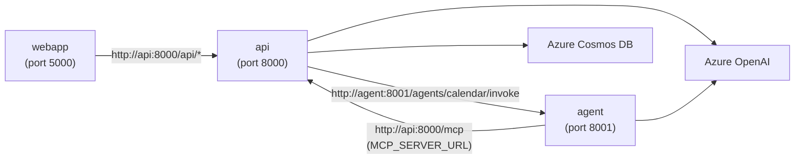
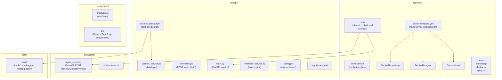

<!-- source: DeepWiki mcp.deepwiki.com · repo microsoft/EvalsforAgentsInterop · page 1.1 Getting Started · fetched 2026-10-26 -->

# Getting Started

<details>
<summary>Relevant source files</summary>

The following files were used as context for generating this wiki page:

- [.gitignore](.gitignore)
- [CODE_OF_CONDUCT.md](CODE_OF_CONDUCT.md)
- [CONTRIBUTING.md](CONTRIBUTING.md)
- [README.md](README.md)
- [src/api/README.md](src/api/README.md)

</details>


This page covers prerequisites, environment configuration, and how to run the three services locally — both manually and via Docker Compose. It also describes how to deploy the required Azure infrastructure using the provided Bicep templates.

For a conceptual overview of what the platform does and how the services relate to each other, see [Overview](#1). For instructions on contributing to the project, see [Contributing](#1.2).

---

## Prerequisites

Before running the project, you need the following:

| Requirement | Details |
|---|---|
| **Azure Cosmos DB** | NoSQL API account with four containers: `datasets`, `testcases`, `agents`, `evaluations` |
| **Azure OpenAI** | A GPT-4.1 deployment, used both by the evaluation judge and the sample agent |
| **Azure CLI** | Required for `az login` (DefaultAzureCredential) or for Bicep deployment |
| **Docker Desktop** | Required for the Docker-based workflow |
| **Python 3.11+** | Required for manual local development |
| **Node.js** | Required if running the webapp manually |

Sources: [README.md:72-76](), [src/api/README.md:138-143]()

---

## Azure Infrastructure Setup

The `infra/` directory contains Bicep templates and deployment scripts that provision all required Azure resources.

**What gets deployed:**
- **Azure Cosmos DB** (Serverless) — four containers: `datasets`, `testcases`, `agents`, `evaluations`
- **Azure AI Foundry** resource — for hosting LLMs (GPT-4.1 must be deployed manually after provisioning)

### Deploy with Scripts

```
cd infra

# Bash
./deploy.sh

# PowerShell (Windows)
.\deploy.ps1

# Or manual Azure CLI
az deployment group create \
  --resource-group evals-interop-dev-rg \
  --template-file main.bicep \
  --parameters @main.parameters.json
```

After deployment completes:
1. Manually deploy GPT-4.1 in the Azure AI Foundry portal.
2. Copy output values from the deployment script into your `.env` file at the repo root.

Sources: [README.md:31-67](), [infra/README.md]()

---

## Environment Configuration

All three services share a single `.env` file at the **repo root**. Copy the example template and fill in your credentials:

```
cp .env.example .env
```

The table below lists all required environment variables. Optional variables with defaults are noted.

| Variable | Used By | Description |
|---|---|---|
| `COSMOS_ENDPOINT` | API | Cosmos DB account URI, e.g. `https://account.documents.azure.com:443/` |
| `COSMOS_KEY` | API | Cosmos DB primary key (omit if using managed identity) |
| `COSMOS_DATABASE_NAME` | API | Database name, typically `interopevals` |
| `COSMOS_DATASETS_CONTAINER_NAME` | API | Container name for datasets |
| `COSMOS_TESTCASES_CONTAINER_NAME` | API | Container name for test cases |
| `COSMOS_AGENTS_CONTAINER_NAME` | API | Container name for agents |
| `AZURE_OPENAI_ENDPOINT` | API + Agent | Azure OpenAI resource endpoint |
| `AZURE_OPENAI_API_KEY` | API + Agent | Azure OpenAI API key |
| `AZURE_OPENAI_DEPLOYMENT` | API + Agent | Model deployment name, e.g. `gpt-4.1` |
| `AZURE_OPENAI_API_VERSION` | API + Agent | API version, e.g. `2024-12-01-preview` |
| `MCP_SERVER_URL` | Agent | URL the agent uses to connect to the MCP server on the API |
| `MAX_CONCURRENT_TESTS` | API | Max parallel test case executions (default: `5`) |

These variables are loaded by `config.py` in the API ([src/api/config.py]()) and by the agent server ([src/agents/agent_server.py]()).

Sources: [README.md:77-94](), [src/api/README.md:152-170]()

---

## Port Assignments

**Service-to-Port Map**

| Service | Port | Entry Point |
|---|---|---|
| FastAPI Backend | `8000` | `src/api/main.py` |
| Calendar Agent | `8001` | `src/agents/agent_server.py` |
| React Webapp | `5000` | `src/webapp/` |

Access points when running locally:

| URL | Purpose |
|---|---|
| `http://localhost:5000` | Web UI |
| `http://localhost:8000/api/docs` | Swagger UI |
| `http://localhost:8000/api/redoc` | ReDoc |
| `http://localhost:8001/agents/calendar/invoke` | Agent invocation endpoint |

Sources: [README.md:199-203](), [src/api/README.md:202-205]()

---

## Option A: Run Locally Without Docker

### 1. Install Dependencies

```
# Optional: create a virtual environment
python -m venv .venv
source .venv/bin/activate        # Linux/macOS
.venv\Scripts\activate           # Windows

# Install per-service requirements
pip install -r src/api/requirements.txt
pip install -r src/agents/requirements.txt

# Webapp
cd src/webapp && npm install
```

### 2. Start Each Service

**API** (port 8000):
```
python -m uvicorn src.api.main:app --host 0.0.0.0 --port 8000 --reload
```

**Agent** (port 8001):
```
python -m uvicorn src.agents.agent_server:app --host 0.0.0.0 --port 8001 --reload
```

**Webapp** (port 5000):
```
cd src/webapp
npm run dev
```

### 3. VS Code Launch Profiles

The workspace ships with `.vscode/launch.json` containing pre-configured profiles:

| Profile | What it starts |
|---|---|
| `API` | FastAPI on port 8000, hot reload enabled |
| `Agent` | Agent server on port 8001, hot reload enabled |
| `WebApp` | React dev server on port 5000 |
| `API + Agent + WebApp` | All three services simultaneously |

Open the **Run and Debug** panel (`Ctrl+Shift+D`), select a profile, press `F5`.

Sources: [README.md:125-155]()

---

## Option B: Run with Docker Compose

### Start All Services

```
docker-compose up --build
```

First build: 5–10 minutes. Subsequent builds: seconds to minutes.

### Useful Docker Commands

```
# Start (no rebuild)
docker-compose up

# Rebuild a single service
docker-compose build api
docker-compose build agent
docker-compose build webapp

# Tail logs for one service
docker-compose logs -f api

# Stop everything
docker-compose down
```

### Docker Networking

When services run inside containers, they cannot reach each other at `localhost`. Docker Compose assigns each container a hostname matching its service name.

**Service-to-Service Communication (inside Docker network)**



Key override: `docker-compose.yml` automatically sets `MCP_SERVER_URL=http://api:8000/mcp` for the agent container, replacing the `localhost` value in `.env`.

**Host-to-Container access (your browser / tools)** still uses `localhost:PORT` as normal.

Sources: [README.md:167-197]()

---

## Load Sample Data

After the services are running, seed Cosmos DB with the bundled evaluation datasets using `cosmos_preload.py`:

```
cd src/api

# Preview what will be uploaded (no writes)
python cosmos_preload.py --dry-run

# Upload sample datasets
python cosmos_preload.py

# Overwrite existing data
python cosmos_preload.py --force
```

`cosmos_preload.py` reads from the `data/` directory and calls `cosmos_service.py` to write `Dataset` and `TestCase` documents. For details on the dataset format, see [Evaluation Datasets](#6).

Sources: [README.md:116-122](), [src/api/README.md:172-179]()

---

## Project Structure Reference

The diagram below maps service names to their file system locations and key entry-point files.

**Repo Layout → Code Entities**



Sources: [README.md:206-223](), [src/api/README.md:6-14]()

---

## Troubleshooting

### Docker Compose: Vite Version Mismatch

**Error:**
```
✘ [ERROR] Cannot start service: Host version "0.25.11" does not match binary version "0.25.12"
```

**Fix:**
```
cd src/webapp
rm -rf node_modules
npm install
cd ../..
docker-compose build --no-cache webapp
docker-compose up
```

### Rate Limiting During Evaluations

If Azure OpenAI returns 429s during evaluation runs, reduce concurrency by setting `MAX_CONCURRENT_TESTS` in `.env`:

```
MAX_CONCURRENT_TESTS=2
```

The default is `5`. This controls how many test cases the evaluation engine runs in parallel. Lower values reduce load at the cost of longer run times. The setting is consumed by `config.py` and used in `evaluator_service.py`.

Sources: [README.md:304-348]()

---

## Azure App Service Deployment (Manual)

To deploy the API to Azure App Service instead of running it locally:

```
# Create App Service
az webapp create --resource-group <rg> --plan <plan> \
  --name <app-name> --runtime "PYTHON:3.11"

# Set required environment variables
az webapp config appsettings set --name <app-name> --resource-group <rg> \
  --settings COSMOS_ENDPOINT=<endpoint> COSMOS_DATABASE_NAME=interopevals

# Assign managed identity (removes need for COSMOS_KEY in production)
az webapp identity assign --name <app-name> --resource-group <rg>

# Deploy
az webapp up --name <app-name> --resource-group <rg>
```

When using managed identity, `COSMOS_KEY` can be omitted and `cosmos_service.py` will authenticate via `DefaultAzureCredential`. Ensure `az login` has been run or that the App Service identity has been granted the appropriate Cosmos DB role.

Sources: [src/api/README.md:207-223]()

---

