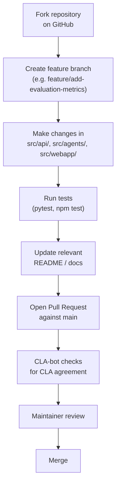
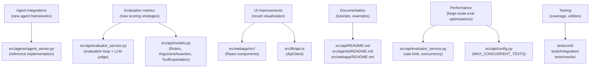

<!-- source: DeepWiki mcp.deepwiki.com · repo microsoft/EvalsforAgentsInterop · page 1.2 Contributing · fetched 2026-10-26 -->

# Contributing

<details>
<summary>Relevant source files</summary>

The following files were used as context for generating this wiki page:

- [AUTHORS.md](AUTHORS.md)
- [CODE_OF_CONDUCT.md](CODE_OF_CONDUCT.md)
- [CONTRIBUTING.md](CONTRIBUTING.md)
- [README.md](README.md)
- [SECURITY.md](SECURITY.md)

</details>


This page covers the process and guidelines for contributing to the EvalsforAgentsInterop project: the code of conduct, how to report bugs and request features, pull request conventions, code style requirements, and project authorship. For information on setting up a local development environment before contributing, see [Getting Started](#1.1).

---

## Code of Conduct

This project follows the [Microsoft Open Source Code of Conduct](CODE_OF_CONDUCT.md). Key points:

- All participants are expected to follow the conduct standards described at `https://opensource.microsoft.com/codeofconduct/`
- Questions or concerns can be sent to `opencode@microsoft.com`
- Microsoft employees can use `aka.ms/opensource/moderation-support`

Sources: [CODE_OF_CONDUCT.md:1-10]()

---

## Contributor License Agreement (CLA)

Most contributions require agreeing to a **Contributor License Agreement (CLA)**, which asserts that you have the right to grant Microsoft rights to use your contribution.

- The CLA process is automated: a CLA-bot checks each pull request and decorates it with the appropriate label or comment.
- If a CLA is required, follow the bot's instructions. This only needs to be done once across all Microsoft repositories.
- The CLA portal is at `https://cla.microsoft.com`.

Sources: [CONTRIBUTING.md:1-7]()

---

## Reporting Bugs

| Step | Detail |
|---|---|
| Search first | Check existing GitHub issues before opening a new one |
| Use templates | Apply issue templates when they are available |
| Reproduce steps | List exact steps to reproduce the problem |
| System info | Include OS version, Docker version, Python version, and Node.js version |

Sources: [CONTRIBUTING.md:12-16]()

---

## Requesting Features

| Step | Detail |
|---|---|
| Check for duplicates | Search existing issues and discussions first |
| Describe the use case | Explain what problem the feature solves |
| Scope fit | Consider whether the feature aligns with the project's evaluation-platform purpose |

Sources: [CONTRIBUTING.md:18-21]()

---

## Contribution Workflow

**Diagram: Pull Request Flow**



Sources: [CONTRIBUTING.md:22-27]()

---

## Pull Request Guidelines

### Branch Naming

Use descriptive names with a type prefix:

```
feature/add-evaluation-metrics
fix/docker-build-error
docs/update-agent-endpoints
```

### Commit Messages

Follow conventional commit format:

```
feat: add support for custom evaluation criteria
fix: resolve Docker build issues with Node.js dependencies
docs: update API documentation for agent endpoints
```

### Checklist Before Submitting

| Requirement | Detail |
|---|---|
| Tests pass | Verify with both Docker and manual local setup |
| New tests written | Cover any new functionality |
| Documentation updated | Update affected `README.md` files in `src/api/`, `src/agents/`, or `src/webapp/` |
| Focused scope | One feature or fix per PR |

Sources: [CONTRIBUTING.md:38-51]()

---

## Code Style

### Python (applies to `src/api/` and `src/agents/`)

| Rule | Detail |
|---|---|
| Style guide | PEP 8 |
| Type hints | Use where appropriate |
| Docstrings | Required for functions and classes |

### TypeScript / React (applies to `src/webapp/`)

| Rule | Detail |
|---|---|
| Linting | Use existing ESLint and Prettier configurations |
| Patterns | Follow React hooks patterns |
| Structure | Maintain consistent component structure |

### General

- Use meaningful variable and function names
- Add comments for complex logic
- Keep functions small and focused

Sources: [CONTRIBUTING.md:53-68]()

---

## Areas for Contribution

**Diagram: Contribution Areas Mapped to Code Entities**



Sources: [CONTRIBUTING.md:71-78]()

---

## Questions and Support

- Check existing GitHub issues and discussions first
- Review service-specific documentation under the `src/` subdirectories (`src/api/README.md`, `src/agents/README.md`, `src/webapp/README.md`)
- Contact maintainers via GitHub issues

Sources: [CONTRIBUTING.md:80-85]()

---

## Security Vulnerabilities

**Do not report security vulnerabilities through public GitHub issues.**

Report security issues through the guidance at `https://aka.ms/SECURITY.md`. This follows standard Microsoft repository security policy.

Sources: [SECURITY.md:1-13]()

---

## Authors

All launch authors are affiliated with Microsoft.

### Developers

| Name | GitHub |
|---|---|
| Aadharsh Kannan | `@aadharshkannan` |
| AJ Fehr | `@ajmfehr` |
| Daniel Evora | `@danevora` |
| Darshini Jois | — |
| Grant Harris | `@gwharris7` |
| Heather Acuna | `@h-acuna` |
| Isha Arora | `@IshaArora3` |
| Sruthi Kilari | `@sruthikilari` |

### Other Contributors

| Name | GitHub |
|---|---|
| Ahmed Zakaria | `@azakariaMSFT` |
| James Oleinik | `@jamesol-msft` |
| Robert Bruckner | `@RobertBruckner` |
| Terell Cobb | — |

Sources: [AUTHORS.md:1-21]()

---

