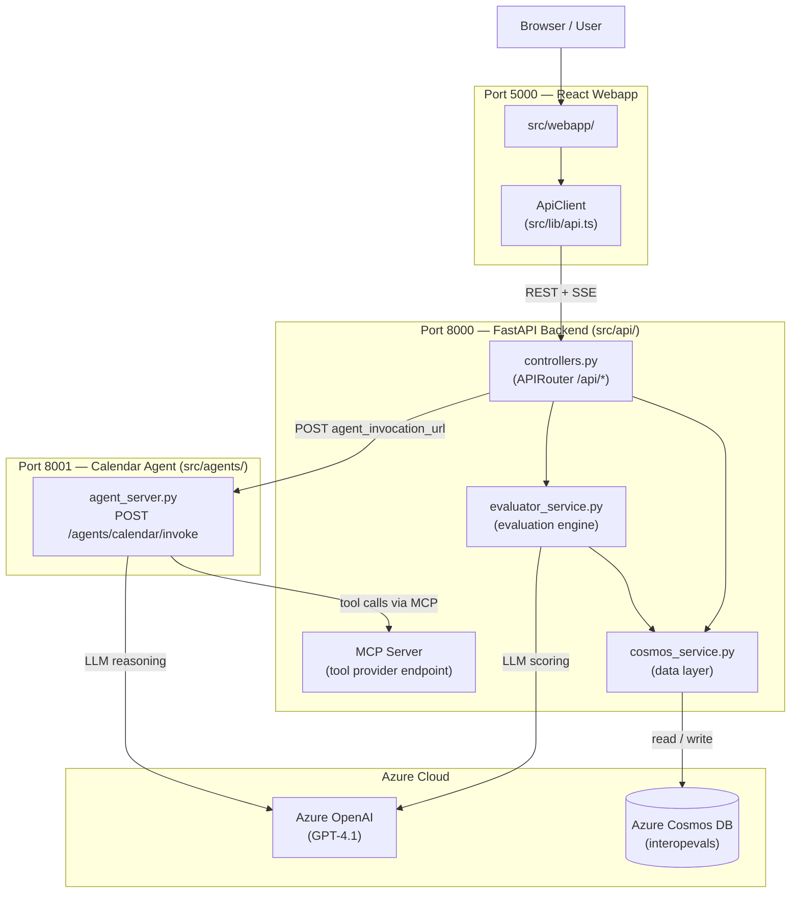
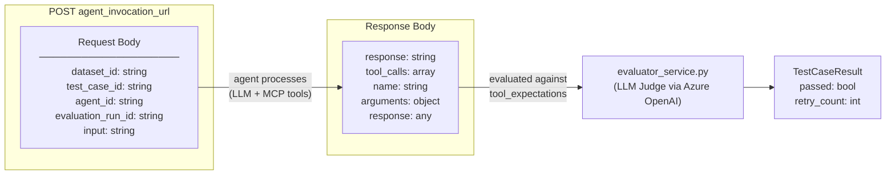
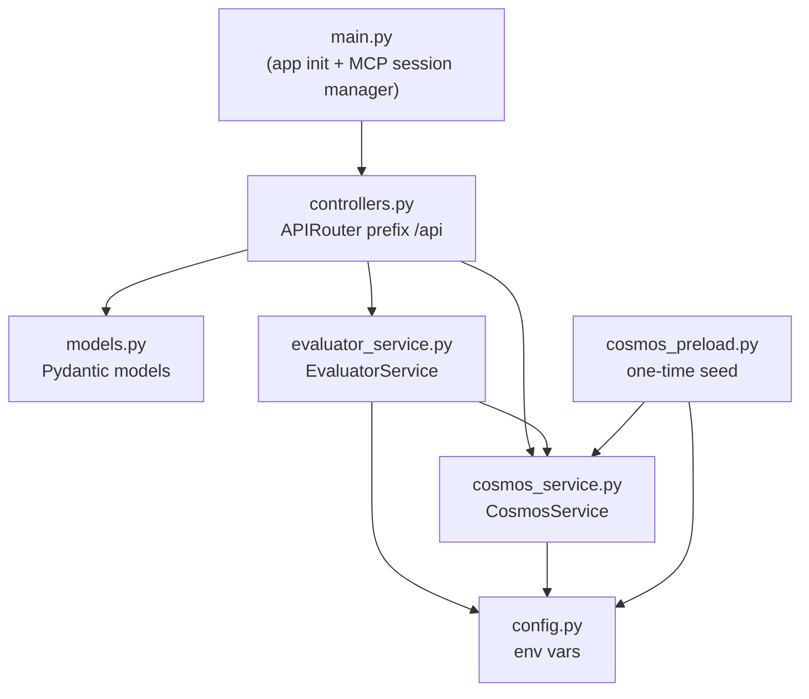
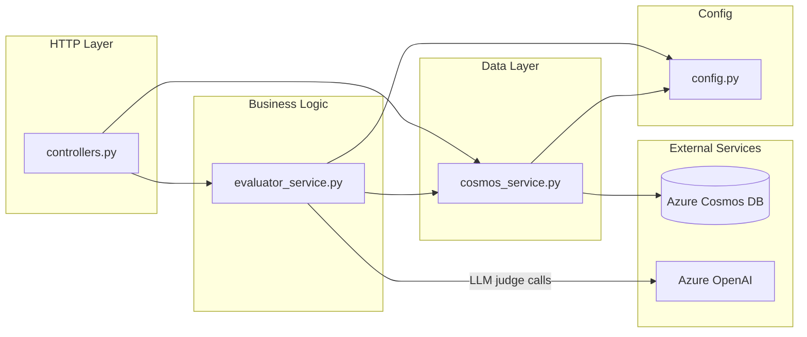
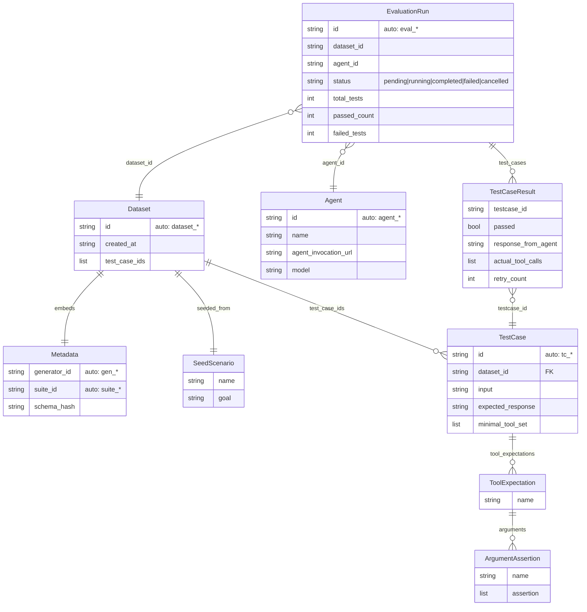
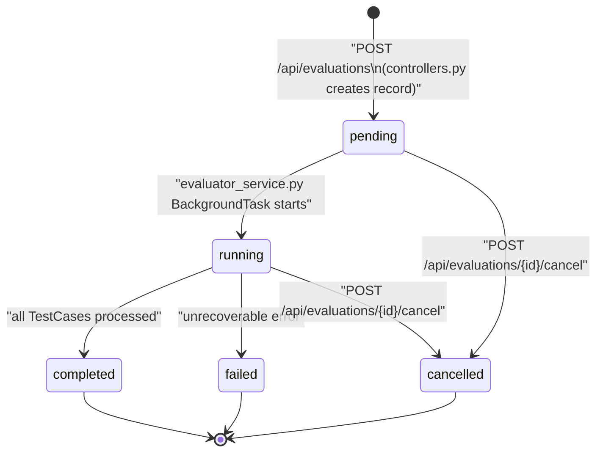

<!-- source: DeepWiki mcp.deepwiki.com · repo microsoft/EvalsforAgentsInterop · page 2 System Architecture · fetched 2026-10-26 -->

# System Architecture

Relevant source files

The following files were used as context for generating this wiki page:

- [CODE_OF_CONDUCT.md](CODE_OF_CONDUCT.md)
- [CONTRIBUTING.md](CONTRIBUTING.md)
- [README.md](README.md)
- [src/api/README.md](src/api/README.md)
- [src/api/controllers.py](src/api/controllers.py)

This page describes the structural layout of the EvalsforAgentsInterop platform: the three deployed services, how they communicate, the Azure dependencies they share, and the internal module structure of the backend API. It is oriented toward developers who need to understand how components fit together before working on any one of them.

For details on individual subsystems, see:
- Backend API internals: [Backend API](#3)
- REST endpoint reference: [REST API Endpoints](#3.1)
- Evaluation engine behavior: [Evaluation Engine](#3.3)
- Frontend components: [Web Application](#5)
- Calendar Agent implementation: [Calendar Agent](#4)

---

## Service Topology

The platform is split into three independently deployable services plus two Azure-managed cloud services. Each service runs on a dedicated port and has a distinct responsibility.

| Service | Port | Technology | Directory |
|---|---|---|---|
| Backend API | 8000 | FastAPI (Python) | `src/api/` |
| Calendar Agent | 8001 | FastAPI (Python) | `src/agents/` |
| Web Application | 5000 | React + TypeScript | `src/webapp/` |
| Azure Cosmos DB | — | NoSQL (cloud) | — |
| Azure OpenAI | — | GPT-4.1 (cloud) | — |

**Top-Level Service Topology**

Sources: [README.md:6-29](), [src/api/README.md:1-54]()

---

## Cross-Service Communication

### Webapp → API

The webapp communicates exclusively with the backend API. The `ApiClient` class in `src/lib/api.ts` issues typed HTTP requests to `controllers.py`. Real-time evaluation progress uses Server-Sent Events (SSE) over `GET /api/evaluations/{id}/stream`.

### API → Agent

When an evaluation run processes a test case, `evaluator_service.py` calls the registered `agent_invocation_url` with a structured JSON payload. This is an HTTP POST — the API makes no assumptions about what language or framework the agent uses, only that it conforms to the invocation contract.

**Agent Invocation Contract**

Sources: [README.md:227-295](), [src/api/README.md:56-67]()

### Agent → API (MCP)

The sample `agent_server.py` connects back to the API's MCP server endpoint to discover and call tools (e.g., calendar operations). This is optional for custom agents — only agents that use the provided MCP tool server need this reverse connection.

---

## Backend API: Internal Module Structure

All backend modules live under `src/api/`. The table below summarizes each file's role.

| File | Role |
|---|---|
| `main.py` | FastAPI app init; mounts `controllers.py`; initializes MCP session manager |
| `controllers.py` | `APIRouter` with prefix `/api`; all HTTP handlers |
| `models.py` | Pydantic data models (`Dataset`, `TestCase`, `Agent`, `EvaluationRun`, etc.) |
| `cosmos_service.py` | `CosmosService` class; all Cosmos DB read/write logic |
| `evaluator_service.py` | `EvaluatorService` class; evaluation loop, LLM judge, rate limiting |
| `config.py` | Loads environment variables; exposes rate limit and Cosmos DB settings |
| `cosmos_preload.py` | One-time data seeding script; reads from `data/` and writes to Cosmos DB |

**Backend API Module Dependency Graph**

Sources: [src/api/README.md:6-16](), [src/api/controllers.py:1-26]()

---

## Key Dependency Boundaries

The module structure enforces a clean layering:

1. **`controllers.py`** depends on `cosmos_service.py` and `evaluator_service.py` but never calls Azure OpenAI directly.
2. **`evaluator_service.py`** owns all LLM judge logic and calls `cosmos_service.py` to read test cases and write results.
3. **`cosmos_service.py`** is the sole module that communicates with Azure Cosmos DB.
4. **`config.py`** is a leaf — it has no internal dependencies and is imported by both `cosmos_service.py` and `evaluator_service.py`.

This means that swapping the data layer requires only changes to `cosmos_service.py` and its consumers, not the controllers or models.

Sources: [src/api/controllers.py:20-26](), [src/api/README.md:6-16]()

---

## Azure Dependencies

Both the backend API and the Calendar Agent require Azure credentials. The two Azure services used are:

| Azure Service | Used By | Purpose |
|---|---|---|
| Azure Cosmos DB | `cosmos_service.py` | Stores datasets, test cases, agents, evaluation runs |
| Azure OpenAI (GPT-4.1) | `evaluator_service.py` | LLM judge scoring of agent tool calls |
| Azure OpenAI (GPT-4.1) | `agent_server.py` | LLM reasoning within the sample Calendar Agent |

Cosmos DB containers created by the platform:

| Container | Contents |
|---|---|
| `datasets` | `Dataset` documents |
| `testcases` | `TestCase` documents |
| `agents` | `Agent` registration documents |
| `evaluations` | `EvaluationRun` and `TestCaseResult` documents |

Sources: [src/api/README.md:140-170](), [README.md:34-58]()

---

## Core Data Model Relationships

The entity relationships below show how the primary Pydantic models in `models.py` connect to each other. IDs are auto-generated with typed prefixes (`dataset_*`, `tc_*`, `eval_*`, `agent_*`).

Sources: [src/api/README.md:69-134](), [src/api/controllers.py:5-19]()

---

## EvaluationRun State Machine

An `EvaluationRun` moves through a fixed set of statuses. `controllers.py` creates the record at `pending`, and `evaluator_service.py` drives the remaining transitions.

Sources: [src/api/controllers.py:266-280](), [src/api/controllers.py:330-359](), [src/api/README.md:55-67]()

---

