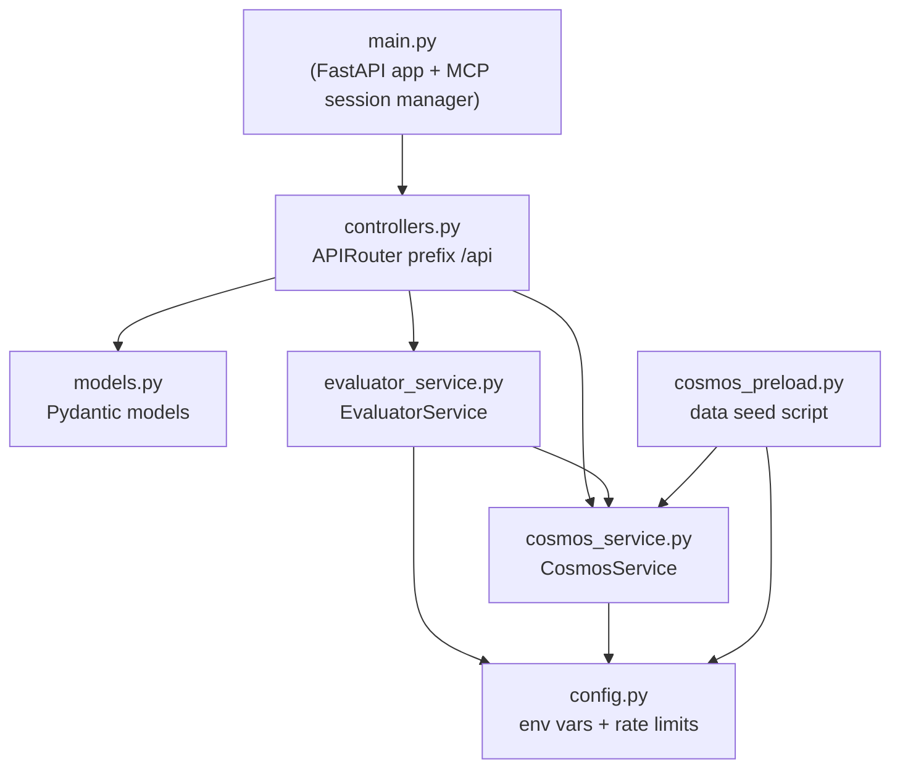
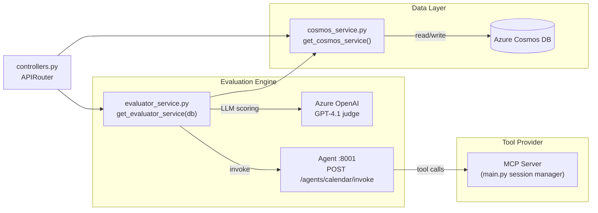

<!-- source: DeepWiki mcp.deepwiki.com · repo microsoft/EvalsforAgentsInterop · page 3 Backend API · fetched 2026-10-26 -->

# Backend API

Relevant source files

The following files were used as context for generating this wiki page:

- [src/api/README.md](src/api/README.md)
- [src/api/controllers.py](src/api/controllers.py)

This page covers the FastAPI backend service (`src/api/`): its startup, module structure, and the roles of its three core dependencies. For the full list of REST endpoints with request/response shapes, see [REST API Endpoints](#3.1). For Pydantic model definitions, see [Data Models](#3.2). For the evaluation engine internals, see [Evaluation Engine](#3.3).

---

## Role in the System

The backend is the central hub of the platform. It runs on **port 8000** and is the only service that talks directly to Azure Cosmos DB and Azure OpenAI. The React webapp communicates with it exclusively over REST and SSE. The Calendar Agent on port 8001 receives invocation requests from it during evaluation runs.

**File layout:**

| File | Purpose |
|---|---|
| `main.py` | FastAPI app initialization, MCP session manager startup |
| `controllers.py` | `APIRouter` definitions, all `/api/*` endpoints |
| `models.py` | Pydantic data models for all request/response bodies |
| `cosmos_service.py` | Async Cosmos DB abstraction (`CosmosService`) |
| `evaluator_service.py` | Evaluation engine (`EvaluatorService`) |
| `config.py` | Environment variable loading, rate limit settings |
| `cosmos_preload.py` | One-time data seeding script |

Sources: [src/api/README.md:1-15]()

---

## Module Dependency Graph

**Diagram: Internal Module Dependencies (`src/api/`)**

Sources: [src/api/controllers.py:1-26](), [src/api/README.md:1-15]()

---

## App Initialization (`main.py`)

The FastAPI application is created in `main.py`. On startup it:

1. Instantiates the FastAPI app with OpenAPI docs mounted at `/api/docs` and `/api/redoc`.
2. Registers the `APIRouter` from `controllers.py` (prefix: `/api`).
3. Initializes an MCP session manager that exposes the tool-provider endpoint consumed by the Calendar Agent.

The `controllers.py` module eagerly constructs two singletons at import time:

- `db = get_cosmos_service()` — the `CosmosService` instance
- `evaluator = get_evaluator_service(db)` — the `EvaluatorService` instance, receiving `db` as a dependency

Sources: [src/api/controllers.py:20-25]()

---

## Three Core Dependencies

**Diagram: Runtime Dependency Wiring**

Sources: [src/api/controllers.py:20-26](), [src/api/README.md:55-68]()

### `CosmosService`

Defined in `cosmos_service.py`, obtained via `get_cosmos_service()`. Provides async CRUD operations over four Cosmos DB containers:

| Container env var | Holds |
|---|---|
| `COSMOS_DATASETS_CONTAINER_NAME` | `Dataset` documents |
| `COSMOS_TESTCASES_CONTAINER_NAME` | `TestCase` documents |
| `COSMOS_AGENTS_CONTAINER_NAME` | `Agent` documents |
| *(evaluations container)* | `EvaluationRun` documents |

Authentication uses `DefaultAzureCredential` (managed identity in production) or `COSMOS_KEY` for local development.

Sources: [src/api/README.md:154-170]()

### `EvaluatorService`

Defined in `evaluator_service.py`, obtained via `get_evaluator_service(db)`. Receives a `CosmosService` instance at construction time. Responsible for:

- Creating `EvaluationRun` records in Cosmos DB.
- Running the per-test-case loop asynchronously (agent call → LLM judge → result write) via FastAPI `BackgroundTasks`.
- Streaming progress updates to connected SSE clients.
- Managing cancellation and retry/rate-limit logic.

The `controllers.py` `create_evaluation` handler calls `evaluator.create_evaluation_run()` synchronously, then enqueues `evaluator.start_evaluation()` as a background task, returning HTTP 202 immediately.

Sources: [src/api/controllers.py:266-280]()

### MCP Session Manager (`main.py`)

Initialized in `main.py` at app startup. Manages persistent MCP (Model Context Protocol) sessions and exposes a tool-provider endpoint. The Calendar Agent on port 8001 connects to this endpoint to discover and invoke tools during its conversation loop. The session manager is not used in unit tests because it has external connection requirements — the test suite patches it out via `app_with_mocks`. For details on the test fixture, see [Test Configuration and Fixtures](#7.1).

---

## Request Routing Overview

All endpoints are registered under the `/api` prefix via `router = APIRouter(prefix="/api")` in `controllers.py`.

**Diagram: Endpoint Groups and Handler Functions**

```mermaid
graph TD
    router["APIRouter\nprefix /api"]

    subgraph "Datasets"
        D1["POST /datasets\ncreate_dataset()"]
        D2["GET /datasets\nlist_datasets()"]
        D3["GET /datasets/{id}\nget_dataset()"]
        D4["DELETE /datasets/{id}\ndelete_dataset()"]
    end

    subgraph "Test Cases"
        TC1["POST /datasets/{id}/testcases\nadd_testcase()"]
        TC2["GET /datasets/{id}/testcases\nlist_testcases()"]
        TC3["GET /datasets/{id}/testcases/{tc_id}\nget_testcase()"]
        TC4["PUT /datasets/{id}/testcases/{tc_id}\nupdate_testcase()"]
        TC5["DELETE /datasets/{id}/testcases/{tc_id}\ndelete_testcase()"]
    end

    subgraph "Agents"
        A1["POST /agents\ncreate_agent()"]
        A2["GET /agents\nlist_agents()"]
        A3["GET /agents/{id}\nget_agent()"]
        A4["PUT /agents/{id}\nupdate_agent()"]
        A5["DELETE /agents/{id}\ndelete_agent()"]
    end

    subgraph "Evaluations"
        E1["POST /evaluations\ncreate_evaluation()"]
        E2["GET /evaluations\nlist_evaluations()"]
        E3["GET /evaluations/{id}\nget_evaluation()"]
        E4["GET /evaluations/{id}/results\nget_evaluation_results()"]
        E5["GET /evaluations/{id}/results/{tc_id}\nget_test_result()"]
        E6["POST /evaluations/{id}/cancel\ncancel_evaluation()"]
        E7["DELETE /evaluations/{id}\ndelete_evaluation()"]
        E8["GET /evaluations/{id}/stream\nSSE stream"]
    end

    router --> D1 & D2 & D3 & D4
    router --> TC1 & TC2 & TC3 & TC4 & TC5
    router --> A1 & A2 & A3 & A4 & A5
    router --> E1 & E2 & E3 & E4 & E5 & E6 & E7 & E8
```

Sources: [src/api/controllers.py:29-370](), [src/api/README.md:17-53]()

---

## Configuration and Environment Variables

All configuration is loaded in `config.py` and consumed by `CosmosService` and `EvaluatorService`.

| Variable | Used By | Purpose |
|---|---|---|
| `COSMOS_ENDPOINT` | `CosmosService` | Cosmos DB account URL |
| `COSMOS_KEY` | `CosmosService` | Auth key (optional; falls back to managed identity) |
| `COSMOS_DATABASE_NAME` | `CosmosService` | Target database name |
| `COSMOS_DATASETS_CONTAINER_NAME` | `CosmosService` | Datasets container |
| `COSMOS_TESTCASES_CONTAINER_NAME` | `CosmosService` | Test cases container |
| `COSMOS_AGENTS_CONTAINER_NAME` | `CosmosService` | Agents container |
| `AZURE_OPENAI_ENDPOINT` | `EvaluatorService` | OpenAI resource URL |
| `AZURE_OPENAI_API_KEY` | `EvaluatorService` | OpenAI auth key |
| `AZURE_OPENAI_DEPLOYMENT` | `EvaluatorService` | Model deployment name (e.g. `gpt-4.1`) |
| `AZURE_OPENAI_API_VERSION` | `EvaluatorService` | API version string |

Rate limit behaviour (retry count, backoff intervals) is also sourced from `config.py` and applied inside `EvaluatorService`. See [Evaluation Engine](#3.3) for the retry logic details.

Sources: [src/api/README.md:154-170]()

---

## Interactive API Documentation

When the server is running, auto-generated documentation is available at:

- **Swagger UI**: `http://localhost:8000/api/docs`
- **ReDoc**: `http://localhost:8000/api/redoc`

Sources: [src/api/README.md:203-206]()

---

