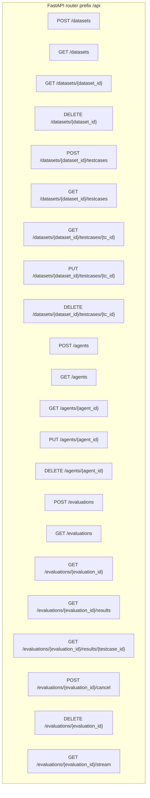
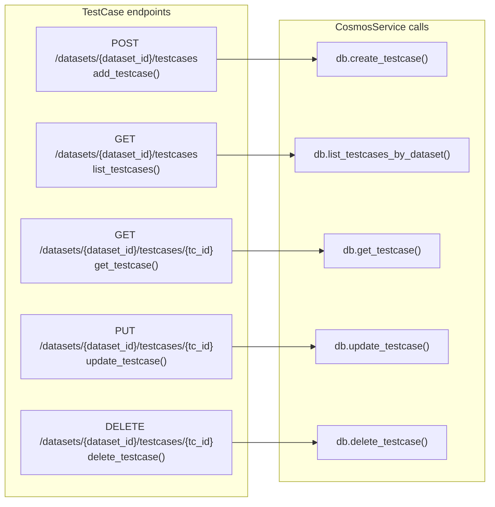
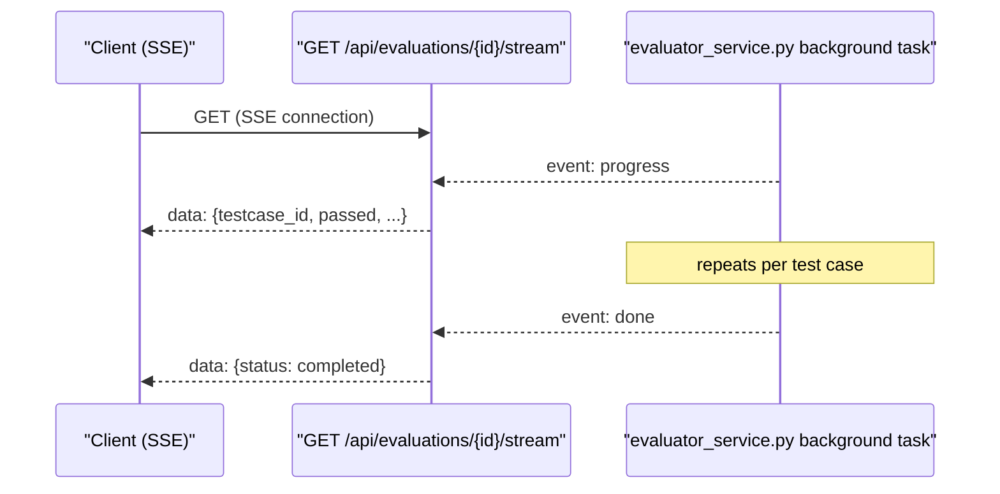

<!-- source: DeepWiki mcp.deepwiki.com · repo microsoft/EvalsforAgentsInterop · page 3.1 REST API Endpoints · fetched 2026-10-26 -->

# REST API Endpoints

<details>
<summary>Relevant source files</summary>

The following files were used as context for generating this wiki page:

- [src/api/README.md](src/api/README.md)
- [src/api/controllers.py](src/api/controllers.py)
- [tests/unit/test_controllers.py](tests/unit/test_controllers.py)

</details>


This page documents all HTTP endpoints exposed by the FastAPI backend (`src/api/controllers.py`), grouped by resource. It covers URL paths, HTTP methods, request body shapes, response shapes, and status codes. For the data models that appear in these requests and responses, see [Data Models](#3.2). For how the evaluation engine processes requests asynchronously, see [Evaluation Engine](#3.3). For the SSE client implementation in the frontend, see [API Client](#5.1).

All endpoints are mounted under the `/api` prefix via the `APIRouter` defined at [src/api/controllers.py:23]().

---

## Endpoint Summary

**Resource routing diagram:**



**Flat reference table:**

| Method | Path | Handler Function | Description |
|--------|------|-----------------|-------------|
| `POST` | `/api/datasets` | `create_dataset` | Create a new dataset |
| `GET` | `/api/datasets` | `list_datasets` | List datasets (paginated) |
| `GET` | `/api/datasets/{dataset_id}` | `get_dataset` | Get a single dataset |
| `DELETE` | `/api/datasets/{dataset_id}` | `delete_dataset` | Delete a dataset |
| `POST` | `/api/datasets/{dataset_id}/testcases` | `add_testcase` | Add test case to dataset |
| `GET` | `/api/datasets/{dataset_id}/testcases` | `list_testcases` | List all test cases in dataset |
| `GET` | `/api/datasets/{dataset_id}/testcases/{tc_id}` | `get_testcase` | Get a single test case |
| `PUT` | `/api/datasets/{dataset_id}/testcases/{tc_id}` | `update_testcase` | Replace a test case's fields |
| `DELETE` | `/api/datasets/{dataset_id}/testcases/{tc_id}` | `delete_testcase` | Delete a test case |
| `POST` | `/api/agents` | `create_agent` | Register a new agent |
| `GET` | `/api/agents` | `list_agents` | List agents (paginated) |
| `GET` | `/api/agents/{agent_id}` | `get_agent` | Get a single agent |
| `PUT` | `/api/agents/{agent_id}` | `update_agent` | Update agent registration |
| `DELETE` | `/api/agents/{agent_id}` | `delete_agent` | Delete an agent |
| `POST` | `/api/evaluations` | `create_evaluation` | Start an evaluation run |
| `GET` | `/api/evaluations` | `list_evaluations` | List evaluation runs |
| `GET` | `/api/evaluations/{evaluation_id}` | `get_evaluation` | Get a single evaluation run |
| `GET` | `/api/evaluations/{evaluation_id}/results` | `get_evaluation_results` | Get all test case results |
| `GET` | `/api/evaluations/{evaluation_id}/results/{testcase_id}` | `get_test_result` | Get one test case result |
| `POST` | `/api/evaluations/{evaluation_id}/cancel` | `cancel_evaluation` | Cancel a running evaluation |
| `DELETE` | `/api/evaluations/{evaluation_id}` | `delete_evaluation` | Delete an evaluation run |
| `GET` | `/api/evaluations/{evaluation_id}/stream` | (in `main.py`) | SSE stream of progress events |

Sources: [src/api/controllers.py:29-370](), [src/api/README.md:19-53]()

---

## Health Endpoints

These are mounted at the root level, not under `/api`.

| Method | Path | Status | Response |
|--------|------|--------|----------|
| `GET` | `/` | `200` | `{ "message": "...", "docs": "..." }` |
| `GET` | `/health` | `200` | `{ "status": "ok" }` |

Sources: [tests/unit/test_controllers.py:16-30]()

---

## Datasets — `/api/datasets`

### `POST /api/datasets`

Creates a new dataset. All IDs (`id`, `generator_id`, `suite_id`) and timestamps are auto-generated by the server.

**Request body** (`CreateDatasetRequest`):

| Field | Type | Required | Description |
|-------|------|----------|-------------|
| `name` | `string` | Yes | Display name for the dataset |
| `goal` | `string` | Yes | Evaluation goal description |
| `input` | `object` | No | Additional seed input parameters |
| `schema_hash` | `string` | No | Optional hash for schema versioning |

**Response** (`DatasetResponse`, `201 Created`):

| Field | Type | Description |
|-------|------|-------------|
| `id` | `string` | Auto-generated, format `dataset_*` |
| `metadata` | `Metadata` | Contains `generator_id`, `suite_id`, `schema_hash` |
| `seed` | `SeedScenario` | Contains `name`, `goal`, `input` |
| `test_case_ids` | `string[]` | Initially empty |
| `created_at` | `string` | ISO 8601 timestamp |

**Error responses:**
- `422 Unprocessable Entity` — missing required fields (`name` or `goal`)
- `500 Internal Server Error` — unexpected failure

---

### `GET /api/datasets`

Returns a paginated list of all datasets.

**Query parameters:**

| Parameter | Type | Default | Description |
|-----------|------|---------|-------------|
| `skip` | `int` | `0` | Number of records to skip |
| `limit` | `int` | `100` | Maximum records to return |

**Response:** `List[DatasetResponse]`, `200 OK`

---

### `GET /api/datasets/{dataset_id}`

Returns a single dataset by its ID.

**Response:** `DatasetResponse`, `200 OK`

**Error responses:**
- `404 Not Found` — dataset ID does not exist

---

### `DELETE /api/datasets/{dataset_id}`

Deletes a dataset. Does not automatically delete associated test cases in the testcases container.

**Response:** `204 No Content`

**Error responses:**
- `404 Not Found` — dataset ID does not exist

Sources: [src/api/controllers.py:29-91](), [tests/unit/test_controllers.py:33-106]()

---

## Test Cases — `/api/datasets/{dataset_id}/testcases`

All test case endpoints validate that the parent dataset exists before operating.

**Endpoint-to-handler mapping:**



### `POST /api/datasets/{dataset_id}/testcases`

Adds a new test case to an existing dataset. The test case ID is auto-generated; `dataset_id` is taken from the URL path, not the request body.

**Request body** (`TestCaseCreate`):

| Field | Type | Required | Description |
|-------|------|----------|-------------|
| `name` | `string` | Yes | Display name |
| `description` | `string` | No | Human-readable description |
| `input` | `string` | Yes | Natural language input sent to the agent |
| `minimal_tool_set` | `string[]` | No | Names of tools the agent must use |
| `tool_expectations` | `ToolExpectation[]` | No | Per-tool argument assertions |
| `expected_response` | `string` | No | Expected natural language response |
| `response_quality_expectation` | `ResponseQualityAssertion` | No | Rubric for response quality |
| `references_seed` | `object` | No | Seed data referenced by this test case |

**Response** (`TestCaseResponse`, `201 Created`):

| Field | Type | Description |
|-------|------|-------------|
| `id` | `string` | Auto-generated, format `tc_*` |
| `dataset_id` | `string` | Parent dataset ID (from URL) |
| `name` | `string` | Falls back to `id` if blank |
| `description` | `string` | |
| `input` | `string` | |
| `minimal_tool_set` | `string[]` | |
| `tool_expectations` | `ToolExpectation[]` | |
| `expected_response` | `string` | |
| `response_quality_expectation` | `ResponseQualityAssertion` | |
| `references_seed` | `object` | |

**Error responses:**
- `404 Not Found` — `dataset_id` does not exist

---

### `GET /api/datasets/{dataset_id}/testcases`

Returns all test cases belonging to the specified dataset.

**Response:** `List[TestCaseResponse]`, `200 OK`

**Error responses:**
- `404 Not Found` — `dataset_id` does not exist

---

### `GET /api/datasets/{dataset_id}/testcases/{tc_id}`

Returns a single test case.

**Response:** `TestCaseResponse`, `200 OK`

**Error responses:**
- `404 Not Found` — test case not found

---

### `PUT /api/datasets/{dataset_id}/testcases/{tc_id}`

Replaces all mutable fields of an existing test case. The `id` and `dataset_id` are preserved and cannot be changed.

**Request body:** `TestCaseCreate` (same schema as POST)

**Response:** `TestCaseResponse`, `200 OK`

**Error responses:**
- `404 Not Found` — dataset or test case not found

---

### `DELETE /api/datasets/{dataset_id}/testcases/{tc_id}`

Deletes a test case.

**Response:** `204 No Content`

**Error responses:**
- `404 Not Found` — test case not found

Sources: [src/api/controllers.py:93-222](), [tests/unit/test_controllers.py:401-520]()

---

## Agents — `/api/agents`

Agents represent external agent servers that can be evaluated. The `agent_invocation_url` field is the endpoint the evaluation engine calls during a run.

### `POST /api/agents`

Registers a new agent.

**Request body** (`AgentCreate`):

| Field | Type | Required | Description |
|-------|------|----------|-------------|
| `name` | `string` | Yes | Display name |
| `description` | `string` | No | What the agent does |
| `model` | `string` | Yes | LLM model identifier (e.g., `gpt-4.1`) |
| `agent_invocation_url` | `string` | Yes | URL for `POST` agent invocation calls |

**Response** (`Agent`, `201 Created`):

| Field | Type | Description |
|-------|------|-------------|
| `id` | `string` | Auto-generated, format `agent_*` |
| `name` | `string` | |
| `description` | `string` | |
| `model` | `string` | |
| `agent_invocation_url` | `string` | |
| `createdAt` | `string` | ISO 8601 timestamp (preserved on update) |

**Error responses:**
- `422 Unprocessable Entity` — missing required fields

---

### `GET /api/agents`

Returns a paginated list of registered agents.

**Query parameters:**

| Parameter | Type | Default |
|-----------|------|---------|
| `skip` | `int` | `0` |
| `limit` | `int` | `100` |

**Response:** `List[Agent]`, `200 OK`

---

### `GET /api/agents/{agent_id}`

Returns a single agent registration.

**Response:** `Agent`, `200 OK`

**Error responses:**
- `404 Not Found`

---

### `PUT /api/agents/{agent_id}`

Updates an agent registration. The `id` and `createdAt` fields are preserved from the original record.

**Request body:** `AgentCreate` (same schema as POST)

**Response:** `Agent`, `200 OK`

**Error responses:**
- `404 Not Found`

---

### `DELETE /api/agents/{agent_id}`

Deletes an agent registration.

**Response:** `204 No Content`

**Error responses:**
- `404 Not Found`

Sources: [src/api/controllers.py:224-262](), [tests/unit/test_controllers.py:109-177](), [tests/unit/test_controllers.py:527-565]()

---

## Evaluations — `/api/evaluations`

Evaluation endpoints interact with `EvaluatorService` (via the `evaluator` module-level instance), not directly with `CosmosService`. The `create_evaluation` handler starts a background task for the actual evaluation loop.

**Lifecycle overview:**

```mermaid
sequenceDiagram
    participant "Client"
    participant "POST /api/evaluations\ncreate_evaluation()"
    participant "evaluator.create_evaluation_run()"
    participant "BackgroundTasks"
    participant "GET /api/evaluations/{id}/stream"

    "Client"->>"POST /api/evaluations\ncreate_evaluation()": EvaluationRunCreate body
    "POST /api/evaluations\ncreate_evaluation()"->> "evaluator.create_evaluation_run()": eval_request
    "evaluator.create_evaluation_run()"-->>"POST /api/evaluations\ncreate_evaluation()": EvaluationRun (status=pending)
    "POST /api/evaluations\ncreate_evaluation()">>"BackgroundTasks": add_task(evaluator.start_evaluation, eval_run.id)
    "POST /api/evaluations\ncreate_evaluation()"-->>"Client": 201 EvaluationRun
    "Client"->>"GET /api/evaluations/{id}/stream": SSE connect
    "BackgroundTasks"-->>"GET /api/evaluations/{id}/stream": progress events
```

### `POST /api/evaluations`

Creates an evaluation run and immediately starts it in the background via `BackgroundTasks`.

**Request body** (`EvaluationRunCreate`):

| Field | Type | Required | Description |
|-------|------|----------|-------------|
| `name` | `string` | Yes | Display name for this run |
| `dataset_id` | `string` | Yes | ID of the dataset to evaluate against |
| `agent_id` | `string` | Yes | ID of the registered agent |
| `agent_endpoint` | `string` | Yes | URL to call during test execution |
| `verbose_logging` | `bool` | No | Enable detailed logging in evaluator |

**Response** (`EvaluationRun`, `201 Created`):

| Field | Type | Description |
|-------|------|-------------|
| `id` | `string` | Auto-generated, format `eval_*` |
| `name` | `string` | |
| `dataset_id` | `string` | |
| `agent_id` | `string` | |
| `agent_endpoint` | `string` | |
| `status` | `EvaluationRunStatus` | Initial value: `pending` |
| `total_tests` | `int` | Total number of test cases |
| `passed_count` | `int` | Count of passed test cases |
| `failed_tests` | `int` | Count of failed test cases |
| `total_rate_limit_hits` | `int` | Cumulative 429 responses encountered |
| `total_retry_wait_seconds` | `float` | Total time spent waiting on retries |
| `started_at` | `string \| null` | ISO 8601, set when background task begins |
| `completed_at` | `string \| null` | ISO 8601, set when all tests finish |
| `created_at` | `string` | ISO 8601 creation timestamp |
| `status_history` | `StatusHistoryEntry[]` | Log of status transitions and rate limit events |
| `test_cases` | `TestCaseResult[]` | Per-test results (populated as evaluation runs) |

**Error responses:**
- `400 Bad Request` — invalid request parameters (e.g., bad dataset or agent ID)
- `500 Internal Server Error` — unexpected failure

---

### `GET /api/evaluations`

Returns a filtered, paginated list of evaluation runs.

**Query parameters:**

| Parameter | Type | Default | Description |
|-----------|------|---------|-------------|
| `skip` | `int` | `0` | Records to skip |
| `limit` | `int` | `100` | Maximum records to return |
| `agent_id` | `string` | `null` | Filter to only runs for this agent |

**Response:** `List[EvaluationRun]`, `200 OK`

---

### `GET /api/evaluations/{evaluation_id}`

Returns the full state of a single evaluation run, including all `test_cases` results collected so far.

**Response:** `EvaluationRun`, `200 OK`

**Error responses:**
- `404 Not Found`

---

### `GET /api/evaluations/{evaluation_id}/results`

Returns only the `test_cases` list from an `EvaluationRun`. Equivalent to fetching the run and reading `.test_cases`.

**Response:** `List[TestCaseResult]`, `200 OK`

Each `TestCaseResult` contains:

| Field | Type | Description |
|-------|------|-------------|
| `testcase_id` | `string` | ID of the evaluated `TestCase` |
| `passed` | `bool` | Judge verdict |
| `response_from_agent` | `string` | Raw text response from the agent |
| `actual_tool_calls` | `object[]` | Tool calls the agent actually made |
| `expected_tools` | `string[]` | Tool names from `minimal_tool_set` |
| `tool_expectations` | `ToolExpectation[]` | Full expectation objects |
| `retry_count` | `int` | Number of retries for this test case |
| `rationale` | `string` | LLM judge explanation |

**Error responses:**
- `404 Not Found` — evaluation run not found

---

### `GET /api/evaluations/{evaluation_id}/results/{testcase_id}`

Returns a single `TestCaseResult` from within an evaluation run.

**Response:** `TestCaseResult`, `200 OK`

**Error responses:**
- `404 Not Found` — evaluation run not found, or no result exists for `testcase_id`

---

### `POST /api/evaluations/{evaluation_id}/cancel`

Marks a `pending` or `running` evaluation as `cancelled`. The evaluation is preserved with any partial results already collected.

**Response:** `EvaluationRun` with `status = "cancelled"`, `200 OK`

**Error responses:**
- `404 Not Found` — evaluation not found
- `400 Bad Request` — evaluation already in a terminal state (`completed`, `failed`, `cancelled`)
- `500 Internal Server Error`

---

### `DELETE /api/evaluations/{evaluation_id}`

Permanently deletes an evaluation run and its results.

**Response:** `204 No Content`

**Error responses:**
- `404 Not Found`
- `500 Internal Server Error`

Sources: [src/api/controllers.py:265-370](), [tests/unit/test_controllers.py:267-308](), [tests/unit/test_controllers.py:572-834]()

---

## SSE Stream — `/api/evaluations/{evaluation_id}/stream`

The `GET /api/evaluations/{evaluation_id}/stream` endpoint returns a persistent `text/event-stream` (Server-Sent Events) response that pushes real-time progress updates as the evaluation background task runs. This endpoint is wired in `main.py`, not `controllers.py`.

**Connection behavior:**

- Clients connect before or during an evaluation run.
- Events are emitted after each test case completes, on status transitions, and when the run finishes.
- The `done` event signals the stream is complete and the client should close the connection.

**Typical event sequence:**



The frontend connects to this stream via `apiClient` in `src/lib/api.ts`. For full details on the client-side handling, see [API Client](#5.1).

Sources: [src/api/README.md:52-67](), [tests/unit/test_controllers.py:291-298]()

---

## Status Codes Summary

| Code | Meaning | When Used |
|------|---------|-----------|
| `200 OK` | Success with body | GET, PUT, POST cancel |
| `201 Created` | Resource created | POST dataset, testcase, agent, evaluation |
| `204 No Content` | Success, no body | DELETE operations |
| `400 Bad Request` | Business rule violation | Cancel completed evaluation; invalid eval params |
| `404 Not Found` | Resource missing | Any `{id}` path parameter that doesn't exist |
| `422 Unprocessable Entity` | Validation failure | Missing required request fields (Pydantic) |
| `500 Internal Server Error` | Unexpected exception | Wrapped in `try/except` blocks throughout |

Sources: [src/api/controllers.py:29-370](), [tests/unit/test_controllers.py:13-834]()

---

## Interactive Documentation

The FastAPI app auto-generates OpenAPI documentation:

- **Swagger UI**: `http://localhost:8000/api/docs`
- **ReDoc**: `http://localhost:8000/api/redoc`
- **OpenAPI JSON**: `http://localhost:8000/openapi.json`

The OpenAPI schema is verified in tests to confirm endpoint registration, parameter names, and response schemas. See [src/api/README.md:202-205]() and [tests/unit/test_controllers.py:194-210]().

---

