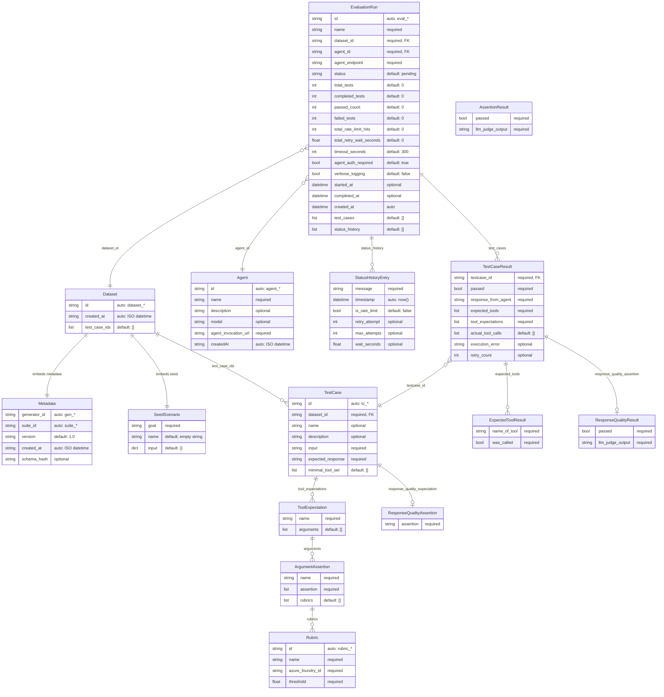
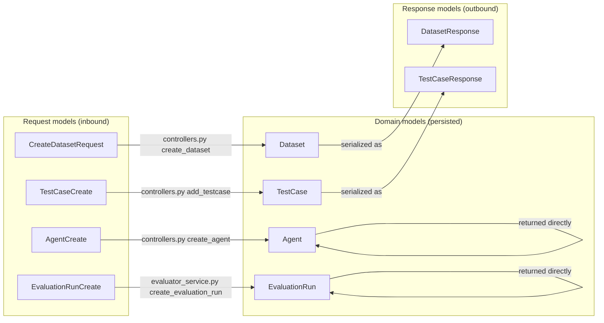

<!-- source: DeepWiki mcp.deepwiki.com · repo microsoft/EvalsforAgentsInterop · page 3.2 Data Models · fetched 2026-10-26 -->

# Data Models

Relevant source files

The following files were used as context for generating this wiki page:

- [src/api/controllers.py](src/api/controllers.py)
- [tests/integration/test_evaluation_flow.py](tests/integration/test_evaluation_flow.py)
- [tests/unit/test_models.py](tests/unit/test_models.py)

All Pydantic models used by the backend API are defined in `src/api/models.py`. This page documents every model's fields, required inputs, auto-generated values, and defaults. It covers only the Python data layer; for how these models are exposed through REST endpoints see [REST API Endpoints](#3.1), and for how the evaluation engine uses them at runtime see [Evaluation Engine](#3.3).

---

## Model Map

The diagram below maps every class name to the file that defines it and shows the relationships between models.

**Core Model Relationships**

Sources: [src/api/models.py](), [tests/unit/test_models.py:1-650]()

---

## Auto-Generated ID Prefixes

Every persisted entity gets an auto-generated string `id` at construction time. No caller needs to supply one.

| Model | ID Prefix | Example |
|---|---|---|
| `Metadata` | `gen_` (generator_id) / `suite_` (suite_id) | `gen_abc123` / `suite_xyz` |
| `Rubric` | `rubric_` | `rubric_7f3a` |
| `Dataset` | `dataset_` | `dataset_8c2d` |
| `TestCase` | `tc_` | `tc_1e4f` |
| `Agent` | `agent_` | `agent_9b0c` |
| `EvaluationRun` | `eval_` | `eval_3d7e` |

Sources: [tests/unit/test_models.py:15-25](), [tests/unit/test_models.py:80-88](), [tests/unit/test_models.py:137-147](), [tests/unit/test_models.py:188-189](), [tests/unit/test_models.py:196-207](), [tests/unit/test_models.py:256-270]()

---

## Dataset-Related Models

### `Metadata`

Embedded inside every `Dataset`. All fields have defaults and no field is mandatory at call time.

| Field | Type | Default / Auto |
|---|---|---|
| `generator_id` | `str` | Auto: `gen_` + UUID fragment |
| `suite_id` | `str` | Auto: `suite_` + UUID fragment |
| `version` | `str` | `"1.0"` |
| `created_at` | `str` | Auto: ISO 8601 timestamp |
| `schema_hash` | `str` | `None` (optional) |

Sources: [tests/unit/test_models.py:12-40]()

---

### `SeedScenario`

Describes the original intent of a dataset; embedded inside `Dataset`.

| Field | Type | Required | Default |
|---|---|---|---|
| `goal` | `str` | ✅ | — |
| `name` | `str` | ❌ | `""` |
| `input` | `dict` | ❌ | `{}` |

Sources: [tests/unit/test_models.py:43-62]()

---

### `Dataset`

Top-level container grouping a set of `TestCase` records.

| Field | Type | Required | Default / Auto |
|---|---|---|---|
| `id` | `str` | ❌ | Auto: `dataset_*` |
| `metadata` | `Metadata` | ✅ | — |
| `seed` | `SeedScenario` | ✅ | — |
| `test_case_ids` | `list[str]` | ❌ | `[]` |
| `created_at` | `str` | ❌ | Auto: ISO 8601 |

`created_at` serializes as a plain ISO 8601 string in `model_dump()` output, not as a Python `datetime` object.

Sources: [tests/unit/test_models.py:134-159](), [src/api/controllers.py:38-56]()

---

### `TestCase`

A single evaluation scenario stored under a `Dataset`.

| Field | Type | Required | Default |
|---|---|---|---|
| `id` | `str` | ❌ | Auto: `tc_*` |
| `dataset_id` | `str` | ✅ | — |
| `name` | `str` | ❌ | `None` |
| `description` | `str` | ❌ | `None` |
| `input` | `str` | ✅ (see note) | — |
| `expected_response` | `str` | ✅ | — |
| `minimal_tool_set` | `list[str]` | ❌ | `[]` |
| `tool_expectations` | `list[ToolExpectation]` | ❌ | `[]` |
| `response_quality_expectation` | `ResponseQualityAssertion` | ❌ | `None` |
| `references_seed` | any | ❌ | `None` |

> `dataset_id` is always set from the URL path parameter in the controllers, not from the request body.

Sources: [tests/unit/test_models.py:162-190](), [src/api/controllers.py:106-133]()

---

### `ToolExpectation`

Declares which tool should be called during a test case and what its arguments must satisfy.

| Field | Type | Required | Default |
|---|---|---|---|
| `name` | `str` | ✅ | — |
| `arguments` | `list[ArgumentAssertion]` | ❌ | `[]` |

Sources: [tests/unit/test_models.py:114-132]()

---

### `ArgumentAssertion`

Declares what constraints must hold for a single argument of a tool call.

| Field | Type | Required | Default |
|---|---|---|---|
| `name` | `str` | ✅ | — |
| `assertion` | `list[str]` | ✅ | — |
| `rubrics` | `list[Rubric]` | ❌ | `[]` |

Sources: [tests/unit/test_models.py:90-112]()

---

### `Rubric`

An optional scoring rubric that can be attached to an `ArgumentAssertion`. Identifies an Azure AI Foundry evaluator by its string ID.

| Field | Type | Required | Default / Auto |
|---|---|---|---|
| `id` | `str` | ❌ | Auto: `rubric_*` |
| `name` | `str` | ✅ | — |
| `azure_foundry_id` | `str` | ✅ | — |
| `threshold` | `float` | ✅ | — |

Sources: [tests/unit/test_models.py:64-88]()

---

### `ResponseQualityAssertion`

An open-ended assertion about the natural-language quality of the agent's response, distinct from tool-call correctness.

| Field | Type | Required |
|---|---|---|
| `assertion` | `str` | ✅ |

Sources: [tests/integration/test_evaluation_flow.py:156-179]()

---

## Agent Model

### `Agent`

Represents a registered agent endpoint. All persisted `Agent` objects are stored in the `agents` Cosmos container.

| Field | Type | Required | Default / Auto |
|---|---|---|---|
| `id` | `str` | ❌ | Auto: `agent_*` |
| `name` | `str` | ✅ | — |
| `description` | `str` | ❌ | `None` |
| `model` | `str` | ❌ | `None` |
| `agent_invocation_url` | `str` | ✅ | — |
| `createdAt` | `str` | ❌ | Auto: ISO 8601 |

`createdAt` is stored and serialized as a plain ISO 8601 string (not a `datetime`) in `model_dump()` output, matching the camelCase convention used by the frontend.

Sources: [tests/unit/test_models.py:192-221]()

---

## Evaluation Models

### `EvaluationRunStatus`

A string enum controlling the lifecycle of an `EvaluationRun`. See [Evaluation Engine](#3.3) for the full state machine.

| Value | Meaning |
|---|---|
| `pending` | Created, background task not yet started |
| `running` | Background task is actively processing test cases |
| `completed` | All test cases finished successfully |
| `failed` | Unrecoverable error during processing |
| `cancelled` | Manually cancelled via `POST /api/evaluations/{id}/cancel` |

Sources: [tests/unit/test_models.py:224-250]()

---

### `EvaluationRun`

The central evaluation record. Written once at creation and updated incrementally as each test case is processed.

**Identity and target fields**

| Field | Type | Required | Default / Auto |
|---|---|---|---|
| `id` | `str` | ❌ | Auto: `eval_*` |
| `name` | `str` | ✅ | — |
| `dataset_id` | `str` | ✅ | — |
| `agent_id` | `str` | ✅ | — |
| `agent_endpoint` | `str` | ✅ | — |

**Status and timing fields**

| Field | Type | Default |
|---|---|---|
| `status` | `EvaluationRunStatus` | `pending` |
| `created_at` | `datetime` | Auto: `now()` |
| `started_at` | `datetime` | `None` |
| `completed_at` | `datetime` | `None` |

**Progress counters**

| Field | Type | Default |
|---|---|---|
| `total_tests` | `int` | `0` |
| `completed_tests` | `int` | `0` |
| `passed_count` | `int` | `0` |
| `failed_tests` | `int` | `0` |

**Rate-limit and retry tracking**

| Field | Type | Default |
|---|---|---|
| `total_rate_limit_hits` | `int` | `0` |
| `total_retry_wait_seconds` | `float` | `0.0` |
| `status_history` | `list[StatusHistoryEntry]` | `[]` |

**Configuration overrides**

| Field | Type | Default |
|---|---|---|
| `agent_auth_required` | `bool` | `True` |
| `timeout_seconds` | `int` | `300` |
| `verbose_logging` | `bool` | `False` |

**Results**

| Field | Type | Default |
|---|---|---|
| `test_cases` | `list[TestCaseResult]` | `[]` |

Sources: [tests/unit/test_models.py:253-530](), [tests/integration/test_evaluation_flow.py:340-409]()

---

### `StatusHistoryEntry`

Appended to `EvaluationRun.status_history` each time the evaluation encounters a notable event, primarily rate-limit hits.

| Field | Type | Required | Default |
|---|---|---|---|
| `message` | `str` | ✅ | — |
| `timestamp` | `datetime` | ❌ | Auto: `now()` |
| `is_rate_limit` | `bool` | ❌ | `False` |
| `retry_attempt` | `int` | ❌ | `None` |
| `max_attempts` | `int` | ❌ | `None` |
| `wait_seconds` | `float` | ❌ | `None` |

Sources: [tests/unit/test_models.py:350-400]()

---

### `TestCaseResult`

Records the outcome of running a single `TestCase` against the agent. Stored inside `EvaluationRun.test_cases`.

| Field | Type | Required | Default |
|---|---|---|---|
| `testcase_id` | `str` | ✅ | — |
| `passed` | `bool` | ✅ | — |
| `response_from_agent` | `str` | ✅ | — |
| `expected_tools` | `list[ExpectedToolResult]` | ✅ | — |
| `tool_expectations` | `list` | ✅ | — |
| `actual_tool_calls` | `list[dict]` | ❌ | `[]` |
| `response_quality_assertion` | `ResponseQualityResult` | ❌ | `None` |
| `execution_error` | `str` | ❌ | `None` |
| `retry_count` | `int` | ❌ | `None` |

`actual_tool_calls` stores raw dicts with the shape `{"name": str, "arguments": dict, "response": any}`.

Sources: [tests/unit/test_models.py:290-308](), [tests/integration/test_evaluation_flow.py:356-469]()

---

### `ExpectedToolResult`

Records whether a specific tool that was expected in `minimal_tool_set` was actually invoked.

| Field | Type | Required |
|---|---|---|
| `name_of_tool` | `str` | ✅ |
| `was_called` | `bool` | ✅ |

Sources: [tests/unit/test_models.py:326-337](), [tests/integration/test_evaluation_flow.py:362-368]()

---

### `AssertionResult`

Captures the LLM judge's verdict on a single `ArgumentAssertion`.

| Field | Type | Required |
|---|---|---|
| `passed` | `bool` | ✅ |
| `llm_judge_output` | `str` | ✅ |

Sources: [tests/unit/test_models.py:313-325]()

---

### `ResponseQualityResult`

Captures the LLM judge's verdict on the overall response quality (`response_quality_expectation`).

| Field | Type | Required |
|---|---|---|
| `passed` | `bool` | ✅ |
| `llm_judge_output` | `str` | ✅ |

Sources: [tests/integration/test_evaluation_flow.py:365-371]()

---

## Request and Response Models

These models are used exclusively at the API boundary; they are not stored in Cosmos DB directly.

**Model purpose map**

Sources: [src/api/controllers.py:1-19](), [src/api/controllers.py:29-58](), [src/api/controllers.py:225-228](), [src/api/controllers.py:266-280]()

---

### `CreateDatasetRequest`

The POST body for `POST /api/datasets`. Controllers build a `Dataset` + `Metadata` + `SeedScenario` from this.

| Field | Type | Required |
|---|---|---|
| `name` | `str` | ✅ |
| `goal` | `str` | ✅ |
| `input` | `dict` | ❌ |
| `schema_hash` | `str` | ❌ |

Sources: [src/api/controllers.py:29-58]()

---

### `TestCaseCreate`

The request body for creating or updating a `TestCase`. Mirrors `TestCase` minus the auto-generated and FK fields.

| Field | Type | Required |
|---|---|---|
| `name` | `str` | ❌ |
| `description` | `str` | ❌ |
| `input` | `str` | ✅ |
| `expected_response` | `str` | ✅ |
| `minimal_tool_set` | `list[str]` | ❌ |
| `tool_expectations` | `list[ToolExpectation]` | ❌ |
| `response_quality_expectation` | `ResponseQualityAssertion` | ❌ |
| `references_seed` | any | ❌ |

Sources: [src/api/controllers.py:94-133]()

---

### `AgentCreate`

The request body for `POST /api/agents` and `PUT /api/agents/{id}`. Mirrors `Agent` minus auto-generated fields.

| Field | Type | Required |
|---|---|---|
| `name` | `str` | ✅ |
| `description` | `str` | ❌ |
| `model` | `str` | ❌ |
| `agent_invocation_url` | `str` | ✅ |

Sources: [src/api/controllers.py:225-228]()

---

### `EvaluationRunCreate`

The request body for `POST /api/evaluations`.

| Field | Type | Required | Default |
|---|---|---|---|
| `name` | `str` | ✅ | — |
| `dataset_id` | `str` | ✅ | — |
| `agent_id` | `str` | ✅ | — |
| `agent_endpoint` | `str` | ✅ | — |
| `verbose_logging` | `bool` | ❌ | `False` |

Sources: [tests/unit/test_models.py:597-649]()

---

### `DatasetResponse` and `TestCaseResponse`

Flat response shapes returned by GET endpoints. They mirror their domain counterparts but ensure all nested objects are fully serialized. `Agent` and `EvaluationRun` are returned directly as their domain models without a separate response wrapper.

Sources: [src/api/controllers.py:61-84](), [src/api/controllers.py:136-153]()

---

## Serialization Notes

- All `datetime` fields serialize as ISO 8601 strings in `model_dump()` output. This is validated by [tests/unit/test_models.py:149-159]() for `Dataset.created_at` and [tests/unit/test_models.py:209-221]() for `Agent.createdAt`.
- `Agent` uses camelCase `createdAt` (not snake_case) to match the frontend's field naming convention.
- `actual_tool_calls` inside `TestCaseResult` stores raw `dict` objects, not typed models, preserving the full tool call payload from the agent including the `response` key.

Sources: [tests/unit/test_models.py:149-159](), [tests/unit/test_models.py:209-221](), [tests/integration/test_evaluation_flow.py:424-469]()

---

