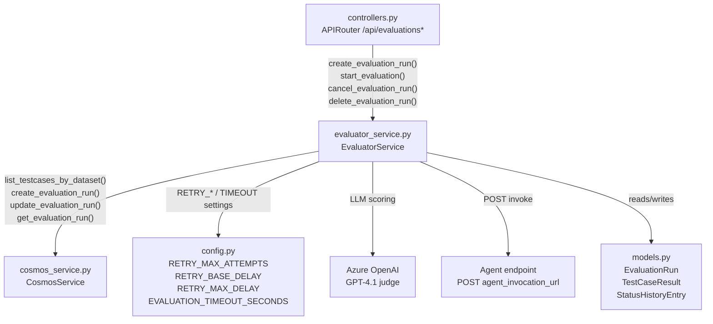
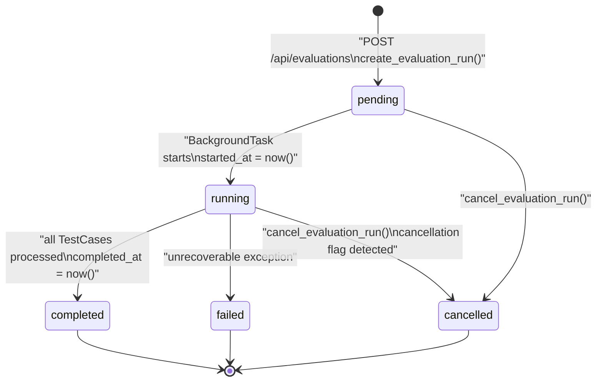
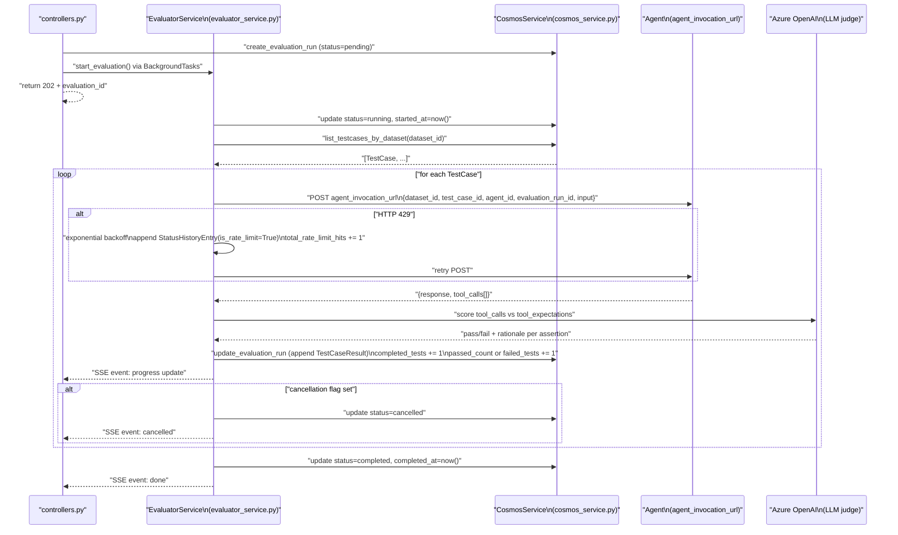

<!-- source: DeepWiki mcp.deepwiki.com · repo microsoft/EvalsforAgentsInterop · page 3.3 Evaluation Engine · fetched 2026-10-26 -->

# Evaluation Engine

<details>
<summary>Relevant source files</summary>

The following files were used as context for generating this wiki page:

- [src/api/README.md](src/api/README.md)
- [tests/integration/test_evaluation_flow.py](tests/integration/test_evaluation_flow.py)
- [tests/unit/test_controllers.py](tests/unit/test_controllers.py)
- [tests/unit/test_models.py](tests/unit/test_models.py)

</details>


This page covers `src/api/evaluator_service.py`: the asynchronous engine that orchestrates evaluation runs, invokes agents, scores results via an LLM judge, and persists results. For documentation of the REST endpoints that trigger and monitor evaluations, see [REST API Endpoints](#3.1). For the Pydantic models referenced throughout this page, see [Data Models](#3.2).

---

## Overview

The evaluation engine lives in `evaluator_service.py` as the `EvaluatorService` class. It is instantiated at startup in `main.py` and injected into `controllers.py` via FastAPI dependency injection. When a client submits an evaluation request, the controller creates the run record, then hands off execution to `EvaluatorService` as a FastAPI `BackgroundTask`. The HTTP response (202) returns immediately with the new evaluation ID; actual test execution proceeds asynchronously.

**Primary responsibilities:**

| Responsibility | Where |
|---|---|
| Create / read / delete `EvaluationRun` records | `EvaluatorService` methods delegating to `CosmosService` |
| Iterate over every `TestCase` in the dataset | `start_evaluation()` background task |
| POST each test input to the agent endpoint | inner loop in `start_evaluation()` |
| Score agent tool calls against `ToolExpectation` via Azure OpenAI | LLM judge call inside the loop |
| Handle HTTP 429 with exponential backoff | retry logic in `start_evaluation()` |
| Write `TestCaseResult` and update counters per test | `CosmosService.update_evaluation_run()` |
| Support cancellation at any point in the loop | `cancel_evaluation_run()` + cancellation flag |
| Emit SSE progress events to connected clients | streamed from the loop |

Sources: [src/api/README.md:57-68](), [tests/unit/test_controllers.py:575-834]()

---

## Module Dependency Map

**Diagram: evaluator_service.py dependencies**



Sources: [src/api/README.md:6-14](), [tests/unit/test_controllers.py:575-598]()

---

## EvaluatorService Public Interface

The controller interacts with `EvaluatorService` exclusively through the following methods:

| Method | Description |
|---|---|
| `create_evaluation_run(run_create)` | Persists a new `EvaluationRun` in status `pending` and returns it |
| `start_evaluation(evaluation_id, background_tasks)` | Schedules the evaluation loop as a `BackgroundTask` |
| `list_evaluation_runs(agent_id, skip, limit)` | Queries Cosmos for all runs, optionally filtered by `agent_id` |
| `get_evaluation_run(evaluation_id)` | Fetches a single `EvaluationRun` by ID |
| `cancel_evaluation_run(evaluation_id)` | Sets a cancellation flag; raises `ValueError` if run is terminal |
| `delete_evaluation_run(evaluation_id)` | Removes the run record; returns `True` on success |

Sources: [tests/unit/test_controllers.py:589-590](), [tests/unit/test_controllers.py:623](), [tests/unit/test_controllers.py:646-657](), [tests/unit/test_controllers.py:783-834]()

---

## EvaluationRun State Machine

**Diagram: EvaluationRun status transitions**



The `EvaluationRunStatus` enum in `models.py` defines all five values: `pending`, `running`, `completed`, `failed`, `cancelled`.

Every time the evaluation hits a rate-limit event, a `StatusHistoryEntry` is appended to `EvaluationRun.status_history`. This history is separate from the terminal status transitions above and is available for display in the UI.

Sources: [tests/unit/test_models.py:224-250](), [tests/unit/test_models.py:406-559](), [tests/integration/test_evaluation_flow.py:26-48]()

---

## Execution Flow

**Diagram: Per-evaluation-run execution sequence**



Sources: [src/api/README.md:57-68](), [tests/integration/test_evaluation_flow.py:291-469](), [tests/unit/test_controllers.py:575-598]()

---

## Agent Invocation Contract

Inside the loop, the engine sends an HTTP POST to `EvaluationRun.agent_endpoint`. The expected request and response shapes are:

**Request body sent to agent:**

```
{
  "dataset_id":        string,
  "test_case_id":      string,
  "agent_id":          string,
  "evaluation_run_id": string,
  "input":             string   ← TestCase.input
}
```

**Response body expected from agent:**

```
{
  "response":    string,
  "tool_calls":  [
    { "name": string, "arguments": object, "response": any },
    ...
  ]
}
```

The `tool_calls` array is then compared to `TestCase.tool_expectations` by the LLM judge. For full agent-side documentation, see [Calendar Agent](#4).

Sources: [tests/integration/test_evaluation_flow.py:153-201]()

---

## LLM Judge Scoring

After the agent responds, the engine submits the actual `tool_calls` alongside the `TestCase.tool_expectations` (including `ArgumentAssertion` criteria) to Azure OpenAI (GPT-4.1). The judge returns a pass/fail verdict and a rationale string per assertion.

Results are stored in `TestCaseResult`:

| Field | Type | Description |
|---|---|---|
| `testcase_id` | `str` | FK to `TestCase.id` |
| `passed` | `bool` | Overall pass/fail |
| `response_from_agent` | `str` | Raw agent response text |
| `actual_tool_calls` | `list` | Full tool call log `[{name, arguments, response}]` |
| `expected_tools` | `list[ExpectedToolResult]` | Per-tool was-called tracking |
| `tool_expectations` | `list` | Expectation snapshot at time of run |
| `response_quality_assertion` | `ResponseQualityResult` | LLM judge output on response quality |
| `execution_error` | `str \| None` | Error text if the test case raised an exception |
| `retry_count` | `int` | Number of retries consumed by this test case |

Sources: [tests/unit/test_models.py:290-336](), [tests/integration/test_evaluation_flow.py:341-416]()

---

## Rate Limiting and Retry Logic

When the agent endpoint returns HTTP 429, the engine does **not** fail the test case immediately. Instead, it applies exponential backoff and retries up to `RETRY_MAX_ATTEMPTS` times.

**Configuration values** (from `src/api/config.py`):

| Config Symbol | Type | Role |
|---|---|---|
| `RETRY_MAX_ATTEMPTS` | `int` | Maximum retry attempts per 429 response |
| `RETRY_BASE_DELAY` | `float` | Initial wait in seconds before first retry |
| `RETRY_MAX_DELAY` | `float` | Cap on computed backoff delay |
| `EVALUATION_TIMEOUT_SECONDS` | `int` | Hard timeout for the entire evaluation run |

**Per rate-limit event**, the engine:

1. Computes the delay: `min(RETRY_BASE_DELAY * 2^attempt, RETRY_MAX_DELAY)`
2. Appends a `StatusHistoryEntry` to `EvaluationRun.status_history` with `is_rate_limit=True`, `retry_attempt`, `max_attempts`, and `wait_seconds`
3. Increments `EvaluationRun.total_rate_limit_hits`
4. Adds the wait duration to `EvaluationRun.total_retry_wait_seconds`
5. Sleeps, then retries the agent POST

The `StatusHistoryEntry` model fields used for tracking:

| Field | Default | Description |
|---|---|---|
| `message` | required | Human-readable description |
| `timestamp` | `datetime.now(utc)` | Auto-generated |
| `is_rate_limit` | `False` | Marks rate-limit events |
| `retry_attempt` | `None` | Which attempt number this is |
| `max_attempts` | `None` | Value of `RETRY_MAX_ATTEMPTS` at time of hit |
| `wait_seconds` | `None` | Actual sleep duration |

Sources: [tests/unit/test_models.py:563-593](), [tests/unit/test_models.py:350-400](), [src/api/README.md:57-64]()

---

## Cancellation

Any evaluation in `pending` or `running` status can be cancelled by calling `cancel_evaluation_run(evaluation_id)`. The method:

- Sets an internal cancellation flag checked at the start of each test-case iteration.
- If the run is already `completed`, `failed`, or `cancelled`, it raises `ValueError` (which the controller surfaces as HTTP 400).
- If the run does not exist, the method returns `None` (controller returns HTTP 404).

On cancellation, the engine:
1. Detects the flag before or after the current test case finishes.
2. Writes `status = cancelled` to `EvaluationRun` via `CosmosService`.
3. Emits a final SSE event to connected clients.

Sources: [tests/unit/test_controllers.py:770-834](), [tests/unit/test_models.py:533-560]()

---

## SSE Streaming

The endpoint `GET /api/evaluations/{id}/stream` (served by `controllers.py`) opens a Server-Sent Events connection. The evaluation loop emits events at these points:

| Event trigger | Payload |
|---|---|
| Test case completed | Progress counter, `passed` flag, test case ID |
| Rate-limit backoff | Status history entry |
| Status change | New `EvaluationRunStatus` value |
| Run finished | `done` sentinel event |

Clients (the React webapp) connect to this stream immediately after receiving the 202 from `POST /api/evaluations`. For UI-side handling, see [Evaluation Results UI](#5.3).

Sources: [src/api/README.md:63-68]()

---

## EvaluationRun Progress Fields

The following fields on `EvaluationRun` are updated incrementally by the engine as each test case completes:

| Field | Initial | Updated When |
|---|---|---|
| `status` | `pending` | Each state transition |
| `started_at` | `None` | Loop begins (`running`) |
| `completed_at` | `None` | Loop ends (`completed`/`cancelled`/`failed`) |
| `total_tests` | `0` | Set from dataset size before loop starts |
| `completed_tests` | `0` | Incremented after every test case result |
| `passed_count` | `0` | Incremented on `TestCaseResult.passed == True` |
| `failed_tests` | `0` | Incremented on `TestCaseResult.passed == False` |
| `total_rate_limit_hits` | `0` | Incremented on each 429 |
| `total_retry_wait_seconds` | `0.0` | Accumulates sleep durations |
| `status_history` | `[]` | Entry appended on rate-limit events |
| `test_cases` | `[]` | Appended after each test case result is written |

Sources: [tests/unit/test_models.py:403-530](), [tests/integration/test_evaluation_flow.py:340-416]()

---

