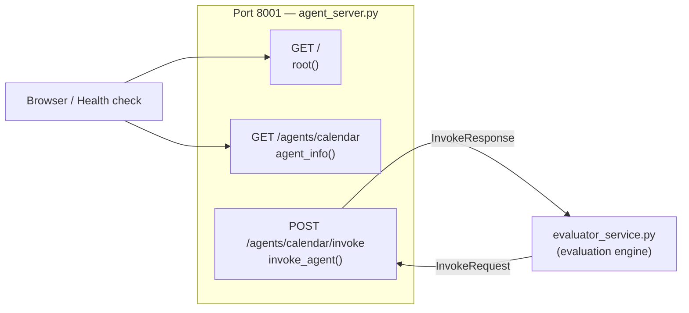
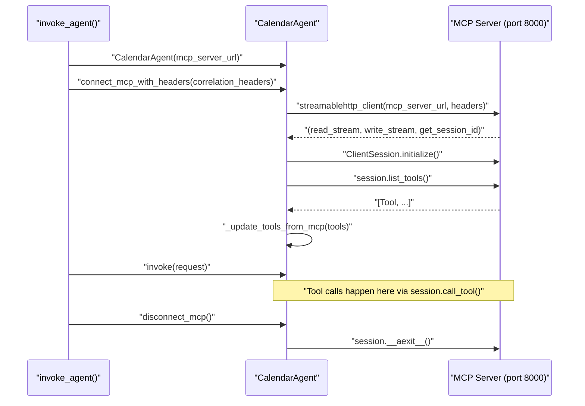
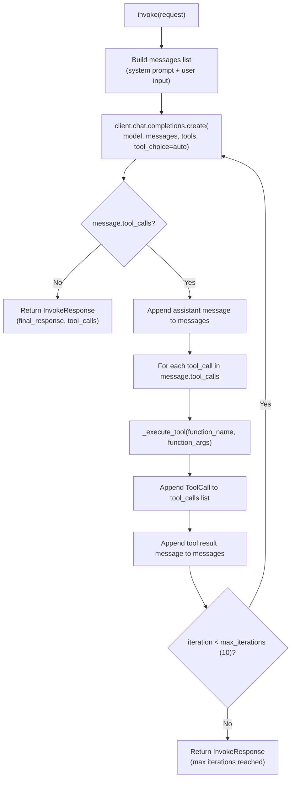
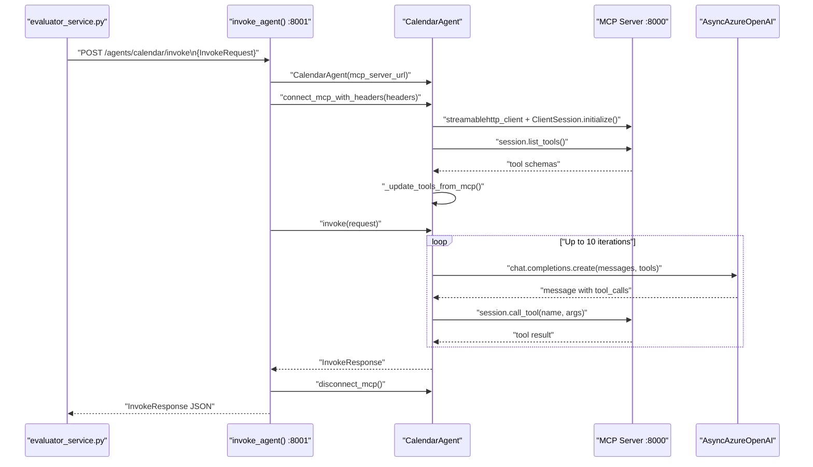

<!-- source: DeepWiki mcp.deepwiki.com · repo microsoft/EvalsforAgentsInterop · page 4 Calendar Agent · fetched 2026-10-26 -->

# Calendar Agent

<details>
<summary>Relevant source files</summary>

The following files were used as context for generating this wiki page:

- [CODE_OF_CONDUCT.md](CODE_OF_CONDUCT.md)
- [CONTRIBUTING.md](CONTRIBUTING.md)
- [README.md](README.md)
- [src/agents/agent_server.py](src/agents/agent_server.py)

</details>


This page documents the sample Calendar Agent implementation in `src/agents/agent_server.py`. It covers the agent's FastAPI endpoints, its data models, how it connects to the MCP server for tool access, the Azure OpenAI conversation loop, and how to register it with the evaluation platform.

For the evaluation engine that calls the agent, see [Evaluation Engine](#3.3). For the full agent invocation contract expected by the platform, see [REST API Endpoints](#3.1). For the mock agent used in tests, see [Mock Agent Server](#7.4).

---

## Overview

The Calendar Agent is a standalone FastAPI server running on **port 8001**. It is a sample, reference implementation of an agent that conforms to the platform's invocation contract. It connects to the Backend API's MCP (Model Context Protocol) server to discover and call tools, and uses Azure OpenAI (GPT-4.1) to reason over user requests and drive tool selection.

**Key design points:**

- Each invocation creates a **fresh `CalendarAgent` instance** with its own MCP connection, which is torn down after the request completes.
- MCP tools are discovered dynamically at connection time and converted to OpenAI function-calling format.
- The conversation loop runs up to **10 iterations**, allowing multi-step tool chains.
- The agent is **stateless across requests** — all context lives in the per-request message history.

Sources: [src/agents/agent_server.py:1-6]()

---

## Data Models

The agent defines four Pydantic models:

| Model | Role |
|---|---|
| `InvokeRequest` | Body of `POST /agents/calendar/invoke`; identifies the test context and carries the user input string |
| `InvokeResponse` | Body returned from the endpoint; contains the final text response and all tool call records |
| `ToolCall` | One record of a single tool invocation: name, list of `ToolArgument`, and optional MCP response |
| `ToolArgument` | A single key/value pair representing one argument to a tool call |

**`InvokeRequest` fields:**

| Field | Type | Description |
|---|---|---|
| `dataset_id` | `str` | ID of the dataset this test case belongs to |
| `test_case_id` | `str` | ID of the specific test case being run |
| `agent_id` | `str` | ID of the registered agent |
| `evaluation_run_id` | `str` | ID of the evaluation run that triggered the invocation |
| `input` | `str` | The user's natural-language instruction to the agent |

**`InvokeResponse` fields:**

| Field | Type | Description |
|---|---|---|
| `response` | `str` | Final natural-language response from the agent |
| `tool_calls` | `List[ToolCall]` | Ordered list of every tool the agent invoked |

Sources: [src/agents/agent_server.py:35-61]()

---

## Endpoints

The FastAPI `app` exposes three HTTP endpoints:

**Endpoint map:**



Sources: [src/agents/agent_server.py:385-441]()

### `GET /`

Health check. Returns `{"status": "ok", "agent": "calendar", "version": "1.0.0"}`.

### `GET /agents/calendar`

Returns metadata about the running agent instance: name, description, the `AZURE_OPENAI_DEPLOYMENT` value, and the configured `MCP_SERVER_URL`.

### `POST /agents/calendar/invoke`

The primary evaluation endpoint. Accepts an `InvokeRequest` body and returns an `InvokeResponse`. This is the URL that should be registered in the platform as the agent's `agent_invocation_url`.

**Correlation headers:** The handler reads `x-correlationid` and `x-testcaseid` from the incoming HTTP headers and forwards them to the MCP server connection. This enables request tracing through the tool execution layer.

Sources: [src/agents/agent_server.py:395-430]()

---

## `CalendarAgent` Class

`CalendarAgent` at [src/agents/agent_server.py:67-372]() is the core logic class. It is instantiated once **per request** inside `invoke_agent()` and discarded after the response is returned.

### Initialization

`__init__` configures two clients:

1. **`AsyncAzureOpenAI`** — Prefers `AZURE_OPENAI_API_KEY` if set; falls back to `DefaultAzureCredential` (Entra ID) for local development.
2. **MCP connection state** — Stores `mcp_server_url` from the environment variable `MCP_SERVER_URL`; all MCP connection handles are `None` until `connect_mcp()` is called.

**Environment variables consumed by `CalendarAgent`:**

| Variable | Default | Purpose |
|---|---|---|
| `AZURE_OPENAI_API_KEY` | _(none)_ | API key auth (preferred in Docker) |
| `AZURE_OPENAI_ENDPOINT` | `https://oai-exp.openai.azure.com/` | Azure OpenAI resource endpoint |
| `AZURE_OPENAI_API_VERSION` | `2024-12-01-preview` | API version |
| `AZURE_OPENAI_DEPLOYMENT` | `gpt-4.1` | Model deployment name |
| `MCP_SERVER_URL` | _(none)_ | URL of the Backend API's MCP endpoint |

Sources: [src/agents/agent_server.py:70-112]()

---

### MCP Connection Lifecycle

Each request creates, uses, and destroys its own MCP connection. The transport used is the **streamable HTTP** transport (not the deprecated SSE transport).

**Connection lifecycle diagram:**



The method `_update_tools_from_mcp` converts each MCP `Tool` object into an OpenAI function-calling schema entry (`{"type": "function", "function": {...}}`), storing the result in `self.tools`.

If `MCP_SERVER_URL` is not configured, or the connection fails, `mcp_connected` is set to `False` and the agent proceeds without tools, returning error payloads for any tool call attempts.

Sources: [src/agents/agent_server.py:114-196](), [src/agents/agent_server.py:198-210]()

---

### Conversation Loop (`invoke`)

The `invoke` method at [src/agents/agent_server.py:212-335]() runs a multi-turn conversation loop with Azure OpenAI.

**Loop diagram:**



**System prompt behavior:** The system prompt instructs the model to always use tools rather than describing actions, to use default values if parameters are missing, and to include all key details in the final confirmation. For calendar scheduling, it explicitly instructs the model to avoid conflicting time slots.

Sources: [src/agents/agent_server.py:212-335]()

---

### Tool Execution (`_execute_tool`)

`_execute_tool` at [src/agents/agent_server.py:337-372]() dispatches tool calls through the active MCP session:

1. If `self.mcp_connected` is `True`, calls `self.mcp_session.call_tool(function_name, arguments)`.
2. Parses the MCP response: if the content has a `.text` attribute, parses it as JSON; otherwise, converts to string.
3. If the MCP connection is unavailable, returns `{"error": "...", "mcp_connected": False}`.

Any `json.JSONDecodeError` or other exception from the MCP call is **re-raised** (not swallowed), which will propagate up to the `invoke_agent` route handler and result in an HTTP 500 response.

Sources: [src/agents/agent_server.py:337-372]()

---

## Per-Request Flow (Full)

This diagram maps the full request lifecycle to the specific code entities involved:



Sources: [src/agents/agent_server.py:395-430]()

---

## Registering the Agent with the Platform

To register the Calendar Agent so the evaluation platform can invoke it, use the Agent Management UI (see [Agent Management UI](#5.2)) or the REST API directly.

**Required registration fields:**

| Field | Value |
|---|---|
| `name` | Any descriptive label (e.g., `"Calendar Agent"`) |
| `agent_invocation_url` | `http://localhost:8001/agents/calendar/invoke` (local) or `http://agent:8001/agents/calendar/invoke` (Docker) |
| `model` | The model name, e.g., `gpt-4.1` |

Once registered, an `Agent` record is stored in Cosmos DB (see [Data Models](#3.2)) and can be selected when creating evaluation runs.

Sources: [src/agents/agent_server.py:379-441](), [README.md:171-180]()

---

## Running the Agent Server

**Without Docker:**

```bash
python -m uvicorn src.agents.agent_server:app --host 0.0.0.0 --port 8001 --reload
```

**With Docker Compose:** The agent service starts automatically alongside the API and Webapp when running `docker-compose up`. The `MCP_SERVER_URL` is automatically overridden to use the Docker service name (`http://api:8000/mcp`).

**Environment file:** The agent reads from the `.env` file at the repo root (loaded via `load_dotenv()` at [src/agents/agent_server.py:24]()).

Sources: [src/agents/agent_server.py:448-450](), [README.md:141-148](), [README.md:157-179]()

---

