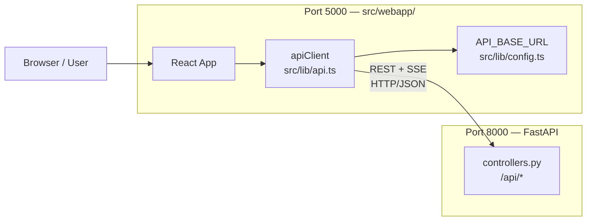
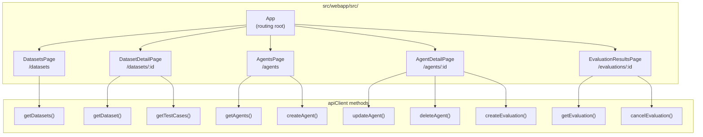
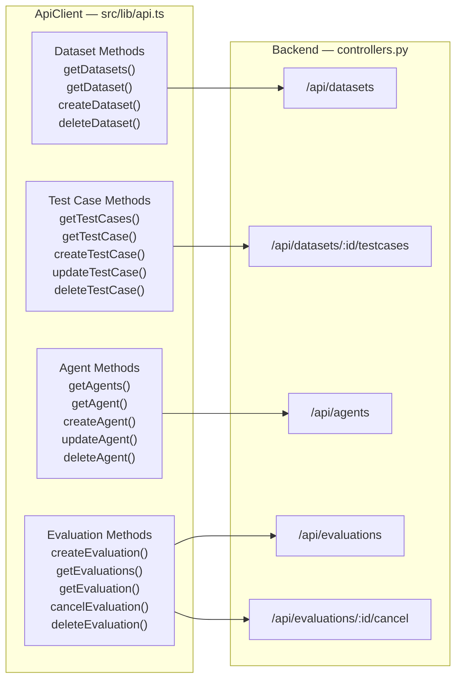

<!-- source: DeepWiki mcp.deepwiki.com · repo microsoft/EvalsforAgentsInterop · page 5 Web Application · fetched 2026-10-26 -->

# Web Application

<details>
<summary>Relevant source files</summary>

The following files were used as context for generating this wiki page:

- [CODE_OF_CONDUCT.md](CODE_OF_CONDUCT.md)
- [CONTRIBUTING.md](CONTRIBUTING.md)
- [README.md](README.md)
- [src/webapp/src/lib/api.ts](src/webapp/src/lib/api.ts)

</details>


This page covers the React/TypeScript frontend located at `src/webapp/`. It describes the webapp's role in the overall system, how it communicates with the backend API, and which page components handle which user workflows.

For details on the specific API client implementation and type definitions, see [API Client](#5.1). For the Agent Management pages, see [Agent Management UI](#5.2). For the evaluation results display, see [Evaluation Results UI](#5.3).

---

## Role and Responsibilities

The webapp is the primary user interface for the evaluation platform. It runs on **port 5000** as a Vite-served React development server (or a static build in Docker). It has no direct connection to Azure Cosmos DB or Azure OpenAI — all data access is brokered through the FastAPI backend on port 8000.

The webapp is responsible for:

- Browsing and inspecting evaluation datasets and their test cases
- Registering, editing, and deleting agents
- Launching evaluation runs and observing live progress
- Viewing per-test-case results, tool call traces, and pass/fail breakdowns
- Cancelling in-progress evaluation runs

Sources: [README.md:23-28](), [src/webapp/src/lib/api.ts:1-33]()

---

## Technology Stack

| Layer | Technology |
|---|---|
| UI framework | React 18 (TypeScript) |
| Build tool | Vite |
| HTTP communication | Fetch API (wrapped in `ApiClient`) |
| Base URL config | `src/lib/config.ts` (`API_BASE_URL`) |
| Container port | 5000 |

Sources: [README.md:150-155](), [src/webapp/src/lib/api.ts:35]()

---

## Service Topology

**Diagram: Webapp in the Three-Service Architecture**



Sources: [src/webapp/src/lib/api.ts:35](), [README.md:23-28]()

---

## Page Components Overview

The webapp is organized into several major page-level components. Each page corresponds to a primary resource in the system.

**Diagram: Page Components and API Resources**



Sources: [src/webapp/src/lib/api.ts:244-484]()

---

## Communication with the Backend

All backend communication is routed through the `apiClient` singleton, which is an instance of the `ApiClient` class defined in [src/webapp/src/lib/api.ts:237-485](). The singleton is exported as:

```
export const apiClient = new ApiClient(API_BASE_URL);
```

`API_BASE_URL` is resolved from `src/lib/config.ts` and points to `http://localhost:8000/api` in local development.

**Diagram: ApiClient Method Groups and Backend Routes**



Sources: [src/webapp/src/lib/api.ts:244-484]()

---

## Key TypeScript Types

The frontend uses a set of TypeScript interfaces that mirror the Pydantic models on the backend. These are all defined in [src/webapp/src/lib/api.ts:39-235]().

| Interface | Purpose |
|---|---|
| `BackendDataset` | Dataset with inlined `test_cases` array for detail views |
| `DatasetResponse` | Raw dataset from the API (no inlined test cases) |
| `BackendTestCase` | A single test case with `tool_expectations` and `expected_response` |
| `BackendAgent` | Agent registration record (name, URL, model) |
| `EvaluationRun` | Full evaluation run with status, counts, and `test_cases` results |
| `TestCaseResult` | Per-test-case outcome including `passed`, `actual_tool_calls`, timing fields |
| `StatusHistoryEntry` | Timestamped status log entry, including rate limit metadata |
| `CreateEvaluationRequest` | Request body for `POST /api/evaluations` |
| `EvaluationRunStatus` | Union type: `"pending" \| "running" \| "completed" \| "failed" \| "cancelled"` |

Sources: [src/webapp/src/lib/api.ts:39-235]()

---

## Major User Workflows

The table below maps user-facing workflows to the components and API methods involved.

| Workflow | Entry Point | Key `apiClient` Calls |
|---|---|---|
| Browse datasets | `DatasetsPage` | `getDatasets()` |
| Inspect test cases | `DatasetDetailPage` | `getDataset()`, `getTestCases()` |
| Register an agent | `AgentsPage` | `createAgent()` |
| Edit / delete an agent | `AgentDetailPage` | `updateAgent()`, `deleteAgent()` |
| Start an evaluation run | `AgentDetailPage` | `createEvaluation()` |
| Watch live evaluation progress | `EvaluationResultsPage` | `getEvaluation()` (polled) |
| Cancel a running evaluation | `EvaluationResultsPage` | `cancelEvaluation()` |
| View per-test-case results | `EvaluationResultsPage` | `getEvaluation()` (includes `test_cases`) |

Sources: [src/webapp/src/lib/api.ts:422-484](), [README.md:23-28]()

---

## Running the Webapp

**Local development (without Docker):**

```bash
cd src/webapp
npm install
npm run dev
```

The dev server is accessible at `http://localhost:5000`.

**Docker:**

```bash
docker-compose up --build webapp
```

If you encounter a Vite binary version mismatch error during Docker builds, delete `src/webapp/node_modules` and rebuild with `--no-cache`.

Sources: [README.md:150-155](), [README.md:308-337]()

---

