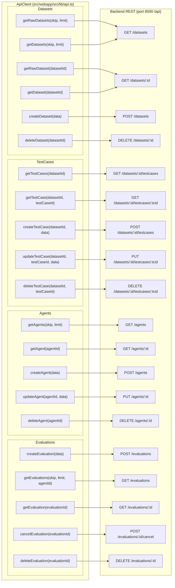
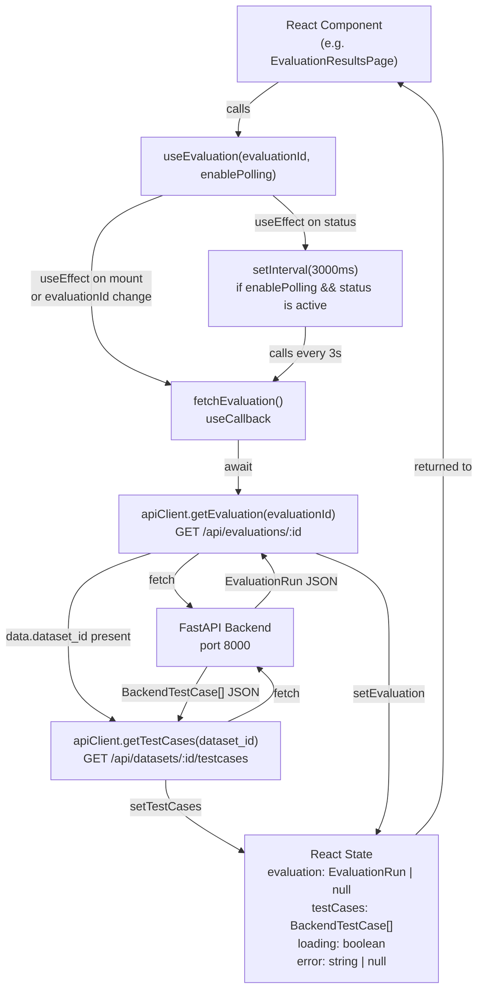

<!-- source: DeepWiki mcp.deepwiki.com · repo microsoft/EvalsforAgentsInterop · page 5.1 API Client · fetched 2026-10-26 -->

# API Client

<details>
<summary>Relevant source files</summary>

The following files were used as context for generating this wiki page:

- [src/webapp/src/hooks/useEvaluation.ts](src/webapp/src/hooks/useEvaluation.ts)
- [src/webapp/src/lib/api.ts](src/webapp/src/lib/api.ts)

</details>


This page documents the frontend API layer: the `ApiClient` class defined in `src/webapp/src/lib/api.ts` and the `useEvaluation` React hook defined in `src/webapp/src/hooks/useEvaluation.ts`. These two modules are the exclusive bridge between the React webapp and the FastAPI backend at port 8000.

For documentation of the backend REST endpoints themselves, see [REST API Endpoints](#3.1). For how the `apiClient` is used in specific UI pages, see [Agent Management UI](#5.2) and [Evaluation Results UI](#5.3).

---

## Module Overview

**`src/webapp/src/lib/api.ts`** exports:
- All shared TypeScript interfaces that mirror backend Pydantic models
- The `ApiClient` class with one method per backend operation
- A singleton `apiClient` instance configured from `API_BASE_URL`

**`src/webapp/src/hooks/useEvaluation.ts`** exports:
- The `useEvaluation` React hook, which wraps `apiClient` calls with React state and optional polling

**Exported singleton:**

```
export const apiClient = new ApiClient(API_BASE_URL);
```

[src/webapp/src/lib/api.ts:487-487]()

All React components import `apiClient` from this module rather than constructing their own instances.

Sources: [src/webapp/src/lib/api.ts:1-488](), [src/webapp/src/hooks/useEvaluation.ts:1-73]()

---

## Type Definitions

### Dataset Types

| Type | Purpose | Key Fields |
|---|---|---|
| `DatasetResponse` | Raw response from `GET /datasets` | `id`, `metadata`, `seed`, `test_case_ids`, `created_at` |
| `BackendDataset` | Frontend-combined view | `DatasetResponse` + `test_cases: BackendTestCase[]` |
| `Metadata` | Embedded in dataset | `generator_id`, `suite_id`, `created_at`, `version`, `schema_hash` |
| `SeedDataset` | Dataset origin info | `name`, `goal`, `input` |

`BackendDataset` is not returned directly by the API — it is assembled client-side by `getDataset()`, which fetches the dataset header and then the test cases separately. In list view (`getDatasets()`), `test_cases` is always set to an empty array for performance; counts are derived from `test_case_ids.length`.

[src/webapp/src/lib/api.ts:76-107]()

### Test Case Types

| Type | Purpose |
|---|---|
| `BackendTestCase` | A single test case returned from the API |
| `ToolExpectation` | Expected tool call with argument assertions |
| `ArgumentAssertion` | Per-argument assertion list and rubrics |
| `Rubric` | Evaluation rubric with a threshold score |
| `ResponseQualityAssertion` | Optional assertion on the agent's text response |

[src/webapp/src/lib/api.ts:39-74]()

### Agent Types

| Type | Purpose | Key Fields |
|---|---|---|
| `BackendAgent` | Agent record from API | `id`, `name`, `description`, `model`, `agent_invocation_url`, `createdAt` |
| `CreateAgentRequest` | Payload for creating/updating agents | `name`, `description`, `model`, `agent_invocation_url` |

[src/webapp/src/lib/api.ts:109-128]()

### Evaluation Types

**`EvaluationRunStatus`** is a union type:

```
"pending" | "running" | "completed" | "failed" | "cancelled"
```

[src/webapp/src/lib/api.ts:137-137]()

**`EvaluationRun`** is the primary evaluation record. Key fields:

| Field | Type | Description |
|---|---|---|
| `id` | `string` | Auto-generated `eval_*` ID |
| `status` | `EvaluationRunStatus` | Current lifecycle state |
| `total_tests` | `number` | Total test cases in the run |
| `completed_tests` | `number` | Tests finished so far |
| `passed_count` | `number` | Tests that passed |
| `failed_tests` | `number` | Tests that failed |
| `test_cases` | `TestCaseResult[]` | Per-test results |
| `status_message` | `string \| null` | Current activity for live display |
| `status_history` | `StatusHistoryEntry[]` | Chronological activity log |
| `total_rate_limit_hits` | `number` | Cumulative rate limit events |
| `total_retry_wait_seconds` | `number` | Total time spent in retry backoff |
| `verbose_logging` | `boolean` | Whether detailed assertion logs are enabled |
| `warnings` | `string[]` | Warning messages (e.g., rate limit notices) |

[src/webapp/src/lib/api.ts:193-216]()

**`TestCaseResult`** captures per-test-case execution detail:

| Field | Type | Description |
|---|---|---|
| `testcase_id` | `string` | Links back to a `BackendTestCase` |
| `passed` | `boolean` | Overall pass/fail |
| `response_from_agent` | `string` | Raw agent text response |
| `actual_tool_calls` | `array` | Tool calls the agent made |
| `tool_expectations` | `ToolExpectationResult[]` | Structured assertion results |
| `retry_count` | `number` | Retries due to rate limiting |
| `agent_call_duration_seconds` | `number \| null` | Agent call wall time |
| `judge_call_duration_seconds` | `number \| null` | LLM judge call time |
| `total_duration_seconds` | `number \| null` | End-to-end test case time |
| `execution_error` | `string \| null` | Error message if test errored |

[src/webapp/src/lib/api.ts:172-191]()

**`StatusHistoryEntry`** records a single timestamped event in the evaluation activity log:

| Field | Type | Description |
|---|---|---|
| `timestamp` | `string` | ISO 8601 timestamp |
| `message` | `string` | Human-readable status message |
| `is_rate_limit` | `boolean` | Whether this is a rate limit event |
| `retry_attempt` | `number \| null` | Which retry attempt (1-based) |
| `max_attempts` | `number \| null` | Max retries configured |
| `wait_seconds` | `number \| null` | Seconds waited before retry |

[src/webapp/src/lib/api.ts:218-225]()

---

## The `ApiClient` Class

**Diagram: `ApiClient` Methods Mapped to Backend Endpoints**



Sources: [src/webapp/src/lib/api.ts:237-485]()

### Constructor and Base URL

`ApiClient` is constructed with a `baseUrl` string and uses it as the prefix for all `fetch` calls. The singleton is exported as:

```
export const apiClient = new ApiClient(API_BASE_URL);
```

`API_BASE_URL` is imported from `src/webapp/src/lib/config.ts`.

[src/webapp/src/lib/api.ts:237-242](), [src/webapp/src/lib/api.ts:487-487]()

### Dataset Methods

| Method | Signature | Notes |
|---|---|---|
| `getRawDatasets` | `(skip?, limit?) → DatasetResponse[]` | Pagination via query params |
| `getRawDataset` | `(datasetId) → DatasetResponse` | No test cases included |
| `getDatasets` | `(skip?, limit?) → BackendDataset[]` | Wraps `getRawDatasets`; sets `test_cases: []` |
| `getDataset` | `(datasetId) → BackendDataset` | Fetches dataset + test cases; combines them |
| `createDataset` | `(data: CreateDatasetRequest) → DatasetResponse` | POST with `seed` string + optional metadata |
| `deleteDataset` | `(datasetId) → void` | DELETE, no body |

The distinction between `getRawDatasets`/`getDatasets` and `getRawDataset`/`getDataset` is intentional. The "raw" variants return the exact API response. The convenience variants assemble the `BackendDataset` shape expected by UI components.

[src/webapp/src/lib/api.ts:244-311]()

### Test Case Methods

| Method | Signature | Notes |
|---|---|---|
| `getTestCases` | `(datasetId) → BackendTestCase[]` | List all test cases for a dataset |
| `getTestCase` | `(datasetId, testCaseId) → BackendTestCase` | Single fetch |
| `createTestCase` | `(datasetId, data: CreateTestCaseRequest) → BackendTestCase` | POST |
| `updateTestCase` | `(datasetId, testCaseId, data: BackendTestCase) → BackendTestCase` | PUT |
| `deleteTestCase` | `(datasetId, testCaseId) → void` | DELETE |

[src/webapp/src/lib/api.ts:313-361]()

### Agent Methods

| Method | Signature | Notes |
|---|---|---|
| `getAgents` | `(skip?, limit?) → BackendAgent[]` | Paginated list |
| `getAgent` | `(agentId) → BackendAgent` | Single agent |
| `createAgent` | `(data: CreateAgentRequest) → BackendAgent` | POST |
| `updateAgent` | `(agentId, data: CreateAgentRequest) → BackendAgent` | PUT |
| `deleteAgent` | `(agentId) → void` | DELETE |

[src/webapp/src/lib/api.ts:363-420]()

### Evaluation Methods

| Method | Signature | Notes |
|---|---|---|
| `createEvaluation` | `(data: CreateEvaluationRequest) → EvaluationRun` | Returns 202 with initial `EvaluationRun` |
| `getEvaluations` | `(skip?, limit?, agentId?) → EvaluationRun[]` | Optional `agentId` filter |
| `getEvaluation` | `(evaluationId) → EvaluationRun` | Full run with `test_cases` results |
| `cancelEvaluation` | `(evaluationId) → EvaluationRun` | POST to `/cancel` sub-route |
| `deleteEvaluation` | `(evaluationId) → void` | DELETE |

`CreateEvaluationRequest` fields:

| Field | Type | Required | Default |
|---|---|---|---|
| `name` | `string` | yes | — |
| `dataset_id` | `string` | yes | — |
| `agent_id` | `string` | yes | — |
| `agent_endpoint` | `string` | yes | — |
| `agent_auth_required` | `boolean` | no | `false` |
| `timeout_seconds` | `number` | no | backend default |
| `verbose_logging` | `boolean` | no | `false` |

[src/webapp/src/lib/api.ts:422-484]()

---

## The `useEvaluation` Hook

`useEvaluation` is a React hook that manages the state of a single evaluation run: fetching it, optionally polling for updates while it is active, and providing a `refetch` function.

**Diagram: `useEvaluation` Internal State and Effects**

```mermaid
stateDiagram-v2
    [*] --> "loading=true": "hook mounts\nor evaluationId changes"
    "loading=true" --> "fetchEvaluation()": "useEffect triggers"
    "fetchEvaluation()" --> "apiClient.getEvaluation()": "await"
    "apiClient.getEvaluation()" --> "apiClient.getTestCases()": "if data.dataset_id exists"
    "apiClient.getTestCases()" --> "state: evaluation+testCases set\nloading=false": "success"
    "apiClient.getEvaluation()" --> "state: error set\nloading=false": "fetch throws"
    "state: evaluation+testCases set\nloading=false" --> "polling active?": "check enablePolling\nand status"
    "polling active?" --> "setInterval 3000ms": "status is pending or running"
    "setInterval 3000ms" --> "fetchEvaluation()": "every 3s"
    "polling active?" --> "[*]": "status is completed\nfailed or cancelled"
    "setInterval 3000ms" --> "[*]": "status changes to terminal\nor component unmounts\n(clearInterval)"
```

Sources: [src/webapp/src/hooks/useEvaluation.ts:1-73]()

### Hook Signature

```
function useEvaluation(
    evaluationId: string | undefined,
    enablePolling: boolean = false
): {
    evaluation: EvaluationRun | null,
    testCases: BackendTestCase[],
    loading: boolean,
    error: string | null,
    refetch: () => void,
}
```

[src/webapp/src/hooks/useEvaluation.ts:4-73]()

### Parameters

| Parameter | Type | Default | Description |
|---|---|---|---|
| `evaluationId` | `string \| undefined` | — | ID of the evaluation to track; if `undefined`, hook is a no-op |
| `enablePolling` | `boolean` | `false` | When `true`, the hook polls every 3 seconds while the evaluation is in an active state |

### Return Values

| Value | Type | Description |
|---|---|---|
| `evaluation` | `EvaluationRun \| null` | Current evaluation run data |
| `testCases` | `BackendTestCase[]` | Test cases for the dataset (used to resolve names) |
| `loading` | `boolean` | `true` until first successful or failed fetch |
| `error` | `string \| null` | Error message if the fetch failed |
| `refetch` | `() => void` | Resets `loading` to `true` and re-runs `fetchEvaluation` |

### Fetch Behavior

On each call to the internal `fetchEvaluation` function ([src/webapp/src/hooks/useEvaluation.ts:10-42]()):

1. `apiClient.getEvaluation(evaluationId)` is called.
2. If `data.dataset_id` is present, `apiClient.getTestCases(data.dataset_id)` is called to populate `testCases`. A failure here is non-fatal — a warning is logged and `testCases` is set to `[]`.
3. On success, `loading` is set to `false`.
4. On any top-level error, `error` is set, `evaluation` and `testCases` are cleared, and `loading` is set to `false`.

### Polling Behavior

The polling effect ([src/webapp/src/hooks/useEvaluation.ts:49-59]()) is activated when all of the following are true:

- `enablePolling` is `true`
- `evaluation` is non-null
- `evaluation.status` is **not** one of `"completed"`, `"failed"`, or `"cancelled"`

When active, `setInterval` fires `fetchEvaluation()` every **3000 ms**. The interval is cleared via the effect cleanup function when the component unmounts or when the status transitions to a terminal state.

**Diagram: Data Flow from Backend to React Component via `useEvaluation`**



Sources: [src/webapp/src/hooks/useEvaluation.ts:1-73](), [src/webapp/src/lib/api.ts:459-465](), [src/webapp/src/lib/api.ts:314-320]()

---

## Feature Annotations in the Module

The top of `src/webapp/src/lib/api.ts` documents several named feature areas that correspond to backend capabilities exposed through the type system. These are purely documentation markers — they are not runtime flags.

| Feature Tag | Types Involved | Description |
|---|---|---|
| `rate-limit-retry` | `TestCaseResult.retry_count`, `EvaluationRun.total_rate_limit_hits`, `EvaluationRun.warnings`, `EvaluationRun.total_retry_wait_seconds` | Surfaces retry metrics to the UI |
| `timing-metrics` | `TestCaseResult.completed_at`, `agent_call_duration_seconds`, `judge_call_duration_seconds`, `total_duration_seconds` | Per-test timing data |
| `verbose-logging` | `CreateEvaluationRequest.verbose_logging`, `EvaluationRun.verbose_logging` | Controls assertion-level status updates |
| `status-updates` | `EvaluationRun.status_message`, `EvaluationRun.status_history`, `StatusHistoryEntry` | Live status during running evaluations |
| `cancel-evaluation` | `ApiClient.cancelEvaluation()`, `EvaluationRunStatus` union | Allows stopping a running evaluation |

[src/webapp/src/lib/api.ts:1-33]()

---

