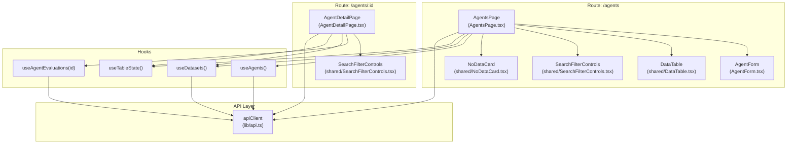
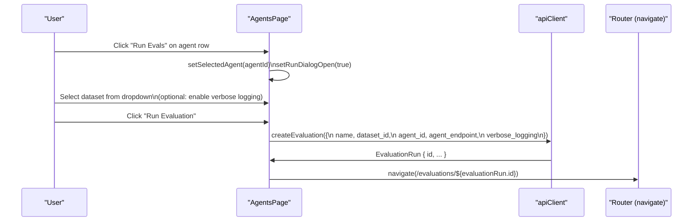
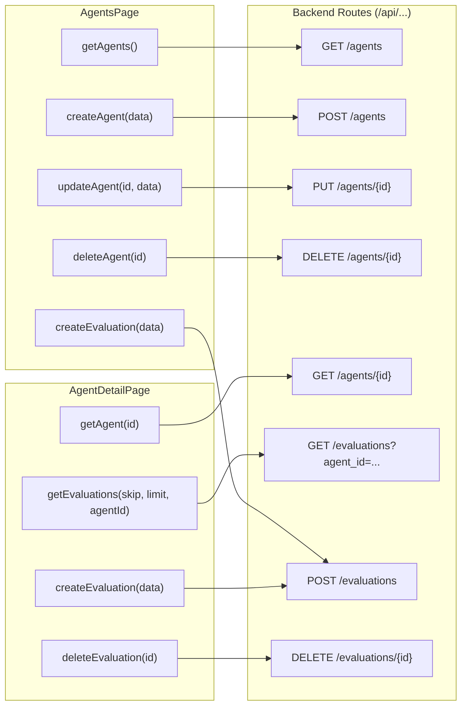

<!-- source: DeepWiki mcp.deepwiki.com · repo microsoft/EvalsforAgentsInterop · page 5.2 Agent Management UI · fetched 2026-10-26 -->

# Agent Management UI

<details>
<summary>Relevant source files</summary>

The following files were used as context for generating this wiki page:

- [src/webapp/src/components/agents/AgentDetailPage.tsx](src/webapp/src/components/agents/AgentDetailPage.tsx)
- [src/webapp/src/components/agents/AgentsPage.tsx](src/webapp/src/components/agents/AgentsPage.tsx)
- [src/webapp/src/lib/api.ts](src/webapp/src/lib/api.ts)

</details>


This page documents the agent management section of the React frontend: the `AgentsPage` and `AgentDetailPage` components. It covers listing, registering, editing, and deleting agents, viewing per-agent evaluation history, and triggering new evaluation runs.

For documentation of the API client methods used by these components, see [API Client](#5.1). For the evaluation results view that opens after triggering a run, see [Evaluation Results UI](#5.3). For the backend endpoints that these components call, see [REST API Endpoints](#3.1).

---

## Component Overview

**Component structure diagram**



Sources: [src/webapp/src/components/agents/AgentsPage.tsx:1-60](), [src/webapp/src/components/agents/AgentDetailPage.tsx:1-66]()

---

## AgentsPage

`AgentsPage` is rendered at route `/agents`. It is the primary interface for managing registered agents.

### Layout and Table

When agents exist, the page renders a `SearchFilterControls` bar above a `DataTable`. The table columns are:

| Column | Source field | Notes |
|--------|-------------|-------|
| **Agent name** | `agent.name`, `agent.description` | Includes icon from `getAgentIcon(agent.id)` |
| **Registered** | `agent.createdAt` | Formatted with `toLocaleDateString()` |
| **Model** | `agent.model` | Rendered as a `Badge` |
| **Action** | — | "Run Evals" button + dropdown (Open, Edit, Delete) |

Column definitions are declared as `TableColumn[]` at [src/webapp/src/components/agents/AgentsPage.tsx:125-296]().

### Search and Filter

`useTableState` manages the search, filter, and sort state:

- **Search**: matches against `agent.name`
- **Filter**: `model` — multiselect dropdown built from the distinct `model` values across all agents
- **Sort**: by `name` (default, ascending)

[src/webapp/src/components/agents/AgentsPage.tsx:106-122]()

### Actions Per Row

Each row in the table exposes three actions via a `DropdownMenu`:

| Action | Handler | Effect |
|--------|---------|--------|
| Open Agent | `handleOpenAgent` | `navigate(/agents/${agent.id})` |
| Edit Agent | `handleEditAgent` | Opens edit dialog pre-populated with agent data |
| Delete Agent | `handleDeleteAgent` | Opens `AlertDialog` for confirmation |

The **Run Evals** button is also in-line per row and opens the run evaluation dialog. Clicking anywhere else on the row also navigates to the agent detail page.

Sources: [src/webapp/src/components/agents/AgentsPage.tsx:310-393]()

---

## Registering an Agent

Clicking **Register Agent** opens a `Dialog` containing `AgentForm` in `mode="create"`.

The form collects:

| Field | Required | Maps to |
|-------|----------|---------|
| Name | Yes | `CreateAgentRequest.name` |
| Description | No | `CreateAgentRequest.description` |
| Model | No | `CreateAgentRequest.model` |
| Agent Invocation URL | Yes | `CreateAgentRequest.agent_invocation_url` |

On submit, `handleCreateAgent` calls `apiClient.createAgent(data)`, which issues a `POST /api/agents`. On success, the agent list is refreshed via `refetchAgents()`.

Sources: [src/webapp/src/components/agents/AgentsPage.tsx:324-347](), [src/webapp/src/lib/api.ts:389-399]()

---

## Editing an Agent

Clicking **Edit Agent** from any row's dropdown opens a `Dialog` with `AgentForm` in `mode="edit"`. The form is pre-populated from the `Agent` object.

`handleUpdateAgent` calls `apiClient.updateAgent(editingAgent.id, data)`, which issues a `PUT /api/agents/{id}`. On success, `refetchAgents()` is called.

An alternative trigger exists via the URL query parameter `?edit={agentId}`: on mount, `AgentsPage` reads this parameter and opens the edit dialog automatically, then removes the parameter from the URL.

Sources: [src/webapp/src/components/agents/AgentsPage.tsx:93-103](), [src/webapp/src/components/agents/AgentsPage.tsx:349-375](), [src/webapp/src/lib/api.ts:401-411]()

---

## Deleting an Agent

Clicking **Delete Agent** sets `agentToDelete` state and opens an `AlertDialog` with a confirmation prompt showing the agent name.

On confirm, `confirmDeleteAgent` calls `apiClient.deleteAgent(agentToDelete.id)`, which issues `DELETE /api/agents/{id}`. On success, `refetchAgents()` is called.

Sources: [src/webapp/src/components/agents/AgentsPage.tsx:377-393](), [src/webapp/src/lib/api.ts:413-420]()

---

## Running an Evaluation (from AgentsPage)

**Evaluation launch flow**



Sources: [src/webapp/src/components/agents/AgentsPage.tsx:395-447]()

The dialog presents:
- A `<select>` populated from all available datasets (name + test case count)
- A checkbox for **verbose logging** (`verbose_logging` flag sent in `CreateEvaluationRequest`)

The `CreateEvaluationRequest` is assembled as:

```
name:              "{agent.name} - {dataset.seed.name}"
dataset_id:        selectedDataset
agent_id:          selectedAgent
agent_endpoint:    agent.agent_invocation_url
agent_auth_required: true
timeout_seconds:   300
verbose_logging:   verboseLogging
```

[src/webapp/src/components/agents/AgentsPage.tsx:401-447](), [src/webapp/src/lib/api.ts:423-442]()

---

## AgentDetailPage

`AgentDetailPage` is rendered at route `/agents/:id`. It shows a single agent's metadata and its full evaluation history.

### Agent Metadata Display

The page header shows:

- Agent name (heading)
- Description (subtext)
- Model badge (from `agent.model`)
- Registration date (from `agent.createdAt`)
- Fluent UI breadcrumb: **Agents** → **{agent.name}**

Agent data is fetched on mount via `apiClient.getAgent(id)` (GET `/api/agents/{id}`).

Sources: [src/webapp/src/components/agents/AgentDetailPage.tsx:105-131](), [src/webapp/src/components/agents/AgentDetailPage.tsx:330-396]()

### Evaluation History

Evaluations for the current agent are loaded via the `useAgentEvaluations(id)` hook, which calls `apiClient.getEvaluations(0, 100, agentId)`.

Each evaluation is enriched in `processedEvaluations` (via `useMemo`) with:

| Derived field | Computation |
|--------------|-------------|
| `passRate` | `passed_count / total_tests * 100` |
| `passRateDisplay` | `Math.round(passRate) + "%"` |
| `datasetName` | Looked up from `datasets` array by `dataset_id` |
| `date` | `new Date(evaluation.created_at)` |
| `dateDisplay` | Locale-formatted date + time string |

Sources: [src/webapp/src/components/agents/AgentDetailPage.tsx:133-174]()

### Evaluation List Controls

The evaluation list uses `useTableState` with:
- **Search**: matches against evaluation `name`
- **Filter**: `dataset` — multiselect by `datasetName`
- **Sort**: by `date` (newest first by default; togglable)

Sources: [src/webapp/src/components/agents/AgentDetailPage.tsx:176-204]()

### Evaluation Cards

Each evaluation in the list renders as a clickable `Card`. Clicking navigates to `/evaluations/{evaluation.id}`.

**Card contents:**

| Element | Condition | Value |
|---------|-----------|-------|
| Date/time string | Always | `evaluation.dateDisplay` (blue text) |
| Evaluation name | Always | `evaluation.name` |
| Status badge | Always | One of: `completed`, `running`, `failed`, `pending`, `cancelled` |
| Dataset name and test count | Always | `"{datasetName} • {N} tests"` |
| Pass rate badge | `status === "completed"` only | Green if ≥ 80%, red otherwise |
| `DotsThree` dropdown | Always | "Delete Evaluation Run" option |

Sources: [src/webapp/src/components/agents/AgentDetailPage.tsx:475-614]()

**Pass rate badge color thresholds:**

| Pass rate | Badge background | Text color |
|-----------|-----------------|------------|
| ≥ 80% | `#F1FAF1` (light green) | `#0D7717` (dark green) |
| < 80% | `#FDF6F6` (light red) | `#C4314B` (dark red) |

### Deleting an Evaluation (from Detail Page)

Clicking **Delete Evaluation Run** in the evaluation card dropdown sets `evaluationToDelete` and opens an `AlertDialog`. On confirm, `confirmDeleteEvaluation` calls `apiClient.deleteEvaluation(evaluationToDelete.id)` and then calls `refetchEvaluations()`.

Sources: [src/webapp/src/components/agents/AgentDetailPage.tsx:206-233]()

### Running an Evaluation (from Detail Page)

A **Run Evals** button appears in the top-right of the evaluation history section. It opens a `Dialog` with the same dataset selector and verbose logging checkbox as on `AgentsPage`.

`handleStartEvaluation` calls `apiClient.createEvaluation(...)` and navigates to `/evaluations/{evaluationRun.id}`.

Sources: [src/webapp/src/components/agents/AgentDetailPage.tsx:235-279](), [src/webapp/src/components/agents/AgentDetailPage.tsx:642-719]()

---

## API Operations Summary

**API call map for agent management**



Sources: [src/webapp/src/lib/api.ts:363-484](), [src/webapp/src/components/agents/AgentsPage.tsx:324-447](), [src/webapp/src/components/agents/AgentDetailPage.tsx:206-279]()

---

## State and Loading Behavior

**AgentsPage states:**

| State | Condition | UI shown |
|-------|-----------|----------|
| Loading | `isLoading === true` | `CircleNotch` spinner |
| Error | `error !== null` | `NoDataCard` with error message |
| Empty | `agents.length === 0` | `NoDataCard` with "Register Your First Agent" CTA |
| Populated | Default | `SearchFilterControls` + `DataTable` |

**AgentDetailPage states:**

| State | Condition | UI shown |
|-------|-----------|----------|
| Loading agent | `isLoading === true` | `CircleNotch` spinner |
| Agent error/not found | `error || !agent` | Alert with back button |
| Evaluations loading | `evaluationsLoading === true` | `Card` with spinner |
| No evaluations | `entries.length === 0` | Empty state card + "Run Evals" button |
| Has evaluations | Default | Filter controls + evaluation card list |

Sources: [src/webapp/src/components/agents/AgentsPage.tsx:449-476](), [src/webapp/src/components/agents/AgentDetailPage.tsx:281-328](), [src/webapp/src/components/agents/AgentDetailPage.tsx:398-616]()

---

