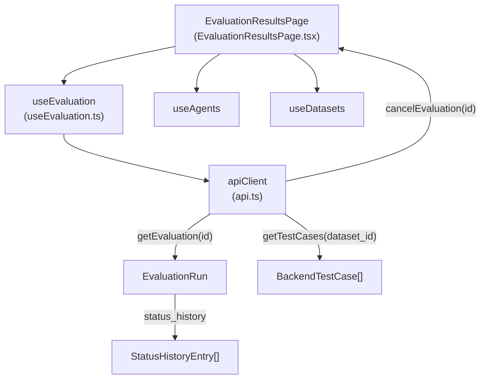
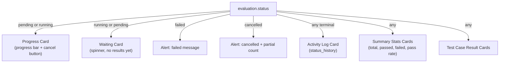
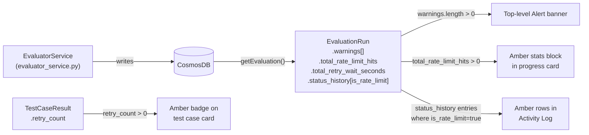
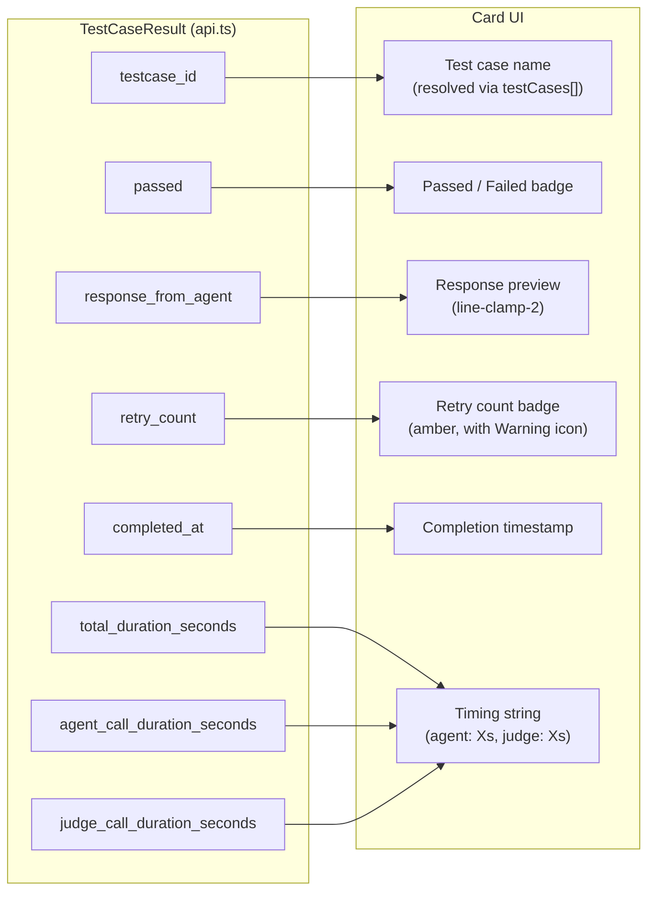
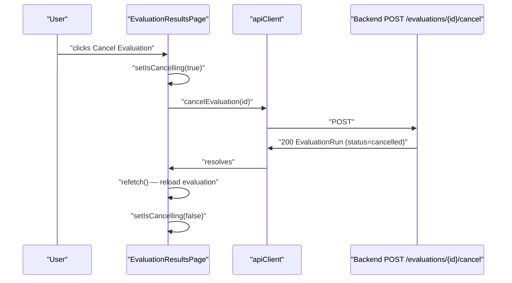

<!-- source: DeepWiki mcp.deepwiki.com · repo microsoft/EvalsforAgentsInterop · page 5.3 Evaluation Results UI · fetched 2026-10-26 -->

# Evaluation Results UI

<details>
<summary>Relevant source files</summary>

The following files were used as context for generating this wiki page:

- [src/webapp/src/components/results/EvaluationResultsPage.tsx](src/webapp/src/components/results/EvaluationResultsPage.tsx)
- [src/webapp/src/hooks/useEvaluation.ts](src/webapp/src/hooks/useEvaluation.ts)
- [src/webapp/src/lib/api.ts](src/webapp/src/lib/api.ts)

</details>


This page documents the `EvaluationResultsPage` component, the `useEvaluation` hook, and the data types that drive the evaluation results view in the React frontend. It covers progress display, status rendering, per-test-case result cards, rate limit surfaces, the activity log, and the cancel flow.

For information about how evaluations are created and triggered from the agent detail page, see [Agent Management UI](#5.2). For the backend evaluation engine that produces the data shown here, see [Evaluation Engine](#3.3). For the `apiClient` methods and `EvaluationRun` type definitions used throughout this component, see [API Client](#5.1).

---

## Component Overview

The page is implemented in a single exported function component, `EvaluationResultsPage`, in [src/webapp/src/components/results/EvaluationResultsPage.tsx]().

It reads the evaluation ID from the URL parameter `id` (via React Router's `useParams`), then delegates all data fetching to the `useEvaluation` hook. Secondary lookups for agent name and dataset name use the `useAgents` and `useDatasets` hooks respectively.

**Component: `EvaluationResultsPage`**

**Diagram: Component and Hook Dependencies**



Sources: [src/webapp/src/components/results/EvaluationResultsPage.tsx:73-96](), [src/webapp/src/hooks/useEvaluation.ts:1-73]()

---

## Data Loading and Polling

The `useEvaluation` hook in [src/webapp/src/hooks/useEvaluation.ts]() manages all async state for this page.

**Diagram: `useEvaluation` Polling State Machine**

```mermaid
stateDiagram-v2
    [*] --> "loading=true" : "hook mounts"
    "loading=true" --> "loading=false" : "fetchEvaluation() resolves"
    "loading=false" --> "polling" : "enablePolling=true AND status is pending or running"
    "polling" --> "polling" : "setInterval 3000ms fires, fetchEvaluation()"
    "polling" --> "stopped" : "status becomes completed, failed, or cancelled"
    "stopped" --> [*]
    "loading=false" --> [*] : "status already terminal on first load"
```

`EvaluationResultsPage` calls `useEvaluation(id, true)`, enabling polling. The hook calls `fetchEvaluation` once on mount, then sets up a 3-second `setInterval` that continues as long as the evaluation `status` is `"pending"` or `"running"`. The interval is cleared when the status becomes `"completed"`, `"failed"`, or `"cancelled"`.

[src/webapp/src/hooks/useEvaluation.ts:49-58]()

In addition to fetching the `EvaluationRun`, the hook also fetches the `BackendTestCase[]` list from the dataset (via `apiClient.getTestCases(data.dataset_id)`) to resolve human-readable test case names. Failure to fetch test cases is treated as non-fatal — the `evaluation` state is still set.

[src/webapp/src/hooks/useEvaluation.ts:21-41]()

| Return value | Type | Purpose |
|---|---|---|
| `evaluation` | `EvaluationRun \| null` | Full evaluation run object |
| `testCases` | `BackendTestCase[]` | Dataset test cases, for name resolution |
| `loading` | `boolean` | True during initial fetch only |
| `error` | `string \| null` | Error message if fetch failed |
| `refetch` | `() => void` | Manually re-trigger fetch (used by cancel handler) |

Sources: [src/webapp/src/hooks/useEvaluation.ts:4-73]()

---

## Status State Rendering

The page renders different UI sections depending on the `evaluation.status` field. The status values match those described in the backend state machine (see [Evaluation Engine](#3.3)).

**Diagram: Status → UI Section Mapping**



Sources: [src/webapp/src/components/results/EvaluationResultsPage.tsx:261-617]()

### `pending` and `running`

A progress card is shown containing:

- A `<Progress>` bar driven by `progressPercentage = (completed_tests / total_tests) * 100`
- The text label `"Preparing"` (pending) or `"Progress"` (running)
- A `status_message` field from the evaluation for live activity text
- Rate limit statistics (if `total_rate_limit_hits > 0`)
- A collapsible **Activity Log** (`<details>` element) showing recent `status_history` entries
- A **Cancel Evaluation** button

[src/webapp/src/components/results/EvaluationResultsPage.tsx:261-371]()

### `failed`

An `<Alert>` is shown with a red-toned message directing users to check logs.

[src/webapp/src/components/results/EvaluationResultsPage.tsx:601-608]()

### `cancelled`

An `<Alert>` is shown with amber styling, displaying how many tests completed before cancellation.

[src/webapp/src/components/results/EvaluationResultsPage.tsx:611-617]()

---

## Summary Statistics Cards

Four metric cards are always shown once `evaluation` is loaded:

| Card | Value source | Label |
|---|---|---|
| Total Test Cases | `evaluation.total_tests` | Total Test Cases |
| Passed | `evaluation.passed_count` | Passed |
| Failed | `evaluation.failed_tests` | Failed |
| Pass Rate | `passed_count / total_tests * 100` | Pass Rate |

Pass rate is computed as a percentage of **total** tests, not just completed tests, so a partial run shows a conservative percentage.

[src/webapp/src/components/results/EvaluationResultsPage.tsx:117-127](), [src/webapp/src/components/results/EvaluationResultsPage.tsx:374-410]()

---

## Rate Limit Warning Surfaces

Rate limit information is surfaced in three places:

**Diagram: Rate Limit Data Flow to UI**



| Surface | Trigger | Shows |
|---|---|---|
| Top-level `<Alert>` | `evaluation.warnings.length > 0` | First 5 warning strings, with overflow count |
| Progress card amber block | `total_rate_limit_hits > 0` | Hit count + total wait seconds |
| Activity log amber rows | `entry.is_rate_limit === true` | Entry message + wait seconds badge |
| Test case card badge | `testCase.retry_count > 0` | Retry count with `Warning` icon |

Sources: [src/webapp/src/components/results/EvaluationResultsPage.tsx:239-258](), [src/webapp/src/components/results/EvaluationResultsPage.tsx:293-350](), [src/webapp/src/components/results/EvaluationResultsPage.tsx:506-528]()

---

## Activity Log

The activity log renders the `status_history` array from `EvaluationRun`. Each entry is a `StatusHistoryEntry` with these fields:

| Field | Type | Purpose |
|---|---|---|
| `timestamp` | `string` | ISO datetime, displayed as `toLocaleTimeString()` |
| `message` | `string` | Human-readable status description |
| `is_rate_limit` | `boolean?` | If true, row gets amber background |
| `wait_seconds` | `number?` | Seconds waited; shown as `+Xs` badge |
| `retry_attempt` | `number?` | Which retry attempt (1-based) |
| `max_attempts` | `number?` | Max retries configured |

The log appears in two forms depending on status:

- **During `pending`/`running`**: A `<details>` collapsible element inside the progress card. Entries are shown in **reverse chronological order** (newest first).
- **After terminal status**: A full `<Card>` titled "Evaluation Activity Log" with entries in **chronological order**. This card is only shown when `status_history.length > 0`.

[src/webapp/src/components/results/EvaluationResultsPage.tsx:311-350](), [src/webapp/src/components/results/EvaluationResultsPage.tsx:413-458]()

---

## Per-Test-Case Result Cards

Each entry in `evaluation.test_cases` (a `TestCaseResult[]`) is rendered as a clickable `<Card>`. Clicking navigates to `/evaluations/{id}/testcases/{testcaseId}` for a detail view.

**Diagram: `TestCaseResult` Fields to Card UI Elements**



Test case names are resolved by looking up `testcase_id` against the `testCases` array fetched from the dataset. If no match is found, the fallback label is `"Test Case {testcaseId}"`.

[src/webapp/src/components/results/EvaluationResultsPage.tsx:107-111](), [src/webapp/src/components/results/EvaluationResultsPage.tsx:466-556]()

---

## Cancel Evaluation Flow

The cancel button is rendered inside the progress card and is only visible when `status` is `"pending"` or `"running"`.

**Diagram: Cancel Flow**



While cancellation is in-flight, the button shows a spinner and the label changes to `"Cancelling..."`. The button is `disabled` during this state. After `cancelEvaluation` resolves, `refetch()` is called to reload the evaluation, which will then show `status === "cancelled"` and render the cancelled alert.

[src/webapp/src/components/results/EvaluationResultsPage.tsx:83-95](), [src/webapp/src/components/results/EvaluationResultsPage.tsx:352-367](), [src/webapp/src/lib/api.ts:467-475]()

---

## Breadcrumb Navigation

The page renders a Fluent UI `<Breadcrumb>` with three segments:

```
Agents  >  {agentName}  >  {evaluationName}
```

Each segment is a `<BreadcrumbButton>`. Long names are truncated using `truncateBreadcrumbLongName` (threshold: 30 characters), and a `<Tooltip>` shows the full name on hover. Agent name is resolved by matching `evaluation.agent_id` against the `agents` list from `useAgents`.

[src/webapp/src/components/results/EvaluationResultsPage.tsx:163-225]()

---

## Key Type Reference

The following types from [src/webapp/src/lib/api.ts]() are central to this page:

| Type | Key Fields Used | Where |
|---|---|---|
| `EvaluationRun` | `status`, `total_tests`, `completed_tests`, `passed_count`, `failed_tests`, `warnings`, `status_message`, `status_history`, `total_rate_limit_hits`, `total_retry_wait_seconds`, `test_cases` | All sections |
| `TestCaseResult` | `testcase_id`, `passed`, `response_from_agent`, `retry_count`, `completed_at`, `total_duration_seconds`, `agent_call_duration_seconds`, `judge_call_duration_seconds` | Test case cards |
| `StatusHistoryEntry` | `timestamp`, `message`, `is_rate_limit`, `wait_seconds` | Activity log |
| `EvaluationRunStatus` | `"pending" \| "running" \| "completed" \| "failed" \| "cancelled"` | Status rendering |

Sources: [src/webapp/src/lib/api.ts:137](), [src/webapp/src/lib/api.ts:172-191](), [src/webapp/src/lib/api.ts:193-216](), [src/webapp/src/lib/api.ts:218-225]()

---

