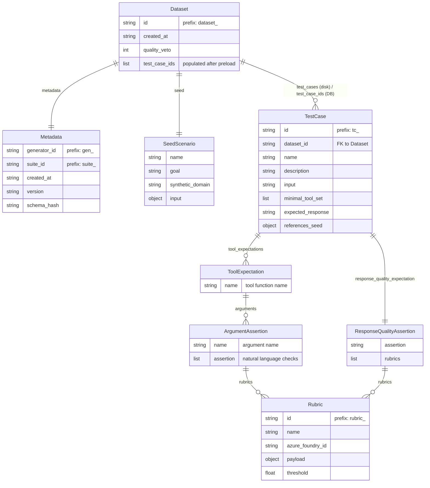
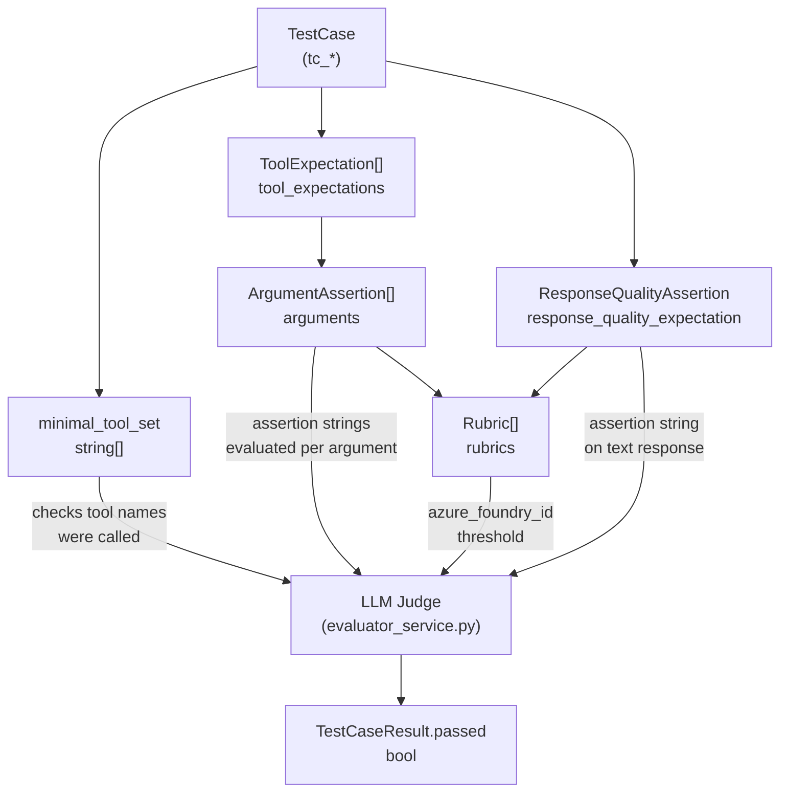
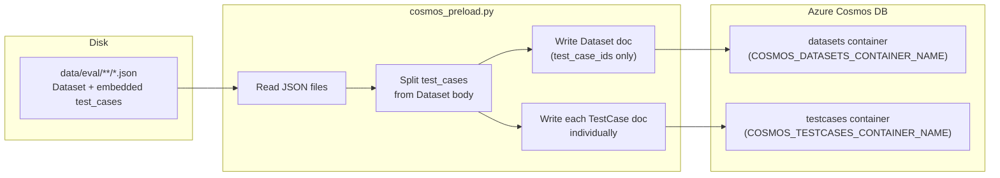
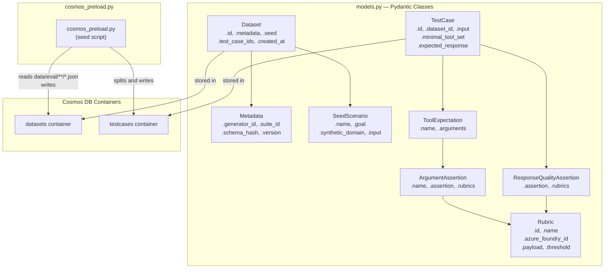

<!-- source: DeepWiki mcp.deepwiki.com · repo microsoft/EvalsforAgentsInterop · page 6 Evaluation Datasets · fetched 2026-10-26 -->

# Evaluation Datasets

<details>
<summary>Relevant source files</summary>

The following files were used as context for generating this wiki page:

- [data/eval/simple/email_collaboration.json](data/eval/simple/email_collaboration.json)
- [data/eval/simple/meeting_scheduler.json](data/eval/simple/meeting_scheduler.json)
- [src/api/README.md](src/api/README.md)

</details>


This page explains the structure of evaluation datasets used by the platform: how JSON files on disk are organized, what each field means, and how `cosmos_preload.py` seeds them into Azure Cosmos DB. It covers the shared schema common to all dataset types.

For details about specific dataset collections, see:
- [Simple Datasets](#6.1) — `email_collaboration` and `meeting_scheduler`
- [Email Agent Contracts](#6.2) — privacy and multi-project email scenarios
- [Meeting Agent Contracts](#6.3) — multi-step calendar scheduling scenarios

For how the evaluation engine consumes these datasets at runtime, see [Evaluation Engine](#3.3).

---

## Directory Layout

All evaluation datasets are stored as JSON files under `data/eval/`. Each subdirectory groups datasets by domain or contract type.

```
data/
└── eval/
    ├── simple/
    │   ├── email_collaboration.json
    │   └── meeting_scheduler.json
    ├── email-agent/
    │   ├── Manager_Leave_Email_Responder_Privacy.json
    │   └── Manager_Leave_Email_Responder_MultiProject.json
    └── meeting-agent/
        ├── EarliestSlot.json
        ├── Confirmation.json
        └── Cancel_PineTreeProject.json
```

| Directory | Contents | Complexity |
|---|---|---|
| `data/eval/simple/` | Single-tool and two-tool scenarios | Low — direct tool call assertions |
| `data/eval/email-agent/` | Email agent behavioral contracts | Medium — multi-step, privacy constraints |
| `data/eval/meeting-agent/` | Calendar scheduling contracts | High — 4-step tool pipelines, timezone handling |

Sources: [data/eval/simple/email_collaboration.json:1-232](), [data/eval/simple/meeting_scheduler.json:1-553]()

---

## Dataset JSON Structure

Each file on disk represents a single `Dataset` with all `TestCase` objects embedded under a `test_cases` array. When loaded into Cosmos DB by `cosmos_preload.py`, the test cases are split into individual documents and the dataset retains only their IDs under `test_case_ids`.

**Dataset structure diagram:**



Sources: [data/eval/simple/email_collaboration.json:1-15](), [data/eval/simple/meeting_scheduler.json:1-15](), [src/api/README.md:71-121]()

---

## Field Reference

### Dataset

| Field | Type | Description |
|---|---|---|
| `id` | `string` | Unique identifier, conventionally prefixed `dataset_` |
| `metadata` | `Metadata` | Embedded provenance metadata |
| `seed` | `SeedScenario` | The scenario description used to generate this dataset |
| `test_cases` | `TestCase[]` | Embedded in on-disk JSON; split into separate documents on load |
| `test_case_ids` | `string[]` | Populated in Cosmos DB after the preload splits test cases out |
| `quality_veto` | `int` | Quality control flag; `0` means the dataset passed review |
| `created_at` | `string` | ISO 8601 timestamp |

Sources: [data/eval/simple/email_collaboration.json:1-15](), [data/eval/simple/meeting_scheduler.json:1-15]()

### Metadata

| Field | Type | Example |
|---|---|---|
| `generator_id` | `string` | `"gen_9393a62e37964a83"` |
| `suite_id` | `string` | `"suite_c390c7a0c0eb419a"` |
| `created_at` | `string` | `"2025-10-31T16:57:24.803323+00:00"` |
| `version` | `string` | `"1.0"` |
| `schema_hash` | `string` | SHA-256 of the schema; may be empty string |

Sources: [data/eval/simple/meeting_scheduler.json:3-9]()

### SeedScenario

The `seed` object captures the high-level intent used to generate test cases.

| Field | Type | Description |
|---|---|---|
| `name` | `string` | Human-readable dataset name |
| `goal` | `string` | What the dataset is designed to test |
| `synthetic_domain` | `string` | Domain context (e.g., `"Meeting scheduling and calendar management"`) |
| `input` | `object` | Generator parameters; often empty (`{}`) for static datasets |

Sources: [data/eval/simple/email_collaboration.json:13-16](), [data/eval/simple/meeting_scheduler.json:11-16]()

### TestCase

| Field | Type | Description |
|---|---|---|
| `id` | `string` | Unique identifier, conventionally prefixed `tc_` |
| `dataset_id` | `string` | FK reference to parent `Dataset.id` |
| `name` | `string` | Short descriptive name |
| `description` | `string` | Narrative description of the scenario |
| `input` | `string` | The natural-language prompt sent to the agent under test |
| `minimal_tool_set` | `string[]` | Minimum set of tool names required to complete the task |
| `tool_expectations` | `ToolExpectation[]` | Per-tool call assertions evaluated by the LLM judge |
| `expected_response` | `string` | Reference natural-language response for quality scoring |
| `response_quality_expectation` | `ResponseQualityAssertion` | Assertion and rubrics applied to the agent's text response |
| `references_seed` | `object` | Optional context documents (e.g., mock calendar JSON) provided as background data |

Sources: [data/eval/simple/email_collaboration.json:17-58](), [data/eval/simple/meeting_scheduler.json:17-64]()

### ToolExpectation

Each `ToolExpectation` corresponds to a single expected tool call that the agent should make.

| Field | Type | Description |
|---|---|---|
| `name` | `string` | Exact tool function name (e.g., `"sendMail"`, `"mcp_CalendarTools_graph_createEvent"`) |
| `arguments` | `ArgumentAssertion[]` | Per-argument assertion checks |

Sources: [data/eval/simple/email_collaboration.json:24-50](), [data/eval/simple/meeting_scheduler.json:25-46]()

### ArgumentAssertion

Each entry in a `ToolExpectation.arguments` array specifies what the LLM judge should verify for one argument of a tool call.

| Field | Type | Description |
|---|---|---|
| `name` | `string` | The argument name (e.g., `"toRecipients"`, `"subject"`, `"body"`) |
| `assertion` | `string[]` | List of natural-language checks the judge applies to the argument's value |
| `rubrics` | `Rubric[]` | Optional scored rubrics using Azure AI Foundry evaluators |

The `assertion` list allows multiple independent conditions. The LLM judge evaluates each one separately.

Example from `email_collaboration.json`:
```json
{
  "name": "body",
  "assertion": [
    "The 'body' field mentions semi-finals moved to Saturday May 18th due to field maintenance",
    "The 'body' field includes championship game on Memorial Day weekend",
    "The 'body' field references referee assignments by coordinator Mike"
  ],
  "rubrics": []
}
```

Sources: [data/eval/simple/email_collaboration.json:27-49](), [data/eval/simple/meeting_scheduler.json:27-44]()

### Rubric

Rubrics attach scored, named evaluators (backed by Azure AI Foundry built-in evaluators) to individual argument assertions or to the `response_quality_expectation`.

| Field | Type | Description |
|---|---|---|
| `id` | `string` | Unique rubric identifier, prefixed `rubric_` |
| `name` | `string` | Short label (e.g., `"task_compliance"`, `"information_completeness"`) |
| `azure_foundry_id` | `string` | Azure AI Foundry evaluator URI (e.g., `"azureai://built-in/evaluators/task_adherence"`) |
| `payload` | `object` | Template variables for the evaluator; uses `<$response$>` and `<$expected_response$>` placeholders |
| `threshold` | `float` | Minimum passing score (typically `0.7`) |

Sources: [data/eval/simple/meeting_scheduler.json:82-112]()

### ResponseQualityAssertion

The `response_quality_expectation` field applies assertions to the agent's final text response rather than its tool calls.

| Field | Type | Description |
|---|---|---|
| `assertion` | `string` | Natural-language description of what the response should contain |
| `rubrics` | `Rubric[]` | Optional Azure AI Foundry scored evaluators |

Sources: [data/eval/simple/email_collaboration.json:53-57](), [data/eval/simple/meeting_scheduler.json:47-50]()

---

## Evaluation Assertion Flow

This diagram shows how the structured fields in a `TestCase` map to evaluation decisions made by the LLM judge at runtime.



Sources: [src/api/README.md:96-121](), [data/eval/simple/meeting_scheduler.json:82-153]()

---

## Seeding Datasets into Cosmos DB

The `cosmos_preload.py` script reads dataset JSON files from the `data/` directory and writes them to Azure Cosmos DB, splitting each embedded `test_cases` array into separate TestCase documents.

**Seeding flow:**



### CLI Usage

```bash
# From src/api directory

# Preview which documents will be created (no writes)
python cosmos_preload.py --dry-run

# Load all datasets from data/eval/ into Cosmos DB
python cosmos_preload.py

# Overwrite documents that already exist
python cosmos_preload.py --force
```

The script depends on environment variables for Cosmos DB connection details. Required variables:

| Variable | Description |
|---|---|
| `COSMOS_ENDPOINT` | Cosmos DB account endpoint URL |
| `COSMOS_KEY` | Account key (omit when using managed identity) |
| `COSMOS_DATABASE_NAME` | Database name (default: `interopevals`) |
| `COSMOS_DATASETS_CONTAINER_NAME` | Container for `Dataset` documents |
| `COSMOS_TESTCASES_CONTAINER_NAME` | Container for `TestCase` documents |

Sources: [src/api/README.md:155-180]()

---

## Model-to-Code Mapping

The following diagram maps each JSON field concept to its corresponding Pydantic class in `models.py` and its Cosmos DB container.



Sources: [src/api/README.md:71-121](), [data/eval/simple/email_collaboration.json:1-232](), [data/eval/simple/meeting_scheduler.json:1-553]()

---

## Intentionally Failing Test Cases

Some test cases in the simple datasets contain deliberately incorrect assertions — for example, `email_collaboration.json` `tc_f4ec95d51ff84519` asserts `toRecipients` should be `chen.research@university.edu` while the input specifies `kim.research@university.edu`, and `tc_9f2e8a1b6c4d7k5j` expects `riley.chen@clientcorp.com` while the input says `riley.kim@clientcorp.com`.

These cases verify that the evaluation pipeline correctly identifies mismatches between agent behavior and dataset expectations. They serve as a built-in sanity check that the LLM judge is sensitive to incorrect tool argument values.

Sources: [data/eval/simple/email_collaboration.json:73-74](), [data/eval/simple/email_collaboration.json:196-197]()

---

