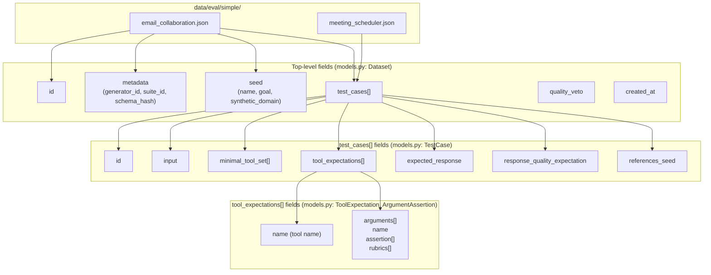
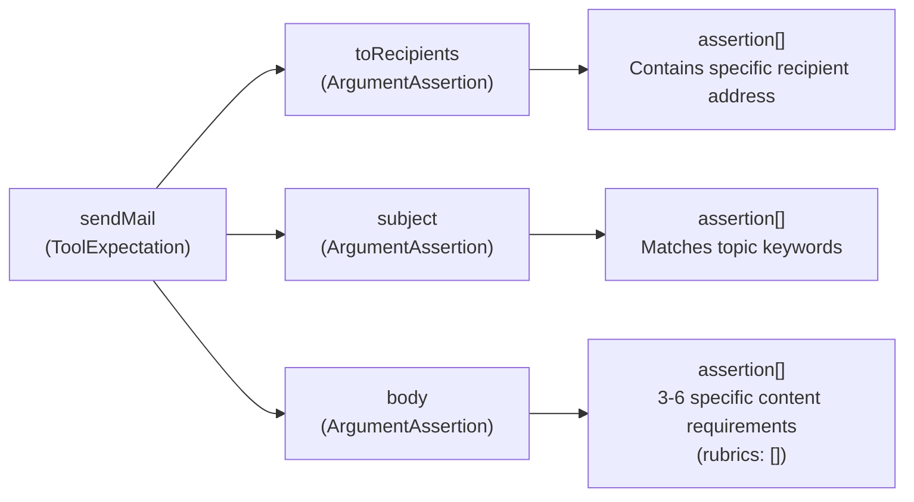
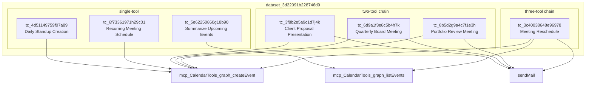
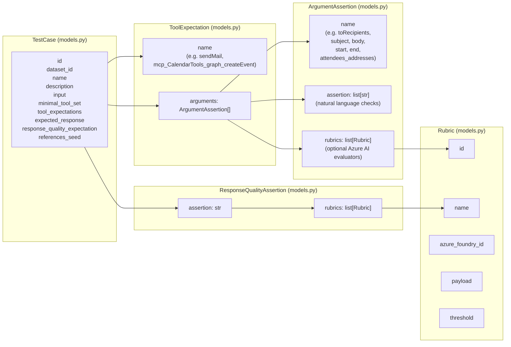

<!-- source: DeepWiki mcp.deepwiki.com · repo microsoft/EvalsforAgentsInterop · page 6.1 Simple Datasets · fetched 2026-10-26 -->

# Simple Datasets

Relevant source files

The following files were used as context for generating this wiki page:

- [data/eval/simple/email_collaboration.json](data/eval/simple/email_collaboration.json)
- [data/eval/simple/meeting_scheduler.json](data/eval/simple/meeting_scheduler.json)

This page documents the two evaluation datasets under `data/eval/simple/`: `email_collaboration.json` and `meeting_scheduler.json`. These datasets are designed as baseline ("simple") capability tests — they verify fundamental tool usage before testing more complex agent contracts.

For the broader dataset format and how datasets are seeded into the system via `cosmos_preload.py`, see page [6](). For more complex multi-step evaluation contracts, see [Email Agent Contracts](#6.2) and [Meeting Agent Contracts](#6.3).

---

## File Locations

| File | Dataset ID | Tool Focus |
|---|---|---|
| `data/eval/simple/email_collaboration.json` | `dataset_dataset_ee6f00f762394612` | `sendMail` only |
| `data/eval/simple/meeting_scheduler.json` | `dataset_3d22091b228746d9` | `mcp_CalendarTools_graph_createEvent`, `mcp_CalendarTools_graph_listEvents`, `sendMail` |

**Dataset structure diagram** — how the files map to the Pydantic data model:

Sources: [data/eval/simple/email_collaboration.json:1-15](), [data/eval/simple/meeting_scheduler.json:1-15]()

---

## Dataset: email_collaboration

**File:** [data/eval/simple/email_collaboration.json]()

**Seed goal:** _"Test an agent's ability to send emails for various subjects and recipients."_

All 5 test cases in this dataset require exactly one tool call: `sendMail`. They cover a variety of real-world email composition scenarios.

### Test Cases

| Test Case ID | Name | Recipient Address (input) | Assertion Address | Tool |
|---|---|---|---|---|
| `tc_e4db542b0bce41ae` | Soccer League Update | `coaches@springfieldyouth.org` | `coaches@springfieldyouth.org` | `sendMail` |
| `tc_f4ec95d51ff84519` | Research Paper Collaboration | `kim.research@university.edu` | `chen.research@university.edu` ⚠️ | `sendMail` |
| `tc_df573bad8a6145c4` | Neighborhood Block Party Planning | `blockparty2024@gmail.com` | `blockparty2024@gmail.com` | `sendMail` |
| `tc_3b190ba3e9b042f6` | Family Reunion Planning | `johnsonreunion@gmail.com` | `johnsonreunion@gmail.com` | `sendMail` |
| `tc_9f2e8a1b6c4d7k5j` | Client Meeting Follow-up | `riley.kim@clientcorp.com` | `riley.chen@clientcorp.com` ⚠️ | `sendMail` |

> ⚠️ **Address mismatches**: Two test cases have a discrepancy between the email address stated in the `input` field and the address asserted in `tool_expectations`. `tc_f4ec95d51ff84519` requests `kim.research@university.edu` in the input but asserts `chen.research@university.edu`; `tc_9f2e8a1b6c4d7k5j` requests `riley.kim@clientcorp.com` but asserts `riley.chen@clientcorp.com`. This means an agent that follows the literal input will fail the `toRecipients` assertion for these two cases.

Sources: [data/eval/simple/email_collaboration.json:16-232]()

### sendMail Assertion Structure

Every test case in this dataset asserts three `sendMail` arguments:

All `rubrics` arrays in this dataset are empty. Assertions are evaluated solely as LLM-judged string checks. The `body` argument carries the most assertions — typically 5–6 content requirements covering the specific facts stated in the `input`.

**Body assertion counts per test case:**

| Test Case | Body Assertion Count |
|---|---|
| Soccer League Update | 6 |
| Research Paper Collaboration | 5 |
| Neighborhood Block Party Planning | 5 |
| Family Reunion Planning | 6 |
| Client Meeting Follow-up | 5 |

Sources: [data/eval/simple/email_collaboration.json:24-58](), [data/eval/simple/email_collaboration.json:67-100](), [data/eval/simple/email_collaboration.json:109-143](), [data/eval/simple/email_collaboration.json:151-186](), [data/eval/simple/email_collaboration.json:194-228]()

---

## Dataset: meeting_scheduler

**File:** [data/eval/simple/meeting_scheduler.json]()

**Seed goal:** _"Test an agent's ability to manage a user's calendar by listing and creating events."_

This dataset contains 7 test cases. They vary from single-tool calls (`mcp_CalendarTools_graph_createEvent` only) to three-tool chains (`mcp_CalendarTools_graph_listEvents` → `mcp_CalendarTools_graph_createEvent` → `sendMail`).

### Test Cases

| Test Case ID | Name | Tool Chain | Uses `references_seed` |
|---|---|---|---|
| `tc_4d51149759f07a89` | Daily Standup Creation | `createEvent` | ✓ (mock calendar) |
| `tc_3c40038648e96978` | Meeting Reschedule | `listEvents` → `createEvent` → `sendMail` | ✓ (mock calendar) |
| `tc_5e62250860g18b90` | Summarize Upcoming Events | `listEvents` | ✓ (mock calendar) |
| `tc_6f73361971h29c01` | Recurring Meeting Schedule | `createEvent` | ✗ |
| `tc_3f8b2e5a9c1d7j4k` | Client Proposal Presentation | `createEvent` → `sendMail` | ✗ |
| `tc_6d9a1f3e8c5b4h7k` | Quarterly Board Meeting | `createEvent` → `sendMail` | ✗ |
| `tc_8b5d2g9a4c7f1e3h` | Portfolio Review Meeting | `createEvent` → `sendMail` | ✗ |

> The `references_seed` field, when populated, contains a mock calendar JSON document embedded as `content_md`. This gives the agent a realistic set of existing events to reason about when checking for conflicts or summarizing a schedule. See [data/eval/simple/meeting_scheduler.json:52-63]() for an example of the embedded calendar structure.

### Tool Chain Patterns

**Tool usage by test case:**

Sources: [data/eval/simple/meeting_scheduler.json:16-550]()

### Tool Assertion Detail

**`mcp_CalendarTools_graph_createEvent` argument assertions:**

| Test Case | `subject` | `start` | `end` | `attendees_addresses` | `location` | `isOnlineMeeting` |
|---|---|---|---|---|---|---|
| Daily Standup Creation | ✓ | ✓ (tomorrow 9 AM) | ✓ (30 min) | — | — | — |
| Meeting Reschedule | ✓ | ✓ (not 3 PM, free slot) | ✓ (1 hr) | ✓ (`devon.torres@example.com`) | — | — |
| Recurring Meeting Schedule | ✓ | ✓ (Friday 2 PM) | ✓ (45 min) | ✓ (`devon.torres@example.com`) | — | — |
| Client Proposal Presentation | ✓ | — | — | ✓ (4 addresses) | — | ✓ (true) |
| Quarterly Board Meeting | ✓ | — | — | ✓ (4 addresses) | ✓ (boardroom) | — |
| Portfolio Review Meeting | ✓ | — | — | ✓ (3 addresses) | — | ✓ (true) |

**`sendMail` argument assertions in meeting_scheduler:**

| Test Case | `toRecipients` | `subject` | `body` |
|---|---|---|---|
| Meeting Reschedule | `devon.torres@example.com` | Reschedule indication | New time, conflict explanation, original 3 PM time, professional tone |
| Client Proposal Presentation | `team.lead@company.com`, `sales.rep@company.com` | — | Q3 slides, pricing proposal, Thursday deadline |
| Quarterly Board Meeting | `chair@`, `director1@`, `director2@`, `cfo@company.com` | — | Reports by Dec 15, budget approval, merger proposal |
| Portfolio Review Meeting | `portfolio.manager@`, `financial.advisor@`, `risk.analyst@wealth.com` | — | Q4 analysis, tech sector allocations, $2.5M rebalancing |

Sources: [data/eval/simple/meeting_scheduler.json:23-214](), [data/eval/simple/meeting_scheduler.json:390-549]()

### Rubrics in meeting_scheduler

Three test cases attach `rubrics` to individual argument assertions on the `mcp_CalendarTools_graph_listEvents` call: `tc_3c40038648e96978` (Meeting Reschedule), `tc_5e62250860g18b90` (Summarize Upcoming Events). Both the `startDateTime` and `endDateTime` arguments carry the same three rubric evaluators.

The rubrics used are Azure AI built-in evaluators referenced by `azure_foundry_id`:

| Rubric ID | `name` | `azure_foundry_id` | Threshold |
|---|---|---|---|
| `rubric_5d728eb2ee714899` | `task_compliance` | `azureai://built-in/evaluators/task_adherence` | 0.7 |
| `rubric_7b8f25e532d24bbf` | `information_completeness` | `azureai://built-in/evaluators/response_completeness` | 0.7 |
| `rubric_14c6875d32cf4c1f` | `output_coherence` | `azureai://built-in/evaluators/coherence` | 0.7 |

The `payload` for each rubric uses template variables `<$response$>` and `<$expected_response$>`, which are populated at evaluation time by the evaluation engine (see page [3.3]()).

The `Meeting Reschedule` test case also carries a single rubric (`task_compliance`) on its `response_quality_expectation`, making it the most heavily rubric-annotated test case in either simple dataset.

Sources: [data/eval/simple/meeting_scheduler.json:80-152](), [data/eval/simple/meeting_scheduler.json:254-330](), [data/eval/simple/meeting_scheduler.json:210-224]()

---

## Assertion Structure Reference

The following diagram maps assertion fields to the corresponding Pydantic model fields (defined in `models.py`) for a complete test case:

Sources: [data/eval/simple/email_collaboration.json:24-57](), [data/eval/simple/meeting_scheduler.json:80-153]()

---

