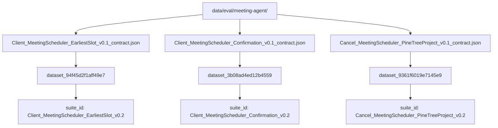
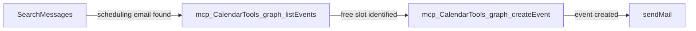
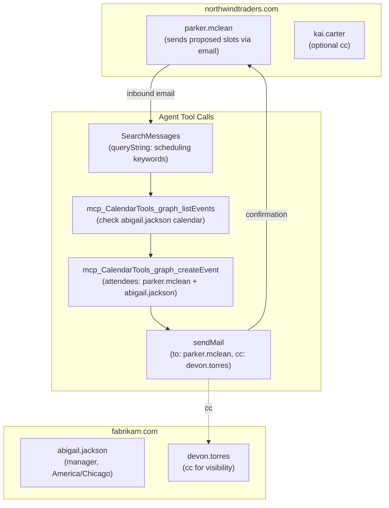
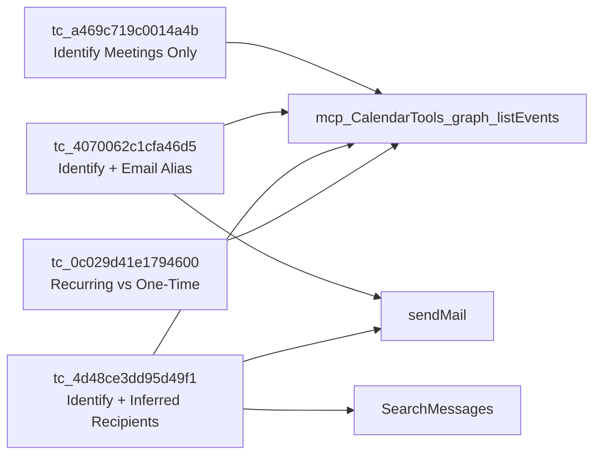

<!-- source: DeepWiki mcp.deepwiki.com · repo microsoft/EvalsforAgentsInterop · page 6.3 Meeting Agent Contracts · fetched 2026-10-26 -->

# Meeting Agent Contracts

Relevant source files

The following files were used as context for generating this wiki page:

- [data/eval/meeting-agent/Cancel_MeetingScheduler_PineTreeProject_v0.1_contract.json](data/eval/meeting-agent/Cancel_MeetingScheduler_PineTreeProject_v0.1_contract.json)
- [data/eval/meeting-agent/Client_MeetingScheduler_Confirmation_v0.1_contract.json](data/eval/meeting-agent/Client_MeetingScheduler_Confirmation_v0.1_contract.json)
- [data/eval/meeting-agent/Client_MeetingScheduler_EarliestSlot_v0.1_contract.json](data/eval/meeting-agent/Client_MeetingScheduler_EarliestSlot_v0.1_contract.json)

This page documents the three evaluation contract datasets located in `data/eval/meeting-agent/`. Each contract defines a multi-step scheduling or cancellation scenario using a set of test cases with tool-level argument assertions and LLM rubric evaluations.

For background on dataset structure, how test cases and rubrics are defined, and how data is seeded into Cosmos DB, see [Evaluation Datasets](#6). For simpler scheduling datasets without stakeholder complexity, see [Simple Datasets](#6.1). For the email agent contracts, see [Email Agent Contracts](#6.2).

---

## Contract Overview

The `data/eval/meeting-agent/` directory contains three contract files, each representing a distinct scheduling scenario domain:

| Contract File | Dataset ID | Suite ID | Primary Domain |
|---|---|---|---|
| `Client_MeetingScheduler_EarliestSlot_v0.1_contract.json` | `dataset_94f45d2f1aff49e7` | `Client_MeetingScheduler_EarliestSlot_v0.2` | Find and book the earliest mutual slot for a customer consultation |
| `Client_MeetingScheduler_Confirmation_v0.1_contract.json` | `dataset_3b08ad4ed12b4559` | `Client_MeetingScheduler_Confirmation_v0.2` | Respond to customer-proposed times, verify calendar, send confirmation |
| `Cancel_MeetingScheduler_PineTreeProject_v0.1_contract.json` | `dataset_9361f6019e7145e9` | `Cancel_MeetingScheduler_PineTreeProject_v0.2` | Cancel all project meetings and notify the team |

**Diagram: Dataset Contract Map**

Sources: [data/eval/meeting-agent/Client_MeetingScheduler_EarliestSlot_v0.1_contract.json:1-15](), [data/eval/meeting-agent/Client_MeetingScheduler_Confirmation_v0.1_contract.json:1-15](), [data/eval/meeting-agent/Cancel_MeetingScheduler_PineTreeProject_v0.1_contract.json:1-15]()

---

## Standard Tool Pipeline

The two scheduling contracts (EarliestSlot and Confirmation) use the same four-tool pipeline. Tool names below are the exact identifiers used in `minimal_tool_set` and `tool_expectations` fields in the JSON contracts.

**Diagram: Four-Step Scheduling Pipeline**

The Cancel/PineTree contract uses only `mcp_CalendarTools_graph_listEvents` and `sendMail` — there is no event creation step.

Each tool has argument-level assertions evaluated by the LLM judge:

| Tool | Key Arguments Asserted |
|---|---|
| `SearchMessages` | `queryString`, `sender`, `size` |
| `mcp_CalendarTools_graph_listEvents` | `userId`, `startDateTime`, `endDateTime`, `filter`, `top` |
| `mcp_CalendarTools_graph_createEvent` | `subject`, `start_dateTime`, `start_timeZone`, `end_dateTime`, `end_timeZone`, `attendees_addresses`, `body_content`, `isOnlineMeeting`, `onlineMeetingProvider` |
| `sendMail` | `to`, `cc`, `subject`, `body` |

Sources: [data/eval/meeting-agent/Client_MeetingScheduler_EarliestSlot_v0.1_contract.json:23-844](), [data/eval/meeting-agent/Client_MeetingScheduler_Confirmation_v0.1_contract.json:23-818]()

---

## EarliestSlot Contract

**File**: `data/eval/meeting-agent/Client_MeetingScheduler_EarliestSlot_v0.1_contract.json`  
**Dataset ID**: `dataset_94f45d2f1aff49e7`

### Scenario

An AI assistant embedded in Fabrikam's Customer Success team receives a meeting request (via email or CRM) to schedule a consultation call with Northwind Traders before quarter-end. The agent must check all required participants' calendars across both organizations, find the earliest mutual time window, create an online meeting event with agenda, and send an HTML confirmation email to all stakeholders.

**Primary time zone**: `America/Chicago`. Graham Barnes (Northwind Traders) uses `America/New_York`, which the agent must account for during availability checks.

### Stakeholders

| Name | Email | Role | Organization | Time Zone | Notes |
|---|---|---|---|---|---|
| Natasha Jones | `natasha.jones@fabrikam.com` | Senior Customer Success Manager | Fabrikam, Inc. | America/Chicago | Request originator |
| Caleb Miller | `caleb.miller@fabrikam.com` | Solutions Architect | Fabrikam, Inc. | America/Chicago | Prefers meetings after 9:30 AM |
| Jamie Evans | `jamie.evans@northwindtraders.com` | Logistics Systems Lead | Northwind Traders | America/Chicago | Prefers early afternoons |
| Graham Barnes | `graham.barnes@northwindtraders.com` | Director of IT Operations | Northwind Traders | America/New_York | Avoids meetings after 16:00 ET |
| Felix Henderson | `felix.henderson@fabrikam.com` | Account Executive | Fabrikam, Inc. | America/Chicago | Optional |
| Eric Solomon | `eric.solomon@northwindtraders.com` | Customer Support Specialist | Northwind Traders | America/Chicago | Optional |

Sources: [data/eval/meeting-agent/Client_MeetingScheduler_EarliestSlot_v0.1_contract.json:13-14]()

### Test Cases

| Test Case ID | Name | Scenario Type | Tool Set |
|---|---|---|---|
| `tc_26989084a20e431f` | Schedule Internal Meeting Using Calendar Integration and Send Confirmation Email | Happy path — all inputs clear, no ambiguity | SearchMessages, listEvents, createEvent, sendMail |
| `tc_6f88a5772cde4f10` | Propose Meeting Time Using CRM and Calendar Data | Ambiguous CRM comment — infer stakeholders and time windows from email history | SearchMessages, listEvents, createEvent, sendMail |

Sources: [data/eval/meeting-agent/Client_MeetingScheduler_EarliestSlot_v0.1_contract.json:16-919]()

### Tool Expectations: tc_26989084a20e431f (Happy Path)

This test case has the most specific, deterministic assertions because all inputs are unambiguous.

**`SearchMessages`**:
- `queryString`: must search for messages from Natasha Jones containing "consultation", "configuration", "logistics", or "Northwind Traders"
- `sender`: must be a valid email
- `size`: must limit results (e.g., `20`)

**`mcp_CalendarTools_graph_listEvents`**:
- `userId`: must identify relevant participant(s)
- `startDateTime` / `endDateTime`: must bracket the candidate date window
- `filter` / `top`: optional, but if provided must be valid

**`mcp_CalendarTools_graph_createEvent`**:
- `subject`: must contain `"Fabrikam"`, `"Northwind Traders"`, and/or `"Configuration Consultation"`
- `start_dateTime`: ISO 8601 for **June 13, 2025, 1:00 PM CT**
- `end_dateTime`: ISO 8601 for **June 13, 2025, 2:00 PM CT**
- `start_timeZone` / `end_timeZone`: `America/Chicago` or equivalent
- `attendees_addresses`: exactly `natasha.jones@fabrikam.com`, `caleb.miller@fabrikam.com`, `jamie.evans@northwindtraders.com`, `graham.barnes@northwindtraders.com` — no additional addresses
- `body_content`: must reference configuration questions and quarter-end urgency
- `isOnlineMeeting`: `true`
- `onlineMeetingProvider`: `teamsForBusiness` or equivalent

**`sendMail`**:
- `to`: the same four addresses as `attendees_addresses`
- `subject`: must include confirmation keywords, meeting date/time, and stakeholder names
- `body`: HTML format, >100 characters, must include Teams link, attendee list, and quarter-end urgency context

Sources: [data/eval/meeting-agent/Client_MeetingScheduler_EarliestSlot_v0.1_contract.json:29-844]()

### Mock Reference Data

Each test case includes a `references_seed` map providing the data the agent should have access to at runtime:

| Key | Kind | Content |
|---|---|---|
| `tc_tc-scheduling-email-1_mock_0` | `email` | Meeting request from Natasha Jones with preferred slots (June 13 or 14 after 1 PM CT) |
| `tc_tc-scheduling-email-1_mock_1` | `docx` | Fabrikam internal calendar: Natasha Jones and Caleb Miller, June 10–21, 2025 |
| `tc_tc-scheduling-email-1_mock_2` | `docx` | Northwind Traders calendar: Jamie Evans and Graham Barnes, June 10–21, 2025 |

**What makes June 13 at 1 PM CT the correct slot**: Graham Barnes has a `Weekly IT Status Review` at 3 PM ET (= 2 PM CT) on June 13, making only the window before 2 PM CT viable. Caleb Miller has no conflicts on June 13 afternoon. June 14 is blocked for Natasha Jones by a private event at 1 PM CT.

Sources: [data/eval/meeting-agent/Client_MeetingScheduler_EarliestSlot_v0.1_contract.json:882-919]()

---

## Confirmation Contract

**File**: `data/eval/meeting-agent/Client_MeetingScheduler_Confirmation_v0.1_contract.json`  
**Dataset ID**: `dataset_3b08ad4ed12b4559`

### Scenario

A Northwind Traders customer contact sends an email with proposed time slots as a follow-up to the manager's earlier request. The agent must read the inbound email, look up the manager's calendar, identify the earliest slot from the customer's proposed options that avoids all conflicts (including tentative holds and focus time), create a meeting event, and confirm scheduling to the customer — restating the chosen time in both parties' local time zones.

**Primary time zones**: Manager `America/Chicago`; customer `America/New_York`. One optional stakeholder uses `Europe/Berlin`.

### Stakeholders

| Name | Email | Role | Organization | Time Zone |
|---|---|---|---|---|
| Abigail Jackson | `abigail.jackson@fabrikam.com` | Agent Manager, Customer Engagement | Fabrikam, Inc. | America/Chicago |
| Parker McLean | `parker.mclean@northwindtraders.com` | Senior Operations Manager | Northwind Traders | America/New_York |
| Devon Torres | `devon.torres@fabrikam.com` | Account Executive (cc only) | Fabrikam, Inc. | America/Chicago |
| Kai Carter | `kai.carter@northwindtraders.com` | Head of Procurement (optional cc) | Northwind Traders | Europe/Berlin |
| Liam Davis | `liam.davis@fabrikam.com` | Customer Success Associate (optional) | Fabrikam, Inc. | America/Chicago |

Sources: [data/eval/meeting-agent/Client_MeetingScheduler_Confirmation_v0.1_contract.json:13-14]()

### Test Cases

| Test Case ID | Name | Scenario Type |
|---|---|---|
| `tc_952792a420ad4fd1` | Send Earliest Available Meeting Confirmation Email with Calendar Invite | Unambiguous slot list, no timezone confusion |
| `tc_8cd25c4983474094` | Confirm Meeting Time with Overlapping Hours via Email Including Time Zone Clarification | Ambiguous formats ("10a EST", "afternoon"), partial overlap requiring conversion |

Sources: [data/eval/meeting-agent/Client_MeetingScheduler_Confirmation_v0.1_contract.json:16-1125]()

### Stakeholder and Tool Flow

**Diagram: Confirmation Contract Agent Actions**

Sources: [data/eval/meeting-agent/Client_MeetingScheduler_Confirmation_v0.1_contract.json:29-818]()

### Tool Expectations

**`SearchMessages`**:
- `queryString`: scheduling-related keywords — "time", "follow-up", "availability", "schedule", "meeting", "afternoon"

**`mcp_CalendarTools_graph_listEvents`**:
- `startDateTime` / `endDateTime`: must cover the proposed date range
- `filter` (`tc_8cd25c4983474094` only): must be valid and contextually matched

**`mcp_CalendarTools_graph_createEvent`**:
- `subject`: must reference meeting context ("Renewal Follow-up", "QBR")
- `start_dateTime` / `end_dateTime`: ISO 8601, must fall within working hours (9am–5pm)
- `start_timeZone` / `end_timeZone`: must match context (e.g., `America/Chicago`)
- `attendees_addresses`: must include both `parker.mclean@northwindtraders.com` and `abigail.jackson@fabrikam.com`
- `body_content`: must include agenda and renewal/business context
- `isOnlineMeeting`: `true`
- `onlineMeetingProvider`: contextually valid

**`sendMail`**:
- `to`: must include `parker.mclean@northwindtraders.com`
- `cc`: must reference at least one Fabrikam stakeholder (e.g., `devon.torres@fabrikam.com`)
- `subject`: must reference meeting context ("QBR Follow-up", "Renewal Discussion")
- `body`: must contain meeting confirmation details and agenda

Sources: [data/eval/meeting-agent/Client_MeetingScheduler_Confirmation_v0.1_contract.json:29-818]()

### Manager Calendar Constraints

The seed data provides Abigail Jackson's March 2025 calendar (`America/Chicago`). The agent must correctly avoid all of the following when evaluating the customer's proposed slots:

| Event ID | Subject | Date/Time (CST) | Block Type |
|---|---|---|---|
| `evt-24001` | Weekly Team Sync | Mon 3/17 10:00–11:00 | `busy` |
| `evt-24002` | 1:1 with Devon Torres | Mon 3/17 15:00–15:30 | `busy` |
| `evt-24003` | OOO: Personal Appointment | Tue 3/18 13:00–16:00 | `OOO` |
| `evt-24004` | Hold: Renewal Discussion Follow-up | Wed 3/19 09:30–10:30 | `tentative` |
| `evt-24005` | Focus Time | Wed 3/19 14:00–15:30 | `focus_time` |
| `evt-24007` | Hold: Client Strategy Review | Thu 3/20 14:00–14:30 | `tentative` |
| `evt-24008` | OOO: Conference Attendance | Fri 3/21 09:00–17:00 | `OOO` |

The customer's proposed slots (from "Priya" at Northwind Traders, in the mock email) and why each creates complexity:

| Customer Proposal | Maps to (CST) | Issue |
|---|---|---|
| Tues 3/18 after 3pm ET | After 2pm CST | Abigail is OOO 1pm–4pm CST |
| Wed 3/19 10:30–11:30 ET | 9:30–10:30 CST | Tentative hold `evt-24004` occupies this slot |
| Wed 3/19 4pm–4:30pm ET | 3pm–3:30pm CST | After Focus Time ends; may be valid |
| Fri 3/21 11am ET | 10am CST | Abigail is OOO all day |
| Thu 3/20 9am ET | 8am CST | Before working hours (9am start) |

The expected resolution requires the agent to perform accurate CST/ET conversion and treat tentative holds and focus time as unavailable.

Sources: [data/eval/meeting-agent/Client_MeetingScheduler_Confirmation_v0.1_contract.json:865-892]()

---

## Cancel/PineTreeProject Contract

**File**: `data/eval/meeting-agent/Cancel_MeetingScheduler_PineTreeProject_v0.1_contract.json`  
**Dataset ID**: `dataset_9361f6019e7145e9`

### Scenario

An AI operations assistant at Northwind Traders receives an internal directive to cancel all Pine Tree project meetings and notify the project team that the initiative is suspended due to global warming regulatory concerns. The agent must:

1. Identify all Pine Tree-related calendar events — including those that only reference the project in the body or agenda, not the title
2. Build the correct recipient list from email history, calendar attendee lists, and distribution rosters
3. Send an empathetic, professional notification email

This contract does **not** use `mcp_CalendarTools_graph_createEvent` — it is a cancellation flow.

### Stakeholders

All stakeholders are internal to `northwindtraders.com`. Time zones span three regions.

| Name | Email | Role | Time Zone |
|---|---|---|---|
| Andre Lawson | `andre.lawson@northwindtraders.com` | Sustainability Program Manager (primary) | America/New_York |
| Amari Rivera | `amari.rivera@northwindtraders.com` | Head of Strategy, Pine Tree Project (primary) | Europe/Berlin |
| Hailey Clark | `hailey.clark@northwindtraders.com` | Senior Research Analyst (secondary) | Asia/Singapore |
| Jamie Evans | `jamie.evans@northwindtraders.com` | Operations Supervisor (secondary) | Europe/Berlin |
| Wesley Brooks | `wesley.brooks@northwindtraders.com` | Executive Assistant (optional) | America/New_York |
| Parker McLean | `parker.mclean@northwindtraders.com` | Junior Sustainability Analyst (optional) | America/New_York |
| Christopher Reed | `christoper.reed@northwindtraders.com` | HR Business Partner (optional) | America/New_York |
| Eugenia Lopez | `eugenia.lopez@northwindtraders.com` | IT Systems Admin (optional) | Europe/Berlin |

Sources: [data/eval/meeting-agent/Cancel_MeetingScheduler_PineTreeProject_v0.1_contract.json:13-14]()

### Test Cases

| Test Case ID | Name | `minimal_tool_set` |
|---|---|---|
| `tc_a469c719c0014a4b` | Identify All Pine Tree Project Meetings to Cancel | `mcp_CalendarTools_graph_listEvents` |
| `tc_4070062c1cfa46d5` | Identify Meetings to Cancel and Email Team Announcement | `mcp_CalendarTools_graph_listEvents`, `sendMail` |
| `tc_4d48ce3dd95d49f1` | Identify Meetings and Notify Full Team via Inferred Membership | `SearchMessages`, `mcp_CalendarTools_graph_listEvents`, `sendMail` |
| `tc_0c029d41e1794600` | Identify Recurring Meetings to Cancel While Preserving One-Time Exceptions | `mcp_CalendarTools_graph_listEvents` |

**Diagram: PineTree Contract — Test Case Tool Coverage**

Sources: [data/eval/meeting-agent/Cancel_MeetingScheduler_PineTreeProject_v0.1_contract.json:16-807]()

### Tool Expectations

**`mcp_CalendarTools_graph_listEvents`** (all four test cases):
- `filter`: must demonstrate the agent is searching for Pine Tree-related calendar events
- `startDateTime` (`tc_0c029d41e1794600` only): must represent the current or near-current date
- `endDateTime` (`tc_0c029d41e1794600` only): must represent approximately 60 days ahead

**`SearchMessages`** (`tc_4d48ce3dd95d49f1` only):
- `queryString`: must show the agent is searching for messages related to "Pine Tree"

**`sendMail`** (`tc_4070062c1cfa46d5` and `tc_4d48ce3dd95d49f1`):
- `to`: must include `ai.pinetree@northwindtraders.com` or individual members such as `hailey.clark@northwindtraders.com`, `andre.lawson@northwindtraders.com`, `amari.rivera@northwindtraders.com`
- `subject`: must allude to Pine Tree Project suspension
- `body`: must inform recipients that the project is suspended and meetings are cancelled

Sources: [data/eval/meeting-agent/Cancel_MeetingScheduler_PineTreeProject_v0.1_contract.json:23-600]()

### Meeting Identification Complexity

The mock calendar data intentionally includes events that reference Pine Tree only in body or agenda text, not in the subject line. The agent must read event bodies to correctly identify them:

| Event Subject | Pine Tree Reference Location | `isCancelled` in Mock |
|---|---|---|
| `Pine Tree Weekly Stakeholder Sync` | Title | `false` |
| `Monthly Sustainability Review Meeting` | Body/agenda | `true` (already cancelled) |
| `PineTree: Ops + Partner Alignment` | Title | `false` |
| `Stakeholder Debrief (project delay discussion)` | Body only | `false` |
| `Q2 Risk Mitigation Working Session` | Body only | `true` (already cancelled) |
| `Weekly Project Lead 1:1` | Body/agenda only — no title reference | `false` |

For `tc_0c029d41e1794600`, the agent must additionally distinguish recurring from one-time events:

| Category | Events | Action |
|---|---|---|
| **Cancel** (recurring) | `Pine Tree Weekly Stakeholder Sync`, `Pine Tree EMEA Regional Sync`, `Pine Tree Q4 Development Standup` | Cancel series |
| **Keep** (one-time closeout) | `Pine Tree Final Budget Review and Reconciliation`, `Pine Tree Project Closeout Meeting - Lessons Learned` | Preserve |

Sources: [data/eval/meeting-agent/Cancel_MeetingScheduler_PineTreeProject_v0.1_contract.json:103-145](), [data/eval/meeting-agent/Cancel_MeetingScheduler_PineTreeProject_v0.1_contract.json:682-807]()

### Distribution List Data Quality Issues

The mock seed data includes multiple distribution lists (`pine.tree.project@northwindtraders.com`, `pine-tree-team@northwindtraders.com`, `pine.tree.americas@northwindtraders.com`, etc.) that contain intentional data quality defects:

| Issue | Example |
|---|---|
| Duplicate member entries | `andre.lawson@northwindtraders.com` appears twice in the same list |
| Inactive members (`isActive: false`) still listed | `kiana.anderson@northwindtraders.com` |
| Known email bounces | `dakota.sanchez@northwindtraders.com` |
| Missing recent joiners | Noted in `known_issues` field of the distribution list record |
| Former members still on roster | `status: "former"` members not removed |

The contract's behavioral expectation is to err on the side of notifying more recipients, not fewer, within internal confidentiality constraints.

Sources: [data/eval/meeting-agent/Cancel_MeetingScheduler_PineTreeProject_v0.1_contract.json:133-145](), [data/eval/meeting-agent/Cancel_MeetingScheduler_PineTreeProject_v0.1_contract.json:382-393]()

---

## Shared Evaluation Rubrics

All three contracts apply the same four LLM-as-judge rubrics to every argument assertion, at a uniform threshold of `0.7`. These rubrics appear under two distinct evaluation layers:

1. **Per-argument assertions**: each `ArgumentAssertion` entry in `tool_expectations` carries its own `rubrics` array
2. **Response quality**: each test case has a top-level `response_quality_expectation` with the same rubric set evaluated against the agent's overall response

| Rubric Name | `azure_foundry_id` | Threshold |
|---|---|---|
| `task_compliance` | `azureai://built-in/evaluators/task_adherence` | `0.7` |
| `content_relevance` | `azureai://built-in/evaluators/relevance` | `0.7` |
| `output_coherence` | `azureai://built-in/evaluators/coherence` | `0.7` |
| `response_completeness` | `azureai://built-in/evaluators/response_completeness` | `0.7` |

Each rubric's `payload` uses two template tokens that the evaluation engine substitutes at runtime:
- `<$response$>` — the agent's actual response
- `<$expected_response$>` — the test case's `expected_response` field

Sources: [data/eval/meeting-agent/Client_MeetingScheduler_EarliestSlot_v0.1_contract.json:38-69](), [data/eval/meeting-agent/Client_MeetingScheduler_Confirmation_v0.1_contract.json:38-79](), [data/eval/meeting-agent/Cancel_MeetingScheduler_PineTreeProject_v0.1_contract.json:30-65]()

---

## Edge Cases and Negative Test Scenarios

The contract `seed.synthetic_domain` fields enumerate edge cases intended for coverage across the generated test inputs.

### Scheduling Edge Cases (EarliestSlot / Confirmation)

| Scenario | Exercised In |
|---|---|
| Customer times outside manager's working hours (before 9am local time) | Confirmation contract — "Thu 9am NY time" = 8am CST |
| Ambiguous time formats ("10a EST", "afternoon if you can") | `tc_8cd25c4983474094` |
| Tentative calendar holds must not be double-booked | Confirmation: `evt-24004`, `evt-24007` |
| Focus time blocks treated as unavailable | Confirmation: `evt-24005`, `evt-24010` |
| OOO blocks overlapping with proposed customer slots | Confirmation: `evt-24003`, `evt-24008` |
| Ambiguous participant list from CRM (no explicit email list) | `tc_6f88a5772cde4f10` |
| Cross-timezone meetings spanning Chicago, New York, and Berlin | All three contracts |
| DST off-by-one-hour errors | Confirmation seed section J |
| Customer offers 30-minute window; only 20 minutes are open | Confirmation seed section G |
| Cancelled events still showing as recurring on some attendees' calendars | Confirmation: `evt-24006` (cancelled) |

### Cancellation Edge Cases (PineTree)

| Scenario | Exercised In |
|---|---|
| Pine Tree meetings identified only by body/agenda text | `tc_a469c719c0014a4b` mock calendar |
| Already-cancelled events (`isCancelled: true`) must not be re-actioned | All PineTree test cases |
| Recurring vs. one-time event distinction | `tc_0c029d41e1794600` |
| Stale, inactive, or duplicate distribution list members | All PineTree test cases (mock roster data) |
| Recipients inferred from email thread history, not an explicit list | `tc_4d48ce3dd95d49f1` |
| Overlapping or duplicate calendar invites sent to different attendee subsets | PineTree mock data: `evt_839655`, duplicate entries |
| Out-of-office auto-replies from stakeholders (Asia/Singapore time zone) | PineTree seed section G |

Sources: [data/eval/meeting-agent/Client_MeetingScheduler_Confirmation_v0.1_contract.json:13-14](), [data/eval/meeting-agent/Cancel_MeetingScheduler_PineTreeProject_v0.1_contract.json:10-14]()

---

