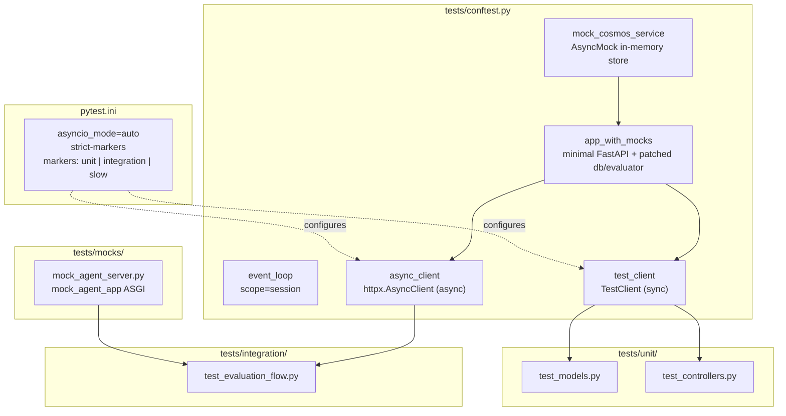
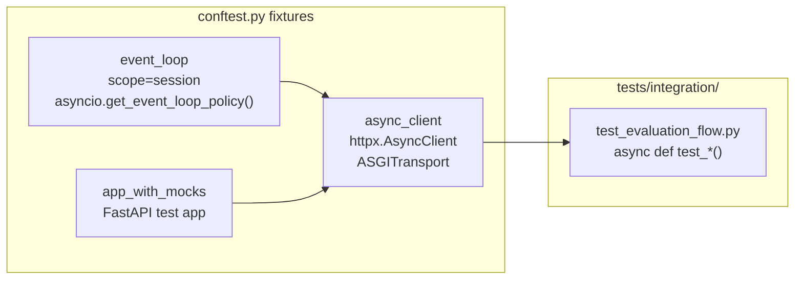
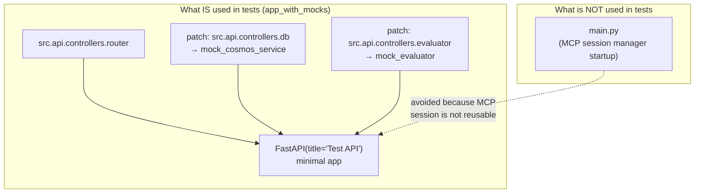
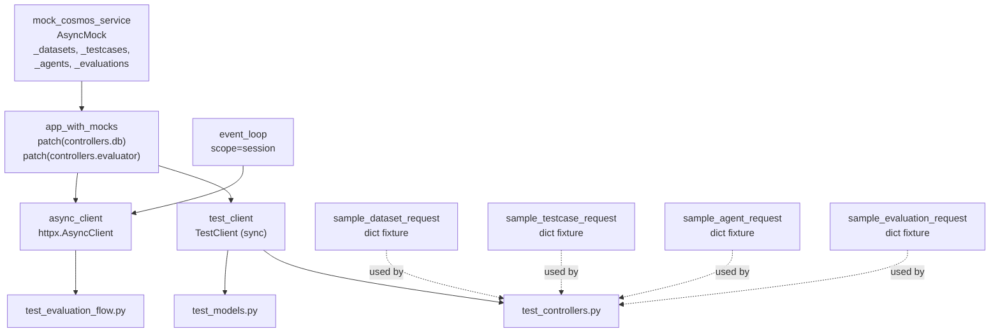

<!-- source: DeepWiki mcp.deepwiki.com · repo microsoft/EvalsforAgentsInterop · page 7 Testing · fetched 2026-10-26 -->

# Testing

<details>
<summary>Relevant source files</summary>

The following files were used as context for generating this wiki page:

- [pytest.ini](pytest.ini)
- [requirements-test.txt](requirements-test.txt)
- [tests/conftest.py](tests/conftest.py)

</details>


This page covers the structure and execution of the test suite for the EvalsforAgentsInterop backend. It describes the directory layout, `pytest` configuration, marker categories, async support, and how to run tests and generate coverage reports.

For detailed documentation of the shared fixtures, see [Test Configuration and Fixtures](#7.1). For unit test coverage, see [Unit Tests](#7.2). For integration test coverage, see [Integration Tests](#7.3). For the mock agent server used in integration tests, see [Mock Agent Server](#7.4).

---

## Directory Layout

All tests reside under the `tests/` directory at the repository root.

```
tests/
├── conftest.py           # Shared fixtures (mock_cosmos_service, test clients)
├── unit/
│   ├── test_models.py    # Pydantic model validation
│   └── test_controllers.py  # CRUD endpoint tests
├── integration/
│   └── test_evaluation_flow.py  # End-to-end pipeline tests
└── mocks/
    └── mock_agent_server.py  # Lightweight ASGI mock agent
```

**Test infrastructure layout (mapping directories to roles):**



Sources: [tests/conftest.py:1-278](), [pytest.ini:1-33]()

---

## pytest Configuration

Configuration is in [`pytest.ini`](pytest.ini) at the repository root.

| Setting | Value | Effect |
|---|---|---|
| `testpaths` | `tests` | Restricts test discovery to `tests/` |
| `python_files` | `test_*.py` | File discovery pattern |
| `python_classes` | `Test*` | Class discovery pattern |
| `python_functions` | `test_*` | Function discovery pattern |
| `asyncio_mode` | `auto` | All `async def` test functions run under `pytest-asyncio` automatically |
| `--strict-markers` | enabled | Undeclared markers cause an error |
| `--tb=short` | enabled | Shortened tracebacks |
| `-p no:warnings` | enabled | Suppresses Python warnings in output |
| `log_cli` | `true` | Live log output at `INFO` level during test run |

Sources: [pytest.ini:1-33]()

---

## Marker Categories

Three markers are declared in `pytest.ini`. Apply them with `@pytest.mark.<marker>`.

| Marker | Purpose | Typical Use |
|---|---|---|
| `unit` | Fast tests with no external dependencies | `test_models.py`, `test_controllers.py` |
| `integration` | Tests that wire multiple components together | `test_evaluation_flow.py` |
| `slow` | Tests with significant latency (e.g., retries, backoff) | Subset of integration tests |

**Selective execution examples:**

```bash
# Run only unit tests
pytest -m unit

# Run integration tests, skipping slow ones
pytest -m "integration and not slow"

# Run everything
pytest
```

Sources: [pytest.ini:22-25]()

---

## Async Test Support

The suite uses `pytest-asyncio` with `asyncio_mode = auto`. This means:

- Any `async def test_*` function is automatically treated as an async test without requiring an explicit `@pytest.mark.asyncio` decorator.
- A session-scoped `event_loop` fixture is defined in `conftest.py` to share one event loop across all tests in a session, avoiding re-creation overhead.

The `async_client` fixture wraps the test app in `httpx.AsyncClient` via `ASGITransport`, which allows awaiting HTTP calls directly against the ASGI app without starting a real server.



Sources: [tests/conftest.py:16-21](), [tests/conftest.py:208-214](), [pytest.ini:11]()

---

## Test Dependencies

Test dependencies are listed separately from the main application in `requirements-test.txt`.

| Package | Version | Role |
|---|---|---|
| `pytest` | `>=8.0.0` | Core test runner |
| `pytest-asyncio` | `>=0.23.0` | Async test support |
| `pytest-cov` | `>=4.1.0` | Coverage reporting |
| `httpx` | `>=0.27.0` | `AsyncClient` and `ASGITransport` |
| `pytest-mock` | `>=3.12.0` | `mocker` fixture for patching |
| `ruff` | `>=0.1.0` | Linting (optional) |
| `mypy` | `>=1.8.0` | Type checking (optional) |

Install with:

```bash
pip install -r requirements-test.txt
pip install -r src/api/requirements.txt
```

Sources: [requirements-test.txt:1-21]()

---

## Why a Minimal Test App (Not `main.py`)

The main application in `src/api/main.py` initializes an MCP session manager on startup. This manager holds persistent state that cannot be safely shared or re-initialized across individual tests. To avoid this, `conftest.py` constructs a minimal `FastAPI` app that includes only `src.api.controllers.router` and patches `src.api.controllers.db` and `src.api.controllers.evaluator` at the module level.



Sources: [tests/conftest.py:171-197]()

---

## Running Tests

**Run the full suite:**

```bash
pytest
```

**Run with coverage (requires `pytest-cov`):**

```bash
pytest --cov=src/api --cov-report=html
```

This generates an HTML report in `htmlcov/` by default. The `pytest.ini` comment at [pytest.ini:31-32]() documents this invocation.

**Run a specific test file:**

```bash
pytest tests/unit/test_models.py
pytest tests/integration/test_evaluation_flow.py
```

**Run a specific test class or function:**

```bash
pytest tests/unit/test_controllers.py::TestDatasetEndpoints
pytest tests/unit/test_models.py::test_dataset_auto_id
```

---

## Fixture Dependency Graph

The fixtures in `conftest.py` compose in a clear dependency chain. All test modules consume one or more of these fixtures.



Sources: [tests/conftest.py:16-277]()

---

For detailed documentation of what each test class and function validates, see the child pages: [Test Configuration and Fixtures](#7.1), [Unit Tests](#7.2), [Integration Tests](#7.3), and [Mock Agent Server](#7.4).

---

