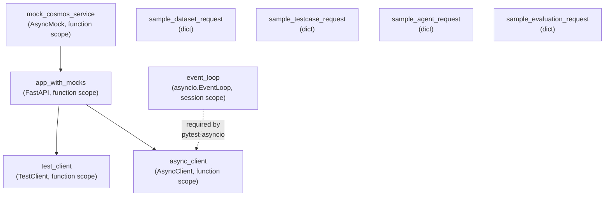
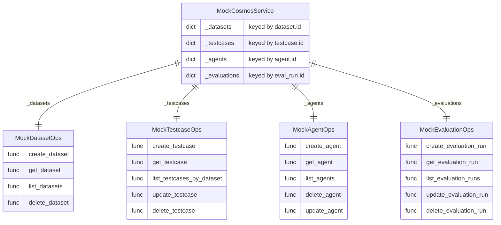
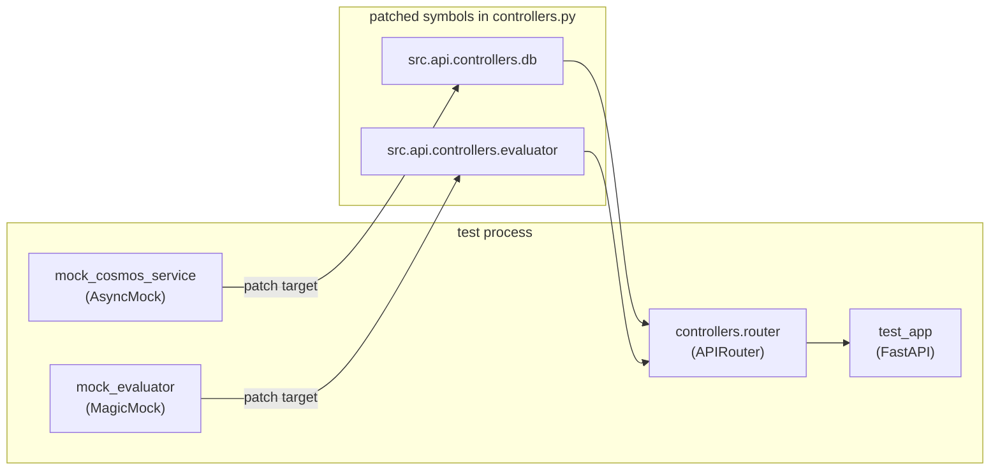

<!-- source: DeepWiki mcp.deepwiki.com · repo microsoft/EvalsforAgentsInterop · page 7.1 Test Configuration and Fixtures · fetched 2026-10-26 -->

# Test Configuration and Fixtures

<details>
<summary>Relevant source files</summary>

The following files were used as context for generating this wiki page:

- [pytest.ini](pytest.ini)
- [requirements-test.txt](requirements-test.txt)
- [tests/conftest.py](tests/conftest.py)

</details>


This page documents the pytest configuration in `pytest.ini` and the shared fixtures defined in `tests/conftest.py`. These are the foundational building blocks used by all unit and integration tests in the repository. For documentation on what the unit tests validate, see [Unit Tests](#7.2). For the integration test suite built on top of these fixtures, see [Integration Tests](#7.3). For the mock agent server used in integration tests, see [Mock Agent Server](#7.4).

---

## pytest Configuration

All pytest behavior is controlled by `pytest.ini` at the repository root.

Sources: [pytest.ini:1-33]()

| Setting | Value | Effect |
|---|---|---|
| `testpaths` | `tests` | Limits test discovery to the `tests/` directory |
| `python_files` | `test_*.py` | Only files matching this pattern are collected |
| `python_classes` | `Test*` | Only classes with this prefix are collected |
| `python_functions` | `test_*` | Only functions with this prefix are collected |
| `asyncio_mode` | `auto` | All `async def` test functions run automatically under `pytest-asyncio` without needing `@pytest.mark.asyncio` |
| `--strict-markers` | (flag) | Any test using an unregistered marker causes an error |
| `--tb=short` | (flag) | Traceback output is abbreviated |
| `-p no:warnings` | (flag) | Python warnings are suppressed in test output |
| `log_cli` | `true` | Log output is written to the terminal during the test run |
| `log_cli_level` | `INFO` | Minimum log level captured during tests |

### Registered Markers

```
unit        — Fast tests, no external dependencies
integration — Tests that may require running services
slow        — Tests that are deliberately excluded with -m "not slow"
```

Run a specific marker group with:
```
pytest -m unit
pytest -m integration
pytest -m "not slow"
```

Generate a coverage report with:
```
pytest --cov=src/api --cov-report=html
```

---

## Test Dependencies

Sources: [requirements-test.txt:1-21]()

| Package | Version | Role |
|---|---|---|
| `pytest` | ≥8.0.0 | Test runner and collection framework |
| `pytest-asyncio` | ≥0.23.0 | Async test support (`asyncio_mode = auto`) |
| `pytest-cov` | ≥4.1.0 | Coverage reporting (`--cov` flag) |
| `httpx` | ≥0.27.0 | Provides `AsyncClient` and `ASGITransport` for async HTTP testing |
| `pytest-mock` | ≥3.12.0 | Additional mock utilities |
| `ruff` | ≥0.1.0 | Linting (optional) |
| `mypy` | ≥1.8.0 | Type checking (optional) |

Application dependencies (FastAPI, Pydantic, etc.) are installed separately from `src/api/requirements.txt`.

---

## Shared Fixtures (`tests/conftest.py`)

All fixtures are defined in `tests/conftest.py` and are automatically available to every test module without any import.

### Fixture Dependency Graph

**Diagram: Fixture dependency relationships in `tests/conftest.py`**



Sources: [tests/conftest.py:16-277]()

---

### `event_loop` — Session-Scoped Event Loop

[tests/conftest.py:16-21]()

```python
@pytest.fixture(scope="session")
def event_loop():
```

Creates a single `asyncio` event loop that persists for the entire test session. This is required because `pytest-asyncio` with `asyncio_mode = auto` needs a consistent loop when fixtures across multiple test modules share async state. The loop is closed after the last test completes.

---

### `mock_cosmos_service` — In-Memory Database

[tests/conftest.py:28-164]()

```python
@pytest.fixture
def mock_cosmos_service():
```

Replaces `cosmos_service.py` with an `AsyncMock` that stores all data in four in-memory Python dictionaries. This allows tests to exercise full CRUD logic without a live Azure Cosmos DB connection.

**Diagram: `mock_cosmos_service` internal storage structure**



Sources: [tests/conftest.py:28-164]()

Each method on the mock mirrors the signature of the real `CosmosService`. Notable behavioral details:

| Method | Behavior |
|---|---|
| `create_testcase` | Also appends the test case ID to the parent dataset's `test_case_ids` list |
| `delete_testcase` | Also removes the test case ID from the parent dataset's `test_case_ids` list |
| `get_testcase(id, dataset_id)` | Returns `None` if the `dataset_id` does not match the stored record |
| `delete_testcase(id, dataset_id)` | Returns `False` if `dataset_id` does not match |
| `list_datasets(skip, limit)` | Supports offset pagination using Python list slicing |
| `update_agent(agent_id, agent)` | Returns `None` if `agent_id` is not found |

The fixture has **function scope** (default), so each test starts with a clean, empty set of dictionaries.

---

### `app_with_mocks` — Patched FastAPI Application

[tests/conftest.py:171-197]()

```python
@pytest.fixture
def app_with_mocks(mock_cosmos_service):
```

Creates a minimal `FastAPI` instance that mounts only `src.api.controllers.router` and two simple health-check routes. The global `db` and `evaluator` symbols in `controllers.py` are patched using `unittest.mock.patch` so the router sees `mock_cosmos_service` instead of the real database and a `MagicMock` instead of `EvaluatorService`.

**Why not import `main.py` directly?**

The comment in the fixture explains the reason explicitly:

> `the main app has MCP session manager that can't be reused across tests`

`main.py` initializes an MCP session manager at startup as part of the FastAPI lifespan context. This manager maintains persistent SSE connections and async tasks that are incompatible with test isolation—reusing it across tests causes event loop conflicts and state leakage. The minimal test app avoids this entirely by never importing `main.py`.

**Diagram: How `app_with_mocks` patches the controller layer**



Sources: [tests/conftest.py:171-197]()

The fixture yields a 3-tuple `(test_app, mock_cosmos_service, mock_evaluator)`. The `test_client` and `async_client` fixtures unpack only the app from this tuple.

---

### `test_client` — Synchronous HTTP Client

[tests/conftest.py:200-205]()

```python
@pytest.fixture
def test_client(app_with_mocks):
```

Wraps `app_with_mocks` in `fastapi.testclient.TestClient`. Used by unit tests in `tests/unit/` that make synchronous HTTP calls and do not require async capabilities.

---

### `async_client` — Asynchronous HTTP Client

[tests/conftest.py:208-214]()

```python
@pytest.fixture
async def async_client(app_with_mocks) -> AsyncGenerator[AsyncClient, None]:
```

Wraps `app_with_mocks` in `httpx.AsyncClient` using `httpx.ASGITransport`. The transport routes requests directly to the ASGI app in-process without binding a network socket. Used by integration tests in `tests/integration/` that exercise async behavior and SSE streaming.

---

## Sample Data Fixtures

Four lightweight fixtures provide pre-built request dictionaries. They are consumed directly by test functions as parameters, avoiding repetition of boilerplate JSON in individual test bodies.

Sources: [tests/conftest.py:220-277]()

| Fixture | Key Fields |
|---|---|
| `sample_dataset_request` | `name`, `goal`, `input` (dict), `schema_hash` |
| `sample_testcase_request` | `name`, `input`, `minimal_tool_set` (list), `tool_expectations` (list with one `sendMail` entry), `expected_response` |
| `sample_agent_request` | `name`, `description`, `model` (`gpt-4o`), `agent_invocation_url` (`http://localhost:8001/agents/calendar/invoke`) |
| `sample_evaluation_request` | `name`, `dataset_id`, `agent_id`, `agent_endpoint`, `agent_auth_required` (`False`), `timeout_seconds` (`60`) |

These fixtures match the shape expected by the Pydantic models in `models.py`. The `tool_expectations` entry in `sample_testcase_request` uses the `sendMail` tool with a single argument assertion on the `to` field, which mirrors the structure documented in [Data Models](#3.2).

---

## Fixture Scope Summary

| Fixture | Scope | Depends On |
|---|---|---|
| `event_loop` | `session` | — |
| `mock_cosmos_service` | `function` | — |
| `app_with_mocks` | `function` | `mock_cosmos_service` |
| `test_client` | `function` | `app_with_mocks` |
| `async_client` | `function` | `app_with_mocks` |
| `sample_dataset_request` | `function` | — |
| `sample_testcase_request` | `function` | — |
| `sample_agent_request` | `function` | — |
| `sample_evaluation_request` | `function` | — |

All non-`event_loop` fixtures are function-scoped, ensuring full isolation between individual test cases. Every test begins with an empty in-memory store and a fresh FastAPI app instance.

---

