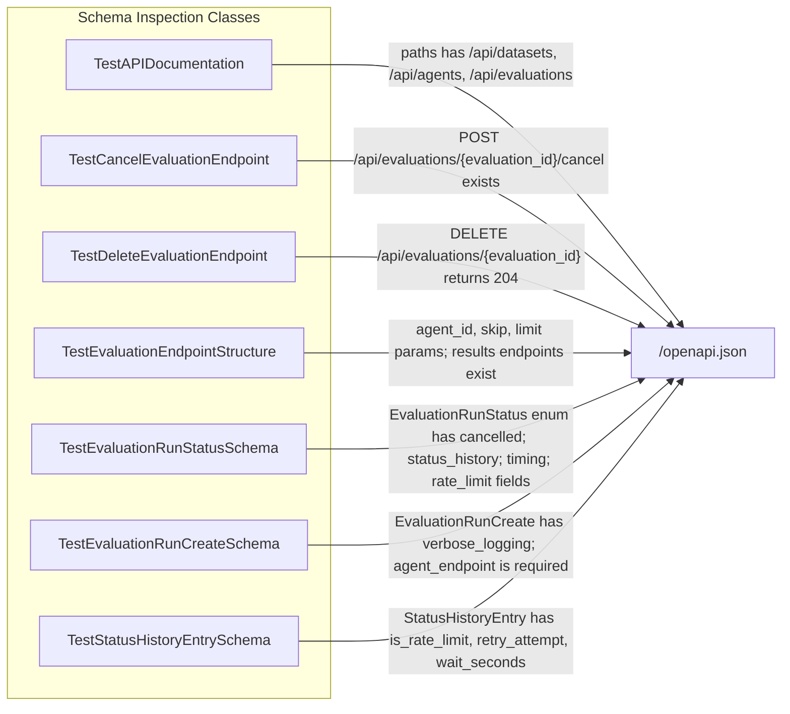
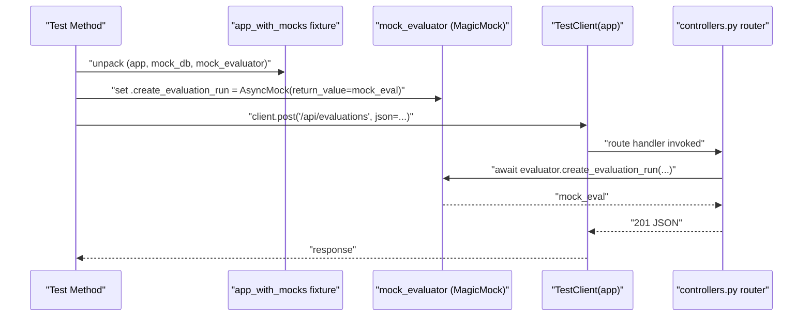
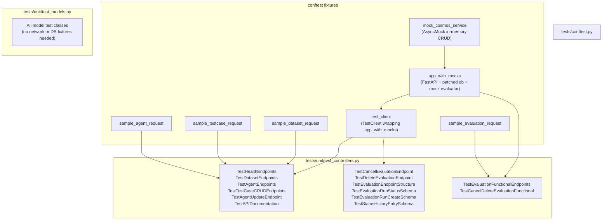

<!-- source: DeepWiki mcp.deepwiki.com · repo microsoft/EvalsforAgentsInterop · page 7.2 Unit Tests · fetched 2026-10-26 -->

# Unit Tests

Relevant source files

The following files were used as context for generating this wiki page:

- [tests/conftest.py](tests/conftest.py)
- [tests/unit/test_controllers.py](tests/unit/test_controllers.py)
- [tests/unit/test_models.py](tests/unit/test_models.py)

This page documents the two unit test modules in `tests/unit/`: `test_controllers.py` and `test_models.py`. These tests validate API endpoint behavior and Pydantic model correctness in isolation, using an in-memory mock in place of Cosmos DB and a patched evaluator service. For how those mocks are constructed and wired up, see [Test Configuration and Fixtures](#7.1). For end-to-end pipeline tests that invoke real async agent logic, see [Integration Tests](#7.3).

---

## Overview

Unit tests are organized into two files:

| File | What it tests |
|------|--------------|
| `tests/unit/test_controllers.py` | HTTP endpoint behavior via `TestClient` and `app_with_mocks` |
| `tests/unit/test_models.py` | Pydantic model validation, auto-generated fields, defaults, and config values |

All tests in these files are synchronous. They use the `test_client` and `app_with_mocks` fixtures from `tests/conftest.py`, which substitute the real `CosmosService` with an `AsyncMock`-backed in-memory store and replace the `evaluator` module-level variable with a plain `MagicMock`.

---

## Test Class Map — Controllers

**Diagram: `test_controllers.py` class and endpoint coverage**

```mermaid
graph TD
    subgraph "tests/unit/test_controllers.py"
        TH["TestHealthEndpoints"]
        TD["TestDatasetEndpoints"]
        TA["TestAgentEndpoints"]
        TTC["TestTestCaseEndpoints"]
        TAUD["TestAPIDocumentation"]
        TCEE["TestCancelEvaluationEndpoint"]
        TDEE["TestDeleteEvaluationEndpoint"]
        TEES["TestEvaluationEndpointStructure"]
        TERSS["TestEvaluationRunStatusSchema"]
        TERCS["TestEvaluationRunCreateSchema"]
        TSHES["TestStatusHistoryEntrySchema"]
        TTCCE["TestTestCaseCRUDEndpoints"]
        TAUE["TestAgentUpdateEndpoint"]
        TEFE["TestEvaluationFunctionalEndpoints"]
        TCDFE["TestCancelDeleteEvaluationFunctional"]
    end

    TH -->|"GET /"| R1["root"]
    TH -->|"GET /health"| R2["health"]
    TD -->|"POST /api/datasets"| R3["create_dataset"]
    TD -->|"GET /api/datasets"| R4["list_datasets"]
    TD -->|"GET /api/datasets/{id}"| R5["get_dataset"]
    TD -->|"DELETE /api/datasets/{id}"| R6["delete_dataset"]
    TA -->|"POST /api/agents"| R7["create_agent"]
    TA -->|"GET /api/agents"| R8["list_agents"]
    TA -->|"GET /api/agents/{id}"| R9["get_agent"]
    TA -->|"DELETE /api/agents/{id}"| R10["delete_agent"]
    TTCCE -->|"POST /api/datasets/{id}/testcases"| R11["add_testcase"]
    TTCCE -->|"GET /api/datasets/{id}/testcases"| R12["list_testcases"]
    TTCCE -->|"PUT /api/datasets/{id}/testcases/{tc_id}"| R13["update_testcase"]
    TTCCE -->|"DELETE /api/datasets/{id}/testcases/{tc_id}"| R14["delete_testcase"]
    TAUE -->|"PUT /api/agents/{id}"| R15["update_agent"]
    TEFE -->|"POST /api/evaluations"| R16["create_evaluation"]
    TEFE -->|"GET /api/evaluations"| R17["list_evaluations"]
    TEFE -->|"GET /api/evaluations/{id}"| R18["get_evaluation"]
    TEFE -->|"GET /api/evaluations/{id}/results"| R19["get_results"]
    TCDFE -->|"POST /api/evaluations/{id}/cancel"| R20["cancel_evaluation"]
    TCDFE -->|"DELETE /api/evaluations/{id}"| R21["delete_evaluation"]
```

Sources: [tests/unit/test_controllers.py:1-835]()

---

## Controller Test Details

### `TestHealthEndpoints`

[tests/unit/test_controllers.py:13-30]()

| Test | Route | Expected |
|------|-------|----------|
| `test_root_endpoint` | `GET /` | 200, body contains `message` and `docs` keys |
| `test_health_endpoint` | `GET /health` | 200, `{"status": "ok"}` |

Both routes are defined directly on `test_app` inside the `app_with_mocks` fixture [tests/conftest.py:188-196](), not on the API router.

---

### `TestDatasetEndpoints` and `TestTestCaseCRUDEndpoints`

[tests/unit/test_controllers.py:33-106](), [tests/unit/test_controllers.py:401-520]()

These two classes together cover the full CRUD surface for datasets and their child test cases.

| Test | Scenario |
|------|----------|
| `test_create_dataset` | 201 with `id`, `seed.name`, `seed.goal` in body |
| `test_create_dataset_missing_goal` | 422 when `goal` is absent |
| `test_list_datasets_empty` | 200 with `[]` before any data |
| `test_list_datasets_with_data` | 200 with ≥1 item after create |
| `test_get_dataset_not_found` | 404 for unknown ID |
| `test_get_dataset_by_id` | 200 with matching `id` |
| `test_delete_dataset` | 204, then 404 on follow-up GET |
| `test_delete_dataset_not_found` | 404 for unknown ID |
| `test_add_testcase_to_dataset` | 201, body has `dataset_id` and `name` |
| `test_list_testcases_for_dataset` | 200, items carry correct `dataset_id` |
| `test_get_testcase_by_id` | 200, correct `id` and `name` |
| `test_get_testcase_not_found` | 404 |
| `test_update_testcase` | 200, `name` updated, `id` preserved |
| `test_update_testcase_not_found` | 404 |
| `test_delete_testcase` | 204, then 404 on follow-up GET |
| `test_delete_testcase_not_found` | 404 |

The dataset fixture used is `sample_dataset_request` and the test case fixture is `sample_testcase_request`, both defined in `tests/conftest.py` [tests/conftest.py:221-253]().

---

### `TestAgentEndpoints` and `TestAgentUpdateEndpoint`

[tests/unit/test_controllers.py:109-177](), [tests/unit/test_controllers.py:527-565]()

| Test | Scenario |
|------|----------|
| `test_create_agent` | 201, body has `id`, `name`, `model` |
| `test_create_agent_missing_fields` | 422 when required fields absent |
| `test_list_agents_empty` | 200 with `[]` |
| `test_list_agents_with_data` | 200 with ≥1 item |
| `test_get_agent_not_found` | 404 |
| `test_get_agent_by_id` | 200, correct `id` |
| `test_delete_agent` | 204, then 404 |
| `test_update_agent` | 200, updated `name` and `model`, same `id` |
| `test_update_agent_not_found` | 404 |
| `test_update_agent_preserves_created_at` | `createdAt` unchanged after PUT |

Agent input comes from `sample_agent_request` [tests/conftest.py:257-264]().

---

### OpenAPI Schema Tests

A distinct group of classes validates the API contract by inspecting `/openapi.json` rather than calling endpoints directly. This approach avoids the need to mock async evaluator logic for schema-level assertions.

**Diagram: OpenAPI schema inspection test classes**

Sources: [tests/unit/test_controllers.py:194-394]()

Key assertions per class:

| Class | What it checks in the schema |
|-------|------------------------------|
| `TestAPIDocumentation` | `/api/datasets`, `/api/agents`, `/api/evaluations` paths all present |
| `TestCancelEvaluationEndpoint` | `POST /api/evaluations/{evaluation_id}/cancel` registered; `GET` absent |
| `TestDeleteEvaluationEndpoint` | `DELETE /api/evaluations/{evaluation_id}` registered; responds 204 |
| `TestEvaluationEndpointStructure` | `agent_id`, `skip`, `limit` query params; `/results` and `/results/{testcase_id}` paths |
| `TestEvaluationRunStatusSchema` | `EvaluationRunStatus` enum includes `cancelled`; `EvaluationRun` schema has `status_history`, `started_at`, `completed_at`, `created_at`, `total_rate_limit_hits`, `total_retry_wait_seconds` |
| `TestEvaluationRunCreateSchema` | `EvaluationRunCreate` schema has `verbose_logging`; `agent_endpoint` is in `required` list |
| `TestStatusHistoryEntrySchema` | `StatusHistoryEntry` schema exists and has `is_rate_limit`, `retry_attempt`, `wait_seconds` |

---

### Functional Evaluation Tests

[tests/unit/test_controllers.py:572-834]()

These classes use `app_with_mocks` directly (not `test_client`) so they can configure the mock evaluator per test with `AsyncMock` return values.

Sources: [tests/unit/test_controllers.py:572-834](), [tests/conftest.py:171-205]()

| Class | Tests |
|-------|-------|
| `TestEvaluationFunctionalEndpoints` | Create, list, get by ID, get-not-found, get-results, get single result, single-result-not-found |
| `TestCancelDeleteEvaluationFunctional` | Cancel success (→ `cancelled`), cancel-not-found (404), cancel-already-completed (400 via `ValueError`), delete success (204), delete-not-found (404) |

The `cancel_already_completed` test asserts that when `evaluator.cancel_evaluation_run` raises `ValueError`, the controller returns 400 [tests/unit/test_controllers.py:804-814]().

---

## Test Class Map — Models

**Diagram: `test_models.py` class and model coverage**

```mermaid
graph TD
    subgraph "tests/unit/test_models.py"
        TMM["TestMetadataModel"]
        TSS["TestSeedScenarioModel"]
        TR["TestRubricModel"]
        TAA["TestArgumentAssertionModel"]
        TTE["TestToolExpectationModel"]
        TDM["TestDatasetModel"]
        TTCM["TestTestCaseModel"]
        TAM["TestAgentModel"]
        TERSE["TestEvaluationRunStatusEnum"]
        TERM["TestEvaluationRunModel"]
        TTCRM["TestTestCaseResultModel"]
        TARM["TestAssertionResultModels"]
        TSHE["TestStatusHistoryEntry"]
        TERE["TestEvaluationRunEnhancements"]
        TCEF["TestCancelledEvaluationFlow"]
        TCS["TestConfigurationSettings"]
        TERCE["TestEvaluationRunCreateEnhancements"]
    end

    TMM --> Metadata["src.api.models.Metadata"]
    TSS --> SeedScenario["src.api.models.SeedScenario"]
    TR --> Rubric["src.api.models.Rubric"]
    TAA --> ArgumentAssertion["src.api.models.ArgumentAssertion"]
    TTE --> ToolExpectation["src.api.models.ToolExpectation"]
    TDM --> Dataset["src.api.models.Dataset"]
    TTCM --> TestCase["src.api.models.TestCase"]
    TAM --> Agent["src.api.models.Agent"]
    TERSE --> EvaluationRunStatus["src.api.models.EvaluationRunStatus"]
    TERM --> EvaluationRun["src.api.models.EvaluationRun"]
    TTCRM --> TestCaseResult["src.api.models.TestCaseResult"]
    TARM --> AssertionResult["src.api.models.AssertionResult"]
    TARM --> ExpectedToolResult["src.api.models.ExpectedToolResult"]
    TSHE --> StatusHistoryEntry["src.api.models.StatusHistoryEntry"]
    TERE --> EvaluationRun
    TCEF --> EvaluationRun
    TCS --> config["src.api.config"]
    TERCE --> EvaluationRunCreate["src.api.models.EvaluationRunCreate"]
```

Sources: [tests/unit/test_models.py:1-650]()

---

## Model Test Details

### Core Model Validation

[tests/unit/test_models.py:12-222]()

| Class | Model | Key assertions |
|-------|-------|---------------|
| `TestMetadataModel` | `Metadata` | `generator_id` starts with `gen_`; `suite_id` starts with `suite_`; `version` defaults to `"1.0"` |
| `TestSeedScenarioModel` | `SeedScenario` | `ValidationError` if no `goal`; `name` defaults to `""`; `input` defaults to `{}` |
| `TestRubricModel` | `Rubric` | Requires `name`, `azure_foundry_id`, `threshold`; `id` starts with `rubric_` |
| `TestArgumentAssertionModel` | `ArgumentAssertion` | Requires `name` and `assertion`; `rubrics` defaults to `[]` |
| `TestToolExpectationModel` | `ToolExpectation` | Requires `name`; `arguments` defaults to `[]` |
| `TestDatasetModel` | `Dataset` | `id` starts with `dataset_`; `test_case_ids` defaults to `[]`; `created_at` serializes as `str` |
| `TestTestCaseModel` | `TestCase` | Requires `dataset_id`; `id` starts with `tc_`; `minimal_tool_set` defaults to `[]` |
| `TestAgentModel` | `Agent` | `id` starts with `agent_`; `createdAt` serializes as `str` in `model_dump()` |

---

### `EvaluationRunStatus` Enum

[tests/unit/test_models.py:224-250]()

`TestEvaluationRunStatusEnum` verifies all five status values:

| Value | Enum member |
|-------|------------|
| `"pending"` | `EvaluationRunStatus.pending` |
| `"running"` | `EvaluationRunStatus.running` |
| `"completed"` | `EvaluationRunStatus.completed` |
| `"failed"` | `EvaluationRunStatus.failed` |
| `"cancelled"` | `EvaluationRunStatus.cancelled` |

The `cancelled` value is separately asserted in `test_status_cancelled` because it was added as an enhancement to the original state machine (see [Evaluation Engine](#3.3) for lifecycle details).

---

### `EvaluationRun` Default Values

[tests/unit/test_models.py:253-288]()

`TestEvaluationRunModel` checks field defaults when only required fields are supplied:

| Field | Default |
|-------|---------|
| `id` | auto-generated, starts with `eval_` |
| `status` | `EvaluationRunStatus.pending` |
| `total_tests` | `0` |
| `test_cases` | `[]` |
| `agent_auth_required` | `True` |
| `timeout_seconds` | `300` |
| `completed_tests` | `0` |
| `failed_tests` | `0` |
| `passed_count` | `0` |

---

### `StatusHistoryEntry` Model

[tests/unit/test_models.py:350-400]()

`TestStatusHistoryEntry` validates the model used to record rate-limit events inside an `EvaluationRun`.

| Test | What it checks |
|------|---------------|
| `test_status_history_entry_creation` | `message` stored; `timestamp` not None |
| `test_status_history_entry_auto_timestamp` | `timestamp` falls between `before` and `after` wall-clock reads |
| `test_status_history_entry_with_rate_limit_info` | `is_rate_limit`, `retry_attempt`, `max_attempts`, `wait_seconds` all stored |
| `test_status_history_entry_default_values` | `is_rate_limit=False`; `retry_attempt`, `max_attempts`, `wait_seconds` all `None` |

---

### `EvaluationRun` Enhancement Fields

[tests/unit/test_models.py:403-530]()

`TestEvaluationRunEnhancements` and `TestCancelledEvaluationFlow` together verify the fields added to support evaluation observability:

| Field group | Fields covered |
|-------------|---------------|
| Status history | `status_history` (list of `StatusHistoryEntry`) |
| Timing | `started_at`, `completed_at`, `created_at` |
| Rate-limit tracking | `total_rate_limit_hits`, `total_retry_wait_seconds` |
| Logging | `verbose_logging` |
| Cancellation | `status = EvaluationRunStatus.cancelled` |
| Progress | `total_tests`, `completed_tests`, `passed_count`, `failed_tests` |

`TestCancelledEvaluationFlow.test_evaluation_can_transition_to_cancelled` [tests/unit/test_models.py:536-560]() simulates in-place mutation: the test sets `run.status` to `cancelled` and appends a `StatusHistoryEntry`, then asserts the updated values.

---

### Configuration Settings

[tests/unit/test_models.py:563-594]()

`TestConfigurationSettings` directly imports `src.api.config` and checks the presence and types of rate-limit and retry settings:

| Setting | Type constraint |
|---------|----------------|
| `RETRY_MAX_ATTEMPTS` | `int`, > 0 |
| `RETRY_BASE_DELAY` | numeric, > 0 |
| `RETRY_MAX_DELAY` | numeric, ≥ `RETRY_BASE_DELAY` |
| `EVALUATION_TIMEOUT_SECONDS` | `int` |

---

### `EvaluationRunCreate` Request Model

[tests/unit/test_models.py:596-650]()

`TestEvaluationRunCreateEnhancements` checks the request schema used when `POST /api/evaluations` is called:

| Test | Assertion |
|------|-----------|
| `test_evaluation_run_create_basic` | All four required fields stored correctly |
| `test_evaluation_run_create_with_verbose` | `verbose_logging=True` accepted |
| `test_evaluation_run_create_requires_name` | `ValidationError` when `name` missing |
| `test_evaluation_run_create_requires_endpoint` | `ValidationError` when `agent_endpoint` missing |

---

## Fixture Dependencies

The diagram below shows which fixtures each test file depends on and where those fixtures originate.

**Diagram: fixture dependency graph for unit tests**

Sources: [tests/conftest.py:28-277](), [tests/unit/test_controllers.py:1-50](), [tests/unit/test_models.py:1-20]()

---

