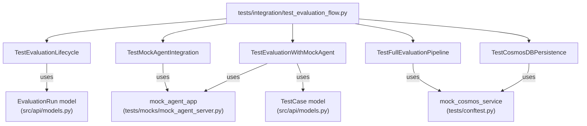
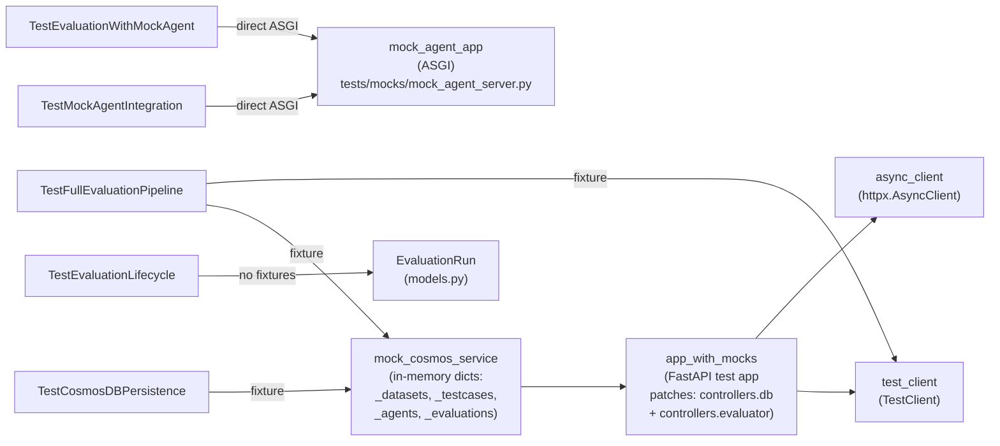
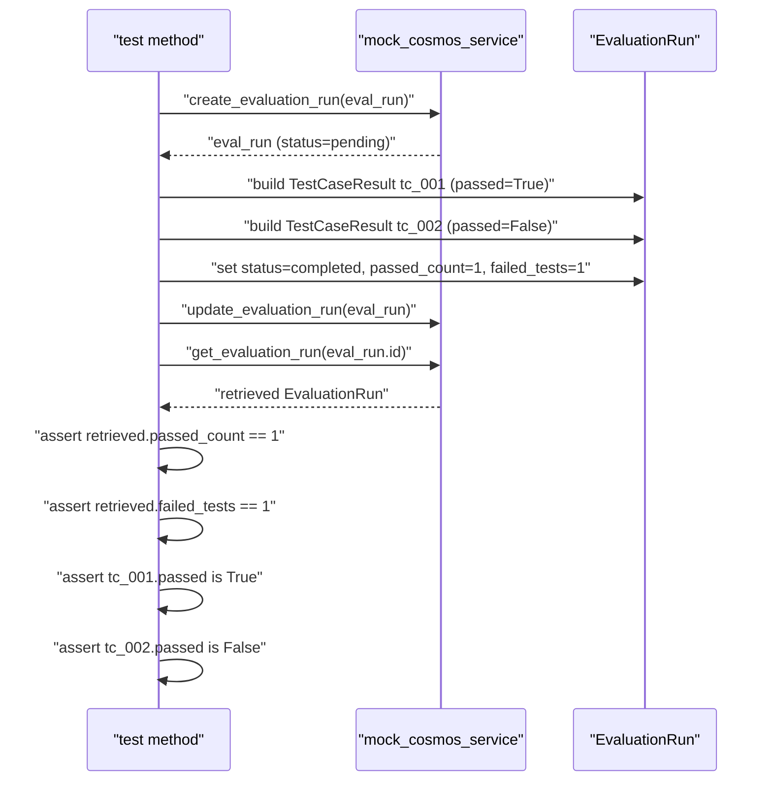

<!-- source: DeepWiki mcp.deepwiki.com · repo microsoft/EvalsforAgentsInterop · page 7.3 Integration Tests · fetched 2026-10-26 -->

# Integration Tests

<details>
<summary>Relevant source files</summary>

The following files were used as context for generating this wiki page:

- [tests/conftest.py](tests/conftest.py)
- [tests/integration/test_evaluation_flow.py](tests/integration/test_evaluation_flow.py)
- [tests/mocks/mock_agent_server.py](tests/mocks/mock_agent_server.py)

</details>


This page covers the integration test suite in `tests/integration/test_evaluation_flow.py`. These tests validate end-to-end behavior of the evaluation pipeline without requiring live Azure resources — Azure Cosmos DB is replaced by `mock_cosmos_service` and Azure OpenAI / real agents are replaced by `mock_agent_app`. For test configuration, shared fixtures, and the `pytest.ini` setup, see [Test Configuration and Fixtures](#7.1). For the mock agent server itself, see [Mock Agent Server](#7.4).

---

## Test File Layout

The integration test module contains five test classes, each targeting a distinct slice of the pipeline.

**Diagram: Test Classes in `test_evaluation_flow.py`**



Sources: [tests/integration/test_evaluation_flow.py:1-30](), [tests/conftest.py:28-164]()

---

## Fixture Dependencies

Each test class pulls from a combination of fixtures defined in `tests/conftest.py` and the `mock_agent_app` ASGI app from `tests/mocks/mock_agent_server.py`. No test in this module contacts a live network endpoint or real database.

**Diagram: Fixture Wiring for Integration Tests**



Sources: [tests/conftest.py:28-214](), [tests/mocks/mock_agent_server.py:28-197]()

---

## `TestEvaluationLifecycle`

[tests/integration/test_evaluation_flow.py:15-48]()

This class validates that `EvaluationRun` model state transitions follow the correct sequence without any HTTP layer or database involvement.

| Test Method | What It Validates |
|---|---|
| `test_evaluation_creation` | Placeholder stub — confirms the creation flow hook is in place |
| `test_evaluation_status_transitions` | `EvaluationRun` starts at `pending`, transitions to `running` (setting `started_at`), then to `completed` (setting `completed_at`) |

Both tests import directly from `src.api.models` and manipulate `EvaluationRun` and `EvaluationRunStatus` in memory. The status transition test exercises the state machine defined on the Pydantic model itself, not through the API layer. For the full state machine specification, see [Evaluation Engine](#3.3).

Sources: [tests/integration/test_evaluation_flow.py:15-48]()

---

## `TestMockAgentIntegration`

[tests/integration/test_evaluation_flow.py:51-145]()

This class exercises `mock_agent_app` directly over an in-process ASGI transport using `httpx.AsyncClient`. No real network I/O occurs. Each test method uses a keyword-based prompt to trigger a specific behavior branch in `invoke_mock_agent`.

**Diagram: Keyword Dispatch in `mock_agent_app`**

```mermaid
flowchart TD
    REQ["POST /agents/mock/invoke\n{user_prompt: ...}"]
    REQ --> K1{"\"timeout\" in prompt?"}
    K1 -->|"yes"| R1["HTTP 504"]
    K1 -->|"no"| K2{"\"rate_limit\" in prompt?"}
    K2 -->|"yes"| R2["HTTP 429"]
    K2 -->|"no"| K3{"\"server_error\" in prompt?"}
    K3 -->|"yes"| R3["HTTP 500"]
    K3 -->|"no"| K4{"\"no_tools\" in prompt?"}
    K4 -->|"yes"| R4["tool_calls: []"]
    K4 -->|"no"| K5{"\"wrong_tool\" in prompt?"}
    K5 -->|"yes"| R5["tool_calls: [sendTeamsMessage]"]
    K5 -->|"no"| R6["tool_calls: [sendMail] (default success)"]
```

Sources: [tests/mocks/mock_agent_server.py:88-122](), [tests/integration/test_evaluation_flow.py:51-145]()

| Test Method | Prompt Keyword | Expected Outcome |
|---|---|---|
| `test_mock_agent_success_response` | `"Send an email to the client"` | HTTP 200, `tool_calls[0].name == "sendMail"` |
| `test_mock_agent_no_tools_scenario` | `"no_tools scenario"` | HTTP 200, empty `tool_calls` |
| `test_mock_agent_rate_limit_simulation` | `"rate_limit test"` | HTTP 429 |
| `test_mock_email_agent` | `"Reply to the client email"` on `/agents/email/invoke` | HTTP 200, `sendMail` with `cc` field |
| `test_mock_meeting_agent` | `"Schedule a meeting with the client"` on `/agents/meeting/invoke` | HTTP 200, all four meeting tools present |

The meeting agent test (`test_mock_meeting_agent`) verifies the full four-tool pipeline: `searchMessages`, `listEvents`, `createEvent`, and `sendMail` — matching the structure of the meeting evaluation contracts described in [Meeting Agent Contracts](#6.3).

Sources: [tests/integration/test_evaluation_flow.py:54-145]()

---

## `TestEvaluationWithMockAgent`

[tests/integration/test_evaluation_flow.py:148-288]()

This class bridges the Pydantic model layer with the mock agent ASGI server. Each test constructs a `TestCase` object with specific `ToolExpectation` and `minimal_tool_set` values, then invokes the mock agent and validates that the response matches or mismatches expectations as appropriate.

### `test_evaluate_test_case_success`

[tests/integration/test_evaluation_flow.py:152-201]()

Creates a `TestCase` expecting `sendMail` with a `to` argument assertion. Calls `/agents/mock/invoke` with the default success prompt. Verifies:
- `sendMail` appears in `tool_calls`
- The returned `sendMail` call has `to`, `subject`, and `body` arguments

### `test_evaluate_test_case_tool_mismatch`

[tests/integration/test_evaluation_flow.py:203-242]()

Creates a `TestCase` expecting `sendMail`, but uses the `"wrong_tool"` prompt keyword. Verifies:
- `sendTeamsMessage` is returned instead of `sendMail`
- `expected_tools` and `actual_tools` sets do not match

This test demonstrates how the evaluation pipeline detects incorrect tool usage without the LLM judge — the mismatch between `minimal_tool_set` and the actual returned tools is directly checkable.

### `test_evaluate_meeting_workflow_complete`

[tests/integration/test_evaluation_flow.py:244-288]()

Creates a `TestCase` with all four meeting tools in `minimal_tool_set`. Calls `/agents/meeting/invoke`. Verifies:
- All four expected tools appear in `tool_calls`
- `searchMessages` precedes `createEvent` in the returned list (ordering assertion)

Sources: [tests/integration/test_evaluation_flow.py:148-288]()

---

## `TestFullEvaluationPipeline`

[tests/integration/test_evaluation_flow.py:291-469]()

This class uses `mock_cosmos_service` to simulate the full data lifecycle: creating entities, running the evaluation loop, persisting results, and reading them back.

### `test_create_dataset_agent_and_evaluate`

[tests/integration/test_evaluation_flow.py:295-337]()

Exercises the complete entity creation chain against the in-memory mock service:

1. Creates a `Dataset` via `mock_cosmos_service.create_dataset`
2. Creates a `TestCase` linked to that dataset via `mock_cosmos_service.create_testcase`
3. Creates an `Agent` via `mock_cosmos_service.create_agent`
4. Reads back each entity and verifies existence

This test also indirectly validates that `create_testcase` correctly appends the test case ID to `dataset.test_case_ids`, which is part of the `mock_cosmos_service` fixture logic in `tests/conftest.py`.

### `test_evaluation_run_with_test_results`

[tests/integration/test_evaluation_flow.py:339-416]()

Simulates a two-test evaluation run where one test passes and one fails:

- Creates an `EvaluationRun` with `total_tests=2`
- Constructs two `TestCaseResult` objects using `ExpectedToolResult` and `ResponseQualityResult`
- Updates the run to `completed` status and writes back to the mock service
- Reads the run and verifies `passed_count == 1`, `failed_tests == 1`, and individual result `passed` flags

**Diagram: Data Flow in `test_evaluation_run_with_test_results`**



### `test_evaluation_tracks_tool_call_details`

[tests/integration/test_evaluation_flow.py:418-469]()

Verifies that nested tool call data — including `arguments` (multi-recipient `to`, `cc`) and `response` fields — round-trips through the mock persistence layer without data loss. Creates a `TestCaseResult` with a detailed `actual_tool_calls` entry, stores it inside an `EvaluationRun`, and retrieves it to assert all fields are intact.

Sources: [tests/integration/test_evaluation_flow.py:291-469]()

---

## `TestCosmosDBPersistence`

[tests/integration/test_evaluation_flow.py:472-530]()

This class validates the `mock_cosmos_service` fixture's CRUD contract. It does not touch any HTTP layer or agent logic.

| Test Method | Operations Verified |
|---|---|
| `test_dataset_crud_operations` | `create_dataset`, `get_dataset`, `list_datasets`, `delete_dataset` — including verify-after-delete returns `None` |
| `test_evaluation_run_persistence` | `create_evaluation_run`, `update_evaluation_run` (status and field mutation), `get_evaluation_run` read-back |

These tests are effectively self-contained tests of the fixture itself, ensuring that the in-memory backing dictionaries (`_datasets`, `_evaluations`) behave like a real Cosmos DB layer for the purposes of the rest of the test suite.

Sources: [tests/integration/test_evaluation_flow.py:472-530](), [tests/conftest.py:28-164]()

---

## Combined Mock Strategy

The integration tests use two independent mocking mechanisms that never need to be wired together at runtime:

| Replacement | Real Component | Mock Implementation |
|---|---|---|
| Azure Cosmos DB | `CosmosService` (cosmos_service.py) | `mock_cosmos_service` fixture — in-memory `dict` per entity type |
| Agent endpoint (port 8001) | `agent_server.py` (Calendar Agent) | `mock_agent_app` — ASGI app via `ASGITransport` |
| Azure OpenAI (LLM judge) | `evaluator_service.py` | Not exercised in integration tests; tool call matching is done directly in test assertions |

The `mock_cosmos_service` fixture is an `AsyncMock` with its methods replaced by real `async def` functions that operate on plain Python dicts. This gives tests the full async interface without any I/O. The `mock_agent_app` is a real FastAPI application run in-process via `httpx.ASGITransport`, so routing and response serialization are exercised exactly as they would be over HTTP.

Sources: [tests/conftest.py:28-164](), [tests/mocks/mock_agent_server.py:28-197](), [tests/integration/test_evaluation_flow.py:54-104]()

---

