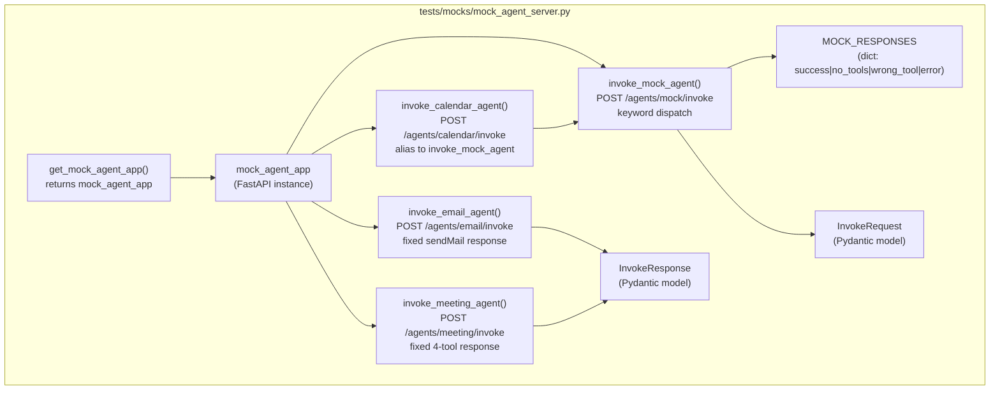

<!-- source: DeepWiki mcp.deepwiki.com · repo microsoft/EvalsforAgentsInterop · page 7.4 Mock Agent Server · fetched 2026-10-26 -->

# Mock Agent Server

<details>
<summary>Relevant source files</summary>

The following files were used as context for generating this wiki page:

- [tests/integration/test_evaluation_flow.py](tests/integration/test_evaluation_flow.py)
- [tests/mocks/mock_agent_server.py](tests/mocks/mock_agent_server.py)

</details>


This page documents `tests/mocks/mock_agent_server.py`, a lightweight in-process ASGI application used to replace real agent endpoints during integration testing. It provides deterministic, keyword-driven responses so the evaluation pipeline can be exercised without requiring Azure OpenAI or a live agent process.

For documentation on the real Calendar Agent it replaces, see [Calendar Agent](#4). For how this mock is wired into the integration test suite, see [Integration Tests](#7.3). For the general test fixture setup, see [Test Configuration and Fixtures](#7.1).

---

## Overview

The mock server is a standard FastAPI application exposed as the module-level variable `mock_agent_app` [tests/mocks/mock_agent_server.py:28](). Tests import this ASGI app directly and mount it via `httpx.ASGITransport`, meaning no actual network socket is opened.

It exposes three agent `POST /invoke` routes, each with a different response strategy:

| Route | Strategy |
|---|---|
| `POST /agents/mock/invoke` | Keyword-driven: inspects `user_prompt` to select behavior |
| `POST /agents/email/invoke` | Fixed: always returns a `sendMail` tool call with CC field |
| `POST /agents/meeting/invoke` | Fixed: always returns the full 4-tool meeting workflow |
| `POST /agents/calendar/invoke` | Alias: delegates to `/agents/mock/invoke` |

---

## Data Models

The server defines two Pydantic models mirroring the agent invocation contract described in [System Architecture](#2).

[tests/mocks/mock_agent_server.py:14-24]()

| Model | Fields | Notes |
|---|---|---|
| `InvokeRequest` | `user_prompt: str`, `dataset_id: Optional[str]`, `test_case_id: Optional[str]` | `dataset_id` and `test_case_id` are accepted but ignored by mock logic |
| `InvokeResponse` | `response: str`, `tool_calls: List[Dict[str, Any]]` | `tool_calls` defaults to `[]` |

---

## MOCK_RESPONSES Dictionary

`MOCK_RESPONSES` [tests/mocks/mock_agent_server.py:32-65]() is a module-level dict with four named response templates. The `/agents/mock/invoke` handler selects from this dict based on keywords in `user_prompt`.

| Key | `tool_calls` content | Intended scenario |
|---|---|---|
| `"success"` | Single `sendMail` call with `to`, `subject`, `body` | Agent completes task correctly |
| `"no_tools"` | `[]` (empty list) | Agent responds but calls no tools |
| `"wrong_tool"` | Single `sendTeamsMessage` call | Agent calls an incorrect tool |
| `"error"` | `[]` (empty list) | Agent reports failure with no tool activity |

---

## Keyword-Driven Routing (`/agents/mock/invoke`)

The `/agents/mock/invoke` handler [tests/mocks/mock_agent_server.py:88-122]() performs a case-insensitive substring search over `user_prompt` to determine which response or HTTP error to return. Checks are evaluated in priority order.

**Routing Logic Diagram**

```mermaid
flowchart TD
    A["POST /agents/mock/invoke\nrequest.user_prompt"] --> B{"\"timeout\" in prompt?"}
    B -->|"Yes"| C["raise HTTPException\nstatus_code=504"]
    B -->|"No"| D{"\"rate_limit\" or \"429\" in prompt?"}
    D -->|"Yes"| E["raise HTTPException\nstatus_code=429"]
    D -->|"No"| F{"\"server_error\" or \"500\" in prompt?"}
    F -->|"Yes"| G["raise HTTPException\nstatus_code=500"]
    F -->|"No"| H{"\"no_tools\" in prompt?"}
    H -->|"Yes"| I["InvokeResponse(**MOCK_RESPONSES[\"no_tools\"])\ntool_calls=[]"]
    H -->|"No"| J{"\"wrong_tool\" in prompt?"}
    J -->|"Yes"| K["InvokeResponse(**MOCK_RESPONSES[\"wrong_tool\"])\ntool_calls=[sendTeamsMessage]"]
    J -->|"No"| L{"\"error\" in prompt?"}
    L -->|"Yes"| M["InvokeResponse(**MOCK_RESPONSES[\"error\"])\ntool_calls=[]"]
    L -->|"No"| N["InvokeResponse(**MOCK_RESPONSES[\"success\"])\ntool_calls=[sendMail]"]
```

Sources: [tests/mocks/mock_agent_server.py:99-122]()

---

## Fixed-Response Routes

The email and meeting routes always return the same response regardless of `user_prompt` content.

### `/agents/email/invoke`

[tests/mocks/mock_agent_server.py:131-149]()

Always returns a single `sendMail` tool call. The `arguments` include:
- `to`: `["recipient@example.com"]`
- `cc`: `["priya.desai@treyresearch.net"]`
- `bcc`: `[]`
- `subject`: `"RE: Client Request"`
- `body`: a templated reply string

The presence of the `cc` field is explicitly verified in `TestMockAgentIntegration.test_mock_email_agent` [tests/integration/test_evaluation_flow.py:107-122]().

### `/agents/meeting/invoke`

[tests/mocks/mock_agent_server.py:152-185]()

Always returns four tool calls in the canonical meeting workflow order:

```
searchMessages → listEvents → createEvent → sendMail
```

| Step | Tool | Key Arguments |
|---|---|---|
| 1 | `searchMessages` | `queryString` (inbox search) |
| 2 | `listEvents` | `userId` (calendar owner) |
| 3 | `createEvent` | `subject`, `attendees` |
| 4 | `sendMail` | `to`, `subject` (confirmation) |

This fixed ordering is used to assert `searchMessages` precedes `createEvent` in `TestEvaluationWithMockAgent.test_evaluate_meeting_workflow_complete` [tests/integration/test_evaluation_flow.py:244-288]().

---

## Module Structure Diagram



Sources: [tests/mocks/mock_agent_server.py:1-196]()

---

## How Tests Use the Mock

Tests in `TestMockAgentIntegration` [tests/integration/test_evaluation_flow.py:51-145]() import `mock_agent_app` and mount it via `httpx.ASGITransport`. No network port is used.

```
from tests.mocks.mock_agent_server import mock_agent_app
from httpx import AsyncClient, ASGITransport

transport = ASGITransport(app=mock_agent_app)
async with AsyncClient(transport=transport, base_url="http://test") as client:
    response = await client.post("/agents/mock/invoke", json={"user_prompt": "..."})
```

The `user_prompt` value is the sole control mechanism. The table below maps test intent to the prompt keyword to use:

| Test scenario | Keyword(s) in `user_prompt` | Expected HTTP status | Expected `tool_calls` |
|---|---|---|---|
| Happy path / default | *(any text)* | 200 | `[sendMail]` |
| No tool calls | `no_tools` | 200 | `[]` |
| Wrong tool selected | `wrong_tool` | 200 | `[sendTeamsMessage]` |
| Error response | `error` | 200 | `[]` |
| Rate limit simulation | `rate_limit` or `429` | 429 | — |
| Timeout simulation | `timeout` | 504 | — |
| Server error simulation | `server_error` or `500` | 500 | — |

Sources: [tests/mocks/mock_agent_server.py:88-122](), [tests/integration/test_evaluation_flow.py:54-145]()

---

## Standalone Execution

The file can be run directly to serve the mock agent on port 8002 [tests/mocks/mock_agent_server.py:194-196](). This allows manual inspection or temporary use as a stand-in for the real agent during development. The `get_mock_agent_app()` helper [tests/mocks/mock_agent_server.py:189-191]() provides a function-based accessor for environments that prefer factory-style app retrieval over direct module import.