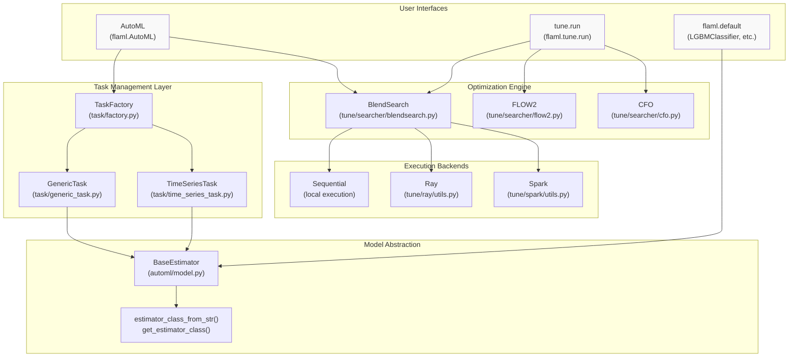
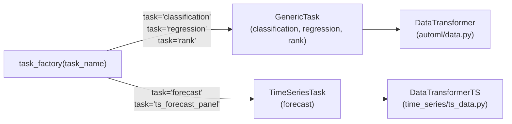
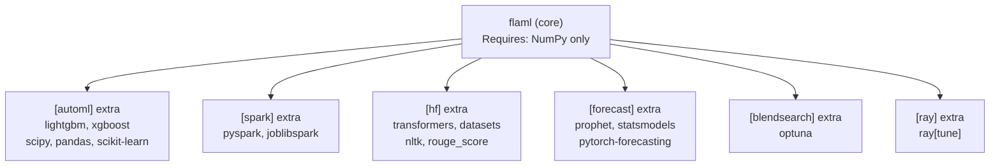
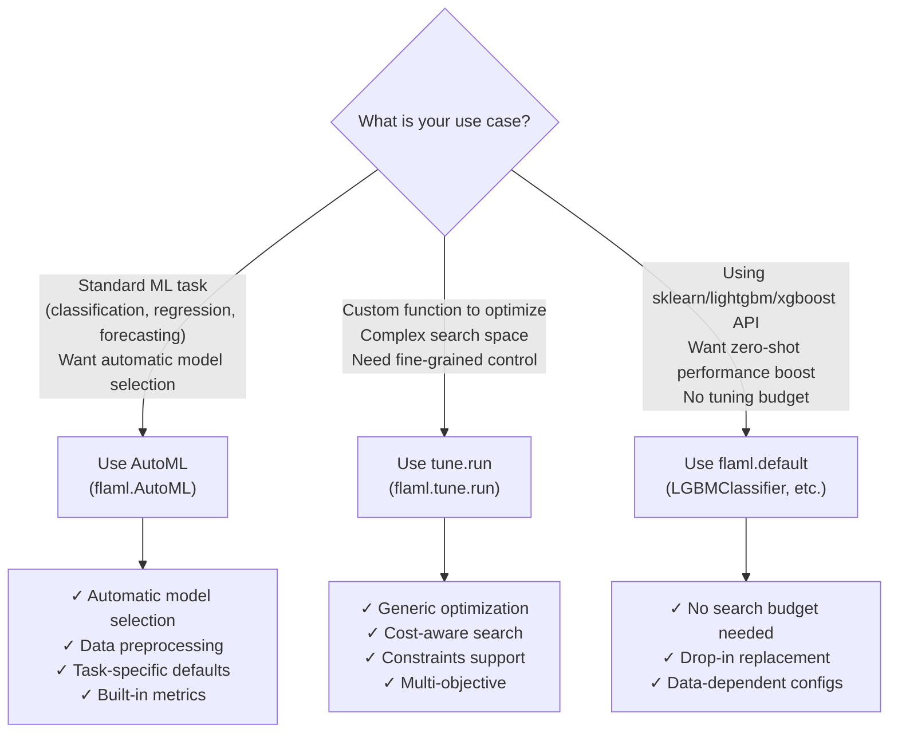

<!-- source: DeepWiki mcp.deepwiki.com · repo microsoft/FLAML · page 1 Overview · fetched 2026-10-26 -->

# Overview

<details>
<summary>Relevant source files</summary>

The following files were used as context for generating this wiki page:

- [.github/workflows/python-package.yml](.github/workflows/python-package.yml)
- [README.md](README.md)
- [flaml/version.py](flaml/version.py)
- [setup.py](setup.py)
- [website/docs/Best-Practices.md](website/docs/Best-Practices.md)
- [website/docs/Contribute.md](website/docs/Contribute.md)
- [website/docs/FAQ.md](website/docs/FAQ.md)
- [website/docs/Getting-Started.md](website/docs/Getting-Started.md)
- [website/docs/Installation.md](website/docs/Installation.md)
- [website/sidebars.js](website/sidebars.js)

</details>


## Purpose and Scope

This document provides a high-level introduction to FLAML (Fast Library for Automated Machine Learning & Tuning), describing its core purpose, architecture, and main user-facing interfaces. This overview is intended to help developers understand the overall system structure before diving into specific subsystems.

For detailed installation instructions, see [Installation and Setup](#2). For in-depth documentation on specific subsystems, see [AutoML](#3), [Tune](#4), and [Zero-shot AutoML](#5).

**Sources:** [README.md:1-127](), [website/docs/Getting-Started.md:1-116]()

---

## What is FLAML

FLAML is a lightweight Python library (version `2.5.0` as of [flaml/version.py:1]()) designed for efficient automation of machine learning and AI operations. The library provides economical and fast hyperparameter optimization with minimal computational resources, particularly suited for scenarios with limited time budgets and heterogeneous evaluation costs.

**Core Capabilities:**

| Capability | Description |
|------------|-------------|
| **Task-oriented AutoML** | Automated model selection and hyperparameter tuning for common ML tasks (classification, regression, forecasting, ranking) |
| **Generic HPO** | Hyperparameter optimization for arbitrary user-defined functions with cost-aware search |
| **Zero-shot AutoML** | Drop-in replacements for popular estimators with automatic hyperparameter configuration |
| **Cost-Frugal Search** | Novel search algorithms (BlendSearch, FLOW2) that minimize computational cost while finding quality configurations |
| **Distributed Execution** | Support for Ray and Spark backends for parallel trial execution |

FLAML requires **Python >= 3.10** and installs with minimal dependencies (only NumPy) by default, with extensive optional extras for specific features.

**Sources:** [README.md:21-34](), [setup.py:17-19](), [setup.py:164](), [website/docs/Getting-Started.md:5-12]()

---

## Three Primary User-Facing Interfaces

FLAML provides three distinct entry points that serve different use cases and abstraction levels:

### 1. AutoML Interface (`flaml.AutoML`)

The `AutoML` class in [flaml/automl/automl.py]() provides a scikit-learn-style estimator for task-oriented automated machine learning. Users specify a task type (classification, regression, forecasting, ranking) and FLAML automatically handles model selection, hyperparameter tuning, and data preprocessing.

```python
from flaml import AutoML

automl = AutoML()
automl.fit(X_train, y_train, task="classification", time_budget=60)
predictions = automl.predict(X_test)
```

The AutoML interface routes through a Task Factory pattern (see [flaml/automl/task/factory.py]()) to appropriate task implementations and manages the optimization loop automatically.

### 2. Tune Interface (`flaml.tune.run`)

The `tune.run` function in [flaml/tune/tune.py]() provides generic hyperparameter optimization for arbitrary evaluation functions. This is a lower-level interface that gives users more control over the optimization process.

```python
from flaml import tune

def evaluation_function(config):
    # Train model with config
    # Return metrics
    return {"loss": loss_value}

analysis = tune.run(
    evaluation_function,
    config=search_space,
    time_budget_s=3600,
    metric="loss",
    mode="min"
)
```

This interface directly exposes FLAML's search algorithms (BlendSearch, FLOW2, CFO) and is suitable for optimizing ML models, pipelines, or any function with measurable performance.

### 3. Zero-shot AutoML (`flaml.default`)

The `flaml.default` module (see [flaml/default/]()) provides drop-in replacements for common estimators like `LGBMClassifier` and `XGBoostRegressor` that automatically configure hyperparameters based on the training data.

```python
from flaml.default import LGBMClassifier

# Same API as lightgbm.LGBMClassifier, but with automatic hyperparameter selection
estimator = LGBMClassifier()
estimator.fit(X_train, y_train)
```

This interface requires no search budget and uses pre-computed, data-dependent configurations stored in JSON files under [flaml/default/]().

**Sources:** [README.md:54-90](), [website/docs/Getting-Started.md:22-104]()

---

## System Architecture

The following diagram shows FLAML's high-level architecture and how the three user interfaces connect to the underlying components:



**Architecture Explanation:**

1. **User Interfaces** (top layer): The three entry points each serve different abstraction levels
2. **Task Management Layer**: Routes AutoML requests to task-specific implementations that handle data validation and preparation
3. **Optimization Engine**: Core search algorithms that suggest configurations to evaluate
4. **Model Abstraction**: Unified interface for diverse model types (sklearn, Spark, Transformers, time series)
5. **Execution Backends**: Support for sequential, Ray-parallel, or Spark-distributed trial execution

**Sources:** [flaml/automl/automl.py](), [flaml/tune/tune.py](), [flaml/automl/task/factory.py](), [flaml/automl/model.py](), [setup.py:22-154]()

---

## Core Components

### Optimization Engines

FLAML implements three main search algorithms located in [flaml/tune/searcher/]():

| Algorithm | Class | Purpose |
|-----------|-------|---------|
| **BlendSearch** | `BlendSearch` | Meta-algorithm that blends global search (Optuna) with local search (FLOW2) using multiple threads |
| **FLOW2** | `FLOW2` | Cost-frugal local search using random directions on unit sphere with adaptive step sizes |
| **CFO** | `CFO` | Cost-frugal optimization with constraints support |

BlendSearch orchestrates multiple `SearchThread` instances: thread 0 runs global search while additional threads run local FLOW2 searches starting from promising configurations. This hybrid approach balances exploration and exploitation while respecting cost-related hyperparameters.

**Sources:** [flaml/tune/searcher/blendsearch.py](), [flaml/tune/searcher/flow2.py](), [flaml/tune/searcher/cfo.py]()

### Model Abstraction Layer

All estimators in FLAML inherit from `BaseEstimator` defined in [flaml/automl/model.py](). This abstract class provides a unified interface:

```python
# Key methods all estimators must implement:
- fit(X_train, y_train, budget, **kwargs)
- predict(X_test)
- score(X_val, y_val, metric, **kwargs)
- search_space(data_size, task)  # class method
- config2params(config)          # static method
```

The model abstraction supports:

- **Traditional ML**: `LGBMEstimator`, `XGBoostEstimator`, `RandomForestEstimator`, `CatBoostEstimator` (see [flaml/automl/model.py]())
- **Distributed Spark**: `SparkLGBMEstimator`, `SparkRFEstimator` (see [flaml/automl/spark/]())
- **Deep Learning NLP**: `TransformersEstimator` with task variants (see [flaml/automl/nlp/]())
- **Time Series**: Statistical models (ARIMA, Prophet) and deep learning (TFT) (see [flaml/automl/time_series/]())

Each estimator defines its search space in FLAML's format and implements `config2params()` to translate FLAML configurations to the original model's parameters.

**Sources:** [flaml/automl/model.py](), [flaml/automl/spark/](), [flaml/automl/nlp/](), [flaml/automl/time_series/]()

### Task System

The `TaskFactory` in [flaml/automl/task/factory.py]() creates task-specific implementations:



Tasks handle:
- Data validation and type checking
- Train/validation splitting (stratified, time-aware, grouped)
- Data preprocessing (missing value imputation, encoding)
- Task-specific metrics and evaluation

**Sources:** [flaml/automl/task/factory.py](), [flaml/automl/task/generic_task.py](), [flaml/automl/task/time_series_task.py](), [flaml/automl/data.py](), [flaml/automl/time_series/ts_data.py]()

### Execution Backends

FLAML supports three execution modes:

1. **Sequential** (default): Trials run one at a time on the local machine
2. **Ray** (`use_ray=True`): Parallel trial execution on Ray clusters (requires `pip install "flaml[ray]"`)
3. **Spark** (automatic for Spark estimators): Distributed execution on Spark clusters (requires `pip install "flaml[spark]"`)

The execution backend is transparent to users and determined automatically based on configuration and available resources.

**Sources:** [flaml/tune/ray/utils.py](), [flaml/tune/spark/utils.py](), [setup.py:105-117]()

---

## Modular Package Structure

FLAML employs a highly modular design with minimal core dependencies and extensive optional extras:



**Installation Examples:**

| Use Case | Command | Enables |
|----------|---------|---------|
| Core only | `pip install flaml` | Basic tune functionality |
| AutoML | `pip install "flaml[automl]"` | Classification, regression with tree-based models |
| Spark support | `pip install "flaml[spark]"` | Distributed estimators (lgbm_spark, rf_spark) |
| NLP tasks | `pip install "flaml[hf]"` | HuggingFace Transformers integration |
| Time series | `pip install "flaml[forecast]"` | Prophet, ARIMA, deep learning forecasters |
| Advanced search | `pip install "flaml[blendsearch]"` | BlendSearch with Optuna backend |
| Parallel execution | `pip install "flaml[ray]"` | Ray-based distributed tuning |

This modular structure allows users to install only the dependencies they need, keeping the base installation lightweight while supporting a comprehensive ML ecosystem.

**Sources:** [setup.py:17-165](), [README.md:35-50](), [website/docs/Installation.md:1-149]()

---

## Data Flow Through FLAML

The following diagram illustrates how data flows through the system from user input to trained models:

```mermaid
graph LR
    Input["User Data<br/>(X, y)"]
    
    subgraph "Data Processing"
        Validate["Task.validate_data()"]
        Transform["DataTransformer.fit_transform()"]
        Split["prepare_data()<br/>(train/val split)"]
    end
    
    subgraph "Optimization Loop"
        Suggest["SearchAlgo.suggest()"]
        Instantiate["Estimator.__init__(config)"]
        Train["Estimator.fit()"]
        Evaluate["Estimator.score()"]
        Update["SearchAlgo.on_trial_complete()"]
    end
    
    Output["Best Model<br/>(automl.model)"]
    
    Input --> Validate
    Validate --> Transform
    Transform --> Split
    Split --> Suggest
    Suggest --> Instantiate
    Instantiate --> Train
    Train --> Evaluate
    Evaluate --> Update
    Update -->|"time budget<br/>not exhausted"| Suggest
    Update -->|"time budget<br/>exhausted"| Output
```



**Key Flow Steps:**

1. **Data Validation**: Task-specific validation ensures data types and shapes are correct
2. **Transformation**: Missing values imputed (median for numerical, "__NAN__" for categorical), categorical encoding applied
3. **Splitting**: Data split into train/validation sets using appropriate strategy (stratified, time-aware, grouped)
4. **Optimization Loop**: Search algorithm suggests configs → Estimators trained → Metrics evaluated → Search state updated
5. **Selection**: Best performing configuration selected based on validation metric

**Sources:** [flaml/automl/automl.py](), [flaml/automl/task/generic_task.py](), [flaml/automl/data.py](), [website/docs/FAQ.md:18-117]()

---

## External Integrations

FLAML integrates with several external systems and platforms:

| Integration | Purpose | Configuration |
|-------------|---------|---------------|
| **MLflow** | Experiment tracking, model registry | `mlflow_logging=True` in `AutoML.fit()` |
| **HuggingFace** | Pre-trained transformers, datasets | Install `flaml[hf]` extra |
| **Azure ML & Synapse** | Cloud deployment, managed Spark | Install `flaml[azureml]` or `flaml[synapse]` extra |
| **OpenML** | Public dataset repository | Used in examples and tests |
| **Ray** | Distributed trial execution | `use_ray=True` in `AutoML.fit()` or `tune.run()` |
| **Spark/SynapseML** | Distributed model training | Automatic for Spark estimators |

These integrations are generally optional and activated through configuration parameters or by installing specific extras.

**Sources:** [setup.py:108-153](), [flaml/automl/spark/](), [website/docs/Best-Practices.md:96-159]()

---

## Relationship Between Components

The three user interfaces serve complementary purposes:



**Decision Guidelines:**

- **Use AutoML** when you have a standard ML task and want end-to-end automation (data preprocessing → model selection → hyperparameter tuning)
- **Use tune.run** when you need to optimize a custom function (e.g., neural network training, pipeline tuning, or non-ML optimization)
- **Use flaml.default** when you want a quick performance boost without any tuning budget by using pre-computed configurations

Internally, AutoML uses the same search algorithms as tune.run but wraps them with task-specific logic and data processing.

**Sources:** [README.md:54-90](), [website/docs/Getting-Started.md:22-108]()

---

## Version and Development Status

FLAML is actively maintained at version `2.5.0` (see [flaml/version.py:1]()). The project is hosted at https://github.com/microsoft/FLAML with continuous integration via GitHub Actions (see [.github/workflows/python-package.yml]()), supporting Python 3.10, 3.11, 3.12, and 3.13 on Ubuntu and Windows platforms.

The library is published to PyPI as `FLAML` and conda-forge as `flaml`. Testing coverage is maintained via pytest with automated coverage reporting (see [.github/workflows/python-package.yml:105-122]()).

**Note:** AutoGen, which was previously part of FLAML, has moved to a dedicated repository at https://github.com/microsoft/autogen. FLAML no longer includes the `autogen` module.

**Sources:** [flaml/version.py:1](), [README.md:19](), [.github/workflows/python-package.yml:1-142](), [setup.py:22-165]()

---

