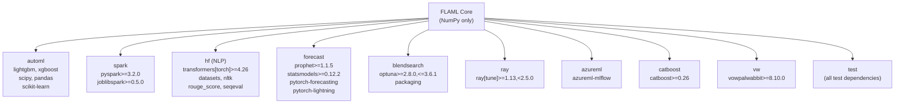
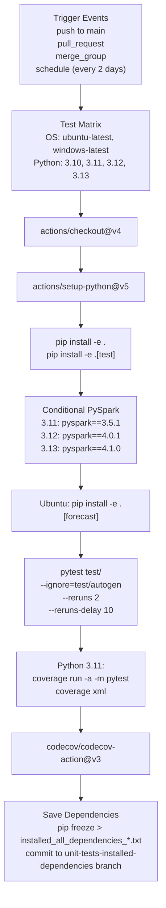
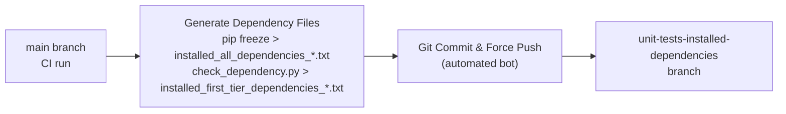
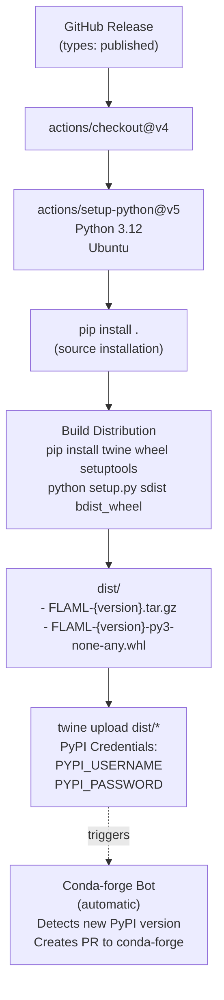
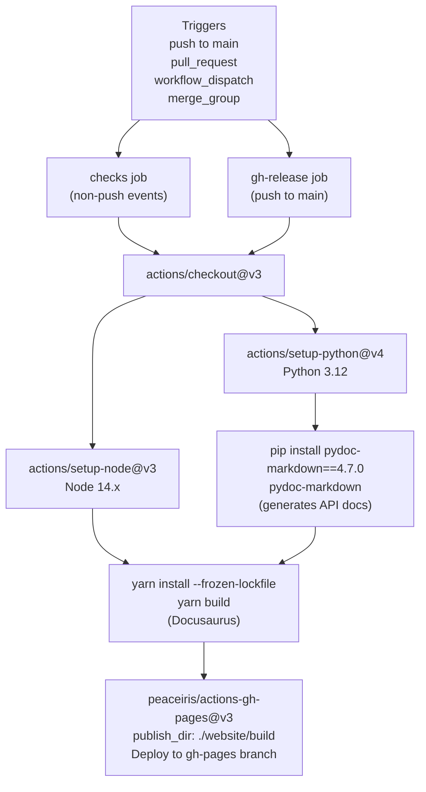
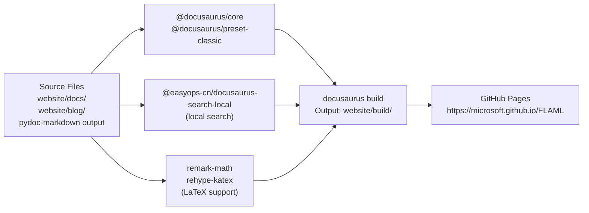
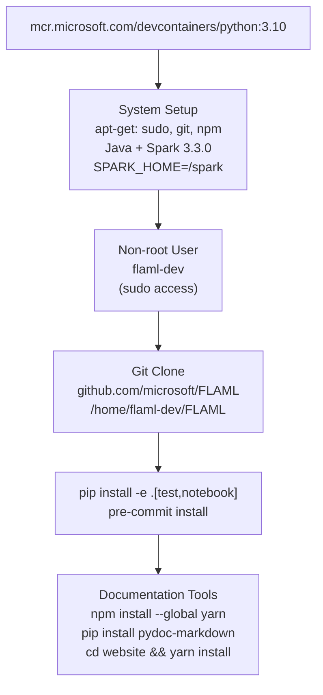
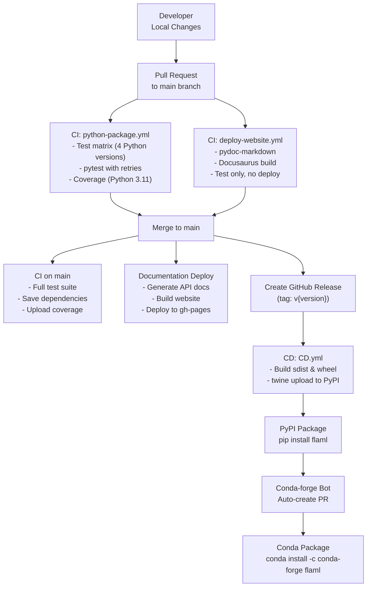

<!-- source: DeepWiki mcp.deepwiki.com · repo microsoft/FLAML · page 10.1 Build System and CI/CD · fetched 2026-10-26 -->

# Build System and CI/CD

<details>
<summary>Relevant source files</summary>

The following files were used as context for generating this wiki page:

- [.github/workflows/CD.yml](.github/workflows/CD.yml)
- [.github/workflows/deploy-website.yml](.github/workflows/deploy-website.yml)
- [.github/workflows/python-package.yml](.github/workflows/python-package.yml)
- [Dockerfile](Dockerfile)
- [README.md](README.md)
- [flaml/autogen/agentchat/contrib/retrieve_assistant_agent.py](flaml/autogen/agentchat/contrib/retrieve_assistant_agent.py)
- [flaml/autogen/agentchat/contrib/retrieve_user_proxy_agent.py](flaml/autogen/agentchat/contrib/retrieve_user_proxy_agent.py)
- [flaml/version.py](flaml/version.py)
- [setup.py](setup.py)
- [test/automl/test_training_log.py](test/automl/test_training_log.py)
- [test/test_autovw.py](test/test_autovw.py)
- [website/package.json](website/package.json)
- [website/yarn.lock](website/yarn.lock)

</details>


This document covers the build system configuration, package structure, and continuous integration/deployment workflows for FLAML. It explains how the project is packaged, tested, and deployed to production environments.

For information about writing and running tests, see [Testing](#10.2). For documentation generation and contribution guidelines, see [Documentation](#10.3).

---

## Package Structure and Build Configuration

FLAML uses `setuptools` for package management with a modular dependency structure that allows users to install only the components they need.

### Version Management

The package version is maintained in a single source file and read by the build system:

```python
# flaml/version.py
__version__ = "2.5.0"
```

The version is dynamically loaded during package build:

[setup.py:11-15]()

This ensures version consistency across the package without duplication.

**Sources:** [flaml/version.py:1-2](), [setup.py:11-15]()

### setuptools Configuration

The main build configuration defines package metadata and dependencies:

| Configuration | Value |
|---------------|-------|
| **Package Name** | `FLAML` |
| **Package Discovery** | `setuptools.find_packages(include=["flaml*"])` |
| **Minimum Python** | `>=3.10` |
| **Core Dependency** | `NumPy>=1.17` |
| **Package Data** | JSON files in `flaml.default` |

The minimal installation requires only NumPy, making the base package lightweight:

[setup.py:17-19]()

**Sources:** [setup.py:22-36](), [setup.py:164]()

### Modular Dependency System

FLAML implements a comprehensive extras system for optional features:



**Installation Examples:**

```bash
# Minimal installation
pip install flaml

# AutoML functionality
pip install "flaml[automl]"

# Spark support
pip install "flaml[spark]"

# Multiple extras
pip install "flaml[automl,blendsearch,ray]"

# Full development setup
pip install "flaml[test]"
```

The extras configuration allows fine-grained dependency management:

[setup.py:37-154]()

**Key extras:**

- **`automl`**: Core ML dependencies (lightgbm, xgboost, scipy, pandas, scikit-learn)
- **`spark`**: Distributed computing with PySpark and joblibspark
- **`hf`/`nlp`**: HuggingFace transformers for NLP tasks
- **`forecast`**: Time series models (prophet, statsmodels, pytorch-forecasting)
- **`blendsearch`**: Advanced search with Optuna
- **`ray`**: Parallel execution with Ray Tune
- **`azureml`**: Azure ML integration
- **`catboost`/`vw`**: Additional estimators
- **`test`**: Complete testing dependencies

**Sources:** [setup.py:37-154](), [README.md:35-50]()

---

## Continuous Integration (CI)

### Main Build Workflow

The primary CI workflow (`python-package.yml`) runs comprehensive tests across multiple platforms and Python versions:



**Workflow Configuration:**

[.github/workflows/python-package.yml:1-34]()

**Key Features:**

1. **Path-based Triggering**: Only runs when relevant files change
   - `flaml/**`, `test/**`, `notebook/**`, `.github/workflows/python-package.yml`, `setup.py`

2. **Concurrency Control**: Cancels in-progress runs for the same branch (except main)
   [.github/workflows/python-package.yml:31-33]()

3. **Platform-specific Dependencies**: Different PySpark versions per Python version
   [.github/workflows/python-package.yml:67-81]()

4. **Timeout Protection**: 120-minute timeout for test execution
   [.github/workflows/python-package.yml:106-107]()

**Sources:** [.github/workflows/python-package.yml:1-142]()

### Test Matrix and Coverage

The workflow tests across multiple dimensions:

| Dimension | Values |
|-----------|--------|
| **Operating Systems** | ubuntu-latest, windows-latest |
| **Python Versions** | 3.10, 3.11, 3.12, 3.13 |
| **Test Retry** | 2 retries with 10s delay |

**Coverage Reporting:**

Only Python 3.11 builds generate coverage reports to reduce CI overhead:

[.github/workflows/python-package.yml:110-122]()

Coverage is uploaded to Codecov for tracking test coverage trends.

**Sources:** [.github/workflows/python-package.yml:39-43](), [.github/workflows/python-package.yml:110-122]()

### Dependency Tracking

The CI system automatically tracks installed dependencies for each platform/Python combination:



This creates a historical record of dependencies:

[.github/workflows/python-package.yml:124-141]()

**Generated Files:**
- `installed_all_dependencies_{python_version}_{os}.txt`: Complete pip freeze output
- `installed_first_tier_dependencies_{python_version}_{os}.txt`: Direct dependencies only
- `coverage_{python_version}_{os}.xml`: Coverage reports

**Sources:** [.github/workflows/python-package.yml:124-141]()

---

## Continuous Deployment (CD)

### PyPI Release Process

The CD workflow (`CD.yml`) automates package publishing to PyPI:



**Workflow Configuration:**

[.github/workflows/CD.yml:1-9]()

**Release Process:**

1. **Trigger**: Publishing a GitHub release
2. **Build**: Creates source distribution (`.tar.gz`) and wheel (`.whl`)
   [.github/workflows/CD.yml:34-37]()
3. **Upload**: Publishes to PyPI using stored credentials
   [.github/workflows/CD.yml:38-43]()

**Environment Secrets:**
- `PYPI_USERNAME`: PyPI account username
- `PYPI_PASSWORD`: PyPI API token

**Sources:** [.github/workflows/CD.yml:1-43](), [README.md:1-6]()

### Conda-forge Integration

After PyPI publication, the conda-forge bot automatically:
1. Detects the new version on PyPI
2. Creates a pull request to the conda-forge FLAML feedstock
3. Updates the conda package recipe

This is mentioned in the CD workflow comments but handled externally:

[.github/workflows/CD.yml:2]()

**Sources:** [.github/workflows/CD.yml:1-3]()

---

## Documentation Pipeline

### API Documentation Generation

The documentation workflow (`deploy-website.yml`) builds and deploys the FLAML website:



**Two-stage Pipeline:**

1. **Checks Stage** (pull requests): Validates documentation builds successfully
   [.github/workflows/deploy-website.yml:24-59]()

2. **Deployment Stage** (main branch): Publishes to GitHub Pages
   [.github/workflows/deploy-website.yml:60-102]()

**Key Tools:**

- **pydoc-markdown 4.7.0**: Generates API documentation from Python docstrings
  [.github/workflows/deploy-website.yml:41-47]()
  
- **Docusaurus**: Static site generator for documentation website
  [website/package.json:28-29]()

**Sources:** [.github/workflows/deploy-website.yml:1-102](), [website/package.json:1-56]()

### Website Build Configuration

The website uses Docusaurus with custom configuration:



**Package Dependencies:**

[website/package.json:27-42]()

**Build Commands:**

```bash
# Development server
yarn start

# Production build
yarn build

# Deploy
yarn deploy
```

**Sources:** [website/package.json:16-25](), [website/package.json:27-42]()

---

## Development Environment

### Docker Development Container

FLAML provides a pre-configured Docker container for development:



**Dockerfile Configuration:**

[Dockerfile:1-41]()

**Container Features:**

1. **Apache Spark 3.3.0**: Pre-installed for Spark development
   [Dockerfile:6-14]()

2. **Non-root User**: `flaml-dev` user with sudo access
   [Dockerfile:17-20]()

3. **Development Tools**: 
   - FLAML installed in editable mode with test and notebook extras
   - Pre-commit hooks configured
   - Documentation build tools (yarn, pydoc-markdown)
   [Dockerfile:27-36]()

**Environment Variables:**

```bash
SPARK_HOME=/spark
PYTHONPATH=/spark/python/lib/py4j-0.10.9.5-src.zip:/spark/python
PATH=$PATH:$SPARK_HOME/bin
```

[Dockerfile:12-14]()

**Usage:**

```bash
# Build container
docker build -t flaml-dev .

# Run container
docker run -it flaml-dev
```

**Sources:** [Dockerfile:1-41]()

### Local Development Setup

For local development without Docker:

**Minimal Setup:**

```bash
git clone https://github.com/microsoft/FLAML.git
cd FLAML
pip install -e .
python -c "import flaml"  # Verify installation
```

**Full Development Setup:**

```bash
# Install with all test dependencies
pip install -e .[test]

# Install pre-commit hooks
pre-commit install

# Run tests
pytest test/ --ignore=test/autogen

# Check dependencies
python test/check_dependency.py
```

**Platform-specific Notes:**

- **macOS**: Requires libomp for lightgbm/xgboost
  [.github/workflows/python-package.yml:50-60]()
  
- **Windows**: No special requirements beyond standard Python setup

**Sources:** [.github/workflows/python-package.yml:61-66](), [Dockerfile:27-30]()

---

## Build System Diagram

This diagram shows the complete build and deployment pipeline:



**Sources:** [.github/workflows/python-package.yml](), [.github/workflows/deploy-website.yml](), [.github/workflows/CD.yml]()

---

