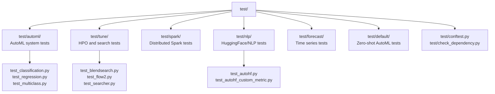
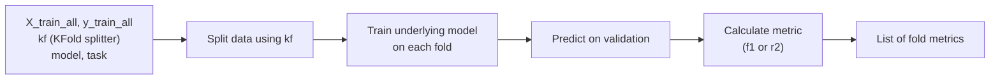
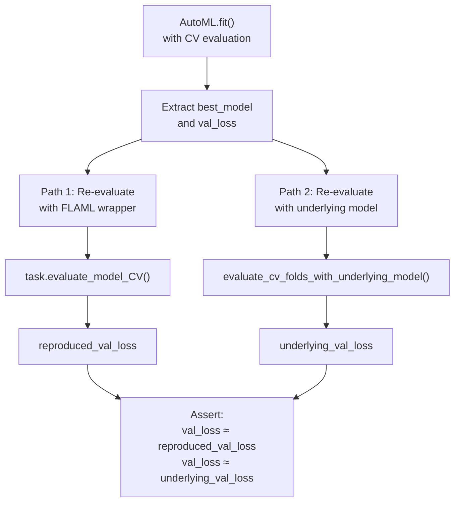
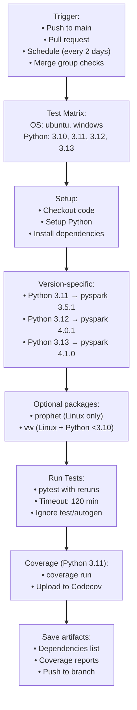
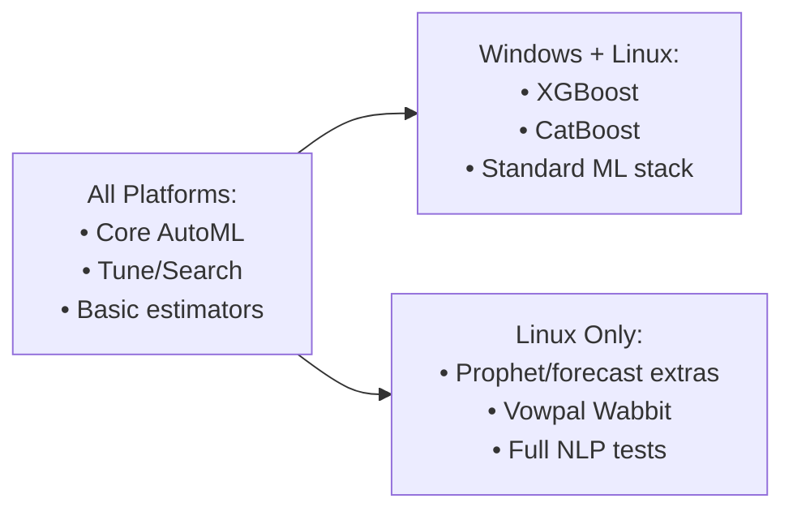
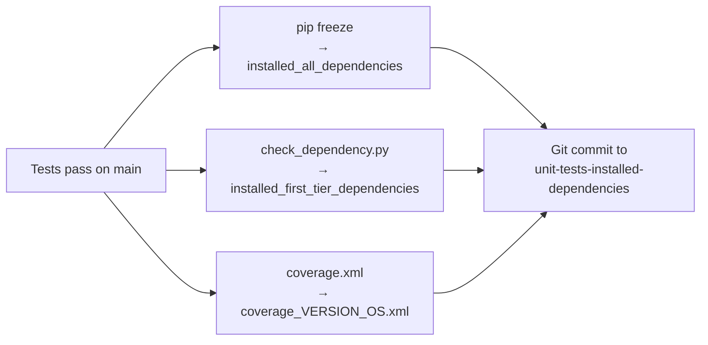

<!-- source: DeepWiki mcp.deepwiki.com · repo microsoft/FLAML · page 10.2 Testing · fetched 2026-10-26 -->

# Testing

<details>
<summary>Relevant source files</summary>

The following files were used as context for generating this wiki page:

- [.github/workflows/python-package.yml](.github/workflows/python-package.yml)
- [README.md](README.md)
- [flaml/automl/model.py](flaml/automl/model.py)
- [flaml/version.py](flaml/version.py)
- [setup.py](setup.py)
- [test/automl/test_classification.py](test/automl/test_classification.py)
- [test/automl/test_regression.py](test/automl/test_regression.py)
- [test/conftest.py](test/conftest.py)

</details>


This page documents FLAML's test suite organization, infrastructure, and practices for contributors developing and testing the codebase. It covers how to run tests locally, the CI/CD testing pipeline, test fixtures, and common testing patterns used throughout the project.

For information about the CI/CD build system and deployment workflows, see [Build System and CI/CD](#10.1). For contributing documentation, see [Documentation](#10.3).

---

## Test Suite Organization

FLAML's test suite is organized in the `test/` directory with subdirectories corresponding to major functional areas. Tests are excluded from the package distribution and are only used during development and CI.

### Directory Structure



**Sources:** [test/automl/test_classification.py:1-543](), [test/automl/test_regression.py:1-454](), [test/conftest.py:1-58]()

### Test Categories

| Category | Directory | Purpose | Key Files |
|----------|-----------|---------|-----------|
| **AutoML Core** | `test/automl/` | Classification, regression, model selection | `test_classification.py`, `test_regression.py`, `test_multiclass.py` |
| **Hyperparameter Optimization** | `test/tune/` | Search algorithms, BlendSearch, FLOW2 | `test_blendsearch.py`, `test_flow2.py` |
| **Distributed Execution** | `test/spark/` | Spark backend, distributed training | `test_sparkml.py` |
| **NLP/Transformers** | `test/nlp/` | HuggingFace integration, tokenization | `test_autohf.py`, `test_tokenization.py` |
| **Time Series** | `test/forecast/` | Forecasting models, panel data | `test_forecast.py`, `test_forecast_panel.py` |
| **Zero-shot AutoML** | `test/default/` | Default estimators | `test_default.py` |
| **Utility Tests** | `test/` (root) | Dependency checking, fixtures | `check_dependency.py`, `conftest.py` |

**Sources:** [.github/workflows/python-package.yml:9-22](), [test/automl/test_classification.py:1-10](), [test/automl/test_regression.py:1-15]()

---

## Running Tests

### Local Testing

Tests use `pytest` as the test runner. Install test dependencies first:

```bash
pip install -e .[test]
```

Run all tests:

```bash
pytest test/
```

Run specific test categories:

```bash
# AutoML tests only
pytest test/automl/

# Single test file
pytest test/automl/test_classification.py

# Specific test function
pytest test/automl/test_classification.py::TestClassification::test_binary

# Parametrized test for specific estimator
pytest test/automl/test_classification.py::test_reproducibility_of_classification_models[lgbm]
```

**Sources:** [.github/workflows/python-package.yml:105-116](), [setup.py:53-97]()

### Test Execution Options

FLAML's test suite supports several execution modes:

| Option | Purpose | Example |
|--------|---------|---------|
| `--reruns N` | Retry flaky tests N times | `pytest --reruns 2 --reruns-delay 10` |
| `--ignore` | Exclude directories | `pytest --ignore=test/autogen` |
| `--timeout` | Set per-test timeout | Configured in CI to 120 minutes |
| `-k PATTERN` | Run tests matching pattern | `pytest -k "classification"` |
| `-v` | Verbose output | `pytest -v` |

The CI pipeline uses `pytest-rerunfailures` to handle intermittent failures:

```bash
pytest test/ --ignore=test/autogen --reruns 2 --reruns-delay 10
```

**Sources:** [.github/workflows/python-package.yml:109](), [setup.py:66]()

---

## Test Infrastructure

### Pytest Configuration and Fixtures

FLAML uses pytest fixtures defined in `test/conftest.py` to provide common test utilities across the test suite.

#### Key Fixtures and Utilities

The `conftest.py` provides reusable helper functions for test validation:

**`evaluate_cv_folds_with_underlying_model`** - Validates model reproducibility by re-running CV folds with the underlying model (not the FLAML wrapper):



This function handles special cases for CatBoost models which require different fitting procedures with `Pool` and `use_best_model` parameters.

**Sources:** [test/conftest.py:22-57]()

### Testing Patterns

#### Reproducibility Tests

A critical testing pattern validates that FLAML's wrapped models produce identical results to their underlying implementations. This ensures the abstraction layer doesn't introduce bugs:



Examples:
- [test/automl/test_classification.py:443-486]() - `test_reproducibility_of_classification_models`
- [test/automl/test_classification.py:505-540]() - `test_reproducibility_of_underlying_classification_models`
- [test/automl/test_regression.py:261-305]() - `test_reproducibility_of_regression_models`
- [test/automl/test_regression.py:414-449]() - `test_reproducibility_of_underlying_regression_models`

**Sources:** [test/automl/test_classification.py:427-540](), [test/automl/test_regression.py:247-449](), [test/conftest.py:22-57]()

#### Parametrized Tests

FLAML uses pytest's `@pytest.mark.parametrize` decorator extensively to test multiple estimators with the same test logic:

```python
@pytest.mark.parametrize(
    "estimator",
    ["catboost", "extra_tree", "histgb", "kneighbor", "lgbm", 
     "lrl2", "rf", "svc", "xgboost", "xgb_limitdepth"]
)
def test_reproducibility_of_classification_models(estimator: str):
    # Test implementation runs once for each estimator
    ...
```

This pattern ensures consistent behavior across all supported estimators.

**Sources:** [test/automl/test_classification.py:427-441](), [test/automl/test_regression.py:247-260]()

#### Custom Learner Tests

Tests verify the `add_learner()` API for registering custom estimators:

```python
class MyLargeLGBM(LGBMEstimator):
    @classmethod
    def search_space(cls, **params):
        return {
            "n_estimators": {
                "domain": tune.lograndint(lower=4, upper=32768),
                "init_value": 32768,
                "low_cost_init_value": 4,
            },
            # ... more hyperparameters
        }

automl_experiment.add_learner(learner_name="large_lgbm", learner_class=MyLargeLGBM)
```

**Sources:** [test/automl/test_classification.py:18-33](), [test/automl/test_regression.py:25-37]()

---

## CI/CD Testing

### GitHub Actions Workflow

The main testing workflow is defined in [.github/workflows/python-package.yml:1-142](). It runs on every push to main, pull request, and on a schedule.



**Sources:** [.github/workflows/python-package.yml:1-142]()

### Test Matrix Configuration

The CI runs a comprehensive matrix of Python versions and operating systems:

| Python Version | Ubuntu | Windows | Special Configurations |
|----------------|--------|---------|------------------------|
| **3.10** | ✓ | ✓ | Base configuration |
| **3.11** | ✓ | ✓ | Coverage collection, pyspark 3.5.1 |
| **3.12** | ✓ | ✓ | pyspark 4.0.1 |
| **3.13** | ✓ | ✓ | pyspark 4.1.0, numpy>=1.17 (no upper bound) |

Different dependency versions are tested:
- [.github/workflows/python-package.yml:67-81]() - PySpark version pinning based on Python version
- [.github/workflows/python-package.yml:87-95]() - Prophet installation (Linux only)
- [setup.py:54-55]() - NumPy version constraints for Python 3.13

**Sources:** [.github/workflows/python-package.yml:36-81](), [setup.py:53-97]()

### Platform-Specific Testing

Certain features are only tested on specific platforms:



**Sources:** [.github/workflows/python-package.yml:87-95]()

### Coverage Collection

Code coverage is collected only on Python 3.11 to reduce CI overhead:

```bash
# Instead of: pytest test/
coverage run -a -m pytest test --ignore=test/autogen --reruns 2 --reruns-delay 10
coverage xml
```

Coverage reports are uploaded to Codecov for tracking. The `-a` flag appends coverage data across multiple test runs.

**Sources:** [.github/workflows/python-package.yml:110-122]()

### Artifact Preservation

After successful test runs on the main branch, the CI saves dependency information:



This creates a historical record of which dependency versions were tested together.

**Sources:** [.github/workflows/python-package.yml:123-141]()

---

## Test Dependencies

### Core Test Requirements

The `test` extra in [setup.py:53-97]() includes extensive dependencies:

| Category | Packages | Purpose |
|----------|----------|---------|
| **Test Framework** | `pytest>=6.1.1`, `pytest-rerunfailures>=13.0`, `coverage>=5.3` | Test execution and coverage |
| **ML Core** | `lightgbm`, `xgboost`, `catboost`, `scikit-learn` | Core ML algorithms |
| **Distributed** | `ray[tune]`, `pyspark`, `joblibspark` | Parallel execution |
| **NLP** | `transformers`, `datasets`, `nltk`, `rouge_score`, `seqeval` | HuggingFace integration |
| **Time Series** | `prophet`, `statsmodels`, `hcrystalball`, `pytorch-forecasting` | Forecasting models |
| **Experiment Tracking** | `mlflow-skinny`, `tensorboardX` | Logging and tracking |
| **Utilities** | `psutil`, `thop`, `dill`, `packaging` | System utilities |

**Sources:** [setup.py:53-97]()

### Version Constraints

Key version constraints for compatibility:

- **XGBoost**: `<2.0.0` for Python <3.11, `>=2.0.0` for Python >=3.11
- **Pandas**: `<2.0.0` for Python <3.10, `>=1.1.4` for Python >=3.10
- **NumPy**: `<2.0.0` for Python <3.13, no upper bound for Python 3.13
- **NLTK**: `!=3.8.2` (incompatible with MLflow)
- **MLflow**: `<=2.22.1` (matches MLflow Spark compatibility)

**Sources:** [setup.py:54-86]()

---

## Testing Patterns and Best Practices

### Test Structure

FLAML tests follow consistent patterns:

```python
class TestClassification(unittest.TestCase):
    def test_feature_name(self):
        # 1. Setup AutoML with specific settings
        automl = AutoML()
        automl_settings = {
            "time_budget": 3,
            "task": "classification",
            "log_file_name": "test/output.log",
            "n_jobs": 1,
        }
        
        # 2. Load or create test data
        X_train, y_train = load_data()
        
        # 3. Fit and verify
        automl.fit(X_train, y_train, **automl_settings)
        
        # 4. Test predictions
        predictions = automl.predict(X_train)
        
        # 5. Verify properties
        assert automl.best_estimator is not None
```

**Sources:** [test/automl/test_classification.py:218-230]()

### Data Handling

Tests use various data sources:

| Data Source | Usage | Example |
|-------------|-------|---------|
| **sklearn datasets** | Standard benchmarks | `load_breast_cancer()`, `fetch_california_housing()` |
| **scipy.sparse** | Sparse matrix testing | `scipy.sparse.random()`, `scipy.sparse.eye()` |
| **Synthetic data** | Edge cases, small datasets | `pd.DataFrame()` with custom values |
| **OpenML** | Real-world datasets | Via `automl_settings` |

**Sources:** [test/automl/test_classification.py:228-229](), [test/automl/test_classification.py:284-285]()

### Conditional Test Execution

Tests gracefully handle missing optional dependencies:

```python
def test_ray_classification(self):
    try:
        import ray
        # Test using ray...
    except ImportError:
        return  # Skip test if ray not available
```

This allows tests to run even when optional features aren't installed.

**Sources:** [test/automl/test_classification.py:319-340]()

### Reproducibility Validation

The reproducibility test pattern ensures model consistency:

```python
# 1. Train with AutoML
automl.fit(X_train, y_train, eval_method="cv", keep_search_state=True)
val_loss_flaml = automl.best_result["val_loss"]

# 2. Extract best config
config = automl.model.get_params()

# 3. Re-evaluate with same CV splits
reproduced_val_loss = automl._state.task.evaluate_model_CV(
    config=config,
    estimator=automl.model,
    X_train_all=automl._state.X_train_all,
    y_train_all=automl._state.y_train_all,
    kf=automl._state.kf,
    budget=None,
    eval_metric="f1"
)

# 4. Verify reproducibility
assert pytest.approx(val_loss_flaml) == reproduced_val_loss
```

**Sources:** [test/automl/test_classification.py:451-486](), [test/automl/test_regression.py:269-305]()

---

## Writing New Tests

### Guidelines

When contributing tests to FLAML:

1. **Use parametrization** for testing multiple estimators with the same logic
2. **Test with small budgets** (`time_budget=1-3` seconds) to keep CI fast
3. **Handle optional dependencies** with try/except blocks
4. **Use fixtures** from `conftest.py` for common utilities
5. **Set `n_jobs=1`** in tests to ensure reproducibility
6. **Include `keep_search_state=True`** when testing internal state
7. **Test both FLAML wrapper and underlying model** for reproducibility issues

### Example Test Template

```python
import pytest
from flaml import AutoML

@pytest.mark.parametrize("estimator", ["lgbm", "xgboost", "rf"])
def test_new_feature(estimator: str):
    """Test description explaining what is being validated."""
    automl = AutoML()
    settings = {
        "time_budget": 2,
        "task": "classification",
        "n_jobs": 1,
        "estimator_list": [estimator],
        "eval_method": "cv",
        "n_splits": 3,
        "keep_search_state": True,
    }
    
    # Setup test data
    X, y = load_test_data()
    
    # Execute
    automl.fit(X, y, **settings)
    
    # Verify
    assert automl.best_estimator == estimator
    assert automl.best_loss < 1.0
```

**Sources:** [test/automl/test_classification.py:427-486](), [test/automl/test_regression.py:247-305]()

### Common Test Scenarios

Tests should cover:

- **Basic functionality**: Standard fit/predict workflows
- **Edge cases**: Empty data, single samples, sparse matrices
- **Error handling**: Invalid configurations, missing dependencies
- **Distributed execution**: Ray/Spark backends when available
- **Reproducibility**: Same config produces same results
- **Integration**: Multiple components working together (e.g., AutoML + MLflow)

**Sources:** [test/automl/test_classification.py:36-216](), [test/automl/test_classification.py:273-312]()

---

