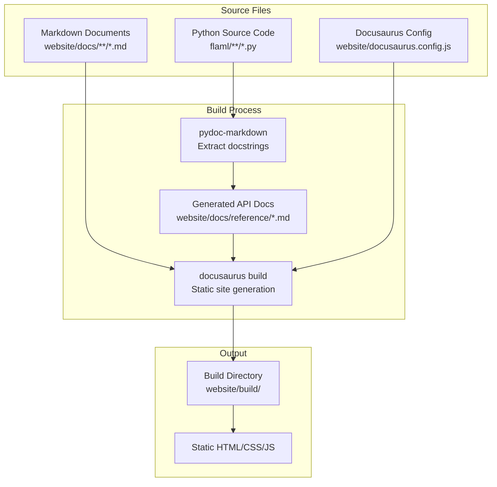
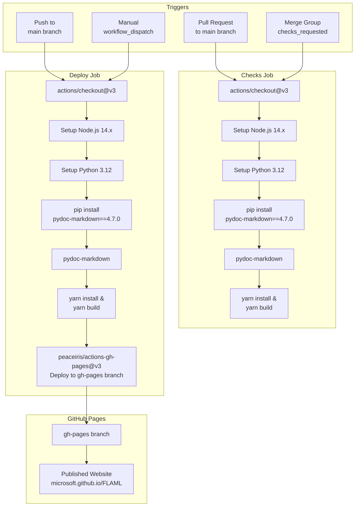
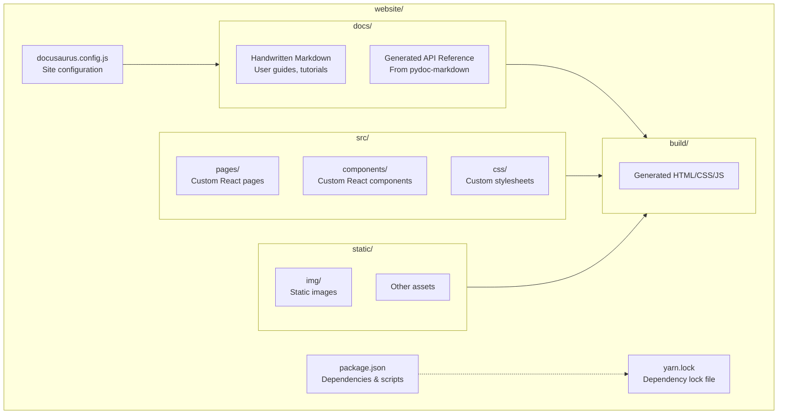

<!-- source: DeepWiki mcp.deepwiki.com · repo microsoft/FLAML · page 10.3 Documentation · fetched 2026-10-26 -->

# Documentation

<details>
<summary>Relevant source files</summary>

The following files were used as context for generating this wiki page:

- [.github/workflows/CD.yml](.github/workflows/CD.yml)
- [.github/workflows/deploy-website.yml](.github/workflows/deploy-website.yml)
- [Dockerfile](Dockerfile)
- [flaml/autogen/agentchat/contrib/retrieve_assistant_agent.py](flaml/autogen/agentchat/contrib/retrieve_assistant_agent.py)
- [flaml/autogen/agentchat/contrib/retrieve_user_proxy_agent.py](flaml/autogen/agentchat/contrib/retrieve_user_proxy_agent.py)
- [test/automl/test_training_log.py](test/automl/test_training_log.py)
- [test/test_autovw.py](test/test_autovw.py)
- [website/package.json](website/package.json)
- [website/yarn.lock](website/yarn.lock)

</details>


## Purpose and Scope

This page documents FLAML's documentation system, which uses Docusaurus for static site generation and pydoc-markdown for API reference generation. It covers the build pipeline, deployment process, and contribution workflow.

For information about the build system and testing infrastructure, see [Build System and CI/CD](#10.1) and [Testing](#10.2).

## Documentation Technology Stack

FLAML's documentation system consists of two primary components:

### Docusaurus

The website is built using **Docusaurus** (version 0.0.0-4193), a React-based static site generator. Docusaurus provides:

- **Markdown-based content**: Documentation pages written in Markdown and MDX
- **Search functionality**: Local search via `@easyops-cn/docusaurus-search-local`
- **Math support**: KaTeX integration for mathematical expressions (`rehype-katex` and `remark-math`)
- **Versioning**: Built-in support for documentation versioning
- **Responsive design**: Mobile-friendly documentation layout

The website configuration is defined in [website/package.json:1-56](), which specifies all dependencies and build scripts.

| Package | Purpose |
|---------|---------|
| `@docusaurus/core` | Core Docusaurus framework |
| `@docusaurus/preset-classic` | Standard Docusaurus theme and plugins |
| `@easyops-cn/docusaurus-search-local` | Local search functionality |
| `rehype-katex` / `remark-math` | Mathematical equation rendering |
| `@mdx-js/react` | MDX (Markdown + JSX) support |

Sources: [website/package.json:1-56]()

### pydoc-markdown

**pydoc-markdown** (version 4.7.0) generates API reference documentation from Python docstrings. This tool:

- Parses Python source files and extracts docstrings
- Converts docstrings to Markdown format
- Integrates with Docusaurus for seamless API documentation

The tool is installed and executed in the CI pipeline at [.github/workflows/deploy-website.yml:42-47]().

Sources: [.github/workflows/deploy-website.yml:42-47](), [Dockerfile:34]()

## Documentation Build Pipeline



The build process follows these steps:

1. **API Documentation Generation**: pydoc-markdown scans Python source files and extracts docstrings, converting them to Markdown
2. **Static Site Build**: Docusaurus processes all Markdown files (handwritten and generated) and produces static HTML
3. **Asset Optimization**: JavaScript, CSS, and images are bundled and optimized for production

Sources: [.github/workflows/deploy-website.yml:45-59]()

## Deployment Workflow

FLAML uses GitHub Actions to automate documentation deployment to GitHub Pages. The workflow is defined in [.github/workflows/deploy-website.yml:1-102]().



### Workflow Jobs

The workflow contains two jobs:

#### 1. Checks Job (`checks`)

Runs on pull requests to validate documentation builds without deploying:

- **Trigger**: Pull requests to main branch ([.github/workflows/deploy-website.yml:25]())
- **Purpose**: Ensure documentation builds successfully
- **Environment**: `ubuntu-latest`, Node.js 14.x, Python 3.12
- **Steps**:
  1. Checkout repository ([.github/workflows/deploy-website.yml:31]())
  2. Setup Node.js ([.github/workflows/deploy-website.yml:32-36]())
  3. Setup Python ([.github/workflows/deploy-website.yml:37-40]())
  4. Install pydoc-markdown ([.github/workflows/deploy-website.yml:41-44]())
  5. Run pydoc-markdown ([.github/workflows/deploy-website.yml:45-47]())
  6. Test build ([.github/workflows/deploy-website.yml:48-59]())

#### 2. Deploy Job (`gh-release`)

Runs on pushes to main branch to build and deploy documentation:

- **Trigger**: Push to main branch ([.github/workflows/deploy-website.yml:61]())
- **Purpose**: Build and deploy documentation to GitHub Pages
- **Steps**: Similar to checks job, plus deployment ([.github/workflows/deploy-website.yml:96-101]())
- **Deployment**: Uses `peaceiris/actions-gh-pages@v3` to publish `website/build/` to `gh-pages` branch

Sources: [.github/workflows/deploy-website.yml:1-102]()

## Package Manager Detection

The workflow intelligently detects which package manager to use:

```bash
if [ -e yarn.lock ]; then
    yarn install --frozen-lockfile --ignore-engines
    yarn build
elif [ -e package-lock.json ]; then
    npm ci
    npm run build
else
    npm i --legacy-peer-deps
    npm run build
fi
```

This logic appears at [.github/workflows/deploy-website.yml:50-59]() and [.github/workflows/deploy-website.yml:86-95]().

Sources: [.github/workflows/deploy-website.yml:50-59](), [.github/workflows/deploy-website.yml:86-95]()

## Development Environment Setup

The Docker development environment includes documentation tooling:

```dockerfile
# For docs
RUN sudo npm install --global yarn
RUN sudo pip install pydoc-markdown
RUN cd website
RUN yarn install --frozen-lockfile --ignore-engines
```

This configuration at [Dockerfile:32-36]() ensures developers can build documentation locally.

Sources: [Dockerfile:32-36]()

## NPM Scripts

The `website/package.json` defines several npm scripts for documentation tasks:

| Script | Command | Purpose |
|--------|---------|---------|
| `docusaurus` | `docusaurus` | Direct access to Docusaurus CLI |
| `start` | `docusaurus start` | Start local development server |
| `build` | `docusaurus build` | Build production-ready static site |
| `swizzle` | `docusaurus swizzle` | Customize Docusaurus components |
| `deploy` | `docusaurus deploy` | Deploy to hosting (typically GitHub Pages) |
| `clear` | `docusaurus clear` | Clear build cache |
| `serve` | `docusaurus serve` | Serve built website locally |
| `write-translations` | `docusaurus write-translations` | Extract translatable strings |
| `write-heading-ids` | `docusaurus write-heading-ids` | Add IDs to Markdown headings |

Sources: [website/package.json:16-26]()

## Contributing Documentation

### Local Development

To work on documentation locally:

1. **Navigate to website directory**:
   ```bash
   cd website
   ```

2. **Install dependencies**:
   ```bash
   yarn install --frozen-lockfile --ignore-engines
   ```

3. **Generate API documentation**:
   ```bash
   pydoc-markdown
   ```

4. **Start development server**:
   ```bash
   yarn start
   ```

   This launches a local server with hot reloading for instant preview of changes.

5. **Build for production** (optional):
   ```bash
   yarn build
   ```

Sources: [.github/workflows/deploy-website.yml:48-59](), [Dockerfile:32-36]()

### File Organization



### Documentation Types

FLAML documentation consists of:

1. **Handwritten Documentation**: Tutorials, guides, and conceptual explanations written in Markdown
2. **API Reference**: Auto-generated from Python docstrings using pydoc-markdown
3. **Code Examples**: Embedded code snippets demonstrating usage
4. **Diagrams**: Mermaid diagrams for visualizing architecture and workflows

Sources: [website/package.json:1-56]()

## Security Considerations

The workflow includes dependency resolution overrides to address security vulnerabilities:

```json
"resolutions": {
    "nth-check": "2.0.1",
    "trim": "0.0.3",
    "got": "11.8.5",
    "node-forge": "1.3.0",
    "minimatch": "3.0.5",
    "loader-utils": "2.0.4",
    "eta": "2.0.0",
    "@sideway/formula": "3.0.1",
    "http-cache-semantics": "4.1.1"
}
```

These resolutions at [website/package.json:5-14]() pin specific versions of transitive dependencies to patch known vulnerabilities.

Sources: [website/package.json:5-14]()

## Workflow Triggers and Path Filters

Documentation builds are triggered by:

- **Pull requests** to main branch affecting:
  - `flaml/*` (source code with docstrings)
  - `website/*` (documentation files)
  - `.github/workflows/deploy-website.yml` (workflow itself)

- **Pushes** to main branch with same path filters

- **Manual dispatch** via GitHub UI (`workflow_dispatch`)

- **Merge group** checks

Sources: [.github/workflows/deploy-website.yml:3-18]()

## Permissions

The workflow requires `contents: write` permission at [.github/workflows/deploy-website.yml:20-21]() to:

- Push to the `gh-pages` branch
- Update GitHub Pages deployment

Sources: [.github/workflows/deploy-website.yml:20-21]()

## Best Practices

When contributing documentation:

1. **Run pydoc-markdown**: Always regenerate API docs before building to capture latest docstring changes
2. **Test locally**: Use `yarn start` to preview changes before pushing
3. **Check build success**: Ensure the `checks` job passes in your pull request
4. **Follow Markdown conventions**: Use consistent formatting and structure
5. **Include code examples**: Demonstrate usage with practical examples
6. **Add diagrams**: Use mermaid for complex concepts
7. **Update both types**: When adding features, update both handwritten docs and docstrings

Sources: [.github/workflows/deploy-website.yml:24-59]()