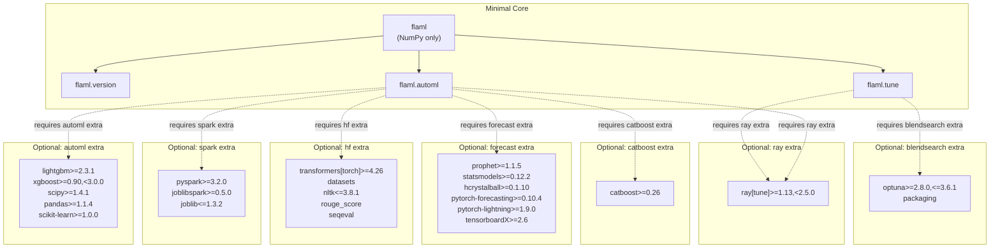
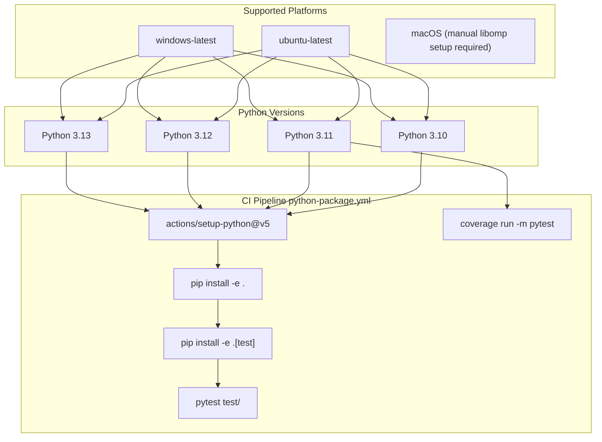

<!-- source: DeepWiki mcp.deepwiki.com · repo microsoft/FLAML · page 2 Installation and Setup · fetched 2026-10-26 -->

# Installation and Setup

<details>
<summary>Relevant source files</summary>

The following files were used as context for generating this wiki page:

- [.github/workflows/python-package.yml](.github/workflows/python-package.yml)
- [README.md](README.md)
- [flaml/version.py](flaml/version.py)
- [setup.py](setup.py)
- [website/docs/Best-Practices.md](website/docs/Best-Practices.md)
- [website/docs/Contribute.md](website/docs/Contribute.md)
- [website/docs/FAQ.md](website/docs/FAQ.md)
- [website/docs/Getting-Started.md](website/docs/Getting-Started.md)
- [website/docs/Installation.md](website/docs/Installation.md)
- [website/sidebars.js](website/sidebars.js)

</details>


This document covers the installation of FLAML, including Python version requirements, optional dependency extras, platform-specific considerations, and development setup. For usage guidance after installation, see [Overview](#1) and [Getting Started](Getting-Started). For deployment in production environments, see [Integration and Deployment](#8).

---

## Python Requirements

FLAML requires **Python >= 3.10 and < 3.14**. While other versions may work for core components, full model support is only guaranteed within this range.

The minimal installation depends only on NumPy:

```bash
pip install flaml
```

**Sources:** [README.md:37](), [setup.py:17-19](), [setup.py:164](), [flaml/version.py:1]()

---

## Installation Methods

### Via pip (Recommended)

```bash
# Minimal installation (NumPy only)
pip install flaml

# With AutoML support
pip install "flaml[automl]"

# Multiple extras
pip install "flaml[automl,spark,hf]"
```

### Via conda

```bash
conda install flaml -c conda-forge
```

**Note:** On Windows with certain shells, escape brackets: `pip install flaml\[automl\]`

**Sources:** [README.md:40-46](), [website/docs/Installation.md:7-15]()

---

## Package Architecture and Optional Extras

FLAML uses a modular architecture where the base package is minimal and feature-specific dependencies are installed via extras.

### Dependency Architecture



**Sources:** [setup.py:22-31](), [setup.py:36-154]()

---

## Optional Extras Reference

The following table maps extras to their purposes and key dependencies:

| Extra | Purpose | Key Dependencies | Installation Command |
|-------|---------|------------------|---------------------|
| `automl` | Core AutoML functionality | lightgbm, xgboost, scipy, pandas, scikit-learn | `pip install "flaml[automl]"` |
| `spark` | Distributed Spark execution | pyspark>=3.2.0, joblibspark>=0.5.0 | `pip install "flaml[spark]"` |
| `hf` (or `nlp`) | HuggingFace NLP models | transformers[torch]>=4.26, datasets, nltk, rouge_score, seqeval | `pip install "flaml[hf]"` |
| `forecast` | Time series forecasting | prophet>=1.1.5, statsmodels>=0.12.2, hcrystalball>=0.1.10, pytorch-forecasting>=0.10.4 | `pip install "flaml[forecast]"` |
| `ts_forecast` | Time series (statistical only) | prophet>=1.1.5, statsmodels>=0.12.2, hcrystalball>=0.1.10 | `pip install "flaml[ts_forecast]"` |
| `blendsearch` | Advanced search with Optuna | optuna>=2.8.0,<=3.6.1, packaging | `pip install "flaml[blendsearch]"` |
| `ray` | Ray distributed execution | ray[tune]>=1.13,<2.5.0 | `pip install "flaml[ray]"` |
| `catboost` | CatBoost estimator | catboost>=0.26 | `pip install "flaml[catboost]"` |
| `vw` | Vowpal Wabbit support | vowpalwabbit>=8.10.0,<9.0.0, scikit-learn | `pip install "flaml[vw]"` |
| `azureml` | Azure ML integration | azureml-mlflow | `pip install "flaml[azureml]"` |
| `synapse` | Azure Synapse support | joblibspark>=0.5.0, optuna, pyspark>=3.2.0 | `pip install "flaml[synapse]"` |
| `nni` | NNI integration | nni | `pip install "flaml[nni]"` |
| `notebook` | Jupyter notebook support | jupyter | `pip install "flaml[notebook]"` |
| `test` | Testing framework | pytest, coverage, all model dependencies | `pip install "flaml[test]"` |

**Note:** The `nlp` extra is an alias for `hf` maintained for backward compatibility.

**Sources:** [setup.py:37-154](), [README.md:43-49](), [website/docs/Installation.md:19-117]()

---

## Platform Support and Testing Matrix

FLAML is tested across multiple platforms and Python versions via GitHub Actions CI/CD:



**Platform-Specific Notes:**

- **macOS:** Requires manual `libomp` installation via Homebrew for lightgbm/xgboost compatibility: [.github/workflows/python-package.yml:50-60]()
- **Windows:** All extras supported; use escaped brackets in PowerShell: `pip install flaml\[automl\]`
- **Linux (Ubuntu):** Prophet and forecast extras tested on Ubuntu only: [.github/workflows/python-package.yml:87-90]()

**Python Version Specifics:**

- **Python 3.11:** pyspark==3.5.1 tested
- **Python 3.12:** pyspark==4.0.1 tested
- **Python 3.13:** pyspark==4.1.0 tested; NumPy>=2.0 supported

**Sources:** [.github/workflows/python-package.yml:36-141](), [setup.py:54-62]()

---

## Spark Setup

For distributed Spark execution, additional setup is required:

### Cloud Platforms

Spark clusters are pre-configured on:
- **Azure Synapse Analytics:** Use `pip install "flaml[synapse]"`
- **Microsoft Fabric Data Science:** Spark available by default
- **Databricks:** Requires `pip install "flaml[spark]"`

### Standalone Spark Installation

For Ubuntu systems, install Spark 3.3.0 standalone:

```bash
# Install Java dependencies
sudo apt-get update && sudo apt-get install -y \
    ca-certificates-java ca-certificates openjdk-17-jdk-headless

# Download and extract Spark
wget --progress=dot:giga \
    "https://www.apache.org/dyn/closer.lua/spark/spark-3.3.0/spark-3.3.0-bin-hadoop2.tgz?action=download" \
    -O - | tar -xzC /tmp
sudo mv /tmp/spark-3.3.0-bin-hadoop2 /spark

# Set environment variables
export SPARK_HOME=/spark
export PYTHONPATH=/spark/python/lib/py4j-0.10.9.5-src.zip:/spark/python
export PATH=$PATH:$SPARK_HOME/bin
```

**Sources:** [website/docs/Installation.md:82-97]()

---

## Development Setup

### Clone and Install for Development

```bash
# Clone repository
git clone https://github.com/microsoft/FLAML.git
cd FLAML

# Install in editable mode with notebook dependencies
pip install -e ".[notebook]"
```

On Windows, escape brackets: `pip install -e .\[notebook\]`

### Docker Development Environment

```bash
# Build Docker image
docker build https://github.com/microsoft/FLAML.git#main -t flaml-dev

# Run container
docker run -it flaml-dev
```

### VS Code Remote Container

FLAML provides a `.devcontainer` configuration for VS Code:

1. Open FLAML folder in VS Code
2. Select "Reopen in Container" when prompted
3. Container includes all development dependencies pre-installed

**Sources:** [website/docs/Contribute.md:61-83](), [Dockerfile]()

---

## Pre-commit Hooks and Testing

### Pre-commit Setup

```bash
# Install pre-commit hooks
pre-commit install

# Run manually before committing
pre-commit run

# Uninstall if needed (Windows without WSL)
pre-commit uninstall
```

### Running Tests

```bash
# Install test dependencies
pip install -e ".[test]"

# Run all tests
pytest test/ --ignore=test/autogen

# Run with retries (CI configuration)
pytest test/ --ignore=test/autogen --reruns 2 --reruns-delay 10

# Generate coverage report
coverage run -m pytest test --ignore=test/autogen
coverage report -m
coverage html
```

### Test Organization

Tests are organized by component:

- **flaml/automl:** AutoML tests
- **flaml/tune:** Hyperparameter tuning tests
- **flaml/default:** Zero-shot AutoML tests
- **test/spark:** Spark integration tests
- **test/nlp:** NLP/transformers tests
- **test/forecast:** Time series forecasting tests

**Sources:** [website/docs/Contribute.md:84-100](), [.github/workflows/python-package.yml:105-116]()

---

## Verification After Installation

After installation, verify FLAML is working:

```python
# Check version
import flaml
print(flaml.__version__)  # Should print current version (e.g., "2.5.0")

# Test minimal import
from flaml import AutoML, tune
print("FLAML core imported successfully")

# Test automl extra (if installed)
try:
    from flaml.automl.model import LGBMEstimator
    print("AutoML extra available")
except ImportError:
    print("AutoML extra not installed")

# List available estimators for a task
from flaml.automl.task.factory import task_factory
print("Classification estimators:", 
      sorted(task_factory("classification").estimators.keys()))
```

### Checking Dependencies

The repository includes a dependency checker:

```bash
# Check first-tier dependencies
python test/check_dependency.py
```

**Sources:** [.github/workflows/python-package.yml:99-101](), [README.md:65](), [flaml/version.py:1]()

---

## .NET Support

FLAML has a .NET implementation in **ML.NET**, an open-source machine learning framework for .NET.

### Installation Options

**Low-Code:**

1. **Model Builder** (Visual Studio extension):
   - Visual tool for training ML models using FLAML
   - Install via: Extensions → Manage Extensions → Search "ML.NET Model Builder"

2. **ML.NET CLI** (Command-line tool):
   ```bash
   # Install as global tool
   dotnet tool install -g mlnet
   
   # Use for AutoML
   mlnet auto-train --task classification --dataset data.csv
   ```

**Code-First:**

3. **Microsoft.ML.AutoML NuGet Package:**
   ```bash
   # Install via dotnet CLI
   dotnet add package Microsoft.ML.AutoML
   
   # Or via NuGet Package Manager in Visual Studio
   Install-Package Microsoft.ML.AutoML
   ```

### Getting Started with ML.NET

Refer to the [csharp-notebooks](https://github.com/dotnet/csharp-notebooks#machine-learning) repository for ML.NET API and AutoML examples.

**Sources:** [website/docs/Installation.md:133-148](), [README.md:33]()

---

## Next Steps

After installation, proceed to:

- **[Getting Started](Getting-Started):** Quick start guide with basic examples
- **[AutoML](#3):** Task-oriented automated machine learning
- **[Tune](#4):** Generic hyperparameter optimization
- **[Zero-shot AutoML](#5):** Drop-in replacements with automatic configuration

For troubleshooting installation issues, see [FAQ](FAQ).

**Sources:** [website/docs/Getting-Started.md:1-116](), [README.md:52-91]()

---

