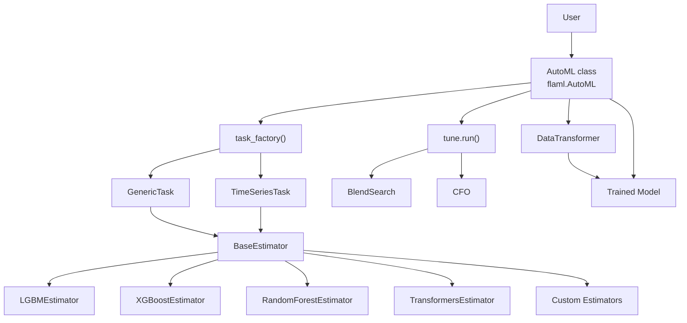
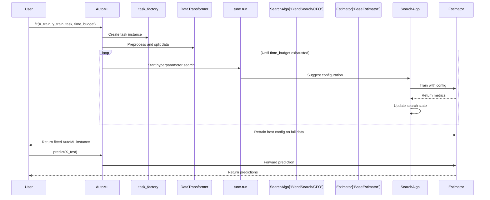
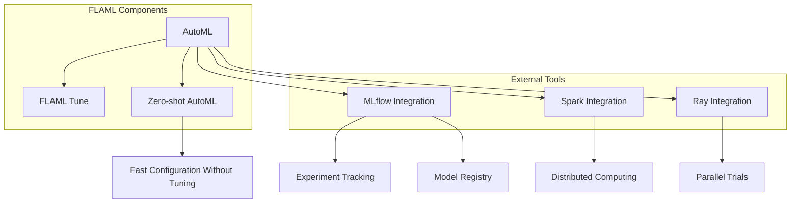

<!-- source: DeepWiki mcp.deepwiki.com · repo microsoft/FLAML · page 3 AutoML · fetched 2026-10-26 -->

# AutoML

<details>
<summary>Relevant source files</summary>

The following files were used as context for generating this wiki page:

- [flaml/automl/automl.py](flaml/automl/automl.py)
- [flaml/ml.py](flaml/ml.py)
- [test/automl/test_multiclass.py](test/automl/test_multiclass.py)
- [website/docs/Best-Practices.md](website/docs/Best-Practices.md)
- [website/docs/Contribute.md](website/docs/Contribute.md)
- [website/docs/FAQ.md](website/docs/FAQ.md)
- [website/docs/Getting-Started.md](website/docs/Getting-Started.md)
- [website/docs/Installation.md](website/docs/Installation.md)
- [website/docs/Use-Cases/Task-Oriented-AutoML.md](website/docs/Use-Cases/Task-Oriented-AutoML.md)
- [website/sidebars.js](website/sidebars.js)

</details>


AutoML in FLAML is a task-oriented automated machine learning system that provides a scikit-learn-style interface for training ML models. It automatically handles model selection and hyperparameter tuning within user-specified resource constraints (time budget, computational resources). AutoML is designed to find high-quality models quickly while minimizing computational cost.

## When to Use AutoML

Use `flaml.AutoML` when you have:
- A standard ML task (classification, regression, time series forecasting, ranking, or NLP)
- Training data and want to find the best model automatically
- Limited time or computational resources
- Need for a scikit-learn-compatible interface

For generic hyperparameter optimization of custom functions, see page [Tune](4). For zero-configuration model training, see page [Zero-shot AutoML](5).

Sources: [flaml/automl/automl.py:88-105](), [website/docs/Getting-Started.md:22-45]()

## Architecture Overview

AutoML orchestrates several subsystems to automate machine learning:

**High-Level Architecture**



Sources: [flaml/automl/automl.py:88-424](), [flaml/automl/task/factory.py:1-50]()

## Basic Workflow

The typical AutoML workflow consists of initialization, fitting, and prediction:

**AutoML Execution Flow**



Sources: [flaml/automl/automl.py:785-1650]()

## Supported Tasks and Estimators

AutoML supports a wide range of machine learning tasks. The available estimators depend on the task type and installed optional dependencies.

**Supported Task Types**

| Task String | Description | Example Use Case |
|-------------|-------------|------------------|
| `"classification"` | Binary or multiclass classification | Spam detection, image classification |
| `"regression"` | Numeric prediction | House price prediction, sales forecasting |
| `"ts_forecast"` | Time series forecasting | Stock price prediction, demand forecasting |
| `"ts_forecast_panel"` | Panel time series forecasting | Multi-store sales forecasting |
| `"rank"` | Learning to rank | Search result ranking |
| `"seq-classification"` | Sequence classification (NLP) | Sentiment analysis, topic classification |
| `"seq-regression"` | Sequence regression (NLP) | Text quality scoring |
| `"summarization"` | Text summarization | Document summarization |
| `"token-classification"` | Token-level classification | Named entity recognition |

Sources: [website/docs/Use-Cases/Task-Oriented-AutoML.md:10-21](), [flaml/automl/automl.py:376-423]()

**Built-in Estimators by Task**

AutoML includes multiple estimator types. Common estimators include:

- **Tree-based**: `lgbm`, `xgboost`, `xgb_limitdepth`, `rf`, `extra_tree`, `catboost`
- **Linear**: `lrl1`, `lrl2` (Logistic Regression with L1/L2 regularization)
- **Time Series**: `prophet`, `arima`, `sarimax`, `holt-winters`
- **Deep Learning**: `transformer` (HuggingFace), `tft` (Temporal Fusion Transformer)
- **Spark Distributed**: `lgbm_spark`, `rf_spark`, `gbt_spark`

To list available estimators for your environment:

```python
from flaml.automl.task.factory import task_factory

print("Classification:", sorted(task_factory("classification").estimators.keys()))
print("Regression:", sorted(task_factory("regression").estimators.keys()))
print("Forecast:", sorted(task_factory("forecast").estimators.keys()))
```

Sources: [website/docs/Use-Cases/Task-Oriented-AutoML.md:178-234](), [website/docs/FAQ.md:319-331]()

## Key Capabilities

### AutoML Configuration Options

AutoML provides extensive configuration through the `fit()` method. Key parameters include:

**Resource Constraints**

| Parameter | Type | Description |
|-----------|------|-------------|
| `time_budget` | float | Total search time in seconds (default: -1, no limit) |
| `max_iter` | int | Maximum number of trials |
| `train_time_limit` | float | Maximum training time per trial in seconds |
| `pred_time_limit` | float | Maximum prediction time per instance |
| `mem_thres` | float | Memory size constraint in bytes |
| `free_mem_ratio` | float | Keep free memory above this ratio (0-1) |

**Search Configuration**

| Parameter | Type | Description |
|-----------|------|-------------|
| `metric` | str or callable | Optimization metric (e.g., 'accuracy', 'r2', custom function) |
| `estimator_list` | list or 'auto' | List of estimators to try |
| `eval_method` | str | Evaluation method: 'auto', 'cv', 'holdout' |
| `split_ratio` | float | Validation data ratio for holdout (default: 0.1) |
| `n_splits` | int | Number of CV folds (default: 5) |
| `hpo_method` | str | HPO algorithm: 'auto', 'cfo', 'bs', 'random' |

**Advanced Options**

| Parameter | Type | Description |
|-----------|------|-------------|
| `n_concurrent_trials` | int | Number of parallel trials (requires Ray or Spark) |
| `use_ray` | bool or dict | Use Ray for parallel execution |
| `use_spark` | bool | Use Spark for parallel execution |
| `ensemble` | bool or dict | Enable stacking ensemble |
| `custom_hp` | dict | Override hyperparameter search spaces |
| `starting_points` | dict | Warm start with initial configurations |

Sources: [flaml/automl/automl.py:109-421](), [website/docs/Use-Cases/Task-Oriented-AutoML.md:47-363]()

### Optimization Metrics

AutoML supports built-in metrics for different tasks. By default, `metric='auto'` selects an appropriate metric based on the task type.

**Common Metrics**

- **Classification**: `'accuracy'`, `'roc_auc'`, `'log_loss'`, `'f1'`, `'micro_f1'`, `'macro_f1'`
- **Regression**: `'r2'`, `'rmse'`, `'mae'`, `'mse'`, `'mape'`
- **Ranking**: `'ndcg'`, `'ndcg@k'`
- **HuggingFace NLP**: `'accuracy'`, `'bleu'`, `'rouge'`, `'f1'`, etc.

Custom metrics can be provided as functions with the signature:

```python
def custom_metric(X_val, y_val, estimator, labels, X_train, y_train, 
                  weight_val=None, weight_train=None, *args):
    # Compute metric
    return metric_to_minimize, metrics_to_log
```

Sources: [website/docs/Use-Cases/Task-Oriented-AutoML.md:49-171](), [test/automl/test_multiclass.py:103-131]()

## Basic Usage

**Minimal Example**

```python
from flaml import AutoML

automl = AutoML()
automl.fit(X_train, y_train, task="classification", time_budget=60)

# Access results
print(f"Best estimator: {automl.best_estimator}")
print(f"Best config: {automl.best_config}")
print(f"Best loss: {automl.best_loss}")

# Make predictions
predictions = automl.predict(X_test)
```

Sources: [website/docs/Getting-Started.md:26-31](), [website/docs/Use-Cases/Task-Oriented-AutoML.md:25-40]()

**Configuration Example**

```python
from flaml import AutoML

automl = AutoML()
automl_settings = {
    "time_budget": 120,              # 2 minutes
    "metric": "roc_auc",             # Optimization metric
    "task": "classification",        # Task type
    "estimator_list": ["lgbm", "xgboost", "rf"],
    "log_file_name": "automl.log",   # Log file
    "eval_method": "cv",             # Cross-validation
    "n_splits": 5,                   # 5-fold CV
    "n_jobs": -1,                    # Use all CPU cores
}

automl.fit(X_train, y_train, **automl_settings)

# Model is stored in automl.model
trained_model = automl.model
```

Sources: [test/automl/test_multiclass.py:309-346](), [flaml/automl/automl.py:512-538]()

**Accessing Results**

The `AutoML` class provides properties to access training results:

| Property | Description |
|----------|-------------|
| `best_estimator` | Name of the best estimator found |
| `best_config` | Best hyperparameter configuration |
| `best_config_per_estimator` | Best config for each estimator tried |
| `best_loss` | Best validation loss achieved |
| `best_loss_per_estimator` | Best loss for each estimator |
| `model` | Trained model instance (supports `predict()`, `predict_proba()`) |
| `config_history` | Dictionary of iteration -> (estimator, config, time) |
| `best_iteration` | Iteration number where best config was found |
| `time_to_find_best_model` | Time taken to find best model in seconds |

Sources: [flaml/automl/automl.py:503-774]()

## Integration Points

AutoML integrates with various components in FLAML and external tools:



Sources: [flaml/automl/automl.py:55-74](flaml/automl/automl.py:55-74), [website/docs/Use-Cases/Task-Oriented-AutoML.md:523-535](website/docs/Use-Cases/Task-Oriented-AutoML.md:523-535)

## Summary

FLAML's AutoML is a fast, lightweight, and economical automated machine learning system that:

1. Supports various ML tasks: classification, regression, time series forecasting, ranking, and NLP
2. Provides a scikit-learn compatible API for easy integration
3. Automatically selects and tunes ML models within resource constraints
4. Offers extensive customization options for estimators, search space, metrics, and constraints
5. Integrates with MLflow, Spark, and Ray for enhanced capabilities
6. Optimizes for both model performance and resource efficiency

AutoML is designed to be a practical solution for everyday ML tasks, finding good models quickly while minimizing computational resources.

---

