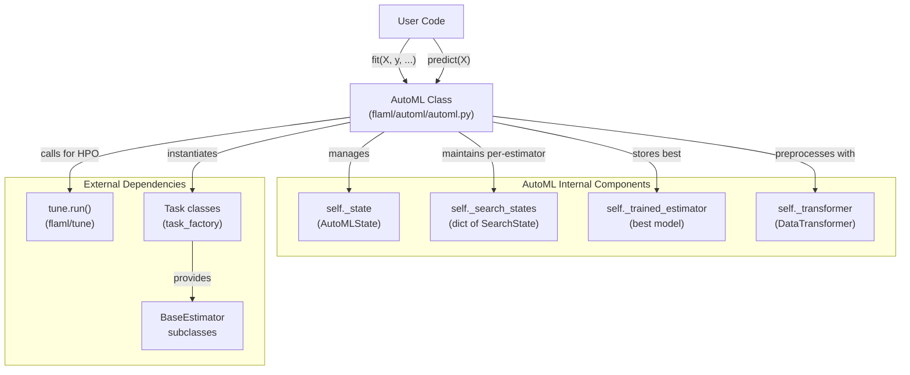
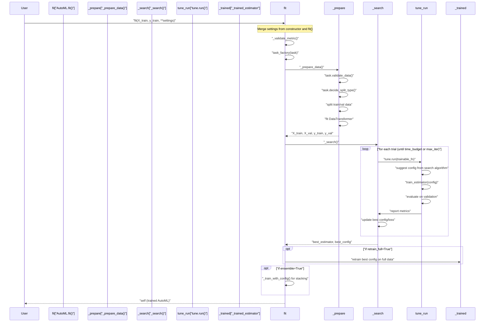
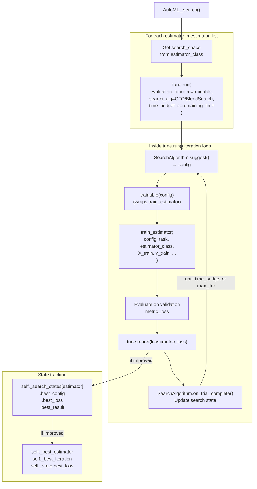
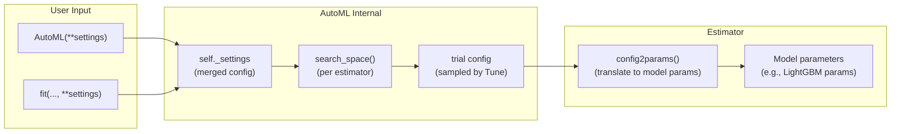
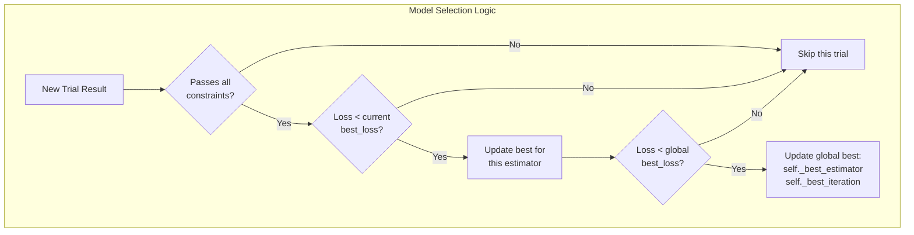

<!-- source: DeepWiki mcp.deepwiki.com · repo microsoft/FLAML · page 3.1 AutoML Core · fetched 2026-10-26 -->

# AutoML Core

<details>
<summary>Relevant source files</summary>

The following files were used as context for generating this wiki page:

- [flaml/automl/automl.py](flaml/automl/automl.py)
- [notebook/automl_classification.ipynb](notebook/automl_classification.ipynb)
- [notebook/automl_time_series_forecast.ipynb](notebook/automl_time_series_forecast.ipynb)
- [test/automl/test_forecast.py](test/automl/test_forecast.py)
- [test/automl/test_multiclass.py](test/automl/test_multiclass.py)
- [test/automl/test_notebook_example.py](test/automl/test_notebook_example.py)
- [website/docs/Examples/AutoML-Time series forecast.md](website/docs/Examples/AutoML-Time series forecast.md)
- [website/docs/Use-Cases/Task-Oriented-AutoML.md](website/docs/Use-Cases/Task-Oriented-AutoML.md)

</details>


This document provides a deep dive into the `AutoML` class, the primary interface for automated machine learning in FLAML. The `AutoML` class orchestrates the entire AutoML workflow, from data preprocessing to model selection, hyperparameter optimization, training, and evaluation.

## Overview

The `AutoML` class (defined in [flaml/automl/automl.py:90]()) is a scikit-learn compatible estimator that automates the machine learning pipeline. It handles:

- **Data validation and preprocessing**: Through task-specific data transformers
- **Model selection**: Selecting and evaluating multiple estimator types
- **Hyperparameter optimization**: Using efficient search algorithms (via FLAML's Tune system)
- **Model training and evaluation**: With configurable evaluation methods (holdout, cross-validation)
- **Result tracking**: Maintaining state of best models and configurations



Sources: [flaml/automl/automl.py:90-424](), [flaml/automl/state.py:1-50]()

## AutoML Class Structure

### Initialization

The `AutoML` class inherits from `sklearn.base.BaseEstimator` [flaml/automl/automl.py:90](), making it compatible with scikit-learn pipelines and utilities.

Constructor signature:
```python
AutoML(**settings)
```

The constructor [flaml/automl/automl.py:109-424]() accepts various settings as keyword arguments:

| Parameter | Default | Description |
|-----------|---------|-------------|
| `task` | `"classification"` | Task type: classification, regression, ts_forecast, etc. |
| `time_budget` | `-1` | Total time budget in seconds (-1 means no limit) |
| `max_iter` | `None` | Maximum number of iterations |
| `metric` | `"auto"` | Optimization metric (string or custom function) |
| `estimator_list` | `"auto"` | List of estimator names to try |
| `n_jobs` | `-1` | Number of parallel threads for training |
| `eval_method` | `"auto"` | Evaluation method: auto, holdout, cv |
| `split_ratio` | `0.1` | Validation data fraction for holdout |
| `n_splits` | `5` | Number of folds for cross-validation |
| `sample` | `True` | Whether to sample training data during search |
| `ensemble` | `False` | Whether to build ensemble after search |
| `model_history` | `False` | Whether to keep best model per estimator |
| `log_training_metric` | `False` | Whether to log training metrics |
| `verbose` | `3` | Logging verbosity level |
| `retrain_full` | `True` | Whether to retrain on full data after search |

During initialization, the constructor:
1. Creates an `AutoMLState` instance in `self._state` [flaml/automl/automl.py:369]()
2. Stores settings in `self._settings` [flaml/automl/automl.py:371]()
3. Validates metric parameter [flaml/automl/automl.py:385]()
4. Sets estimator type (`"classifier"` or `"regressor"`) [flaml/automl/automl.py:423]()

### Key Properties

The `AutoML` class exposes several properties to access results after `fit()`:

| Property | Description | Implementation |
|----------|-------------|----------------|
| `model` | Best trained model object | [flaml/automl/automl.py:512-516]() |
| `best_estimator` | Name of best estimator (e.g., "lgbm") | [flaml/automl/automl.py:536-538]() |
| `best_config` | Best hyperparameter configuration dict | [flaml/automl/automl.py:547-600]() |
| `best_config_per_estimator` | Best config for each estimator | [flaml/automl/automl.py:603-676]() |
| `best_loss` | Best validation loss achieved | [flaml/automl/automl.py:684-686]() |
| `best_iteration` | Iteration where best config was found | [flaml/automl/automl.py:541-544]() |
| `config_history` | Dictionary of iteration→(estimator, config, time) | [flaml/automl/automl.py:504-509]() |
| `best_result` | Full result dictionary for best config | [flaml/automl/automl.py:689-692]() |
| `best_config_train_time` | Training time for best config | [flaml/automl/automl.py:703-705]() |
| `time_to_find_best_model` | Time taken to find best model | [flaml/automl/automl.py:771-773]() |
| `classes_` | Class labels (classification only) | [flaml/automl/automl.py:742-750]() |
| `feature_names_in_` | Feature names from training data | [flaml/automl/automl.py:757-762]() |
| `feature_importances_` | Feature importances from best model | [flaml/automl/automl.py:765-768]() |

**Important Notes on `best_config`:**

The `best_config` property [flaml/automl/automl.py:547-600]() returns FLAML's search space parameters, which may differ from the original model's parameters. For example:
- FLAML uses `log_max_bin` for LightGBM instead of `max_bin`
- To convert to original parameters, use the estimator's `config2params()` method
- See the docstring examples for how to use configs with FLAML estimators vs. original model libraries

Sources: [flaml/automl/automl.py:109-424](), [flaml/automl/automl.py:500-773]()

## The fit() Workflow

The `fit()` method [flaml/automl/automl.py:789-1559]() is the core of the AutoML process. It orchestrates data preparation, model search, and final model training.

### High-Level fit() Workflow



### Detailed Workflow Steps

**1. Setup and Validation** [flaml/automl/automl.py:789-911]()
   - Merge settings from constructor and `fit()` call
   - Validate `metric` parameter [flaml/automl/automl.py:479-498]()
   - Create task instance via `task_factory()` [flaml/automl/task/factory.py:9-20]()
   - Initialize state: `self._state`, `self._search_states` [flaml/automl/automl.py:913-927]()

**2. Data Preparation** [flaml/automl/automl.py:929-1113]()
   - Call `task.validate_data()` to check data format and labels
   - Determine split type (stratified, uniform, time, group) via `task.decide_split_type()`
   - Split data into train/validation sets based on `eval_method`
   - Fit `DataTransformer` on training data (if `skip_transform=False`)
   - Transform training and validation data
   - Handle missing labels in validation set (classification tasks)

**3. Model Search** [flaml/automl/automl.py:1115-1459]()
   - Determine estimator list from `estimator_list` parameter
   - For each estimator type:
     - Get search space via `estimator_class.search_space()`
     - Define `trainable` function that wraps `train_estimator()` [flaml/automl/ml.py:283-447]()
     - Call `tune.run()` with search algorithm (CFO or BlendSearch)
     - Track best config per estimator in `self._search_states[estimator_name]`
   - Update global best: `self._best_estimator`, `self._best_iteration`

**4. Final Model Training** [flaml/automl/automl.py:1461-1543]()
   - If `retrain_full=True` or `retrain_full="budget"`:
     - Retrain best config on full training data
     - Store in `self._trained_estimator`
   - If `ensemble=True`:
     - Build `StackingEstimator` or `VotingEstimator`
     - Use top models from search as base estimators
     - Store ensemble in `self._trained_estimator`

**5. Cleanup** [flaml/automl/automl.py:1545-1559]()
   - Delete search state if `keep_search_state=False`
   - Save training log
   - Return `self`

Sources: [flaml/automl/automl.py:789-1559](), [flaml/automl/ml.py:283-447](), [flaml/automl/task/factory.py:9-20]()

## Hyperparameter Optimization Loop

The hyperparameter optimization (HPO) loop is executed within the `_search()` method [flaml/automl/automl.py:1115-1459]() via `tune.run()`.

### HPO Loop Structure



### Key Components of the HPO Loop

**1. Search Algorithm Selection** [flaml/automl/automl.py:1252-1280]()

The search algorithm is determined by:
- `hpo_method="auto"` (default): Uses CFO for sequential search, BlendSearch for parallel
- `hpo_method="bs"`: Forces BlendSearch
- `hpo_method="random"`: Uses random search

**2. Trial Execution via `trainable()` function** [flaml/automl/automl.py:1164-1244]()

For each trial, the `trainable` function:
1. Receives a config dictionary from the search algorithm
2. Calls `train_estimator(config, ...)` [flaml/automl/ml.py:283-447]()
3. Within `train_estimator()`:
   - Instantiates estimator: `estimator_class(**config)`
   - Trains: `estimator.fit(X_train, y_train, budget=time_budget)`
   - Evaluates: `estimator.score(X_val, y_val, metric)`
   - Returns metrics dictionary
4. Reports loss to Tune: `tune.report(loss=metric_loss, ...)`

**3. State Updates** [flaml/automl/automl.py:1428-1458]()

After each trial:
- If loss improved for current estimator: update `self._search_states[estimator_name].best_config`
- If loss improved globally: update `self._best_estimator`, `self._best_iteration`
- Optionally save trained model if `model_history=True`

**4. Resource Management**

During HPO, FLAML manages resources via:
- `time_budget_s` parameter to `tune.run()` [flaml/automl/automl.py:1397]()
- `train_time_limit` per trial [flaml/automl/automl.py:1174]()
- `mem_thres` for memory constraints [flaml/automl/automl.py:1180]()
- Early stopping if `early_stop=True` [flaml/automl/automl.py:1451]()

Sources: [flaml/automl/automl.py:1115-1459](), [flaml/automl/ml.py:283-447](), [flaml/tune/__init__.py:1-50]()

## Configuration Management

The AutoML class manages configurations at multiple levels:

### Configuration Levels

**1. Constructor Settings** [flaml/automl/automl.py:371-422]()
   - Stored in `self._settings` dictionary
   - Contains defaults for all parameters
   - Can be overridden by `fit()` arguments

**2. fit() Settings** [flaml/automl/automl.py:789-911]()
   - Merged with constructor settings
   - Takes precedence over constructor settings
   - Validated before use

**3. Estimator Configurations** [flaml/automl/automl.py:1164-1244]()
   - Search space defined by `estimator_class.search_space()`
   - Config sampled by search algorithm
   - Converted to estimator params via `config2params()`

### Configuration Flow



### Best Configuration Storage

After search completes, best configurations are stored:

- **Per estimator**: `self._search_states[estimator_name].best_config`
- **Global best**: Accessible via `self.best_config` property
- **All estimators**: Accessible via `self.best_config_per_estimator` property

The `best_config` contains FLAML's search space parameters, which may differ from the underlying model's parameters. Use the estimator's `config2params()` method to convert if needed.

Sources: [flaml/automl/automl.py:371-422](), [flaml/automl/automl.py:547-676](), [flaml/automl/model.py:380-432]()

## Model Selection Process

The AutoML class selects the best model through an iterative search process that evaluates multiple estimator types and their hyperparameter configurations.

### Estimator Selection

**1. Determining Estimator List** [flaml/automl/automl.py:1283-1330]()

The list of estimators to try is determined by:
- `estimator_list` parameter (default `"auto"`)
- If `"auto"`: uses `task.default_estimator_list()` based on task type
- Custom estimators can be registered via `add_learner()` [flaml/automl/automl.py:2710-2768]()

Example estimator lists by task:
- Classification: `['lgbm', 'xgboost', 'xgb_limitdepth', 'catboost', 'rf', 'extra_tree', 'lrl1']`
- Regression: `['lgbm', 'xgboost', 'xgb_limitdepth', 'catboost', 'rf', 'extra_tree']`
- Time series: `['lgbm', 'rf', 'xgboost', 'extra_tree', 'xgb_limitdepth', 'prophet', 'arima', 'sarimax']`

**2. Search Space per Estimator** [flaml/automl/automl.py:1164-1180]()

Each estimator class defines its search space via the `search_space()` class method:
```python
@classmethod
def search_space(cls, data_size, task):
    return {
        "n_estimators": {
            "domain": tune.lograndint(lower=4, upper=32768),
            "init_value": 4,
            "low_cost_init_value": 4,
        },
        # ... other hyperparameters
    }
```

The search space includes:
- `domain`: The range and distribution of values (via `tune` primitives)
- `init_value`: Starting value for the search
- `low_cost_init_value`: Value associated with low computational cost

**3. Learner Selector** [flaml/automl/automl.py:1332-1342]()

The `learner_selector` parameter controls which estimator to try next:
- `"sample"` (default): Weighted sampling based on estimated improvement
- `"roundrobin"`: Cycle through estimators in order

### Selection Criteria

The best model is selected based on:

**Primary Criterion: Validation Loss** [flaml/automl/automl.py:1428-1441]()
- The model with lowest validation loss across all trials
- Loss computed using the specified `metric`
- Tracked in `self._state.best_loss`

**Secondary Criteria** (when applicable):
- Training time: via `pred_time_limit` and `train_time_limit`
- Memory usage: via `mem_thres`
- Metric constraints: via `metric_constraints` parameter

### Model Comparison



Sources: [flaml/automl/automl.py:1283-1458](), [flaml/automl/automl.py:2710-2768](), [flaml/automl/model.py:264-295]()

## Prediction Methods

After training, the AutoML instance can be used for prediction via several methods:

### predict()

```python
predict(X, **kwargs)
```

Generate predictions using the best trained model [flaml/automl/automl.py:1784-1830]().

**Process:**
1. Check if a model is trained (`self._trained_estimator` exists)
2. Preprocess input: `X = self._state.task.preprocess(X, self._transformer)`
3. Call underlying model: `self._trained_estimator.predict(X)`
4. For classification with label transformation, inverse transform predictions

### predict_proba()

```python
predict_proba(X, **kwargs)
```

Generate class probability predictions for classification tasks [flaml/automl/automl.py:1832-1869]().

**Process:**
1. Preprocess input data
2. Call `self._trained_estimator.predict_proba(X)`
3. Return probability array of shape (n_samples, n_classes)

### score()

```python
score(X, y, **kwargs)
```

Evaluate model performance on test data [flaml/automl/automl.py:775-788]().

**Process:**
1. Preprocess input data
2. Generate predictions
3. Compute metric using the task's default metric
4. Return score (higher is better by default)

### Usage Example

```python
from flaml import AutoML
from sklearn.datasets import load_iris

X, y = load_iris(return_X_y=True)

# Train AutoML
automl = AutoML()
automl.fit(X[:120], y[:120], task="classification", time_budget=30)

# Make predictions
predictions = automl.predict(X[120:])
probabilities = automl.predict_proba(X[120:])
test_score = automl.score(X[120:], y[120:])

# Access best model
print(f"Best estimator: {automl.best_estimator}")
print(f"Best config: {automl.best_config}")
print(f"Best loss: {automl.best_loss}")
```

Sources: [flaml/automl/automl.py:775-788](), [flaml/automl/automl.py:1784-1869](), [test/automl/test_multiclass.py:309-346]()

## Using the AutoML Core

To use the AutoML Core, users typically:

1. Create an instance of the `AutoML` class
2. Configure settings like time budget, task type, metric, etc.
3. Call the `fit()` method with training data
4. Use the trained model for predictions

Example usage pattern:

```python
from flaml import AutoML

# Create and configure AutoML
automl = AutoML()
settings = {
    "time_budget": 60,  # seconds
    "metric": "accuracy",
    "task": "classification",
    "n_jobs": 4,
    "estimator_list": ["lgbm", "rf", "xgboost"],
}

# Train AutoML
automl.fit(X_train, y_train, **settings)

# Make predictions
predictions = automl.predict(X_test)
```

Sources: [flaml/automl/automl.py:93-101](). [test/automl/test_classification.py:93-107](). [test/automl/test_regression.py:41-52]().

## Extensibility

The AutoML Core is designed to be extensible in several ways:

1. **Custom Estimators**: Users can add custom ML algorithms via the `add_learner()` method
2. **Custom Metrics**: Custom evaluation metrics can be provided to the `fit()` method
3. **Custom Data Preprocessing**: Users can skip the built-in preprocessing by setting `skip_transform=True`
4. **Custom Hyperparameter Spaces**: The search space can be customized via the `custom_hp` parameter

This extensibility allows the AutoML Core to be adapted to specific domains and use cases beyond its built-in capabilities.

Sources: [flaml/automl/automl.py:635-642](). [test/automl/test_regression.py:183-207]().

---

