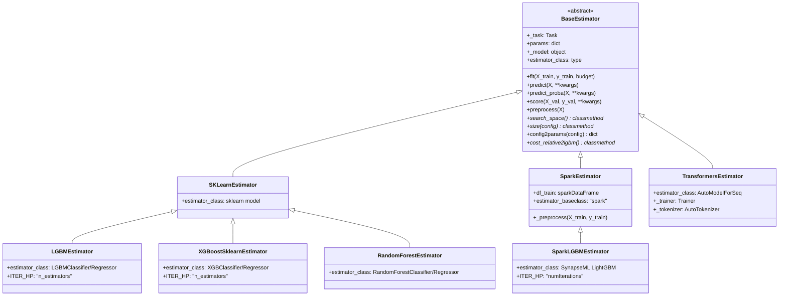
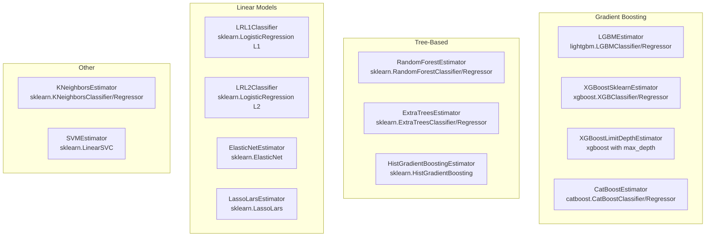
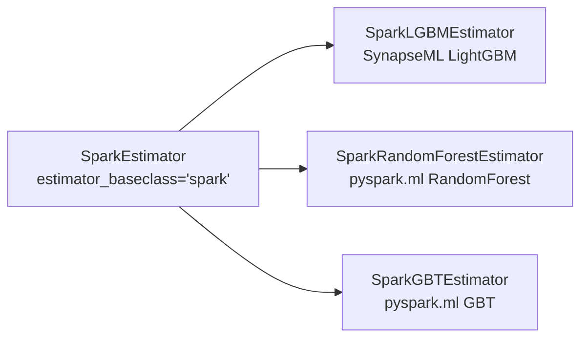
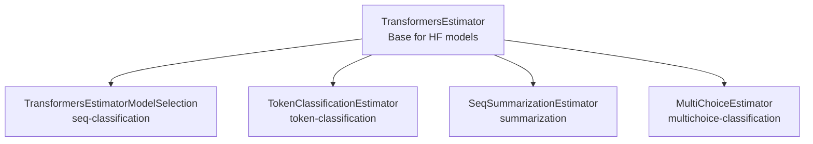
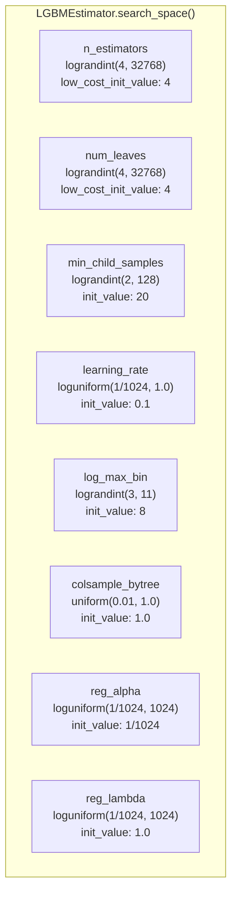
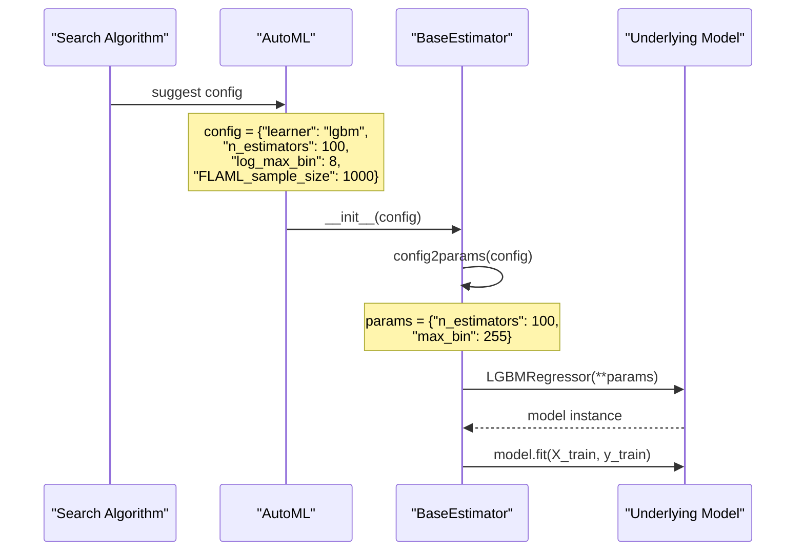
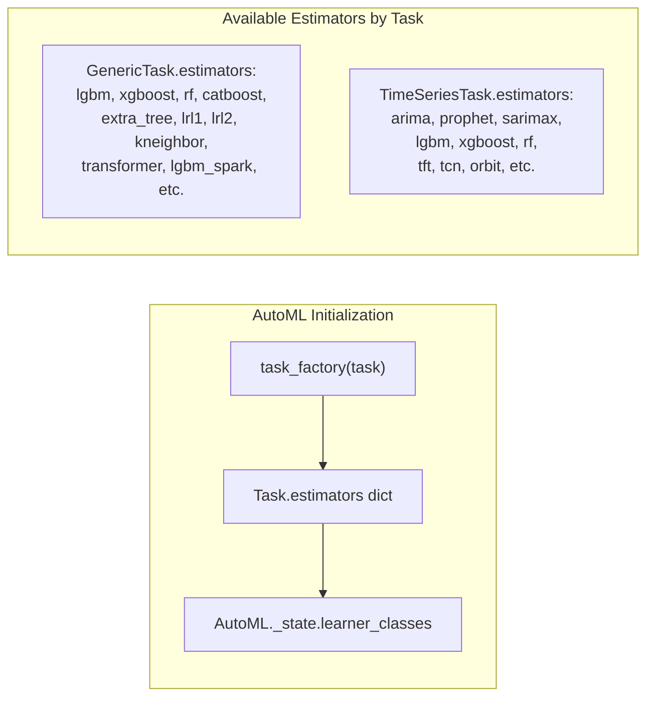
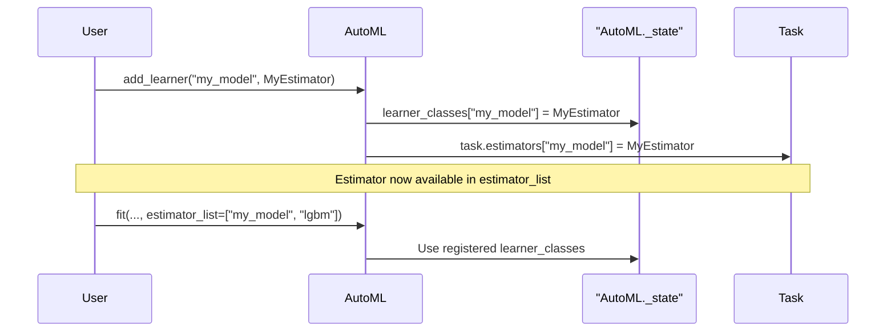
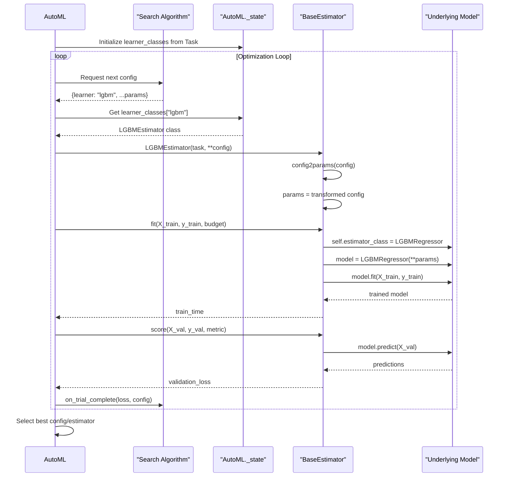

<!-- source: DeepWiki mcp.deepwiki.com · repo microsoft/FLAML · page 3.2 Model Abstraction and Estimators · fetched 2026-10-26 -->

# Model Abstraction and Estimators

<details>
<summary>Relevant source files</summary>

The following files were used as context for generating this wiki page:

- [flaml/automl/automl.py](flaml/automl/automl.py)
- [flaml/automl/model.py](flaml/automl/model.py)
- [test/automl/test_classification.py](test/automl/test_classification.py)
- [test/automl/test_multiclass.py](test/automl/test_multiclass.py)
- [test/automl/test_regression.py](test/automl/test_regression.py)
- [test/conftest.py](test/conftest.py)
- [website/docs/Use-Cases/Task-Oriented-AutoML.md](website/docs/Use-Cases/Task-Oriented-AutoML.md)

</details>


This page documents the model abstraction layer in FLAML, which provides a unified interface for diverse machine learning models. It covers the `BaseEstimator` hierarchy, search space definition, configuration translation, and the estimator registration system that enables AutoML to work seamlessly with traditional ML, distributed computing, deep learning, and time series models.

For information about how estimators are used within the AutoML optimization loop, see [AutoML Core](#3.1). For task-specific considerations, see [Tasks and Data Preparation](#3.3).

---

## Purpose and Design

The model abstraction layer serves three critical functions:

1. **Unified Interface**: Provides consistent `fit()`, `predict()`, and `search_space()` methods across all model types
2. **Search Space Specification**: Enables each estimator to define its own hyperparameter search space in a standardized format
3. **Configuration Translation**: Translates FLAML's internal search space format to model-specific parameters via `config2params()`

This abstraction allows AutoML to optimize hyperparameters across heterogeneous model types without knowing implementation details of each underlying library (scikit-learn, XGBoost, LightGBM, Spark, HuggingFace, etc.).

---

## BaseEstimator: The Abstract Interface

### Class Hierarchy



Sources: [flaml/automl/model.py:121-488]()

### Core Methods and Properties

The `BaseEstimator` class defines the contract that all estimators must follow:

| Method/Property | Type | Description |
|-----------------|------|-------------|
| `fit(X_train, y_train, budget)` | instance | Trains the model with optional time/memory budget constraints |
| `predict(X, **kwargs)` | instance | Generates predictions from features |
| `predict_proba(X, **kwargs)` | instance | Returns class probabilities (classification only) |
| `score(X_val, y_val, **kwargs)` | instance | Evaluates the model on validation data |
| `preprocess(X)` | instance | Applies estimator-level preprocessing transformations |
| `search_space(data_size, task)` | classmethod | Returns the hyperparameter search space definition |
| `config2params(config)` | instance | Translates search space config to model constructor params |
| `size(config)` | classmethod | Estimates memory size in bytes for a configuration |
| `cost_relative2lgbm()` | classmethod | Returns relative computational cost compared to LightGBM |
| `model` / `estimator` | property | Returns the trained underlying model after `fit()` |
| `classes_` | property | Returns class labels (classification) |
| `feature_names_in_` | property | Returns feature names used during training |
| `feature_importances_` | property | Returns feature importance scores |

Sources: [flaml/automl/model.py:121-488]()

### Abstract Methods Requirements

Every estimator must implement the `search_space()` classmethod. This method returns a dictionary where:
- Keys are hyperparameter names
- Values are dictionaries with `domain`, `init_value`, and optionally `low_cost_init_value`

```python
@classmethod
def search_space(cls, data_size, task, **params):
    return {
        "n_estimators": {
            "domain": tune.lograndint(lower=4, upper=32768),
            "init_value": 4,
            "low_cost_init_value": 4,
        },
        "learning_rate": {
            "domain": tune.loguniform(lower=1/1024, upper=1.0),
            "init_value": 0.1,
        },
    }
```

The `config2params()` method translates FLAML's internal search configuration to parameters accepted by the underlying model's constructor. By default, it simply removes internal FLAML keys like `FLAML_sample_size`.

Sources: [flaml/automl/model.py:435-488](), [website/docs/Use-Cases/Task-Oriented-AutoML.md:316-323]()

---

## Estimator Hierarchy and Types

### Traditional Machine Learning Estimators

FLAML includes scikit-learn compatible estimators that wrap gradient boosting, tree-based, and linear models:



All these estimators inherit from `SKLearnEstimator`, which sets `self.estimator_class` to the appropriate scikit-learn compatible class. The base `fit()` method instantiates `self.estimator_class(**self.params)` and calls its `fit()` method.

Sources: [flaml/automl/model.py:672-2350](), [website/docs/Use-Cases/Task-Oriented-AutoML.md:179-191]()

### Spark Distributed Estimators

The `SparkEstimator` base class supports distributed training on Spark clusters using pyspark.ml and SynapseML APIs:



Key differences from sklearn estimators:
- `_preprocess()` converts pandas-on-Spark DataFrames to Spark DataFrames
- `fit()` expects pyspark.pandas DataFrames as input
- `predict()` returns pyspark.pandas Series with predictions
- Parameters use Spark/SynapseML naming conventions (e.g., `numIterations` instead of `n_estimators`)

Sources: [flaml/automl/model.py:490-818]()

### Deep Learning Estimators

#### Transformers for NLP

The `TransformersEstimator` family wraps HuggingFace Transformers models:



These estimators handle tokenization, training arguments, and HuggingFace `Trainer` initialization internally. They expose hyperparameters like `learning_rate`, `num_train_epochs`, `per_device_train_batch_size` in their search space.

Sources: [website/docs/Use-Cases/Task-Oriented-AutoML.md:196](), Diagram 4 from high-level architecture

#### Time Series Deep Learning

Time series forecasting includes deep learning models:
- `TemporalFusionTransformerEstimator` (TFT): Multi-horizon attention-based forecasting
- `TCNEstimator`: Temporal Convolutional Networks

These require optional dependencies (PyTorch, pytorch-forecasting) and are only available when installed.

Sources: [website/docs/Use-Cases/Task-Oriented-AutoML.md:197-198](), Diagram 4 from high-level architecture

---

## Search Space Definition

### Domain Specification

The search space for each estimator is defined using `flaml.tune` domain functions:

| Domain Function | Description | Example |
|----------------|-------------|---------|
| `tune.uniform(lower, upper)` | Continuous uniform distribution | `tune.uniform(0.0, 1.0)` |
| `tune.loguniform(lower, upper)` | Continuous log-uniform distribution | `tune.loguniform(1e-5, 1e-1)` |
| `tune.randint(lower, upper)` | Discrete uniform integer | `tune.randint(1, 100)` |
| `tune.lograndint(lower, upper)` | Discrete log-uniform integer | `tune.lograndint(4, 32768)` |
| `tune.choice([...])` | Categorical choice | `tune.choice(['gini', 'entropy'])` |
| constant value | Fixed hyperparameter | `"subsample_freq": {"domain": 1}` |

### Search Space Structure

Each hyperparameter in the search space dictionary has the following fields:

```python
{
    "hyperparameter_name": {
        "domain": tune.lograndint(lower=4, upper=1000),  # Required: sampling domain
        "init_value": 100,                               # Optional: initial value to try
        "low_cost_init_value": 4,                        # Optional: computationally cheap starting point
    }
}
```

The `low_cost_init_value` is crucial for cost-frugal optimization. It represents a configuration known to train quickly, allowing FLAML to explore the search space efficiently even under tight time budgets.

Sources: [website/docs/Use-Cases/Task-Oriented-AutoML.md:316-323]()

### Example: LightGBM Search Space



Note that `log_max_bin` is a FLAML-specific parameter. The actual LightGBM parameter `max_bin` is derived via `config2params()`: `max_bin = (1 << log_max_bin) - 1`. This log transformation enables more efficient search over exponentially-scaled hyperparameters.

Sources: [flaml/automl/model.py:705-781]()

---

## Configuration Translation: config2params()

### Purpose and Workflow



The `config2params()` method performs three key transformations:

1. **Remove FLAML-specific keys**: Keys like `FLAML_sample_size`, `learner`, `_choice_` are internal to FLAML and not passed to the model
2. **Transform hyperparameter names**: Convert FLAML search space parameter names to model-specific names (e.g., `log_max_bin` → `max_bin`)
3. **Apply transformations**: Apply mathematical transformations (e.g., `max_bin = (1 << log_max_bin) - 1`)

Sources: [flaml/automl/model.py:475-487](), [flaml/automl/model.py:782-797]()

### Example Implementations

**LightGBM:**
```python
def config2params(self, config: dict) -> dict:
    params = super().config2params(config)
    if "log_max_bin" in params:
        params["max_bin"] = (1 << params.pop("log_max_bin")) - 1
    return params
```

**XGBoost:**
```python
def config2params(self, config: dict) -> dict:
    params = super().config2params(config)
    # max_depth must be int
    max_depth = params.get("max_depth")
    if max_depth is not None:
        params["max_depth"] = 0 if max_depth == 0 else max(1, int(max_depth))
    return params
```

**Spark LightGBM:**
```python
def config2params(self, config: dict) -> dict:
    params = super().config2params(config)
    if "n_jobs" in params:
        params.pop("n_jobs")  # Not applicable in Spark context
    if "log_max_bin" in params:
        params["maxBin"] = (1 << params.pop("log_max_bin")) - 1
    return params
```

Sources: [flaml/automl/model.py:782-797](), [flaml/automl/model.py:660-666]()

---

## Estimator Registration System

### Built-in Estimator Registry

FLAML maintains a registry of estimators in `AutoML._state.learner_classes`:



The available estimators depend on:
1. The task type (classification, regression, forecasting, etc.)
2. Installed optional dependencies (e.g., prophet, catboost, ray)
3. Execution environment (e.g., Spark estimators only available in Spark contexts)

To list available estimators for a task:
```python
from flaml.automl.task.factory import task_factory

print("classification:", sorted(task_factory("classification").estimators.keys()))
print("regression:", sorted(task_factory("regression").estimators.keys()))
print("forecast:", sorted(task_factory("forecast").estimators.keys()))
```

Sources: [website/docs/Use-Cases/Task-Oriented-AutoML.md:212-234](), [flaml/automl/automl.py:369-371]()

### Adding Custom Estimators

Custom estimators are registered using `AutoML.add_learner()`:



The registration process:
1. Validates that the custom class inherits from `BaseEstimator`
2. Adds it to `_state.learner_classes` dictionary
3. Makes it available for selection in `estimator_list`

Sources: [flaml/automl/automl.py:1288-1320]()

---

## Creating Custom Estimators

### Basic Structure

To create a custom estimator:

1. **Inherit from BaseEstimator or a subclass** (e.g., `SKLearnEstimator`)
2. **Set `self.estimator_class`** in the constructor to the underlying model class
3. **Define `search_space()` classmethod** to specify hyperparameter ranges
4. **(Optional) Override `config2params()`** for parameter transformations
5. **(Optional) Override `size()` and `cost_relative2lgbm()`** for resource estimation

### Example: Regularized Greedy Forest

```python
from flaml.automl.model import SKLearnEstimator
from flaml import tune

class MyRegularizedGreedyForest(SKLearnEstimator):
    def __init__(self, task="binary", **config):
        super().__init__(task, **config)
        
        if isinstance(task, str):
            from flaml.automl.task.factory import task_factory
            task = task_factory(task)
        
        if task.is_classification():
            from rgf.sklearn import RGFClassifier
            self.estimator_class = RGFClassifier
        else:
            from rgf.sklearn import RGFRegressor
            self.estimator_class = RGFRegressor
    
    @classmethod
    def search_space(cls, data_size, task):
        return {
            "max_leaf": {
                "domain": tune.lograndint(lower=4, upper=data_size[0]),
                "init_value": 4,
            },
            "n_iter": {
                "domain": tune.lograndint(lower=1, upper=data_size[0]),
                "init_value": 1,
            },
            "learning_rate": {
                "domain": tune.loguniform(lower=0.01, upper=20.0)
            },
        }
    
    @classmethod
    def size(cls, config):
        max_leaves = int(round(config.get("max_leaf", 1)))
        n_estimators = int(round(config.get("n_iter", 1)))
        return (max_leaves * 3 + (max_leaves - 1) * 4 + 1.0) * n_estimators * 8
```

Sources: [test/automl/test_multiclass.py:13-67](), [website/docs/Use-Cases/Task-Oriented-AutoML.md:236-294]()

### Registration and Usage

```python
from flaml import AutoML

automl = AutoML()
automl.add_learner(learner_name="rgf", learner_class=MyRegularizedGreedyForest)

automl.fit(
    X_train, y_train,
    task="classification",
    time_budget=60,
    estimator_list=["rgf", "lgbm", "xgboost"],  # Mix custom with built-in
)
```

Sources: [website/docs/Use-Cases/Task-Oriented-AutoML.md:298-312]()

### Customizing Built-in Estimators

To customize search space or constructor arguments of a built-in estimator, inherit from it:

```python
from flaml.automl.model import XGBoostSklearnEstimator

class MyXGBoost(XGBoostSklearnEstimator):
    """XGBoost with custom objective function"""
    
    def __init__(self, **config):
        super().__init__(objective=my_custom_objective, **config)
```

Or override the search space:

```python
class XGBoost2D(XGBoostSklearnEstimator):
    """XGBoost tuning only 2 hyperparameters"""
    
    @classmethod
    def search_space(cls, data_size, task):
        upper = min(32768, int(data_size))
        return {
            "n_estimators": {
                "domain": tune.lograndint(lower=4, upper=upper),
                "low_cost_init_value": 4,
            },
            "max_leaves": {
                "domain": tune.lograndint(lower=4, upper=upper),
                "low_cost_init_value": 4,
            },
        }
```

Sources: [website/docs/Use-Cases/Task-Oriented-AutoML.md:324-364](), [test/automl/test_regression.py:25-37]()

### Shortcut: custom_hp Argument

For quick search space modifications without creating a new class, use the `custom_hp` argument in `fit()`:

```python
custom_hp = {
    "xgboost": {
        "n_estimators": {
            "domain": tune.lograndint(lower=10, upper=1000),
            "low_cost_init_value": 10,
        },
    },
    "rf": {
        "max_leaves": {
            "domain": None,  # Disable this hyperparameter
        },
    },
    "lgbm": {
        "subsample": {
            "domain": tune.uniform(lower=0.1, upper=1.0),
            "init_value": 1.0,
        },
        "subsample_freq": {
            "domain": 1,  # Fixed value (must be > 0 to enable subsample)
        },
    },
}

automl.fit(X_train, y_train, custom_hp=custom_hp, task="classification")
```

Sources: [website/docs/Use-Cases/Task-Oriented-AutoML.md:366-393](), [flaml/automl/automl.py:419]()

---

## Built-in Estimator Reference

### Gradient Boosting Models

| Estimator Key | Class | Underlying Library | Key Hyperparameters |
|--------------|-------|-------------------|---------------------|
| `lgbm` | `LGBMEstimator` | LightGBM | n_estimators, num_leaves, min_child_samples, learning_rate, log_max_bin, colsample_bytree, reg_alpha, reg_lambda |
| `xgboost` | `XGBoostSklearnEstimator` | XGBoost | n_estimators, max_leaves, min_child_weight, learning_rate, subsample, colsample_bylevel, colsample_bytree, reg_alpha, reg_lambda |
| `xgb_limitdepth` | `XGBoostLimitDepthEstimator` | XGBoost | n_estimators, max_depth, min_child_weight, learning_rate, subsample, colsample_bylevel, colsample_bytree, reg_alpha, reg_lambda |
| `catboost` | `CatBoostEstimator` | CatBoost | early_stopping_rounds, learning_rate, n_estimators |
| `histgb` | `HistGradientBoostingEstimator` | scikit-learn | n_estimators, max_leaves, min_samples_leaf, learning_rate, log_max_bin, l2_regularization |

Sources: [website/docs/Use-Cases/Task-Oriented-AutoML.md:179-190]()

### Tree-Based Models

| Estimator Key | Class | Underlying Library | Key Hyperparameters |
|--------------|-------|-------------------|---------------------|
| `rf` | `RandomForestEstimator` | scikit-learn | n_estimators, max_features, max_leaves, criterion |
| `extra_tree` | `ExtraTreesEstimator` | scikit-learn | n_estimators, max_features, max_leaves, criterion |

Sources: [website/docs/Use-Cases/Task-Oriented-AutoML.md:183-186]()

### Linear Models

| Estimator Key | Class | Underlying Library | Key Hyperparameters |
|--------------|-------|-------------------|---------------------|
| `lrl1` | `LRL1Classifier` | scikit-learn LogisticRegression | C (L1 regularization) |
| `lrl2` | `LRL2Classifier` | scikit-learn LogisticRegression | C (L2 regularization) |
| `enet` | `ElasticNetEstimator` | scikit-learn ElasticNet | alpha, l1_ratio |
| `lassolars` | `LassoLarsEstimator` | scikit-learn LassoLars | alpha |

Sources: [website/docs/Use-Cases/Task-Oriented-AutoML.md:188-189]()

### Distributed Spark Models

| Estimator Key | Class | Underlying Library | Notes |
|--------------|-------|-------------------|-------|
| `lgbm_spark` | `SparkLGBMEstimator` | SynapseML | Requires Spark environment, uses Spark parameter naming |
| `rf_spark` | `SparkRandomForestEstimator` | pyspark.ml | MLlib RandomForest for Spark |
| `gbt_spark` | `SparkGBTEstimator` | pyspark.ml | MLlib Gradient-Boosted Trees |
| `lr_spark` | `SparkLinearRegression` | pyspark.ml | MLlib Linear Regression |

Sources: [website/docs/Use-Cases/Task-Oriented-AutoML.md:199-207]()

### Deep Learning Models

| Estimator Key | Class | Underlying Library | Tasks |
|--------------|-------|-------------------|-------|
| `transformer` | `TransformersEstimatorModelSelection` | HuggingFace Transformers | seq-classification, seq-regression, token-classification, summarization, multichoice-classification |
| `tft` | `TemporalFusionTransformerEstimator` | pytorch-forecasting | ts_forecast_panel |
| `tcn` | `TCNEstimator` | PyTorch | ts_forecast |

Sources: [website/docs/Use-Cases/Task-Oriented-AutoML.md:196-198]()

### Time Series Models

| Estimator Key | Class | Underlying Library | Key Hyperparameters |
|--------------|-------|-------------------|---------------------|
| `prophet` | `Prophet` | Prophet | changepoint_prior_scale, seasonality_prior_scale, holidays_prior_scale, seasonality_mode |
| `arima` | `ARIMA` | statsmodels | p, d, q |
| `sarimax` | `SARIMAX` | statsmodels | p, d, q, P, D, Q, s |
| `holt-winters` | `HoltWinters` | statsmodels | seasonal_periods, seasonal, use_boxcox, trend, damped_trend |

Sources: [website/docs/Use-Cases/Task-Oriented-AutoML.md:192-195]()

---

## Integration with AutoML Workflow

### Estimator Lifecycle in AutoML



Sources: [flaml/automl/automl.py:1630-1850](), Diagram 2 from high-level architecture

### Memory and Resource Management

Estimators participate in resource management through two classmethods:

**`size(config)`**: Returns estimated memory usage in bytes for a configuration
```python
@classmethod
def size(cls, config):
    num_leaves = int(round(config.get("num_leaves", 1)))
    n_estimators = int(round(config["n_estimators"]))
    return (num_leaves * 3 + (num_leaves - 1) * 4 + 1.0) * n_estimators * 8
```

**`cost_relative2lgbm()`**: Returns relative computational cost compared to LightGBM
```python
@classmethod
def cost_relative2lgbm(cls):
    return 1.6  # e.g., XGBoost is ~60% slower than LightGBM
```

These are used by AutoML to:
1. Respect memory constraints (`mem_thres` parameter)
2. Estimate trial durations for time budget allocation
3. Prioritize faster models early in search

Sources: [flaml/automl/model.py:453-468](), [flaml/automl/automl.py:78-88]()

### Resource Limiting During Training

When `free_mem_ratio` or `budget` are specified, estimators with `limit_resource=True` train under resource constraints:

```python
def fit(self, X_train, y_train, budget=None, free_mem_ratio=0, **kwargs):
    if getattr(self, "limit_resource", None) and resource is not None:
        with limit_resource(memory_limit, time_limit):
            train_time = self._fit(X_train, y_train, **kwargs)
```

The `limit_resource` context manager:
- Sets memory limits using `resource.setrlimit(resource.RLIMIT_AS, ...)`
- Sets time limits using `signal.alarm()`
- Catches `MemoryError` and `TimeoutError`, falling back to a dummy model

Sources: [flaml/automl/model.py:279-322](), [flaml/automl/model.py:86-119]()

---

## Best Practices

### 1. Search Space Design
- Use `low_cost_init_value` for parameters that significantly affect training time (e.g., `n_estimators`, `num_leaves`)
- Use log-scale domains (`loguniform`, `lograndint`) for parameters that span orders of magnitude
- Provide sensible `init_value` based on domain knowledge or data-dependent defaults

### 2. Parameter Transformation
- Keep FLAML search space parameters intuitive (e.g., `log_max_bin` instead of `max_bin`)
- Handle all necessary transformations in `config2params()`
- Remove inapplicable parameters (e.g., `n_jobs` for Spark estimators)

### 3. Resource Estimation
- Implement `size()` accurately to help AutoML respect memory constraints
- Set `cost_relative2lgbm()` to reflect actual training time relative to LightGBM
- Consider data-dependent resource usage in the implementation

### 4. Custom Estimators
- Inherit from the most specific base class (e.g., `SKLearnEstimator` for sklearn-compatible models)
- Handle task-specific logic (classification vs regression) in `__init__`
- Test with both `eval_method="holdout"` and `eval_method="cv"`

### 5. Constructor Signature
- Always include task-specific parameters (like `task` or `n_jobs`) in the `__init__` signature explicitly, not in `**config`
- This prevents them from being passed to the underlying model, which may not accept them

Sources: [website/docs/Use-Cases/Task-Oriented-AutoML.md:296]()

---

