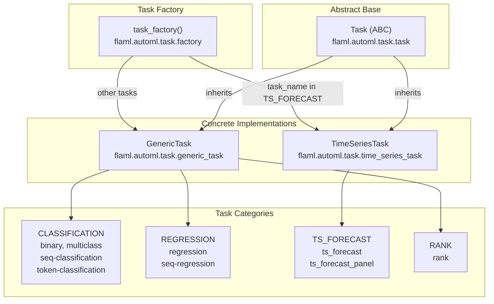
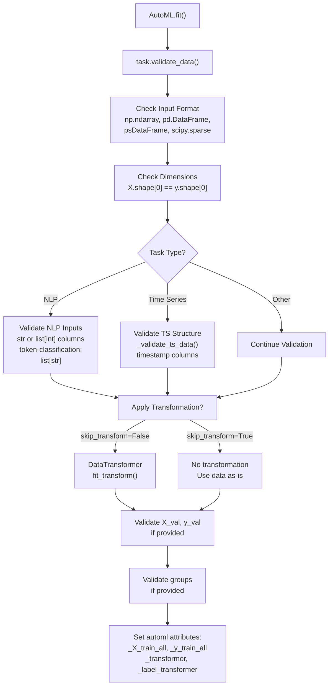
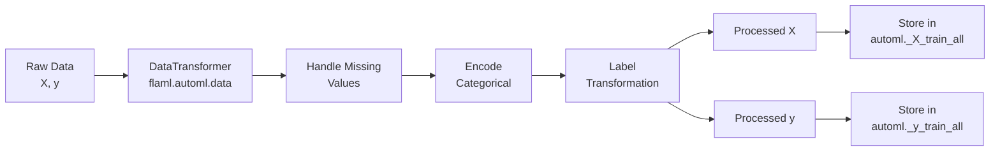
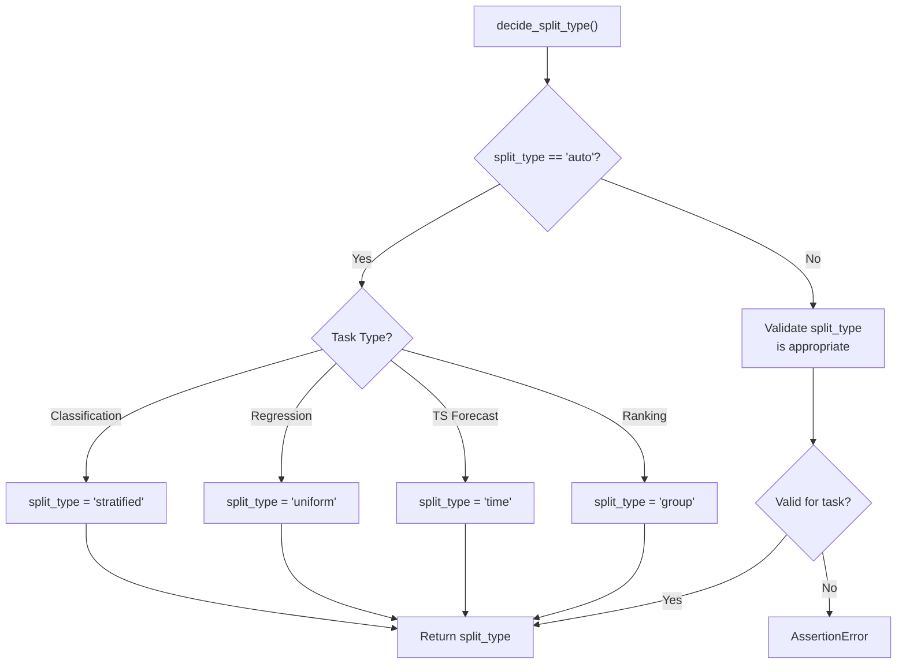
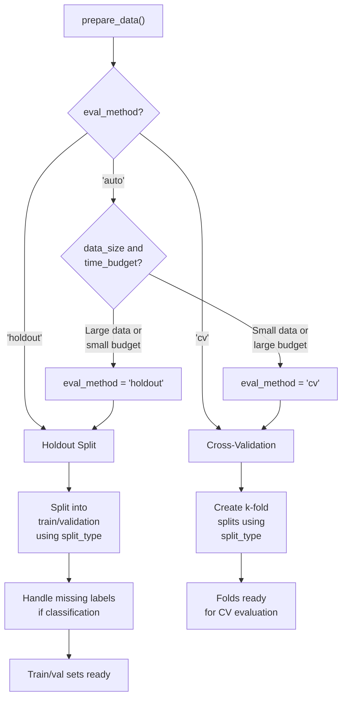
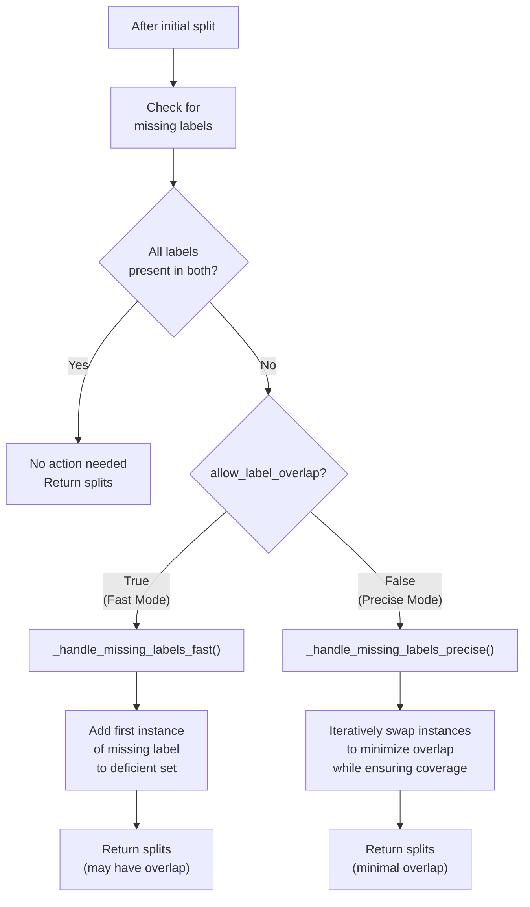
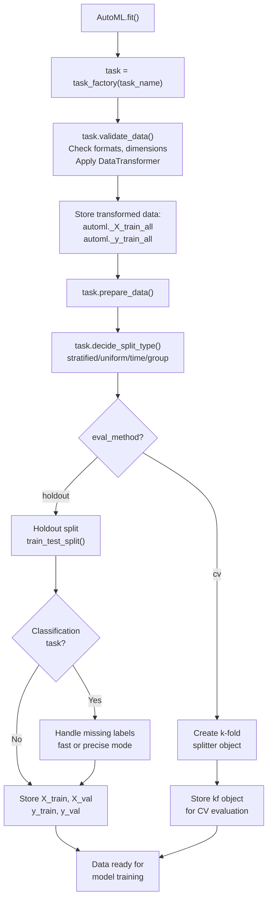

<!-- source: DeepWiki mcp.deepwiki.com · repo microsoft/FLAML · page 3.3 Tasks and Data Preparation · fetched 2026-10-26 -->

# Tasks and Data Preparation

<details>
<summary>Relevant source files</summary>

The following files were used as context for generating this wiki page:

- [flaml/automl/automl.py](flaml/automl/automl.py)
- [flaml/automl/task/__init__.py](flaml/automl/task/__init__.py)
- [flaml/automl/task/factory.py](flaml/automl/task/factory.py)
- [flaml/automl/task/generic_task.py](flaml/automl/task/generic_task.py)
- [flaml/automl/task/task.py](flaml/automl/task/task.py)
- [test/automl/test_multiclass.py](test/automl/test_multiclass.py)
- [test/automl/test_no_overlap.py](test/automl/test_no_overlap.py)
- [test/automl/test_score.py](test/automl/test_score.py)
- [test/automl/test_split.py](test/automl/test_split.py)
- [website/docs/Use-Cases/Task-Oriented-AutoML.md](website/docs/Use-Cases/Task-Oriented-AutoML.md)

</details>


## Purpose and Scope

This document describes FLAML's Task abstraction layer and data preparation pipeline, which handle data validation, preprocessing, and splitting before model training. The Task system provides a unified interface for different machine learning problems while accommodating task-specific requirements.

For estimator-specific details, see [Model Abstraction and Estimators](#3.2). For time series-specific features, see [Time Series Forecasting](#3.4). For NLP-specific preprocessing, see [NLP and Transformers](#3.5).

---

## Task Abstraction Layer

### Task Class Hierarchy

FLAML uses an abstract `Task` class to encapsulate task-specific behavior. Each task type implements methods for data validation, preparation, and model evaluation.

**Diagram 1: Task Type System**



Sources: [flaml/automl/task/task.py:1-350](), [flaml/automl/task/factory.py:1-21](), [flaml/automl/task/generic_task.py:1-102]()

### Task Factory

The `task_factory()` function instantiates the appropriate task implementation based on the task name:

| Task Name(s) | Task Class | Description |
|--------------|-----------|-------------|
| `"classification"`, `"binary"`, `"multiclass"` | GenericTask | Binary/multi-class classification |
| `"regression"` | GenericTask | Regression problems |
| `"seq-classification"`, `"seq-regression"` | GenericTask | NLP sequence tasks |
| `"token-classification"`, `"summarization"` | GenericTask | NLP token/generation tasks |
| `"rank"` | GenericTask | Learning to rank |
| `"ts_forecast"`, `"ts_forecast_panel"` | TimeSeriesTask | Time series forecasting |

**Example Task Instantiation:**

```python
from flaml.automl.task.factory import task_factory

# Create a classification task
task = task_factory("classification", X_train, y_train)

# Create a time series task
ts_task = task_factory("ts_forecast", X_train, y_train)
```

Sources: [flaml/automl/task/factory.py:9-20](), [flaml/automl/task/task.py:12-50]()

### Task Abstract Methods

The `Task` abstract base class defines the interface that all concrete implementations must provide:

| Method | Purpose |
|--------|---------|
| `validate_data()` | Validates input data format and constraints |
| `prepare_data()` | Splits data into train/validation sets |
| `evaluate_model_CV()` | Evaluates model using cross-validation |
| `decide_split_type()` | Determines appropriate data split strategy |
| `preprocess()` | Applies task-specific preprocessing |
| `default_estimator_list()` | Returns valid estimators for the task |
| `default_metric()` | Returns default evaluation metric |

Sources: [flaml/automl/task/task.py:60-350]()

---

## Data Validation

### Validation Pipeline

The `validate_data()` method performs comprehensive input validation before model training begins. It is called by `AutoML.fit()` early in the workflow.

**Diagram 2: Data Validation Flow**



Sources: [flaml/automl/task/generic_task.py:103-263](), [flaml/automl/automl.py:1290-1300]()

### Input Format Requirements

**Supported Data Types:**

| Data Type | X_train | y_train | Notes |
|-----------|---------|---------|-------|
| NumPy arrays | `np.ndarray` | `np.ndarray` | Most efficient for dense numeric data |
| Pandas DataFrames | `pd.DataFrame` | `pd.Series` | Supports mixed types, categorical |
| Scipy sparse | `scipy.sparse` matrices | `np.ndarray` | For high-dimensional sparse data |
| Spark DataFrames | `pyspark.pandas.DataFrame` | `pyspark.pandas.Series` | For distributed data processing |

**Key Validation Checks:**

```python
# From generic_task.py:116-129
assert isinstance(X_train_all, (np.ndarray, pd.DataFrame, psDataFrame)) or issparse(X_train_all)
assert isinstance(y_train_all, (np.ndarray, pd.Series, psSeries))
assert X_train_all.size != 0 and y_train_all.size != 0
assert X_train_all.shape[0] == y_train_all.shape[0]
```

Sources: [flaml/automl/task/generic_task.py:116-138]()

### NLP Task Validation

For NLP tasks (`seq-classification`, `token-classification`, `summarization`, etc.), additional validation ensures text data is properly formatted:

**Token Classification Requirements:**
- Each cell must be a **list of strings** (not a single string)
- Example: `['EU', 'rejects', 'German', 'call', 'to', 'boycott', 'British', 'lamb', '.']`

**Other NLP Tasks:**
- Each cell must be either:
  - A **string** (untokenized text), or
  - A **list of integers** (tokenized IDs)
- All columns must use the same format (all strings OR all lists)

```python
# From generic_task.py:161-192
if self.is_nlp():
    for column in X.columns:
        assert X[column].dtype.name in ("object", "string")
        for _, each_cell in X[column].items():
            if self.is_token_classification():
                # Must be list of strings
                assert is_list_of_str(each_cell)
            else:
                # Must be str or list[int]
                assert is_str or is_list_of_int
```

Sources: [flaml/automl/task/generic_task.py:161-192](), [test/automl/test_multiclass.py:176-180]()

### Spark DataFrame Handling

When using Spark DataFrames (`pyspark.pandas`), FLAML caches the data for performance and automatically skips certain transformations:

```python
# From generic_task.py:130-133
if isinstance(X_train_all, psDataFrame):
    X_train_all = X_train_all.spark.cache()  # Cache for performance
    y_train_all = y_train_all.to_frame().spark.cache()[y_train_all.name]
    
# From generic_task.py:193-196
if isinstance(X, psDataFrame):
    # Spark DataFrames skip DataTransformer
    automl._skip_transform = True
```

Sources: [flaml/automl/task/generic_task.py:130-196]()

---

## Data Preprocessing

### DataTransformer Pipeline

When `skip_transform=False` (default), FLAML applies a `DataTransformer` to handle common preprocessing tasks:

**Diagram 3: DataTransformer Pipeline**



**DataTransformer Operations:**

| Operation | Applied To | Purpose |
|-----------|-----------|---------|
| Missing value imputation | X (features) | Fills NaN values |
| Categorical encoding | X (features) | Converts categories to numeric |
| Label encoding | y (targets) | Encodes string labels to integers |
| Type conversion | X, y | Ensures compatible data types |

**When Transformation is Skipped:**

1. `skip_transform=True` is set explicitly
2. `X_train_all` is a scipy sparse matrix
3. `X_train_all` is a Spark DataFrame (pandas_on_spark)

```python
# From generic_task.py:196-208
if automl._skip_transform or issparse(X_train_all):
    automl._transformer = automl._label_transformer = False
    automl._X_train_all, automl._y_train_all = X, y
else:
    automl._transformer = DataTransformer()
    automl._X_train_all, automl._y_train_all = automl._transformer.fit_transform(X, y, self)
    automl._label_transformer = automl._transformer.label_transformer
```

Sources: [flaml/automl/task/generic_task.py:196-220](), [flaml/automl/data.py]() (referenced but not in files list)

### Label Transformation

For classification tasks with non-integer labels, FLAML automatically encodes them:

```python
# Example: String labels -> integer codes
y_train = pd.Series(['cat', 'dog', 'cat', 'bird', 'dog'])
# After transformation:
y_train_transformed = np.array([0, 1, 0, 2, 1])

# Access label classes
automl.classes_  # Returns: array(['cat', 'dog', 'bird'])
```

The label transformer is stored in `automl._label_transformer` and automatically applied during prediction to convert back to original labels.

Sources: [flaml/automl/task/generic_task.py:204-220](), [test/automl/test_score.py:211-268]()

---

## Data Splitting Strategies

### Split Type Decision Tree

FLAML automatically selects an appropriate split type based on the task, or you can specify one explicitly.

**Diagram 4: Split Type Selection Logic**



Sources: [flaml/automl/task/generic_task.py:1090-1145]()

### Available Split Types

| Split Type | Description | Suitable For | Shuffles Data |
|------------|-------------|--------------|---------------|
| `stratified` | Preserves class distribution | Classification | Yes |
| `uniform` | Random split | Regression, general | Yes |
| `time` | Sequential split (no shuffle) | Time series | No |
| `group` | Keeps groups together | Grouped data, ranking | No |
| Custom splitter | User-defined KFold object | Any (CV only) | Depends on splitter |

**Example Usage:**

```python
# Automatic selection (default)
automl.fit(X_train, y_train, task="classification")  # Uses 'stratified'

# Explicit split type
automl.fit(X_train, y_train, task="classification", split_type="uniform")

# Time-based split
automl.fit(X_train, y_train, task="regression", split_type="time")

# Group-based split with group labels
automl.fit(X_train, y_train, task="rank", 
           split_type="group", groups=group_labels)
```

Sources: [flaml/automl/task/generic_task.py:1090-1145](), [test/automl/test_split.py:12-51]()

### Custom Data Splitters

For cross-validation, you can provide a custom splitter object:

**Requirements:**
- Must inherit from sklearn's `KFold` (or compatible)
- Must implement `split(X)` and `get_n_splits()` methods
- Must set `eval_method="cv"` in `AutoML.fit()`

**Example Custom Splitter:**

```python
from sklearn.model_selection import KFold
import numpy as np

class TestKFold(KFold):
    def __init__(self, n_splits):
        self.n_splits = int(n_splits)
    
    def split(self, X):
        rng = np.random.default_rng()
        train_num = int(len(X) * 0.8)
        for _ in range(self.n_splits):
            permu_idx = rng.permutation(len(X))
            yield permu_idx[:train_num], permu_idx[train_num:]
    
    def get_n_splits(self, X=None, y=None, groups=None):
        return self.n_splits

# Use custom splitter
automl.fit(X_train, y_train, 
           eval_method="cv", 
           split_type=TestKFold(5))
```

Sources: [test/automl/test_split.py:228-270](), [flaml/automl/task/generic_task.py:1090-1145]()

### Group-Based Splitting

When data has natural groupings (e.g., multiple samples from the same user/entity), use group splits to prevent data leakage:

**Specifying Groups:**

Groups can be provided in two formats:

1. **Group labels** (same length as data):
   ```python
   groups = np.array([0, 0, 1, 1, 1, 2, 2, 3, 3])  # One label per sample
   ```

2. **Group counts** (sum equals data length):
   ```python
   groups = [2, 3, 2, 2]  # Group sizes: 2+3+2+2=9 samples
   ```

**Example with GroupKFold:**

```python
from sklearn.model_selection import GroupKFold

# Define groups
groups = np.random.randint(0, 10, size=len(y_train))

# Cross-validation with groups
automl.fit(X_train, y_train, 
           eval_method="cv",
           split_type="group",
           groups=groups)

# Holdout split with groups
automl.fit(X_train, y_train,
           eval_method="holdout",
           split_type="group", 
           groups=groups)

# Custom group splitter
automl.fit(X_train, y_train,
           eval_method="cv",
           split_type=GroupKFold(n_splits=3),
           groups=groups)
```

Sources: [test/automl/test_split.py:53-89](), [test/automl/test_split.py:91-118](), [flaml/automl/task/generic_task.py:252-261]()

### Groups with Sample Weights

Groups can be combined with sample weights without issues:

```python
# Create sample weights
sample_weight = np.random.rand(len(y_train))

# Use both groups and sample weights
automl.fit(X_train, y_train,
           eval_method="cv",
           split_type="group",
           groups=groups_train,
           sample_weight=sample_weight_train)
```

Sources: [test/automl/test_split.py:120-155]()

---

## Holdout vs Cross-Validation

### Evaluation Method Selection

FLAML supports two evaluation strategies:

**Diagram 5: Evaluation Method Decision**



Sources: [flaml/automl/task/generic_task.py:655-1045](), [flaml/config.py:24-25]() (CV_HOLDOUT_THRESHOLD)

### Holdout Split Parameters

| Parameter | Default | Description |
|-----------|---------|-------------|
| `eval_method` | `"auto"` | Use `"holdout"` to force holdout split |
| `split_ratio` | `0.1` | Fraction of data for validation (10%) |
| `split_type` | `"auto"` | Split strategy (stratified/uniform/time/group) |
| `X_val`, `y_val` | `None` | Provide explicit validation set |
| `retrain_full` | `True` | Retrain on full data after search |

**Example Holdout Usage:**

```python
# Default holdout (10% validation)
automl.fit(X_train, y_train, 
           eval_method="holdout")

# Custom split ratio (20% validation)
automl.fit(X_train, y_train,
           eval_method="holdout",
           split_ratio=0.2)

# Explicit validation set
automl.fit(X_train, y_train,
           X_val=X_val, y_val=y_val)

# Disable retraining on full data
automl.fit(X_train, y_train,
           eval_method="holdout",
           retrain_full=False)
```

Sources: [flaml/automl/task/generic_task.py:655-890](), [website/docs/Use-Cases/Task-Oriented-AutoML.md:506-516]()

### Cross-Validation Parameters

| Parameter | Default | Description |
|-----------|---------|-------------|
| `eval_method` | `"auto"` | Use `"cv"` to force cross-validation |
| `n_splits` | `5` | Number of folds |
| `split_type` | `"auto"` | Split strategy or custom splitter |
| `cv_score_agg_func` | `None` | Custom aggregation function for CV scores |

**Example CV Usage:**

```python
# Default 5-fold CV
automl.fit(X_train, y_train,
           eval_method="cv")

# 10-fold CV
automl.fit(X_train, y_train,
           eval_method="cv",
           n_splits=10)

# CV with custom splitter
from sklearn.model_selection import StratifiedKFold
automl.fit(X_train, y_train,
           eval_method="cv",
           split_type=StratifiedKFold(n_splits=5, shuffle=True))
```

Sources: [flaml/automl/task/generic_task.py:891-1045](), [website/docs/Use-Cases/Task-Oriented-AutoML.md:506-537](), [flaml/config.py:25]()

---

## Missing Label Handling

### The Problem

When splitting classification data using stratified or uniform splits, some classes may be underrepresented, leading to:
- **Missing labels in training set**: Model cannot learn those classes
- **Missing labels in validation set**: Cannot evaluate performance on those classes

This is especially problematic with:
- Imbalanced datasets
- Small datasets
- Classes with very few instances

### Two Handling Modes

FLAML provides two strategies controlled by the `allow_label_overlap` parameter:

| Mode | `allow_label_overlap` | Speed | Overlap | Use Case |
|------|----------------------|-------|---------|----------|
| Fast | `True` (default) | Fast | May occur | Large datasets, balanced classes |
| Precise | `False` | Slower | Minimized | Small datasets, imbalanced classes |

**Diagram 6: Missing Label Handling Strategy**



Sources: [flaml/automl/task/generic_task.py:368-670]()

### Fast Mode (Default)

**Algorithm:**
1. Identify labels missing from train set
2. Add **first instance** of each missing label to train
3. Identify labels missing from val set
4. Add **first instance** of each missing label to val

**Characteristics:**
- ✅ Very fast (single pass)
- ✅ Ensures all labels present
- ⚠️ May create overlap (same instance in both sets)
- ⚠️ Overlap only for rare classes

**Implementation:**

```python
# From generic_task.py:368-451
def _handle_missing_labels_fast(self, state, X_train, X_val, y_train, y_val, ...):
    # Find unique labels and first occurrence of each
    label_set_all, first = unique_value_first_index(y_train_all)
    label_set_train = np.unique(y_train)
    label_set_val = np.unique(y_val)
    
    # Find missing labels
    missing_in_train = np.setdiff1d(label_set_all, label_set_train)
    missing_in_val = np.setdiff1d(label_set_all, label_set_val)
    
    # Add first instance of missing labels to train
    if len(missing_in_train) > 0:
        for label in missing_in_train:
            idx = first[label_matches[0]]
            X_train = concat(X_train_all[idx], X_train)
            y_train = concat(y_train_all[idx], y_train)
    
    # Add first instance of missing labels to val
    if len(missing_in_val) > 0:
        # Similar logic...
```

**Example:**

```python
# Use fast mode (default)
automl.fit(X_train, y_train,
           task="classification",
           eval_method="holdout",
           allow_label_overlap=True)  # Default

# After split with fast mode:
# Input:  150 samples, 3 classes
# Train:  135 samples, 3 classes
# Val:    15 samples, 3 classes
# Total:  150 samples (no overlap if classes well-represented)
#     or  151 samples (1 overlap if rare class added to both)
```

Sources: [flaml/automl/task/generic_task.py:368-451](), [test/automl/test_no_overlap.py:9-57]()

### Precise Mode

**Algorithm:**
1. Check if all labels present in both sets
2. If not, find **movable instances** (not sole representative of class)
3. Move instances between sets to achieve coverage
4. Only duplicate if no other option (very rare classes)

**Characteristics:**
- ✅ Minimizes overlap intelligently
- ✅ Preserves split ratio as much as possible
- ✅ Better for imbalanced datasets
- ⚠️ Slower (iterative swapping)

**Implementation:**

```python
# From generic_task.py:453-670
def _handle_missing_labels_precise(self, state, X_train, X_val, y_train, y_val, ...):
    # Identify classes that need adjustment
    label_set_train = set(np.unique(y_train))
    label_set_val = set(np.unique(y_val))
    label_set_all = set(np.unique(y_train_all))
    
    missing_in_train = label_set_all - label_set_train
    missing_in_val = label_set_all - label_set_val
    
    # Iteratively swap instances to achieve coverage
    while missing_in_train or missing_in_val:
        # Find instances that can be moved without breaking coverage
        # Move from val to train for missing_in_train labels
        # Move from train to val for missing_in_val labels
        # Only duplicate if instance is sole representative
```

**Example:**

```python
# Use precise mode
automl.fit(X_train, y_train,
           task="classification",
           eval_method="holdout",
           allow_label_overlap=False)

# After split with precise mode:
# Input:  150 samples, 3 classes (50 each)
# Train:  135 samples, 3 classes (45 each)
# Val:    15 samples, 3 classes (5 each)
# Total:  150 samples (no overlap achieved through intelligent swapping)

# With single-instance class:
# Input:  50 samples, 3 classes [40, 9, 1]
# Train:  46 samples, 3 classes [36, 9, 1]  # Class 2 duplicated
# Val:    5 samples, 3 classes [4, 0, 1]     # Class 2 duplicated
# Total:  51 samples (1 overlap for single-instance class)
```

Sources: [flaml/automl/task/generic_task.py:453-670](), [test/automl/test_no_overlap.py:60-110]()

### Performance Comparison

**Benchmark (150 samples, 3 balanced classes):**

| Mode | Time | Train Size | Val Size | Total | Overlap |
|------|------|------------|----------|-------|---------|
| Fast | ~0.01s | 135 | 15 | 150 | 0 |
| Precise | ~0.02s | 135 | 15 | 150 | 0 |

**Benchmark (50 samples, 3 imbalanced classes [40, 9, 1]):**

| Mode | Time | Train Size | Val Size | Total | Overlap |
|------|------|------------|----------|-------|---------|
| Fast | ~0.01s | 46 | 5 | 51 | 1 |
| Precise | ~0.03s | 46 | 5 | 51 | 1 |

**Recommendation:**
- Use **Fast mode** (default) for large, reasonably balanced datasets
- Use **Precise mode** for small or highly imbalanced datasets

Sources: [test/automl/test_no_overlap.py:1-273]()

### Sample Weight Handling

Both modes properly handle sample weights when instances are moved or duplicated:

```python
# Weights are preserved and adjusted
if "sample_weight" in state.fit_kwargs:
    # Get weight of moved/duplicated instance
    missing_weights = sample_weight_all[missing_indices]
    # Add to appropriate set
    state.fit_kwargs["sample_weight"] = concat(missing_weights, weights_train)
    state.weight_val = concat(missing_weights, weights_val)
```

**Example with Weights:**

```python
# Create sample weights
sample_weight = np.random.uniform(0.5, 2.0, size=len(y_train))

# Use with precise mode
automl.fit(X_train, y_train,
           task="classification",
           eval_method="holdout",
           split_type="stratified",
           allow_label_overlap=False,  # Precise mode
           sample_weight=sample_weight)

# Weights are correctly propagated to moved instances
```

Sources: [flaml/automl/task/generic_task.py:439-451](), [flaml/automl/task/generic_task.py:547-562](), [test/automl/test_no_overlap.py:154-224]()

---

## Complete Data Preparation Workflow

**Diagram 7: End-to-End Data Preparation**



Sources: [flaml/automl/automl.py:1270-1400](), [flaml/automl/task/generic_task.py:103-1045]()

### Configuration Examples

**Basic Classification (Stratified Split):**

```python
automl = AutoML()
automl.fit(
    X_train, y_train,
    task="classification",
    time_budget=60
)
# Uses: eval_method="auto" -> holdout
#       split_type="auto" -> stratified
#       allow_label_overlap=True (fast mode)
```

**Time Series (Temporal Split):**

```python
automl = AutoML()
automl.fit(
    X_train, y_train,
    task="ts_forecast",
    time_budget=60
)
# Uses: eval_method="auto" -> holdout
#       split_type="auto" -> time (no shuffle)
```

**Ranking with Groups:**

```python
automl = AutoML()
automl.fit(
    X_train, y_train,
    task="rank",
    time_budget=60,
    groups=group_labels
)
# Uses: eval_method="auto" -> cv or holdout
#       split_type="auto" -> group
```

**Custom Configuration:**

```python
from sklearn.model_selection import StratifiedGroupKFold

automl = AutoML()
automl.fit(
    X_train, y_train,
    task="classification",
    time_budget=60,
    eval_method="cv",
    split_type=StratifiedGroupKFold(n_splits=5),
    groups=groups,
    allow_label_overlap=False,  # Precise mode
    skip_transform=False,  # Use DataTransformer
    sample_weight=weights
)
```

Sources: [website/docs/Use-Cases/Task-Oriented-AutoML.md:506-537](), [test/automl/test_split.py:157-188]()

---

## Summary

### Key Classes and Methods

| Class/Function | File | Purpose |
|----------------|------|---------|
| `Task` | flaml/automl/task/task.py | Abstract base class for task types |
| `GenericTask` | flaml/automl/task/generic_task.py | Classification, regression, NLP, ranking |
| `TimeSeriesTask` | flaml/automl/task/time_series_task.py | Time series forecasting |
| `task_factory()` | flaml/automl/task/factory.py | Creates appropriate task instance |
| `validate_data()` | flaml/automl/task/generic_task.py:103 | Validates input format and constraints |
| `prepare_data()` | flaml/automl/task/generic_task.py:655 | Splits data for training/validation |
| `decide_split_type()` | flaml/automl/task/generic_task.py:1090 | Determines split strategy |
| `_handle_missing_labels_fast()` | flaml/automl/task/generic_task.py:368 | Fast label handling with possible overlap |
| `_handle_missing_labels_precise()` | flaml/automl/task/generic_task.py:453 | Precise label handling minimizing overlap |

### Data Flow Summary

1. **User calls `AutoML.fit()`** with data and task type
2. **Task instantiation** via `task_factory()`
3. **Data validation** via `task.validate_data()`
   - Format checking
   - Dimension validation  
   - Task-specific validation (NLP, time series, etc.)
4. **Data transformation** via `DataTransformer` (unless skipped)
   - Missing value handling
   - Categorical encoding
   - Label encoding
5. **Data preparation** via `task.prepare_data()`
   - Split type selection
   - Train/validation split (holdout or CV)
   - Missing label handling (classification only)
   - Sample weight propagation
6. **Ready for model training** with properly prepared data

Sources: [flaml/automl/automl.py:1270-1400](), [flaml/automl/task/generic_task.py:103-1045](), [flaml/automl/task/factory.py:9-20]()

---

