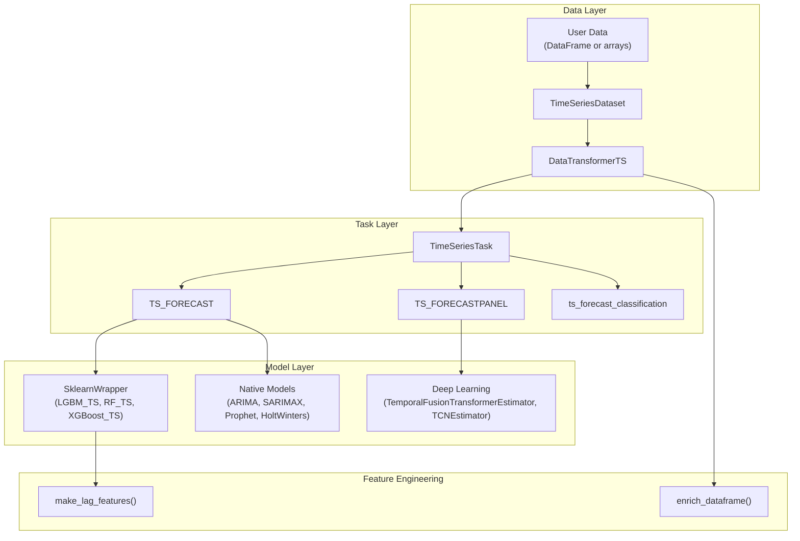
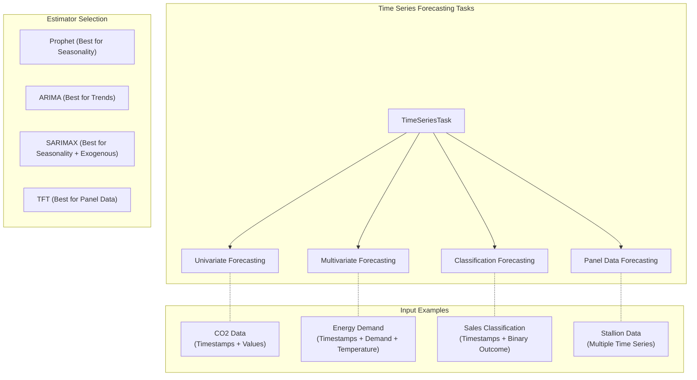
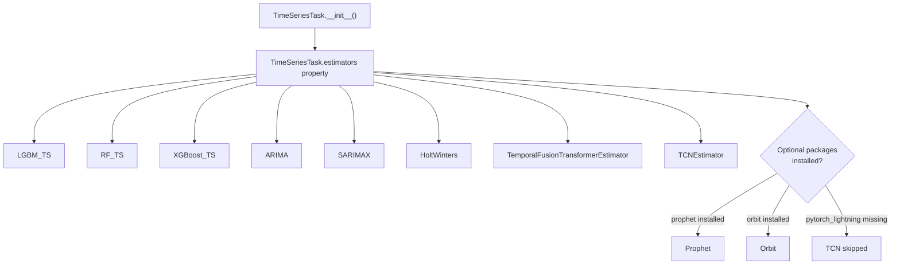
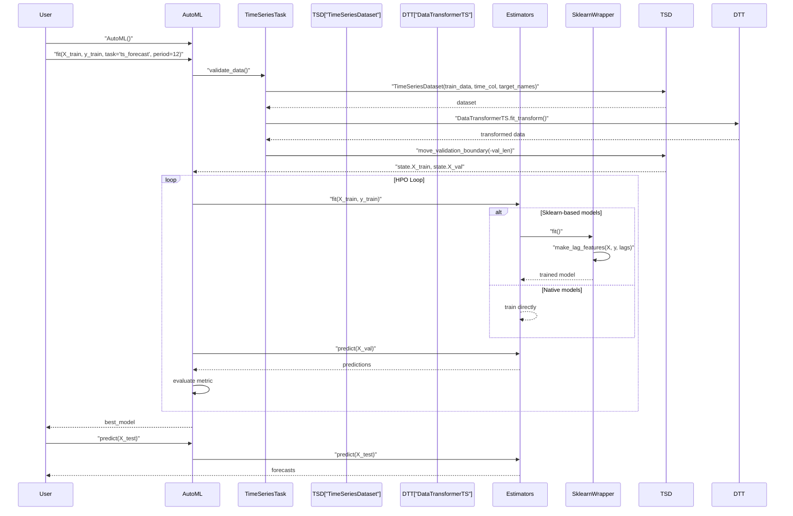
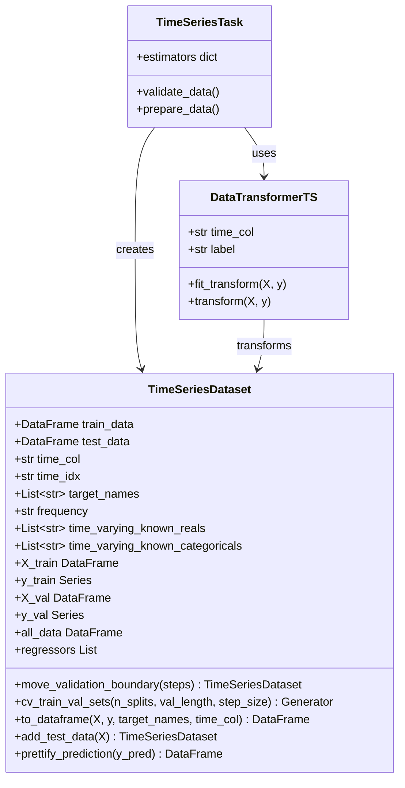
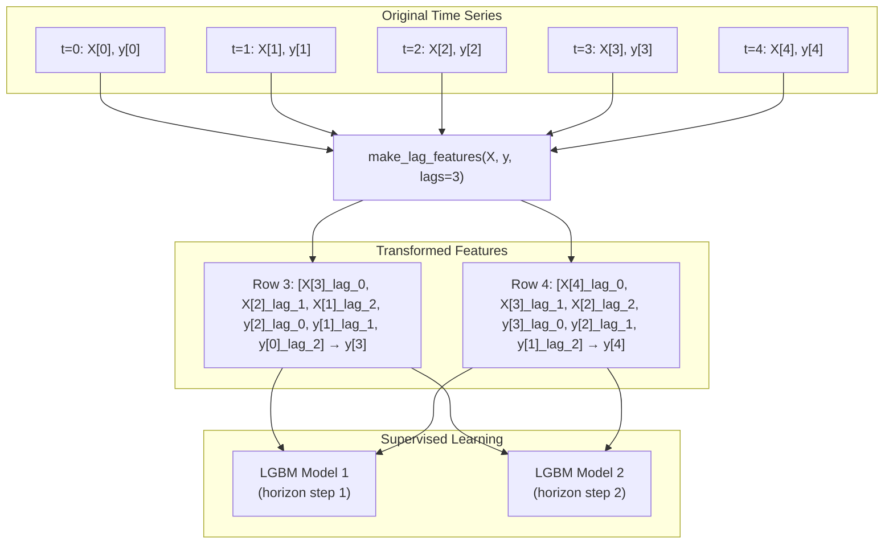

<!-- source: DeepWiki mcp.deepwiki.com · repo microsoft/FLAML · page 3.4 Time Series Forecasting · fetched 2026-10-26 -->

# Time Series Forecasting

<details>
<summary>Relevant source files</summary>

The following files were used as context for generating this wiki page:

- [flaml/automl/nlp/huggingface/training_args.py](flaml/automl/nlp/huggingface/training_args.py)
- [flaml/automl/nlp/huggingface/utils.py](flaml/automl/nlp/huggingface/utils.py)
- [flaml/automl/task/time_series_task.py](flaml/automl/task/time_series_task.py)
- [flaml/automl/time_series/sklearn.py](flaml/automl/time_series/sklearn.py)
- [flaml/automl/time_series/ts_data.py](flaml/automl/time_series/ts_data.py)
- [notebook/automl_classification.ipynb](notebook/automl_classification.ipynb)
- [notebook/automl_time_series_forecast.ipynb](notebook/automl_time_series_forecast.ipynb)
- [test/automl/test_forecast.py](test/automl/test_forecast.py)
- [test/automl/test_notebook_example.py](test/automl/test_notebook_example.py)
- [test/spark/test_0sparkml.py](test/spark/test_0sparkml.py)
- [test/spark/test_automl.py](test/spark/test_automl.py)
- [website/docs/Examples/AutoML-Time series forecast.md](website/docs/Examples/AutoML-Time series forecast.md)

</details>


This page documents the time series forecasting capabilities within FLAML's AutoML system. It explains how to use FLAML for various time series forecasting tasks, the supported algorithms, and configuration options. For general information about FLAML's AutoML system, see [AutoML](#2).

## Overview

Time series forecasting in FLAML enables automated model selection and hyperparameter tuning for predicting future values of time-dependent data. FLAML provides specialized data structures and automatic feature engineering capabilities that distinguish it from standard AutoML tasks.

**Key Components:**
- `TimeSeriesDataset`: Core data structure for managing time series data with train/test splits and metadata
- `DataTransformerTS`: Handles preprocessing and transformations specific to temporal data
- `SklearnWrapper`: Enables sklearn-based models (lgbm, rf, xgboost, etc.) for forecasting via automatic lag feature generation
- Native time series models: ARIMA, SARIMAX, Prophet, Holt-Winters, TFT (Temporal Fusion Transformer)

**Automatic Feature Engineering:**
FLAML automatically creates lagged features for sklearn-based models, transforming time series forecasting into supervised learning. Users do not need to manually create lag features - this is handled internally by the `make_lag_features` function in [flaml/automl/time_series/sklearn.py:19-60]().

Diagram: Time Series Forecasting Architecture



Sources: [flaml/automl/time_series/ts_data.py:33-93](), [flaml/automl/task/time_series_task.py:29-93](), [flaml/automl/time_series/sklearn.py:19-60](), [flaml/automl/time_series/sklearn.py:63-183]()

## Supported Task Types

FLAML supports three main types of time series forecasting tasks:

1. **Standard Time Series Forecasting** (`ts_forecast`): Predicts continuous values in future time periods
2. **Time Series Classification Forecasting** (`ts_forecast_classification`): Predicts categorical or binary values in future time periods
3. **Panel Time Series Forecasting** (`ts_forecast_panel`): Forecasts for multiple related time series with shared characteristics



Sources: [test/automl/test_forecast.py:13-97](test/automl/test_forecast.py:13-97), [test/automl/test_forecast.py:198-403](test/automl/test_forecast.py:198-403), [test/automl/test_forecast.py:406-474](test/automl/test_forecast.py:406-474), [test/automl/test_forecast.py:506-615](test/automl/test_forecast.py:506-615)

## Supported Estimators

FLAML includes multiple time series estimators defined in `TimeSeriesTask.estimators` property. The estimators are categorized into three groups:

**1. Sklearn-based Models (via SklearnWrapper):**
- `LGBM_TS`, `RF_TS`, `XGBoost_TS`, `XGBoostLimitDepth_TS`, `ExtraTrees_TS`, `CatBoost_TS`, `LassoLars_TS`
- These use `SklearnWrapper` to automatically create lagged features via `make_lag_features()`
- Best for: Fast training, handling exogenous variables, multivariate forecasting

**2. Native Statistical Models:**
- `ARIMA`, `SARIMAX`, `HoltWinters`
- Built-in time series forecasting capabilities
- Best for: Capturing trends and seasonality without manual feature engineering

**3. Deep Learning Models:**
- `TemporalFusionTransformerEstimator` (TFT), `TCNEstimator` (Temporal Convolutional Network)
- Best for: Panel data, complex patterns, high-dimensional features

**4. Baseline Models:**
- `Naive`, `SeasonalNaive`, `Average`, `SeasonalAverage`
- Simple baseline models for comparison

**5. Optional External Models:**
- `Prophet` (requires `prophet` package)
- `Orbit` (requires `orbit` package)

| Estimator Class | Code Name | Multivariate | Seasonal | Exogenous | Implementation |
|----------------|-----------|--------------|----------|-----------|----------------|
| `LGBM_TS` | lgbm | ✓ | Via lags | ✓ | SklearnWrapper |
| `Prophet` | prophet | ✓ | Strong | ✓ | Native |
| `ARIMA` | arima | ✗ | Limited | ✗ | Native |
| `SARIMAX` | sarimax | ✓ | Strong | ✓ | Native |
| `HoltWinters` | holt-winters | ✗ | Strong | ✗ | Native |
| `TemporalFusionTransformerEstimator` | tft | ✓ | Strong | ✓ | Deep Learning |
| `TCNEstimator` | tcn | ✓ | Strong | ✓ | Deep Learning |

Diagram: Estimator Initialization Flow



Sources: [flaml/automl/task/time_series_task.py:29-93](), [test/automl/test_forecast.py:98-124]()

## Basic Usage

Diagram: Time Series Forecasting Workflow



**Step-by-step Process:**

1. **Data Preparation**: Convert user data into `TimeSeriesDataset` via [flaml/automl/task/time_series_task.py:96-176]()
2. **Transformation**: Apply `DataTransformerTS` for preprocessing [flaml/automl/task/time_series_task.py:178]()
3. **Validation Split**: Set up train/val split using `move_validation_boundary()` [flaml/automl/time_series/ts_data.py:195-207]()
4. **Model Training**: For sklearn-based models, `SklearnWrapper.fit()` calls `make_lag_features()` [flaml/automl/time_series/sklearn.py:95-122]()
5. **Prediction**: Models generate forecasts via their `predict()` methods

Sources: [flaml/automl/task/time_series_task.py:96-221](), [flaml/automl/time_series/ts_data.py:33-262](), [flaml/automl/time_series/sklearn.py:63-183]()

## TimeSeriesDataset

The `TimeSeriesDataset` class (defined in [flaml/automl/time_series/ts_data.py:33-262]()) is the core data structure for time series forecasting in FLAML. It manages temporal data with proper train/test boundaries and metadata.

**Key Properties:**
- `train_data`, `test_data`: Train and validation DataFrames
- `time_col`: Name of the timestamp column
- `target_names`: List of target column names
- `frequency`: Inferred frequency of time series (e.g., 'D', 'MS')
- `time_varying_known_reals`, `time_varying_known_categoricals`: Exogenous variables

**Key Methods:**
- `move_validation_boundary(steps)`: Shift train/val split by given steps [flaml/automl/time_series/ts_data.py:195-207]()
- `cv_train_val_sets(n_splits, val_length, step_size)`: Generate CV folds [flaml/automl/time_series/ts_data.py:209-218]()
- `to_dataframe(X, y, target_names, time_col)`: Static method to create dataset from arrays [flaml/automl/time_series/ts_data.py:80-85]()

**Data Properties:**
- `X_train`, `y_train`: Training features and target
- `X_val`, `y_val`: Validation features and target
- `X_all`, `y_all`: Combined train and validation data

Diagram: TimeSeriesDataset Structure



**Example Usage:**
```python
# TimeSeriesDataset is created internally by TimeSeriesTask.validate_data()
# Users typically don't instantiate it directly, but it's available as state.X_train

# After fitting:
# automl._state.X_train is a TimeSeriesDataset
# automl._state.X_train.train_data  # Training DataFrame
# automl._state.X_train.frequency   # e.g., 'MS' for month start
```

Sources: [flaml/automl/time_series/ts_data.py:33-262](), [flaml/automl/task/time_series_task.py:96-221]()

## Automatic Lag Feature Generation

For sklearn-based models (lgbm, rf, xgboost, extra_tree, catboost), FLAML automatically converts time series forecasting into a supervised learning problem using the `make_lag_features()` function.

**How It Works:**

The `SklearnWrapper` class [flaml/automl/time_series/sklearn.py:63-183]() wraps sklearn models and:
1. During `fit()`: Calls `make_lag_features(X, y, lags)` to create lagged versions of features [flaml/automl/time_series/sklearn.py:102]()
2. Creates separate models for each step in the forecast horizon [flaml/automl/time_series/sklearn.py:89]()
3. During `predict()`: Generates features from recent history and predicts iteratively [flaml/automl/time_series/sklearn.py:124-163]()

**The `make_lag_features()` Function:**

Located in [flaml/automl/time_series/sklearn.py:19-60](), this function:
- Takes time series data (X, y) and number of lags
- Creates `lags` shifted versions of all features including the target (shifted by 1 to prevent leakage)
- Returns a DataFrame with columns like `feature_lag_0`, `feature_lag_1`, etc.

Diagram: Lag Feature Generation Process



**Important Notes:**
- Users do **NOT** need to manually create lag features
- The target variable is automatically shifted by 1 to prevent data leakage: `X["lag_" + y.name] = y.shift(1)` [flaml/automl/time_series/sklearn.py:49]()
- The function drops rows with NaN values created by shifting: `X_out = X_lags.dropna()` [flaml/automl/time_series/sklearn.py:58]()
- Result: `len(X_out) + lags == len(X)` [flaml/automl/time_series/sklearn.py:59]()

**Example of Internal Process:**
```python
# This happens internally when you fit lgbm, rf, xgboost, etc.
# User code:
automl.fit(X_train=X, y_train=y, task='ts_forecast', period=12)

# Internal FLAML code (automatic):
# 1. SklearnWrapper is instantiated with horizon=12, lags determined by search
# 2. During fit():
X_feat = make_lag_features(X, y, lags=10)  # Creates lag features
# 3. Train separate models for each horizon step
for i, model in enumerate(self.models):  # 12 models for horizon=12
    offset = i + self.lags
    model.fit(X_feat[:len(X)-offset], y[offset:])
```

Sources: [flaml/automl/time_series/sklearn.py:19-60](), [flaml/automl/time_series/sklearn.py:63-183]()

## The period Parameter (Forecast Horizon)

The `period` parameter specifies the **forecast horizon** - the number of future time steps to predict. It is a required parameter for time series forecasting tasks.

**Key Points:**
- `period` determines how far into the future to forecast (e.g., `period=12` means 12 time steps)
- During training, this is used to create the validation split [flaml/automl/task/time_series_task.py:250]()
- For sklearn-based models, determines the number of separate models to train (one per horizon step) [flaml/automl/time_series/sklearn.py:89]()
- During prediction, you can generate forecasts for any length by providing corresponding timestamps in `X_test`

**Usage Examples:**
```python
# Basic usage
automl.fit(
    dataframe=df,
    label="y",
    period=12,  # Forecast 12 steps ahead
    task='ts_forecast'
)

# The period affects validation split in holdout mode
# If eval_method='holdout' and no test_data provided:
# - Last `period` samples become validation set
# - See: flaml/automl/task/time_series_task.py:248-299

# For panel data
automl.fit(
    X_train=X,
    y_train=y,
    period=6,
    task='ts_forecast_panel',
    group_ids=['agency', 'sku']
)
# Creates validation split: training_cutoff = max_time_idx - period
```

**Prediction Length vs. Training Period:**
- The `period` parameter is used during training to set up validation
- During prediction, the output length equals `len(X_test)`, not necessarily `period`
- Example: Train with `period=12`, but can predict any number of steps by providing appropriate timestamps

Sources: [website/docs/Examples/AutoML-Time series forecast.md:11-18](), [flaml/automl/task/time_series_task.py:248-299]()

## Advanced Features

### Multivariate Forecasting

FLAML supports multivariate time series forecasting with exogenous variables (both numerical and categorical). The `TimeSeriesDataset` automatically identifies and categorizes features:

- `time_varying_known_reals`: Numerical features (float columns) [flaml/automl/time_series/ts_data.py:64]()
- `time_varying_known_categoricals`: Categorical features [flaml/automl/time_series/ts_data.py:66-68]()

**Example:**
```python
# Multivariate forecasting with numerical covariates
automl.fit(
    dataframe=train_df,  # contains timestamp, target, temp, precip
    label="demand",
    period=time_horizon,
    **settings
)

# Prediction requires exogenous variables for forecast period
predictions = automl.predict(X_test)  # X_test must include temp, precip
```

Sources: [test/automl/test_forecast.py:198-265](), [flaml/automl/time_series/ts_data.py:63-68]()

### Categorical Features

FLAML also handles categorical features in time series forecasting:

```python
# Forecasting with categorical features
automl.fit(
    dataframe=train_df,  # contains timestamp, target, numerical and categorical features
    label="demand",
    period=time_horizon,
    **settings
)
```

The categorical features are automatically detected and appropriately encoded by the underlying models.

Sources: [test/automl/test_forecast.py:278-403](test/automl/test_forecast.py:278-403)

### Panel Data Forecasting

Panel data forecasting allows you to work with multiple related time series simultaneously:

```python
automl.fit(
    X_train=X_train,  # contains timestamp and features
    y_train=y_train,  # target values
    period=time_horizon,
    task="ts_forecast_panel",
    group_ids=["agency", "sku"],  # identifiers for each time series
    **settings
)
```

This is useful for forecasting across multiple products, stores, regions, etc. simultaneously.

Sources: [test/automl/test_forecast.py:506-615](test/automl/test_forecast.py:506-615)

### Classification Forecasting

Time series classification forecasting predicts categorical outcomes rather than continuous values:

```python
automl.fit(
    X_train=X_train,  # contains timestamp and features
    y_train=y_train,  # binary or categorical target
    period=time_horizon,
    task="ts_forecast_classification",
    metric="accuracy",  # classification metric
    **settings
)
```

This is useful for predicting binary events or categorical states in the future.

Sources: [test/automl/test_forecast.py:406-474](test/automl/test_forecast.py:406-474)

### Cross-Validation for Time Series

FLAML provides time-aware cross-validation via `TimeSeriesDataset.cv_train_val_sets()` [flaml/automl/time_series/ts_data.py:209-218]() and `TimeSeriesTask.prepare_data()` [flaml/automl/task/time_series_task.py:301-323]().

**Cross-Validation Setup:**
- Uses `TimeSeriesSplit` from sklearn for standard tasks [flaml/automl/task/time_series_task.py:315]()
- Uses `GroupKFold` for panel data tasks [flaml/automl/task/time_series_task.py:320]()
- Respects temporal ordering to prevent data leakage

**Parameters:**
- `eval_method="cv"`: Enable cross-validation
- `n_splits`: Number of CV folds
- `cv_step_size`: Step size between validation folds (controls overlap)

```python
# Time series cross-validation
automl = AutoML(
    time_budget=60,
    metric="mae",
    task="ts_forecast",
    eval_method="cv",
)

automl.fit(
    dataframe=train_df,
    label=target_column,
    period=horizon,
    time_col=time_column,
    n_splits=5,  # 5-fold CV
    cv_step_size=5  # Move forward 5 steps between folds
)
```

**How It Works:**
1. `TimeSeriesTask.prepare_data()` checks if `eval_method != "holdout"`
2. For panel data: Sets up `state.kf = GroupKFold(n_splits)` [flaml/automl/task/time_series_task.py:320]()
3. For univariate: Creates CV generator via `cv_train_val_sets()` [flaml/automl/time_series/ts_data.py:209-218]()
4. Each fold maintains temporal order with validation set after training set

Sources: [test/automl/test_forecast.py:626-664](), [flaml/automl/task/time_series_task.py:301-323](), [flaml/automl/time_series/ts_data.py:209-218]()

## Data Input Formats

FLAML's time series forecasting supports multiple data input formats:

1. **DataFrame format**:
   ```python
   automl.fit(dataframe=df, label="target_column", period=horizon)
   ```

2. **X_train, y_train format**:
   ```python
   automl.fit(X_train=X, y_train=y, period=horizon)
   ```

3. **NumPy arrays**:
   ```python
   automl.fit(X_train=X_array, y_train=y_array, period=horizon)
   ```

The timestamp column can be datetime, date, or other time-related types. If not specified, FLAML will attempt to identify the timestamp column automatically.

Sources: [test/automl/test_forecast.py:126-176](test/automl/test_forecast.py:126-176)

## Prediction Methods

When making predictions, you have several options:

1. **Provide future timestamps**:
   ```python
   predictions = automl.predict(future_dates)
   ```

2. **Specify number of periods** (for some models):
   ```python
   predictions = automl.predict(12)  # Predict 12 periods ahead
   ```

3. **Provide features for future periods** (for multivariate forecasting):
   ```python
   predictions = automl.predict(X_test)  # X_test contains timestamps and feature values
   ```

Sources: [test/automl/test_forecast.py:58-67](test/automl/test_forecast.py:58-67), [test/automl/test_forecast.py:151-153](test/automl/test_forecast.py:151-153)

## Key Implementation Details

Diagram: Time Series Forecasting Class Hierarchy

```mermaid
classDiagram
    class Task {
        <<abstract>>
        +validate_data()
        +prepare_data()
        +estimators
    }
    
    class TimeSeriesTask {
        +str name
        +str time_col
        +List~str~ target_names
        +validate_data()
        +prepare_data()
        +estimators property
    }
    
    class BaseEstimator {
        <<abstract>>
        +fit(X, y)
        +predict(X)
        +search_space()
    }
    
    class SklearnWrapper {
        +int horizon
        +int lags
        +List~Model~ models
        +fit_params dict
        +fit(X, y)
        +predict(X, X_train, y_train)
    }
    
    class LGBM_TS {
        +search_space()
        +__init__()
    }
    
    class ARIMA {
        +search_space()
        +fit(X, y)
        +predict(X)
    }
    
    class Prophet {
        +search_space()
        +fit(X, y)
        +predict(X)
    }
    
    class TemporalFusionTransformerEstimator {
        +search_space()
        +fit(X, y)
        +predict(X)
    }
    
    Task <|-- TimeSeriesTask
    BaseEstimator <|-- LGBM_TS
    BaseEstimator <|-- ARIMA
    BaseEstimator <|-- Prophet
    BaseEstimator <|-- TemporalFusionTransformerEstimator
    
    SklearnWrapper --o LGBM_TS: uses internally
    SklearnWrapper --> "make_lag_features()": calls
    
    TimeSeriesTask --> LGBM_TS: creates
    TimeSeriesTask --> ARIMA: creates
    TimeSeriesTask --> Prophet: creates
    TimeSeriesTask --> TemporalFusionTransformerEstimator: creates
    
    class TimeSeriesDataset {
        +DataFrame train_data
        +DataFrame test_data
        +str time_col
        +List~str~ target_names
    }
    
    class DataTransformerTS {
        +str time_col
        +fit_transform(X, y)
    }
    
    TimeSeriesTask --> TimeSeriesDataset: creates
    TimeSeriesTask --> DataTransformerTS: uses
```

**Core Components:**

1. **TimeSeriesTask** [flaml/automl/task/time_series_task.py:29-389]()
   - Extends `Task` base class
   - Implements `validate_data()` to create `TimeSeriesDataset`
   - Implements `prepare_data()` for train/val splits
   - Property `estimators` returns dict of available time series models

2. **TimeSeriesDataset** [flaml/automl/time_series/ts_data.py:33-262]()
   - Core data structure for temporal data
   - Manages train/test boundaries
   - Provides properties like `X_train`, `y_train`, `X_val`, `y_val`

3. **SklearnWrapper** [flaml/automl/time_series/sklearn.py:63-183]()
   - Wraps sklearn-based models (lgbm, rf, xgboost, etc.)
   - Creates multiple models (one per horizon step)
   - Automatically generates lag features via `make_lag_features()`

4. **Native Time Series Models**
   - ARIMA, SARIMAX, HoltWinters, Prophet, Orbit
   - Have built-in time series forecasting capabilities
   - Don't require lag feature generation

5. **Deep Learning Models**
   - TemporalFusionTransformerEstimator, TCNEstimator
   - Designed for panel data and complex patterns

Sources: [flaml/automl/task/time_series_task.py:29-389](), [flaml/automl/time_series/ts_data.py:33-262](), [flaml/automl/time_series/sklearn.py:63-183]()

## Performance Considerations

- **Time Budget**: The time budget parameter is crucial as some time series models (especially with cross-validation) can be computationally expensive.
- **Estimator Selection**: If you know your data characteristics, you can limit the estimators to save computational time:
  ```python
  automl.fit(
      dataframe=df,
      estimator_list=["arima", "sarimax"],  # Only use specified models
      **settings
  )
  ```
- **Data Size**: For large datasets, especially with many time series in panel data, consider sampling or using more efficient models (like ARIMA or Holt-Winters instead of Prophet).

Sources: [test/automl/test_forecast.py:142-150](test/automl/test_forecast.py:142-150)

---

