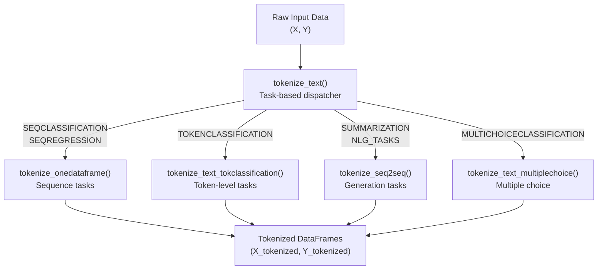
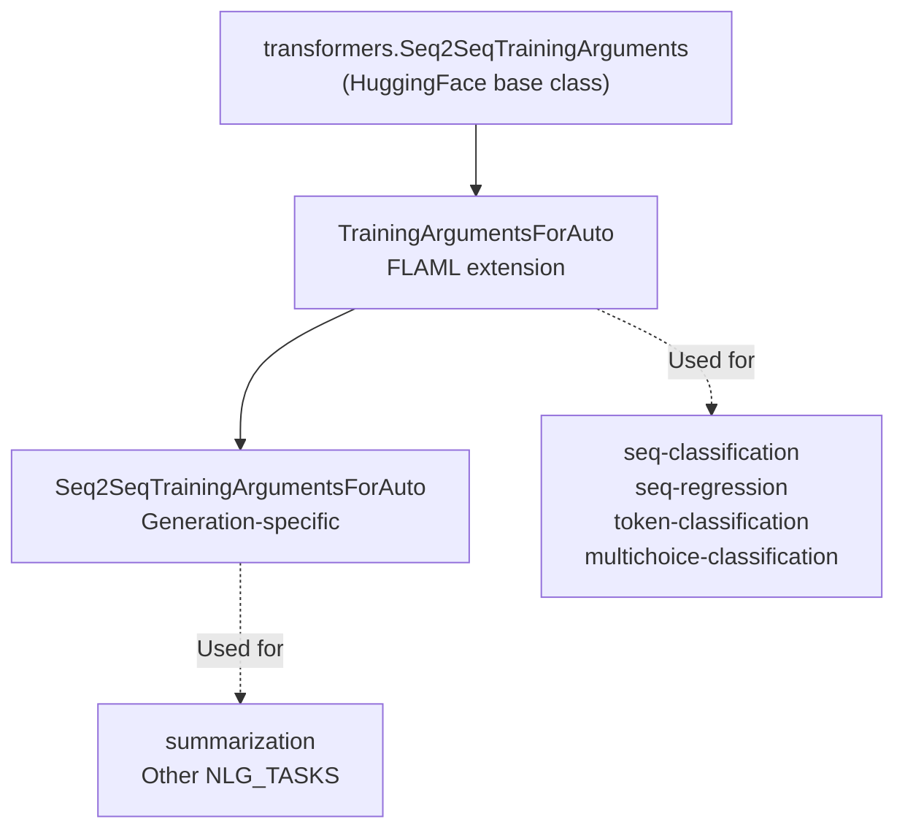
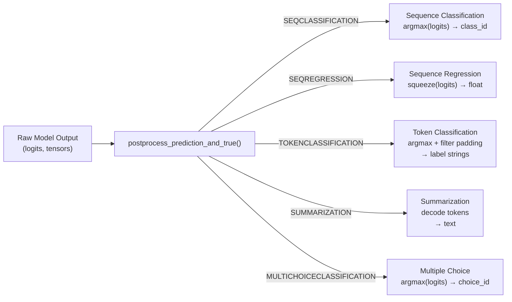
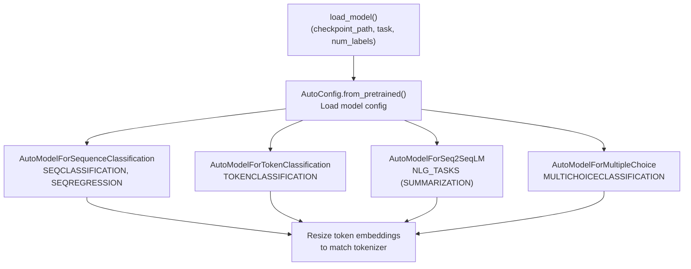

<!-- source: DeepWiki mcp.deepwiki.com · repo microsoft/FLAML · page 3.5 NLP and Transformers · fetched 2026-10-26 -->

# NLP and Transformers

<details>
<summary>Relevant source files</summary>

The following files were used as context for generating this wiki page:

- [flaml/automl/nlp/huggingface/training_args.py](flaml/automl/nlp/huggingface/training_args.py)
- [flaml/automl/nlp/huggingface/utils.py](flaml/automl/nlp/huggingface/utils.py)
- [flaml/automl/task/time_series_task.py](flaml/automl/task/time_series_task.py)
- [flaml/automl/time_series/sklearn.py](flaml/automl/time_series/sklearn.py)
- [flaml/automl/time_series/ts_data.py](flaml/automl/time_series/ts_data.py)
- [test/nlp/test_autohf.py](test/nlp/test_autohf.py)
- [test/nlp/test_autohf_classificationhead.py](test/nlp/test_autohf_classificationhead.py)
- [test/nlp/test_autohf_custom_metric.py](test/nlp/test_autohf_custom_metric.py)
- [test/nlp/test_autohf_cv.py](test/nlp/test_autohf_cv.py)
- [test/nlp/test_autohf_multichoice_classification.py](test/nlp/test_autohf_multichoice_classification.py)
- [test/nlp/test_autohf_regression.py](test/nlp/test_autohf_regression.py)
- [test/nlp/test_autohf_summarization.py](test/nlp/test_autohf_summarization.py)
- [test/nlp/test_autohf_tokenclassification.py](test/nlp/test_autohf_tokenclassification.py)
- [test/spark/test_0sparkml.py](test/spark/test_0sparkml.py)
- [test/spark/test_automl.py](test/spark/test_automl.py)

</details>


## Purpose and Scope

This page documents FLAML's integration with HuggingFace Transformers for Natural Language Processing (NLP) tasks. FLAML provides automated hyperparameter optimization for transformer-based models across multiple NLP task types through the `TransformersEstimator` within the AutoML framework.

For general AutoML concepts and workflows, see [AutoML Core](#3.1). For information about the model abstraction system that underlies all estimators including transformers, see [Model Abstraction and Estimators](#3.2). For task-specific data handling, see [Tasks and Data Preparation](#3.3).

**Coverage:**
- Supported NLP task types and their configurations
- Tokenization utilities and data preprocessing
- Training arguments and model configuration
- Task-specific implementation details
- Custom metrics and evaluation
- Integration patterns with AutoML

---

## Supported NLP Tasks

FLAML supports five primary NLP task types through HuggingFace Transformers. Each task has specialized tokenization, model loading, and postprocessing logic.

### Task Types Overview

| Task Type | Task Identifier | Model Type | Primary Use Case |
|-----------|----------------|------------|------------------|
| Sequence Classification | `seq-classification` | `AutoModelForSequenceClassification` | Text classification, sentiment analysis |
| Sequence Regression | `seq-regression` | `AutoModelForSequenceClassification` | Semantic similarity scoring |
| Token Classification | `token-classification` | `AutoModelForTokenClassification` | Named Entity Recognition (NER), POS tagging |
| Summarization | `summarization` | `AutoModelForSeq2SeqLM` | Text summarization, generation |
| Multiple Choice | `multichoice-classification` | `AutoModelForMultipleChoice` | Question answering with choices |

**Sources:** [flaml/automl/nlp/huggingface/utils.py:6-13](), [flaml/automl/nlp/huggingface/utils.py:375-427]()

### Task Selection in AutoML

```python
from flaml import AutoML

automl = AutoML()
automl_settings = {
    "task": "seq-classification",  # Specify NLP task type
    "metric": "accuracy",
    "time_budget": 60,
    "estimator_list": ["transformer"],
}

automl.fit(X_train=X_train, y_train=y_train, X_val=X_val, y_val=y_val, **automl_settings)
```

**Sources:** [test/nlp/test_autohf.py:14-26]()

---

## Tokenization Architecture

FLAML implements a unified tokenization pipeline that dispatches to task-specific tokenizers based on the task type. The tokenization layer transforms raw text data into model-ready tensors.

### Tokenization Flow



**Sources:** [flaml/automl/nlp/huggingface/utils.py:26-51]()

### Core Tokenization Functions

#### Main Dispatcher: `tokenize_text()`

Dispatches tokenization based on task type and returns DataFrames with tokenized features.

[flaml/automl/nlp/huggingface/utils.py:26-51]()

**Parameters:**
- `X`: Input text data (DataFrame or Series)
- `Y`: Target labels (optional)
- `task`: Task identifier (e.g., `SEQCLASSIFICATION`)
- `hf_args`: HuggingFace training arguments
- `tokenizer`: HuggingFace tokenizer instance

**Returns:**
- `X_tokenized`: DataFrame with columns `input_ids`, `attention_mask`, etc.
- `Y_tokenized`: DataFrame with label column (`label` or `labels`)

#### Sequence Tasks: `tokenize_onedataframe()`

Tokenizes text for classification and regression tasks using standard transformer tokenization.

[flaml/automl/nlp/huggingface/utils.py:207-235]()

**Key features:**
- Handles single or multiple text columns
- Supports optional prefix strings (e.g., "summarize: " for T5 models)
- Configurable padding and truncation via `hf_args`

#### Token Classification: `tokenize_text_tokclassification()`

Specialized tokenization for token-level tasks where labels must align with subword tokens.

[flaml/automl/nlp/huggingface/utils.py:130-204]()

**Label alignment logic:**
```
Original:    ["John", "Smith", "works", "at", "Microsoft"]
Labels:      ["B-PER", "I-PER", "O", "O", "B-ORG"]

After tokenization with subwords:
Tokens:      ["John", "Smith", "works", "at", "Micro", "##soft"]
Labels:      ["B-PER", "I-PER", "O", "O", "B-ORG", "I-ORG"]  # if label_all_tokens=True
             ["B-PER", "I-PER", "O", "O", "B-ORG", -100]      # if label_all_tokens=False
```

The `-100` label is used to ignore additional subtokens during loss calculation.

**Sources:** [flaml/automl/nlp/huggingface/utils.py:79-127](), [flaml/automl/nlp/huggingface/utils.py:130-204]()

#### Seq2Seq Tasks: `tokenize_seq2seq()`

Tokenizes both inputs and outputs for generation tasks.

[flaml/automl/nlp/huggingface/utils.py:54-76]()

**Special handling:**
- Prepends prefix strings (e.g., "summarize: ") for T5-style models
- Creates `decoder_input_ids` from input sequences
- Replaces padding tokens with `-100` in labels to exclude from loss

#### Multiple Choice: `tokenize_text_multiplechoice()`

Tokenizes question-answer pairs for multiple choice tasks (e.g., SWAG dataset).

[flaml/automl/nlp/huggingface/utils.py:266-283]()

**Structure:**
- Input: `sent1` (context), `sent2` (question stem), `ending0-3` (choices)
- Creates pairs: `(sent1, sent2 + ending_i)` for each choice
- Flattens to 4 tokenized sequences per example

**Sources:** [flaml/automl/nlp/huggingface/utils.py:286-309]()

---

## Training Arguments Configuration

FLAML provides custom training argument classes that extend HuggingFace's `TrainingArguments` with AutoML-specific features.

### TrainingArgumentsForAuto

The base training arguments class for all NLP tasks.



**Sources:** [flaml/automl/nlp/huggingface/training_args.py:1-138]()

### Key Configuration Parameters

| Parameter | Type | Default | Description |
|-----------|------|---------|-------------|
| `task` | str | `"seq-classification"` | NLP task type identifier |
| `output_dir` | str | `"data/output/"` | Output directory for logs and checkpoints |
| `model_path` | str | `"facebook/muppet-roberta-base"` | HuggingFace model identifier or local path |
| `fp16` | bool | `True` | Enable mixed precision training |
| `max_seq_length` | int | `128` | Maximum sequence length for tokenization |
| `pad_to_max_length` | bool | `False` | Pad all sequences to max length (vs. dynamic padding) |
| `label_all_tokens` | bool | `False` | For NER: label all subtokens or only first |
| `label_list` | List[str] | `None` | Label names for token classification (e.g., `["B-PER", "I-PER", "O"]`) |
| `per_device_eval_batch_size` | int | `1` | Evaluation batch size per device |

**Sources:** [flaml/automl/nlp/huggingface/training_args.py:14-72]()

### Configuration via AutoML

Training arguments can be specified through AutoML's `fit_kwargs_by_estimator` parameter:

```python
automl_settings = {
    "task": "token-classification",
    "fit_kwargs_by_estimator": {
        "transformer": {
            "model_path": "bert-base-uncased",
            "max_seq_length": 256,
            "label_list": ["O", "B-PER", "I-PER", "B-ORG", "I-ORG", "B-LOC", "I-LOC"],
            "label_all_tokens": True,
        }
    }
}
```

**Sources:** [test/nlp/test_autohf_tokenclassification.py:18-38]()

### Seq2Seq-Specific Arguments

For generation tasks, use `Seq2SeqTrainingArgumentsForAuto`:

| Parameter | Type | Default | Description |
|-----------|------|---------|-------------|
| `model_path` | str | `"t5-small"` | Default model for generation (auto-set for NLG tasks) |
| `predict_with_generate` | bool | `True` | Use generation for evaluation metrics |
| `generation_max_length` | int | `None` | Max length for generation (defaults to model config) |
| `generation_num_beams` | int | `None` | Beam search width for generation |
| `sortish_sampler` | bool | `False` | Use sortish sampler for efficiency |

**Sources:** [flaml/automl/nlp/huggingface/training_args.py:108-138]()

---

## Prediction Postprocessing

FLAML implements task-specific postprocessing to convert raw model outputs into user-friendly predictions.

### Postprocessing Pipeline



**Sources:** [flaml/automl/nlp/huggingface/utils.py:312-373]()

### Task-Specific Postprocessing

#### Sequence Classification

[flaml/automl/nlp/huggingface/utils.py:316-317]()

Returns class indices from logits: `np.argmax(y_pred, axis=1)`

#### Sequence Regression

[flaml/automl/nlp/huggingface/utils.py:318-319]()

Returns squeezed predictions: `np.squeeze(y_pred)`

#### Token Classification

[flaml/automl/nlp/huggingface/utils.py:320-350]()

Complex postprocessing to handle subword tokenization:
1. Get predicted labels: `np.argmax(y_pred, axis=2)`
2. Filter out `-100` padding labels
3. Convert label IDs to label strings using `label_list`
4. Return aligned label sequences

**Example:**
```python
# Input predictions (token IDs after argmax)
[[1, 2, 0, 0, 3, -100], [0, 0, 1, 2, 0, -100]]

# After filtering and converting with label_list=["O", "B-PER", "I-PER", "B-ORG"]
[["B-PER", "I-PER", "O", "O", "B-ORG"], ["O", "O", "B-PER", "I-PER", "O"]]
```

#### Summarization

[flaml/automl/nlp/huggingface/utils.py:351-370]()

1. Decode token IDs to text: `tokenizer.batch_decode(y_pred, skip_special_tokens=True)`
2. Strip whitespace
3. Format with sentence tokenization using NLTK: `nltk.sent_tokenize()`

**Note:** NLTK's `punkt` tokenizer is automatically downloaded on first use.

#### Multiple Choice

[flaml/automl/nlp/huggingface/utils.py:371-372]()

Returns choice index from logits: `np.argmax(y_pred, axis=1)`

**Sources:** [flaml/automl/nlp/huggingface/utils.py:312-373]()

---

## Model Loading and Configuration

FLAML provides a unified model loading interface that selects the appropriate HuggingFace model class based on task type.

### Model Loading Function

The `load_model()` function instantiates task-specific model architectures:



**Sources:** [flaml/automl/nlp/huggingface/utils.py:375-427]()

### Model Architecture Selection

[flaml/automl/nlp/huggingface/utils.py:388-405]()

**Task-to-Model mapping:**
- `SEQCLASSIFICATION` / `SEQREGRESSION` → `AutoModelForSequenceClassification`
  - Sets `num_labels` in config
  - Used for both classification (multiple classes) and regression (num_labels=1)
  - Parameter: `ignore_mismatched_sizes=True` allows loading models with different head sizes
  
- `TOKENCLASSIFICATION` → `AutoModelForTokenClassification`
  - Sets `num_labels` to number of entity types
  
- `NLG_TASKS` (includes `SUMMARIZATION`) → `AutoModelForSeq2SeqLM`
  - No num_labels configuration
  
- `MULTICHOICECLASSIFICATION` → `AutoModelForMultipleChoice`
  - Specialized architecture for choice-based QA

### Classification Head Switching

FLAML supports loading pre-trained models and switching classification heads. This is particularly useful when:
- Fine-tuning on a task with different number of classes than pre-training
- Adapting models between regression and classification
- Using models pre-trained on different label sets

**Example:** A model pre-trained for binary sentiment (2 classes) can be adapted for 3-class classification.

**Sources:** [test/nlp/test_autohf_classificationhead.py:19-28](), [test/nlp/test_autohf_classificationhead.py:81-109]()

---

## Custom Metrics

FLAML supports custom evaluation metrics for transformer models through the standard AutoML metric interface.

### Custom Metric Signature

```python
def custom_metric(
    X_test,
    y_test,
    estimator,
    labels,
    X_train,
    y_train,
    weight_test=None,
    weight_train=None,
    config=None,
    groups_test=None,
    groups_train=None,
):
    """
    Custom metric function for transformers.
    
    Returns:
        loss (float): Primary metric value (to minimize)
        metrics (dict): Additional metrics for logging
    """
    # Access trainer from estimator
    trainer = estimator._trainer or estimator._init_model_for_predict()
    
    # Tokenize test data
    X_test, y_test = estimator._tokenize_text(X_test)
    
    # Create HuggingFace Dataset
    from datasets import Dataset
    eval_dataset = Dataset.from_pandas(X_test.join(y_test))
    
    # Evaluate
    metrics = trainer.evaluate(eval_dataset)
    
    return metrics.pop("eval_automl_metric"), metrics
```

**Sources:** [test/nlp/test_autohf_custom_metric.py:9-41]()

### Metric Configuration

Custom metrics are specified via the `metric` parameter in AutoML settings:

```python
automl_settings = {
    "task": "seq-classification",
    "metric": custom_metric,  # Pass function reference
    "use_ray": {"local_dir": "data/output/"},
}

automl.fit(X_train=X_train, y_train=y_train, X_val=X_val, y_val=y_val, **automl_settings)
```

**Sources:** [test/nlp/test_autohf_custom_metric.py:61-66]()

### Built-in Metrics

For standard metrics, FLAML uses metric strings:

| Task | Common Metrics |
|------|---------------|
| Sequence Classification | `accuracy`, `f1`, `roc_auc` |
| Sequence Regression | `pearsonr`, `spearmanr`, `rmse` |
| Token Classification | `seqeval:overall_f1`, `seqeval:overall_precision`, `seqeval:overall_recall` |
| Summarization | `rouge1`, `rouge2`, `rougeL`, `bleu` |
| Multiple Choice | `accuracy` |

**Note:** Token classification metrics use the `seqeval` library to compute entity-level scores (rather than token-level).

**Sources:** [test/nlp/test_autohf_tokenclassification.py:26](), [test/nlp/test_autohf_summarization.py:24]()

---

## Data Format Requirements

### Sequence Classification / Regression

**Input format:**
- `X_train`: DataFrame or list of strings
  - Single column for single-sentence tasks
  - Multiple columns for sentence-pair tasks (e.g., MNLI, QQP)
- `y_train`: Series or array of labels/scores

**Example:**
```python
import pandas as pd

# Single sentence
X_train = pd.DataFrame({
    "text": ["This movie is great", "Terrible film", ...]
})
y_train = [1, 0, ...]  # Binary labels

# Sentence pair
X_train = pd.DataFrame({
    "premise": ["A person is walking", ...],
    "hypothesis": ["Someone is moving", ...]
})
y_train = [0, 1, 2, ...]  # Entailment labels
```

**Sources:** [test/nlp/test_autohf.py:17-18]()

### Token Classification

**Two supported label formats:**

1. **Token labels** (string labels directly):
```python
X_train = pd.DataFrame({
    "tokens": [
        ["John", "Smith", "works", "at", "Microsoft"],
        ["Mary", "lives", "in", "Seattle"],
    ]
})
y_train = [
    ["B-PER", "I-PER", "O", "O", "B-ORG"],
    ["B-PER", "O", "O", "B-LOC"],
]
```

2. **ID labels** (integer indices):
```python
# Requires label_list in fit_kwargs
X_train = pd.DataFrame({
    "tokens": [["John", "Smith", ...]]
})
y_train = [[1, 2, 0, 0, 3]]  # Maps to label_list

fit_kwargs_by_estimator = {
    "transformer": {
        "label_list": ["O", "B-PER", "I-PER", "B-ORG", "I-ORG", ...]
    }
}
```

**Sources:** [test/nlp/test_autohf_tokenclassification.py:7-11](), [test/nlp/test_autohf_tokenclassification.py:27-37]()

### Summarization

**Input format:**
- `X_train`: DataFrame or Series of source texts
- `y_train`: Series of target summaries

**Example:**
```python
X_train = pd.DataFrame({
    "document": ["Long article text...", "Another document...", ...]
})
y_train = ["Short summary", "Brief summary", ...]
```

**Sources:** [test/nlp/test_autohf_summarization.py:18]()

### Multiple Choice

**Input format:**
- `X_train`: DataFrame with columns:
  - `sent1`: Context or first sentence
  - `sent2`: Question stem
  - `ending0`, `ending1`, `ending2`, `ending3`: Four answer choices
- `y_train`: Series of correct choice indices (0-3)

**Example (SWAG format):**
```python
X_train = pd.DataFrame({
    "sent1": ["A person is chopping vegetables"],
    "sent2": ["He"],
    "ending0": ["puts them in a bowl"],
    "ending1": ["throws them away"],
    "ending2": ["starts dancing"],
    "ending3": ["walks outside"],
})
y_train = [0]  # First choice is correct
```

**Sources:** [test/nlp/test_autohf_multichoice_classification.py:6](), [flaml/automl/nlp/huggingface/utils.py:267]()

---

## Integration with AutoML

### Basic Usage Pattern

```python
from flaml import AutoML

# Initialize AutoML
automl = AutoML()

# Configure for NLP
automl_settings = {
    "task": "seq-classification",
    "metric": "accuracy",
    "time_budget": 60,
    "estimator_list": ["transformer"],
    "log_file_name": "nlp_experiment.log",
}

# Fit on data
automl.fit(
    X_train=X_train,
    y_train=y_train,
    X_val=X_val,
    y_val=y_val,
    **automl_settings
)

# Make predictions
predictions = automl.predict(X_test)
probabilities = automl.predict_proba(X_test)  # For classification
```

**Sources:** [test/nlp/test_autohf.py:14-27]()

### Cross-Validation

FLAML supports cross-validation for NLP tasks:

```python
automl_settings = {
    "task": "seq-classification",
    "metric": "accuracy",
    "n_splits": 3,  # Enable CV with 3 folds
    "time_budget": 120,
}

automl.fit(X_train=X_train, y_train=y_train, **automl_settings)
```

**Note:** Cross-validation with transformers can be memory-intensive due to model checkpointing.

**Sources:** [test/nlp/test_autohf_cv.py:22-36]()

### Distributed Training with Ray

For faster hyperparameter search, use Ray for parallel trials:

```python
automl_settings = {
    "task": "seq-classification",
    "use_ray": {
        "local_dir": "data/output/",
    },
    "n_concurrent_trials": 4,  # Run 4 trials in parallel
}

import ray
if not ray.is_initialized():
    ray.init()

automl.fit(X_train=X_train, y_train=y_train, **automl_settings)
```

**Sources:** [test/nlp/test_autohf_custom_metric.py:54-64]()

### Model Persistence

FLAML supports pickling trained transformer models:

```python
# Save model
automl.pickle("automl_nlp.pkl")

# Load model
from flaml import AutoML
automl_loaded = AutoML()
automl_loaded = automl_loaded.load_pickle("automl_nlp.pkl")

# Use loaded model
predictions = automl_loaded.predict(X_test)
```

**Note:** The pickle includes the full model state, tokenizer, and training configuration.

**Sources:** [test/nlp/test_autohf.py:27]()

### Checkpoint Management

Control checkpoint preservation:

```python
automl_settings = {
    "preserve_checkpoint": False,  # Delete checkpoints after training
}
```

Setting `preserve_checkpoint=False` saves disk space by removing intermediate checkpoints after selecting the best model.

**Sources:** [test/nlp/test_autohf.py:22]()

### Retrain from Log

Retrain the best configuration from a previous run:

```python
automl.retrain_from_log(
    X_train=X_train,
    y_train=y_train,
    train_full=True,  # Train on full dataset (train + val)
    record_id=0,  # Use best trial from log
    **automl_settings
)
```

**Sources:** [test/nlp/test_autohf.py:52]()

---

## Advanced Configuration

### Starting Points

Provide initial hyperparameter configurations to guide the search:

```python
automl_settings = {
    "starting_points": {
        "transformer": {
            "num_train_epochs": 3,
            "learning_rate": 2e-5,
            "per_device_train_batch_size": 16,
        }
    }
}
```

**Sources:** [test/nlp/test_autohf_regression.py:27]()

### Model Path Configuration

Specify different pre-trained models:

```python
automl_settings = {
    "fit_kwargs_by_estimator": {
        "transformer": {
            "model_path": "bert-base-uncased",  # HuggingFace model
            # or
            "model_path": "/path/to/local/model",  # Local checkpoint
        }
    }
}
```

Common model paths:
- `"bert-base-uncased"` - BERT base
- `"roberta-base"` - RoBERTa base
- `"facebook/muppet-roberta-base"` - MUPPET (default for classification)
- `"t5-small"` - T5 small (default for generation)
- `"google/flan-t5-small"` - FLAN-T5 small
- `"distilbert-base-uncased"` - DistilBERT

**Sources:** [test/nlp/test_autohf_classificationhead.py:90](), [test/nlp/test_autohf_summarization.py:26]()

### Batch Size Configuration

Control inference batch size for predictions:

```python
# During prediction
predictions = automl.predict(X_test, per_device_eval_batch_size=8)
```

**Sources:** [test/nlp/test_autohf.py:53]()

### Input Validation

FLAML handles various input formats:

```python
# List of strings
predictions = automl.predict(["Sample text 1", "Sample text 2"])

# Single string
predictions = automl.predict(["Single text"])

# DataFrame
predictions = automl.predict(X_test_df)

# Nested lists (for sentence pairs)
predictions = automl.predict([
    ["premise 1", "hypothesis 1"],
    ["premise 2", "hypothesis 2"],
])
```

**Sources:** [test/nlp/test_autohf.py:54-63]()

---

## Implementation Details

### File Structure

```
flaml/automl/nlp/huggingface/
├── utils.py              # Tokenization and postprocessing utilities
├── training_args.py      # Custom training arguments
└── (estimator implementation in parent module)
```

### Key Code Entities

| Component | Location | Purpose |
|-----------|----------|---------|
| `tokenize_text()` | [flaml/automl/nlp/huggingface/utils.py:26]() | Main tokenization dispatcher |
| `tokenize_onedataframe()` | [flaml/automl/nlp/huggingface/utils.py:207]() | Tokenizes DataFrames for seq tasks |
| `tokenize_text_tokclassification()` | [flaml/automl/nlp/huggingface/utils.py:130]() | Token-level tokenization with label alignment |
| `tokenize_seq2seq()` | [flaml/automl/nlp/huggingface/utils.py:54]() | Seq2seq tokenization for generation |
| `tokenize_and_align_labels()` | [flaml/automl/nlp/huggingface/utils.py:79]() | Aligns labels with subword tokens |
| `postprocess_prediction_and_true()` | [flaml/automl/nlp/huggingface/utils.py:312]() | Converts model outputs to predictions |
| `load_model()` | [flaml/automl/nlp/huggingface/utils.py:375]() | Loads task-specific model architectures |
| `TrainingArgumentsForAuto` | [flaml/automl/nlp/huggingface/training_args.py:14]() | Base training arguments class |
| `Seq2SeqTrainingArgumentsForAuto` | [flaml/automl/nlp/huggingface/training_args.py:108]() | Generation-specific arguments |

**Sources:** [flaml/automl/nlp/huggingface/utils.py:1-427](), [flaml/automl/nlp/huggingface/training_args.py:1-138]()

### Dependencies

Required packages for NLP support (install with `pip install "flaml[hf]"`):
- `transformers` - HuggingFace Transformers library
- `datasets` - HuggingFace Datasets library
- `nltk` - Natural Language Toolkit (for summarization post-processing)
- `rouge_score` - ROUGE metric computation

Optional for specific tasks:
- `seqeval` - Entity-level metrics for token classification

**Sources:** Installation documentation in section [2](#2)

---

