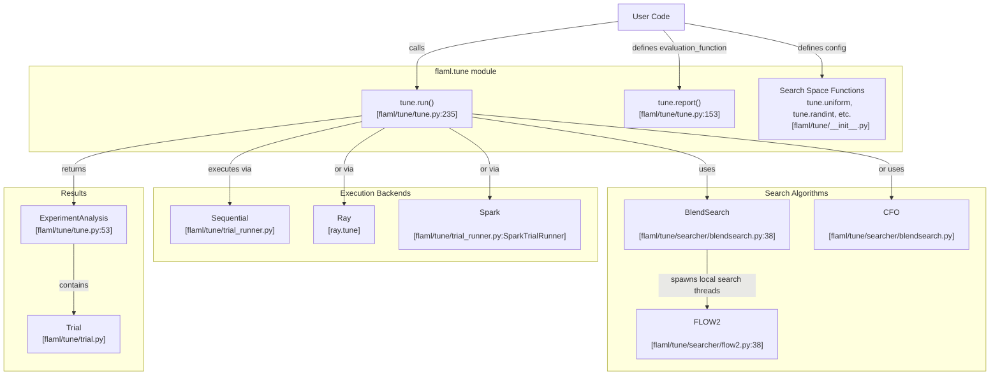

<!-- source: DeepWiki mcp.deepwiki.com · repo microsoft/FLAML · page 4 Tune · fetched 2026-10-26 -->

# Tune

<details>
<summary>Relevant source files</summary>

The following files were used as context for generating this wiki page:

- [flaml/default/portfolio.py](flaml/default/portfolio.py)
- [flaml/tune/__init__.py](flaml/tune/__init__.py)
- [flaml/tune/result.py](flaml/tune/result.py)
- [flaml/tune/searcher/blendsearch.py](flaml/tune/searcher/blendsearch.py)
- [flaml/tune/searcher/flow2.py](flaml/tune/searcher/flow2.py)
- [flaml/tune/searcher/search_thread.py](flaml/tune/searcher/search_thread.py)
- [flaml/tune/space.py](flaml/tune/space.py)
- [flaml/tune/tune.py](flaml/tune/tune.py)
- [flaml/tune/utils.py](flaml/tune/utils.py)
- [notebook/tune_lexicographic.ipynb](notebook/tune_lexicographic.ipynb)
- [test/tune/test_lexiflow.py](test/tune/test_lexiflow.py)
- [test/tune/test_search_thread.py](test/tune/test_search_thread.py)
- [test/tune/test_searcher.py](test/tune/test_searcher.py)
- [test/tune/test_tune.py](test/tune/test_tune.py)
- [website/docs/Best-Practices.md](website/docs/Best-Practices.md)
- [website/docs/Contribute.md](website/docs/Contribute.md)
- [website/docs/Examples/Tune-Lexicographic-objectives.md](website/docs/Examples/Tune-Lexicographic-objectives.md)
- [website/docs/FAQ.md](website/docs/FAQ.md)
- [website/docs/Getting-Started.md](website/docs/Getting-Started.md)
- [website/docs/Installation.md](website/docs/Installation.md)
- [website/docs/Use-Cases/Tune-User-Defined-Function.md](website/docs/Use-Cases/Tune-User-Defined-Function.md)
- [website/sidebars.js](website/sidebars.js)

</details>


## Overview

FLAML's Tune is a standalone module for economical hyperparameter optimization of user-defined functions. It provides the `tune.run()` function as the primary interface for generic hyperparameter tuning. While AutoML uses Tune internally for its optimization, Tune can be used independently when:

1. Your task is not a standard ML task (classification, regression, forecasting)
2. Your input format differs from `X_train` + `y_train` (e.g., requires custom data loaders)
3. You need to optimize for custom metrics beyond standard ML metrics
4. You want to tune non-ML functions (e.g., simulation parameters, system configurations)

**Tune vs AutoML**: Use AutoML for standard ML tasks with tabular/time-series data. Use Tune directly when you need more control over the evaluation function or have non-standard optimization requirements. See [AutoML](#3) for the task-oriented interface.

Sources:
- [website/docs/Use-Cases/Tune-User-Defined-Function.md:1-9]()
- [flaml/tune/tune.py:235-273]()

## High-Level Architecture

**High-Level Component Diagram**



**Key Components**:

1. **`tune.run()`** [flaml/tune/tune.py:235](): Main entry point that orchestrates the optimization process
2. **Search Algorithms**: `BlendSearch`, `CFO`, `FLOW2` implement different optimization strategies (detailed in [Search Algorithms](#4-2))
3. **Search Space**: Defined using functions like `tune.uniform()`, `tune.randint()` (detailed in [Search Space Definition](#4-3))
4. **Execution Backends**: Sequential, Ray, or Spark for trial execution
5. **`ExperimentAnalysis`** [flaml/tune/tune.py:53](): Result object providing access to best trial, config, and all trials

Sources:
- [flaml/tune/tune.py:44-86]()
- [flaml/tune/tune.py:235-483]()
- [flaml/tune/searcher/blendsearch.py:38-152]()
- [flaml/tune/searcher/flow2.py:38-106]()

## Basic Usage Pattern

**Execution Flow**

```mermaid
sequenceDiagram
    participant User
    participant tune_run["tune.run()"]
    participant SearchAlg["Search Algorithm
    (BlendSearch/CFO)"]
    participant eval_func["evaluation_function"]
    participant Analysis["ExperimentAnalysis"]
    
    User->>tune_run: "Call with config, metric, mode, time_budget_s"
    
    loop "until time_budget_s exhausted"
        tune_run->>SearchAlg: "suggest(trial_id)"
        SearchAlg-->>tune_run: "config dict"
        
        tune_run->>eval_func: "Call with config"
        
        opt "Intermediate reporting"
            eval_func->>tune_run: "tune.report(metric=value)"
        end
        
        eval_func-->>tune_run: "return result dict"
        tune_run->>SearchAlg: "on_trial_complete(trial_id, result)"
    end
    
    tune_run->>Analysis: "Create ExperimentAnalysis"
    tune_run-->>User: "Return analysis"
```

**Minimal Example**:

```python
from flaml import tune

# Step 1: Define evaluation function
def evaluate_config(config):
    # Your evaluation logic
    score = (config["x"] - 85000) ** 2 - config["x"] / config["y"]
    return {"score": score}

# Step 2: Define search space
config = {
    "x": tune.lograndint(lower=1, upper=100000),
    "y": tune.randint(lower=1, upper=100000),
}

# Step 3: Run optimization
analysis = tune.run(
    evaluate_config,      # evaluation function
    config=config,        # search space
    metric="score",       # metric to optimize
    mode="min",          # minimize or maximize
    time_budget_s=60,    # time budget in seconds
)

# Access results
print(analysis.best_config)
print(analysis.best_trial.last_result)
```

For details on the evaluation function and reporting mechanism, see [Core Concepts](#4-1). For search space definition details, see [Search Space Definition](#4-3).

Sources:
- [website/docs/Use-Cases/Tune-User-Defined-Function.md:34-92]()
- [website/docs/Getting-Started.md:47-93]()
- [flaml/tune/tune.py:235-480]()

## Key Features

### Cost-Frugal Search

FLAML's search algorithms (`BlendSearch`, `CFO`, `FLOW2`) are designed to find good hyperparameters quickly with limited computational budget. Key capabilities:

- **Low-cost initialization**: Start search from known low-cost configurations via `low_cost_partial_config` [flaml/tune/tune.py:238]()
- **Cost-aware exploration**: `cat_hp_cost` parameter specifies relative costs of categorical choices [flaml/tune/tune.py:239]()
- **Adaptive resource allocation**: Automatically balance exploration vs exploitation based on time remaining

**Example**:
```python
analysis = tune.run(
    evaluate_config,
    config=config,
    low_cost_partial_config={"n_estimators": 4, "max_leaves": 4},
    cat_hp_cost={"tree_method": [1, 1, 2]},  # relative costs
    time_budget_s=60,
)
```

See [Search Algorithms](#4-2) for details on how `BlendSearch`, `CFO`, and `FLOW2` implement cost-frugal search.

Sources:
- [website/docs/Use-Cases/Tune-User-Defined-Function.md:340-351]()
- [website/docs/FAQ.md:9-16]()
- [flaml/tune/tune.py:238-240]()

### Constraints

**Configuration Constraints**: Skip invalid configurations before evaluation using `config_constraints` [flaml/tune/tune.py:255]():

```python
def memory_requirement(config):
    return config["batch_size"] * config["model_size"]

analysis = tune.run(
    evaluate_config,
    config=config,
    config_constraints=[(memory_requirement, "<=", 16000)],
)
```

**Metric Constraints**: Require metrics to satisfy conditions using `metric_constraints` [flaml/tune/tune.py:256]():

```python
analysis = tune.run(
    evaluate_config,
    config=config,
    metric_constraints=[("training_time", "<=", 60)],
)
```

See [Constraints and Multi-Objective Optimization](#4-4) for complete details.

Sources:
- [website/docs/Use-Cases/Tune-User-Defined-Function.md:411-443]()
- [flaml/tune/tune.py:255-257]()

### Multi-Objective Optimization

Tune supports lexicographic multi-objective optimization via `lexico_objectives` [flaml/tune/tune.py:262](), where objectives are prioritized in order with optional tolerances:

```python
lexico_objectives = {
    "metrics": ["error_rate", "flops"],
    "modes": ["min", "min"],
    "tolerances": {"error_rate": 0.02, "flops": 0.0},
    "targets": {"error_rate": 0.0, "flops": 0.0},
}

analysis = tune.run(
    evaluate_function,
    config=search_space,
    lexico_objectives=lexico_objectives,
)
```

This optimizes `error_rate` first, then optimizes `flops` among configurations within the tolerance of the best `error_rate`. See [Constraints and Multi-Objective Optimization](#4-4) for implementation details.

Sources:
- [website/docs/Use-Cases/Tune-User-Defined-Function.md:428-458]()
- [website/docs/Examples/Tune-Lexicographic-objectives.md:1-170]()
- [flaml/tune/tune.py:262]()
- [test/tune/test_lexiflow.py:40-226]()

### Parallel Execution

Tune supports parallel trial execution via Ray [flaml/tune/tune.py:258]() or Spark [flaml/tune/tune.py:259]() backends:

**Ray Backend**:
```python
analysis = tune.run(
    evaluate_config,
    config=config,
    use_ray=True,
    resources_per_trial={"cpu": 2},
)
```

**Spark Backend**:
```python
analysis = tune.run(
    evaluate_config,
    config=config,
    use_spark=True,
    n_concurrent_trials=4,
)
```

Note: Parallel execution introduces overhead per trial. Use sequential execution when each trial can utilize full compute resources. See [Ray Integration](#7-1) and [Spark Integration](#7-2) for deployment details.

Sources:
- [website/docs/Use-Cases/Tune-User-Defined-Function.md:445-490]()
- [flaml/tune/tune.py:258-259]()
- [flaml/tune/tune.py:672-829]()

## Relationship to Child Pages

This page provides an overview of the Tune system. For detailed information:

- **[Core Concepts](#4-1)**: Detailed explanation of `tune.run()` parameters, evaluation functions, `tune.report()` mechanism, trial lifecycle, and `ExperimentAnalysis` methods
- **[Search Algorithms](#4-2)**: Deep dive into `BlendSearch`, `FLOW2`, `CFO`, `SearchThread` management, and lexicographic optimization implementation
- **[Search Space Definition](#4-3)**: Complete reference for search space primitives (`tune.uniform`, `tune.randint`, etc.), hierarchical spaces, normalization, and cost-related parameters
- **[Constraints and Multi-Objective Optimization](#4-4)**: Detailed guide on `config_constraints`, `metric_constraints`, lexicographic objectives with tolerances and targets

Sources:
- [website/docs/Use-Cases/Tune-User-Defined-Function.md]()

## Common Parameters

The `tune.run()` function [flaml/tune/tune.py:235]() accepts many parameters. Key ones include:

| Parameter | Type | Description |
|-----------|------|-------------|
| `evaluation_function` | Callable | User-defined function to evaluate configurations |
| `config` | Dict | Search space definition (see [Search Space Definition](#4-3)) |
| `metric` | str | Metric name to optimize |
| `mode` | str | "min" or "max" |
| `time_budget_s` | float | Time budget in seconds |
| `num_samples` | int | Number of trials (-1 for unlimited) |
| `low_cost_partial_config` | Dict | Initial low-cost configuration values |
| `cat_hp_cost` | Dict | Relative costs for categorical choices |
| `config_constraints` | List | Configuration constraints |
| `metric_constraints` | List | Metric constraints |
| `lexico_objectives` | Dict | Multi-objective specification |
| `use_ray` | bool | Use Ray backend for parallel execution |
| `use_spark` | bool | Use Spark backend for parallel execution |
| `search_alg` | Searcher | Custom search algorithm instance |

See [Core Concepts](#4-1) for detailed parameter descriptions and usage patterns.

Sources:
- [flaml/tune/tune.py:235-480]()
- [website/docs/Use-Cases/Tune-User-Defined-Function.md:20-63]()

## Result Analysis

The `tune.run()` function returns an `ExperimentAnalysis` object [flaml/tune/tune.py:53]() that provides access to tuning results:

**ExperimentAnalysis Properties**:
- `analysis.best_config` [flaml/tune/tune.py:75-79](): Best configuration found
- `analysis.best_trial` [flaml/tune/tune.py:68-72](): `Trial` object with best result
- `analysis.best_result` [flaml/tune/tune.py:136-140](): Dictionary of best metrics
- `analysis.trials`: List of all `Trial` objects [flaml/tune/trial.py]()

**Example**:
```python
analysis = tune.run(evaluate_config, config=config, metric="loss", mode="min")

print(f"Best config: {analysis.best_config}")
print(f"Best loss: {analysis.best_result['loss']}")
print(f"Total trials: {len(analysis.trials)}")
```

For lexicographic optimization, `best_trial` is determined using the `lexico_best()` method [flaml/tune/tune.py:81-120]() which respects objective priorities and tolerances. See [Core Concepts](#4-1) for detailed result analysis methods.

Sources:
- [flaml/tune/tune.py:53-151]()
- [website/docs/Use-Cases/Tune-User-Defined-Function.md:393-410]()

## Integration Points

### Execution Backends

Tune supports three execution backends:

1. **Sequential** (default): Trials run one at a time in the main process
2. **Ray** [flaml/tune/tune.py:672-701](): Distributed execution using Ray, set `use_ray=True`
3. **Spark** [flaml/tune/tune.py:703-829](): Distributed execution using Spark, set `use_spark=True`

See [Distributed Execution](#7) for detailed backend configuration.

### MLflow Logging

When running inside an MLflow context, Tune can automatically log trials [flaml/tune/tune.py:531-536]():

```python
import mlflow

with mlflow.start_run():
    analysis = tune.run(
        evaluate_config,
        config=config,
        mlflow_exp_name="my_experiment",
    )
```

See [MLflow Integration](#8-1) for logging configuration details.

Sources:
- [flaml/tune/tune.py:421-422]()
- [flaml/tune/tune.py:458-483]()
- [flaml/tune/tune.py:531-536]()
- [flaml/tune/tune.py:672-829]()

## Advanced Use Cases

### Warm-Start Tuning

You can provide previously evaluated configurations to warm-start the tuning process:

```python
points_to_evaluate = [
    {"x": 10, "y": 20},
    {"x": 15, "y": 30},
]
evaluated_rewards = [0.5, 0.7]  # Known results for these points

analysis = tune.run(
    evaluate_config,
    config=search_space,
    metric="score",
    mode="max",
    points_to_evaluate=points_to_evaluate,
    evaluated_rewards=evaluated_rewards,
)
```

### Cost-Aware Tuning

For heterogeneous cost spaces, you can provide low-cost partial configurations to guide the search:

```python
low_cost_partial_config = {
    "n_estimators": 4,
    "max_depth": 3,
}

cat_hp_cost = {
    "tree_method": [1, 1, 2],  # Relative costs for each choice
}

analysis = tune.run(
    evaluate_config,
    config=search_space,
    metric="score",
    mode="min",
    low_cost_partial_config=low_cost_partial_config,
    cat_hp_cost=cat_hp_cost,
)
```

Sources:
- [website/docs/Use-Cases/Tune-User-Defined-Function.md:497-536]()
- [website/docs/Use-Cases/Tune-User-Defined-Function.md:184-195]()
- [flaml/tune/tune.py:44-86]()

## Summary

FLAML's Tune is a versatile hyperparameter tuning module that offers:

1. Efficient search algorithms like BlendSearch and CFO
2. Flexible search space definition
3. Resource-aware tuning with time and computational constraints
4. Multi-objective optimization with lexicographic preferences
5. Trial scheduling and early stopping mechanisms
6. Integration with Ray, Spark, and MLflow
7. Support for warm starting and cost-aware tuning

These features make Tune suitable for a wide range of optimization problems beyond traditional machine learning, while maintaining efficiency with limited computational resources.

---

