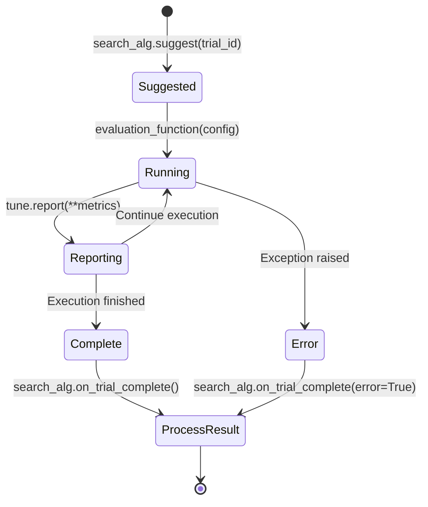
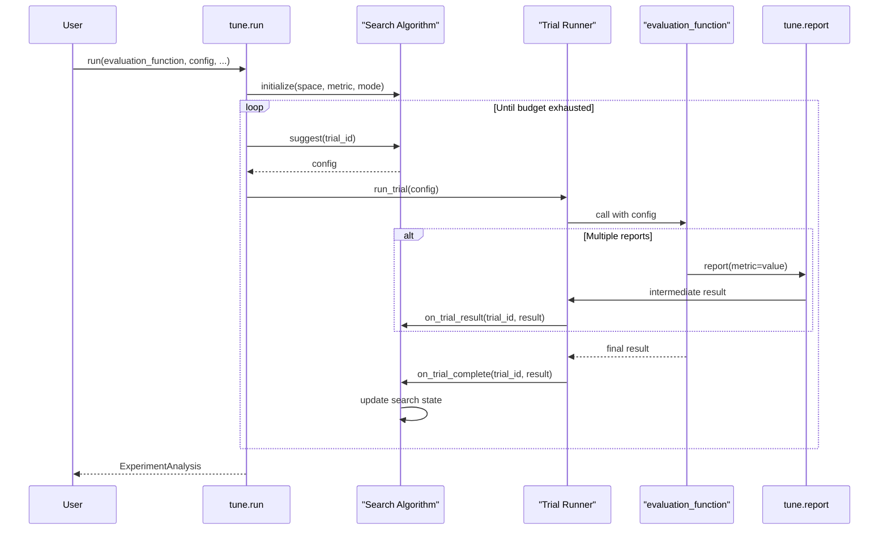
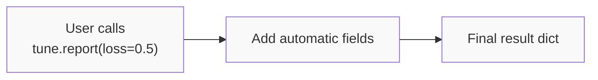
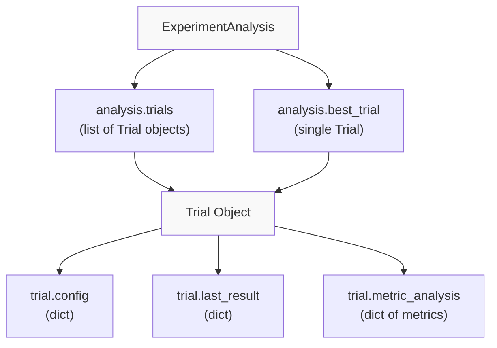
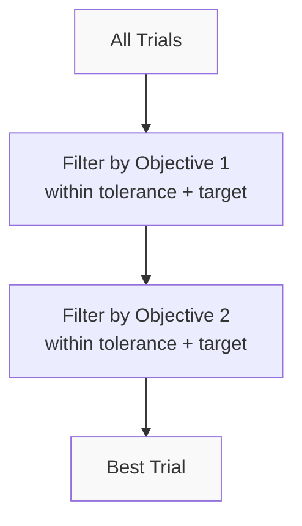
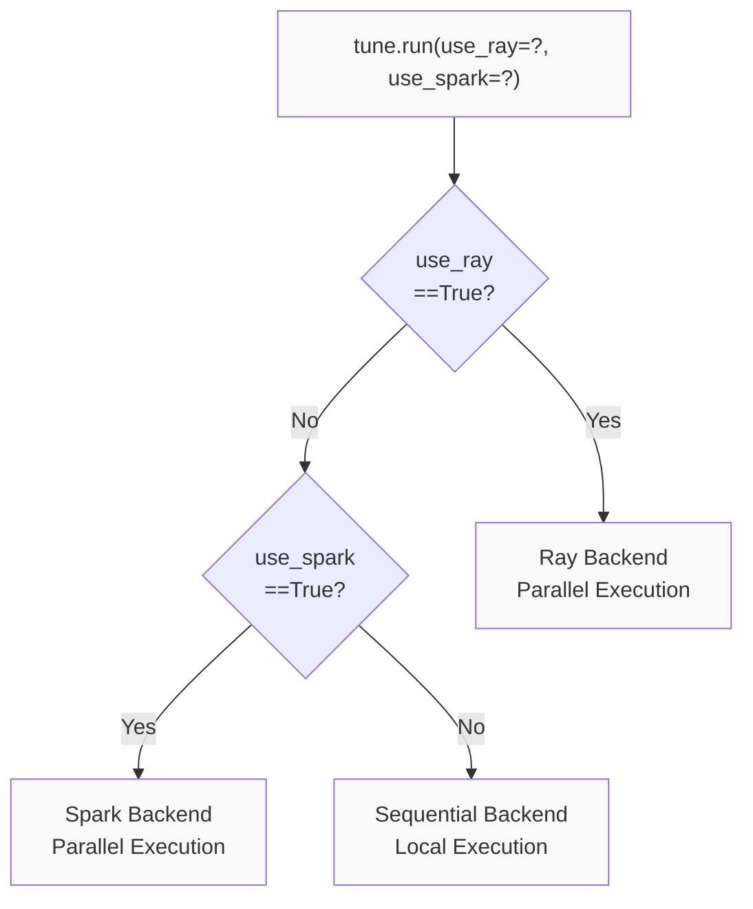

<!-- source: DeepWiki mcp.deepwiki.com · repo microsoft/FLAML · page 4.1 Core Concepts · fetched 2026-10-26 -->

# Core Concepts

<details>
<summary>Relevant source files</summary>

The following files were used as context for generating this wiki page:

- [flaml/default/portfolio.py](flaml/default/portfolio.py)
- [flaml/tune/__init__.py](flaml/tune/__init__.py)
- [flaml/tune/result.py](flaml/tune/result.py)
- [flaml/tune/searcher/blendsearch.py](flaml/tune/searcher/blendsearch.py)
- [flaml/tune/searcher/flow2.py](flaml/tune/searcher/flow2.py)
- [flaml/tune/searcher/search_thread.py](flaml/tune/searcher/search_thread.py)
- [flaml/tune/space.py](flaml/tune/space.py)
- [flaml/tune/tune.py](flaml/tune/tune.py)
- [flaml/tune/utils.py](flaml/tune/utils.py)
- [notebook/tune_lexicographic.ipynb](notebook/tune_lexicographic.ipynb)
- [test/tune/test_lexiflow.py](test/tune/test_lexiflow.py)
- [test/tune/test_search_thread.py](test/tune/test_search_thread.py)
- [test/tune/test_searcher.py](test/tune/test_searcher.py)
- [test/tune/test_tune.py](test/tune/test_tune.py)
- [website/docs/Examples/Tune-Lexicographic-objectives.md](website/docs/Examples/Tune-Lexicographic-objectives.md)
- [website/docs/Use-Cases/Tune-User-Defined-Function.md](website/docs/Use-Cases/Tune-User-Defined-Function.md)

</details>


This page covers the fundamental concepts for using `flaml.tune` to perform hyperparameter optimization. The `tune.run()` function provides a flexible interface for optimizing user-defined functions with respect to hyperparameter configurations. 

For information about the specific search algorithms used (BlendSearch, FLOW2, CFO), see [Search Algorithms](#4.2). For details on defining search spaces with `tune.uniform()`, `tune.randint()`, etc., see [Search Space Definition](#4.3). For advanced features like constraints and multi-objective optimization, see [Constraints and Multi-Objective Optimization](#4.4).

## The tune.run Function

The `tune.run()` function is the primary entry point for hyperparameter tuning. It orchestrates the search process by repeatedly suggesting configurations, evaluating them, and using the results to guide future suggestions.

**Function Signature:**

```python
tune.run(
    evaluation_function,
    config=None,
    metric=None,
    mode=None,
    time_budget_s=None,
    num_samples=1,
    # ... other parameters
)
```

**Key Parameters:**

| Parameter | Type | Description |
|-----------|------|-------------|
| `evaluation_function` | Callable | User-defined function that takes a config dict and returns results |
| `config` | dict | Search space specification using `tune.uniform()`, `tune.randint()`, etc. |
| `metric` | str | Name of the metric to optimize (must match key in result dict) |
| `mode` | str | Either `"min"` or `"max"` to minimize or maximize the metric |
| `time_budget_s` | float | Time budget in seconds for the entire tuning process |
| `num_samples` | int | Maximum number of trials to run (-1 for unlimited) |
| `low_cost_partial_config` | dict | Initial low-cost values for cost-related hyperparameters |
| `cat_hp_cost` | dict | Relative costs of categorical hyperparameter choices |
| `search_alg` | Searcher/str | Search algorithm instance or name ("BlendSearch", "CFO", etc.) |
| `scheduler` | Scheduler/str | Trial scheduler for early stopping ("asha", "flaml", etc.) |
| `config_constraints` | list | List of (function, op, threshold) tuples for config constraints |
| `metric_constraints` | list | List of (metric_name, op, threshold) tuples for metric constraints |
| `lexico_objectives` | dict | Specification for lexicographic multi-objective optimization |
| `use_ray` | bool | Whether to use Ray for parallel execution |
| `use_spark` | bool | Whether to use Spark for parallel execution |
| `verbose` | int | Verbosity level (0=silent, 1=status, 2=brief results, 3=detailed) |

Sources: [flaml/tune/tune.py:235-480]()

### Basic Usage Example

```python
from flaml import tune

def evaluate_config(config):
    # Your evaluation logic here
    score = some_model.train_and_eval(
        learning_rate=config["lr"],
        batch_size=config["batch_size"]
    )
    return {"accuracy": score}

analysis = tune.run(
    evaluate_config,
    config={
        "lr": tune.loguniform(1e-5, 1e-1),
        "batch_size": tune.choice([32, 64, 128])
    },
    metric="accuracy",
    mode="max",
    time_budget_s=3600
)
```

Sources: [website/docs/Use-Cases/Tune-User-Defined-Function.md:34-55](), [website/docs/Use-Cases/Tune-User-Defined-Function.md:376-390]()

## Evaluation Function

The evaluation function is the core component that users provide to `tune.run()`. It defines how to evaluate a given hyperparameter configuration.

### Function Contract

- **Input**: A dictionary (`config`) containing hyperparameter values
- **Output**: Either a scalar value or a dictionary containing metric names and values
- **Side effects**: Can call `tune.report()` to report intermediate or final results

### Return Value Options

**Option 1: Return a scalar**
```python
def evaluate_config(config):
    score = train_model(config)
    return score  # Single metric value
```

**Option 2: Return a dictionary**
```python
def evaluate_config(config):
    accuracy, time = train_model(config)
    return {
        "accuracy": accuracy,
        "train_time": time
    }
```

**Option 3: Use tune.report() (no return)**
```python
def evaluate_config(config):
    for epoch in range(config["epochs"]):
        loss = train_epoch(config)
        tune.report(loss=loss, epoch=epoch)
```

Sources: [flaml/tune/tune.py:305-311](), [website/docs/Use-Cases/Tune-User-Defined-Function.md:34-55]()

### Evaluation Function Execution

When a trial runs, the evaluation function:
1. Receives a configuration suggested by the search algorithm
2. Performs training/evaluation with those hyperparameters
3. Reports results back to the search algorithm
4. May be interrupted if a scheduler decides to stop the trial early

Sources: [flaml/tune/tune.py:153-233]()

## Trial Lifecycle

A trial represents a single evaluation of a hyperparameter configuration. The following diagram shows the complete lifecycle of a trial in the tune system:



### Trial States

**Suggested**: Search algorithm proposes a new configuration
- The search algorithm's `suggest()` method generates a config
- A trial ID is assigned
- Configuration is logged

**Running**: Evaluation function executes with the config
- User's evaluation function is called with `config` parameter
- Function can call `tune.report()` multiple times
- Resource usage is tracked

**Reporting**: Intermediate or final results are reported
- `tune.report()` is called from within the evaluation function
- Results are stored in the trial object
- Search algorithm may receive intermediate updates via `on_trial_result()`

**Complete**: Trial finishes successfully
- Evaluation function returns or final `tune.report()` called
- Final results are recorded
- Search algorithm's `on_trial_complete()` is called with results

**Error**: Trial encounters an error
- Exception is caught and logged
- Search algorithm's `on_trial_complete()` is called with `error=True`
- Trial is marked as failed

Sources: [flaml/tune/tune.py:153-233](), [flaml/tune/searcher/search_thread.py:127-163]()

### Trial Flow in Sequential Execution



Sources: [flaml/tune/tune.py:235-480](), [flaml/tune/searcher/blendsearch.py:452-533]()

## Reporting Results with tune.report

The `tune.report()` function allows the evaluation function to report metrics back to the tuning system. It can be called multiple times for intermediate results or once for final results.

### Function Signature

```python
tune.report(_metric=None, **kwargs)
```

**Parameters:**
- `_metric`: Optional anonymous metric value (for compatibility with Ray Tune)
- `**kwargs`: Named metric values as keyword arguments

### Usage Patterns

**Pattern 1: Single metric report**
```python
def evaluate_config(config):
    model = train_model(config)
    accuracy = evaluate_model(model)
    tune.report(accuracy=accuracy)
```

**Pattern 2: Multiple metrics**
```python
def evaluate_config(config):
    model = train_model(config)
    tune.report(
        accuracy=0.95,
        loss=0.05,
        train_time=120.5
    )
```

**Pattern 3: Iterative reporting**
```python
def evaluate_config(config):
    for epoch in range(config["epochs"]):
        loss = train_epoch(config)
        tune.report(epoch=epoch, loss=loss)
        # Scheduler may stop trial early
```

### Report Behavior

When `tune.report()` is called:

1. **Result Collection**: The reported metrics are collected into a result dictionary
2. **Training Iteration**: An auto-incremented `training_iteration` counter is added
3. **Config Echo**: The current `config` is included in the result
4. **Trial Processing**: The runner's `process_trial_result()` is called
5. **Early Stopping Check**: If the trial is marked as finished (by scheduler), a `StopIteration` exception is raised

Sources: [flaml/tune/tune.py:153-233]()

### Automatic Fields Added to Results



**Fields automatically added:**
- `training_iteration`: Incremented counter for each report within a trial
- `config`: The hyperparameter configuration being evaluated
- `config/*`: Flattened config values with "config/" prefix

Sources: [flaml/tune/tune.py:214-228]()

## ExperimentAnalysis

The `ExperimentAnalysis` class provides methods to analyze and retrieve results after `tune.run()` completes. It contains all trials and their results, with utilities to find the best performing configurations.

### Basic Properties

```python
analysis = tune.run(...)

# Access all trials
all_trials = analysis.trials

# Get best trial based on specified metric/mode
best_trial = analysis.best_trial

# Get best configuration
best_config = analysis.best_config

# Get best result dictionary
best_result = analysis.best_result
```

Sources: [flaml/tune/tune.py:53-151]()

### Key Methods

| Method | Description |
|--------|-------------|
| `best_trial` | Returns the Trial object with the best metric value |
| `best_config` | Returns the configuration dict of the best trial |
| `best_result` | Returns the result dict of the best trial |
| `get_best_trial(metric, mode, scope)` | Get best trial with custom metric/mode |
| `get_best_config(metric, mode, scope)` | Get best config with custom metric/mode |

Sources: [flaml/tune/tune.py:68-133]()

### Accessing Trial Information



Sources: [flaml/tune/tune.py:53-151]()

### Example: Analyzing Results

```python
analysis = tune.run(
    evaluate_config,
    config=search_space,
    metric="accuracy",
    mode="max",
    num_samples=100
)

# Print best configuration found
print("Best config:", analysis.best_config)

# Access best trial's full results
best_trial = analysis.best_trial
print("Best accuracy:", best_trial.last_result["accuracy"])
print("Best trial config:", best_trial.config)

# Iterate through all trials
for trial in analysis.trials:
    print(f"Trial {trial.trial_id}: {trial.last_result}")
```

Sources: [website/docs/Use-Cases/Tune-User-Defined-Function.md:392-409]()

### Lexicographic Multi-Objective Best Selection

When `lexico_objectives` is specified, the `best_trial` and `best_config` properties use a lexicographic comparison to determine the best trial:

1. Sort trials by the first objective within tolerance
2. Among those, sort by the second objective within tolerance
3. Continue for all objectives in priority order



Sources: [flaml/tune/tune.py:81-120]()

### Special Case: Lexicographic Objectives

When `lexico_objectives` is provided to `tune.run()`, the analysis computes the best trial using lexicographic preferences:

```python
lexico_objectives = {
    "metrics": ["error_rate", "inference_time"],
    "modes": ["min", "min"],
    "tolerances": {"error_rate": 0.01, "inference_time": 0.0},
    "targets": {"error_rate": 0.0, "inference_time": 0.0}
}

analysis = tune.run(
    evaluate_config,
    config=search_space,
    lexico_objectives=lexico_objectives,
    num_samples=100
)

# best_trial now uses lexicographic comparison
best = analysis.best_trial
```

The lexicographic selection prioritizes objectives in order:
1. First minimize `error_rate` to within tolerance of the best seen
2. Among those, minimize `inference_time`

Sources: [flaml/tune/tune.py:81-120](), [test/tune/test_lexiflow.py:58-199]()

## Global State and Backend Selection

The tune module maintains global state to support both Ray and non-Ray backends:

**Global Variables:**
- `_use_ray`: Boolean flag indicating whether Ray backend is active
- `_runner`: The current trial runner instance
- `_running_trial`: The currently executing trial
- `_training_iteration`: Counter for reports within the current trial
- `_verbose`: Global verbosity level

Sources: [flaml/tune/tune.py:44-49]()

### Backend Selection



**Sequential Backend** (default):
- Trials run one at a time
- Minimal overhead
- Direct execution in main process

**Ray Backend** (`use_ray=True`):
- Trials can run in parallel
- Requires `resources_per_trial` to limit resources per trial
- See [Ray Integration](#7.1) for details

**Spark Backend** (`use_spark=True`):
- Trials run in parallel on Spark cluster
- Uses `n_concurrent_trials` to control parallelism
- See [Spark Integration](#7.2) for details

Sources: [flaml/tune/tune.py:498-701]()

---

