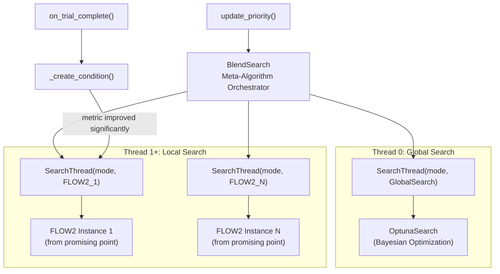
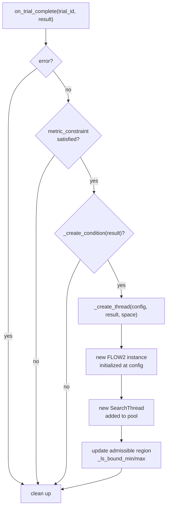
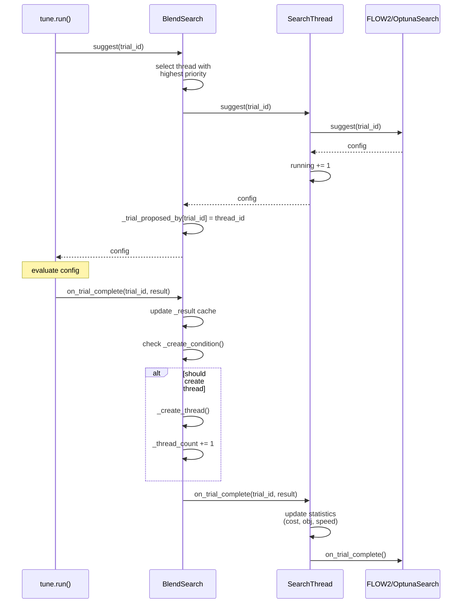
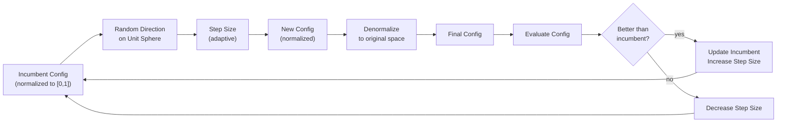
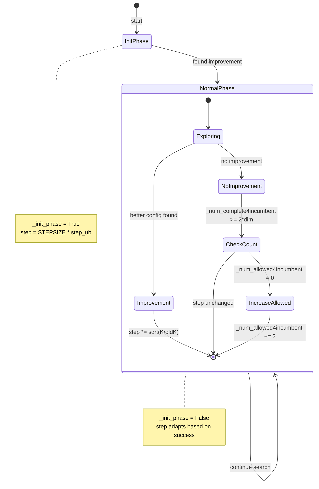
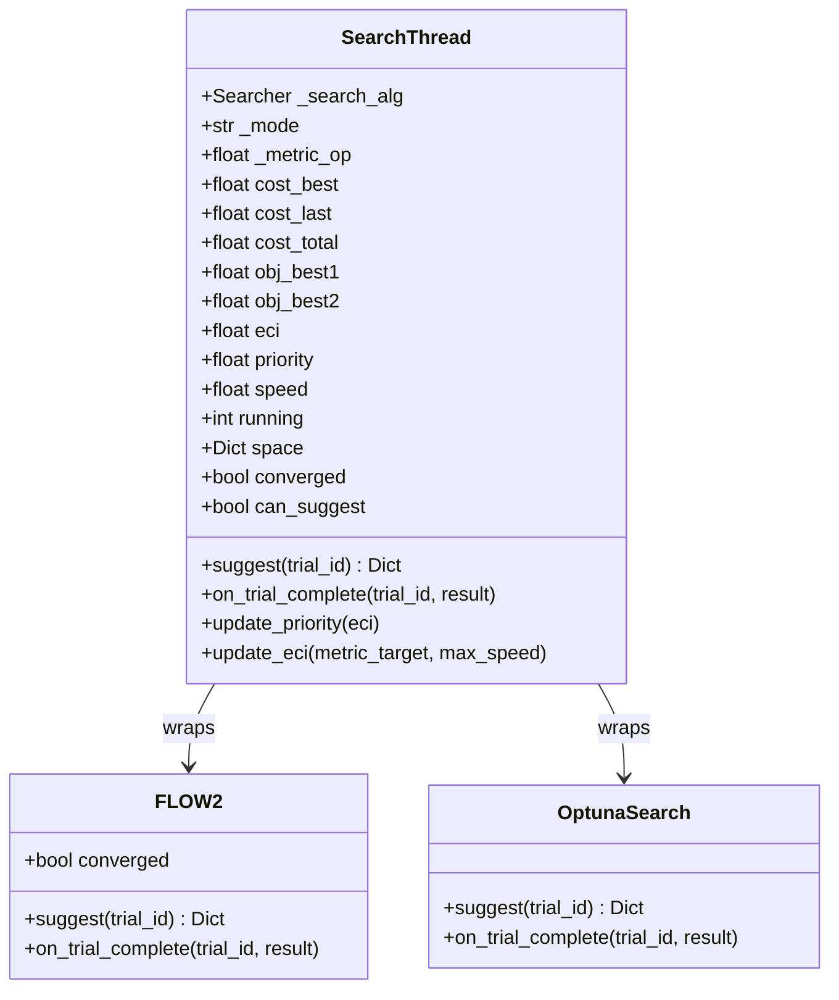
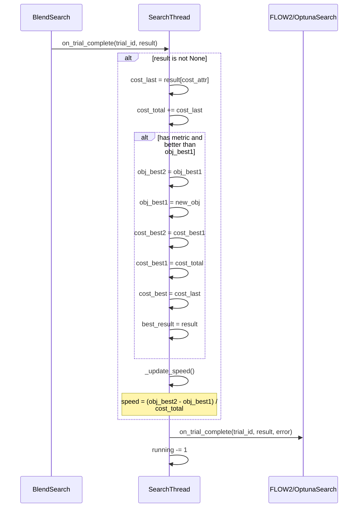
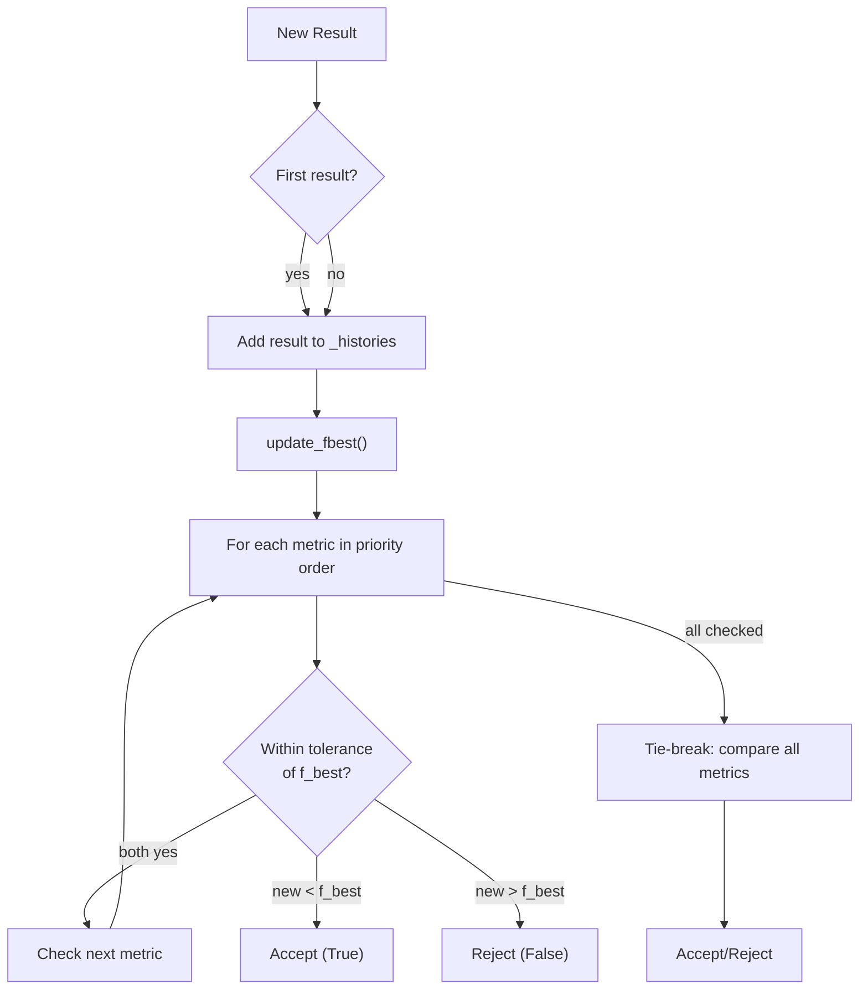

<!-- source: DeepWiki mcp.deepwiki.com · repo microsoft/FLAML · page 4.2 Search Algorithms · fetched 2026-10-26 -->

# Search Algorithms

<details>
<summary>Relevant source files</summary>

The following files were used as context for generating this wiki page:

- [flaml/default/portfolio.py](flaml/default/portfolio.py)
- [flaml/tune/__init__.py](flaml/tune/__init__.py)
- [flaml/tune/result.py](flaml/tune/result.py)
- [flaml/tune/searcher/blendsearch.py](flaml/tune/searcher/blendsearch.py)
- [flaml/tune/searcher/flow2.py](flaml/tune/searcher/flow2.py)
- [flaml/tune/searcher/search_thread.py](flaml/tune/searcher/search_thread.py)
- [flaml/tune/space.py](flaml/tune/space.py)
- [flaml/tune/tune.py](flaml/tune/tune.py)
- [flaml/tune/utils.py](flaml/tune/utils.py)
- [notebook/tune_lexicographic.ipynb](notebook/tune_lexicographic.ipynb)
- [test/tune/test_lexiflow.py](test/tune/test_lexiflow.py)
- [test/tune/test_search_thread.py](test/tune/test_search_thread.py)
- [test/tune/test_searcher.py](test/tune/test_searcher.py)
- [test/tune/test_tune.py](test/tune/test_tune.py)
- [website/docs/Examples/Tune-Lexicographic-objectives.md](website/docs/Examples/Tune-Lexicographic-objectives.md)
- [website/docs/Use-Cases/Tune-User-Defined-Function.md](website/docs/Use-Cases/Tune-User-Defined-Function.md)

</details>


This page documents the search algorithms available in FLAML Tune for hyperparameter optimization. These algorithms determine which configurations to evaluate next during the tuning process. For information about defining search spaces, see [Search Space Definition](#4.3). For constraints and multi-objective optimization features, see [Constraints and Multi-Objective Optimization](#4.4).

## Overview

FLAML Tune provides several search algorithms that can be specified via the `search_alg` parameter in `tune.run()`. The algorithms are designed to be cost-efficient, particularly when evaluation costs vary across the search space (heterogeneous cost scenarios).

**Available Algorithms:**

| Algorithm | Class | Description |
|-----------|-------|-------------|
| BlendSearch | `BlendSearch` | Meta-algorithm combining global (Optuna) and local (FLOW2) search |
| CFO | `CFO` | Cost-Frugal Optimization - BlendSearch without global search |
| RandomSearch | `RandomSearch` | Random sampling baseline |
| External | Via `search_alg` | Optuna, Ray Tune algorithms (ASHA, BOHB, etc.) |

Sources: [flaml/tune/searcher/blendsearch.py:38-43](), [flaml/tune/tune.py:548-593]()

## Algorithm Selection

When `search_alg` is not specified or set to `"BlendSearch"`, FLAML automatically selects the appropriate algorithm:

```python
# Automatic selection
analysis = tune.run(
    evaluation_function,
    config=search_space,
    metric="loss",
    mode="min",
    time_budget_s=60,
    # search_alg defaults to BlendSearch if optuna is installed, CFO otherwise
)
```

Explicit algorithm specification:

```python
from flaml import BlendSearch, CFO

# Using BlendSearch explicitly
search_alg = BlendSearch(
    metric="loss",
    mode="min",
    space=search_space,
    low_cost_partial_config={"n_estimators": 4},
)

analysis = tune.run(
    evaluation_function,
    search_alg=search_alg,
    time_budget_s=60,
)
```

Sources: [flaml/tune/tune.py:538-614](), [website/docs/Use-Cases/Tune-User-Defined-Function.md:413-456]()

## BlendSearch: Hierarchical Meta-Algorithm

BlendSearch is the flagship search algorithm in FLAML, combining global exploration with local exploitation through a hierarchical thread-based architecture.

### Architecture Overview



**BlendSearch Thread Management**

BlendSearch maintains a pool of `SearchThread` instances indexed by thread ID. Thread 0 always runs global search (OptunaSearch by default), while additional threads run local FLOW2 searches spawned dynamically from promising configurations.

Sources: [flaml/tune/searcher/blendsearch.py:38-304](), [flaml/tune/searcher/search_thread.py:53-103]()

### Thread Creation Logic

New local search threads are created when a configuration satisfies the creation condition:



**Creation Condition**

The `_create_condition()` method determines whether to spawn a new local search thread. Key factors:
- Improvement over current best
- Sufficient distance from existing search threads
- Resource budget remaining

Sources: [flaml/tune/searcher/blendsearch.py:452-558](), [flaml/tune/searcher/blendsearch.py:600-672]()

### Configuration Suggestion Flow



Sources: [flaml/tune/searcher/blendsearch.py:673-921](), [flaml/tune/searcher/search_thread.py:85-163]()

### Cost-Aware Configuration Selection

BlendSearch uses cost information to prioritize search threads:

**Priority Calculation:**
```
priority = eci * speed - obj_best1
```

Where:
- `eci` = estimated cost for improvement
- `speed` = (obj_best2 - obj_best1) / cost_total
- `obj_best1` = current best objective

**Algorithm:**
1. Each thread maintains statistics: `obj_best1`, `obj_best2`, `cost_total`, `speed`
2. Threads update their priority based on expected improvement rate
3. BlendSearch selects the thread with highest priority to suggest next config

Sources: [flaml/tune/searcher/search_thread.py:104-126](), [flaml/tune/searcher/blendsearch.py:923-1017]()

## FLOW2: Local Search Algorithm

FLOW2 (Flow-based Optimization, version 2) is the local search algorithm used within BlendSearch. It performs cost-frugal exploration around a promising incumbent configuration.

### Core Concept

FLOW2 maintains an incumbent configuration and explores its neighborhood by:
1. Generating random directions on the unit sphere
2. Moving along those directions with adaptive step size
3. Accepting moves that improve the objective
4. Adjusting step size based on success/failure



Sources: [flaml/tune/searcher/flow2.py:38-246]()

### Initialization and Normalization

FLOW2 operates in a normalized [0,1] space for all dimensions:

**Key Properties:**
- `incumbent`: Current best configuration in normalized space
- `best_config`: Current best configuration in original space
- `step`: Current step size (starts at `STEPSIZE * sqrt(dim)`)
- `step_ub`: Upper bound for step size = `sqrt(dim)`
- `step_lb`: Lower bound based on quantization and domain ranges

**Normalization:**
- Continuous dimensions: linear or log scale mapping to [0,1]
- Integer dimensions: mapped to discrete points in [0,1]
- Categorical dimensions: mapped to indices [0, n-1] then normalized

Sources: [flaml/tune/searcher/flow2.py:146-245](), [flaml/tune/space.py:272-418]()

### Random Direction Generation

```python
# From flow2.py, approximately lines 514-620
# Generate random direction on unit sphere
def complete_config(self, partial_config: Dict) -> Tuple[Dict, Dict]:
    # For each tunable dimension
    for key in self._tunable_keys:
        # Generate random value from unit sphere
        move = self.rand_vector_gaussian(1)[0]
        # Scale by step size and add to incumbent
        value = self.incumbent[key] + move * self.step
        # Project back to [0,1]
        value = max(0.0, min(1.0, value))
        # Store in config
```

**Direction Properties:**
- Generated from Gaussian distribution (mean=0, std=1)
- Normalized to unit length for all dimensions
- Scaled by current `step` size
- Projected back to [0,1] bounds

Sources: [flaml/tune/searcher/flow2.py:261-263](), [flaml/tune/searcher/flow2.py:514-820]()

### Adaptive Step Size

The step size adapts based on search progress:



**Step Size Bounds:**
- Upper bound: `step_ub = sqrt(dim)`
- Lower bound: `step_lb` = function of quantization requirements and domain ranges
- Initial step: `STEPSIZE * step_ub` where `STEPSIZE = 0.1`

**Adaptation Rules:**
- On improvement: `step *= sqrt(K / oldK)` where `K` tracks iteration count
- On repeated failures: gradually reduce step
- Minimum step: `STEP_LOWER_BOUND = 0.0001`

Sources: [flaml/tune/searcher/flow2.py:41-42](), [flaml/tune/searcher/flow2.py:196-245](), [flaml/tune/searcher/flow2.py:412-473]()

### Convergence Criteria

FLOW2 is considered converged when:
1. Step size falls below the lower bound: `step < step_lower_bound`
2. For resource-aware search: reached maximum resource

```python
@property
def converged(self) -> bool:
    return self._search_alg.converged
```

Sources: [flaml/tune/searcher/flow2.py:821-831](), [flaml/tune/searcher/search_thread.py:181-183]()

## CFO: Cost-Frugal Optimization

CFO is a simplified version of BlendSearch that uses only local FLOW2 search without the global search component.

### Differences from BlendSearch

| Aspect | BlendSearch | CFO |
|--------|-------------|-----|
| Global Search | OptunaSearch (Thread 0) | None |
| Local Search | FLOW2 (Thread 1+) | FLOW2 only |
| Thread Creation | Dynamic based on conditions | Starts immediately with init_config |
| Use Case | General HPO with exploration | Fast, cost-efficient local search |

**When to Use CFO:**
- Search space has known good starting points (via `low_cost_partial_config` or `points_to_evaluate`)
- Primarily interested in local refinement
- Want faster convergence with less exploration
- Working with lexicographic objectives (currently only CFO supports this)

Sources: [flaml/tune/searcher/blendsearch.py:38-304](), [test/tune/test_tune.py:240-250]()

### CFO Instantiation

```python
from flaml import CFO, tune

search_alg = CFO(
    space=search_space,
    metric="loss",
    mode="min",
    low_cost_partial_config={"n_estimators": 4, "max_leaves": 4},
    points_to_evaluate=[{"n_estimators": 10, "max_leaves": 10}],
)

analysis = tune.run(
    evaluation_function,
    search_alg=search_alg,
    num_samples=100,
)
```

Sources: [test/tune/test_tune.py:171-192](), [flaml/tune/tune.py:570-576]()

## SearchThread: Thread Management

`SearchThread` wraps individual search algorithm instances (FLOW2 or OptunaSearch) and maintains statistics for thread prioritization.

### SearchThread Properties



**Statistics Tracked:**
- `cost_best`, `cost_best1`, `cost_best2`: Costs at best points
- `obj_best1`, `obj_best2`: Best and second-best objectives
- `cost_total`, `cost_last`: Cumulative and most recent costs
- `speed`: Rate of improvement = (obj_best2 - obj_best1) / cost_total
- `eci`: Estimated cost for improvement
- `priority`: Thread priority = eci * speed - obj_best1
- `running`: Number of currently running trials from this thread

Sources: [flaml/tune/searcher/search_thread.py:53-163]()

### Thread Statistics Update



Sources: [flaml/tune/searcher/search_thread.py:127-163]()

### Nested Dictionary Handling

For hierarchical search spaces (e.g., XGBoost with nested `params` dict), SearchThread uses recursive dictionary updates:

```python
def _recursive_dict_update(target: Dict, source: Dict) -> None:
    """Recursively merge source into target, preserving nested structures."""
    for key, value in source.items():
        if isinstance(value, dict) and key in target and isinstance(target[key], dict):
            _recursive_dict_update(target[key], value)
        else:
            target[key] = value
```

This ensures that constant configuration values (from `_const`) are properly merged with sampled values without overwriting entire nested dictionaries.

Sources: [flaml/tune/searcher/search_thread.py:28-51](), [test/tune/test_search_thread.py:24-63]()

## RandomSearch

`RandomSearch` is a baseline algorithm that samples configurations randomly from the search space.

**Implementation:**
- Evaluates `points_to_evaluate` first (if provided)
- Then samples randomly using the space definition
- No adaptation or learning from previous results
- Useful as a baseline for comparison

```python
from flaml.tune.searcher.blendsearch import RandomSearch

search_alg = RandomSearch(
    space=search_space,
    points_to_evaluate=[{"x": 1, "y": 2}],
)
```

Sources: [flaml/tune/searcher/blendsearch.py:1399-1479](), [test/tune/test_searcher.py:289-308]()

## Lexicographic Multi-Objective Optimization

CFO and FLOW2 support lexicographic preferences across multiple objectives, where objectives are prioritized in order with tolerance levels.

### Lexicographic Objective Specification

```python
lexico_objectives = {
    "metrics": ["error_rate", "flops"],  # Priority order
    "modes": ["min", "min"],  # Optimization direction per metric
    "tolerances": {"error_rate": 0.02, "flops": 0.0},  # Absolute tolerance
    "targets": {"error_rate": 0.0, "flops": 0.0},  # Target values
}

analysis = tune.run(
    evaluation_function,
    config=search_space,
    lexico_objectives=lexico_objectives,
    num_samples=100,
)
```

**Tolerance Types:**
- Absolute: `{"error_rate": 0.02}` means ±0.02 tolerance
- Percentage: `{"error_rate": "5%"}` means ±5% tolerance

Sources: [flaml/tune/tune.py:428-458](), [website/docs/Examples/Tune-Lexicographic-objectives.md:145-168]()

### Lexicographic Comparison Logic



**Algorithm (from `lexico_compare()`):**

1. Add new result to history
2. Update `f_best` for each metric (feasible minimum within tolerance)
3. For each metric in priority order:
   - If both new and current within tolerance bound: continue to next metric
   - If new result better: accept
   - If new result worse: reject
4. If all metrics checked, use exact comparison as tie-breaker

Sources: [flaml/tune/searcher/flow2.py:339-411](), [test/tune/test_lexiflow.py:58-199]()

### Feasible Region Updates

```python
def update_fbest(self):
    """Update f_best values for each objective within feasible region."""
    obj_initial = self.lexico_objectives["metrics"][0]
    feasible_index = np.array([*range(len(self._histories[obj_initial]))])
    
    for k_metric, k_mode in zip(metrics, modes):
        k_values = np.array(self._histories[k_metric])
        feasible_value = k_values.take(feasible_index)
        self._f_best[k_metric] = np.min(feasible_value)
        
        # Calculate tolerance bound
        tolerance_bound = f_best + tolerance  # or f_best * (1 + tolerance%)
        
        # Filter to points within tolerance and target
        feasible_index_filter = np.where(
            feasible_value <= max(tolerance_bound, target)
        )[0]
        feasible_index = feasible_index.take(feasible_index_filter)
```

This progressively narrows the feasible region as metrics are considered in priority order.

Sources: [flaml/tune/searcher/flow2.py:339-365]()

## Integration with External Search Algorithms

FLAML Tune can use external search algorithms from Ray Tune or other libraries:

**Supported External Algorithms:**
- OptunaSearch (default for global search in BlendSearch)
- SkOptSearch
- HyperOptSearch
- AxSearch
- NevergradSearch
- DragonflySearch
- ZOOptSearch

**Usage:**

```python
from ray.tune.search.optuna import OptunaSearch

search_alg = OptunaSearch(
    space=search_space,
    metric="loss",
    mode="min",
)

analysis = tune.run(
    evaluation_function,
    search_alg=search_alg,
    use_ray=True,  # Required for Ray Tune algorithms
    num_samples=100,
)
```

Sources: [test/tune/test_tune.py:159-235](), [flaml/tune/searcher/suggestion.py]()

## Best Practices

**Choosing a Search Algorithm:**

1. **Use BlendSearch when:**
   - You want both exploration and exploitation
   - Search space is large and unfamiliar
   - Optuna is installed (`pip install flaml[blendsearch]`)

2. **Use CFO when:**
   - You have good starting points (low_cost_partial_config)
   - Primarily need local refinement
   - Using lexicographic objectives
   - Want faster convergence

3. **Specify low_cost_partial_config:**
   - Provides a good starting point for local search
   - Particularly important for cost-related hyperparameters
   - Example: `{"n_estimators": 4, "max_leaves": 4}` for tree models

4. **Use cat_hp_cost for categorical choices:**
   - Inform the algorithm about relative costs of categorical choices
   - Example: `{"tree_method": [1, 1, 2]}` if "hist" is 2x slower

5. **For multi-objective optimization:**
   - Use lexicographic objectives if you have clear priority ordering
   - Set appropriate tolerances to allow trade-offs
   - Use percentage tolerances for scale-invariant comparisons

Sources: [flaml/tune/searcher/blendsearch.py:44-150](), [website/docs/Use-Cases/Tune-User-Defined-Function.md:340-350]()

---

